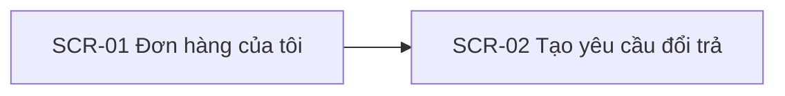
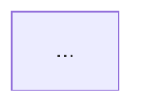

# ui-spec — từ Screen Inventory tới bản vẽ chi tiết

## Input
- `outputs/<du-an>/SRS.md` mục 3 (FR), 6 (Screen Inventory), 7 (User flow).
- `.claude/skills/wireframe/design-kit/patterns.md` và tên component trong `components-storefront.html` / `components-backend.html` (để mô tả bố cục bằng đúng component sẽ dùng).

## Cách làm

1. Đọc bảng 6.1 và các heading 6.2 của SRS để lấy: mã SCR, tên, slug (từ đường dẫn ảnh), loại, trường, hành động, trạng thái, FR.
2. **Sitemap**: một Mermaid `flowchart` cho storefront, một cho backend (bỏ phần không có). Node = SCR, cạnh = điều hướng.
3. **User flow**: một Mermaid cho mỗi luồng chính/ngoại lệ trong SRS mục 7, chi tiết ở mức thao tác (bấm nút nào → sang màn nào → trạng thái nào).
4. **Danh sách màn hình cần vẽ**: mỗi SCR một mục theo mẫu bên dưới. Mô tả bố cục **từ trên xuống dưới, trái sang phải**, mỗi vùng ghi component trong kit (`sf-header`, `be-controlpanel`, `wf-table`…).
5. Kiểm tra chéo: mọi trường và hành động trong Screen Inventory xuất hiện trong mô tả bố cục; mọi trạng thái được liệt kê. Thiếu trong SRS mà màn cần (vd. nút "Quay lại", phân trang) → thêm vào mô tả, đồng thời **cập nhật lại Screen Inventory trong SRS.md** cho khớp.
6. Mơ hồ (vd. không rõ có cần bộ lọc theo ngày không) → chọn phương án theo `patterns.md`, ghi `AS-xx`/`OQ-xx` mới vào mục 9 SRS.

## Output: `outputs/<du-an>/ui/flows.md`

````markdown
# UI spec — <Tên dự án>

## 1. Sitemap
### 1.1 Storefront

### 1.2 Backend


## 2. User flows
### 2.1 <Tên luồng> (FR-01, FR-02)


## 3. Danh sách màn hình cần vẽ
| SCR | Slug | Loại | Khung | Trạng thái cần vẽ | FR |
|---|---|---|---|---|---|
| SCR-01 | don-hang-cua-toi | storefront | 1440 + 390 | Mặc định, Rỗng | FR-01 |

### SCR-01 — <Tên>
- **File:** `ui/screens/SCR-01-<slug>.html`
- **Mục đích:** …
- **Bố cục (desktop 1440):**
  1. `sf-header` + `sf-nav`
  2. `wf-breadcrumb`: Trang chủ › Tài khoản › …
  3. Hai cột: trái `sf-account-nav`; phải `wf-h1` + `wf-table` các cột: …
  4. …
- **Mobile 390 (storefront):** nav thu thành `sf-burger`; bảng chuyển thành danh sách thẻ `wf-card`…
- **Trường:** …
- **Hành động:** nút chính `wf-btn--primary` "…"; phụ …
- **Trạng thái:**
  - Mặc định: …
  - Rỗng: `wf-empty` "Bạn chưa có …" + CTA …
  - Lỗi: `wf-alert--error` "…"
- **Ghi chú:** chú thích ① ② cho điểm nghiệp vụ cần giải thích (`wf-anno`).
````

## Quy tắc
- Khung: backend 1440; storefront 1440 + mobile 390 (mobile do responsive CSS của kit, không vẽ file riêng).
- Mỗi màn vẽ trạng thái chính + mọi trạng thái Lỗi/Rỗng/Loading/Thành công mà SRS nêu. Trạng thái nghiệp vụ (Chờ duyệt, Đã duyệt…) của form backend vẽ thành các state riêng nếu bố cục khác nhau (nút hành động khác nhau).
- Nhãn tiếng Việt, khớp thuật ngữ SRS.
