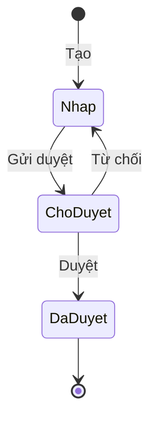

# SRS — {{Tên dự án}}

| Thuộc tính | Giá trị |
|---|---|
| Mã dự án | {{du-an}} |
| Phiên bản | 0.1 (bản nháp tự động) |
| Ngày | {{YYYY-MM-DD}} |
| Tài liệu liên quan | URD.md, brainstorm.md, Diagram/Wireframe/flows.md |
| Trạng thái | Chờ review |

**Lịch sử phiên bản**

| Phiên bản | Ngày | Thay đổi | Nguồn | Ảnh hưởng |
|---|---|---|---|---|
| 0.1 | {{YYYY-MM-DD}} | Bản đầu tiên | {{các file trong projects/<du-an>/Document/Bien_Ban_Khao_Sat/}} | Toàn bộ |

## 1. Giới thiệu

### 1.1 Mục đích
{{Tài liệu đặc tả yêu cầu phần mềm cho … dành cho đội phát triển, QA và khách hàng.}}

### 1.2 Phạm vi
- **Trong phạm vi:** {{…}}
- **Ngoài phạm vi:** {{…}}

### 1.3 Thuật ngữ
| Thuật ngữ | Giải thích |
|---|---|
| {{RMA}} | {{Return Merchandise Authorization — yêu cầu đổi/trả hàng}} |

## 2. Mô tả tổng quan

### 2.1 Bối cảnh hệ thống
{{Mô tả các hệ thống tham gia và vai trò của từng hệ thống.}}


### 2.2 Vai trò người dùng
| Vai trò | Hệ thống | Quyền chính |
|---|---|---|
| {{…}} | {{Storefront / Backend}} | {{…}} |

**Ma trận phân quyền** (đối tượng × vai trò; ô ghi quyền: Tạo / Xem / Sửa / Duyệt / Xoá; `Của mình` / `Nhóm mình` khi giới hạn theo người / nhóm; `—` không có quyền). Nguồn cho nhóm quyền và record rule.

| Đối tượng / thao tác | {{Vai trò 1}} | {{Vai trò 2}} | {{Quản trị}} |
|---|---|---|---|
| {{Yêu cầu mua hàng}} | {{Tạo, Xem/Sửa của mình}} | {{Xem nhóm mình, Duyệt}} | {{Xem tất cả}} |

### 2.3 Giả định, phụ thuộc & ràng buộc
- **Giả định:** xem mục 9 (AS-xx).
- **Phụ thuộc:** {{module/version/dịch vụ bên ngoài}}
- **Ràng buộc:** {{phiên bản & edition nền tảng (vd. Odoo 17 Enterprise), hosting, trình duyệt, quy định pháp lý / chuẩn kế toán bắt buộc}}

## 3. Yêu cầu chức năng

### 3.0 Mô hình trạng thái
{{Mỗi chứng từ chính có ≥ 3 trạng thái (phiếu yêu cầu, đơn hàng, đề nghị thanh toán…): 1 sơ đồ + 1 bảng chuyển trạng thái. Không có chứng từ nhiều trạng thái → bỏ mục này.}}



| Trạng thái nguồn | Sự kiện | Điều kiện (guard) | Trạng thái đích | Ai thực hiện | Tác động kèm theo | FR |
|---|---|---|---|---|---|---|
| {{Nháp}} | {{Gửi duyệt}} | {{Có ≥ 1 dòng}} | {{Chờ duyệt}} | {{Người đề xuất}} | {{Tạo activity cho Trưởng nhóm}} | {{FR-01}} |

### 3.1 {{Phân hệ — mỗi phân hệ một file Document/SRS/srs/03-NN-<phan-he>.md}}

#### FR-01 — {{Tên chức năng}}
- **Mô tả:** {{…}}
- **Vai trò:** {{…}}
- **Truy vết:** {{US-01, US-02}} · Màn hình: {{SCR-01 | Không có UI}}
- **Input:** {{trường + kiểu + bắt buộc}}
- **Output:** {{kết quả / dữ liệu sinh ra / thông báo}}
- **Business rules:**
  - BR-01.1: {{Quy tắc luôn đúng — câu khẳng định, có số / điều kiện cụ thể}}
  - BR-01.2: KHI {{điều kiện}} THÌ {{hệ thống làm / chặn gì}}{{ TRỪ KHI <ngoại lệ>}}.
- **Acceptance criteria:**
  1. **Given** {{…}} **When** {{…}} **Then** {{… — tình huống thành công}}.
  2. **Given** {{dữ liệu vi phạm BR-01.1}} **When** {{…}} **Then** hiện lỗi "{{thông báo nguyên văn}}" và {{trạng thái giữ nguyên}}.
  3. **Given** {{giá trị biên: đúng ngưỡng / vượt ngưỡng 1 đơn vị}} **When** {{…}} **Then** {{…}}.
- **Độ ưu tiên:** {{Must | Should | Could}}

#### FR-02 — {{…}}
…

## 4. Yêu cầu phi chức năng

### NFR-01 — {{Hiệu năng}}
- **Yêu cầu:** {{Trang … tải < 2 giây ở p95 với … người dùng đồng thời.}}
- **Cách kiểm chứng:** {{…}}

## 5. Tích hợp & dữ liệu

### 5.1 Hệ thống ngoài
| Hệ thống | Mục đích | Giao thức | Chiều | Tần suất | Xử lý lỗi |
|---|---|---|---|---|---|
| {{Odoo}} | {{…}} | {{REST / XML-RPC / queue}} | {{M2 → Odoo}} | {{Realtime / 5 phút}} | {{Retry 3 lần, log, cảnh báo}} |

### 5.2 API
| API | Method | Endpoint | Request chính | Response chính |
|---|---|---|---|---|
| {{…}} | {{POST}} | {{/rest/V1/…}} | {{…}} | {{…}} |

### 5.3 Mapping trường dữ liệu
| Magento 2 | Odoo | Kiểu | Ghi chú |
|---|---|---|---|
| {{order.increment_id}} | {{sale.order.name}} | {{string}} | {{…}} |

### 5.4 Từ điển dữ liệu (model / trường mới)
{{Chỉ liệt kê model và trường THÊM MỚI hoặc ĐỔI so với chuẩn. Không có → ghi "Dùng model chuẩn, không thêm trường".}}

| Model | Trường (nhãn) | Tên kỹ thuật | Kiểu | Bắt buộc | Mặc định / ràng buộc | Ý nghĩa | FR |
|---|---|---|---|---|---|---|---|
| {{purchase.request}} | {{Ngày cần hàng}} | {{date_required}} | {{Date}} | {{Không}} | {{≥ hôm nay}} | {{…}} | {{FR-01}} |

## 6. Screen Inventory

### 6.1 Danh sách màn hình
| SCR | Tên | Vai trò | Trường dữ liệu | Hành động | Trạng thái | FR | Loại |
|---|---|---|---|---|---|---|---|
| SCR-01 | {{…}} | {{…}} | {{trường1, trường2}} | {{Gửi, Huỷ}} | {{Rỗng / Lỗi / Loading / Thành công}} | {{FR-01, FR-02}} | {{storefront | backend}} |

### 6.2 Wireframe

#### SCR-01 — {{Tên màn hình}}
{{Mô tả 1–2 câu: mục đích, điểm chính.}}


## 7. User flow

{{Luồng chính và luồng ngoại lệ. Mỗi flow một khối Mermaid.}}

```mermaid
flowchart TD
  A[{{…}}] --> B{{{Điều kiện?}}}
  B -- Có --> C[{{…}}]
  B -- Không --> D[{{…}}]
```

## 8. Ma trận truy vết

> Không viết tay — `build_srs.py` sinh: 8.1 FR ↔ US ↔ SCR (từ dòng "Truy vết"), 8.2 Danh mục thông báo (từ các `hiện lỗi "…"` trong AC).

## 9. Assumptions & Open Questions

### 9.1 Giả định
| Mã | Giả định | Lý do chọn | Liên quan |
|---|---|---|---|
| AS-01 | {{…}} | {{…}} | {{FR-xx}} |

### 9.2 Câu hỏi mở
| Mã | Câu hỏi | Người cần trả lời | Ảnh hưởng tới |
|---|---|---|---|
| OQ-01 | {{…}} | {{…}} | {{FR-xx, SCR-xx}} |
