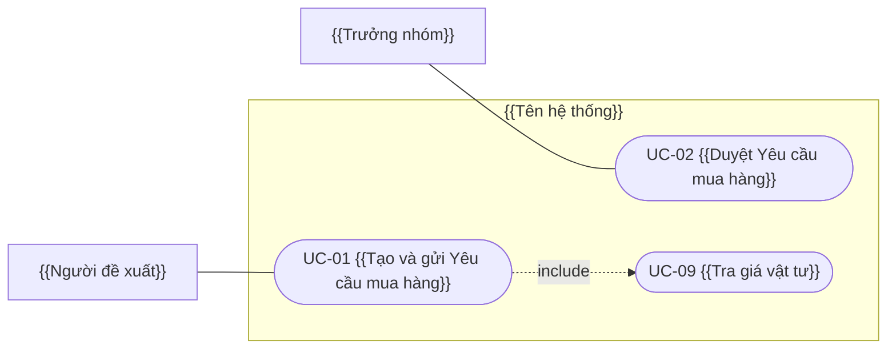

# Use Case — {{Tên dự án}}

| Thuộc tính | Giá trị |
|---|---|
| Mã dự án | {{du-an}} |
| Phiên bản | {{0.1 — cùng phiên bản SRS}} |
| Ngày | {{YYYY-MM-DD}} |
| Nguồn | {{projects/<du-an>/Document/URD/URD.md v…; projects/<du-an>/Document/Bien_Ban_Khao_Sat/…}} |
| Trạng thái | Chờ khách hàng review |

## 1. Tác nhân

| Tác nhân | Loại | Mô tả | Use case (chính) |
|---|---|---|---|
| {{Người đề xuất}} | Người | {{Nhân viên các phòng ban có nhu cầu mua}} | {{UC-01, UC-02}} |
| {{Máy chủ email}} | Hệ thống ngoài | {{Gửi / nhận email với nhà cung cấp}} | {{UC-05}} |
| {{Thời gian}} | Thời gian | {{Tác vụ định kỳ hằng ngày}} | {{UC-12}} |

## 2. Sơ đồ use case

## 3. Danh sách use case

| UC | Tên | Tác nhân chính | Mức | Ưu tiên | User story |
|---|---|---|---|---|---|
| UC-01 | {{…}} | {{…}} | Mục tiêu người dùng | Must | {{US-01, US-19}} |

## 4. Đặc tả use case

### 4.1 {{Phân hệ}}

#### UC-01 — {{Động từ + danh từ}}
- **Tác nhân chính:** {{…}}
- **Tác nhân phụ:** {{… | Không có}}
- **Mức:** {{Mục tiêu người dùng | Tóm tắt | Chức năng con}}
- **Mô tả:** {{1–2 câu: tác nhân muốn đạt gì}}
- **Kích hoạt:** {{sự kiện bắt đầu}}
- **Tiền điều kiện:** {{điều đã đúng trước khi bắt đầu}}
- **Đảm bảo khi thành công:** {{trạng thái dữ liệu sau khi xong — đo được}}
- **Đảm bảo tối thiểu:** {{điều luôn giữ khi thất bại}}
- **Quy tắc nghiệp vụ:** {{AS-xx, quy tắc từ URD}}
- **Quan hệ:** {{include UC-09 tại bước 3 | extend UC-02 tại điểm mở rộng "…" | Không có}}
- **Truy vết:** {{US-01, US-19}}
- **Tần suất:** {{vài lần/ngày}}
- **Độ ưu tiên:** {{Must | Should | Could}}
- **Kịch bản chính:**
  1. {{Tác nhân …}}
  2. {{Hệ thống …}}
  3. {{…}}
- **Luồng thay thế / ngoại lệ:**
  - **3a. {{Điều kiện đã xảy ra}}:**
    - 3a1. {{Hệ thống …}}
    - 3a2. {{Quay lại bước 3 | Use case kết thúc thất bại}}
  - **\*a. {{Tác nhân huỷ ở bất kỳ bước nào}}:**
    - \*a1. {{…}}

## 5. Ma trận truy vết

<!-- uc-matrix:start -->
> Sinh tự động bởi `check_uc.py --write-matrix`.
<!-- uc-matrix:end -->

## 6. Assumptions & Open Questions (phát sinh khi viết use case)

### 6.1 Giả định
| Mã | Giả định | Lý do chọn | Liên quan |
|---|---|---|---|
| {{AS-xx}} | {{…}} | {{…}} | {{UC-xx}} |

### 6.2 Câu hỏi mở
| Mã | Câu hỏi | Người cần trả lời | Liên quan |
|---|---|---|---|
| {{OQ-xx}} | {{…}} | {{…}} | {{UC-xx}} |
