# SRS — Đổi trả hàng online (Magento 2 + Odoo 17)

| Thuộc tính | Giá trị |
|---|---|
| Mã dự án | _example |
| Phiên bản | 0.1 (bản nháp tự động) |
| Ngày | 2026-10-20 |
| Tài liệu liên quan | URD.md, brainstorm.md, ui/flows.md |
| Trạng thái | Chờ review |

## 1. Giới thiệu

### 1.1 Mục đích
Tài liệu đặc tả yêu cầu phần mềm cho tính năng đổi trả hàng online (RMA) của Mộc An Fashion (dữ liệu giả lập), dành cho đội phát triển Magento/Odoo, QA và khách hàng review.

### 1.2 Phạm vi
- **Trong phạm vi:** module RMA trên Magento 2.4.6 (storefront: tạo, theo dõi, huỷ yêu cầu) và Odoo 17 (duyệt/từ chối, nhận hàng, credit note, đơn đổi, cảnh báo, báo cáo, cấu hình); đồng bộ hai chiều qua connector hiện có.
- **Ngoài phạm vi:** tích hợp API GHN, hoàn tiền tự động qua cổng thanh toán, ứng dụng mobile, đổi sang sản phẩm khác.

### 1.3 Thuật ngữ
| Thuật ngữ | Giải thích |
|---|---|
| RMA | Return Merchandise Authorization — yêu cầu đổi/trả hàng, mã `RMA-xxxxxx` |
| M2 | Magento 2.4.6 — website bán hàng |
| Odoo | Odoo 17 — hệ thống vận hành (Sales, Inventory, Accounting) |
| Connector | Module đồng bộ M2 ↔ Odoo hiện có |
| Credit note | Hoá đơn điều chỉnh giảm (hoàn tiền) trong Odoo Accounting |
| COD | Thanh toán khi nhận hàng |
| VIP | Customer group "VIP" trên M2 |
| WH/Returns, WH/Stock, WH/Damaged | Location kho: hàng trả chờ kiểm tra / kho bán / hàng lỗi |
| Chatter | Khu vực lịch sử, tin nhắn, ghi chú trên form Odoo |

## 2. Mô tả tổng quan

### 2.1 Bối cảnh hệ thống
Khách tạo yêu cầu trên M2. M2 lưu bản sao yêu cầu và đẩy sang Odoo qua queue của connector. Odoo là **source of truth** của trạng thái yêu cầu, kho và kế toán; mọi thay đổi trạng thái được đẩy ngược về M2 để hiển thị cho khách và gửi email.

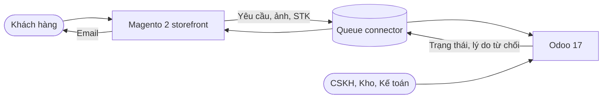

### 2.2 Vai trò người dùng
| Vai trò | Hệ thống | Quyền chính |
|---|---|---|
| Khách hàng / Khách VIP | Storefront | Tạo, xem, huỷ yêu cầu của chính mình |
| Nhân viên CSKH | Backend (nhóm "RMA / Nhân viên") | Xem mọi yêu cầu, duyệt, từ chối |
| Trưởng CSKH | Backend (nhóm "RMA / Quản lý") | Quyền CSKH + nhận cảnh báo, báo cáo, cấu hình |
| Nhân viên kho | Backend (nhóm "Inventory / User") | Nhận hàng, kiểm tra, chuyển location |
| Kế toán | Backend (nhóm "Accounting / Billing") | Xác nhận credit note, xem STK đầy đủ |

### 2.3 Giả định & phụ thuộc
- **Giả định:** xem mục 9 (AS-01 → AS-11).
- **Phụ thuộc:** connector M2 ↔ Odoo hiện có (hỗ trợ thêm đối tượng RMA); SMTP của M2; customer group "VIP" có sẵn; location WH/Returns và WH/Damaged được tạo khi triển khai.

## 3. Yêu cầu chức năng

Mô hình trạng thái yêu cầu: **Mới** (đã tạo trên M2, chưa đồng bộ) → **Chờ duyệt** → **Đã duyệt** → **Đã nhận hàng** → **Hoàn tất**; nhánh **Từ chối** (từ Chờ duyệt), **Đã huỷ** (từ Mới/Chờ duyệt).

### FR-01 — Kiểm tra điều kiện đổi trả của đơn hàng
- **Mô tả:** Hệ thống xác định đơn hàng và từng dòng sản phẩm có được tạo yêu cầu đổi trả hay không.
- **Vai trò:** Khách hàng, Khách VIP
- **Truy vết:** US-01, US-08 · Màn hình: SCR-01, SCR-02
- **Input:** đơn hàng (trạng thái, ngày giao, customer group), dòng đơn (SL mua, giá gốc, giá bán), các yêu cầu đã có của đơn.
- **Output:** cờ `can_return` cho đơn; với mỗi dòng: SL còn được yêu cầu, loại cho phép (Trả hàng / Đổi size).
- **Business rules:**
  - BR-01.1: Đơn phải ở trạng thái "Complete" (đã giao) (AS-04).
  - BR-01.2: Hạn = ngày giao + 7 ngày; customer group VIP: + 15 ngày. Giá trị lấy từ cấu hình (FR-17).
  - BR-01.3: SL còn được yêu cầu = SL mua − tổng SL của các yêu cầu không ở trạng thái Từ chối/Đã huỷ.
  - BR-01.4: Dòng có (giá gốc − giá bán) / giá gốc > 50% chỉ cho phép "Đổi size" (AS-08).
  - BR-01.5: Chỉ khách đã đăng nhập và là chủ đơn mới tạo được yêu cầu (AS-02).
- **Acceptance criteria:**
  1. **Given** đơn giao ngày 10/10/2026, khách thường **When** hôm nay là 17/10/2026 **Then** đơn có nút "Yêu cầu đổi trả"; ngày 18/10/2026 thì không có nút và hiện "Đã hết hạn đổi trả".
  2. **Given** khách VIP, đơn giao 10/10/2026 **When** hôm nay là 25/10/2026 **Then** đơn vẫn có nút; ngày 26/10/2026 thì không.
  3. **Given** đơn chưa ở trạng thái Complete **When** xem danh sách **Then** không có nút và không có ghi chú hết hạn.
  4. **Given** mọi dòng có SL còn được yêu cầu = 0 **When** xem danh sách **Then** không có nút và hiện "Đã yêu cầu đổi trả toàn bộ".
- **Độ ưu tiên:** Must

### FR-02 — Tạo yêu cầu đổi trả trên website
- **Mô tả:** Khách chọn sản phẩm, số lượng, loại yêu cầu, lý do, mô tả, ảnh và gửi yêu cầu.
- **Vai trò:** Khách hàng
- **Truy vết:** US-02 · Màn hình: SCR-02
- **Input:** loại yêu cầu (Trả hàng / Đổi size — bắt buộc, một loại cho cả yêu cầu, AS-09); danh sách dòng chọn (SL ≥ 1 ≤ SL còn lại; size mới nếu Đổi size); lý do (bắt buộc, từ danh sách cấu hình); mô tả (tuỳ chọn, ≤ 500 ký tự); ảnh (0–5 ảnh JPG/PNG, mỗi ảnh ≤ 5MB).
- **Output:** yêu cầu mã `RMA-` + 6 chữ số tăng dần, trạng thái Mới; trang xác nhận hiển thị mã; yêu cầu được đưa vào queue đồng bộ (FR-05).
- **Business rules:**
  - BR-02.1: Phải chọn ít nhất 1 dòng.
  - BR-02.2: Đổi size: size mới phải khác size cũ và còn tồn kho > 0 tại thời điểm gửi (OQ-06).
  - BR-02.3: Kiểm tra lại toàn bộ FR-01 ở phía server khi gửi (không tin dữ liệu form).
  - BR-02.4: Chống gửi trùng: nút "Gửi yêu cầu" bị vô hiệu hoá sau lần bấm đầu tiên đến khi có phản hồi.
- **Acceptance criteria:**
  1. **Given** đơn đủ điều kiện **When** khách chọn 1 dòng SL 1, loại Trả hàng, lý do "Không vừa size" và bấm "Gửi yêu cầu" **Then** hệ thống tạo `RMA-000123` trạng thái Mới và hiển thị trang thành công có mã yêu cầu.
  2. **Given** dòng còn 1 sản phẩm được yêu cầu **When** khách nhập SL 2 **Then** hiện lỗi "Số lượng tối đa có thể đổi trả là 1" dưới trường SL và không gửi.
  3. **Given** khách không chọn dòng nào **When** bấm "Gửi yêu cầu" **Then** hiện lỗi "Vui lòng chọn ít nhất 1 sản phẩm".
  4. **Given** loại Đổi size **When** khách mở danh sách size mới **Then** chỉ hiện size còn hàng, khác size đã mua.
- **Độ ưu tiên:** Must

### FR-03 — Quy tắc lý do, ảnh đính kèm và phí vận chuyển
- **Mô tả:** Áp dụng quy tắc theo lý do đổi trả trên form tạo yêu cầu.
- **Vai trò:** Khách hàng
- **Truy vết:** US-02, US-03 · Màn hình: SCR-02
- **Input:** lý do, ảnh.
- **Output:** thông báo, chặn gửi khi vi phạm.
- **Business rules:**
  - BR-03.1: Lý do mặc định: Sản phẩm lỗi, Giao sai sản phẩm, Không vừa size, Không giống mô tả, Đổi ý (cấu hình được — FR-17).
  - BR-03.2: Lý do "Sản phẩm lỗi", "Giao sai sản phẩm": bắt buộc ≥ 1 ảnh.
  - BR-03.3: Lý do "Đổi ý": hiện cảnh báo "Bạn chịu phí vận chuyển gửi trả". Lý do khác: hiện "Phí gửi trả được hoàn theo biên nhận, tối đa 50.000₫" (AS-06).
- **Acceptance criteria:**
  1. **Given** lý do "Sản phẩm lỗi", không có ảnh **When** bấm "Gửi yêu cầu" **Then** hiện lỗi "Vui lòng đính kèm ít nhất 1 ảnh" tại vùng tải ảnh.
  2. **Given** đã có 5 ảnh **When** khách thêm ảnh thứ 6 **Then** ảnh bị bỏ qua và hiện "Tối đa 5 ảnh".
  3. **Given** ảnh 6MB **When** tải lên **Then** hiện "Ảnh vượt quá 5MB".
  4. **Given** lý do "Đổi ý" **When** chọn lý do **Then** hiện cảnh báo phí vận chuyển ngay dưới trường lý do.
- **Độ ưu tiên:** Must

### FR-04 — Thông tin nhận hoàn tiền cho đơn COD
- **Mô tả:** Thu thập tài khoản ngân hàng nhận tiền hoàn cho đơn COD loại Trả hàng.
- **Vai trò:** Khách hàng
- **Truy vết:** US-04 · Màn hình: SCR-02
- **Input:** ngân hàng (danh sách), số tài khoản (6–19 chữ số), chủ tài khoản (chữ in hoa không dấu).
- **Output:** thông tin lưu mã hoá, đồng bộ sang Odoo (NFR-05).
- **Business rules:**
  - BR-04.1: Chỉ hiện và bắt buộc khi phương thức thanh toán đơn = COD và loại = Trả hàng (AS-07, OQ-05).
  - BR-04.2: Đơn thẻ/VNPay: hiện ghi chú "Tiền sẽ hoàn về phương thức thanh toán ban đầu" (AS-05).
- **Acceptance criteria:**
  1. **Given** đơn COD, loại Trả hàng **When** mở form **Then** hiện nhóm "Thông tin nhận hoàn tiền" với 3 trường bắt buộc.
  2. **Given** số tài khoản có chữ cái **When** gửi **Then** hiện lỗi "Số tài khoản chỉ gồm 6–19 chữ số".
  3. **Given** đơn VNPay **When** mở form **Then** không hiện nhóm trường, hiện ghi chú hoàn về phương thức ban đầu.
- **Độ ưu tiên:** Should

### FR-05 — Đồng bộ yêu cầu từ Magento sang Odoo
- **Mô tả:** Đẩy yêu cầu mới (kèm dòng, ảnh, STK) từ M2 sang Odoo, tạo bản ghi RMA trạng thái Chờ duyệt.
- **Vai trò:** Hệ thống
- **Truy vết:** US-09 · Màn hình: Không có UI
- **Input:** message queue `rma.created`.
- **Output:** bản ghi `rma.request` trên Odoo liên kết `sale.order` và `res.partner`; M2 cập nhật trạng thái Chờ duyệt.
- **Business rules:**
  - BR-05.1: Idempotent theo mã RMA — nhận trùng message không tạo bản ghi thứ hai.
  - BR-05.2: Lỗi → retry 3 lần cách nhau 1, 5, 15 phút; vẫn lỗi → ghi log và tạo activity cho Trưởng CSKH.
  - BR-05.3: Nếu đơn chưa có trên Odoo (connector đơn hàng chưa chạy) → chờ và retry như BR-05.2.
- **Acceptance criteria:**
  1. **Given** khách gửi yêu cầu lúc 10:00 **When** queue hoạt động bình thường **Then** bản ghi Chờ duyệt có trên Odoo trước 10:05 (AS-03).
  2. **Given** message bị gửi 2 lần **When** Odoo xử lý **Then** chỉ có 1 bản ghi.
  3. **Given** Odoo không phản hồi 3 lần liên tiếp **When** hết retry **Then** Trưởng CSKH có activity "Đồng bộ RMA-000123 thất bại".
- **Độ ưu tiên:** Must

### FR-06 — Khách xem danh sách và chi tiết yêu cầu
- **Mô tả:** Trong tài khoản khách có mục "Yêu cầu đổi trả" (danh sách) và trang chi tiết từng yêu cầu.
- **Vai trò:** Khách hàng
- **Truy vết:** US-05 · Màn hình: SCR-03, SCR-04
- **Input:** khách đang đăng nhập.
- **Output:** danh sách (mã, đơn hàng, ngày tạo, loại, trạng thái), sắp xếp mới nhất trước, 10 dòng/trang; chi tiết gồm dòng sản phẩm, lý do, ảnh, tiến trình trạng thái, hướng dẫn gửi hàng (khi Đã duyệt), lý do từ chối (khi Từ chối).
- **Business rules:**
  - BR-06.1: Khách chỉ xem được yêu cầu của chính mình; truy cập mã của người khác → trang 404.
  - BR-06.2: Hướng dẫn gửi hàng: địa chỉ kho, yêu cầu ghi mã RMA ngoài gói hàng, nút "In phiếu gửi hàng" (PDF có mã vạch).
- **Acceptance criteria:**
  1. **Given** khách có 3 yêu cầu **When** mở "Yêu cầu đổi trả" **Then** thấy 3 dòng với trạng thái hiện tại.
  2. **Given** khách chưa có yêu cầu **When** mở trang **Then** thấy trạng thái rỗng "Bạn chưa có yêu cầu đổi trả nào" và nút "Xem đơn hàng".
  3. **Given** yêu cầu Đã duyệt **When** mở chi tiết **Then** thấy hướng dẫn gửi hàng và nút "In phiếu gửi hàng".
  4. **Given** yêu cầu Từ chối **When** mở chi tiết **Then** thấy lý do và ghi chú từ chối.
- **Độ ưu tiên:** Must

### FR-07 — Khách huỷ yêu cầu
- **Mô tả:** Khách huỷ yêu cầu khi chưa được duyệt.
- **Vai trò:** Khách hàng
- **Truy vết:** US-06 · Màn hình: SCR-04
- **Input:** yêu cầu, xác nhận của khách.
- **Output:** trạng thái Đã huỷ trên M2 và Odoo; SL được giải phóng (BR-01.3).
- **Business rules:**
  - BR-07.1: Chỉ huỷ khi trạng thái Mới hoặc Chờ duyệt.
  - BR-07.2: Nếu Odoo đã chuyển Đã duyệt trước khi lệnh huỷ tới → huỷ thất bại, M2 hiển thị trạng thái mới nhất và thông báo "Yêu cầu đã được duyệt, không thể huỷ".
- **Acceptance criteria:**
  1. **Given** yêu cầu Chờ duyệt **When** khách bấm "Huỷ yêu cầu" và xác nhận trong hộp thoại **Then** trạng thái thành Đã huỷ trên cả M2 và Odoo trong ≤ 5 phút.
  2. **Given** yêu cầu Đã duyệt **When** mở chi tiết **Then** không có nút "Huỷ yêu cầu".
- **Độ ưu tiên:** Should

### FR-08 — Danh sách và lọc yêu cầu trên Odoo
- **Mô tả:** Menu Đổi trả › Yêu cầu: list view có tìm kiếm, bộ lọc, nhóm, sắp xếp.
- **Vai trò:** Nhân viên CSKH, Trưởng CSKH
- **Truy vết:** US-09 · Màn hình: SCR-05
- **Input:** từ khoá (mã RMA, mã đơn, tên/điện thoại khách), bộ lọc.
- **Output:** list: Mã, Khách hàng, Đơn hàng, Ngày tạo, Loại, Lý do, Giá trị, Người phụ trách, Trạng thái, cờ quá hạn.
- **Business rules:**
  - BR-08.1: Bộ lọc mặc định: "Chờ duyệt". Bộ lọc có sẵn: Chờ duyệt, Đã duyệt, Đã nhận hàng, Quá 48 giờ, Của tôi; nhóm theo Trạng thái, Lý do, Người phụ trách.
  - BR-08.2: Yêu cầu quá 48 giờ hiển thị nhãn "Quá hạn" ở cột Trạng thái.
- **Acceptance criteria:**
  1. **Given** 5 yêu cầu Chờ duyệt và 10 yêu cầu khác **When** mở menu **Then** list hiện 5 dòng với facet "Chờ duyệt".
  2. **Given** gõ "000001234" **When** chọn "Tìm Đơn hàng" **Then** chỉ hiện yêu cầu của đơn đó.
  3. **Given** không có yêu cầu thoả bộ lọc **When** mở menu **Then** hiện trạng thái rỗng "Chưa có yêu cầu đổi trả nào".
- **Độ ưu tiên:** Must

### FR-09 — Duyệt yêu cầu
- **Mô tả:** CSKH duyệt yêu cầu từ form view.
- **Vai trò:** Nhân viên CSKH
- **Truy vết:** US-10 · Màn hình: SCR-06
- **Input:** yêu cầu Chờ duyệt; người phụ trách (bắt buộc, mặc định người đang thao tác).
- **Output:** trạng thái Đã duyệt; phiếu nhập kho (receipt) dự kiến vào WH/Returns; message đồng bộ `rma.status_changed` (FR-11).
- **Business rules:**
  - BR-09.1: Nút "Duyệt" chỉ hiện khi trạng thái Chờ duyệt và user thuộc nhóm RMA / Nhân viên trở lên.
  - BR-09.2: Ghi tracking trạng thái và người duyệt vào chatter.
- **Acceptance criteria:**
  1. **Given** yêu cầu Chờ duyệt **When** CSKH bấm "Duyệt" **Then** statusbar chuyển Đã duyệt, smart button "Phiếu nhập kho" = 1, chatter ghi "Trạng thái: Chờ duyệt → Đã duyệt".
  2. **Given** user kho mở form **When** yêu cầu Chờ duyệt **Then** không thấy nút "Duyệt" và "Từ chối".
- **Độ ưu tiên:** Must

### FR-10 — Từ chối yêu cầu
- **Mô tả:** CSKH từ chối yêu cầu qua hộp thoại chọn lý do.
- **Vai trò:** Nhân viên CSKH
- **Truy vết:** US-11 · Màn hình: SCR-06
- **Input:** lý do từ chối (bắt buộc, danh sách cấu hình — FR-17), ghi chú gửi khách (tuỳ chọn, ≤ 500 ký tự).
- **Output:** trạng thái Từ chối; lý do + ghi chú đồng bộ về M2 và gửi email (FR-11).
- **Business rules:**
  - BR-10.1: Lý do từ chối mặc định: Quá hạn đổi trả, Sản phẩm đã qua sử dụng, Ảnh không chứng minh lỗi, Hàng sale không áp dụng trả, Khác.
  - BR-10.2: Lý do "Khác" → ghi chú bắt buộc.
- **Acceptance criteria:**
  1. **Given** yêu cầu Chờ duyệt **When** CSKH bấm "Từ chối" **Then** mở hộp thoại "Từ chối yêu cầu" với trường Lý do từ chối và Ghi chú.
  2. **Given** hộp thoại **When** bấm "Xác nhận từ chối" mà chưa chọn lý do **Then** trường Lý do được đánh dấu lỗi "Bắt buộc chọn lý do từ chối" và trạng thái không đổi.
  3. **Given** chọn lý do "Khác" và để trống ghi chú **When** xác nhận **Then** báo lỗi "Vui lòng nhập ghi chú".
- **Độ ưu tiên:** Must

### FR-11 — Đồng bộ trạng thái về Magento và email khách
- **Mô tả:** Mọi thay đổi trạng thái trên Odoo được đẩy về M2; M2 gửi email theo trạng thái.
- **Vai trò:** Hệ thống
- **Truy vết:** US-07, US-05 · Màn hình: Không có UI
- **Input:** message `rma.status_changed` (mã RMA, trạng thái mới, lý do/ghi chú từ chối, thời điểm).
- **Output:** trạng thái trên M2 cập nhật; email cho khách khi Đã duyệt, Từ chối, Hoàn tất.
- **Business rules:**
  - BR-11.1: Bỏ qua message có thời điểm cũ hơn trạng thái hiện tại trên M2 (chống đảo thứ tự).
  - BR-11.2: Email template quản lý trong M2 (Marketing › Email Templates), tiếng Việt.
  - BR-11.3: Retry như BR-05.2.
- **Acceptance criteria:**
  1. **Given** CSKH duyệt lúc 14:00 **When** đồng bộ bình thường **Then** khách thấy trạng thái Đã duyệt trên website và nhận email trước 14:10.
  2. **Given** message Đã duyệt tới sau message Đã nhận hàng **When** M2 xử lý **Then** trạng thái giữ Đã nhận hàng.
- **Độ ưu tiên:** Must

### FR-12 — Cảnh báo yêu cầu quá 48 giờ
- **Mô tả:** Job định kỳ phát hiện yêu cầu Chờ duyệt quá 48 giờ và báo Trưởng CSKH.
- **Vai trò:** Trưởng CSKH, Hệ thống
- **Truy vết:** US-13, US-09 · Màn hình: SCR-05
- **Input:** thời điểm tạo yêu cầu (trên Odoo), ngưỡng giờ (cấu hình, mặc định 48 — AS-10).
- **Output:** activity "Yêu cầu quá hạn xử lý" gán Trưởng CSKH + email; cờ `is_overdue` cho bộ lọc "Quá 48 giờ".
- **Business rules:**
  - BR-12.1: Job chạy mỗi giờ; mỗi yêu cầu chỉ cảnh báo một lần.
- **Acceptance criteria:**
  1. **Given** yêu cầu tạo 08:00 ngày 01/11 vẫn Chờ duyệt **When** job chạy 09:00 ngày 03/11 **Then** Trưởng CSKH có 1 activity và 1 email; job lần sau không tạo thêm.
  2. **Given** yêu cầu quá hạn **When** xem list **Then** dòng hiện nhãn "Quá hạn".
- **Độ ưu tiên:** Should

### FR-13 — Nhận hàng trả và kiểm tra tình trạng
- **Mô tả:** Kho quét/nhập mã RMA, ghi tình trạng từng dòng và xác nhận nhận hàng.
- **Vai trò:** Nhân viên kho
- **Truy vết:** US-15, US-16 · Màn hình: SCR-07
- **Input:** mã RMA (máy quét mã vạch hoặc gõ tay); với mỗi dòng: SL thực nhận, tình trạng (Nguyên vẹn / Lỗi / Thiếu phụ kiện), ghi chú.
- **Output:** receipt vào WH/Returns được validate; internal transfer Nguyên vẹn → WH/Stock, Lỗi/Thiếu phụ kiện → WH/Damaged; trạng thái Đã nhận hàng; kích hoạt FR-14 hoặc FR-15.
- **Business rules:**
  - BR-13.1: Chỉ nhận yêu cầu ở trạng thái Đã duyệt.
  - BR-13.2: Mọi dòng phải có tình trạng; SL thực nhận ≤ SL yêu cầu.
  - BR-13.3: SL thực nhận < SL yêu cầu hoặc tình trạng Thiếu phụ kiện → gắn cờ "Cần CSKH xem xét" (OQ-07).
- **Acceptance criteria:**
  1. **Given** RMA-000045 Đã duyệt **When** kho quét mã **Then** màn kiểm tra hiện các dòng sản phẩm của yêu cầu.
  2. **Given** mã RMA-999999 không tồn tại **When** quét **Then** hiện lỗi "Không tìm thấy yêu cầu RMA-999999".
  3. **Given** RMA đang Chờ duyệt **When** quét **Then** hiện lỗi "Yêu cầu chưa được duyệt".
  4. **Given** còn dòng chưa chọn tình trạng **When** bấm "Xác nhận nhận hàng" **Then** dòng đó được đánh dấu lỗi và không xác nhận.
- **Độ ưu tiên:** Must

### FR-14 — Credit note hoàn tiền cho yêu cầu trả hàng
- **Mô tả:** Tạo credit note nháp khi yêu cầu Trả hàng chuyển Đã nhận hàng; kế toán xác nhận và đánh dấu đã hoàn.
- **Vai trò:** Kế toán, Hệ thống
- **Truy vết:** US-17 · Màn hình: SCR-06 (smart button "Credit note"; xử lý trên màn credit note chuẩn của Odoo)
- **Input:** yêu cầu Trả hàng Đã nhận hàng, hoá đơn gốc.
- **Output:** credit note nháp liên kết hoá đơn gốc và yêu cầu; khi credit note "Paid" → yêu cầu Hoàn tất.
- **Business rules:**
  - BR-14.1: Số tiền = Σ (SL thực nhận × giá bán) + phí ship gửi trả theo AS-06 (dòng riêng).
  - BR-14.2: Mỗi yêu cầu tối đa 1 credit note không ở trạng thái huỷ.
  - BR-14.3: Đơn COD: STK của khách hiển thị trên credit note (chỉ nhóm Kế toán thấy đầy đủ — NFR-05).
- **Acceptance criteria:**
  1. **Given** RMA-000045 Trả hàng, 1 sản phẩm 249.000₫, lý do Sản phẩm lỗi, phí ship 30.000₫ **When** kho xác nhận nhận hàng **Then** có credit note nháp 279.000₫ liên kết hoá đơn gốc.
  2. **Given** yêu cầu đã có credit note **When** bấm tạo lần nữa **Then** hệ thống báo "Yêu cầu đã có credit note".
  3. **Given** credit note được đánh dấu Paid **When** lưu **Then** yêu cầu chuyển Hoàn tất và khách nhận email.
- **Độ ưu tiên:** Must

### FR-15 — Đơn đổi size giá 0đ
- **Mô tả:** Tự tạo sale order giá 0đ với size mới khi yêu cầu Đổi size chuyển Đã nhận hàng với dòng Nguyên vẹn.
- **Vai trò:** Hệ thống, Nhân viên CSKH
- **Truy vết:** US-12 · Màn hình: SCR-06 (smart button "Đơn đổi")
- **Input:** yêu cầu Đổi size Đã nhận hàng; size mới từng dòng.
- **Output:** sale order xác nhận, đơn giá 0đ, địa chỉ giao = địa chỉ đơn gốc; khi giao xong → yêu cầu Hoàn tất.
- **Business rules:**
  - BR-15.1: Size mới hết hàng tại thời điểm tạo → vẫn tạo đơn ở trạng thái chờ hàng và tạo activity cho CSKH (OQ-06).
  - BR-15.2: Dòng tình trạng Lỗi do khách → không tạo đơn đổi cho dòng đó, chờ CSKH quyết định (OQ-07).
- **Acceptance criteria:**
  1. **Given** RMA Đổi size M → L, nhận Nguyên vẹn **When** kho xác nhận **Then** có sale order giá 0đ size L, smart button "Đơn đổi" = 1.
  2. **Given** đơn đổi đã giao xong **When** phiếu giao validate **Then** yêu cầu chuyển Hoàn tất.
- **Độ ưu tiên:** Must

### FR-16 — Báo cáo yêu cầu theo lý do
- **Mô tả:** Báo cáo số yêu cầu và giá trị theo lý do × tháng.
- **Vai trò:** Trưởng CSKH
- **Truy vết:** US-14 · Màn hình: SCR-08
- **Input:** khoảng thời gian (mặc định 6 tháng gần nhất), loại yêu cầu.
- **Output:** bảng pivot (dòng: lý do, cột: tháng, giá trị: số yêu cầu) + biểu đồ cột; xuất Excel.
- **Business rules:**
  - BR-16.1: Không tính yêu cầu Đã huỷ.
- **Acceptance criteria:**
  1. **Given** tháng 10 có 120 yêu cầu (30 "Không vừa size") **When** mở báo cáo **Then** ô Không vừa size × 10/2026 = 30, tổng cột = 120.
  2. **Given** bộ lọc đang chọn **When** bấm "Xuất Excel" **Then** tải file .xlsx có cùng số liệu.
- **Độ ưu tiên:** Should

### FR-17 — Cấu hình chính sách đổi trả
- **Mô tả:** Trưởng CSKH cấu hình hạn đổi trả theo customer group, danh sách lý do (kèm cờ bắt buộc ảnh, khách chịu phí ship), ngưỡng % sale, lý do từ chối, ngưỡng giờ cảnh báo.
- **Vai trò:** Trưởng CSKH
- **Truy vết:** US-08, US-13 · Màn hình: Không có UI (dùng list/form cấu hình chuẩn của Odoo, đồng bộ sang M2)
- **Input:** bản ghi cấu hình.
- **Output:** M2 áp dụng cấu hình mới trong ≤ 5 phút.
- **Business rules:**
  - BR-17.1: Giá trị khởi tạo theo mục 3 (7/15 ngày, 5 lý do, 50%, 48 giờ) cho tới khi có chính sách chính thức (OQ-01).
- **Acceptance criteria:**
  1. **Given** đổi hạn khách thường từ 7 thành 10 ngày **When** lưu **Then** sau ≤ 5 phút, đơn giao 9 ngày trước có nút "Yêu cầu đổi trả" trên website.
- **Độ ưu tiên:** Should

## 4. Yêu cầu phi chức năng

### NFR-01 — Hiệu năng
- **Yêu cầu:** Trang SCR-01 → SCR-04 tải < 2 giây (p95) với 200 người dùng đồng thời; gửi yêu cầu kèm 5 ảnh 5MB hoàn tất < 10 giây trên kết nối 10 Mbps.
- **Cách kiểm chứng:** Load test JMeter trên staging.

### NFR-02 — Độ tin cậy đồng bộ
- **Yêu cầu:** 99,5% message đồng bộ thành công trong ≤ 5 phút; không mất message khi Odoo ngừng ≤ 2 giờ (queue lưu bền).
- **Cách kiểm chứng:** Tắt Odoo 30 phút trên staging, kiểm tra toàn bộ yêu cầu được đồng bộ sau khi bật lại.

### NFR-03 — Bảo mật & phân quyền
- **Yêu cầu:** Khách chỉ truy cập yêu cầu của mình (kiểm tra ở server); các nút Odoo theo nhóm quyền mục 2.2; API connector xác thực bằng token, HTTPS.
- **Cách kiểm chứng:** Test IDOR bằng cách đổi mã RMA trên URL; test từng nhóm quyền.

### NFR-04 — Audit log
- **Yêu cầu:** Lưu vết mọi thay đổi trạng thái, người phụ trách, tình trạng hàng, số tiền credit note (người, thời gian, cũ → mới) trên chatter; lưu tối thiểu 24 tháng.
- **Cách kiểm chứng:** Kiểm tra chatter sau mỗi bước của luồng chính.

### NFR-05 — Dữ liệu cá nhân
- **Yêu cầu:** Số tài khoản ngân hàng mã hoá khi lưu; hiển thị che `******6789` với mọi nhóm trừ Kế toán; xoá sau 12 tháng kể từ khi yêu cầu Hoàn tất.
- **Cách kiểm chứng:** Kiểm tra DB và giao diện với từng nhóm quyền.

### NFR-06 — Tương thích & responsive
- **Yêu cầu:** Storefront hoạt động trên Chrome, Safari, Edge, Firefox 2 phiên bản mới nhất; hiển thị đúng ở độ rộng 360–1920px. Backend tối ưu desktop ≥ 1366px; màn SCR-07 nhận input từ máy quét mã vạch dạng bàn phím.
- **Cách kiểm chứng:** Test thủ công trên BrowserStack; test với máy quét của kho.

### NFR-07 — Định dạng & ngôn ngữ
- **Yêu cầu:** Giao diện và email tiếng Việt; tiền `249.000₫`; ngày `dd/mm/yyyy`, giờ `HH:mm` (GMT+7).
- **Cách kiểm chứng:** Review UI và email template.

### NFR-08 — Lưu trữ ảnh
- **Yêu cầu:** Ảnh JPG/PNG ≤ 5MB, tối đa 5 ảnh/yêu cầu; lưu trên M2 media và đồng bộ sang Odoo attachment; chỉ người có quyền xem yêu cầu xem được ảnh.
- **Cách kiểm chứng:** Upload file sai định dạng/kích thước; truy cập URL ảnh khi chưa đăng nhập.

## 5. Tích hợp & dữ liệu

### 5.1 Hệ thống ngoài
| Hệ thống | Mục đích | Giao thức | Chiều | Tần suất | Xử lý lỗi |
|---|---|---|---|---|---|
| Odoo 17 | Tạo/cập nhật yêu cầu | Queue connector + REST JSON | M2 → Odoo | Theo sự kiện, ≤ 5 phút | Retry 1/5/15 phút, activity Trưởng CSKH |
| Magento 2 | Cập nhật trạng thái, gửi email | Queue connector + REST JSON | Odoo → M2 | Theo sự kiện, ≤ 5 phút | Retry 1/5/15 phút, log |
| Magento 2 | Cấu hình chính sách | REST JSON | Odoo → M2 | Khi lưu cấu hình | Retry, log |
| SMTP (M2) | Email khách | SMTP | M2 → khách | Theo sự kiện | Hàng đợi email M2 |

### 5.2 API
| API | Method | Endpoint | Request chính | Response chính |
|---|---|---|---|---|
| Tạo RMA trên Odoo | POST | /api/rma | rma_number, order_increment_id, customer_email, type, reason_code, description, lines[], images[], bank_info | odoo_id, status |
| Cập nhật trạng thái trên M2 | POST | /rest/V1/rma/{rma_number}/status | status, reject_reason, reject_note, changed_at | success |
| Huỷ RMA trên Odoo | POST | /api/rma/{rma_number}/cancel | requested_at | status (cancelled / rejected_conflict) |
| Đồng bộ cấu hình | PUT | /rest/V1/rma/config | return_days_by_group, reasons[], sale_threshold | success |

### 5.3 Mapping trường dữ liệu
| Magento 2 | Odoo | Kiểu | Ghi chú |
|---|---|---|---|
| rma.rma_number | rma.request.name | string | `RMA-` + 6 số, sinh ở M2 |
| sales_order.increment_id | sale.order.client_order_ref | string | Khoá tìm đơn gốc |
| customer.email | res.partner.email | string | Khoá tìm khách |
| rma.type | rma.request.type | selection | return / exchange |
| rma.reason_code | rma.request.reason_id | many2one | Mã lý do cấu hình |
| rma.description | rma.request.description | text | ≤ 500 ký tự |
| rma_item.order_item_id | rma.request.line.sale_line_id | many2one | |
| rma_item.qty | rma.request.line.qty | float | |
| rma_item.new_sku | rma.request.line.exchange_product_id | many2one | Chỉ Đổi size |
| rma.images[] | ir.attachment | binary | Tối đa 5 |
| rma.bank_name / bank_account / holder | rma.request.bank_* | string (mã hoá) | NFR-05 |
| rma.status | rma.request.state | selection | new, pending, approved, received, done, rejected, cancelled |
| rma.reject_reason / reject_note | rma.request.reject_reason_id / reject_note | many2one / text | |

## 6. Screen Inventory

### 6.1 Danh sách màn hình
| SCR | Tên | Vai trò | Trường dữ liệu | Hành động | Trạng thái | FR | Loại |
|---|---|---|---|---|---|---|---|
| SCR-01 | Đơn hàng của tôi | Khách hàng | Mã đơn, Ngày đặt, Ngày giao, Tổng tiền, Trạng thái đơn, Hạn đổi trả | Xem đơn, Yêu cầu đổi trả | Mặc định, Rỗng | FR-01 | storefront |
| SCR-02 | Tạo yêu cầu đổi trả | Khách hàng | Loại yêu cầu, Sản phẩm (chọn), SL, Size mới, Lý do, Mô tả, Ảnh, Ngân hàng, Số tài khoản, Chủ tài khoản | Gửi yêu cầu, Quay lại | Mặc định, Lỗi validate, Thành công | FR-01, FR-02, FR-03, FR-04 | storefront |
| SCR-03 | Yêu cầu đổi trả của tôi | Khách hàng | Mã yêu cầu, Đơn hàng, Ngày tạo, Loại, Trạng thái | Xem chi tiết, phân trang | Mặc định, Rỗng | FR-06 | storefront |
| SCR-04 | Chi tiết yêu cầu đổi trả (khách) | Khách hàng | Mã, Trạng thái, Tiến trình, Sản phẩm, SL, Lý do, Ảnh, Hướng dẫn gửi hàng, Lý do từ chối | In phiếu gửi hàng, Huỷ yêu cầu | Đã duyệt, Chờ duyệt + xác nhận huỷ, Từ chối | FR-06, FR-07 | storefront |
| SCR-05 | Danh sách yêu cầu đổi trả (Odoo) | CSKH, Trưởng CSKH | Mã, Khách hàng, Đơn hàng, Ngày tạo, Loại, Lý do, Giá trị, Người phụ trách, Trạng thái, Quá hạn | Tìm kiếm, Lọc, Nhóm, Mở bản ghi | Mặc định, Mở bộ lọc, Rỗng | FR-08, FR-12 | backend |
| SCR-06 | Form yêu cầu đổi trả (Odoo) | CSKH, Kế toán | Mã, Khách hàng, Đơn hàng, Loại, Lý do, Người phụ trách, Ngày tạo, Dòng sản phẩm, Ảnh, Thông tin hoàn tiền, Lý do từ chối | Duyệt, Từ chối, Xác nhận từ chối, smart button Phiếu nhập kho / Credit note / Đơn đổi, Chatter | Chờ duyệt, Từ chối – lỗi thiếu lý do, Đã duyệt | FR-09, FR-10, FR-14, FR-15 | backend |
| SCR-07 | Nhận hàng & kiểm tra (Odoo) | Nhân viên kho | Mã RMA (quét), Khách hàng, Dòng sản phẩm, SL yêu cầu, SL thực nhận, Tình trạng, Ghi chú | Quét mã, Xác nhận nhận hàng, Huỷ | Mặc định, Lỗi | FR-13 | backend |
| SCR-08 | Báo cáo đổi trả theo lý do (Odoo) | Trưởng CSKH | Khoảng thời gian, Loại, Lý do × Tháng, Số yêu cầu | Lọc, Xuất Excel, Đổi dạng biểu đồ/pivot | Mặc định | FR-16 | backend |

### 6.2 Wireframe

#### SCR-01 — Đơn hàng của tôi
Danh sách đơn trong tài khoản khách; đơn đủ điều kiện có nút "Yêu cầu đổi trả" và hạn còn lại.

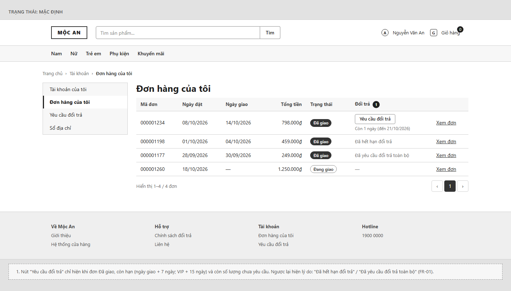

#### SCR-02 — Tạo yêu cầu đổi trả
Form một trang: chọn loại, chọn sản phẩm và số lượng, lý do, ảnh, thông tin hoàn tiền (đơn COD).

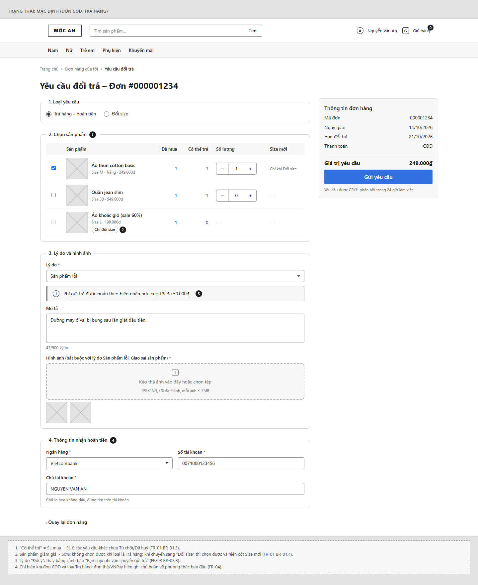

#### SCR-03 — Yêu cầu đổi trả của tôi
Danh sách yêu cầu của khách với trạng thái hiện tại.

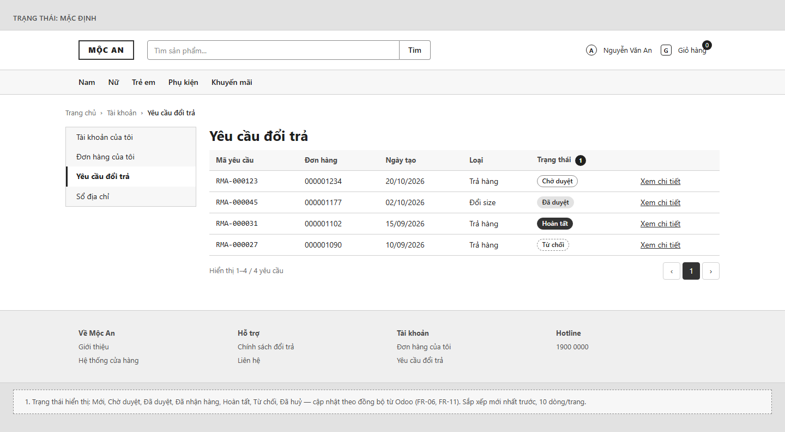

#### SCR-04 — Chi tiết yêu cầu đổi trả (khách)
Tiến trình trạng thái, sản phẩm, hướng dẫn gửi hàng hoặc lý do từ chối; nút huỷ khi còn Chờ duyệt.

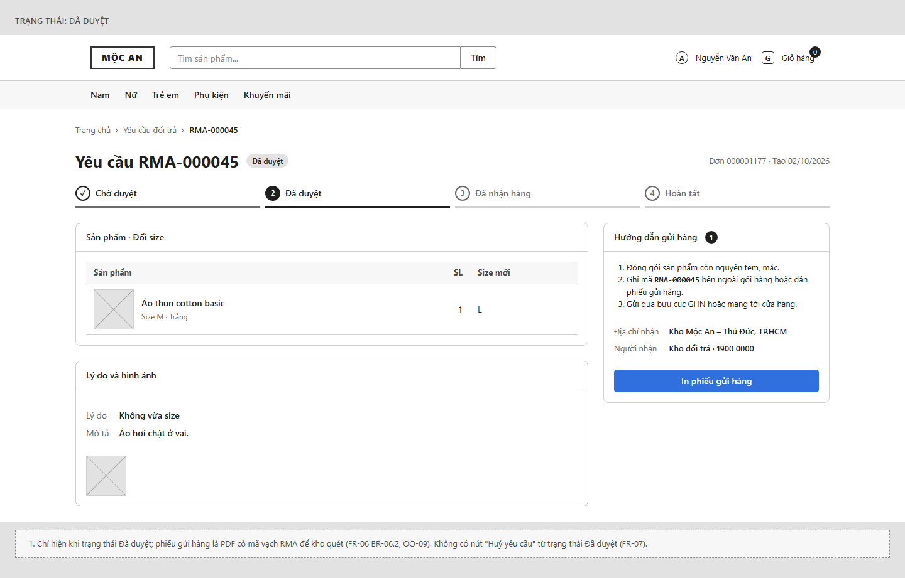

#### SCR-05 — Danh sách yêu cầu đổi trả (Odoo)
List view có bộ lọc mặc định "Chờ duyệt", nhãn "Quá hạn" cho yêu cầu quá 48 giờ.

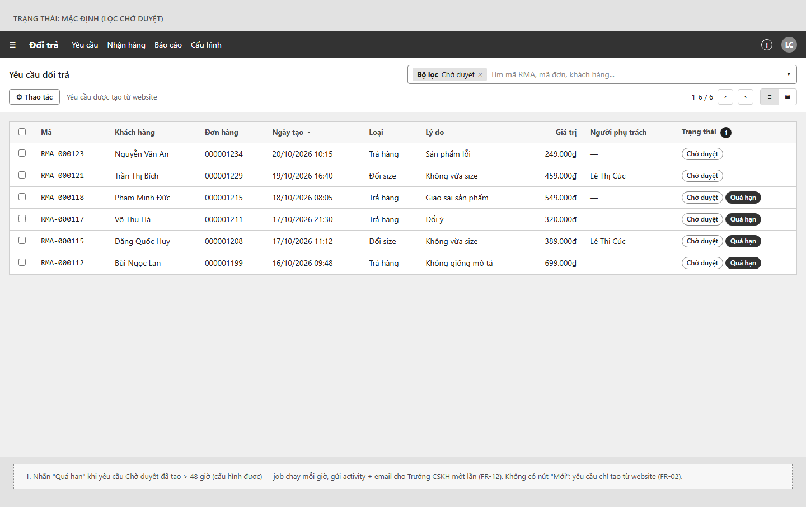

#### SCR-06 — Form yêu cầu đổi trả (Odoo)
Form view với statusbar, nút Duyệt/Từ chối, hộp thoại từ chối, smart button và chatter.

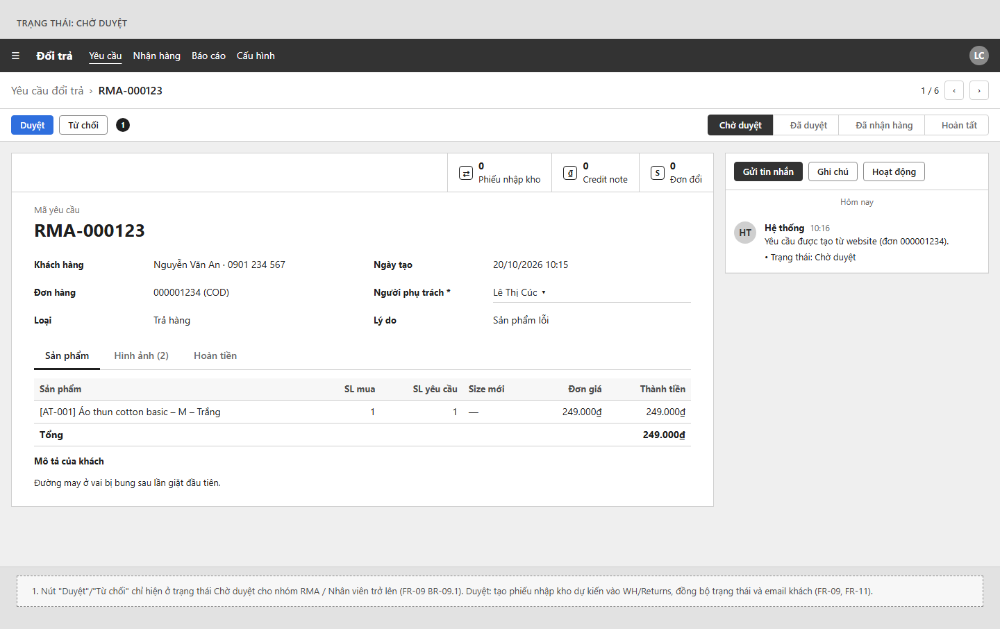

#### SCR-07 — Nhận hàng & kiểm tra (Odoo)
Màn kho: quét mã RMA, ghi SL thực nhận và tình trạng từng dòng, xác nhận nhận hàng.

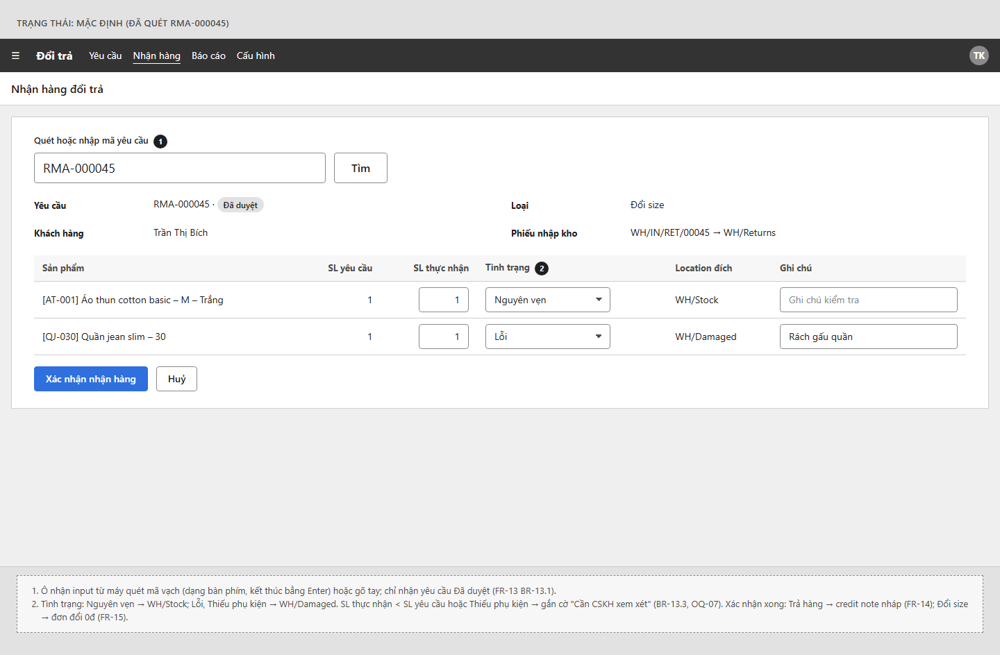

#### SCR-08 — Báo cáo đổi trả theo lý do (Odoo)
Pivot lý do × tháng và biểu đồ cột, xuất Excel.

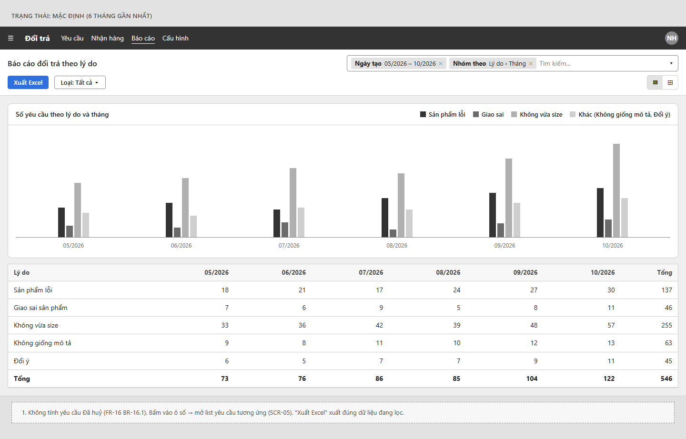

## 7. User flow

Luồng chính (khách tạo → duyệt → nhận hàng → hoàn tiền/đổi):

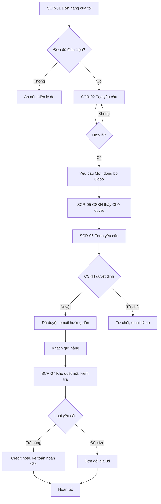

Luồng ngoại lệ (huỷ, quá hạn, đồng bộ lỗi):

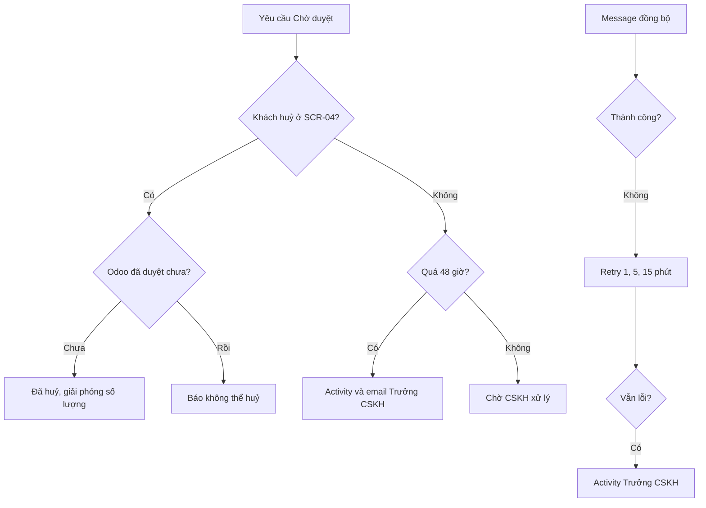

## 8. Ma trận truy vết

| FR | Tên | URD (US) | Màn hình (SCR) |
|---|---|---|---|
| FR-01 | Kiểm tra điều kiện đổi trả | US-01, US-08 | SCR-01, SCR-02 |
| FR-02 | Tạo yêu cầu đổi trả | US-02 | SCR-02 |
| FR-03 | Quy tắc lý do, ảnh, phí ship | US-02, US-03 | SCR-02 |
| FR-04 | Thông tin hoàn tiền đơn COD | US-04 | SCR-02 |
| FR-05 | Đồng bộ yêu cầu M2 → Odoo | US-09 | Không có UI |
| FR-06 | Khách xem danh sách & chi tiết | US-05 | SCR-03, SCR-04 |
| FR-07 | Khách huỷ yêu cầu | US-06 | SCR-04 |
| FR-08 | Danh sách & lọc trên Odoo | US-09 | SCR-05 |
| FR-09 | Duyệt yêu cầu | US-10 | SCR-06 |
| FR-10 | Từ chối yêu cầu | US-11 | SCR-06 |
| FR-11 | Đồng bộ trạng thái & email | US-07, US-05 | Không có UI |
| FR-12 | Cảnh báo quá 48 giờ | US-13, US-09 | SCR-05 |
| FR-13 | Nhận hàng & kiểm tra | US-15, US-16 | SCR-07 |
| FR-14 | Credit note hoàn tiền | US-17 | SCR-06 |
| FR-15 | Đơn đổi size giá 0đ | US-12 | SCR-06 |
| FR-16 | Báo cáo theo lý do | US-14 | SCR-08 |
| FR-17 | Cấu hình chính sách | US-08, US-13 | Không có UI |

## 9. Assumptions & Open Questions

### 9.1 Giả định
| Mã | Giả định | Lý do chọn | Liên quan |
|---|---|---|---|
| AS-01 | KPI: phản hồi ≤ 24h cho 90% yêu cầu; 0 hoàn tiền trùng | Input chỉ nêu hiện trạng 3 ngày | Mục 1 |
| AS-02 | Guest không tạo yêu cầu online | Cần tài khoản để xác thực đơn | FR-01 |
| AS-03 | Đồng bộ qua queue, trễ ≤ 5 phút | Cùng cơ chế connector | FR-05, FR-11 |
| AS-04 | Ngày giao = ngày đơn M2 "Complete" | Dữ liệu sẵn có | FR-01 |
| AS-05 | Hoàn tiền thẻ/VNPay thủ công trên cổng; Odoo ghi nhận credit note | Ngoài phạm vi tích hợp | FR-04, FR-14 |
| AS-06 | "Đổi ý" khách chịu ship; lý do khác shop hoàn phí ship ≤ 50.000₫ | Thông lệ e-commerce | FR-03, FR-14 |
| AS-07 | Đơn COD: khách nhập STK trên form | Giảm thao tác CSKH | FR-04 |
| AS-08 | Sale > 50% tính trên giá dòng đơn so với giá gốc | Dữ liệu có trên order item | FR-01 |
| AS-09 | Mỗi yêu cầu một loại cho mọi dòng | Đơn giản hoá xử lý | FR-02 |
| AS-10 | 48h tính theo giờ thực | Email không nêu ngày làm việc | FR-12 |
| AS-11 | Mã RMA sinh ở M2 (`RMA-` + 6 số) và in mã vạch Code128 trên phiếu gửi hàng | Kho cần quét mã (ghi-chu-kho) | FR-02, FR-06, FR-13 |

### 9.2 Câu hỏi mở
| Mã | Câu hỏi | Người cần trả lời | Ảnh hưởng tới |
|---|---|---|---|
| OQ-01 | Chính sách đổi trả chính thức (hạn, lý do, điều kiện)? | Ban giám đốc / chị Hạnh | FR-01, FR-03, FR-17 |
| OQ-02 | KPI mục tiêu chính thức? | Chị Hạnh | Mục 1 |
| OQ-03 | Nguồn của "ngày giao" (trạng thái M2 hay phiếu xuất Odoo/GHN)? | IT khách hàng | FR-01 |
| OQ-04 | Quy tắc phí ship gửi trả và mức trần? | Chị Hạnh, chị Linh | FR-03, FR-14, SCR-02 |
| OQ-05 | Ai nhập STK cho đơn COD — khách hay CSKH? | Chị Linh | FR-04, SCR-02 |
| OQ-06 | Đổi size khi size mới hết hàng: chờ hàng hay chuyển sang trả hàng? | Chị Hạnh | FR-02, FR-15 |
| OQ-07 | Hàng thiếu phụ kiện / lỗi do khách: từ chối hay hoàn một phần? | Chị Hạnh, anh Tùng | FR-13, FR-14, FR-15, SCR-07 |
| OQ-08 | Hạn khách gửi hàng sau khi duyệt? Quá hạn tự huỷ? | Chị Hạnh | FR-06, FR-09 |
| OQ-09 | Có cần in phiếu gửi hàng PDF (mã vạch) hay khách chỉ ghi tay mã RMA? | Anh Tùng | FR-06, SCR-04 |
