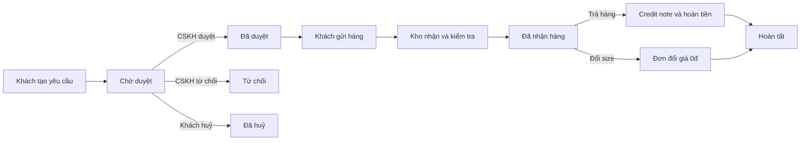

# URD — Đổi trả hàng online (Magento 2 + Odoo 17)

| Thuộc tính | Giá trị |
|---|---|
| Mã dự án | _example |
| Phiên bản | 0.1 (bản nháp tự động) |
| Ngày | 2026-10-20 |
| Nguồn | bien-ban-hop-kickoff.md, email-bo-sung-cskh.md, ghi-chu-kho.txt, brainstorm.md |
| Trạng thái | Chờ khách hàng review |

## 1. Giới thiệu

### 1.1 Mục đích
Tài liệu mô tả yêu cầu của người dùng cho tính năng đổi trả hàng online của Mộc An Fashion (dữ liệu giả lập), nhằm thay quy trình thủ công (hotline, Google Sheet, Zalo) bằng quy trình khép kín trên Magento 2 và Odoo 17.

### 1.2 Phạm vi
- **Trong phạm vi:** tạo yêu cầu đổi/trả trên website, kiểm tra điều kiện, duyệt/từ chối trên Odoo, theo dõi trạng thái, nhận hàng và kiểm tra tại kho, hoàn tiền bằng credit note, đơn đổi size giá 0đ, cảnh báo quá 48 giờ, báo cáo theo lý do.
- **Ngoài phạm vi:** tích hợp API GHN, hoàn tiền tự động qua cổng thanh toán, ứng dụng mobile, đổi sang sản phẩm khác.

### 1.3 Mục tiêu kinh doanh
| # | Mục tiêu | Chỉ số đo | Giá trị mục tiêu |
|---|---|---|---|
| 1 | Rút ngắn thời gian phản hồi khách | Thời gian từ tạo đến duyệt/từ chối | ≤ 24 giờ cho 90% yêu cầu (AS-01) |
| 2 | Loại bỏ hoàn tiền sót/trùng | Số trường hợp hoàn trùng/tháng | 0 (AS-01) |
| 3 | Minh bạch trạng thái cho khách | Khiếu nại "không biết trạng thái" | Giảm (chờ OQ-02) |
| 4 | Go-live kịp mùa sale | Ngày go-live | Trước 15/11/2026 |

## 2. Vai trò người dùng

| Vai trò | Mô tả | Hệ thống sử dụng | Tần suất |
|---|---|---|---|
| Khách hàng | Khách có tài khoản (guest không áp dụng — AS-02) | Storefront Magento | Thỉnh thoảng |
| Khách hàng VIP | Customer group "VIP" | Storefront Magento | Thỉnh thoảng |
| Nhân viên CSKH | Xử lý yêu cầu | Odoo | Hằng ngày (~15 yêu cầu/ngày) |
| Trưởng CSKH | Giám sát, báo cáo | Odoo | Hằng ngày / hằng tháng |
| Nhân viên kho | Nhận và kiểm tra hàng trả | Odoo (máy tính bàn) | Hằng ngày |
| Kế toán | Hoàn tiền | Odoo Accounting | Hằng ngày |

## 3. User stories theo vai trò

### 3.1 Khách hàng

#### US-01 — Biết đơn nào được đổi trả
- **Story:** Là khách hàng, tôi muốn thấy ngay đơn nào còn được đổi trả, để không mất công liên hệ hotline.
- **Ưu tiên:** Must
- **Nguồn:** bien-ban-hop-kickoff.md
- **Acceptance criteria:**
  1. **Given** đơn đã giao trong vòng 7 ngày **When** tôi mở "Đơn hàng của tôi" **Then** đơn có nút "Yêu cầu đổi trả".
  2. **Given** đơn chưa giao hoặc đã quá 7 ngày kể từ ngày giao **When** tôi mở danh sách **Then** đơn không có nút và hiện ghi chú lý do ("Đã hết hạn đổi trả").
  3. **Given** mọi sản phẩm của đơn đã được yêu cầu đủ số lượng **When** tôi mở danh sách **Then** đơn không có nút "Yêu cầu đổi trả".

#### US-02 — Tạo yêu cầu đổi trả
- **Story:** Là khách hàng, tôi muốn chọn sản phẩm, số lượng, loại (trả hàng / đổi size) và lý do, để gửi yêu cầu mà không cần gọi điện.
- **Ưu tiên:** Must
- **Nguồn:** bien-ban-hop-kickoff.md, email-bo-sung-cskh.md
- **Acceptance criteria:**
  1. **Given** đơn đủ điều kiện **When** tôi chọn ít nhất 1 sản phẩm, số lượng, loại, lý do và bấm "Gửi yêu cầu" **Then** hệ thống tạo yêu cầu mã `RMA-xxxxxx` ở trạng thái Chờ duyệt và hiển thị mã cho tôi.
  2. **Given** tôi đã có yêu cầu khác cho cùng đơn **When** tôi nhập số lượng vượt số lượng còn lại **Then** hệ thống báo "Số lượng tối đa có thể đổi trả là N".
  3. **Given** sản phẩm có mức giảm giá > 50% **When** tôi chọn loại yêu cầu **Then** chỉ có lựa chọn "Đổi size" (AS-08).
  4. **Given** tôi chọn lý do "Đổi ý" **When** xem form **Then** hiển thị thông báo "Bạn chịu phí vận chuyển gửi trả" (AS-06).
  5. **Given** loại "Đổi size" **When** chọn sản phẩm **Then** tôi chọn được size mới trong các size còn hàng.

#### US-03 — Đính kèm ảnh
- **Story:** Là khách hàng, tôi muốn đính kèm ảnh sản phẩm, để CSKH duyệt nhanh mà không cần nhắn Zalo.
- **Ưu tiên:** Must
- **Nguồn:** email-bo-sung-cskh.md
- **Acceptance criteria:**
  1. **Given** lý do "Sản phẩm lỗi" hoặc "Giao sai sản phẩm" **When** tôi gửi yêu cầu không có ảnh **Then** hệ thống chặn và báo "Vui lòng đính kèm ít nhất 1 ảnh".
  2. **Given** tôi đã chọn 5 ảnh **When** tôi chọn thêm ảnh **Then** hệ thống báo "Tối đa 5 ảnh".

#### US-04 — Cung cấp tài khoản nhận hoàn tiền (đơn COD)
- **Story:** Là khách hàng thanh toán COD, tôi muốn nhập tài khoản ngân hàng nhận tiền hoàn, để nhận tiền mà không phải gọi điện.
- **Ưu tiên:** Should
- **Nguồn:** bien-ban-hop-kickoff.md, AS-07
- **Acceptance criteria:**
  1. **Given** đơn COD và loại "Trả hàng" **When** tôi mở form **Then** hiện nhóm trường Ngân hàng, Số tài khoản, Chủ tài khoản (bắt buộc).
  2. **Given** đơn thanh toán thẻ/VNPay **When** tôi mở form **Then** không hiện nhóm trường này và hiện ghi chú "Tiền sẽ hoàn về phương thức thanh toán ban đầu".

#### US-05 — Theo dõi trạng thái yêu cầu
- **Story:** Là khách hàng, tôi muốn xem trạng thái các yêu cầu của mình, để biết yêu cầu đang ở bước nào.
- **Ưu tiên:** Must
- **Nguồn:** bien-ban-hop-kickoff.md
- **Acceptance criteria:**
  1. **Given** tôi có yêu cầu **When** mở "Yêu cầu đổi trả" trong tài khoản **Then** thấy danh sách: mã, đơn hàng, ngày tạo, loại, trạng thái.
  2. **Given** yêu cầu đã duyệt **When** mở chi tiết **Then** thấy hướng dẫn gửi hàng và mã yêu cầu để ghi ngoài gói hàng.
  3. **Given** yêu cầu bị từ chối **When** mở chi tiết **Then** thấy lý do từ chối.

#### US-06 — Huỷ yêu cầu
- **Story:** Là khách hàng, tôi muốn huỷ yêu cầu khi đổi ý, để không phải gửi hàng.
- **Ưu tiên:** Should
- **Nguồn:** brainstorm.md mục 5.3
- **Acceptance criteria:**
  1. **Given** yêu cầu ở trạng thái Chờ duyệt **When** tôi bấm "Huỷ yêu cầu" và xác nhận **Then** trạng thái thành Đã huỷ và số lượng được giải phóng cho yêu cầu khác.
  2. **Given** yêu cầu đã duyệt trở đi **When** mở chi tiết **Then** không có nút "Huỷ yêu cầu".

#### US-07 — Nhận email thông báo
- **Story:** Là khách hàng, tôi muốn nhận email khi yêu cầu được duyệt, từ chối hoặc hoàn tất, để không phải vào website kiểm tra.
- **Ưu tiên:** Must
- **Nguồn:** bien-ban-hop-kickoff.md, email-bo-sung-cskh.md
- **Acceptance criteria:**
  1. **Given** CSKH duyệt yêu cầu **When** trạng thái đồng bộ về Magento **Then** tôi nhận email có mã yêu cầu và hướng dẫn gửi hàng trong vòng 10 phút.
  2. **Given** CSKH từ chối **When** đồng bộ **Then** email có lý do từ chối.

### 3.2 Khách hàng VIP

#### US-08 — Hạn đổi trả 15 ngày
- **Story:** Là khách hàng VIP, tôi muốn được đổi trả trong 15 ngày, để được hưởng ưu đãi hạng thành viên.
- **Ưu tiên:** Must
- **Nguồn:** email-bo-sung-cskh.md
- **Acceptance criteria:**
  1. **Given** tôi thuộc customer group "VIP" và đơn giao cách đây 10 ngày **When** mở "Đơn hàng của tôi" **Then** đơn vẫn có nút "Yêu cầu đổi trả".
  2. **Given** đơn giao cách đây 16 ngày **When** mở danh sách **Then** đơn không có nút.

### 3.3 Nhân viên CSKH

#### US-09 — Xem và lọc yêu cầu
- **Story:** Là nhân viên CSKH, tôi muốn xem danh sách yêu cầu và lọc theo trạng thái, lý do, quá hạn, để xử lý theo thứ tự ưu tiên.
- **Ưu tiên:** Must
- **Nguồn:** bien-ban-hop-kickoff.md
- **Acceptance criteria:**
  1. **Given** có yêu cầu mới từ website **When** tôi mở menu Đổi trả › Yêu cầu **Then** thấy yêu cầu trong tối đa 5 phút kể từ khi khách gửi (AS-03).
  2. **Given** danh sách **When** chọn bộ lọc "Quá 48 giờ" **Then** chỉ hiện yêu cầu Chờ duyệt có thời gian tạo cách đây > 48 giờ.

#### US-10 — Duyệt yêu cầu
- **Story:** Là nhân viên CSKH, tôi muốn duyệt yêu cầu sau khi xem ảnh và thông tin, để khách gửi hàng về.
- **Ưu tiên:** Must
- **Nguồn:** bien-ban-hop-kickoff.md
- **Acceptance criteria:**
  1. **Given** yêu cầu Chờ duyệt **When** tôi bấm "Duyệt" **Then** trạng thái thành Đã duyệt, hệ thống tạo phiếu nhập kho dự kiến vào WH/Returns và gửi email cho khách.
  2. **Given** yêu cầu không ở trạng thái Chờ duyệt **When** mở form **Then** không có nút "Duyệt".

#### US-11 — Từ chối yêu cầu
- **Story:** Là nhân viên CSKH, tôi muốn từ chối kèm lý do, để khách hiểu vì sao bị từ chối.
- **Ưu tiên:** Must
- **Nguồn:** email-bo-sung-cskh.md
- **Acceptance criteria:**
  1. **Given** yêu cầu Chờ duyệt **When** tôi bấm "Từ chối" **Then** hiện hộp thoại bắt buộc chọn lý do từ chối.
  2. **Given** hộp thoại từ chối **When** tôi bấm "Xác nhận từ chối" mà chưa chọn lý do **Then** hệ thống báo lỗi và không đổi trạng thái.

#### US-12 — Đơn đổi size tự động
- **Story:** Là nhân viên CSKH, tôi muốn hệ thống tự tạo đơn đổi giá 0đ khi kho xác nhận hàng nguyên vẹn, để không phải tạo đơn thủ công.
- **Ưu tiên:** Must
- **Nguồn:** bien-ban-hop-kickoff.md
- **Acceptance criteria:**
  1. **Given** yêu cầu loại "Đổi size" và kho xác nhận Nguyên vẹn **When** kho bấm "Xác nhận nhận hàng" **Then** hệ thống tạo sale order giá 0đ với size mới, liên kết với yêu cầu.

### 3.4 Trưởng CSKH

#### US-13 — Cảnh báo quá 48 giờ
- **Story:** Là trưởng CSKH, tôi muốn được báo khi yêu cầu quá 48 giờ chưa duyệt, để can thiệp kịp thời.
- **Ưu tiên:** Should
- **Nguồn:** email-bo-sung-cskh.md
- **Acceptance criteria:**
  1. **Given** yêu cầu Chờ duyệt đã tạo > 48 giờ (AS-10) **When** job kiểm tra chạy (mỗi giờ) **Then** tôi nhận activity "Yêu cầu quá hạn xử lý" trên Odoo và email, một lần cho mỗi yêu cầu.

#### US-14 — Báo cáo theo lý do
- **Story:** Là trưởng CSKH, tôi muốn xem số yêu cầu theo lý do theo tháng, để làm việc với nhà cung cấp.
- **Ưu tiên:** Should
- **Nguồn:** bien-ban-hop-kickoff.md
- **Acceptance criteria:**
  1. **Given** có dữ liệu yêu cầu **When** mở Đổi trả › Báo cáo **Then** thấy bảng số yêu cầu theo lý do × tháng và biểu đồ cột, lọc được theo khoảng thời gian.
  2. **Given** bảng báo cáo **When** bấm "Xuất Excel" **Then** tải file .xlsx đúng dữ liệu đang lọc.

### 3.5 Nhân viên kho

#### US-15 — Nhận hàng bằng quét mã
- **Story:** Là nhân viên kho, tôi muốn quét mã yêu cầu trên gói hàng, để tìm nhanh yêu cầu và ghi nhận hàng về.
- **Ưu tiên:** Must
- **Nguồn:** ghi-chu-kho.txt
- **Acceptance criteria:**
  1. **Given** yêu cầu Đã duyệt **When** tôi quét/nhập mã `RMA-xxxxxx` **Then** hệ thống mở màn kiểm tra với các dòng sản phẩm dự kiến nhận.
  2. **Given** mã không tồn tại hoặc yêu cầu không ở trạng thái Đã duyệt **When** quét **Then** hệ thống báo lỗi rõ lý do.

#### US-16 — Ghi tình trạng và chuyển location
- **Story:** Là nhân viên kho, tôi muốn ghi tình trạng từng sản phẩm, để hàng tốt về kho bán và hàng lỗi tách riêng.
- **Ưu tiên:** Must
- **Nguồn:** bien-ban-hop-kickoff.md, ghi-chu-kho.txt
- **Acceptance criteria:**
  1. **Given** màn kiểm tra **When** tôi chọn tình trạng (Nguyên vẹn / Lỗi / Thiếu phụ kiện) cho mọi dòng và bấm "Xác nhận nhận hàng" **Then** hàng nhập WH/Returns, rồi Nguyên vẹn → WH/Stock, Lỗi → WH/Damaged; trạng thái yêu cầu thành Đã nhận hàng.
  2. **Given** còn dòng chưa chọn tình trạng **When** bấm xác nhận **Then** hệ thống chặn và đánh dấu dòng thiếu.

### 3.6 Kế toán

#### US-17 — Hoàn tiền không trùng
- **Story:** Là kế toán, tôi muốn có credit note nháp tự động cho yêu cầu trả hàng đã nhận, để hoàn tiền đúng và không trùng.
- **Ưu tiên:** Must
- **Nguồn:** bien-ban-hop-kickoff.md
- **Acceptance criteria:**
  1. **Given** yêu cầu "Trả hàng" chuyển sang Đã nhận hàng **When** kho xác nhận **Then** hệ thống tạo credit note nháp liên kết hoá đơn gốc với số tiền = giá trị dòng trả (+ phí ship theo AS-06).
  2. **Given** yêu cầu đã có credit note **When** có thao tác tạo credit note lần nữa **Then** hệ thống chặn.
  3. **Given** credit note được xác nhận và đánh dấu đã thanh toán **When** lưu **Then** yêu cầu chuyển Hoàn tất.

## 4. Quy trình nghiệp vụ mong muốn (TO-BE)

| Bước | Vai trò | Mô tả | User story |
|---|---|---|---|
| 1 | Khách hàng | Tạo yêu cầu từ đơn đủ điều kiện | US-01, US-02, US-03, US-04, US-08 |
| 2 | Hệ thống | Đồng bộ yêu cầu sang Odoo | US-09 |
| 3 | CSKH | Duyệt / từ chối | US-10, US-11, US-07 |
| 4 | Trưởng CSKH | Theo dõi quá hạn | US-13 |
| 5 | Kho | Nhận hàng, kiểm tra, chuyển location | US-15, US-16 |
| 6 | Kế toán / Hệ thống | Hoàn tiền hoặc tạo đơn đổi | US-17, US-12 |
| 7 | Khách hàng | Theo dõi, huỷ | US-05, US-06 |

## 5. Yêu cầu chung (không gắn vai trò)
- Giao diện storefront tiếng Việt; tiền tệ VND; ngày dd/mm/yyyy.
- Mọi thay đổi trạng thái yêu cầu được lưu vết (người, thời gian, giá trị cũ → mới) trên chatter Odoo.
- Hạn đổi trả, danh sách lý do, ngưỡng % sale cấu hình được trên Odoo (chính sách chưa chốt — OQ-01).

## 6. Assumptions & Open Questions

### 6.1 Giả định
| Mã | Giả định | Lý do chọn | Liên quan |
|---|---|---|---|
| AS-01 | KPI: phản hồi ≤ 24h cho 90% yêu cầu; 0 hoàn tiền trùng | Input chỉ nêu hiện trạng 3 ngày | Mục 1.3 |
| AS-02 | Guest không tạo yêu cầu online | Cần tài khoản để xác thực đơn | US-01 |
| AS-03 | Đồng bộ qua queue, trễ ≤ 5 phút | Cùng cơ chế connector hiện có | US-09 |
| AS-04 | Ngày giao = ngày đơn Magento "Complete" | Dữ liệu sẵn có trên Magento | US-01, US-08 |
| AS-05 | Hoàn tiền thẻ/VNPay thủ công trên cổng | Ngoài phạm vi tích hợp | US-17 |
| AS-06 | "Đổi ý" khách chịu ship; khác: shop hoàn phí ship ≤ 50.000₫ | Thông lệ e-commerce | US-02, US-17 |
| AS-07 | Đơn COD: khách nhập STK trên form | Giảm thao tác CSKH | US-04 |
| AS-08 | Sale > 50% tính trên giá dòng đơn so với giá gốc | Dữ liệu có trên order item | US-02 |
| AS-09 | Mỗi yêu cầu một loại cho mọi dòng | Đơn giản hoá xử lý kho/kế toán | US-02 |
| AS-10 | 48h tính theo giờ thực | Email không nêu ngày làm việc | US-13 |

### 6.2 Câu hỏi mở
| Mã | Câu hỏi | Người cần trả lời | Liên quan |
|---|---|---|---|
| OQ-01 | Chính sách đổi trả chính thức? | Ban giám đốc / chị Hạnh | Toàn bộ |
| OQ-02 | KPI mục tiêu chính thức? | Chị Hạnh | Mục 1.3 |
| OQ-03 | Nguồn của "ngày giao"? | IT khách hàng | US-01, US-08 |
| OQ-04 | Quy tắc phí ship gửi trả, mức trần? | Chị Hạnh, chị Linh | US-02, US-17 |
| OQ-05 | Ai nhập STK cho đơn COD? | Chị Linh | US-04 |
| OQ-06 | Đổi size khi size mới hết hàng? | Chị Hạnh | US-02, US-12 |
| OQ-07 | Hàng thiếu phụ kiện / lỗi do khách: từ chối hay hoàn một phần? | Chị Hạnh, anh Tùng | US-16, US-17 |
| OQ-08 | Hạn khách gửi hàng sau khi duyệt? Quá hạn tự huỷ? | Chị Hạnh | US-05 |
