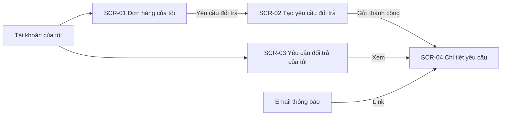
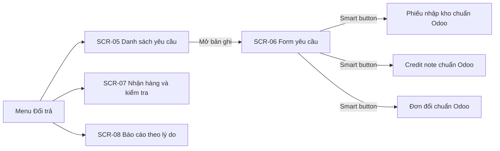
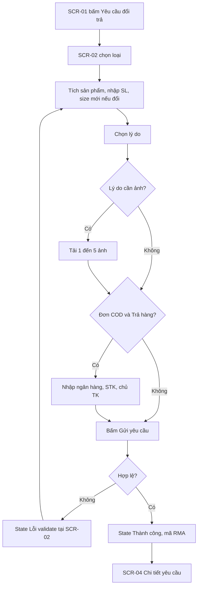
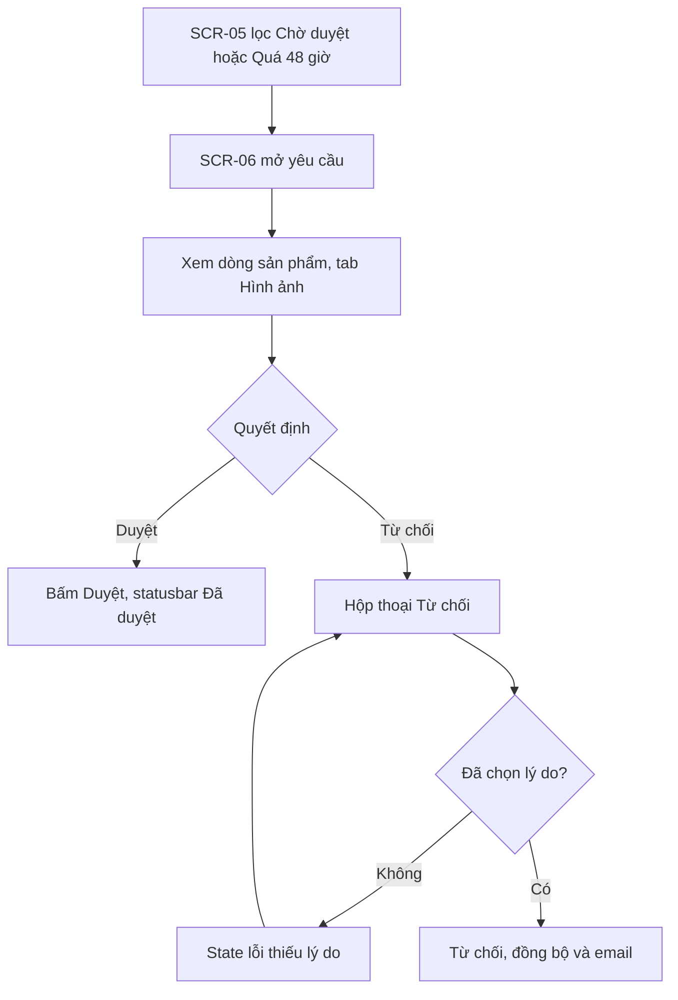
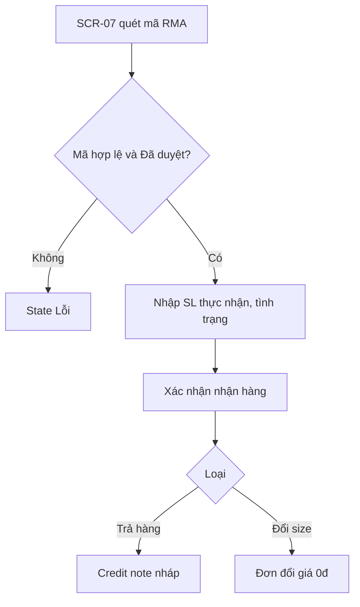

# UI spec — Đổi trả hàng online (Magento 2 + Odoo 17)

> Nguồn: SRS.md mục 3, 6, 7. Kit: `.claude/skills/wireframe/design-kit/`.

## 1. Sitemap

### 1.1 Storefront

### 1.2 Backend

## 2. User flows

### 2.1 Khách tạo yêu cầu (FR-01, FR-02, FR-03, FR-04)

### 2.2 CSKH xử lý (FR-08, FR-09, FR-10, FR-12)

### 2.3 Kho nhận hàng (FR-13, FR-14, FR-15)

## 3. Danh sách màn hình cần vẽ

| SCR | Slug | Loại | Khung | Trạng thái cần vẽ | FR |
|---|---|---|---|---|---|
| SCR-01 | don-hang-cua-toi | storefront | 1440 + 390 | default, empty | FR-01 |
| SCR-02 | tao-yeu-cau-doi-tra | storefront | 1440 + 390 | default, error, success | FR-01, FR-02, FR-03, FR-04 |
| SCR-03 | yeu-cau-doi-tra-cua-toi | storefront | 1440 + 390 | default, empty | FR-06 |
| SCR-04 | chi-tiet-yeu-cau-doi-tra | storefront | 1440 + 390 | default (Đã duyệt), cancel (Chờ duyệt + hộp thoại huỷ), rejected | FR-06, FR-07 |
| SCR-05 | danh-sach-yeu-cau-odoo | backend | 1440 | default, filter, empty | FR-08, FR-12 |
| SCR-06 | form-yeu-cau-odoo | backend | 1440 | default (Chờ duyệt), reject-error, approved | FR-09, FR-10, FR-14, FR-15 |
| SCR-07 | nhan-hang-kiem-tra | backend | 1440 | default, error | FR-13 |
| SCR-08 | bao-cao-doi-tra | backend | 1440 | default | FR-16 |

### SCR-01 — Đơn hàng của tôi
- **File:** `ui/screens/SCR-01-don-hang-cua-toi.html`
- **Bố cục (1440):** `sf-header` + `sf-nav` → `wf-breadcrumb` (Trang chủ › Tài khoản › Đơn hàng của tôi) → `sf-account`: trái `sf-account-nav` (Đơn hàng của tôi active), phải `wf-h1` + `wf-table wf-table--stack` cột Mã đơn, Ngày đặt, Ngày giao, Tổng tiền, Trạng thái, Đổi trả (nút `wf-btn--sm` "Yêu cầu đổi trả" + hạn còn lại, hoặc ghi chú lý do) → `wf-pagination` → `sf-footer`.
- **Mobile 390:** bảng thành thẻ (`data-label`), account nav thành hàng ngang.
- **Trạng thái:** default — 4 đơn (1 đủ điều kiện, 1 VIP-style còn hạn, 1 hết hạn, 1 đang giao); empty — `wf-empty` "Bạn chưa có đơn hàng nào" + CTA "Mua sắm ngay".
- **Chú thích:** ① hạn = ngày giao + 7/15 ngày (FR-01 BR-01.2).

### SCR-02 — Tạo yêu cầu đổi trả
- **File:** `ui/screens/SCR-02-tao-yeu-cau-doi-tra.html`
- **Bố cục (1440):** header/nav → breadcrumb → `wf-h1` "Yêu cầu đổi trả – Đơn #000001234" → `wf-split`: trái form (`wf-fieldset` Loại yêu cầu radio; bảng chọn sản phẩm checkbox + SL + size mới; `wf-field` Lý do select + `wf-alert` phí ship; Mô tả textarea; `wf-upload` + `wf-file-list`; `wf-fieldset` Thông tin nhận hoàn tiền), phải `sf-summary` (thông tin đơn, phương thức thanh toán, hạn đổi trả, nút primary "Gửi yêu cầu") → hàng nút: ghost "‹ Quay lại đơn hàng".
- **Trạng thái:** default (đơn COD, loại Trả hàng); error — `wf-alert--error` tổng hợp + SL vượt, thiếu ảnh, STK sai; success — `wf-alert--success` + mã RMA-000123 + bước tiếp theo + nút "Xem yêu cầu".

### SCR-03 — Yêu cầu đổi trả của tôi
- **File:** `ui/screens/SCR-03-yeu-cau-doi-tra-cua-toi.html`
- **Bố cục:** như SCR-01 (account nav "Yêu cầu đổi trả" active); bảng cột Mã yêu cầu, Đơn hàng, Ngày tạo, Loại, Trạng thái (`wf-badge` kiểu khác nhau), Xem.
- **Trạng thái:** default (4 yêu cầu ở các trạng thái khác nhau); empty "Bạn chưa có yêu cầu đổi trả nào" + "Xem đơn hàng".

### SCR-04 — Chi tiết yêu cầu đổi trả (khách)
- **File:** `ui/screens/SCR-04-chi-tiet-yeu-cau-doi-tra.html`
- **Bố cục:** account layout → tiêu đề "RMA-000045" + `wf-badge` trạng thái → `wf-steps` tiến trình (Chờ duyệt, Đã duyệt, Đã nhận hàng, Hoàn tất) → `wf-split`: trái `wf-card` Sản phẩm (bảng) + `wf-card` Lý do & ảnh; phải `wf-card` Hướng dẫn gửi hàng (địa chỉ kho, mã RMA, nút "In phiếu gửi hàng") hoặc lý do từ chối.
- **Trạng thái:** default (Đã duyệt); cancel (Chờ duyệt, có nút "Huỷ yêu cầu", hiện `wf-overlay` + `wf-modal` xác nhận); rejected (`wf-alert--error` lý do từ chối).

### SCR-05 — Danh sách yêu cầu đổi trả (Odoo)
- **File:** `ui/screens/SCR-05-danh-sach-yeu-cau-odoo.html`
- **Bố cục:** `be-topbar` (Đổi trả: Yêu cầu, Nhận hàng, Báo cáo, Cấu hình) → `be-controlpanel` (breadcrumb, nút "Mới" không có — yêu cầu tạo từ website; search với facet "Chờ duyệt", pager) → `be-list` `wf-table` các cột theo SRS + nhãn "Quá hạn".
- **Trạng thái:** default; empty.
- **Ghi chú:** không có nút "Mới" vì yêu cầu chỉ tạo từ website (FR-02); chỉ có nút phụ "Thao tác".

### SCR-06 — Form yêu cầu đổi trả (Odoo)
- **File:** `ui/screens/SCR-06-form-yeu-cau-odoo.html`
- **Bố cục:** topbar → controlpanel (breadcrumb Yêu cầu › RMA-000045, pager) → `be-form-header` (Duyệt primary, Từ chối; statusbar) → `be-form-layout`: `be-sheet` (smart buttons, `be-title`, `be-fields`, `be-notebook` tabs Sản phẩm / Hình ảnh / Hoàn tiền) + `be-chatter`.
- **Trạng thái:** default (Chờ duyệt); reject-error (hộp thoại Từ chối, trường lý do lỗi); approved (statusbar Đã duyệt, không còn nút Duyệt/Từ chối, smart button Phiếu nhập kho = 1, chatter có tracking).

### SCR-07 — Nhận hàng & kiểm tra (Odoo)
- **File:** `ui/screens/SCR-07-nhan-hang-kiem-tra.html`
- **Bố cục:** topbar (menu Nhận hàng active) → controlpanel → `be-sheet` full width: ô quét mã lớn + thông tin yêu cầu (`be-fields`) + `be-o2m` bảng dòng (SL yêu cầu, SL thực nhận, Tình trạng select, Location đích, Ghi chú) + nút "Xác nhận nhận hàng" primary, "Huỷ".
- **Trạng thái:** default (đã quét RMA-000045); error (mã không tồn tại `wf-alert--error` + 1 dòng thiếu tình trạng).

### SCR-08 — Báo cáo đổi trả theo lý do (Odoo)
- **File:** `ui/screens/SCR-08-bao-cao-doi-tra.html`
- **Bố cục:** topbar (Báo cáo active) → controlpanel (facet "6 tháng gần nhất", view switcher biểu đồ/pivot, nút "Xuất Excel") → `wf-card` biểu đồ cột `wf-chart` (chiều cao cột bằng `style="height:%"`) + `wf-legend` → `wf-table` pivot lý do × tháng có dòng tổng.
- **Trạng thái:** default.
