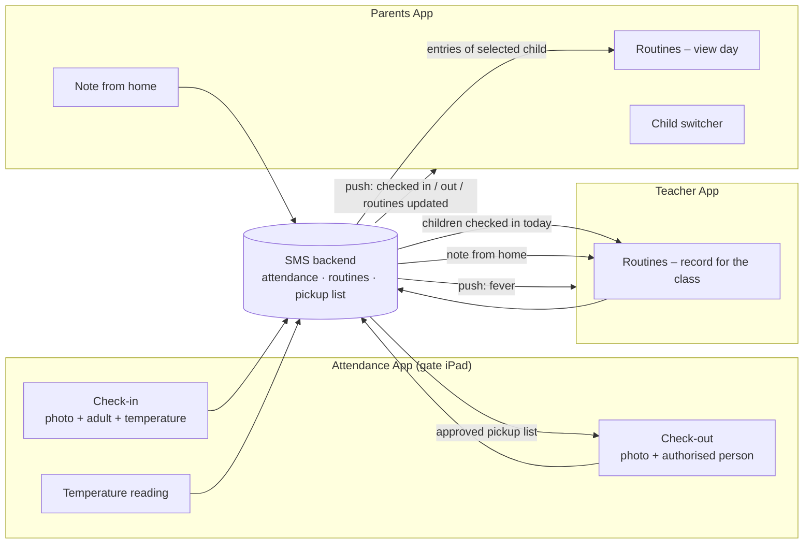

# FRS — BBA SMS · Mobile Apps · Sprint 5

| Thuộc tính | Giá trị |
|---|---|
| Mã dự án | bba-sms (Plane: `BBA`) |
| Phạm vi | Mobile — Sprint 5 (S5, 07/12 – 18/12/2026) |
| Phiên bản | 0.1 (bản nháp) |
| Ngày | 2026-11-26 |
| Người soạn | DOTB BA |
| Trạng thái | Chờ review nội bộ → gửi BBA kèm BBA-543 |

**Lịch sử phiên bản**

| Phiên bản | Ngày | Thay đổi | Nguồn | Ảnh hưởng |
|---|---|---|---|---|
| 0.1 | 2026-11-26 | Bản nháp đầu tiên | SRS Parents App v0.1, Teacher App v0.1, Attendance App v0.1 (Drive `2. SRS`); Plane cycle S5 | Toàn bộ |

---

## 1. Giới thiệu

### 1.1 Mục đích
Tài liệu đặc tả chức năng (FRS) chi tiết cho các tính năng Mobile được lên kế hoạch trong Sprint 5. FRS chuyển các feature/BR ở mức SRS thành yêu cầu đủ chi tiết để Design, Dev (MOB) và QA làm việc: luồng xử lý, trường dữ liệu, validation, trạng thái màn hình, thông báo và acceptance criteria.

FRS **không thay thế** SRS. Khi FRS và SRS khác nhau, SRS là baseline cho đến khi BBA xác nhận (xem mục 9).

### 1.2 Phạm vi Sprint 5

| Plane | Module | Tính năng | FR | Effort (MD) |
|---|---|---|---|---|
| BBA-145 | 4.1 Parent App | Child switcher | FR-01 | 1 |
| BBA-146 | 4.1 Parent App | Routines (xem nhật ký trong ngày) | FR-02, FR-03 | 2 |
| BBA-148 | 4.2 Teacher App | Routines – bulk record | FR-04 → FR-07 | 3.5 |
| BBA-149 | 4.4 Attendance App | Handover photo capture | FR-08 | 1 |
| BBA-150 | 4.4 Attendance App | Authorised pickup verification | FR-09 | 2 |
| BBA-151 | 4.4 Attendance App | Gate temperature entry | FR-10 | 1 |

**Ngoài phạm vi S5**
- BBA-147 *Teacher App – Temperature entry*: đã **Cancelled** trên Plane, khớp SRS Teacher App §1.2 ("Recording temperature readings in the Teacher App" không thuộc Phase 1). Mô tả BBA-543 vẫn liệt kê BBA-147 → cần sửa ticket.
- Các phần khác của 3 app: sign-in, check-in/check-out đầy đủ, sync queue, visitors, staff clock, messages, fees… thuộc sprint khác. FRS này chỉ mô tả phần chạm tới để 6 tính năng trên chạy được (vd. FR-08 nằm trong luồng check-in/check-out).

### 1.3 Thuật ngữ

| Thuật ngữ | Giải thích |
|---|---|
| Guardian | Phụ huynh/người giám hộ có tài khoản Parents App |
| Routine | Bản ghi chăm sóc trong ngày: meal, bottle, nap, nappy/toilet, mood |
| Note from home | Ghi chú phụ huynh gửi cho giáo viên trong ngày (sleep, appetite, mood) |
| Gate iPad | iPad dùng chung tại cổng, đăng nhập bằng centre account (Attendance App) |
| Handover photo | Ảnh chụp lúc giao/nhận trẻ tại check-in và check-out |
| Authorised pickup list | Danh sách người đón đã được Centre Director/School Admin duyệt |
| Fever threshold | Ngưỡng sốt theo quốc gia (mặc định 37.5°C) |
| CD | Centre Director |

### 1.4 Tài liệu tham chiếu

| Tài liệu | Vị trí |
|---|---|
| BBA-SMS-SRS-Parents-App-v0.1 | Drive `2. SRS` |
| BBA-SMS-SRS-Teacher-App-v0.1 | Drive `2. SRS` (BBA-543 nhắc tới v0.2 — chưa có trên Drive, OQ-01) |
| BBA-SMS-SRS-Attendance-App-v0.1 | Drive `2. SRS` |
| BBA-SMS-SRS-00-General-Requirements-v0.1 | Drive `2. SRS` |
| Prototype | bba-parents.lovable.app · bba-teacher.lovable.app · bba-attendance-visitor.lovable.app |
| Plane | Project BBA, cycle *S5 – Invoice engine, journeys, safeguarding, lifecycle*; ticket xác nhận BBA-543 |

---

## 2. Tổng quan

### 2.1 Luồng dữ liệu giữa các app trong S5

### 2.2 Vai trò

| Vai trò | App | Quyền trong phạm vi S5 |
|---|---|---|
| Guardian | Parents App | Chuyển trẻ; xem routines của con mình; viết 1 note from home/ngày |
| Teacher / Senior Teacher | Teacher App | Ghi routines cho lớp mình được phân công; sửa/xoá entry; đọc note from home |
| Gate staff (centre account) | Attendance App | Chụp handover photo; chọn người đưa/đón; nhập nhiệt độ |
| Centre Director | SMS web / CD App | Nhận cảnh báo sốt; duyệt pickup person (ngoài app trong S5) |
| HQ Admin | SMS web | Cấu hình fever threshold, late cut-off, required routines, default nap time |

### 2.3 Phụ thuộc
- Platform: GP-05 (media/attendance), GP-12, GP-13 (theo Plane; định nghĩa GP-xx ở WBS platform).
- Dữ liệu nền: children, guardians, classes, class assignments, authorised pickup (đã duyệt), bus service.
- Input BBA còn mở: **BBA-535** (fever threshold), **BBA-527** (app store accounts).
- BBA-543 (xác nhận SRS & prototype) phải xong trước khi design S5 bắt đầu.

---

## 3. Yêu cầu chức năng — Parents App (4.1)

### FR-01 — Child switcher
- **Plane:** BBA-145 · **SRS:** Parents §4 1.2 *My children*; BR-PAR-002, 003, 004, 007
- **Màn hình:** SCR-01 (Home header – child card), SCR-02 (Child picker sheet)
- **Vai trò:** Guardian
- **Mô tả:** Guardian chạm vào child card trên header để mở danh sách trẻ liên kết với tài khoản (mọi brand/centre/country) và chọn trẻ. Toàn bộ màn hình tải lại theo trẻ đã chọn. App nhớ trẻ xem gần nhất.

**Luồng chính**
1. Guardian mở app → app hiển thị trẻ xem gần nhất (lưu theo tài khoản + thiết bị). Lần đầu: trẻ đầu tiên theo thứ tự ở BR-01.4.
2. Guardian chạm child card → mở SCR-02 với danh sách trẻ.
3. Guardian chọn một trẻ → đóng picker, xoá cache dữ liệu màn hình của trẻ cũ, tải lại màn hình hiện tại theo trẻ mới.
4. App lưu `last_child_id`.

**Dữ liệu hiển thị (mỗi dòng trong SCR-02)**

| Trường | Nguồn | Ghi chú |
|---|---|---|
| Photo / initials | Child | Không có ảnh → 2 chữ cái đầu |
| Preferred name + family name | Child | |
| Brand · Centre | Enrolment | |
| Class (main) | Class assignment | |
| Country | Centre | Hiển thị cờ/mã quốc gia |
| Trạng thái đặc biệt | Enrolment | "Temporarily withdrawn" (xem BR-01.5) |
| Dấu đang chọn | App | ✓ ở trẻ hiện tại |

**Business rules**
- BR-01.1: Danh sách chỉ gồm trẻ liên kết với guardian đang đăng nhập (BR-PAR-003). API lọc phía server, không lọc ở client.
- BR-01.2: Sau khi chuyển, không màn hình nào còn hiển thị dữ liệu trẻ trước (BR-PAR-004). Request đang chạy của trẻ cũ bị huỷ; response về muộn bị bỏ qua.
- BR-01.3: Guardian chỉ có 1 trẻ → child card không mở picker (không có mũi tên chuyển).
- BR-01.4: Thứ tự danh sách: trẻ đang học (Active) trước, sau đó theo ngày sinh tăng dần.
- BR-01.5: Trẻ đang temporary withdrawal vẫn có trong picker với nhãn "Temporarily withdrawn"; khi chọn, các màn Attendance/Routines/Class hiển thị empty state "Not attending at the moment" (BR-PAR-007). (AS-01)
- BR-01.6: `last_child_id` không còn hợp lệ (trẻ đã bị gỡ liên kết) → app chọn trẻ đầu tiên theo BR-01.4.
- BR-01.7: Mở app từ push notification về trẻ X → app tự chuyển sang trẻ X trước khi mở record (deep link mang `child_id`).

**Trạng thái màn hình:** loading (skeleton list) · lỗi mạng ("Couldn't load your children. Try again") · danh sách.

**Acceptance criteria**
1. **Given** Sarah có Emma (Small Wonder Tampines, SG) và Sophia (Brighton Montessori Mont Kiara, MY) **When** Sarah chạm child card **Then** picker hiển thị 2 trẻ với brand, centre, class, country và Emma có dấu ✓.
2. **Given** Sarah đang xem Routines của Emma **When** Sarah chọn Sophia **Then** màn Routines tải lại dữ liệu của Sophia và không còn entry nào của Emma.
3. **Given** Sarah chọn Sophia rồi đóng app **When** Sarah mở lại app **Then** app hiển thị Sophia.
4. **Given** David chỉ có 1 trẻ **When** David chạm child card **Then** picker không mở.
5. **Given** Sarah đang xem Emma **When** Sarah mở push "Sophia checked in" **Then** app chuyển sang Sophia và mở bản ghi check-in của Sophia.

- **Độ ưu tiên:** Must

---

### FR-02 — Routines: xem nhật ký trong ngày (Parents)
- **Plane:** BBA-146 · **SRS:** Parents §4 3.2 *Routines*; BR-PAR-016, 017
- **Màn hình:** SCR-03 (Routines – day timeline)
- **Vai trò:** Guardian
- **Mô tả:** Guardian xem timeline các routine của trẻ đã chọn trong một ngày, lọc theo loại, chọn ngày khác.

**Luồng chính**
1. Guardian mở Routines (từ Home tile, All features hoặc push "Daily routines updated").
2. App mặc định hiển thị **hôm nay**; push mở đúng ngày của notification.
3. Timeline sắp xếp theo thời gian, mỗi entry gồm icon loại, giờ, nội dung chi tiết, ghi chú giáo viên, ảnh (nếu có).
4. Guardian chọn ngày bằng date picker hoặc vuốt ngày trước/sau.
5. Guardian lọc theo loại (chip): All · Meals · Bottles · Naps · Nappy & toilet.

**Nội dung từng loại entry**

| Loại | Hiển thị |
|---|---|
| Meal | Giờ · meal type (Breakfast / Morning snack / Lunch / Afternoon snack / Late snack) · amount eaten (All / Most / Some / None) · meal items |
| Bottle | Giờ · ml prepared · ml drunk |
| Nap | Start – end · duration (tính sẵn) · quality (Slept well / Disrupted sleep) |
| Nappy / toilet | Giờ · Diaper / Potty / Accident · Wet / BM / Dry |
| Note & photo | Ghi chú giáo viên; ảnh mở full screen |

**Business rules**
- BR-02.1: Routines chỉ đọc với guardian (BR-PAR-016). Không có nút sửa/xoá entry.
- BR-02.2: Chỉ hiển thị entry của trẻ đang chọn (BR-TCH-021).
- BR-02.3: Entry đã bị giáo viên xoá không hiển thị. Entry đã sửa hiển thị giá trị mới nhất, không hiển thị lịch sử sửa.
- BR-02.4: Không hiển thị tên giáo viên ("Logged by") cho phụ huynh. (AS-02)
- BR-02.5: Date picker cho phép chọn từ ngày bắt đầu học đến hôm nay; không chọn ngày tương lai.
- BR-02.6: Ngày không có entry hiển thị lý do: Closure · Public holiday · On leave · Absent · "Nothing recorded yet" (chỉ cho hôm nay).
- BR-02.7: Guardian nhận **một** push "Daily routines updated" mỗi ngày, gửi khi trẻ được check-out (BR-PAR-017). Không push theo từng entry. (OQ-04)
- BR-02.8: Mood **không** hiển thị cho phụ huynh trong S5 (SRS Parents không liệt kê mood). (OQ-05)
- BR-02.9: Phạm vi "routines the centre marks as shareable" (mô tả BBA-146) chưa có trong SRS → S5 hiển thị mọi loại routine ở bảng trên. (OQ-03)

**Trạng thái màn hình:** loading · rỗng có lý do (BR-02.6) · lỗi mạng · danh sách · lọc không có kết quả ("No naps recorded on 8 Dec").

**Acceptance criteria**
1. **Given** giáo viên đã ghi Lunch "Most" 11:45 và Nap 12:30–14:05 cho Emma hôm nay **When** Sarah mở Routines **Then** timeline hiển thị 2 entry theo thứ tự giờ, nap hiển thị duration "1h 35m".
2. **Given** Sarah chọn chip Naps **When** hôm đó không có nap **Then** màn hình hiển thị "No naps recorded on <ngày>".
3. **Given** 25/12 là Public holiday **When** Sarah chọn 25/12 **Then** màn hình hiển thị lý do "Public holiday" và không có entry.
4. **Given** giáo viên đã xoá entry Bottle 10:00 **When** Sarah mở Routines **Then** entry đó không hiển thị.
5. **Given** Emma được check-out lúc 17:30 **When** bản ghi check-out tới SMS **Then** mỗi guardian của Emma nhận đúng 1 push "Daily routines updated" trong ngày; chạm push mở Routines của Emma ở ngày đó.

- **Độ ưu tiên:** Must

---

### FR-03 — Note from home
- **Plane:** BBA-146 (phần "notes") · **SRS:** Parents §4 3.2 *Add note from home*; BR-PAR-016; BR-TCH-028
- **Màn hình:** SCR-03 (khối "Note from home")
- **Vai trò:** Guardian
- **Mô tả:** Guardian viết một ghi chú trong ngày cho giáo viên (sleep, appetite, mood). Giáo viên đọc trong Teacher App (FR-07).

**Trường dữ liệu**

| Trường | Kiểu | Bắt buộc | Validation |
|---|---|---|---|
| Note | Text | Có | 1–500 ký tự (AS-03) |
| Date | Date | Tự động | Hôm nay theo múi giờ của centre |

**Business rules**
- BR-03.1: Mỗi trẻ tối đa **1** note from home mỗi ngày (BR-PAR-016). Note thuộc trẻ, không thuộc guardian: nếu guardian A đã viết, guardian B thấy note đó và sửa được.
- BR-03.2: Chỉ viết/sửa cho **hôm nay**. Ngày trước chỉ đọc.
- BR-03.3: Guardian sửa được note đến 23:59 cùng ngày; mỗi lần sửa lưu người sửa và thời điểm.
- BR-03.4: Nhân viên không sửa/xoá note from home (BR-TCH-028).

**Acceptance criteria**
1. **Given** Emma chưa có note hôm nay **When** Sarah nhập "She slept late last night" và lưu **Then** note hiển thị trên SCR-03 với tên Sarah và giờ lưu.
2. **Given** Sarah đã viết note hôm nay **When** David mở Routines của Emma **Then** David thấy note của Sarah và chỉ có nút Edit, không có nút tạo note mới.
3. **Given** Sarah mở Routines ngày hôm qua **When** xem khối Note from home **Then** không có nút Add/Edit.

- **Độ ưu tiên:** Must (OQ-06: xác nhận note from home thuộc S5)

---

## 4. Yêu cầu chức năng — Teacher App (4.2)

### FR-04 — Routines: tổng quan lớp
- **Plane:** BBA-148 · **SRS:** Teacher §4 3.1; BR-TCH-001, 007, 020
- **Màn hình:** SCR-04 (Routines – class overview)
- **Vai trò:** Teacher, Senior Teacher
- **Mô tả:** Danh sách trẻ **đã check-in hôm nay** của lớp đang chọn, với những gì đã ghi cho từng trẻ.

**Nội dung SCR-04**
- Header: class switcher (một lớp hoặc All my classes — nhóm theo lớp, BR-TCH-007).
- Mỗi lớp: số trẻ có mặt · số trẻ "To do" (chưa có entry nào hôm nay).
- Mỗi trẻ: photo, tên, medical icon (nếu có allergy/condition), các icon routine đã ghi, thời gian từ entry gần nhất ("3h 10m since the last bottle"), marker note from home chưa đọc.
- Nút chính: **Record for the class**.

**Business rules**
- BR-04.1: Chỉ trẻ có check-in hôm nay và chưa check-out mới được chọn mặc định khi ghi cho lớp. Trẻ đã check-out vẫn hiển thị (để sửa entry) với nhãn "Gone home".
- BR-04.2: Level có routine bắt buộc (mặc định Infant, Playgroup) hiển thị cảnh báo "Missing: Lunch, Nap" cho từng trẻ thiếu. Danh sách routine bắt buộc là cấu hình HQ. (AS-04)
- BR-04.3: "Time since last" do hệ thống tính (BR-TCH-025), không nhập.
- BR-04.4: Giáo viên chỉ thấy lớp mình được phân công (BR-TCH-001).

**Acceptance criteria**
1. **Given** lớp Infant A có 12 trẻ, 10 đã check-in **When** cô Priya mở Routines **Then** SCR-04 hiển thị 10 trẻ và "10 here · 10 to do".
2. **Given** Mia đã có Lunch nhưng chưa có Nap, lớp thuộc level Infant **When** cô Priya xem SCR-04 **Then** dòng Mia hiển thị "Missing: Nap".

- **Độ ưu tiên:** Must

---

### FR-05 — Routines: ghi cho cả lớp (bulk record)
- **Plane:** BBA-148 · **SRS:** Teacher §4 3.1, §3 P1; BR-TCH-020 → 027
- **Màn hình:** SCR-05 (chọn routine), SCR-06 (form routine), SCR-07 (chọn trẻ & điều chỉnh)
- **Vai trò:** Teacher, Senior Teacher
- **Mô tả:** Giáo viên điền form một lần, áp dụng cho nhiều trẻ, điều chỉnh từng trẻ khác biệt, lưu thành một entry riêng cho mỗi trẻ.

**Luồng chính** (Plane: select children → routine → details; SRS: routine → details → children. FRS theo SRS/prototype, AS-05)
1. Giáo viên chọn **Record for the class** → SCR-05 chọn loại: Meal · Bottle · Nap · Nappy/toilet · Mood.
2. SCR-06: điền form một lần (trường theo bảng dưới).
3. SCR-07: mọi trẻ đã check-in và chưa check-out được tick sẵn. Giáo viên bỏ tick trẻ không áp dụng, đổi giá trị trên dòng của trẻ khác biệt, hoặc mở form đầy đủ cho trẻ đó.
4. Giáo viên chạm **Save (N children)** → hệ thống tạo N entry, mỗi entry "Logged by" = giáo viên đăng nhập.
5. Toast "Lunch saved for 9 children" và quay lại SCR-04.

**Trường dữ liệu theo loại**

| Loại | Trường | Bắt buộc | Validation / mặc định |
|---|---|---|---|
| Meal | Time | Có | Mặc định giờ hiện tại; không ở tương lai |
| | Meal type | Có | Breakfast / Morning snack / Lunch / Afternoon snack / Late snack |
| | Amount eaten | Có | All / Most / Some / None — chỉnh được theo từng trẻ |
| | Meal items | Không | Text ≤ 200 ký tự |
| Bottle | Time | Có | Như trên |
| | ml prepared | Không | Số nguyên 0–500 |
| | ml drunk | **Có** (BR-TCH-024) | Số nguyên 0–500; ≤ ml prepared nếu có nhập |
| Nap | Start time | Có | Mặc định = default nap time của lớp (vd. 12:00) |
| | End time | Không khi lưu lần đầu | Phải sau start time (BR-TCH-023); để trống = đang ngủ |
| | Quality | Không | Slept well / Disrupted sleep |
| | Duration | Tính tự động | end − start |
| Nappy / toilet | Time | Có | |
| | Kind | Có | Diaper / Potty / Accident |
| | Result | Có | Wet / BM / Dry |
| Mood | Time | Có | |
| | Mood | Có | Happy / Settled / Quiet / Tired / Unsettled / Upset |
| Tất cả | Note | Không | Text ≤ 500 ký tự; phụ huynh đọc được |
| | Photo | Không | Chỉ khi ghi cho 1 trẻ (AS-06); cảnh báo "This photo will also appear in the child's album in the Parents App" (BR-TCH-026) |

**Business rules**
- BR-05.1: Mỗi trẻ được tick nhận **một entry riêng**; entry là riêng tư của trẻ đó (BR-TCH-020, 021).
- BR-05.2: "Logged by" = người đăng nhập, không đổi được (BR-TCH-022).
- BR-05.3: Không lưu nếu không có trẻ nào được tick; nút Save bị disable và hiển thị "Select at least one child".
- BR-05.4: Trẻ có medical icon hiển thị icon trên SCR-07 để giáo viên chú ý allergy khi ghi Meal.
- BR-05.5: Không ghi showering (BR-TCH-027).
- BR-05.6: Nap không có end time hiển thị "Sleeping" trên SCR-04; giáo viên chọn **Wake up** để điền end time = giờ hiện tại cho một hoặc nhiều trẻ.
- BR-05.7: Lưu một phần thất bại (mạng chập chờn) → các entry đã lưu giữ nguyên; app liệt kê trẻ chưa lưu và nút **Retry**. Không tạo entry trùng khi retry (idempotency key theo lần lưu + trẻ).
- BR-05.8: Default nap time đặt theo lớp (Teacher §4 3.1 *Set default nap time*); giáo viên của lớp sửa được.

**Acceptance criteria**
1. **Given** Infant A có 10 trẻ đã check-in **When** cô Priya ghi Lunch "All" cho cả lớp và đổi Mia thành "Some" **Then** 9 trẻ có Lunch "All", Mia có "Some", mỗi entry có "Logged by Priya", mỗi phụ huynh chỉ thấy entry của con mình (AC-TCH-005).
2. **Given** form Nap có start 13:00 **When** giáo viên nhập end 12:30 **Then** app không lưu và báo "End time must be after 13:00" (AC-TCH-006).
3. **Given** form Bottle **When** giáo viên để trống ml drunk **Then** nút Save bị disable và trường được đánh dấu bắt buộc.
4. **Given** giáo viên bỏ tick tất cả trẻ **When** xem nút Save **Then** nút bị disable với "Select at least one child".
5. **Given** lưu Lunch cho 10 trẻ, 3 entry thất bại do mất mạng **When** giáo viên chạm Retry khi có mạng **Then** 3 entry còn lại được tạo và mỗi trẻ có đúng 1 entry Lunch đó.

- **Độ ưu tiên:** Must

---

### FR-06 — Routines: sửa / xoá entry
- **Plane:** BBA-148 ("edit/delete own entries") · **SRS:** Teacher §4 3.1 *Edit entry*, *Remove entry*; BR-TCH-022
- **Màn hình:** SCR-08 (Child's day), SCR-06 (form ở chế độ sửa)
- **Vai trò:** Teacher, Senior Teacher

**Business rules**
- BR-06.1: Giáo viên được phân công lớp của trẻ được sửa và xoá entry trong **ngày hôm nay** của trẻ đó, kể cả entry người khác tạo. (AS-07, OQ-07)
- BR-06.2: Sửa lưu người sửa và thời điểm; "Logged by" gốc giữ nguyên.
- BR-06.3: Xoá cần xác nhận ("Remove this entry? Parents will no longer see it."). Entry bị ẩn với phụ huynh và giữ trong lịch sử (soft delete).
- BR-06.4: Entry của ngày trước chỉ đọc trong Teacher App. (AS-08)

**Acceptance criteria**
1. **Given** cô Priya ghi Lunch "All" cho Mia **When** cô Lan (cùng lớp) đổi thành "Some" **Then** entry hiển thị "Some", "Logged by Priya", "Edited by Lan 12:10".
2. **Given** giáo viên xoá entry Bottle 10:00 của Mia **When** phụ huynh mở Routines **Then** entry không hiển thị; trên SMS web lịch sử vẫn có entry với người xoá và thời điểm.

- **Độ ưu tiên:** Must

---

### FR-07 — Routines: đọc note from home
- **Plane:** BBA-148 · **SRS:** Teacher §4 3.1 *View note from home*, *Show unread note from home*; BR-TCH-028
- **Màn hình:** SCR-04 (marker), SCR-08 (khối "From the family")
- **Business rules**
  - BR-07.1: SCR-04 hiển thị marker trên dòng trẻ có note from home chưa đọc, cho đến khi một giáo viên mở SCR-08 của trẻ đó. Trạng thái đã đọc tính theo từng giáo viên. (AS-09)
  - BR-07.2: Note hiển thị dưới "From the family" kèm tên người viết và giờ; chỉ đọc.
- **Acceptance criteria**
  1. **Given** mẹ của Chloe viết "She slept late last night" **When** cô Priya mở SCR-04 **Then** dòng Chloe có marker note chưa đọc; mở SCR-08 thì note hiển thị với người viết, giờ, không có nút sửa (AC-TCH-007), và marker biến mất với cô Priya.
- **Độ ưu tiên:** Must

---

## 5. Yêu cầu chức năng — Attendance App / gate iPad (4.4)

### FR-08 — Handover photo capture
- **Plane:** BBA-149 · **SRS:** Attendance §4 2.2, 2.3 *Take photo*; BR-ATT-006, 030
- **Màn hình:** SCR-09 (Check-in sheet), SCR-10 (Check-out sheet), SCR-11 (Camera full screen)
- **Vai trò:** Gate staff (centre account)
- **Mô tả:** Mỗi check-in và check-out bắt buộc có ảnh giao/nhận trẻ, lưu cùng attendance record để đối chiếu và gửi phụ huynh.

**Luồng chính**
1. Trong SCR-09/SCR-10, staff chạm ô ảnh → SCR-11 mở camera (mặc định camera sau, AS-10).
2. Staff chụp → xem lại → **Retake** hoặc **Use photo**. Có nút đổi camera trước/sau.
3. Ảnh gắn vào record; ảnh thumbnail hiển thị trên sheet.
4. Khi lưu record: ảnh lưu trên iPad trước, sync lên server cùng record (offline-first).

**Yêu cầu kỹ thuật ảnh**

| Tiêu chí | Giá trị |
|---|---|
| Định dạng upload | JPEG |
| Kích thước | Cạnh dài tối đa 1600 px, ≤ 500 KB sau nén (AS-11) |
| Metadata | Xoá EXIF GPS trước khi upload |
| Lưu trên iPad | Chỉ trong sandbox app, không lưu vào Photos; xoá khỏi iPad sau khi sync thành công |
| Hiển thị | Phụ huynh xem trong Attendance (Parents App) và push check-in |

**Business rules**
- BR-08.1: Không lưu được check-in/check-out khi chưa có ảnh (BR-ATT-006). Nút Save bị disable với "Photo required".
- BR-08.2: Camera bị từ chối quyền → app hiển thị hướng dẫn bật quyền trong Settings của iPad; không có đường lưu không ảnh. (OQ-09: có cần ngoại lệ khi camera hỏng?)
- BR-08.3: Ảnh thuộc record chưa sync có thể chụp lại qua *Fix a mistake*; record đã sync thì ảnh bị khoá (BR-ATT-018).
- BR-08.4: Thời gian lưu trữ ảnh: lưu cùng attendance record, không có tự động xoá trong Phase 1. (AS-12, OQ-08)
- BR-08.5: Ảnh không hiển thị trên idle cover screen và màn hình visitor (BR-ATT-026, 027).

**Acceptance criteria**
1. **Given** staff mở Check-in cho Mia **When** chưa chụp ảnh **Then** nút Save bị disable với "Photo required".
2. **Given** staff chụp ảnh và chọn Retake **When** chụp lại và chọn Use photo **Then** chỉ ảnh thứ hai được gắn vào record.
3. **Given** iPad mất mạng **When** staff check-in Mia có ảnh **Then** record hiển thị Not synced; khi có mạng, record và ảnh sync, ảnh hiển thị trong Attendance của Parents App và bản sao trên iPad bị xoá.
4. **Given** ảnh gốc 4 MB **When** upload **Then** file trên server ≤ 500 KB và không có GPS trong EXIF.

- **Độ ưu tiên:** Must

---

### FR-09 — Authorised pickup verification
- **Plane:** BBA-150 · **SRS:** Attendance §4 2.2, 2.3; BR-ATT-004, 005, 007; Parents BR-PAR-026 → 028
- **Màn hình:** SCR-10 (Check-out sheet – danh sách người đón), SCR-09 (Check-in – người đưa)
- **Vai trò:** Gate staff
- **Mô tả:** Khi check-out, iPad hiển thị danh sách người đón đã duyệt (ảnh, tên, quan hệ) để staff đối chiếu và chọn người đón thực tế.

**Luồng chính — check-out**
1. Staff tìm trẻ → **Check out** → SCR-10.
2. SCR-10 hiển thị các thẻ người đón đã duyệt: **ảnh lớn**, họ tên, quan hệ, 4 số cuối NRIC/FIN (AS-13), số điện thoại (che giữa).
3. Staff đối chiếu mặt người đón với ảnh, chọn 1 thẻ.
4. Staff chụp handover photo (FR-08) → giờ mặc định là hiện tại → **Save**.
5. Phụ huynh nhận push "Emma was picked up by Grandma Lim at 17:30".

**Luồng ngoại lệ — người đón không có trong danh sách**
- E1. Staff chạm **"Person not on the list"** → app hiển thị: "Only approved pickup persons can collect <child>. Contact the Centre Director. A parent can add a new person in the Parents App." Không có lựa chọn lưu check-out.
- E2. App gửi alert in-app cho Centre Director và School Admin: trẻ, giờ, iPad. (AS-14)
- E3. Override của CD (mô tả BBA-150) **không** làm trên iPad trong S5: iPad dùng centre account nên không xác định được CD (BR-ATT-021). CD xử lý trên SMS web/CD App. (OQ-10)

**Luồng — check-in (người đưa)**
- Danh sách chọn gồm guardians của trẻ + authorised pickup list + **Someone else** (nhập tên và quan hệ, bắt buộc). Không yêu cầu duyệt cho người đưa.

**Business rules**
- BR-09.1: Check-out chỉ chọn được người trong authorised pickup list **đã duyệt** (BR-ATT-005). Người Pending, Rejected, Removed không hiển thị.
- BR-09.2: Authorised pickup không có ngày hiệu lực; có hiệu lực đến khi bị xoá (BR-PAR-026). Trường "validity" trong BBA-150 không áp dụng. (OQ-11)
- BR-09.3: Phụ huynh xoá người đón → iPad cập nhật ở lần sync danh sách kế tiếp, tối đa 5 phút khi có mạng (AS-15). Offline: iPad dùng danh sách cache gần nhất và hiển thị "Pickup list last updated <giờ>".
- BR-09.4: Không check-out trẻ chưa check-in (BR-ATT-007): hiển thị "Not checked in today" và nút **Check in first**.
- BR-09.5: Record lưu người đón đã chọn; **không** lưu/hiển thị staff bấm nút (BR-ATT-004).
- BR-09.6: Trẻ không có người đón nào được duyệt → SCR-10 hiển thị "No approved pickup persons" và luồng E1.

**Acceptance criteria**
1. **Given** danh sách đã duyệt của Mia có mẹ và bà, chú David đang Pending **When** staff mở Check out cho Mia **Then** chỉ mẹ và bà hiển thị, mỗi người có ảnh, tên, quan hệ (AC-ATT-004).
2. **Given** người đến đón Mia không có trong danh sách **When** staff chạm "Person not on the list" **Then** app hiển thị hướng dẫn, không cho lưu check-out, và CD + School Admin nhận alert.
3. **Given** Sarah xoá Uncle David lúc 10:00 **When** staff mở Check out cho Emma lúc 10:10 (có mạng) **Then** Uncle David không có trong danh sách.
4. **Given** Noah chưa check-in **When** staff mở Check out **Then** app hiển thị "Not checked in today" và nút Check in first (AC-ATT-005).
5. **Given** staff check-out Emma cho Grandma Lim lúc 17:30 **When** record tới SMS **Then** mỗi guardian nhận push nêu tên Grandma Lim và giờ (AC-PAR-005).

- **Độ ưu tiên:** Must

---

### FR-10 — Gate temperature entry
- **Plane:** BBA-151 · **SRS:** Attendance §4 2.2, 2.4; BR-ATT-012 → 016
- **Màn hình:** SCR-09 (Check-in – temperature), SCR-12 (Add temperature reading), SCR-13 (Child's day)
- **Vai trò:** Gate staff
- **Mô tả:** Nhập nhiệt độ khi check-in (bắt buộc) và thêm reading bất kỳ lúc nào trong ngày; cảnh báo khi vượt ngưỡng; đồng bộ vào child's day.

**Trường dữ liệu**

| Trường | Kiểu | Bắt buộc | Validation / mặc định |
|---|---|---|---|
| Temperature | Decimal (1 chữ số thập phân), °C | Có | Picker 36.0–40.0, mặc định 36.5; "Enter manually" chấp nhận 34.0–42.0 (AS-16) |
| Source | Enum | Tự động | Picker · Manual · Bluetooth |
| Label | Text | Có (reading thêm); tự động "On arrival" khi check-in | Gợi ý: On arrival, Mid-morning, Before nap, After nap, Going home, hoặc tự nhập ≤ 30 ký tự |
| Time | Time | Có | Mặc định hiện tại |

**Luồng chính**
1. Trong check-in (SCR-09): bước Temperature bắt buộc. Nếu có Bluetooth thermometer đã ghép, giá trị tự điền và vẫn sửa tay được.
2. Thêm reading: từ child card/child's day → **Add temperature reading** (SCR-12) → giá trị + label → Save.
3. Reading lưu trên iPad trước rồi sync (offline-first).

**Business rules**
- BR-10.1: Check-in không lưu được khi chưa có nhiệt độ (BR-ATT-012).
- BR-10.2: Reading ≥ fever threshold (mặc định 37.5°C, cấu hình theo country; chờ BBA-535) hiển thị đỏ trên sheet, child card và child's day.
- BR-10.3: Reading ≥ threshold gửi alert in-app tới class teacher và Centre Director khi record tới SMS (BR-ATT-015). Push trên Teacher App theo SRS Teacher §6.
- BR-10.4: Lưu reading sốt cần xác nhận lần hai: "37.8°C is at or above 37.5°C. Save and alert the class teacher and Centre Director?" (AS-17)
- BR-10.5: Không giới hạn số reading/ngày (BR-ATT-013). Child's day liệt kê theo giờ: giờ · giá trị · label.
- BR-10.6: Fever threshold chỉ đọc trên iPad (Attendance §4 1.1).
- BR-10.7: Reading hiển thị cho phụ huynh trong Attendance (Parents App) với dấu "raised" khi ≥ 37.5°C (BR-PAR-014).
- BR-10.8: Màu đỏ chỉ dùng cho reading sốt (BR-ATT-016).

**Acceptance criteria**
1. **Given** staff check-in Mia **When** chưa nhập nhiệt độ **Then** không lưu được và bước Temperature được đánh dấu bắt buộc.
2. **Given** thermometer Bluetooth đã ghép **When** đo Mia ở check-in **Then** giá trị tự điền và sửa tay được (AC-ATT-007).
3. **Given** Mia có 36.6°C On arrival và 36.8°C Mid-morning **When** thêm 37.8°C label Before nap và xác nhận **Then** 3 reading hiển thị theo giờ, reading thứ ba màu đỏ, class teacher và CD nhận alert (AC-ATT-008).
4. **Given** staff nhập tay 3.6 **When** chạm Save **Then** app báo "Enter a temperature between 34.0 and 42.0°C" và không lưu.
5. **Given** iPad offline **When** staff nhập 38.0°C cho Noah **Then** reading đỏ ngay trên iPad; alert gửi khi record tới SMS.

- **Độ ưu tiên:** Must

---

## 6. Danh mục màn hình (Screen Inventory)

| Mã | App | Tên màn hình | FR | Prototype |
|---|---|---|---|---|
| SCR-01 | Parents | Home header – child card | FR-01 | bba-parents.lovable.app/ |
| SCR-02 | Parents | Child picker (bottom sheet) | FR-01 | bba-parents.lovable.app/children |
| SCR-03 | Parents | Routines – day timeline + Note from home | FR-02, FR-03 | bba-parents.lovable.app/routines |
| SCR-04 | Teacher | Routines – class overview | FR-04, FR-07 | bba-teacher.lovable.app/routines |
| SCR-05 | Teacher | Record for the class – chọn routine | FR-05 | bba-teacher.lovable.app/routines |
| SCR-06 | Teacher | Routine form (tạo / sửa) | FR-05, FR-06 | bba-teacher.lovable.app/routines |
| SCR-07 | Teacher | Chọn trẻ & điều chỉnh từng trẻ | FR-05 | bba-teacher.lovable.app/routines |
| SCR-08 | Teacher | Child's day | FR-06, FR-07 | bba-teacher.lovable.app/routines |
| SCR-09 | Attendance | Check-in sheet (adult, photo, temperature) | FR-08, FR-09, FR-10 | bba-attendance-visitor.lovable.app/ |
| SCR-10 | Attendance | Check-out sheet (authorised pickup, photo) | FR-08, FR-09 | bba-attendance-visitor.lovable.app/ |
| SCR-11 | Attendance | Camera full screen | FR-08 | bba-attendance-visitor.lovable.app/ |
| SCR-12 | Attendance | Add temperature reading | FR-10 | bba-attendance-visitor.lovable.app/ |
| SCR-13 | Attendance | Child's day (readings, check-in/out) | FR-10 | bba-attendance-visitor.lovable.app/ |

## 7. Thông báo

| Sự kiện | Người nhận | Kênh | Thời điểm | FR |
|---|---|---|---|---|
| Child checked in | Mỗi guardian | Push + in-app (Parents) | Record tới SMS; kèm giờ và handover photo | FR-08 |
| Child checked out | Mỗi guardian | Push + in-app (Parents) | Record tới SMS; kèm tên người đón | FR-09 |
| Daily routines updated | Mỗi guardian | Push + in-app (Parents) | 1 lần/ngày khi trẻ check-out | FR-02 |
| Fever reading | Class teacher, CD | In-app (web) + push (Teacher App) | Reading ≥ threshold tới SMS | FR-10 |
| Person not on pickup list | CD, School Admin | In-app (web) | Staff chọn "Person not on the list" | FR-09 |

Mọi push mang deep link `child_id` + record; mở app sẽ chuyển trẻ theo BR-01.7. Push không nhắc late flag hay tên staff tại cổng (BR-ATT-051).

## 8. Yêu cầu phi chức năng (Mobile S5)

### NFR-01 — Hiệu năng
- Chuyển trẻ (FR-01): màn hình hiện tại tải xong ≤ 2 giây ở p95 trên 4G.
- Lưu bulk routine cho 30 trẻ (FR-05): ≤ 3 giây ở p95.
- Check-in đầy đủ (chọn người, chụp ảnh, nhiệt độ, lưu): thao tác ≤ 20 giây/trẻ; lưu cục bộ ≤ 1 giây.

### NFR-02 — Offline (Attendance App)
- FR-08, FR-09, FR-10 hoạt động không cần mạng (BR-ATT-030). Record có trạng thái Synced / Not synced / Sync error.
- Authorised pickup list và danh sách trẻ cache trên iPad, làm mới mỗi 5 phút khi có mạng.

### NFR-03 — Bảo mật & dữ liệu cá nhân
- Ảnh và dữ liệu sức khoẻ chỉ truyền qua HTTPS; ảnh lưu trên object storage với URL có thời hạn (≤ 15 phút).
- API trả dữ liệu đã lọc theo quyền (guardian → con mình; teacher → lớp mình; centre account → centre mình).
- iPad: idle cover sau 2 phút (BR-ATT-026); không lưu ảnh vào thư viện máy.

### NFR-04 — Thiết bị
- Parents App, Teacher App: iOS 16+ và Android 10+, điện thoại. (AS-18)
- Attendance App: iPad (iPadOS 16+), ngang mặc định. Bluetooth thermometer: model chờ BBA chỉ định (OQ-12).

### NFR-05 — Ngôn ngữ
- Giao diện tiếng Anh (BR-PAR-008). Định dạng ngày `dd/MM/yyyy`, giờ 24h, theo múi giờ của centre.

## 9. Truy vết

| FR | Plane | SRS feature / BR | AC SRS | SCR |
|---|---|---|---|---|
| FR-01 | BBA-145 | Parents 1.2; BR-PAR-002/003/004/007 | AC-PAR-001, 002 | SCR-01, 02 |
| FR-02 | BBA-146 | Parents 3.2; BR-PAR-016/017; BR-TCH-021 | — | SCR-03 |
| FR-03 | BBA-146 | Parents 3.2; BR-PAR-016; BR-TCH-028 | AC-TCH-007 | SCR-03 |
| FR-04 | BBA-148 | Teacher 3.1; BR-TCH-001/007/025 | — | SCR-04 |
| FR-05 | BBA-148 | Teacher 3.1, P1; BR-TCH-020→027 | AC-TCH-005, 006 | SCR-05, 06, 07 |
| FR-06 | BBA-148 | Teacher 3.1; BR-TCH-022 | — | SCR-06, 08 |
| FR-07 | BBA-148 | Teacher 3.1; BR-TCH-028 | AC-TCH-007 | SCR-04, 08 |
| FR-08 | BBA-149 | Attendance 2.2/2.3; BR-ATT-006/018/030 | AC-ATT-001 | SCR-09, 10, 11 |
| FR-09 | BBA-150 | Attendance 2.2/2.3; BR-ATT-004/005/007; BR-PAR-026→028 | AC-ATT-004, 005; AC-PAR-005, 009 | SCR-09, 10 |
| FR-10 | BBA-151 | Attendance 2.2/2.4; BR-ATT-012→016; BR-PAR-014 | AC-ATT-007, 008; AC-PAR-006 | SCR-09, 12, 13 |

## 10. Assumptions & Open Questions

### 10.1 Giả định (AS)

| Mã | Giả định | Liên quan |
|---|---|---|
| AS-01 | Trẻ temporary withdrawal vẫn có trong child switcher, các màn Attendance/Routines hiển thị empty state | FR-01 |
| AS-02 | Phụ huynh không thấy tên giáo viên ghi routine (SRS Parents chỉ nêu không hiển thị staff ở attendance) | FR-02 |
| AS-03 | Note from home tối đa 500 ký tự | FR-03 |
| AS-04 | Routine bắt buộc mặc định cho Infant, Playgroup là Meal (Lunch) và Nap | FR-04 |
| AS-05 | Thứ tự bulk record theo SRS/prototype: routine → details → children | FR-05 |
| AS-06 | Ảnh routine chỉ thêm khi ghi cho 1 trẻ, tránh gắn ảnh nhầm cho nhiều trẻ | FR-05 |
| AS-07 | Mọi giáo viên của lớp được sửa/xoá entry hôm nay, kể cả entry người khác tạo | FR-06 |
| AS-08 | Entry ngày trước chỉ đọc trong Teacher App | FR-06 |
| AS-09 | Trạng thái đã đọc note from home tính theo từng giáo viên | FR-07 |
| AS-10 | Camera sau là mặc định cho handover photo | FR-08 |
| AS-11 | Ảnh nén cạnh dài 1600 px, ≤ 500 KB | FR-08 |
| AS-12 | Ảnh handover lưu cùng attendance record, không tự xoá trong Phase 1 | FR-08 |
| AS-13 | Hiển thị 4 số cuối NRIC/FIN để đối chiếu người đón | FR-09 |
| AS-14 | Chọn "Person not on the list" gửi alert cho CD và School Admin | FR-09 |
| AS-15 | Pickup list trên iPad làm mới tối đa mỗi 5 phút khi có mạng | FR-09 |
| AS-16 | Nhập tay nhiệt độ chấp nhận 34.0–42.0°C | FR-10 |
| AS-17 | Reading sốt cần xác nhận lần hai trước khi lưu | FR-10 |
| AS-18 | Phiên bản OS tối thiểu iOS/iPadOS 16, Android 10 | NFR-04 |

### 10.2 Câu hỏi mở (OQ) — gửi BBA qua BBA-543

| Mã | Câu hỏi | Nguồn mâu thuẫn / thiếu | Ảnh hưởng |
|---|---|---|---|
| OQ-01 | BBA-543 dẫn link Teacher App SRS **v0.2**, Drive chỉ có v0.1. Bản nào là baseline? | BBA-543 vs Drive | FR-04 → FR-07 |
| OQ-02 | BBA-543 vẫn liệt kê BBA-147 (Teacher temperature entry) trong S5, nhưng ticket đã Cancelled và SRS Teacher loại khỏi Phase 1. Xác nhận bỏ? | BBA-543 vs Plane/SRS | Phạm vi |
| OQ-03 | BBA-146 ghi "only routines the centre marks as shareable". SRS không có cấu hình này. Có cần cờ shareable theo loại routine/centre không? | Plane vs SRS Parents | FR-02 |
| OQ-04 | SRS Parents: 1 push "Daily routines updated" khi check-out. SRS Teacher §6: push "Routine recorded" mỗi lần lưu entry "as set by the parent". Chọn cách nào? | SRS Parents vs SRS Teacher | FR-02, FR-05 |
| OQ-05 | Teacher ghi Mood nhưng SRS Parents không liệt kê Mood trong Routines. Phụ huynh có xem Mood không? | SRS Teacher vs SRS Parents | FR-02 |
| OQ-06 | Note from home (viết ở Parents, đọc ở Teacher) có thuộc S5 không, hay chỉ phần xem timeline? | BBA-146 chỉ ghi "notes" | FR-03, FR-07 |
| OQ-07 | BBA-148 ghi "edit/delete **own** entries"; SRS Teacher cho sửa entry và ghi lại người sửa. Giáo viên có được sửa entry người khác tạo? | Plane vs SRS Teacher | FR-06 |
| OQ-08 | BBA-149 ghi "retention rule" cho handover photo. Thời hạn lưu là bao lâu (PDPA SG / PDPA MY)? | Plane, SRS không nêu | FR-08 |
| OQ-09 | Camera iPad hỏng hoặc bị từ chối quyền: có cho check-in/check-out không ảnh kèm lý do không? | SRS bắt buộc ảnh | FR-08 |
| OQ-10 | BBA-150 yêu cầu "alert if not on list (requires CD override)". SRS chỉ cho chọn từ danh sách và không cho thao tác cần định danh trên iPad dùng chung. Có cần override không; nếu có, CD xác thực thế nào (PIN của CD, duyệt trên CD App)? | Plane vs BR-ATT-005/021 | FR-09 |
| OQ-11 | BBA-150 nhắc "validity" của người đón; SRS Parents nói authorisation không có ngày hiệu lực. Xác nhận không có validity? | Plane vs BR-PAR-026 | FR-09 |
| OQ-12 | Model Bluetooth thermometer sẽ dùng tại centre (để tích hợp SDK/BLE profile)? | SRS không nêu | FR-10 |
| OQ-13 | Fever threshold theo country — chờ BBA-535. Malaysia có dùng 37.5°C không? | BBA-535 | FR-10 |
| OQ-14 | App store accounts (BBA-527) cho TestFlight / Play internal testing trước demo S5? | BBA-527 | Release S5 |
