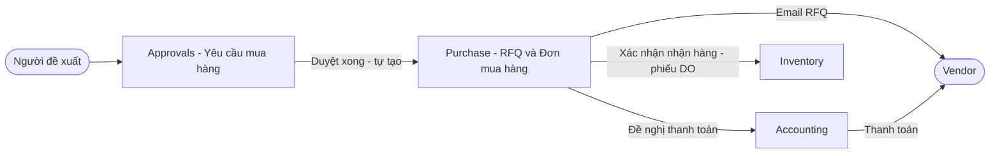
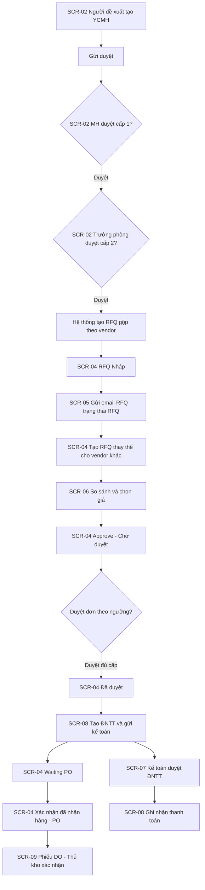
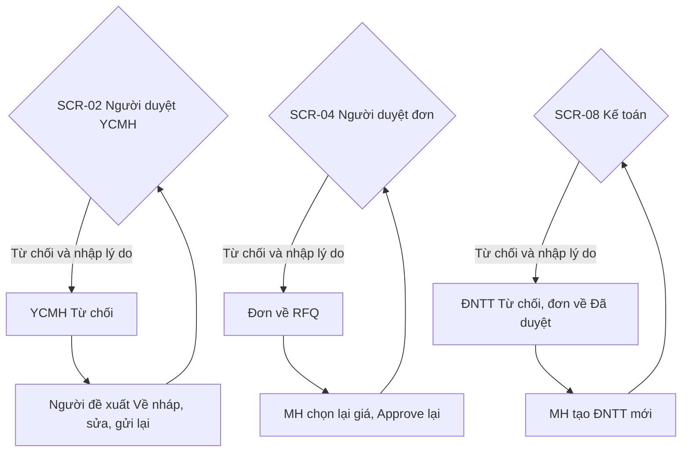
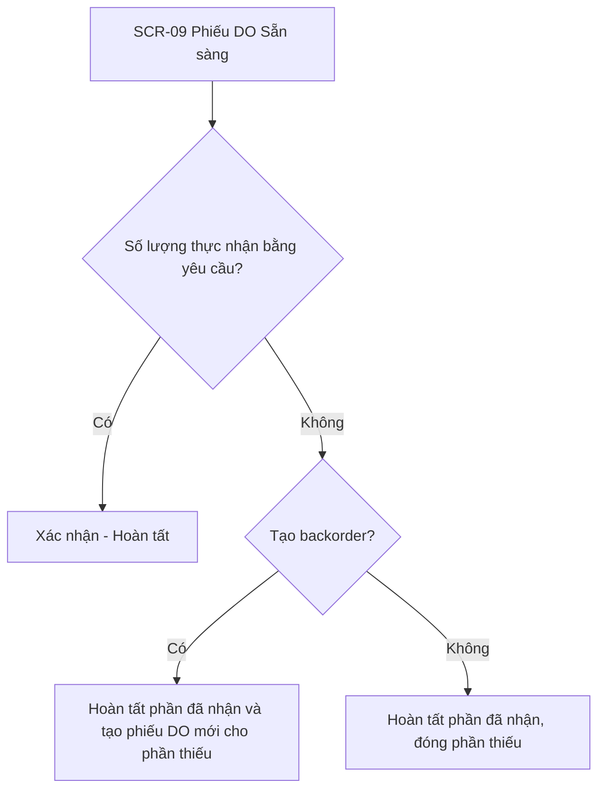

# SRS — Quy trình mua hàng trên Odoo

| Thuộc tính | Giá trị |
|---|---|
| Mã dự án | odoo-mua-hang |
| Phiên bản | 0.1 (bản nháp tự động) |
| Ngày | 2026-10-20 |
| Tài liệu liên quan | URD.md, brainstorm.md, ui/flows.md |
| Trạng thái | Chờ review |

## 1. Giới thiệu

### 1.1 Mục đích
Tài liệu đặc tả yêu cầu phần mềm cho quy trình mua hàng trên Odoo 17 (Purchase, Inventory, Approvals, Accounting), dành cho đội phát triển Odoo, QA và khách hàng. Tài liệu là căn cứ để ước lượng, phát triển module tuỳ biến và nghiệm thu.

### 1.2 Phạm vi
- **Trong phạm vi:**
  - Yêu cầu mua hàng trên Approvals, duyệt 2 cấp (Nhân viên MH → Trưởng phòng).
  - Tự tạo RFQ gộp theo vendor khi yêu cầu được duyệt xong.
  - Gửi email RFQ; RFQ thay thế cho vendor khác; so sánh và chọn giá theo dòng.
  - Gửi duyệt và duyệt đơn mua hàng theo ngưỡng giá trị.
  - Đề nghị thanh toán (chứng từ mới), Kế toán duyệt và ghi nhận thanh toán.
  - Trạng thái mới `Đã duyệt`, `Waiting PO`; nút "Xác nhận đã nhận hàng" chuyển `PO` và tạo phiếu DO.
  - Nhập kho theo phiếu DO, nhận thiếu tạo backorder.
  - Cấu hình người duyệt và ngưỡng.
- **Ngoài phạm vi:** hoá đơn nhà cung cấp và đối chiếu 3 bên (AS-15); kiểm soát ngân sách; cổng vendor (AS-16); đa tiền tệ (AS-17); báo cáo phân tích mua hàng.

### 1.3 Thuật ngữ
| Thuật ngữ | Giải thích |
|---|---|
| Yêu cầu mua hàng (YCMH) | Phiếu đề xuất mua do Người đề xuất tạo, model `approval.request` loại Purchases |
| RFQ | Request for Quotation — Yêu cầu báo giá gửi vendor, model `purchase.order` ở trạng thái Nháp / RFQ |
| RFQ thay thế | RFQ cho vendor khác cùng nhu cầu, liên kết trong nhóm Alternatives để so sánh giá |
| Đơn mua hàng | `purchase.order` từ trạng thái Chờ duyệt trở đi |
| PO | Trạng thái đơn mua hàng đã xác nhận nhận hàng (state `purchase` của Odoo) |
| Waiting PO | Trạng thái mới: đơn đã có Đề nghị thanh toán, đang chờ hàng về |
| Đề nghị thanh toán (ĐNTT) | Chứng từ mới yêu cầu Kế toán thanh toán cho vendor theo một đơn mua hàng |
| Phiếu DO | Phiếu nhập kho (Receipt, `stock.picking` loại incoming) tạo khi xác nhận nhận hàng (AS-12) |
| Vendor | Nhà cung cấp (`res.partner` có bảng giá nhà cung cấp) |
| MH | Phòng / Nhân viên Mua hàng |
| Backorder | Phiếu DO mới cho phần hàng chưa nhận đủ |
| Chatter | Khung lịch sử trao đổi và theo dõi thay đổi bên phải form Odoo |
| Activity | Việc cần làm Odoo giao cho một người dùng, có hạn xử lý |

## 2. Mô tả tổng quan

### 2.1 Bối cảnh hệ thống
Toàn bộ quy trình chạy trong một CSDL Odoo 17 Enterprise (AS-01). Approvals quản lý Yêu cầu mua hàng; Purchase quản lý RFQ và đơn mua hàng; Accounting quản lý Đề nghị thanh toán và thanh toán; Inventory quản lý phiếu DO. Máy chủ email (SMTP) gửi RFQ cho vendor và thông báo cho người dùng.

### 2.2 Vai trò người dùng
| Vai trò | Hệ thống | Quyền chính |
|---|---|---|
| Người đề xuất | Backend — Approvals | Tạo, sửa, gửi, huỷ Yêu cầu mua hàng của mình |
| Nhân viên MH | Backend — Approvals, Purchase, Accounting | Duyệt cấp 1 YCMH; tạo, gửi, huỷ RFQ; chọn giá; gửi duyệt đơn; tạo ĐNTT; xác nhận nhận hàng |
| Trưởng phòng | Backend — Approvals | Duyệt cấp 2 YCMH của bộ phận mình |
| Trưởng phòng Mua hàng | Backend — Purchase | Duyệt đơn mua hàng (AS-08) |
| Giám đốc | Backend — Purchase | Duyệt đơn mua hàng từ ngưỡng (AS-08) |
| Kế toán | Backend — Accounting | Duyệt, từ chối ĐNTT; ghi nhận thanh toán |
| Thủ kho | Backend — Inventory | Xác nhận phiếu DO, tạo backorder |
| Quản trị hệ thống | Backend — Settings | Cấu hình người duyệt, ngưỡng, mẫu email |

### 2.3 Giả định & phụ thuộc
- **Giả định:** xem mục 9.1 (AS-01 … AS-25).
- **Phụ thuộc:**
  - Odoo 17 Enterprise với các module `purchase`, `purchase_requisition` (Alternatives), `approvals`, `approval_purchase`, `stock`, `account_accountant` (AS-01).
  - Module tuỳ biến mới `purchase_flow_custom` (tên đề xuất) chứa toàn bộ thay đổi; không sửa mã nguồn lõi.
  - Máy chủ SMTP đã cấu hình trong Odoo.
  - Dữ liệu bảng giá nhà cung cấp (`product.supplierinfo`) của sản phẩm (AS-04).

## 3. Yêu cầu chức năng

### FR-01 — Tạo và gửi Yêu cầu mua hàng
- **Mô tả:** Người đề xuất tạo YCMH gồm nhiều dòng sản phẩm và gửi duyệt.
- **Vai trò:** Người đề xuất
- **Truy vết:** US-01 · Màn hình: SCR-01, SCR-02
- **Input:** Người đề xuất (mặc định người đăng nhập, bắt buộc); Phòng ban (tự lấy từ nhân viên, bắt buộc); Ngày cần hàng (date, bắt buộc); Lý do mua (text, bắt buộc); Dòng sản phẩm: Sản phẩm (bắt buộc), Mô tả, Số lượng (> 0, bắt buộc), Đơn vị tính (bắt buộc), Vendor đề xuất (tuỳ chọn), Đơn giá dự kiến (tuỳ chọn); Tệp đính kèm.
- **Output:** YCMH mã `YCMH/<năm>/<4 số>` (AS-20) trạng thái "Chờ duyệt"; activity "Duyệt yêu cầu mua hàng" cho Nhân viên MH.
- **Business rules:**
  - BR-01.1: Phải có ít nhất 1 dòng sản phẩm.
  - BR-01.2: Ngày cần hàng ≥ ngày hiện tại (AS-19).
  - BR-01.3: Chỉ sửa được phiếu ở trạng thái "Nháp".
  - BR-01.4: Tổng dự kiến = Σ (Số lượng × Đơn giá dự kiến), chỉ để tham khảo.
- **Acceptance criteria:**
  1. **Given** phiếu Nháp có 1 dòng số lượng 5 và ngày cần hàng là ngày mai **When** người đề xuất bấm "Gửi duyệt" **Then** phiếu nhận mã `YCMH/2026/0001`, chuyển "Chờ duyệt" và Nhân viên MH có activity hạn 1 ngày làm việc (AS-24).
  2. **Given** phiếu không có dòng **When** bấm "Gửi duyệt" **Then** hiện lỗi "Yêu cầu mua hàng phải có ít nhất một sản phẩm" và phiếu giữ "Nháp".
  3. **Given** ngày cần hàng là hôm qua **When** bấm "Gửi duyệt" **Then** hiện lỗi "Ngày cần hàng không được trước ngày hôm nay".
  4. **Given** dòng có số lượng 0 **When** bấm "Lưu" **Then** hiện lỗi "Số lượng phải lớn hơn 0" tại ô số lượng.
- **Độ ưu tiên:** Must

### FR-02 — Duyệt Yêu cầu mua hàng 2 cấp
- **Mô tả:** YCMH được duyệt tuần tự: cấp 1 Nhân viên MH, cấp 2 Trưởng phòng của bộ phận người đề xuất (AS-03).
- **Vai trò:** Nhân viên MH, Trưởng phòng
- **Truy vết:** US-05, US-14 · Màn hình: SCR-02
- **Input:** Thao tác "Duyệt" của người duyệt đúng cấp; Vendor trên từng dòng (MH bổ sung khi thiếu).
- **Output:** Trạng thái người duyệt cập nhật; duyệt cấp 1 xong → activity cho Trưởng phòng; duyệt cấp 2 xong → YCMH "Đã duyệt" và kích hoạt FR-05.
- **Business rules:**
  - BR-02.1: Dùng cấu hình Approvals "Approvers sequence" bật; người duyệt cấp 2 chỉ thấy nút "Duyệt" khi cấp 1 đã duyệt.
  - BR-02.2: Trưởng phòng = `department_id.manager_id` của nhân viên người đề xuất (AS-03).
  - BR-02.3: Khi Nhân viên MH duyệt, mọi dòng phải xác định được vendor theo thứ tự: vendor trên dòng → vendor đầu tiên (theo sequence) trong bảng giá nhà cung cấp còn hiệu lực của sản phẩm (AS-04).
  - BR-02.4: Người đề xuất không được tự duyệt phiếu của mình.
- **Acceptance criteria:**
  1. **Given** phiếu "Chờ duyệt" cấp 1 **When** Nhân viên MH bấm "Duyệt" **Then** dòng MH trong khối Người duyệt chuyển "Đã duyệt" và Trưởng phòng có activity duyệt.
  2. **Given** dòng sản phẩm "Giấy A4" không có vendor trên dòng và trong bảng giá **When** Nhân viên MH bấm "Duyệt" **Then** hiện lỗi "Chưa xác định vendor cho: Giấy A4" và phiếu giữ nguyên trạng thái.
  3. **Given** cấp 1 chưa duyệt **When** Trưởng phòng mở phiếu **Then** nút "Duyệt" không hiển thị với Trưởng phòng.
  4. **Given** cấp 1 đã duyệt **When** Trưởng phòng bấm "Duyệt" **Then** phiếu chuyển "Đã duyệt" trong cùng giao dịch với việc tạo RFQ (FR-05).
- **Độ ưu tiên:** Must

### FR-03 — Từ chối và gửi lại Yêu cầu mua hàng
- **Mô tả:** Người duyệt ở cấp bất kỳ từ chối YCMH kèm lý do; người đề xuất sửa và gửi lại.
- **Vai trò:** Nhân viên MH, Trưởng phòng, Người đề xuất
- **Truy vết:** US-02, US-05, US-14 · Màn hình: SCR-02
- **Input:** Lý do từ chối (text, bắt buộc).
- **Output:** YCMH "Từ chối"; tin nhắn chatter "Từ chối bởi <người duyệt>: <lý do>"; email thông báo người đề xuất.
- **Business rules:**
  - BR-03.1: Lý do bắt buộc, tối thiểu 10 ký tự (AS-25).
  - BR-03.2: "Về nháp" đặt lại trạng thái mọi người duyệt; khi gửi lại duyệt từ cấp 1 (AS-09).
- **Acceptance criteria:**
  1. **Given** Trưởng phòng bấm "Từ chối" **When** để trống lý do và bấm "Xác nhận" **Then** hiện lỗi "Vui lòng nhập lý do từ chối" và hộp thoại không đóng.
  2. **Given** lý do hợp lệ **When** bấm "Xác nhận" **Then** phiếu chuyển "Từ chối" và người đề xuất nhận email chứa lý do.
  3. **Given** phiếu "Từ chối" **When** người đề xuất bấm "Về nháp", sửa và "Gửi duyệt" **Then** phiếu chuyển "Chờ duyệt" cấp 1 và chatter còn lịch sử lần từ chối trước.
- **Độ ưu tiên:** Must

### FR-04 — Huỷ Yêu cầu mua hàng
- **Mô tả:** Người đề xuất huỷ YCMH chưa duyệt xong.
- **Vai trò:** Người đề xuất
- **Truy vết:** US-04 · Màn hình: SCR-02
- **Input:** Thao tác "Huỷ".
- **Output:** YCMH "Đã huỷ"; activity duyệt đang mở bị xoá.
- **Business rules:**
  - BR-04.1: Chỉ huỷ được khi trạng thái là "Nháp", "Chờ duyệt" hoặc "Từ chối" (AS-14).
- **Acceptance criteria:**
  1. **Given** phiếu "Chờ duyệt" **When** người đề xuất bấm "Huỷ" **Then** phiếu chuyển "Đã huỷ" và activity của người duyệt bị xoá.
  2. **Given** phiếu "Đã duyệt" **When** mở phiếu **Then** nút "Huỷ" không hiển thị.
- **Độ ưu tiên:** Should

### FR-05 — Tự động tạo RFQ gộp theo vendor
- **Mô tả:** Khi YCMH chuyển "Đã duyệt", hệ thống tạo RFQ: các dòng cùng vendor gộp vào một RFQ, mỗi vendor một RFQ.
- **Vai trò:** Hệ thống
- **Truy vết:** US-06 · Màn hình: Không có UI (kết quả hiển thị ở SCR-02, SCR-04)
- **Input:** Dòng YCMH đã xác định vendor (BR-02.3).
- **Output:** n RFQ trạng thái "Nháp" (n = số vendor khác nhau); mỗi RFQ có `Yêu cầu mua hàng` = YCMH gốc; activity "Gửi RFQ" cho Nhân viên MH đã duyệt cấp 1.
- **Business rules:**
  - BR-05.1: Nhóm dòng theo vendor; mỗi YCMH sinh RFQ riêng, không gộp vào RFQ của YCMH khác (AS-05).
  - BR-05.2: Dòng RFQ lấy sản phẩm, mô tả, số lượng, đơn vị tính; ngày cần hàng → `date_planned`; đơn giá lấy theo bảng giá vendor nếu có, nếu không = 0.
  - BR-05.3: Chạy một lần cho mỗi YCMH (cờ `rfq_generated`); duyệt lại không tạo RFQ trùng.
  - BR-05.4: Lỗi khi tạo RFQ → huỷ toàn bộ giao dịch duyệt, YCMH giữ trạng thái cũ, hiện lỗi cho người duyệt.
- **Acceptance criteria:**
  1. **Given** YCMH có 3 dòng: 2 dòng vendor "Công ty Văn phòng phẩm Hồng Hà", 1 dòng vendor "Công ty TNHH Tin học Phong Vũ" **When** Trưởng phòng duyệt **Then** tạo đúng 2 RFQ Nháp, RFQ Hồng Hà có 2 dòng, RFQ Phong Vũ có 1 dòng.
  2. **Given** RFQ đã tạo **When** mở RFQ **Then** trường "Yêu cầu mua hàng" hiện mã YCMH gốc và mở được phiếu gốc.
  3. **Given** YCMH đã có cờ `rfq_generated` **When** hàm tạo RFQ được gọi lại **Then** không có RFQ mới nào được tạo.
- **Độ ưu tiên:** Must

### FR-06 — Gửi email RFQ cho vendor
- **Mô tả:** Nhân viên MH gửi RFQ qua email cho vendor; RFQ chuyển trạng thái "RFQ". Gửi được hàng loạt từ danh sách.
- **Vai trò:** Nhân viên MH
- **Truy vết:** US-07 · Màn hình: SCR-03, SCR-04, SCR-05
- **Input:** Người nhận (mặc định vendor của RFQ, thêm được người nhận khác), Tiêu đề, Nội dung (theo mẫu email "Yêu cầu báo giá"), Tệp đính kèm (PDF RFQ tự sinh).
- **Output:** Email gửi đi; tin nhắn trên chatter RFQ; RFQ trạng thái "RFQ" (state `sent`).
- **Business rules:**
  - BR-06.1: Vendor không có email → chặn gửi (AS-13).
  - BR-06.2: Gửi hàng loạt: mỗi RFQ một email riêng tới vendor của RFQ đó.
  - BR-06.3: Gửi lại RFQ đã ở trạng thái "RFQ" được phép; trạng thái giữ nguyên.
- **Acceptance criteria:**
  1. **Given** RFQ Nháp vendor có email **When** bấm "Gửi email RFQ" rồi "Gửi" **Then** email kèm `P00012.pdf` được gửi và RFQ chuyển "RFQ".
  2. **Given** vendor không có email **When** bấm "Gửi" **Then** hiện lỗi "Vendor Công ty TNHH An Phát chưa có email" và RFQ giữ "Nháp".
  3. **Given** chọn 3 RFQ Nháp của 3 vendor trên danh sách **When** chọn "Thao tác › Gửi email RFQ" và xác nhận **Then** 3 email riêng được gửi và cả 3 RFQ chuyển "RFQ".
- **Độ ưu tiên:** Must

### FR-07 — Tạo RFQ thay thế cho vendor khác
- **Mô tả:** Từ một RFQ, Nhân viên MH tạo RFQ cho vendor khác với cùng dòng sản phẩm để so sánh giá (Alternatives, AS-06).
- **Vai trò:** Nhân viên MH
- **Truy vết:** US-08 · Màn hình: SCR-04
- **Input:** Vendor (bắt buộc); Sao chép dòng sản phẩm (mặc định bật).
- **Output:** RFQ Nháp mới cùng nhóm thay thế; tab "Báo giá thay thế" ở các RFQ trong nhóm liệt kê nhau.
- **Business rules:**
  - BR-07.1: Một vendor chỉ có một RFQ trong một nhóm thay thế.
  - BR-07.2: Chỉ tạo được khi RFQ ở trạng thái "Nháp" hoặc "RFQ".
  - BR-07.3: RFQ thay thế kế thừa trường "Yêu cầu mua hàng" của RFQ gốc.
- **Acceptance criteria:**
  1. **Given** RFQ P00012 vendor Hồng Hà **When** bấm "Tạo RFQ thay thế", chọn vendor "Công ty CP Thiên Long" và "Tạo" **Then** RFQ P00014 vendor Thiên Long được tạo với cùng sản phẩm, số lượng và xuất hiện trong tab "Báo giá thay thế" của P00012.
  2. **Given** Thiên Long đã có RFQ trong nhóm **When** chọn lại Thiên Long **Then** hiện lỗi "Vendor Công ty CP Thiên Long đã có RFQ trong nhóm này".
- **Độ ưu tiên:** Must

### FR-08 — Nhập giá, so sánh và chọn giá
- **Mô tả:** Nhân viên MH nhập đơn giá vendor báo về vào từng RFQ, mở màn hình so sánh theo dòng sản phẩm và chọn giá.
- **Vai trò:** Nhân viên MH
- **Truy vết:** US-09 · Màn hình: SCR-04, SCR-06
- **Input:** Đơn giá, Ngày giao dự kiến trên từng dòng RFQ (nhập tay, AS-16); thao tác "Chọn" trên dòng.
- **Output:** Dòng được chọn giữ số lượng; dòng cùng sản phẩm ở RFQ khác trong nhóm về số lượng 0; RFQ không còn dòng số lượng > 0 bị huỷ khi bấm "Hoàn tất chọn giá".
- **Business rules:**
  - BR-08.1: Màn hình so sánh nhóm theo sản phẩm; mỗi nhóm hiện mọi vendor có báo giá; đánh dấu đơn giá thấp nhất và ngày giao sớm nhất.
  - BR-08.2: Chọn theo dòng; cho phép chọn vendor khác nhau cho các sản phẩm khác nhau (AS-07).
  - BR-08.3: Dòng đơn giá = 0 không chọn được.
  - BR-08.4: "Hoàn tất chọn giá" huỷ các RFQ trong nhóm không còn dòng số lượng > 0, ghi chatter "Huỷ do không được chọn giá".
- **Acceptance criteria:**
  1. **Given** sản phẩm "Bút bi Thiên Long TL-027" có giá 4.500₫ (Hồng Hà) và 4.200₫ (Thiên Long) **When** mở "So sánh báo giá" **Then** dòng 4.200₫ được đánh dấu "Giá thấp nhất".
  2. **Given** bấm "Chọn" ở dòng Thiên Long **When** hệ thống ghi nhận **Then** dòng bút bi ở RFQ Hồng Hà có số lượng 0 và dòng ở RFQ Thiên Long giữ 200.
  3. **Given** sau khi chọn, RFQ Hồng Hà không còn dòng số lượng > 0 **When** bấm "Hoàn tất chọn giá" **Then** RFQ Hồng Hà chuyển "Đã huỷ".
  4. **Given** dòng có đơn giá 0 **When** bấm "Chọn" **Then** hiện lỗi "Chưa có giá từ vendor cho dòng này".
- **Độ ưu tiên:** Must

### FR-09 — Gửi duyệt đơn mua hàng (Approve)
- **Mô tả:** Sau khi chọn giá, Nhân viên MH bấm "Approve" để đơn vào quy trình duyệt.
- **Vai trò:** Nhân viên MH
- **Truy vết:** US-10 · Màn hình: SCR-04
- **Input:** RFQ trạng thái "RFQ".
- **Output:** Đơn trạng thái "Chờ duyệt" (state `to approve`); danh sách cấp duyệt cần có theo ngưỡng (FR-10); activity cho người duyệt cấp đầu.
- **Business rules:**
  - BR-09.1: Mọi dòng số lượng > 0 phải có đơn giá > 0.
  - BR-09.2: Đơn phải có ít nhất 1 dòng số lượng > 0.
  - BR-09.3: Ghi nhận "Người gửi duyệt" và thời điểm.
- **Acceptance criteria:**
  1. **Given** RFQ "RFQ" tổng 12.500.000₫, mọi dòng có giá **When** bấm "Approve" **Then** đơn chuyển "Chờ duyệt" và Trưởng phòng Mua hàng có activity duyệt.
  2. **Given** một dòng số lượng 10, đơn giá 0 **When** bấm "Approve" **Then** hiện lỗi "Chưa nhập đơn giá cho sản phẩm Mực in HP 107A" và đơn giữ "RFQ".
- **Độ ưu tiên:** Must

### FR-10 — Duyệt hoặc từ chối đơn mua hàng theo ngưỡng
- **Mô tả:** Đơn "Chờ duyệt" được duyệt theo cấp: Trưởng phòng Mua hàng; tổng ≥ ngưỡng thêm Giám đốc (AS-08).
- **Vai trò:** Trưởng phòng Mua hàng, Giám đốc
- **Truy vết:** US-15 · Màn hình: SCR-03, SCR-04
- **Input:** Thao tác "Duyệt" / "Từ chối" + lý do.
- **Output:** Duyệt đủ cấp → đơn "Đã duyệt" (state mới `approved`); từ chối → đơn về "RFQ".
- **Business rules:**
  - BR-10.1: Ngưỡng Giám đốc mặc định 50.000.000₫ (tổng có thuế), cấu hình ở FR-18.
  - BR-10.2: Cấp 2 chỉ duyệt được khi cấp 1 đã duyệt.
  - BR-10.3: Lý do từ chối bắt buộc, tối thiểu 10 ký tự (AS-25); về "RFQ" giữ nguyên giá đã chọn (AS-09). Hộp thoại nhập lý do dùng chung mẫu với SCR-02 trạng thái "Từ chối - nhập lý do".
  - BR-10.4: Nhân viên MH gửi duyệt không được tự duyệt đơn của mình.
  - BR-10.5: Bộ lọc "Chờ tôi duyệt" trên danh sách đơn chỉ hiện đơn có activity duyệt của người đăng nhập.
- **Acceptance criteria:**
  1. **Given** đơn "Chờ duyệt" tổng 12.500.000₫ **When** Trưởng phòng Mua hàng bấm "Duyệt" **Then** đơn chuyển "Đã duyệt".
  2. **Given** đơn tổng 68.000.000₫ **When** Trưởng phòng Mua hàng bấm "Duyệt" **Then** đơn giữ "Chờ duyệt", khối duyệt hiện cấp 1 "Đã duyệt", cấp 2 Giám đốc "Chờ duyệt" và Giám đốc có activity.
  3. **Given** Giám đốc bấm "Từ chối" với lý do "Giá cao hơn hợp đồng năm" **When** xác nhận **Then** đơn về "RFQ" và Nhân viên MH nhận email chứa lý do.
- **Độ ưu tiên:** Must

### FR-11 — Tạo Đề nghị thanh toán và chuyển Waiting PO
- **Mô tả:** Từ đơn "Đã duyệt", Nhân viên MH tạo ĐNTT và gửi Kế toán; đơn chuyển `Waiting PO`.
- **Vai trò:** Nhân viên MH
- **Truy vết:** US-11 · Màn hình: SCR-04, SCR-08
- **Input:** Đơn mua hàng (tự điền); Vendor (tự điền); Số tiền đề nghị (mặc định = tổng đơn, bắt buộc, > 0); Ngày đề nghị thanh toán (bắt buộc); Hình thức thanh toán (Chuyển khoản / Tiền mặt, bắt buộc); Tài khoản ngân hàng vendor (bắt buộc khi Chuyển khoản); Nội dung; Tệp đính kèm (báo giá, hợp đồng).
- **Output:** ĐNTT mã `DNTT/<năm>/<4 số>` trạng thái "Chờ kế toán duyệt"; đơn mua hàng `Waiting PO` (AS-11); activity cho nhóm Kế toán.
- **Business rules:**
  - BR-11.1: Chỉ tạo được từ đơn "Đã duyệt"; mỗi đơn tối đa 1 ĐNTT chưa bị từ chối.
  - BR-11.2: Số tiền đề nghị ≤ tổng đơn.
  - BR-11.3: Đơn chuyển `Waiting PO` khi ĐNTT được gửi ("Gửi kế toán"), không phải khi lưu nháp.
- **Acceptance criteria:**
  1. **Given** đơn P00014 "Đã duyệt" tổng 12.500.000₫ **When** bấm "Tạo đề nghị thanh toán" **Then** mở form ĐNTT điền sẵn vendor, P00014, số tiền 12.500.000₫.
  2. **Given** ĐNTT hợp lệ **When** bấm "Gửi kế toán" **Then** ĐNTT "Chờ kế toán duyệt" và P00014 chuyển `Waiting PO`.
  3. **Given** số tiền 13.000.000₫ > tổng đơn **When** bấm "Gửi kế toán" **Then** hiện lỗi "Số tiền đề nghị vượt tổng giá trị đơn mua hàng".
  4. **Given** hình thức "Chuyển khoản" và không chọn tài khoản ngân hàng **When** bấm "Gửi kế toán" **Then** hiện lỗi tại trường "Tài khoản ngân hàng".
- **Độ ưu tiên:** Must

### FR-12 — Kế toán xử lý Đề nghị thanh toán
- **Mô tả:** Kế toán duyệt hoặc từ chối ĐNTT; ĐNTT đã duyệt được ghi nhận thanh toán.
- **Vai trò:** Kế toán
- **Truy vết:** US-16 · Màn hình: SCR-07, SCR-08
- **Input:** Thao tác "Duyệt"/"Từ chối" + lý do; khi ghi nhận thanh toán: Sổ nhật ký (Ngân hàng/Tiền mặt), Ngày thanh toán, Số tiền.
- **Output:** ĐNTT "Đã duyệt" / "Từ chối" / "Đã thanh toán"; bút toán thanh toán `account.payment` loại outbound cho vendor, liên kết ĐNTT.
- **Business rules:**
  - BR-12.1: Từ chối ĐNTT → đơn mua hàng về "Đã duyệt" để MH tạo lại ĐNTT.
  - BR-12.2: Thanh toán là khoản trả trước cho vendor (chưa đối trừ hoá đơn, AS-10); đối trừ hoá đơn theo chuẩn Odoo (AS-15).
  - BR-12.3: Số tiền ghi nhận thanh toán = số tiền đề nghị (không thanh toán một phần, AS-10).
  - BR-12.4: Trạng thái `Waiting PO` của đơn không thay đổi khi ĐNTT được duyệt hoặc thanh toán.
- **Acceptance criteria:**
  1. **Given** ĐNTT "Chờ kế toán duyệt" **When** Kế toán bấm "Duyệt" **Then** ĐNTT chuyển "Đã duyệt".
  2. **Given** ĐNTT "Đã duyệt" **When** bấm "Ghi nhận thanh toán", chọn sổ "Ngân hàng Vietcombank", ngày 25/10/2026, "Xác nhận" **Then** tạo payment 12.500.000₫ trạng thái Posted và ĐNTT chuyển "Đã thanh toán".
  3. **Given** Kế toán bấm "Từ chối" với lý do hợp lệ **When** xác nhận **Then** ĐNTT "Từ chối", đơn về "Đã duyệt", Nhân viên MH nhận email lý do.
- **Độ ưu tiên:** Must

### FR-13 — Xác nhận đã nhận hàng, chuyển PO và tạo phiếu DO
- **Mô tả:** Khi hàng về, Nhân viên MH bấm "Xác nhận đã nhận hàng": đơn chuyển `PO` (xác nhận đơn chuẩn Odoo) và hệ thống tạo phiếu DO.
- **Vai trò:** Nhân viên MH
- **Truy vết:** US-12 · Màn hình: SCR-04
- **Input:** Đơn `Waiting PO`; xác nhận trong hộp thoại.
- **Output:** Đơn state `purchase` (hiển thị "PO"); phiếu DO (`stock.picking` incoming) trạng thái "Sẵn sàng", dòng = dòng đơn có số lượng > 0; activity cho Thủ kho.
- **Business rules:**
  - BR-13.1: Chỉ hiện nút khi đơn `Waiting PO`.
  - BR-13.2: Gọi `button_confirm` chuẩn của Odoo để sinh phiếu nhập kho; không tự xác nhận phiếu DO (AS-12).
  - BR-13.3: Kho nhận mặc định = kho của loại phiếu nhập trên đơn.
- **Acceptance criteria:**
  1. **Given** P00014 `Waiting PO` có 2 dòng **When** MH bấm "Xác nhận đã nhận hàng" và "Xác nhận" **Then** P00014 chuyển `PO` và tạo phiếu `WH/IN/00031` "Sẵn sàng" có 2 dòng đúng số lượng.
  2. **Given** P00014 đã `PO` **When** mở đơn **Then** nút "Xác nhận đã nhận hàng" không hiển thị và smart button "Phiếu DO" hiện 1.
  3. **Given** hộp thoại xác nhận đang mở **When** MH bấm "Huỷ" **Then** đơn giữ `Waiting PO` và không có phiếu DO mới.
- **Độ ưu tiên:** Must

### FR-14 — Nhập kho theo phiếu DO
- **Mô tả:** Thủ kho kiểm đếm, nhập số lượng thực nhận và xác nhận phiếu DO; nhận thiếu tạo backorder.
- **Vai trò:** Thủ kho
- **Truy vết:** US-17 · Màn hình: SCR-09
- **Input:** Số lượng thực nhận từng dòng; lựa chọn "Tạo backorder" / "Không tạo backorder" khi nhận thiếu.
- **Output:** Phiếu DO "Hoàn tất"; tồn kho tăng; số lượng đã nhận trên dòng đơn mua hàng cập nhật; backorder nếu có.
- **Business rules:**
  - BR-14.1: Dùng luồng Validate và backorder chuẩn Odoo Inventory.
  - BR-14.2: Số lượng thực nhận > số lượng đặt → cảnh báo, Thủ kho xác nhận lần 2.
- **Acceptance criteria:**
  1. **Given** phiếu DO "Sẵn sàng" yêu cầu 200 bút bi **When** Thủ kho nhập 200 và bấm "Xác nhận" **Then** phiếu "Hoàn tất" và tồn kho bút bi tăng 200.
  2. **Given** nhập 150/200 **When** bấm "Xác nhận" và chọn "Tạo backorder" **Then** phiếu hiện tại hoàn tất 150 và tạo phiếu DO mới 50 trạng thái "Sẵn sàng".
- **Độ ưu tiên:** Must

### FR-15 — Huỷ RFQ và đơn mua hàng
- **Mô tả:** Nhân viên MH huỷ RFQ hoặc đơn mua hàng chưa ở `PO`.
- **Vai trò:** Nhân viên MH
- **Truy vết:** US-13 · Màn hình: SCR-04
- **Input:** Lý do huỷ (bắt buộc).
- **Output:** Đơn "Đã huỷ"; ĐNTT liên quan ở trạng thái "Nháp"/"Chờ kế toán duyệt"/"Đã duyệt" bị huỷ theo.
- **Business rules:**
  - BR-15.1: Không huỷ được đơn ở `PO` hoặc có ĐNTT "Đã thanh toán" (AS-14).
- **Acceptance criteria:**
  1. **Given** đơn `Waiting PO`, ĐNTT "Chờ kế toán duyệt" **When** MH bấm "Huỷ" với lý do hợp lệ **Then** đơn và ĐNTT cùng chuyển "Đã huỷ".
  2. **Given** ĐNTT "Đã thanh toán" **When** MH bấm "Huỷ" **Then** hiện lỗi "Đơn đã được thanh toán, liên hệ Kế toán để xử lý".
- **Độ ưu tiên:** Should

### FR-16 — Thông báo và activity
- **Mô tả:** Hệ thống tạo activity và gửi email ở mỗi bước chuyển giao.
- **Vai trò:** Hệ thống
- **Truy vết:** US-05, US-14, US-15, US-16 · Màn hình: Không có UI
- **Input:** Sự kiện chuyển trạng thái.
- **Output:** Activity (hạn 1 ngày làm việc, AS-24) + email theo bảng quy tắc.
- **Business rules:**
  - BR-16.1: Sự kiện → người nhận: YCMH gửi duyệt → Nhân viên MH; MH duyệt → Trưởng phòng; YCMH từ chối → Người đề xuất; RFQ tạo → Nhân viên MH; đơn gửi duyệt → người duyệt cấp hiện tại; đơn từ chối → Nhân viên MH; ĐNTT gửi → nhóm Kế toán; ĐNTT từ chối → Nhân viên MH; phiếu DO tạo → nhóm Thủ kho.
  - BR-16.2: Activity của bước đã xử lý được đánh dấu hoàn thành tự động.
- **Acceptance criteria:**
  1. **Given** đơn gửi duyệt **When** Trưởng phòng Mua hàng duyệt **Then** activity của Trưởng phòng Mua hàng chuyển hoàn thành trong cùng thao tác.
  2. **Given** ĐNTT bị từ chối **When** sự kiện xảy ra **Then** Nhân viên MH nhận 1 email tiêu đề "ĐNTT DNTT/2026/0007 bị từ chối".
- **Độ ưu tiên:** Must

### FR-17 — Truy vết và tra cứu chứng từ
- **Mô tả:** Danh sách và smart button liên kết YCMH ↔ RFQ/đơn ↔ ĐNTT ↔ phiếu DO; bộ lọc theo vai trò.
- **Vai trò:** Tất cả
- **Truy vết:** US-03 · Màn hình: SCR-01, SCR-02, SCR-03, SCR-04
- **Input:** Bộ lọc, nhóm, tìm kiếm.
- **Output:** Danh sách lọc; smart button có số đếm.
- **Business rules:**
  - BR-17.1: Bộ lọc mặc định: Người đề xuất "Của tôi"; Trưởng phòng "Bộ phận của tôi"; MH "Đang xử lý".
  - BR-17.2: Smart button YCMH: "RFQ/Đơn mua hàng"; đơn: "Yêu cầu mua hàng", "Đề nghị thanh toán", "Phiếu DO".
  - BR-17.3: Danh sách đơn có cột Trạng thái hiển thị nhãn: Nháp, RFQ, Chờ duyệt, Đã duyệt, Waiting PO, PO, Đã huỷ.
- **Acceptance criteria:**
  1. **Given** YCMH sinh 2 RFQ **When** mở YCMH **Then** smart button "RFQ/Đơn mua hàng" hiện 2 và mở danh sách đúng 2 phiếu.
  2. **Given** Người đề xuất mở danh sách YCMH **When** không đổi bộ lọc **Then** chỉ thấy phiếu của mình.
- **Độ ưu tiên:** Should

### FR-18 — Cấu hình người duyệt và ngưỡng
- **Mô tả:** Quản trị hệ thống cấu hình người duyệt đơn mua hàng, ngưỡng Giám đốc và mẫu email.
- **Vai trò:** Quản trị hệ thống
- **Truy vết:** US-18 · Màn hình: SCR-10
- **Input:** Người duyệt cấp 1 đơn mua hàng (user, bắt buộc); Người duyệt cấp 2 (user, bắt buộc); Ngưỡng duyệt cấp 2 (số tiền VND, > 0); Mẫu email RFQ; Mẫu email thông báo từ chối.
- **Output:** Cấu hình lưu theo công ty; áp dụng cho đơn gửi duyệt sau thời điểm lưu.
- **Business rules:**
  - BR-18.1: Chỉ nhóm "Quản trị mua hàng" thấy menu cấu hình.
  - BR-18.2: Đơn đang "Chờ duyệt" giữ danh sách cấp duyệt đã tính lúc gửi.
- **Acceptance criteria:**
  1. **Given** đổi ngưỡng từ 50.000.000₫ sang 100.000.000₫ và lưu **When** MH gửi duyệt đơn 68.000.000₫ **Then** đơn chỉ cần Trưởng phòng Mua hàng duyệt.
  2. **Given** nhập ngưỡng 0 **When** bấm "Lưu" **Then** hiện lỗi "Ngưỡng duyệt phải lớn hơn 0".
- **Độ ưu tiên:** Should

## 4. Yêu cầu phi chức năng

### NFR-01 — Hiệu năng
- **Yêu cầu:** Mở danh sách và form YCMH, đơn mua hàng, ĐNTT ≤ 2 giây ở p95 với 50 người dùng đồng thời và 20.000 đơn mua hàng/năm (AS-21). Tạo RFQ cho YCMH 50 dòng ≤ 5 giây.
- **Cách kiểm chứng:** Kiểm thử tải trên môi trường staging có dữ liệu giả lập tương đương.

### NFR-02 — Bảo mật và phân quyền
- **Yêu cầu:** Nhóm quyền mới: Người đề xuất, Nhân viên MH, Trưởng phòng Mua hàng, Kế toán ĐNTT, Quản trị mua hàng. Record rule: Người đề xuất chỉ đọc/sửa YCMH của mình; Trưởng phòng đọc YCMH của bộ phận; chỉ Kế toán duyệt và ghi nhận thanh toán ĐNTT.
- **Cách kiểm chứng:** Kiểm thử ma trận quyền với 1 tài khoản mỗi nhóm.

### NFR-03 — Audit log
- **Yêu cầu:** Mọi thay đổi trạng thái, người duyệt, số tiền, đơn giá được tracking trên chatter kèm người và thời điểm. Không xoá được YCMH, đơn, ĐNTT đã rời trạng thái "Nháp"; chỉ huỷ.
- **Cách kiểm chứng:** Thực hiện trọn quy trình, kiểm tra chatter từng chứng từ; thử xoá chứng từ đã gửi.

### NFR-04 — Toàn vẹn dữ liệu
- **Yêu cầu:** Duyệt YCMH và tạo RFQ chạy trong một giao dịch; lỗi thì rollback toàn bộ. Hai người bấm duyệt đồng thời chỉ một thao tác thành công, thao tác còn lại nhận lỗi "Phiếu đã được cập nhật, vui lòng tải lại".
- **Cách kiểm chứng:** Kiểm thử tự động (unit test Odoo) cho tạo RFQ và duyệt đồng thời.

### NFR-05 — Khả dụng
- **Yêu cầu:** Hệ thống sẵn sàng 99,5% trong giờ làm việc 08:00–18:00, thứ 2–thứ 7 (AS-22).
- **Cách kiểm chứng:** Giám sát uptime hằng tháng.

### NFR-06 — Ngôn ngữ và định dạng
- **Yêu cầu:** Giao diện, email, mẫu in tiếng Việt; tiền VND `12.500.000₫`; ngày `dd/mm/yyyy`; múi giờ Asia/Ho_Chi_Minh.
- **Cách kiểm chứng:** Kiểm tra giao diện, email và PDF mẫu.

### NFR-07 — Tương thích trình duyệt
- **Yêu cầu:** Chrome và Edge 2 phiên bản mới nhất, màn hình ≥ 1366px (AS-23).
- **Cách kiểm chứng:** Kiểm thử thủ công trên 2 trình duyệt.

### NFR-08 — Gửi email
- **Yêu cầu:** Email gửi qua SMTP cấu hình sẵn; email lỗi hiện biểu tượng lỗi trên chatter và được cron chuẩn Odoo gửi lại; không chặn chuyển trạng thái.
- **Cách kiểm chứng:** Tắt SMTP tạm thời, gửi RFQ, kiểm tra trạng thái và hàng đợi email.

### NFR-09 — Khả năng bảo trì
- **Yêu cầu:** Toàn bộ tuỳ biến nằm trong module `purchase_flow_custom`, kế thừa model chuẩn, không sửa mã nguồn lõi; có unit test cho FR-05, FR-08, FR-10, FR-11, FR-13.
- **Cách kiểm chứng:** Code review; chạy test suite khi nâng cấp.

## 5. Tích hợp & dữ liệu

### 5.1 Hệ thống ngoài
| Hệ thống | Mục đích | Giao thức | Chiều | Tần suất | Xử lý lỗi |
|---|---|---|---|---|---|
| Approvals → Purchase | Tạo RFQ từ YCMH đã duyệt | ORM nội bộ Odoo | Approvals → Purchase | Realtime khi duyệt cấp cuối | Rollback giao dịch, hiện lỗi cho người duyệt |
| Purchase → Accounting | ĐNTT, payment | ORM nội bộ Odoo | Purchase → Accounting | Realtime | Validate trước khi lưu, hiện lỗi |
| Purchase → Inventory | Phiếu DO khi xác nhận nhận hàng | ORM nội bộ Odoo (`button_confirm`) | Purchase → Inventory | Realtime | Rollback, đơn giữ `Waiting PO` |
| Máy chủ SMTP | Email RFQ, thông báo | SMTP/TLS | Odoo → vendor, người dùng | Hàng đợi email Odoo, cron mỗi 5 phút | Gửi lại theo cron chuẩn; lỗi hiện trên chatter |

- Source of truth: CSDL Odoo cho mọi đối tượng.

### 5.2 API
| API | Method | Endpoint | Request chính | Response chính |
|---|---|---|---|---|
| Duyệt YCMH (mở rộng) | ORM | `approval.request.action_approve()` | id YCMH | YCMH đã cập nhật; gọi `_generate_rfqs()` khi duyệt cấp cuối |
| Tạo RFQ theo vendor | ORM | `approval.request._generate_rfqs()` | dòng YCMH | danh sách `purchase.order` mới |
| Gửi duyệt đơn | ORM | `purchase.order.action_submit_approval()` | id đơn | state `to approve`, danh sách cấp duyệt |
| Duyệt đơn | ORM | `purchase.order.action_approve_level()` | id đơn | state `approved` khi đủ cấp |
| Tạo ĐNTT | ORM | `purchase.order.action_create_payment_request()` | id đơn | form `purchase.payment.request` mới |
| Xác nhận nhận hàng | ORM | `purchase.order.action_confirm_receipt()` | id đơn | state `purchase`, `stock.picking` mới |
| Ghi nhận thanh toán | ORM | `purchase.payment.request.action_register_payment()` | sổ nhật ký, ngày | `account.payment` posted |

### 5.3 Mapping trường dữ liệu
| Nguồn | Đích | Kiểu | Ghi chú |
|---|---|---|---|
| `approval.request.name` | `purchase.order.approval_request_id` | many2one | Liên kết YCMH gốc (trường mới) |
| `approval.product.line.product_id` | `purchase.order.line.product_id` | many2one | |
| `approval.product.line.description` | `purchase.order.line.name` | text | |
| `approval.product.line.quantity` | `purchase.order.line.product_qty` | float | Quy đổi theo đơn vị tính mua |
| `approval.product.line.product_uom_id` | `purchase.order.line.product_uom` | many2one | |
| `approval.product.line.vendor_id` (mới) | `purchase.order.partner_id` | many2one | Khoá gộp RFQ (BR-05.1) |
| `approval.request.date_needed` (mới) | `purchase.order.line.date_planned` | date | |
| `purchase.order.id` | `purchase.payment.request.purchase_id` | many2one | Model mới |
| `purchase.order.partner_id` | `purchase.payment.request.partner_id` | many2one | |
| `purchase.order.amount_total` | `purchase.payment.request.amount` | monetary | Giá trị mặc định, sửa được ≤ tổng |
| `purchase.payment.request.amount` | `account.payment.amount` | monetary | payment_type `outbound` |
| `purchase.order.line.product_qty` | `stock.move.product_uom_qty` | float | Sinh bởi `button_confirm` |

## 6. Screen Inventory

### 6.1 Danh sách màn hình
| SCR | Tên | Vai trò | Trường dữ liệu | Hành động | Trạng thái | FR | Loại |
|---|---|---|---|---|---|---|---|
| SCR-01 | Danh sách Yêu cầu mua hàng | Người đề xuất, Nhân viên MH, Trưởng phòng | Mã, Người đề xuất, Phòng ban, Ngày cần hàng, Tổng dự kiến, Trạng thái | Mới, Tìm kiếm, Lọc, Nhóm theo | Mặc định, Rỗng | FR-01, FR-17 | backend |
| SCR-02 | Yêu cầu mua hàng | Người đề xuất, Nhân viên MH, Trưởng phòng | Mã, Người đề xuất, Phòng ban, Ngày cần hàng, Lý do mua, Dòng sản phẩm (Sản phẩm, Mô tả, Số lượng, Đơn vị tính, Vendor, Đơn giá dự kiến), Tổng dự kiến, Người duyệt và trạng thái duyệt, Tệp đính kèm | Gửi duyệt, Duyệt, Từ chối, Về nháp, Huỷ, RFQ/Đơn mua hàng | Nháp, Chờ duyệt cấp 2, Đã duyệt, Từ chối - nhập lý do, Từ chối, Lỗi validate | FR-01, FR-02, FR-03, FR-04, FR-17 | backend |
| SCR-03 | Danh sách RFQ và Đơn mua hàng | Nhân viên MH, Người duyệt đơn mua hàng | Mã, Vendor, Yêu cầu mua hàng, Ngày đặt, Ngày cần hàng, Tổng tiền, Trạng thái | Mới, Gửi email RFQ hàng loạt, Lọc Chờ tôi duyệt, Nhóm theo trạng thái | Mặc định, Rỗng | FR-06, FR-10, FR-17 | backend |
| SCR-04 | RFQ và Đơn mua hàng | Nhân viên MH, Người duyệt đơn mua hàng | Mã, Vendor, Yêu cầu mua hàng, Ngày đặt, Ngày cần hàng, Dòng (Sản phẩm, Số lượng, Đơn giá, Ngày giao dự kiến, Thành tiền), Tổng tiền, Báo giá thay thế, Cấp duyệt, Lý do | Gửi email RFQ, Tạo RFQ thay thế, So sánh báo giá, Approve, Duyệt, Từ chối, Tạo đề nghị thanh toán, Xác nhận đã nhận hàng, Huỷ, Yêu cầu mua hàng, Đề nghị thanh toán, Phiếu DO | Nháp, RFQ, Tạo RFQ thay thế, Lỗi chưa nhập giá, Chờ duyệt, Đã duyệt, Waiting PO, Xác nhận nhận hàng, PO | FR-06, FR-07, FR-08, FR-09, FR-10, FR-11, FR-13, FR-15, FR-17 | backend |
| SCR-05 | Gửi email yêu cầu báo giá | Nhân viên MH | Người nhận, Tiêu đề, Nội dung, Tệp đính kèm, Mẫu email | Gửi, Huỷ | Mặc định, Lỗi vendor chưa có email | FR-06 | backend |
| SCR-06 | So sánh báo giá | Nhân viên MH | Sản phẩm, Vendor, RFQ, Số lượng, Đơn giá, Thành tiền, Ngày giao dự kiến, Nhãn Giá thấp nhất | Chọn, Bỏ chọn, Hoàn tất chọn giá | Mặc định, Đã chọn, Rỗng | FR-08 | backend |
| SCR-07 | Danh sách Đề nghị thanh toán | Kế toán, Nhân viên MH | Mã, Đơn mua hàng, Vendor, Số tiền, Ngày đề nghị, Hình thức, Trạng thái | Lọc Chờ kế toán duyệt, Nhóm theo trạng thái, Tìm kiếm | Mặc định, Rỗng | FR-12 | backend |
| SCR-08 | Đề nghị thanh toán | Nhân viên MH, Kế toán | Mã, Đơn mua hàng, Vendor, Số tiền, Ngày đề nghị, Hình thức thanh toán, Tài khoản ngân hàng, Nội dung, Tệp đính kèm, Thanh toán | Gửi kế toán, Duyệt, Từ chối, Ghi nhận thanh toán, Huỷ | Nháp, Lỗi validate, Chờ kế toán duyệt, Ghi nhận thanh toán, Đã thanh toán | FR-11, FR-12 | backend |
| SCR-09 | Phiếu DO - nhập kho | Thủ kho | Mã, Vendor, Chứng từ gốc, Ngày dự kiến, Kho nhận, Dòng (Sản phẩm, Số lượng yêu cầu, Số lượng thực nhận, Đơn vị tính) | Xác nhận, Tạo backorder, Không tạo backorder | Sẵn sàng, Nhận thiếu - backorder, Hoàn tất | FR-14 | backend |
| SCR-10 | Cấu hình duyệt mua hàng | Quản trị hệ thống | Người duyệt cấp 1, Người duyệt cấp 2, Ngưỡng duyệt cấp 2, Mẫu email RFQ, Mẫu email từ chối | Lưu, Huỷ bỏ | Mặc định, Lỗi validate | FR-18 | backend |

### 6.2 Wireframe

#### SCR-01 — Danh sách Yêu cầu mua hàng
Danh sách YCMH nhóm theo trạng thái, bộ lọc mặc định theo vai trò. Điểm vào để tạo phiếu mới.

#### SCR-02 — Yêu cầu mua hàng
Form YCMH: thông tin chung, dòng sản phẩm, khối người duyệt 2 cấp. Nút hiển thị theo trạng thái và cấp duyệt.

#### SCR-03 — Danh sách RFQ và Đơn mua hàng
Danh sách RFQ và đơn mua hàng với các trạng thái mới; hỗ trợ gửi email RFQ hàng loạt và lọc "Chờ tôi duyệt".

#### SCR-04 — RFQ và Đơn mua hàng
Form trung tâm của quy trình: statusbar Nháp → RFQ → Chờ duyệt → Đã duyệt → Waiting PO → PO; nút đổi theo trạng thái.

#### SCR-05 — Gửi email yêu cầu báo giá
Cửa sổ soạn email gửi RFQ cho vendor, đính kèm PDF RFQ.

#### SCR-06 — So sánh báo giá
Bảng so sánh dòng sản phẩm giữa các RFQ trong nhóm thay thế, đánh dấu giá thấp nhất, chọn theo dòng.

#### SCR-07 — Danh sách Đề nghị thanh toán
Danh sách ĐNTT cho Kế toán, lọc mặc định "Chờ kế toán duyệt".

#### SCR-08 — Đề nghị thanh toán
Form ĐNTT gắn với một đơn mua hàng; Kế toán duyệt và ghi nhận thanh toán.

#### SCR-09 — Phiếu DO - nhập kho
Phiếu nhập kho tạo tự động khi xác nhận nhận hàng; Thủ kho nhập số lượng thực nhận.

#### SCR-10 — Cấu hình duyệt mua hàng
Trang Settings của Purchase, khối cấu hình người duyệt, ngưỡng và mẫu email.

## 7. User flow

### 7.1 Luồng chính end-to-end

### 7.2 Luồng từ chối

### 7.3 Luồng nhận thiếu hàng

## 8. Ma trận truy vết

| FR | Tên | URD (US) | Màn hình (SCR) |
|---|---|---|---|
| FR-01 | Tạo và gửi Yêu cầu mua hàng | US-01 | SCR-01, SCR-02 |
| FR-02 | Duyệt Yêu cầu mua hàng 2 cấp | US-05, US-14 | SCR-02 |
| FR-03 | Từ chối và gửi lại Yêu cầu mua hàng | US-02, US-05, US-14 | SCR-02 |
| FR-04 | Huỷ Yêu cầu mua hàng | US-04 | SCR-02 |
| FR-05 | Tự động tạo RFQ gộp theo vendor | US-06 | Không có UI |
| FR-06 | Gửi email RFQ cho vendor | US-07 | SCR-03, SCR-04, SCR-05 |
| FR-07 | Tạo RFQ thay thế cho vendor khác | US-08 | SCR-04 |
| FR-08 | Nhập giá, so sánh và chọn giá | US-09 | SCR-04, SCR-06 |
| FR-09 | Gửi duyệt đơn mua hàng | US-10 | SCR-04 |
| FR-10 | Duyệt hoặc từ chối đơn mua hàng theo ngưỡng | US-15 | SCR-03, SCR-04 |
| FR-11 | Tạo Đề nghị thanh toán và chuyển Waiting PO | US-11 | SCR-04, SCR-08 |
| FR-12 | Kế toán xử lý Đề nghị thanh toán | US-16 | SCR-07, SCR-08 |
| FR-13 | Xác nhận đã nhận hàng, chuyển PO và tạo phiếu DO | US-12 | SCR-04 |
| FR-14 | Nhập kho theo phiếu DO | US-17 | SCR-09 |
| FR-15 | Huỷ RFQ và đơn mua hàng | US-13 | SCR-04 |
| FR-16 | Thông báo và activity | US-05, US-14, US-15, US-16 | Không có UI |
| FR-17 | Truy vết và tra cứu chứng từ | US-03 | SCR-01, SCR-02, SCR-03, SCR-04 |
| FR-18 | Cấu hình người duyệt và ngưỡng | US-18 | SCR-10 |

## 9. Assumptions & Open Questions

### 9.1 Giả định
| Mã | Giả định | Lý do chọn | Liên quan |
|---|---|---|---|
| AS-01 | Odoo 17 Enterprise, on-premise hoặc Odoo.sh, cho phép module tuỳ biến | Approvals là module Enterprise; cần code tuỳ biến | Toàn hệ thống, NFR-09 |
| AS-02 | KPI: 100% đơn mua hàng có YCMH đã duyệt làm gốc và lịch sử duyệt trên chatter | Input chưa có KPI | Mục 1 |
| AS-03 | YCMH duyệt tuần tự: Nhân viên MH → Trưởng phòng bộ phận người đề xuất | Theo thứ tự trong input | FR-02, SCR-02 |
| AS-04 | Vendor dòng: vendor trên dòng → vendor đầu tiên trong bảng giá NCC; thiếu thì chặn duyệt cấp 1 | Bảo đảm tạo được RFQ | FR-02, FR-05 |
| AS-05 | Mỗi YCMH sinh RFQ riêng theo vendor, không gộp với YCMH khác | Giữ truy vết 1 YCMH → n RFQ | FR-05 |
| AS-06 | Hỏi giá nhiều vendor bằng RFQ thay thế (Alternatives) | Tính năng chuẩn Odoo | FR-07, SCR-04 |
| AS-07 | Chọn giá theo dòng; RFQ không còn dòng được chọn tự huỷ | Linh hoạt chọn vendor theo sản phẩm | FR-08, SCR-06 |
| AS-08 | Trưởng phòng Mua hàng duyệt mọi đơn; tổng ≥ 50.000.000₫ thêm Giám đốc | Thông lệ phân cấp duyệt | FR-09, FR-10, FR-18 |
| AS-09 | Từ chối bắt buộc lý do; YCMH về Từ chối để sửa gửi lại; đơn về RFQ | Không mất dữ liệu đã nhập | FR-03, FR-10 |
| AS-10 | ĐNTT là chứng từ mới gắn 1 đơn; là khoản trả trước, thanh toán đủ số tiền đề nghị | Input chỉ nêu tên chứng từ | FR-11, FR-12, SCR-08 |
| AS-11 | Đơn chuyển Waiting PO khi ĐNTT được gửi kế toán | Theo input | FR-11 |
| AS-12 | Phiếu DO = phiếu nhập kho (Receipt), tạo "Sẵn sàng"; Thủ kho xác nhận; nhận thiếu tạo backorder | Thuật ngữ DO chưa rõ | FR-13, FR-14, SCR-09 |
| AS-13 | Vendor phải có email mới gửi được RFQ | Gửi RFQ qua email | FR-06, SCR-05 |
| AS-14 | Huỷ YCMH trước khi duyệt xong; huỷ đơn trước PO và khi chưa thanh toán | Tránh huỷ chứng từ đã phát sinh kho/tiền | FR-04, FR-15 |
| AS-15 | Hoá đơn nhà cung cấp dùng chuẩn Odoo, ngoài phạm vi | Input không đề cập | FR-12 |
| AS-16 | MH nhập giá vendor thủ công vào RFQ | Không có cổng vendor | FR-08 |
| AS-17 | Chỉ dùng VND | Input không đề cập ngoại tệ | NFR-06 |
| AS-18 | Thông báo qua activity Odoo + email | Kênh chuẩn Odoo | FR-16 |
| AS-19 | Dòng YCMH bắt buộc sản phẩm, số lượng > 0, đơn vị tính; ngày cần hàng ≥ hôm nay | Dữ liệu tối thiểu để tạo RFQ | FR-01 |
| AS-20 | Mã tự động `YCMH/<năm>/<4 số>`, `DNTT/<năm>/<4 số>`; RFQ/đơn dùng mã chuẩn `P<5 số>` | Quy ước sequence Odoo | FR-01, FR-11 |
| AS-21 | Quy mô: 50 người dùng đồng thời, 20.000 đơn mua hàng/năm | Input chưa có số liệu | NFR-01 |
| AS-22 | Khả dụng 99,5% giờ làm việc 08:00–18:00, thứ 2–thứ 7 | Thông lệ hệ thống nội bộ | NFR-05 |
| AS-23 | Trình duyệt Chrome/Edge 2 phiên bản mới nhất, màn hình ≥ 1366px | Thông lệ Odoo backend | NFR-07 |
| AS-24 | Activity duyệt/xử lý có hạn 1 ngày làm việc | Input chưa có SLA xử lý | FR-01, FR-16 |
| AS-25 | Lý do từ chối/huỷ tối thiểu 10 ký tự | Tránh lý do rỗng nghĩa | FR-03, FR-10, FR-12, FR-15 |

### 9.2 Câu hỏi mở
| Mã | Câu hỏi | Người cần trả lời | Ảnh hưởng tới |
|---|---|---|---|
| OQ-01 | Phiên bản Odoo, edition và hosting (Odoo Online không cài được module tuỳ biến)? | IT khách hàng | Toàn hệ thống, NFR-09 |
| OQ-02 | Quy trình hiện tại (AS-IS) và vấn đề đang gặp? | Khách hàng | Mục 1 |
| OQ-03 | KPI, giá trị mục tiêu và mốc go-live? | Khách hàng | Mục 1 |
| OQ-04 | "Trưởng phòng" là trưởng bộ phận người đề xuất hay Trưởng phòng Mua hàng? Thứ tự duyệt? | Khách hàng | FR-02, SCR-02 |
| OQ-05 | Vendor của dòng lấy từ đâu khi không chọn? Sản phẩm chưa có vendor xử lý thế nào? | Phòng Mua hàng | FR-02, FR-05 |
| OQ-06 | Có gộp dòng của nhiều YCMH cùng vendor vào một RFQ không? | Phòng Mua hàng | FR-05 |
| OQ-07 | Một nhu cầu hỏi giá bao nhiêu vendor? Chọn theo dòng hay cả phiếu? Tiêu chí chọn? | Phòng Mua hàng | FR-07, FR-08, SCR-06 |
| OQ-08 | Ai duyệt đơn mua hàng? Phân cấp theo giá trị, ngưỡng bao nhiêu? | Ban giám đốc | FR-10, FR-18 |
| OQ-09 | Khi bị từ chối, phiếu quay về đâu? Có cho gửi lại không? | Khách hàng | FR-03, FR-10 |
| OQ-10 | ĐNTT là tạm ứng trước khi nhận hàng hay thanh toán theo hoá đơn? Ai duyệt? Có thanh toán một phần không? | Kế toán | FR-11, FR-12, SCR-08 |
| OQ-11 | Có phải chờ thanh toán xong mới được nhận hàng không? | Kế toán / Mua hàng | FR-11, FR-13 |
| OQ-12 | "Phiếu DO" là phiếu gì? Tự hoàn tất nhập kho hay Thủ kho xác nhận? | Kho | FR-13, FR-14, SCR-09 |
| OQ-13 | Hoá đơn nhà cung cấp và đối chiếu có trong dự án không? | Kế toán | FR-12 |
| OQ-14 | Số người dùng và số YCMH, đơn mua hàng mỗi tháng? | Khách hàng | NFR-01 |
| OQ-15 | Có mẫu email / mẫu in RFQ, ĐNTT theo mẫu công ty không? | Phòng Mua hàng | FR-06, FR-18, SCR-05 |
| OQ-16 | Vendor gửi báo giá qua kênh nào? Có cần cổng vendor tự nhập giá không? | Phòng Mua hàng | FR-08 |
| OQ-17 | Có mua hàng bằng ngoại tệ không? | Kế toán | NFR-06 |
| OQ-18 | Ngoài activity và email, có cần kênh thông báo khác (Zalo, SMS) không? | Khách hàng | FR-16 |
| OQ-19 | Quy tắc đánh mã YCMH, ĐNTT theo mẫu công ty? | Kế toán | FR-01, FR-11 |
| OQ-20 | Yêu cầu khả dụng, giờ làm việc và trình duyệt chuẩn của công ty? | IT khách hàng | NFR-05, NFR-07 |
| OQ-21 | Thời hạn xử lý mỗi bước duyệt? Quá hạn có nhắc hoặc chuyển cấp không? Quy định về nội dung lý do từ chối? | Khách hàng | FR-03, FR-16 |
