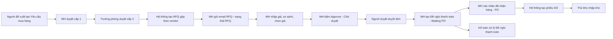

# URD — Quy trình mua hàng trên Odoo

| Thuộc tính | Giá trị |
|---|---|
| Mã dự án | odoo-mua-hang |
| Phiên bản | 0.1 (bản nháp tự động) |
| Ngày | 2026-10-20 |
| Nguồn | inputs/odoo-mua-hang/khao-sat-lan-1.md; outputs/odoo-mua-hang/brainstorm.md |
| Trạng thái | Chờ khách hàng review |

## 1. Giới thiệu

### 1.1 Mục đích
Tài liệu mô tả yêu cầu của người dùng cho quy trình mua hàng trên Odoo (Purchase, Inventory, Approvals, Accounting), nhằm chuẩn hoá toàn bộ vòng đời mua hàng từ Yêu cầu mua hàng tới nhận hàng nhập kho, có duyệt và truy vết đầy đủ.

### 1.2 Phạm vi
- **Trong phạm vi:** Yêu cầu mua hàng và duyệt 2 cấp; tự tạo Yêu cầu báo giá (RFQ) gộp theo vendor; gửi RFQ qua email; so sánh và chọn giá; duyệt đơn mua hàng; Đề nghị thanh toán; trạng thái `Waiting PO`; xác nhận nhận hàng chuyển `PO` và tự tạo phiếu DO; nhập kho theo phiếu DO.
- **Ngoài phạm vi:** hoá đơn nhà cung cấp và đối chiếu 3 bên (AS-15); kiểm soát ngân sách; cổng vendor tự nhập báo giá (AS-16); đa tiền tệ (AS-17).

### 1.3 Mục tiêu kinh doanh
| # | Mục tiêu | Chỉ số đo | Giá trị mục tiêu |
|---|---|---|---|
| 1 | Mọi giao dịch mua hàng đi qua quy trình | Tỉ lệ đơn mua hàng có Yêu cầu mua hàng đã duyệt làm gốc | 100% (AS-02) |
| 2 | Truy vết được người duyệt và thời điểm duyệt | Tỉ lệ đơn mua hàng có lịch sử duyệt trên chatter | 100% (AS-02) |
| 3 | Giảm thao tác thủ công khi lập RFQ | Số RFQ phải tạo tay từ yêu cầu đã duyệt | 0 (RFQ tạo tự động) |

## 2. Vai trò người dùng

| Vai trò | Mô tả | Hệ thống sử dụng | Tần suất |
|---|---|---|---|
| Người đề xuất | Nhân viên các phòng ban có nhu cầu mua | Odoo backend — Approvals | Theo nhu cầu, vài lần/tháng |
| Nhân viên Mua hàng (MH) | Xử lý yêu cầu, RFQ, đơn mua hàng | Odoo backend — Approvals, Purchase, Accounting | Hằng ngày |
| Trưởng phòng | Duyệt cấp 2 Yêu cầu mua hàng (AS-03) | Odoo backend — Approvals | Hằng ngày |
| Người duyệt đơn mua hàng | Trưởng phòng Mua hàng; Giám đốc với đơn từ ngưỡng (AS-08) | Odoo backend — Purchase | Hằng ngày |
| Kế toán | Xử lý Đề nghị thanh toán (AS-10) | Odoo backend — Accounting | Hằng ngày |
| Thủ kho | Nhập kho theo phiếu DO (AS-12) | Odoo backend — Inventory | Hằng ngày |
| Quản trị hệ thống | Cấu hình người duyệt, ngưỡng, mẫu email | Odoo backend — Settings | Khi thay đổi chính sách |

## 3. User stories theo vai trò

### 3.1 Người đề xuất

#### US-01 — Tạo và gửi Yêu cầu mua hàng
- **Story:** Là Người đề xuất, tôi muốn tạo phiếu Yêu cầu mua hàng gồm nhiều sản phẩm và gửi duyệt, để bộ phận Mua hàng mua đúng hàng tôi cần.
- **Ưu tiên:** Must
- **Nguồn:** khao-sat-lan-1.md; AS-19
- **Acceptance criteria:**
  1. **Given** tôi đã đăng nhập **When** tôi nhập ngày cần hàng, lý do, ít nhất một dòng sản phẩm có số lượng > 0 và bấm "Gửi duyệt" **Then** phiếu nhận mã `YCMH/<năm>/<số>` (AS-20), chuyển trạng thái "Chờ duyệt" và Nhân viên MH nhận một activity duyệt.
  2. **Given** phiếu không có dòng sản phẩm nào **When** tôi bấm "Gửi duyệt" **Then** hệ thống chặn và báo "Yêu cầu mua hàng phải có ít nhất một sản phẩm".
  3. **Given** ngày cần hàng sớm hơn ngày hiện tại **When** tôi bấm "Gửi duyệt" **Then** hệ thống chặn và báo "Ngày cần hàng không được trước ngày hôm nay" (AS-19).

#### US-02 — Sửa và gửi lại yêu cầu bị từ chối
- **Story:** Là Người đề xuất, tôi muốn biết lý do yêu cầu bị từ chối và sửa để gửi lại, để không phải tạo phiếu mới.
- **Ưu tiên:** Must
- **Nguồn:** AS-09
- **Acceptance criteria:**
  1. **Given** phiếu của tôi bị từ chối **When** tôi mở phiếu **Then** tôi thấy trạng thái "Từ chối", người từ chối và lý do trên chatter.
  2. **Given** phiếu ở trạng thái "Từ chối" **When** tôi bấm "Về nháp", sửa dòng sản phẩm và bấm "Gửi duyệt" **Then** phiếu quay lại "Chờ duyệt" từ cấp 1 và lịch sử lần duyệt trước vẫn còn trên chatter.

#### US-03 — Theo dõi yêu cầu và chứng từ liên quan
- **Story:** Là Người đề xuất, tôi muốn xem trạng thái yêu cầu và các RFQ, đơn mua hàng, phiếu DO sinh ra từ nó, để biết khi nào có hàng.
- **Ưu tiên:** Should
- **Nguồn:** Đề xuất của BA (brainstorm)
- **Acceptance criteria:**
  1. **Given** yêu cầu đã duyệt xong **When** tôi mở phiếu **Then** tôi thấy nút thông minh "RFQ/Đơn mua hàng" kèm số lượng chứng từ và mở được danh sách chứng từ đó.
  2. **Given** tôi mở danh sách Yêu cầu mua hàng **When** tôi dùng bộ lọc mặc định "Của tôi" **Then** danh sách chỉ hiện các phiếu tôi tạo.

#### US-04 — Huỷ yêu cầu chưa duyệt xong
- **Story:** Là Người đề xuất, tôi muốn huỷ yêu cầu khi không còn nhu cầu, để Mua hàng không xử lý thừa.
- **Ưu tiên:** Should
- **Nguồn:** AS-14
- **Acceptance criteria:**
  1. **Given** phiếu ở trạng thái "Nháp", "Chờ duyệt" hoặc "Từ chối" **When** tôi bấm "Huỷ" **Then** phiếu chuyển "Đã huỷ" và các activity duyệt đang mở bị xoá.
  2. **Given** phiếu đã "Đã duyệt" **When** tôi mở phiếu **Then** nút "Huỷ" không hiển thị.

### 3.2 Nhân viên Mua hàng (MH)

#### US-05 — Duyệt cấp 1 Yêu cầu mua hàng
- **Story:** Là Nhân viên MH, tôi muốn kiểm tra và duyệt hoặc từ chối Yêu cầu mua hàng, để chỉ những nhu cầu hợp lệ đi tiếp.
- **Ưu tiên:** Must
- **Nguồn:** khao-sat-lan-1.md; AS-03, AS-04, AS-09
- **Acceptance criteria:**
  1. **Given** phiếu "Chờ duyệt" ở cấp 1 **When** tôi bấm "Duyệt" **Then** phiếu chuyển sang chờ Trưởng phòng duyệt và Trưởng phòng nhận activity duyệt.
  2. **Given** phiếu có dòng chưa xác định được vendor **When** tôi bấm "Duyệt" **Then** hệ thống chặn và báo tên sản phẩm thiếu vendor (AS-04).
  3. **Given** tôi bấm "Từ chối" **When** tôi để trống lý do **Then** hệ thống không cho xác nhận và báo "Vui lòng nhập lý do từ chối".

#### US-06 — Nhận RFQ tự động gộp theo vendor
- **Story:** Là Nhân viên MH, tôi muốn hệ thống tự tạo RFQ ngay khi yêu cầu được duyệt xong, gộp các sản phẩm cùng vendor vào một phiếu, để không phải lập RFQ thủ công.
- **Ưu tiên:** Must
- **Nguồn:** khao-sat-lan-1.md; AS-05
- **Acceptance criteria:**
  1. **Given** yêu cầu có 3 dòng: 2 dòng vendor A, 1 dòng vendor B **When** cấp duyệt cuối bấm "Duyệt" **Then** hệ thống tạo đúng 2 RFQ trạng thái "Nháp": RFQ vendor A có 2 dòng, RFQ vendor B có 1 dòng.
  2. **Given** RFQ được tạo tự động **When** tôi mở RFQ **Then** trường "Yêu cầu mua hàng" trỏ về phiếu gốc và mỗi dòng giữ số lượng, đơn vị tính, ngày cần hàng của dòng yêu cầu.
  3. **Given** yêu cầu đã sinh RFQ **When** có người bấm "Duyệt" lại trên cùng phiếu **Then** hệ thống không tạo thêm RFQ trùng.

#### US-07 — Gửi email RFQ cho vendor
- **Story:** Là Nhân viên MH, tôi muốn gửi RFQ qua email cho vendor, để xin báo giá.
- **Ưu tiên:** Must
- **Nguồn:** khao-sat-lan-1.md; AS-13
- **Acceptance criteria:**
  1. **Given** RFQ "Nháp" có vendor có email **When** tôi bấm "Gửi email RFQ" và bấm "Gửi" trong cửa sổ soạn email **Then** email kèm file PDF RFQ được gửi và RFQ chuyển trạng thái "RFQ".
  2. **Given** vendor không có email **When** tôi bấm "Gửi" **Then** hệ thống chặn và báo "Vendor <tên> chưa có email".
  3. **Given** tôi chọn nhiều RFQ "Nháp" trên danh sách **When** tôi chọn hành động "Gửi email RFQ" **Then** mỗi vendor nhận một email riêng kèm RFQ của mình.

#### US-08 — Hỏi giá thêm vendor khác cho cùng nhu cầu
- **Story:** Là Nhân viên MH, tôi muốn tạo RFQ thay thế cho vendor khác với cùng sản phẩm, để so sánh giá trước khi chọn.
- **Ưu tiên:** Must
- **Nguồn:** khao-sat-lan-1.md ("gửi Email đến nhiều vendor"); AS-06
- **Acceptance criteria:**
  1. **Given** một RFQ đang mở **When** tôi bấm "Tạo RFQ thay thế", chọn vendor C và xác nhận **Then** hệ thống tạo RFQ mới cho vendor C với cùng dòng sản phẩm, số lượng và liên kết vào nhóm thay thế của RFQ gốc.
  2. **Given** vendor C đã có RFQ trong nhóm thay thế **When** tôi chọn lại vendor C **Then** hệ thống báo "Vendor C đã có RFQ trong nhóm này".

#### US-09 — Nhập giá, so sánh và chọn giá
- **Story:** Là Nhân viên MH, tôi muốn nhập giá các vendor gửi về và so sánh theo từng sản phẩm, để chọn giá tốt nhất.
- **Ưu tiên:** Must
- **Nguồn:** khao-sat-lan-1.md; AS-07, AS-16
- **Acceptance criteria:**
  1. **Given** nhóm thay thế có 3 RFQ đã nhập đơn giá **When** tôi mở "So sánh báo giá" **Then** mỗi sản phẩm hiện một nhóm dòng theo vendor với đơn giá, thành tiền, ngày giao dự kiến và dòng giá thấp nhất được đánh dấu.
  2. **Given** tôi bấm "Chọn" trên dòng của vendor A cho sản phẩm X **When** hệ thống ghi nhận **Then** dòng sản phẩm X ở RFQ của vendor khác về số lượng 0 và dòng của vendor A giữ nguyên.
  3. **Given** sau khi chọn, một RFQ không còn dòng nào có số lượng > 0 **When** tôi bấm "Hoàn tất chọn giá" **Then** RFQ đó chuyển "Đã huỷ".

#### US-10 — Gửi duyệt đơn mua hàng
- **Story:** Là Nhân viên MH, tôi muốn bấm "Approve" sau khi chọn giá để đơn vào quy trình duyệt, để đơn được phê duyệt trước khi thanh toán.
- **Ưu tiên:** Must
- **Nguồn:** khao-sat-lan-1.md; AS-08
- **Acceptance criteria:**
  1. **Given** RFQ trạng thái "RFQ" có ít nhất một dòng có đơn giá > 0 **When** tôi bấm "Approve" **Then** phiếu chuyển "Chờ duyệt" và người duyệt theo ngưỡng (AS-08) nhận activity duyệt.
  2. **Given** RFQ có dòng số lượng > 0 nhưng đơn giá = 0 **When** tôi bấm "Approve" **Then** hệ thống chặn và báo "Chưa nhập đơn giá cho sản phẩm <tên>".

#### US-11 — Tạo Đề nghị thanh toán
- **Story:** Là Nhân viên MH, tôi muốn tạo Đề nghị thanh toán từ đơn đã duyệt, để Kế toán thanh toán cho vendor.
- **Ưu tiên:** Must
- **Nguồn:** khao-sat-lan-1.md; AS-10, AS-11
- **Acceptance criteria:**
  1. **Given** đơn mua hàng "Đã duyệt" **When** tôi bấm "Tạo đề nghị thanh toán" **Then** hệ thống mở phiếu Đề nghị thanh toán điền sẵn vendor, đơn mua hàng, số tiền = tổng đơn.
  2. **Given** phiếu Đề nghị thanh toán hợp lệ **When** tôi bấm "Gửi kế toán" **Then** Đề nghị thanh toán chuyển "Chờ kế toán duyệt" và đơn mua hàng chuyển `Waiting PO` (AS-11).
  3. **Given** số tiền đề nghị lớn hơn tổng đơn **When** tôi bấm "Gửi kế toán" **Then** hệ thống chặn và báo "Số tiền đề nghị vượt tổng giá trị đơn mua hàng".

#### US-12 — Xác nhận đã nhận hàng
- **Story:** Là Nhân viên MH, tôi muốn bấm một nút khi hàng về để chuyển đơn từ `Waiting PO` sang `PO`, để hoàn tất nhận hàng và có phiếu DO cho kho.
- **Ưu tiên:** Must
- **Nguồn:** khao-sat-lan-1.md; AS-12
- **Acceptance criteria:**
  1. **Given** đơn ở trạng thái `Waiting PO` **When** tôi bấm "Xác nhận đã nhận hàng" và xác nhận **Then** đơn chuyển `PO` và hệ thống tạo một phiếu DO trạng thái "Sẵn sàng" với đúng sản phẩm và số lượng của đơn.
  2. **Given** đơn đã ở `PO` **When** tôi mở đơn **Then** nút "Xác nhận đã nhận hàng" không hiển thị và nút thông minh "Phiếu DO" hiển thị số phiếu.

#### US-13 — Huỷ RFQ hoặc đơn mua hàng
- **Story:** Là Nhân viên MH, tôi muốn huỷ RFQ hoặc đơn mua hàng không còn dùng, để danh sách chỉ còn chứng từ đang xử lý.
- **Ưu tiên:** Should
- **Nguồn:** AS-14
- **Acceptance criteria:**
  1. **Given** đơn ở trạng thái trước `PO` **When** tôi bấm "Huỷ" và nhập lý do **Then** đơn chuyển "Đã huỷ" và lý do ghi trên chatter.
  2. **Given** đơn có Đề nghị thanh toán ở trạng thái "Đã thanh toán" **When** tôi bấm "Huỷ" **Then** hệ thống chặn và báo "Đơn đã được thanh toán, liên hệ Kế toán để xử lý".

### 3.3 Trưởng phòng

#### US-14 — Duyệt cấp 2 Yêu cầu mua hàng
- **Story:** Là Trưởng phòng, tôi muốn duyệt hoặc từ chối Yêu cầu mua hàng đã qua MH, để kiểm soát nhu cầu mua của bộ phận.
- **Ưu tiên:** Must
- **Nguồn:** khao-sat-lan-1.md; AS-03, AS-09
- **Acceptance criteria:**
  1. **Given** phiếu đã được MH duyệt **When** tôi bấm "Duyệt" **Then** phiếu chuyển "Đã duyệt" và hệ thống tạo RFQ theo US-06.
  2. **Given** phiếu chưa được MH duyệt **When** tôi mở phiếu **Then** nút "Duyệt" không hiển thị với tôi.
  3. **Given** tôi bấm "Từ chối" và nhập lý do **When** tôi xác nhận **Then** phiếu chuyển "Từ chối" và Người đề xuất nhận thông báo kèm lý do.

### 3.4 Người duyệt đơn mua hàng

#### US-15 — Duyệt hoặc từ chối đơn mua hàng
- **Story:** Là Người duyệt đơn mua hàng, tôi muốn duyệt đơn sau khi MH chọn giá, để kiểm soát giá trị mua.
- **Ưu tiên:** Must
- **Nguồn:** khao-sat-lan-1.md; AS-08, AS-09
- **Acceptance criteria:**
  1. **Given** đơn "Chờ duyệt" tổng < 50.000.000₫ **When** Trưởng phòng Mua hàng bấm "Duyệt" **Then** đơn chuyển "Đã duyệt".
  2. **Given** đơn "Chờ duyệt" tổng ≥ 50.000.000₫ **When** Trưởng phòng Mua hàng bấm "Duyệt" **Then** đơn vẫn "Chờ duyệt" và Giám đốc nhận activity duyệt; khi Giám đốc duyệt, đơn chuyển "Đã duyệt".
  3. **Given** tôi bấm "Từ chối" và nhập lý do **When** tôi xác nhận **Then** đơn quay về trạng thái "RFQ" và Nhân viên MH nhận thông báo kèm lý do.

### 3.5 Kế toán

#### US-16 — Xử lý Đề nghị thanh toán
- **Story:** Là Kế toán, tôi muốn duyệt hoặc từ chối Đề nghị thanh toán và ghi nhận thanh toán, để trả tiền vendor đúng đơn đã duyệt.
- **Ưu tiên:** Must
- **Nguồn:** AS-10
- **Acceptance criteria:**
  1. **Given** Đề nghị thanh toán "Chờ kế toán duyệt" **When** tôi bấm "Duyệt" **Then** phiếu chuyển "Đã duyệt".
  2. **Given** phiếu "Đã duyệt" **When** tôi bấm "Ghi nhận thanh toán", chọn sổ nhật ký và ngày thanh toán, xác nhận **Then** hệ thống tạo bút toán thanh toán cho vendor và phiếu chuyển "Đã thanh toán".
  3. **Given** tôi bấm "Từ chối" và nhập lý do **When** tôi xác nhận **Then** phiếu chuyển "Từ chối", đơn mua hàng quay về "Đã duyệt" và Nhân viên MH nhận thông báo.

### 3.6 Thủ kho

#### US-17 — Nhập kho theo phiếu DO
- **Story:** Là Thủ kho, tôi muốn kiểm đếm hàng theo phiếu DO và xác nhận, để tồn kho cập nhật đúng số thực nhận.
- **Ưu tiên:** Must
- **Nguồn:** khao-sat-lan-1.md; AS-12
- **Acceptance criteria:**
  1. **Given** phiếu DO "Sẵn sàng" **When** tôi nhập số lượng thực nhận bằng số lượng yêu cầu và bấm "Xác nhận" **Then** phiếu chuyển "Hoàn tất" và tồn kho tăng đúng số lượng.
  2. **Given** số lượng thực nhận nhỏ hơn số lượng yêu cầu **When** tôi bấm "Xác nhận" và chọn "Tạo backorder" **Then** hệ thống hoàn tất phần đã nhận và tạo phiếu DO mới cho phần còn thiếu.

### 3.7 Quản trị hệ thống

#### US-18 — Cấu hình người duyệt và ngưỡng
- **Story:** Là Quản trị hệ thống, tôi muốn cấu hình người duyệt và ngưỡng giá trị duyệt, để thay đổi chính sách mà không cần sửa code.
- **Ưu tiên:** Should
- **Nguồn:** Đề xuất của BA (brainstorm); AS-08
- **Acceptance criteria:**
  1. **Given** tôi thuộc nhóm Quản trị **When** tôi đổi ngưỡng duyệt Giám đốc từ 50.000.000₫ sang 100.000.000₫ và lưu **Then** các đơn gửi duyệt sau thời điểm lưu áp dụng ngưỡng mới.
  2. **Given** người dùng không thuộc nhóm Quản trị **When** họ mở menu cấu hình mua hàng **Then** menu không hiển thị.

## 4. Quy trình nghiệp vụ mong muốn (TO-BE)

| Bước | Vai trò | Mô tả | User story |
|---|---|---|---|
| 1 | Người đề xuất | Tạo và gửi Yêu cầu mua hàng | US-01, US-02, US-04 |
| 2 | Nhân viên MH | Duyệt cấp 1 | US-05 |
| 3 | Trưởng phòng | Duyệt cấp 2 | US-14 |
| 4 | Hệ thống | Tạo RFQ gộp theo vendor | US-06 |
| 5 | Nhân viên MH | Gửi email RFQ, hỏi giá vendor khác | US-07, US-08 |
| 6 | Nhân viên MH | Nhập giá, so sánh, chọn giá | US-09 |
| 7 | Nhân viên MH | Bấm Approve | US-10 |
| 8 | Người duyệt đơn mua hàng | Duyệt đơn | US-15 |
| 9 | Nhân viên MH | Tạo Đề nghị thanh toán, đơn chuyển `Waiting PO` | US-11 |
| 10 | Kế toán | Duyệt và ghi nhận thanh toán | US-16 |
| 11 | Nhân viên MH | Xác nhận đã nhận hàng, đơn chuyển `PO`, tạo phiếu DO | US-12 |
| 12 | Thủ kho | Nhập kho theo phiếu DO | US-17 |
| — | Người đề xuất / MH | Theo dõi, huỷ chứng từ | US-03, US-13 |

## 5. Yêu cầu chung (không gắn vai trò)
- Giao diện tiếng Việt; tiền tệ VND định dạng `1.250.000₫`; ngày `dd/mm/yyyy`.
- Mọi chuyển trạng thái, duyệt, từ chối ghi lên chatter kèm người thực hiện và thời điểm.
- Người duyệt nhận activity trên Odoo và email thông báo khi có phiếu chờ duyệt (AS-18).
- Phân quyền theo nhóm: Người đề xuất chỉ xem phiếu của mình; Trưởng phòng xem phiếu của bộ phận; MH, Kế toán, Thủ kho xem chứng từ thuộc nghiệp vụ của mình.

## 6. Assumptions & Open Questions

### 6.1 Giả định
| Mã | Giả định | Lý do chọn | Liên quan |
|---|---|---|---|
| AS-01 | Odoo 17 Enterprise, on-premise hoặc Odoo.sh, cho phép module tuỳ biến | Approvals là module Enterprise; cần code tuỳ biến | Toàn hệ thống |
| AS-02 | KPI: 100% đơn mua hàng có Yêu cầu mua hàng đã duyệt làm gốc và lịch sử duyệt trên chatter | Input chưa có KPI | Mục 1.3 |
| AS-03 | Duyệt tuần tự: Nhân viên MH (cấp 1) → Trưởng phòng của bộ phận người đề xuất (cấp 2) | Theo thứ tự nêu trong input | US-05, US-14 |
| AS-04 | Vendor của dòng = vendor chọn trên dòng; trống thì lấy vendor đầu tiên trong bảng giá nhà cung cấp; vẫn trống thì chặn duyệt cấp 1 | Bảo đảm tạo được RFQ | US-05, US-06 |
| AS-05 | Mỗi Yêu cầu mua hàng sinh RFQ riêng theo vendor, không gộp với yêu cầu khác | Giữ truy vết 1 yêu cầu → n RFQ | US-06 |
| AS-06 | Hỏi giá nhiều vendor bằng RFQ thay thế (Alternatives) của Odoo | Tính năng chuẩn, không cần custom | US-08 |
| AS-07 | Chọn giá theo từng dòng; RFQ không còn dòng nào được chọn thì tự huỷ | Linh hoạt chọn vendor theo sản phẩm | US-09 |
| AS-08 | Trưởng phòng Mua hàng duyệt mọi đơn; tổng ≥ 50.000.000₫ thêm Giám đốc | Thông lệ phân cấp duyệt; input chưa có ngưỡng | US-10, US-15, US-18 |
| AS-09 | Từ chối bắt buộc lý do; yêu cầu về "Từ chối" để sửa gửi lại; đơn mua hàng về "RFQ" | Không mất dữ liệu đã nhập | US-02, US-05, US-14, US-15 |
| AS-10 | Đề nghị thanh toán là chứng từ mới gắn 1 đơn mua hàng; Kế toán duyệt và ghi nhận thanh toán | Input chỉ nêu tên chứng từ | US-11, US-16 |
| AS-11 | Đơn chuyển `Waiting PO` ngay khi Đề nghị thanh toán được gửi kế toán | Theo input: "tạo xong … chuyển waiting PO" | US-11 |
| AS-12 | Phiếu DO = phiếu nhập kho (Receipt), tạo ở trạng thái "Sẵn sàng"; Thủ kho xác nhận; nhận thiếu tạo backorder | Thuật ngữ DO trong input chưa rõ | US-12, US-17 |
| AS-13 | Vendor phải có email mới gửi được RFQ | Gửi RFQ qua email | US-07 |
| AS-14 | Huỷ được yêu cầu trước khi duyệt xong; huỷ được đơn trước trạng thái `PO` và khi chưa thanh toán | Tránh huỷ chứng từ đã phát sinh kho/tiền | US-04, US-13 |
| AS-15 | Hoá đơn nhà cung cấp dùng chuẩn Odoo, ngoài phạm vi | Input không đề cập | Phạm vi |
| AS-16 | MH nhập giá vendor thủ công vào RFQ | Không có cổng vendor | US-09 |
| AS-17 | Chỉ dùng VND | Input không đề cập ngoại tệ | Phạm vi |
| AS-18 | Thông báo qua activity Odoo + email | Kênh chuẩn của Odoo | Mục 5 |
| AS-19 | Dòng yêu cầu bắt buộc: sản phẩm, số lượng > 0, đơn vị tính; ngày cần hàng không trước hôm nay | Dữ liệu tối thiểu để tạo RFQ | US-01 |
| AS-20 | Mã tự động: Yêu cầu mua hàng `YCMH/<năm>/<4 số>`, Đề nghị thanh toán `DNTT/<năm>/<4 số>`; RFQ/đơn dùng mã chuẩn Odoo `P<5 số>` | Theo quy ước sequence Odoo | US-01, US-11 |

### 6.2 Câu hỏi mở
| Mã | Câu hỏi | Người cần trả lời | Liên quan |
|---|---|---|---|
| OQ-01 | Phiên bản Odoo, edition và hosting? | IT khách hàng | AS-01 |
| OQ-02 | Quy trình hiện tại (AS-IS) và vấn đề đang gặp? | Khách hàng | Bối cảnh |
| OQ-03 | KPI, giá trị mục tiêu và mốc go-live? | Khách hàng | AS-02 |
| OQ-04 | "Trưởng phòng" là trưởng bộ phận người đề xuất hay Trưởng phòng Mua hàng? Thứ tự duyệt? | Khách hàng | AS-03, US-05, US-14 |
| OQ-05 | Vendor của dòng lấy từ đâu khi không chọn? Sản phẩm không có vendor xử lý thế nào? | Phòng Mua hàng | AS-04, US-06 |
| OQ-06 | Có gộp dòng của nhiều Yêu cầu mua hàng cùng vendor vào một RFQ không? | Phòng Mua hàng | AS-05 |
| OQ-07 | Một nhu cầu hỏi giá bao nhiêu vendor? Chọn giá theo dòng hay cả phiếu? Tiêu chí chọn? | Phòng Mua hàng | AS-06, AS-07, US-09 |
| OQ-08 | Ai duyệt đơn mua hàng sau khi chọn giá? Có phân cấp theo giá trị, ngưỡng bao nhiêu? | Ban giám đốc | AS-08, US-15 |
| OQ-09 | Khi bị từ chối, phiếu quay về đâu? Có cho gửi lại không? | Khách hàng | AS-09 |
| OQ-10 | Đề nghị thanh toán là tạm ứng trước khi nhận hàng hay thanh toán theo hoá đơn? Ai duyệt, có thanh toán một phần không? | Kế toán | AS-10, US-16 |
| OQ-11 | Có phải chờ thanh toán xong mới nhận hàng không? | Kế toán / Mua hàng | AS-11 |
| OQ-12 | "Phiếu DO" là phiếu gì? Tự động hoàn tất nhập kho hay để Thủ kho xác nhận? | Kho | AS-12, US-12, US-17 |
| OQ-13 | Hoá đơn nhà cung cấp và đối chiếu có nằm trong dự án không? | Kế toán | AS-15 |
| OQ-14 | Số người dùng và số Yêu cầu mua hàng mỗi tháng? | Khách hàng | Phi chức năng |
| OQ-15 | Có mẫu email / mẫu in RFQ, Đề nghị thanh toán theo mẫu công ty không? | Phòng Mua hàng | US-07 |
| OQ-16 | Vendor gửi báo giá qua kênh nào? Có cần cổng vendor tự nhập giá không? | Phòng Mua hàng | AS-16 |
| OQ-17 | Có mua hàng bằng ngoại tệ không? | Kế toán | AS-17 |
| OQ-18 | Ngoài activity và email, có cần thông báo qua kênh khác (Zalo, SMS) không? | Khách hàng | AS-18 |
| OQ-19 | Quy tắc đánh mã Yêu cầu mua hàng, Đề nghị thanh toán theo mẫu công ty? | Kế toán | AS-20 |
