# URD — Quy trình mua hàng trên Odoo

| Thuộc tính | Giá trị |
|---|---|
| Mã dự án | odoo-mua-hang |
| Phiên bản | 0.2 (cập nhật theo khảo sát lần 2 — Yêu cầu mua hàng) |
| Ngày | 2026-10-20 |
| Nguồn | inputs/odoo-mua-hang/khao-sat-lan-1.md; inputs/odoo-mua-hang/khao-sat-lan-2-yeu-cau-mua-hang.md; inputs/odoo-mua-hang/_changes/20261020-074707.md; outputs/odoo-mua-hang/brainstorm.md |
| Trạng thái | Chờ khách hàng review |

## 1. Giới thiệu

### 1.1 Mục đích
Tài liệu mô tả yêu cầu của người dùng cho quy trình mua hàng trên Odoo (Purchase, Inventory, Approvals, Accounting), nhằm chuẩn hoá toàn bộ vòng đời mua hàng từ Yêu cầu mua hàng tới nhận hàng nhập kho, có duyệt và truy vết đầy đủ.

### 1.2 Phạm vi
- **Trong phạm vi:** Yêu cầu mua hàng (tạo trực tiếp, từ Hợp đồng, từ Báo giá NCC) và duyệt 3 cấp; danh mục Hợp đồng mua hàng và Báo giá NCC; tự điền NCC và đơn giá theo Hợp đồng → Price List; phân loại vật tư Nhập kho / Dịch vụ, mua dịch vụ bằng RFQ trực tiếp; tự tạo Yêu cầu báo giá (RFQ) gộp theo vendor; gửi RFQ qua email; so sánh và chọn giá; duyệt đơn mua hàng; Đề nghị thanh toán; trạng thái `Waiting PO`; xác nhận nhận hàng chuyển `PO` và tự tạo phiếu DO; nhập kho theo phiếu DO.
- **Ngoài phạm vi:** hoá đơn nhà cung cấp và đối chiếu 3 bên (AS-15); kiểm soát ngân sách; cổng vendor tự nhập báo giá (AS-16); đa tiền tệ (AS-17).

### 1.3 Mục tiêu kinh doanh
| # | Mục tiêu | Chỉ số đo | Giá trị mục tiêu |
|---|---|---|---|
| 1 | Mọi giao dịch mua vật tư Nhập kho đi qua quy trình | Tỉ lệ đơn mua vật tư Nhập kho có Yêu cầu mua hàng đã duyệt làm gốc | 100% (AS-02) |
| 2 | Truy vết được người duyệt và thời điểm duyệt | Tỉ lệ đơn mua hàng có lịch sử duyệt trên chatter | 100% (AS-02) |
| 3 | Giảm thao tác thủ công khi lập RFQ | Số RFQ phải tạo tay từ yêu cầu đã duyệt | 0 (RFQ tạo tự động) |

## 2. Vai trò người dùng

| Vai trò | Mô tả | Hệ thống sử dụng | Tần suất |
|---|---|---|---|
| Người đề xuất | Nhân viên các phòng ban có nhu cầu mua ("Người tạo" phiếu) | Odoo backend — Approvals, Purchase (xem Hợp đồng, Báo giá NCC) | Theo nhu cầu, vài lần/tháng |
| Nhân viên Mua hàng (MH) | Duyệt cấp 2 YCMH; quản lý Hợp đồng, Báo giá NCC; xử lý RFQ, đơn mua hàng | Odoo backend — Approvals, Purchase, Accounting | Hằng ngày |
| Trưởng nhóm | Duyệt cấp 1 Yêu cầu mua hàng, theo người tạo (AS-34; v0.2 thay "Trưởng phòng") | Odoo backend — Approvals | Hằng ngày |
| BOD | Ban giám đốc, duyệt cấp 3 Yêu cầu mua hàng (AS-34) | Odoo backend — Approvals | Hằng ngày |
| Người duyệt đơn mua hàng | Trưởng phòng Mua hàng; Giám đốc với đơn từ ngưỡng (AS-08) | Odoo backend — Purchase | Hằng ngày |
| Kế toán | Xử lý Đề nghị thanh toán (AS-10) | Odoo backend — Accounting | Hằng ngày |
| Thủ kho | Nhập kho theo phiếu DO (AS-12) | Odoo backend — Inventory | Hằng ngày |
| Quản trị hệ thống | Cấu hình người duyệt, ngưỡng, mẫu email | Odoo backend — Settings | Khi thay đổi chính sách |

## 3. User stories theo vai trò

### 3.1 Người đề xuất

#### US-01 — Tạo và gửi Yêu cầu mua hàng
- **Story:** Là Người đề xuất, tôi muốn tạo phiếu Yêu cầu mua hàng trực tiếp tại menu "Yêu cầu mua hàng" gồm nhiều vật tư Nhập kho và gửi duyệt, để bộ phận Mua hàng mua đúng hàng tôi cần.
- **Ưu tiên:** Must
- **Nguồn:** khao-sat-lan-1.md; khao-sat-lan-2-yeu-cau-mua-hang.md (v0.2); AS-28, AS-29, AS-35
- **Acceptance criteria:**
  1. **Given** tôi thuộc bộ phận Hành chính (mã HC) **When** tôi lưu phiếu mới ngày 20/10/2026 **Then** phiếu nhận số `HC_0012_20_10_26` (AS-28), Người tạo, Bộ phận, Ngày tạo tự điền theo tôi.
  2. **Given** phiếu có ít nhất một dòng đủ Vật tư, Đơn vị tính, Nhập kho, Số lượng **When** tôi bấm "Gửi duyệt" **Then** phiếu chuyển "Chờ duyệt" và Trưởng nhóm của tôi nhận activity duyệt.
  3. **Given** tôi tìm vật tư trên dòng **When** danh sách vật tư hiện ra **Then** danh sách chỉ có vật tư loại "Nhập kho", không có vật tư "Dịch vụ".
  4. **Given** hai dòng cùng vật tư và cùng nhà cung cấp **When** tôi bấm "Lưu" **Then** hệ thống chặn và báo "Trùng vật tư và nhà cung cấp với dòng <số dòng>".
  5. **Given** một dòng để trống số lượng **When** tôi bấm "Lưu" **Then** hệ thống chặn và báo "Không được để trống số lượng".

#### US-02 — Sửa và gửi lại yêu cầu bị từ chối
- **Story:** Là Người đề xuất, tôi muốn biết lý do yêu cầu bị từ chối và sửa để gửi lại, để không phải tạo phiếu mới.
- **Ưu tiên:** Must
- **Nguồn:** AS-09
- **Acceptance criteria:**
  1. **Given** phiếu của tôi bị từ chối **When** tôi mở phiếu **Then** tôi thấy trạng thái "Từ chối", người từ chối và lý do trên chatter.
  2. **Given** phiếu ở trạng thái "Từ chối" **When** tôi bấm "Về nháp", sửa dòng sản phẩm và bấm "Gửi duyệt" **Then** phiếu quay lại "Chờ duyệt" từ cấp 1 và lịch sử lần duyệt trước vẫn còn trên chatter.

#### US-03 — Theo dõi yêu cầu và chứng từ liên quan
- **Story:** Là Người đề xuất, tôi muốn xem trạng thái yêu cầu và các RFQ, đơn mua hàng, phiếu DO sinh ra từ nó, để biết khi nào có hàng.
- **Ưu tiên:** Should
- **Nguồn:** Đề xuất của BA (brainstorm)
- **Acceptance criteria:**
  1. **Given** yêu cầu đã duyệt xong **When** tôi mở phiếu **Then** tôi thấy nút thông minh "RFQ/Đơn mua hàng" kèm số lượng chứng từ và mở được danh sách chứng từ đó.
  2. **Given** tôi mở danh sách Yêu cầu mua hàng **When** tôi dùng bộ lọc mặc định "Của tôi" **Then** danh sách chỉ hiện các phiếu tôi tạo.

#### US-04 — Huỷ yêu cầu chưa duyệt xong
- **Story:** Là Người đề xuất, tôi muốn huỷ yêu cầu khi không còn nhu cầu, để Mua hàng không xử lý thừa.
- **Ưu tiên:** Should
- **Nguồn:** AS-14
- **Acceptance criteria:**
  1. **Given** phiếu ở trạng thái "Nháp", "Chờ duyệt" hoặc "Từ chối" **When** tôi bấm "Huỷ" **Then** phiếu chuyển "Đã huỷ" và các activity duyệt đang mở bị xoá.
  2. **Given** phiếu đã "Đã duyệt" **When** tôi mở phiếu **Then** nút "Huỷ" không hiển thị.

#### US-19 — Tạo Yêu cầu mua hàng từ Hợp đồng
- **Story:** Là Người đề xuất, tôi muốn tạo Yêu cầu mua hàng ngay từ một Hợp đồng còn hiệu lực, để dùng sẵn nhà cung cấp và đơn giá đã ký.
- **Ưu tiên:** Must
- **Nguồn:** khao-sat-lan-2-yeu-cau-mua-hang.md; AS-30, AS-36
- **Acceptance criteria:**
  1. **Given** Hợp đồng HĐ-HH-2026-01 "Đang hiệu lực" **When** tôi bấm "Tạo yêu cầu mua hàng" trên hợp đồng **Then** hệ thống mở YCMH mới có Nguồn tạo = HĐ-HH-2026-01, chép mọi dòng vật tư với nhà cung cấp, đơn giá của hợp đồng và số lượng để trống.
  2. **Given** dòng được chép từ hợp đồng **When** tôi sửa đơn giá **Then** ô đơn giá bị khoá.
  3. **Given** hợp đồng đã hết hiệu lực **When** tôi mở hợp đồng **Then** nút "Tạo yêu cầu mua hàng" không hiển thị.

#### US-20 — Tạo Yêu cầu mua hàng từ Báo giá NCC
- **Story:** Là Người đề xuất, tôi muốn tạo Yêu cầu mua hàng từ một Báo giá NCC còn hiệu lực, để dùng sẵn vật tư và giá nhà cung cấp đã báo.
- **Ưu tiên:** Must
- **Nguồn:** khao-sat-lan-2-yeu-cau-mua-hang.md; _changes/20261020-074707.md; AS-33, AS-36
- **Acceptance criteria:**
  1. **Given** Báo giá NCC BG-PV-1510 còn hiệu lực **When** tôi bấm "Tạo yêu cầu mua hàng" **Then** YCMH mới có Nguồn tạo = BG-PV-1510, chép mọi dòng với nhà cung cấp và đơn giá của báo giá, số lượng để trống.
  2. **Given** báo giá quá ngày "Hiệu lực đến" **When** tôi mở báo giá **Then** nút "Tạo yêu cầu mua hàng" không hiển thị.

#### US-21 — Tự điền nhà cung cấp và đơn giá
- **Story:** Là Người đề xuất, tôi muốn hệ thống tự điền nhà cung cấp và đơn giá khi tôi chọn vật tư, để không phải tra hợp đồng hay bảng giá.
- **Ưu tiên:** Must
- **Nguồn:** khao-sat-lan-2-yeu-cau-mua-hang.md; AS-30, AS-31, AS-32
- **Acceptance criteria:**
  1. **Given** vật tư "Giấy A4 Double A 80gsm" có hợp đồng HĐ-HH-2026-01 còn hiệu lực, giá 78.000₫ **When** tôi chọn vật tư trên YCMH tạo trực tiếp **Then** dòng tự điền nhà cung cấp Hồng Hà, đơn giá 78.000₫, nguồn giá "Hợp đồng HĐ-HH-2026-01".
  2. **Given** vật tư "Bút bi Thiên Long TL-027" không có hợp đồng còn hiệu lực nhưng có Price List Hồng Hà 4.500₫ **When** tôi chọn vật tư **Then** dòng tự điền Hồng Hà, 4.500₫, nguồn giá "Price List".
  3. **Given** vật tư không có hợp đồng và không có Price List **When** tôi chọn vật tư **Then** nhà cung cấp và đơn giá để trống, nguồn giá "Không có", tôi chọn nhà cung cấp bằng tay.

### 3.2 Nhân viên Mua hàng (MH)

#### US-05 — Duyệt cấp 2 Yêu cầu mua hàng
- **Story:** Là Nhân viên MH, tôi muốn kiểm tra và duyệt hoặc từ chối Yêu cầu mua hàng sau khi Trưởng nhóm duyệt, để chỉ những nhu cầu hợp lệ đi tiếp tới BOD.
- **Ưu tiên:** Must
- **Nguồn:** khao-sat-lan-1.md; khao-sat-lan-2-yeu-cau-mua-hang.md (v0.2: MH là cấp 2); AS-32, AS-09
- **Acceptance criteria:**
  1. **Given** phiếu đã được Trưởng nhóm duyệt **When** tôi bấm "Duyệt" **Then** phiếu chuyển sang chờ BOD duyệt và BOD nhận activity duyệt.
  2. **Given** phiếu có dòng chưa có nhà cung cấp **When** tôi bấm "Duyệt" **Then** hệ thống chặn và báo tên vật tư thiếu nhà cung cấp (AS-32).
  3. **Given** tôi bấm "Từ chối" **When** tôi để trống lý do **Then** hệ thống không cho xác nhận và báo "Vui lòng nhập lý do từ chối".
  4. **Given** Trưởng nhóm chưa duyệt **When** tôi mở phiếu **Then** nút "Duyệt" không hiển thị với tôi.

#### US-06 — Nhận RFQ tự động gộp theo vendor
- **Story:** Là Nhân viên MH, tôi muốn hệ thống tự tạo RFQ ngay khi yêu cầu được duyệt xong, gộp các sản phẩm cùng vendor vào một phiếu, để không phải lập RFQ thủ công.
- **Ưu tiên:** Must
- **Nguồn:** khao-sat-lan-1.md; AS-05
- **Acceptance criteria:**
  1. **Given** yêu cầu có 3 dòng: 2 dòng vendor A, 1 dòng vendor B **When** cấp duyệt cuối bấm "Duyệt" **Then** hệ thống tạo đúng 2 RFQ trạng thái "Nháp": RFQ vendor A có 2 dòng, RFQ vendor B có 1 dòng.
  2. **Given** RFQ được tạo tự động **When** tôi mở RFQ **Then** trường "Yêu cầu mua hàng" trỏ về phiếu gốc và mỗi dòng giữ số lượng, đơn vị tính, ngày cần hàng của dòng yêu cầu.
  3. **Given** yêu cầu đã sinh RFQ **When** có người bấm "Duyệt" lại trên cùng phiếu **Then** hệ thống không tạo thêm RFQ trùng.

#### US-07 — Gửi email RFQ cho vendor
- **Story:** Là Nhân viên MH, tôi muốn gửi RFQ qua email cho vendor, để xin báo giá.
- **Ưu tiên:** Must
- **Nguồn:** khao-sat-lan-1.md; AS-13
- **Acceptance criteria:**
  1. **Given** RFQ "Nháp" có vendor có email **When** tôi bấm "Gửi email RFQ" và bấm "Gửi" trong cửa sổ soạn email **Then** email kèm file PDF RFQ được gửi và RFQ chuyển trạng thái "RFQ".
  2. **Given** vendor không có email **When** tôi bấm "Gửi" **Then** hệ thống chặn và báo "Vendor <tên> chưa có email".
  3. **Given** tôi chọn nhiều RFQ "Nháp" trên danh sách **When** tôi chọn hành động "Gửi email RFQ" **Then** mỗi vendor nhận một email riêng kèm RFQ của mình.

#### US-08 — Hỏi giá thêm vendor khác cho cùng nhu cầu
- **Story:** Là Nhân viên MH, tôi muốn tạo RFQ thay thế cho vendor khác với cùng sản phẩm, để so sánh giá trước khi chọn.
- **Ưu tiên:** Must
- **Nguồn:** khao-sat-lan-1.md ("gửi Email đến nhiều vendor"); AS-06
- **Acceptance criteria:**
  1. **Given** một RFQ đang mở **When** tôi bấm "Tạo RFQ thay thế", chọn vendor C và xác nhận **Then** hệ thống tạo RFQ mới cho vendor C với cùng dòng sản phẩm, số lượng và liên kết vào nhóm thay thế của RFQ gốc.
  2. **Given** vendor C đã có RFQ trong nhóm thay thế **When** tôi chọn lại vendor C **Then** hệ thống báo "Vendor C đã có RFQ trong nhóm này".

#### US-09 — Nhập giá, so sánh và chọn giá
- **Story:** Là Nhân viên MH, tôi muốn nhập giá các vendor gửi về và so sánh theo từng sản phẩm, để chọn giá tốt nhất.
- **Ưu tiên:** Must
- **Nguồn:** khao-sat-lan-1.md; AS-07, AS-16
- **Acceptance criteria:**
  1. **Given** nhóm thay thế có 3 RFQ đã nhập đơn giá **When** tôi mở "So sánh báo giá" **Then** mỗi sản phẩm hiện một nhóm dòng theo vendor với đơn giá, thành tiền, ngày giao dự kiến và dòng giá thấp nhất được đánh dấu.
  2. **Given** tôi bấm "Chọn" trên dòng của vendor A cho sản phẩm X **When** hệ thống ghi nhận **Then** dòng sản phẩm X ở RFQ của vendor khác về số lượng 0 và dòng của vendor A giữ nguyên.
  3. **Given** sau khi chọn, một RFQ không còn dòng nào có số lượng > 0 **When** tôi bấm "Hoàn tất chọn giá" **Then** RFQ đó chuyển "Đã huỷ".

#### US-10 — Gửi duyệt đơn mua hàng
- **Story:** Là Nhân viên MH, tôi muốn bấm "Approve" sau khi chọn giá để đơn vào quy trình duyệt, để đơn được phê duyệt trước khi thanh toán.
- **Ưu tiên:** Must
- **Nguồn:** khao-sat-lan-1.md; AS-08
- **Acceptance criteria:**
  1. **Given** RFQ trạng thái "RFQ" có ít nhất một dòng có đơn giá > 0 **When** tôi bấm "Approve" **Then** phiếu chuyển "Chờ duyệt" và người duyệt theo ngưỡng (AS-08) nhận activity duyệt.
  2. **Given** RFQ có dòng số lượng > 0 nhưng đơn giá = 0 **When** tôi bấm "Approve" **Then** hệ thống chặn và báo "Chưa nhập đơn giá cho sản phẩm <tên>".

#### US-11 — Tạo Đề nghị thanh toán
- **Story:** Là Nhân viên MH, tôi muốn tạo Đề nghị thanh toán từ đơn đã duyệt, để Kế toán thanh toán cho vendor.
- **Ưu tiên:** Must
- **Nguồn:** khao-sat-lan-1.md; AS-10, AS-11
- **Acceptance criteria:**
  1. **Given** đơn mua hàng "Đã duyệt" **When** tôi bấm "Tạo đề nghị thanh toán" **Then** hệ thống mở phiếu Đề nghị thanh toán điền sẵn vendor, đơn mua hàng, số tiền = tổng đơn.
  2. **Given** phiếu Đề nghị thanh toán hợp lệ **When** tôi bấm "Gửi kế toán" **Then** Đề nghị thanh toán chuyển "Chờ kế toán duyệt" và đơn mua hàng chuyển `Waiting PO` (AS-11).
  3. **Given** số tiền đề nghị lớn hơn tổng đơn **When** tôi bấm "Gửi kế toán" **Then** hệ thống chặn và báo "Số tiền đề nghị vượt tổng giá trị đơn mua hàng".

#### US-12 — Xác nhận đã nhận hàng
- **Story:** Là Nhân viên MH, tôi muốn bấm một nút khi hàng về để chuyển đơn từ `Waiting PO` sang `PO`, để hoàn tất nhận hàng và có phiếu DO cho kho.
- **Ưu tiên:** Must
- **Nguồn:** khao-sat-lan-1.md; AS-12
- **Acceptance criteria:**
  1. **Given** đơn ở trạng thái `Waiting PO` **When** tôi bấm "Xác nhận đã nhận hàng" và xác nhận **Then** đơn chuyển `PO` và hệ thống tạo một phiếu DO trạng thái "Sẵn sàng" với đúng sản phẩm và số lượng của đơn.
  2. **Given** đơn đã ở `PO` **When** tôi mở đơn **Then** nút "Xác nhận đã nhận hàng" không hiển thị và nút thông minh "Phiếu DO" hiển thị số phiếu.

#### US-13 — Huỷ RFQ hoặc đơn mua hàng
- **Story:** Là Nhân viên MH, tôi muốn huỷ RFQ hoặc đơn mua hàng không còn dùng, để danh sách chỉ còn chứng từ đang xử lý.
- **Ưu tiên:** Should
- **Nguồn:** AS-14
- **Acceptance criteria:**
  1. **Given** đơn ở trạng thái trước `PO` **When** tôi bấm "Huỷ" và nhập lý do **Then** đơn chuyển "Đã huỷ" và lý do ghi trên chatter.
  2. **Given** đơn có Đề nghị thanh toán ở trạng thái "Đã thanh toán" **When** tôi bấm "Huỷ" **Then** hệ thống chặn và báo "Đơn đã được thanh toán, liên hệ Kế toán để xử lý".

#### US-22 — Quản lý danh mục Hợp đồng mua hàng
- **Story:** Là Nhân viên MH, tôi muốn lưu hợp đồng với nhà cung cấp gồm vật tư, đơn giá và thời hạn hiệu lực, để hệ thống dùng giá hợp đồng khi tạo Yêu cầu mua hàng.
- **Ưu tiên:** Must
- **Nguồn:** khao-sat-lan-2-yeu-cau-mua-hang.md; AS-30
- **Acceptance criteria:**
  1. **Given** tôi nhập Số hợp đồng, Nhà cung cấp, Hiệu lực từ, Hiệu lực đến và ít nhất một dòng vật tư có đơn giá > 0 **When** tôi bấm "Xác nhận" **Then** hợp đồng chuyển "Đang hiệu lực".
  2. **Given** dòng hợp đồng chọn vật tư loại "Dịch vụ" **When** tôi bấm "Lưu" **Then** hệ thống chặn và báo "Hợp đồng chỉ áp dụng cho vật tư Nhập kho".
  3. **Given** "Hiệu lực đến" sớm hơn "Hiệu lực từ" **When** tôi bấm "Lưu" **Then** hệ thống chặn và báo "Ngày kết thúc phải sau ngày bắt đầu".

#### US-23 — Quản lý danh mục Báo giá NCC
- **Story:** Là Nhân viên MH, tôi muốn lưu báo giá nhà cung cấp gửi về gồm vật tư, đơn giá và hạn hiệu lực, để người đề xuất tạo Yêu cầu mua hàng từ báo giá đó.
- **Ưu tiên:** Must
- **Nguồn:** khao-sat-lan-2-yeu-cau-mua-hang.md; _changes/20261020-074707.md; AS-33
- **Acceptance criteria:**
  1. **Given** tôi nhập Số báo giá, Nhà cung cấp, Ngày báo giá, Hiệu lực đến, ít nhất một dòng vật tư có đơn giá > 0 và đính kèm file báo giá **When** tôi bấm "Xác nhận" **Then** báo giá chuyển "Còn hiệu lực".
  2. **Given** ngày hiện tại sau "Hiệu lực đến" **When** hệ thống chạy kiểm tra hằng ngày **Then** báo giá chuyển "Hết hiệu lực".

#### US-25 — Mua Dịch vụ bằng RFQ trực tiếp
- **Story:** Là Nhân viên MH, tôi muốn tạo RFQ cho vật tư Dịch vụ ngay trong Purchase mà không cần Yêu cầu mua hàng, để mua dịch vụ nhanh nhưng vẫn qua duyệt đơn.
- **Ưu tiên:** Must
- **Nguồn:** khao-sat-lan-2-yeu-cau-mua-hang.md; _changes/20261020-074707.md (quyết định #15); AS-27
- **Acceptance criteria:**
  1. **Given** tôi bấm "Mới" ở danh sách RFQ và chọn vật tư Dịch vụ **When** tôi lưu **Then** RFQ được tạo với trường "Yêu cầu mua hàng" để trống, không báo lỗi thiếu YCMH.
  2. **Given** RFQ chỉ có vật tư Dịch vụ đi hết các bước tới `Waiting PO` **When** tôi bấm "Xác nhận đã nhận hàng" **Then** đơn chuyển `PO` và không có phiếu DO nào được tạo.
  3. **Given** RFQ tạo trực tiếp có vật tư "Nhập kho" **When** tôi bấm "Lưu" **Then** hệ thống chặn và báo "Vật tư Nhập kho phải mua qua Yêu cầu mua hàng".

### 3.3 Trưởng nhóm

#### US-14 — Duyệt cấp 1 Yêu cầu mua hàng
- **Story:** Là Trưởng nhóm, tôi muốn duyệt hoặc từ chối Yêu cầu mua hàng do thành viên nhóm tạo, để kiểm soát nhu cầu mua của nhóm.
- **Ưu tiên:** Must
- **Nguồn:** khao-sat-lan-2-yeu-cau-mua-hang.md (v0.2: thay "Trưởng phòng duyệt cấp 2"); AS-34, AS-09
- **Acceptance criteria:**
  1. **Given** phiếu "Chờ duyệt" do thành viên nhóm tôi tạo **When** tôi bấm "Duyệt" **Then** phiếu chuyển sang chờ Nhân viên MH duyệt (cấp 2).
  2. **Given** phiếu do người không thuộc nhóm tôi tạo **When** tôi mở phiếu **Then** nút "Duyệt" không hiển thị với tôi.
  3. **Given** tôi bấm "Từ chối" và nhập lý do **When** tôi xác nhận **Then** phiếu chuyển "Từ chối" và Người đề xuất nhận thông báo kèm lý do.

### 3.4 Người duyệt đơn mua hàng

#### US-15 — Duyệt hoặc từ chối đơn mua hàng
- **Story:** Là Người duyệt đơn mua hàng, tôi muốn duyệt đơn sau khi MH chọn giá, để kiểm soát giá trị mua.
- **Ưu tiên:** Must
- **Nguồn:** khao-sat-lan-1.md; AS-08, AS-09
- **Acceptance criteria:**
  1. **Given** đơn "Chờ duyệt" tổng < 50.000.000₫ **When** Trưởng phòng Mua hàng bấm "Duyệt" **Then** đơn chuyển "Đã duyệt".
  2. **Given** đơn "Chờ duyệt" tổng ≥ 50.000.000₫ **When** Trưởng phòng Mua hàng bấm "Duyệt" **Then** đơn vẫn "Chờ duyệt" và Giám đốc nhận activity duyệt; khi Giám đốc duyệt, đơn chuyển "Đã duyệt".
  3. **Given** tôi bấm "Từ chối" và nhập lý do **When** tôi xác nhận **Then** đơn quay về trạng thái "RFQ" và Nhân viên MH nhận thông báo kèm lý do.

### 3.5 Kế toán

#### US-16 — Xử lý Đề nghị thanh toán
- **Story:** Là Kế toán, tôi muốn duyệt hoặc từ chối Đề nghị thanh toán và ghi nhận thanh toán, để trả tiền vendor đúng đơn đã duyệt.
- **Ưu tiên:** Must
- **Nguồn:** AS-10
- **Acceptance criteria:**
  1. **Given** Đề nghị thanh toán "Chờ kế toán duyệt" **When** tôi bấm "Duyệt" **Then** phiếu chuyển "Đã duyệt".
  2. **Given** phiếu "Đã duyệt" **When** tôi bấm "Ghi nhận thanh toán", chọn sổ nhật ký và ngày thanh toán, xác nhận **Then** hệ thống tạo bút toán thanh toán cho vendor và phiếu chuyển "Đã thanh toán".
  3. **Given** tôi bấm "Từ chối" và nhập lý do **When** tôi xác nhận **Then** phiếu chuyển "Từ chối", đơn mua hàng quay về "Đã duyệt" và Nhân viên MH nhận thông báo.

### 3.6 Thủ kho

#### US-17 — Nhập kho theo phiếu DO
- **Story:** Là Thủ kho, tôi muốn kiểm đếm hàng theo phiếu DO và xác nhận, để tồn kho cập nhật đúng số thực nhận.
- **Ưu tiên:** Must
- **Nguồn:** khao-sat-lan-1.md; AS-12
- **Acceptance criteria:**
  1. **Given** phiếu DO "Sẵn sàng" **When** tôi nhập số lượng thực nhận bằng số lượng yêu cầu và bấm "Xác nhận" **Then** phiếu chuyển "Hoàn tất" và tồn kho tăng đúng số lượng.
  2. **Given** số lượng thực nhận nhỏ hơn số lượng yêu cầu **When** tôi bấm "Xác nhận" và chọn "Tạo backorder" **Then** hệ thống hoàn tất phần đã nhận và tạo phiếu DO mới cho phần còn thiếu.

### 3.7 Quản trị hệ thống

#### US-18 — Cấu hình người duyệt và ngưỡng
- **Story:** Là Quản trị hệ thống, tôi muốn cấu hình người duyệt và ngưỡng giá trị duyệt, để thay đổi chính sách mà không cần sửa code.
- **Ưu tiên:** Should
- **Nguồn:** Đề xuất của BA (brainstorm); AS-08
- **Acceptance criteria:**
  1. **Given** tôi thuộc nhóm Quản trị **When** tôi đổi ngưỡng duyệt Giám đốc từ 50.000.000₫ sang 100.000.000₫ và lưu **Then** các đơn gửi duyệt sau thời điểm lưu áp dụng ngưỡng mới.
  2. **Given** người dùng không thuộc nhóm Quản trị **When** họ mở menu cấu hình mua hàng **Then** menu không hiển thị.

### 3.8 BOD

#### US-24 — Duyệt cấp 3 Yêu cầu mua hàng
- **Story:** Là thành viên BOD, tôi muốn duyệt cuối Yêu cầu mua hàng đã qua Trưởng nhóm và MH, để chỉ những nhu cầu được ban giám đốc đồng ý mới sinh RFQ.
- **Ưu tiên:** Must
- **Nguồn:** khao-sat-lan-2-yeu-cau-mua-hang.md; AS-34
- **Acceptance criteria:**
  1. **Given** phiếu đã được Nhân viên MH duyệt **When** một thành viên BOD bấm "Duyệt" **Then** phiếu chuyển "Đã duyệt" và hệ thống tạo RFQ theo US-06.
  2. **Given** phiếu chưa được MH duyệt **When** thành viên BOD mở phiếu **Then** nút "Duyệt" không hiển thị.
  3. **Given** thành viên BOD bấm "Từ chối" và nhập lý do **When** xác nhận **Then** phiếu chuyển "Từ chối" và Người đề xuất nhận thông báo kèm lý do.

## 4. Quy trình nghiệp vụ mong muốn (TO-BE)

```mermaid
flowchart LR
  A0[Hợp đồng còn hiệu lực] --> A
  A1[Báo giá NCC còn hiệu lực] --> A
  A[Người đề xuất tạo Yêu cầu mua hàng - tự điền NCC và giá] --> B0[Trưởng nhóm duyệt cấp 1]
  B0 --> B[MH duyệt cấp 2]
  B --> C[BOD duyệt cấp 3]
  C --> D[Hệ thống tạo RFQ: N NCC ra N RFQ]
  S[MH tạo RFQ dịch vụ trực tiếp] --> F
  D --> E[MH gửi email RFQ - trạng thái RFQ]
  E --> F[MH nhập giá, so sánh, chọn giá]
  F --> G[MH bấm Approve - Chờ duyệt]
  G --> H[Người duyệt duyệt đơn]
  H --> I[MH tạo Đề nghị thanh toán - Waiting PO]
  I --> J[MH xác nhận đã nhận hàng - PO]
  J --> K[Hệ thống tạo phiếu DO]
  K --> L[Thủ kho nhập kho]
  I --> M[Kế toán xử lý Đề nghị thanh toán]
```

| Bước | Vai trò | Mô tả | User story |
|---|---|---|---|
| 0 | Nhân viên MH | Lưu Hợp đồng, Báo giá NCC | US-22, US-23 |
| 1 | Người đề xuất | Tạo (trực tiếp / từ Hợp đồng / từ Báo giá NCC) và gửi Yêu cầu mua hàng | US-01, US-02, US-04, US-19, US-20, US-21 |
| 2a | Trưởng nhóm | Duyệt cấp 1 | US-14 |
| 2b | Nhân viên MH | Duyệt cấp 2 | US-05 |
| 3 | BOD | Duyệt cấp 3 | US-24 |
| 4 | Hệ thống | Tạo RFQ gộp theo vendor | US-06 |
| 5 | Nhân viên MH | Gửi email RFQ, hỏi giá vendor khác; tạo RFQ dịch vụ trực tiếp | US-07, US-08, US-25 |
| 6 | Nhân viên MH | Nhập giá, so sánh, chọn giá | US-09 |
| 7 | Nhân viên MH | Bấm Approve | US-10 |
| 8 | Người duyệt đơn mua hàng | Duyệt đơn | US-15 |
| 9 | Nhân viên MH | Tạo Đề nghị thanh toán, đơn chuyển `Waiting PO` | US-11 |
| 10 | Kế toán | Duyệt và ghi nhận thanh toán | US-16 |
| 11 | Nhân viên MH | Xác nhận đã nhận hàng, đơn chuyển `PO`, tạo phiếu DO | US-12 |
| 12 | Thủ kho | Nhập kho theo phiếu DO | US-17 |
| — | Người đề xuất / MH | Theo dõi, huỷ chứng từ | US-03, US-13 |

## 5. Yêu cầu chung (không gắn vai trò)
- Giao diện tiếng Việt; tiền tệ VND định dạng `1.250.000₫`; ngày `dd/mm/yyyy`.
- Mọi chuyển trạng thái, duyệt, từ chối ghi lên chatter kèm người thực hiện và thời điểm.
- Người duyệt nhận activity trên Odoo và email thông báo khi có phiếu chờ duyệt (AS-18).
- Phân quyền theo nhóm: Người đề xuất chỉ xem phiếu của mình; Trưởng nhóm xem phiếu của thành viên nhóm; BOD xem mọi phiếu; MH, Kế toán, Thủ kho xem chứng từ thuộc nghiệp vụ của mình.

## 6. Assumptions & Open Questions

### 6.1 Giả định
| Mã | Giả định | Lý do chọn | Liên quan |
|---|---|---|---|
| AS-01 | Odoo 17 Enterprise, on-premise hoặc Odoo.sh, cho phép module tuỳ biến | Approvals là module Enterprise; cần code tuỳ biến | Toàn hệ thống |
| AS-02 | KPI (sửa v0.2): 100% đơn mua vật tư Nhập kho có Yêu cầu mua hàng đã duyệt làm gốc và lịch sử duyệt trên chatter | Input chưa có KPI | Mục 1.3 |
| AS-03 | **[Đã thay — v0.2]** ~~Duyệt tuần tự MH → Trưởng phòng~~. Khảo sát lần 2 xác nhận Trưởng nhóm → MH → BOD | khao-sat-lan-2-yeu-cau-mua-hang.md | US-05, US-14, US-24 |
| AS-04 | **[Đã thay — v0.2]** ~~Vendor trên dòng → bảng giá NCC~~. Khảo sát lần 2: Hợp đồng → Price List; chi tiết AS-30, AS-31, AS-32 | khao-sat-lan-2-yeu-cau-mua-hang.md | US-05, US-06, US-21 |
| AS-05 | Mỗi Yêu cầu mua hàng sinh RFQ riêng theo vendor, không gộp với yêu cầu khác | Giữ truy vết 1 yêu cầu → n RFQ | US-06 |
| AS-06 | Hỏi giá nhiều vendor bằng RFQ thay thế (Alternatives) của Odoo | Tính năng chuẩn, không cần custom | US-08 |
| AS-07 | Chọn giá theo từng dòng; RFQ không còn dòng nào được chọn thì tự huỷ | Linh hoạt chọn vendor theo sản phẩm | US-09 |
| AS-08 | Trưởng phòng Mua hàng duyệt mọi đơn; tổng ≥ 50.000.000₫ thêm Giám đốc | Thông lệ phân cấp duyệt; input chưa có ngưỡng | US-10, US-15, US-18 |
| AS-09 | Từ chối bắt buộc lý do; yêu cầu về "Từ chối" để sửa gửi lại; đơn mua hàng về "RFQ" | Không mất dữ liệu đã nhập | US-02, US-05, US-14, US-15 |
| AS-10 | Đề nghị thanh toán là chứng từ mới gắn 1 đơn mua hàng; Kế toán duyệt và ghi nhận thanh toán | Input chỉ nêu tên chứng từ | US-11, US-16 |
| AS-11 | Đơn chuyển `Waiting PO` ngay khi Đề nghị thanh toán được gửi kế toán | Theo input: "tạo xong … chuyển waiting PO" | US-11 |
| AS-12 | Phiếu DO = phiếu nhập kho (Receipt), tạo ở trạng thái "Sẵn sàng"; Thủ kho xác nhận; nhận thiếu tạo backorder | Thuật ngữ DO trong input chưa rõ | US-12, US-17 |
| AS-13 | Vendor phải có email mới gửi được RFQ | Gửi RFQ qua email | US-07 |
| AS-14 | Huỷ được yêu cầu trước khi duyệt xong; huỷ được đơn trước trạng thái `PO` và khi chưa thanh toán | Tránh huỷ chứng từ đã phát sinh kho/tiền | US-04, US-13 |
| AS-15 | Hoá đơn nhà cung cấp dùng chuẩn Odoo, ngoài phạm vi | Input không đề cập | Phạm vi |
| AS-16 | MH nhập giá vendor thủ công vào RFQ | Không có cổng vendor | US-09 |
| AS-17 | Chỉ dùng VND | Input không đề cập ngoại tệ | Phạm vi |
| AS-18 | Thông báo qua activity Odoo + email | Kênh chuẩn của Odoo | Mục 5 |
| AS-19 | (Sửa v0.2) Dòng bắt buộc: vật tư loại Nhập kho, đơn vị tính, kho nhận, số lượng > 0 (không để trống — khảo sát lần 2 xác nhận); ngày cần hàng không bắt buộc (AS-35) | Dữ liệu tối thiểu để tạo RFQ | US-01 |
| AS-20 | (Sửa v0.2) Mã tự động: Yêu cầu mua hàng theo AS-28 (thay `YCMH/<năm>/<4 số>`), Đề nghị thanh toán `DNTT/<năm>/<4 số>`; RFQ/đơn dùng mã chuẩn Odoo `P<5 số>` | Theo quy ước sequence Odoo | US-01, US-11 |
| AS-26 | Vật tư "Nhập kho" = sản phẩm loại Lưu kho (storable) của Odoo; vật tư "Dịch vụ" = sản phẩm loại Dịch vụ; không dùng loại Tiêu dùng | Khảo sát lần 2 chỉ nêu 2 loại | US-01, US-25 |
| AS-27 | Đơn dịch vụ dùng chung nút "Xác nhận đã nhận hàng" để chuyển Waiting PO → PO, không sinh phiếu DO | Giữ một luồng trạng thái cho mọi đơn | US-25 |
| AS-28 | Số phiếu YCMH = `<Mã BP>_<XXXX>_<DD>_<MM>_<YY>`: Mã BP là mã bộ phận của người tạo; XXXX đếm riêng theo bộ phận, về 0001 đầu mỗi năm; DD_MM_YY là ngày tạo (vd. `HC_0012_20_10_26`) | Mẫu số phiếu chưa nói cách đếm XXXX | US-01 |
| AS-29 | Kho nhận (cột "Nhập kho") mặc định là kho chính của công ty, người tạo sửa được theo từng dòng; một đơn mua sinh một phiếu DO cho mỗi kho nhận | Một YCMH có nhiều kho (người làm chốt); Odoo chuẩn nhận mỗi đơn vào một kho | US-01, US-12 |
| AS-30 | Hợp đồng = Purchase Agreement loại Hợp đồng khung (Blanket Order); còn hiệu lực khi trạng thái "Đang hiệu lực" và ngày hiện tại nằm trong khoảng hiệu lực; không kiểm tra số lượng còn lại | Tính năng chuẩn Odoo, có NCC, đơn giá, ngày hiệu lực | US-19, US-21, US-22 |
| AS-31 | Nhiều hợp đồng còn hiệu lực cùng vật tư → chọn đơn giá thấp nhất, bằng nhau thì hợp đồng hết hạn sớm nhất. Price List chọn theo quy tắc chuẩn Odoo (thứ tự, số lượng tối thiểu, hiệu lực) | Input chưa có tiêu chí chọn | US-21 |
| AS-32 | Giá lấy từ hợp đồng bị khoá; giá từ Price List sửa được; không có nguồn giá thì người tạo nhập tay NCC (đơn giá tuỳ chọn). Mọi dòng phải có NCC trước khi Nhân viên MH duyệt cấp 2 | Bảo đảm tạo được RFQ theo NCC | US-05, US-21 |
| AS-33 | Báo giá NCC là danh mục mới (NCC, ngày báo giá, hiệu lực đến, dòng vật tư – đơn giá); không tham gia tự tra giá; hết hiệu lực thì không tạo được YCMH | Quy tắc tra giá chỉ nêu Hợp đồng và Price List | US-20, US-23 |
| AS-34 | Trưởng nhóm = quản lý trực tiếp (Manager) trên hồ sơ nhân viên của người tạo; người tạo chưa có Trưởng nhóm thì chặn gửi duyệt. BOD = nhóm quyền "BOD", một thành viên duyệt là đủ | Input chỉ nêu "Trưởng nhóm (theo người tạo)" và "BOD" | US-14, US-24 |
| AS-35 | Đầu phiếu giữ "Ngày cần hàng" (không bắt buộc, làm ngày dự kiến trên RFQ); "Lý do mua" bỏ, thay bằng "Ghi chú" (không bắt buộc) | Khảo sát lần 2 không nhắc 2 trường này | US-01 |
| AS-36 | Tạo YCMH từ Hợp đồng / Báo giá NCC: chép mọi dòng, số lượng để trống cho người tạo nhập, dòng không cần thì xoá; NCC và đơn giá khoá theo chứng từ nguồn; được thêm dòng vật tư khác (tự tra giá) | Input chưa mô tả chi tiết | US-19, US-20 |
| AS-37 | Giữ cả hai lớp duyệt: YCMH (Trưởng nhóm → MH → BOD) và đơn mua hàng sau chọn giá (AS-08) cho tới khi khảo sát phiếu tiếp theo | Khảo sát lần 2 mới đi chi tiết phiếu YCMH | US-10, US-15 |

### 6.2 Câu hỏi mở
| Mã | Câu hỏi | Người cần trả lời | Liên quan |
|---|---|---|---|
| OQ-01 | Phiên bản Odoo, edition và hosting? | IT khách hàng | AS-01 |
| OQ-02 | Quy trình hiện tại (AS-IS) và vấn đề đang gặp? | Khách hàng | Bối cảnh |
| OQ-03 | KPI, giá trị mục tiêu và mốc go-live? | Khách hàng | AS-02 |
| OQ-04 | **Đã trả lời (khao-sat-lan-2-yeu-cau-mua-hang.md):** Trưởng nhóm (theo người tạo) → User MH → BOD | Khách hàng | AS-03, US-05, US-14, US-24 |
| OQ-05 | **Đã trả lời một phần (khao-sat-lan-2-yeu-cau-mua-hang.md):** Hợp đồng còn hiệu lực → Price List. Còn mở → OQ-28 | Phòng Mua hàng | AS-04, US-06, US-21 |
| OQ-06 | Có gộp dòng của nhiều Yêu cầu mua hàng cùng vendor vào một RFQ không? | Phòng Mua hàng | AS-05 |
| OQ-07 | Một nhu cầu hỏi giá bao nhiêu vendor? Chọn giá theo dòng hay cả phiếu? Tiêu chí chọn? | Phòng Mua hàng | AS-06, AS-07, US-09 |
| OQ-08 | Ai duyệt đơn mua hàng sau khi chọn giá? Có phân cấp theo giá trị, ngưỡng bao nhiêu? | Ban giám đốc | AS-08, US-15 |
| OQ-09 | Khi bị từ chối, phiếu quay về đâu? Có cho gửi lại không? | Khách hàng | AS-09 |
| OQ-10 | Đề nghị thanh toán là tạm ứng trước khi nhận hàng hay thanh toán theo hoá đơn? Ai duyệt, có thanh toán một phần không? | Kế toán | AS-10, US-16 |
| OQ-11 | Có phải chờ thanh toán xong mới nhận hàng không? | Kế toán / Mua hàng | AS-11 |
| OQ-12 | "Phiếu DO" là phiếu gì? Tự động hoàn tất nhập kho hay để Thủ kho xác nhận? | Kho | AS-12, US-12, US-17 |
| OQ-13 | Hoá đơn nhà cung cấp và đối chiếu có nằm trong dự án không? | Kế toán | AS-15 |
| OQ-14 | Số người dùng và số Yêu cầu mua hàng mỗi tháng? | Khách hàng | Phi chức năng |
| OQ-15 | Có mẫu email / mẫu in RFQ, Đề nghị thanh toán theo mẫu công ty không? | Phòng Mua hàng | US-07 |
| OQ-16 | Vendor gửi báo giá qua kênh nào? Có cần cổng vendor tự nhập giá không? | Phòng Mua hàng | AS-16 |
| OQ-17 | Có mua hàng bằng ngoại tệ không? | Kế toán | AS-17 |
| OQ-18 | Ngoài activity và email, có cần thông báo qua kênh khác (Zalo, SMS) không? | Khách hàng | AS-18 |
| OQ-19 | Quy tắc đánh mã Yêu cầu mua hàng, Đề nghị thanh toán theo mẫu công ty? | Kế toán | AS-20 |
| OQ-22 | Vật tư "Nhập kho" ứng với loại sản phẩm nào trong Odoo? Có dùng loại Tiêu dùng (consumable) không? | IT khách hàng | AS-26 |
| OQ-23 | Đơn dịch vụ hoàn tất bằng nút nào? Có cần nghiệm thu / biên bản trước khi chuyển PO không? | Phòng Mua hàng | AS-27, US-25 |
| OQ-24 | XXXX trong số phiếu đếm theo bộ phận hay toàn công ty? Về 0001 theo năm, tháng hay ngày? Mã BP lấy ở đâu? | Kế toán / IT | AS-28, US-01 |
| OQ-25 | Kho nhận mặc định của dòng là kho nào? Bộ phận nào được chọn kho nào? | Kho | AS-29 |
| OQ-26 | Hợp đồng có giới hạn số lượng / giá trị không? Có trừ luỹ kế và chặn khi vượt không? | Phòng Mua hàng | AS-30, US-22 |
| OQ-27 | Nhiều hợp đồng hoặc nhiều dòng Price List cùng vật tư thì chọn theo tiêu chí nào? | Phòng Mua hàng | AS-31, US-21 |
| OQ-28 | Người tạo được sửa NCC và đơn giá hệ thống tự điền không? Không có cả hợp đồng lẫn Price List thì xử lý thế nào? | Phòng Mua hàng | AS-32, US-21 |
| OQ-29 | Báo giá NCC có tham gia tự tra giá không? Ai nhập báo giá, có cần duyệt không? | Phòng Mua hàng | AS-33, US-20, US-23 |
| OQ-30 | Người tạo không có Trưởng nhóm thì xử lý thế nào? BOD cần một hay tất cả thành viên duyệt? Có phân ngưỡng giá trị không? | Ban giám đốc | AS-34, US-24 |
| OQ-31 | Có cần "Ngày cần hàng" và "Lý do mua" trên đầu phiếu không? | Khách hàng | AS-35 |
| OQ-32 | Tạo YCMH từ Hợp đồng / Báo giá: chép mọi dòng hay chọn dòng? Có được thêm vật tư ngoài chứng từ nguồn không? | Phòng Mua hàng | AS-36, US-19, US-20 |
| OQ-33 | BOD đã duyệt YCMH thì đơn mua hàng sau khi chọn giá còn cần duyệt nữa không? | Ban giám đốc | AS-37 |
