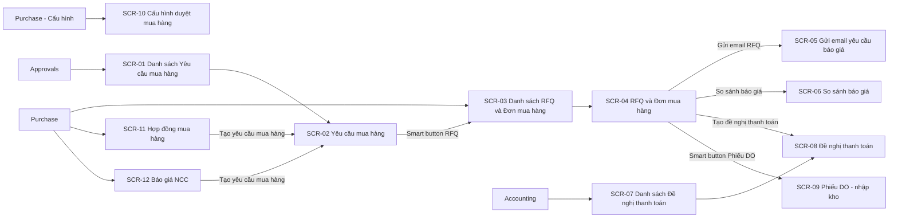
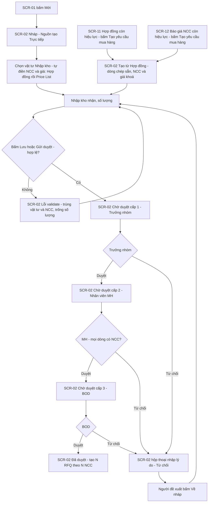
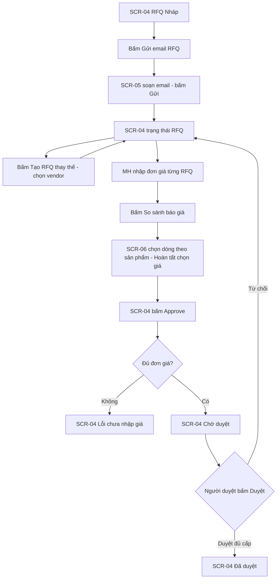
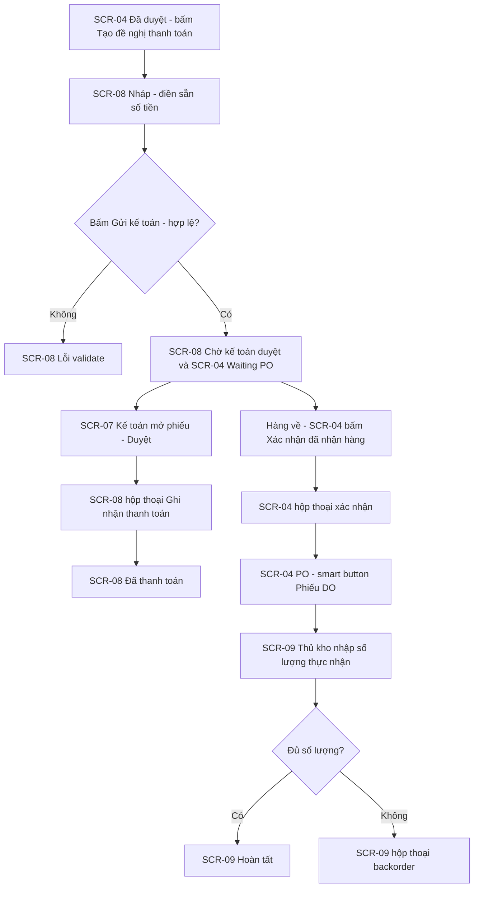

# UI spec — Quy trình mua hàng trên Odoo

> Nguồn: SRS.md mục 3, 6, 7 (v0.2). Toàn bộ màn hình là backend Odoo, khung 1440px.
> v0.2: sửa SCR-01, SCR-02, SCR-03, SCR-04 (khảo sát lần 2 — Yêu cầu mua hàng); thêm SCR-11, SCR-12.

## 1. Sitemap

### 1.1 Backend

## 2. User flows

### 2.1 Tạo và duyệt Yêu cầu mua hàng (FR-01 → FR-05, FR-22 → FR-24) — v0.2

### 2.2 Hỏi giá, chọn giá và duyệt đơn (FR-06 đến FR-10)

### 2.3 Thanh toán và nhận hàng (FR-11 đến FR-14)

## 3. Danh sách màn hình cần vẽ
| SCR | Slug | Loại | Khung | Trạng thái cần vẽ | FR |
|---|---|---|---|---|---|
| SCR-01 | danh-sach-yeu-cau-mua-hang | backend | 1440 | default, empty | FR-01, FR-17 |
| SCR-02 | yeu-cau-mua-hang | backend | 1440 | default, from-contract, to-approve, approved, refuse, refused, error | FR-01, FR-02, FR-03, FR-04, FR-17, FR-19, FR-22, FR-23, FR-24 |
| SCR-03 | danh-sach-don-mua-hang | backend | 1440 | default, empty | FR-06, FR-10, FR-17, FR-25 |
| SCR-04 | don-mua-hang | backend | 1440 | default, rfq, alternative, error, to-approve, approved, waiting-po, confirm-receipt, po, service | FR-06, FR-07, FR-08, FR-09, FR-10, FR-11, FR-13, FR-15, FR-17, FR-19, FR-25 |
| SCR-05 | gui-email-yeu-cau-bao-gia | backend | 1440 | default, error | FR-06 |
| SCR-06 | so-sanh-bao-gia | backend | 1440 | default, selected, empty | FR-08 |
| SCR-07 | danh-sach-de-nghi-thanh-toan | backend | 1440 | default, empty | FR-12 |
| SCR-08 | de-nghi-thanh-toan | backend | 1440 | default, error, submitted, register-payment, paid | FR-11, FR-12 |
| SCR-09 | phieu-do-nhap-kho | backend | 1440 | default, backorder, done | FR-14 |
| SCR-10 | cau-hinh-duyet-mua-hang | backend | 1440 | default, error | FR-18 |
| SCR-11 | hop-dong-mua-hang | backend | 1440 | default, expired | FR-20, FR-22 |
| SCR-12 | bao-gia-ncc | backend | 1440 | default, expired | FR-21, FR-23 |

### SCR-01 — Danh sách Yêu cầu mua hàng (sửa v0.2)
- **File:** `ui/screens/SCR-01-danh-sach-yeu-cau-mua-hang.html`
- **Mục đích:** Xem, lọc YCMH; tạo YCMH mới.
- **Bố cục (desktop 1440):**
  1. `be-topbar`: app "Phê duyệt", menu "Yêu cầu mua hàng", "Việc cần duyệt", "Cấu hình".
  2. `be-body` > `be-sidebar`: Của tôi, Chờ tôi duyệt, Tất cả.
  3. `be-controlpanel`: breadcrumb "Yêu cầu mua hàng"; `be-search` facet "Của tôi"; nút `wf-btn--primary` "Mới"; `be-pager`.
  4. `be-list` > `wf-table` nhóm theo trạng thái (`be-list__group`): Số phiếu, Người tạo, Bộ phận, Ngày tạo, Nguồn tạo, Tổng dự kiến, Trạng thái (`wf-badge`).
- **Trường:** Số phiếu (`HC_0012_20_10_26`), Người tạo, Bộ phận, Ngày tạo, Nguồn tạo (Trực tiếp / Hợp đồng <số> / Báo giá NCC <số>), Tổng dự kiến, Trạng thái.
- **Hành động:** Mới (primary), Tìm kiếm, Lọc, Nhóm theo.
- **Trạng thái:**
  - Mặc định: 3 nhóm Chờ duyệt / Đã duyệt / Từ chối.
  - Rỗng: `wf-empty` "Chưa có yêu cầu mua hàng nào" + mô tả + nút "Tạo yêu cầu mua hàng".

### SCR-02 — Yêu cầu mua hàng (sửa v0.2)
- **File:** `ui/screens/SCR-02-yeu-cau-mua-hang.html`
- **Mục đích:** Tạo (trực tiếp / từ Hợp đồng / từ Báo giá NCC), gửi, duyệt 3 cấp, từ chối YCMH.
- **Bố cục (desktop 1440):**
  1. `be-topbar` + `be-controlpanel` (breadcrumb "Yêu cầu mua hàng › HC_0012_20_10_26", pager).
  2. `be-form-header`: nút theo trạng thái và cấp duyệt; `be-statusbar` Nháp → Chờ duyệt → Đã duyệt (Từ chối thay Đã duyệt khi bị từ chối).
  3. `be-sheet`: `be-smart-buttons` (RFQ/Đơn mua hàng; Hợp đồng hoặc Báo giá NCC khi tạo từ đó); `be-title` = số phiếu; `be-fields` 2 cột: Người tạo, Ngày tạo, Bộ phận, Nguồn tạo, Ngày cần hàng, Tổng dự kiến, Ghi chú.
  4. `be-notebook` tab "Sản phẩm" (`wf-table--compact`: Vật tư, Đơn vị tính, Nhập kho, Số lượng, Nhà cung cấp, Đơn giá, Nguồn giá, Thành tiền, Ghi chú); tab "Người duyệt" (Cấp, Người duyệt, Vai trò, Trạng thái, Thời điểm — 3 cấp); tab "Đính kèm".
  5. `be-chatter`.
- **Trạng thái:**
  - default (Nháp — tạo trực tiếp): nút "Gửi duyệt" (primary), "Huỷ" (ghost); dòng tự điền: Giấy A4 nguồn "Hợp đồng HĐ-HH-2026-01" (giá khoá 🔒), Bút bi và Mực in nguồn "Price List", Máy in nguồn "Không có" (NCC trống); 2 kho nhận khác nhau.
  - from-contract (Nháp — tạo từ Hợp đồng HĐ-HH-2026-01): Nguồn tạo "Hợp đồng HĐ-HH-2026-01", smart button Hợp đồng; 2 dòng chép từ hợp đồng, số lượng đã nhập.
  - to-approve (Chờ duyệt cấp 2 — góc nhìn Nhân viên MH): nút "Duyệt" (primary), "Từ chối"; tab Người duyệt: cấp 1 Trưởng nhóm "Đã duyệt", cấp 2 MH "Chờ duyệt", cấp 3 BOD "Chờ duyệt".
  - approved: statusbar Đã duyệt; smart button "2 RFQ/Đơn mua hàng"; `wf-alert--success` "Đã tạo 2 RFQ: P00012, P00013".
  - refuse: `wf-overlay` + `wf-modal` "Từ chối yêu cầu HC_0012_20_10_26" (góc nhìn BOD), textarea Lý do (bắt buộc), nút "Xác nhận" (primary) "Huỷ".
  - refused (Từ chối — góc nhìn Người đề xuất): `wf-alert--warning` BOD từ chối kèm lý do; nút "Về nháp" (primary), "Huỷ" (ghost); tab Người duyệt cấp 3 "Từ chối".
  - error: `wf-alert--error` tóm tắt 2 lỗi; dòng trùng vật tư + NCC và dòng trống số lượng có `wf-error-text`.

### SCR-03 — Danh sách RFQ và Đơn mua hàng
- **File:** `ui/screens/SCR-03-danh-sach-don-mua-hang.html`
- **v0.2:** cột Yêu cầu mua hàng dùng số phiếu mới; thêm dòng RFQ dịch vụ P00020 (Yêu cầu mua hàng "—").
- **Bố cục:** `be-topbar` app "Mua hàng" (menu Đơn hàng, Sản phẩm, Cấu hình) → `be-controlpanel` (breadcrumb "Yêu cầu báo giá", facet "Chờ tôi duyệt" tuỳ state, nút "Mới" primary, "⚙ Thao tác") → `be-list` cột: chọn, Mã, Vendor, Yêu cầu mua hàng, Ngày đặt, Ngày cần hàng, Tổng tiền, Trạng thái.
- **Trạng thái:**
  - default: 2 dòng được chọn, `wf-dropdown` Thao tác mở mục "Gửi email RFQ"; badge trạng thái Nháp, RFQ, Chờ duyệt, Đã duyệt, Waiting PO, PO.
  - empty: facet "Chờ tôi duyệt", `wf-empty` "Không có đơn nào chờ bạn duyệt".

### SCR-04 — RFQ và Đơn mua hàng
- **File:** `ui/screens/SCR-04-don-mua-hang.html`
- **Bố cục:** `be-topbar` → `be-controlpanel` (breadcrumb "Yêu cầu báo giá › P00012") → `be-form-header` (nút theo trạng thái + `be-statusbar` Nháp → RFQ → Chờ duyệt → Đã duyệt → Waiting PO → PO) → `be-sheet`: `be-smart-buttons` (Yêu cầu mua hàng, Đề nghị thanh toán, Phiếu DO); `be-title`; `be-fields`: Vendor, Yêu cầu mua hàng, Ngày đặt, Ngày cần hàng; `be-notebook` tab "Sản phẩm" (Sản phẩm, Số lượng, Đơn vị tính, Nhập kho, Đơn giá, Ngày giao dự kiến, Thành tiền + tổng; v0.2 thêm cột Nhập kho), tab "Báo giá thay thế", tab "Duyệt" (Cấp, Người duyệt, Trạng thái, Thời điểm) → `be-chatter`.
- **Trạng thái:**
  - default (Nháp): "Gửi email RFQ" (primary), "Tạo RFQ thay thế", "Huỷ" (ghost); đơn giá và kho nhận lấy từ dòng YCMH (v0.2).
  - rfq: "Approve" (primary), "Gửi lại email", "Tạo RFQ thay thế", "So sánh báo giá", "Huỷ"; tab Báo giá thay thế liệt kê 2 RFQ khác.
  - alternative: modal "Tạo RFQ thay thế": Vendor (bắt buộc), checkbox "Sao chép dòng sản phẩm"; nút "Tạo" (primary), "Huỷ".
  - error: `wf-alert--error` "Chưa nhập đơn giá cho sản phẩm Mực in HP 107A"; ô đơn giá lỗi.
  - to-approve: góc nhìn Trưởng phòng Mua hàng; "Duyệt" (primary), "Từ chối"; tab Duyệt cấp 1 chờ, cấp 2 Giám đốc chờ (đơn 68.000.000₫).
  - approved: "Tạo đề nghị thanh toán" (primary), "Huỷ".
  - waiting-po: "Xác nhận đã nhận hàng" (primary), "Huỷ"; smart button Đề nghị thanh toán 1.
  - confirm-receipt: modal xác nhận "Xác nhận đã nhận hàng cho P00014? Hệ thống tạo phiếu DO."; "Xác nhận" (primary), "Huỷ".
  - service (RFQ dịch vụ — v0.2): P00020 NCC "Công ty TNHH Vệ sinh Công nghiệp Sao Việt", Yêu cầu mua hàng trống, dòng "[DV-005] Vệ sinh công nghiệp văn phòng" Nhập kho "—"; nút như Nháp; ghi chú không có phiếu DO.
  - po: không có nút hành động trạng thái (không huỷ được); statusbar PO; smart button Phiếu DO 1; `wf-alert--success` "Đã xác nhận nhận hàng. Phiếu DO WH/IN/00031 (2 dòng) đã gửi Thủ kho."
- **Ghi chú:** chú thích nút chỉ hiện theo trạng thái (FR-09, FR-13), ngưỡng duyệt (FR-10).

### SCR-05 — Gửi email yêu cầu báo giá
- **File:** `ui/screens/SCR-05-gui-email-yeu-cau-bao-gia.html`
- **Bố cục:** nền form SCR-04 mờ (`wf-overlay`) + `wf-modal--lg`: Người nhận (tag vendor), Tiêu đề, Nội dung (`wf-textarea`), Tệp đính kèm (P00012.pdf), Mẫu email; footer "Gửi" (primary), "Huỷ".
- **Trạng thái:**
  - default: RFQ P00012, người nhận "Công ty Văn phòng phẩm Hồng Hà <baogia@vpphongha.vn>".
  - error: RFQ P00019, `wf-alert--error` "Vendor Công ty TNHH An Phát chưa có email".

### SCR-06 — So sánh báo giá
- **File:** `ui/screens/SCR-06-so-sanh-bao-gia.html`
- **Bố cục:** `be-topbar` → `be-controlpanel` (breadcrumb "Yêu cầu báo giá › P00012 › So sánh báo giá"; nút "Hoàn tất chọn giá" primary) → `be-list` > `wf-table` nhóm theo sản phẩm (`be-list__group`): Vendor, RFQ, Số lượng, Đơn giá, Thành tiền, Ngày giao dự kiến, nhãn, nút "Chọn".
- **Trạng thái:**
  - default: 2 sản phẩm × 3 vendor; nhãn "Giá thấp nhất".
  - selected: dòng đã chọn badge "Đã chọn" + nút "Bỏ chọn", dòng khác số lượng 0; `wf-alert--warning` báo RFQ sẽ bị huỷ.
  - empty: `wf-empty` "Chưa có báo giá thay thế" + nút "Tạo RFQ thay thế".

### SCR-07 — Danh sách Đề nghị thanh toán
- **File:** `ui/screens/SCR-07-danh-sach-de-nghi-thanh-toan.html`
- **Bố cục:** `be-topbar` app "Kế toán" → `be-controlpanel` (facet "Chờ kế toán duyệt") → `be-list`: Mã, Đơn mua hàng, Vendor, Số tiền, Ngày đề nghị, Hình thức, Trạng thái.
- **Trạng thái:** default (nhóm Chờ kế toán duyệt / Đã duyệt / Đã thanh toán); empty `wf-empty` "Không có đề nghị thanh toán nào chờ duyệt".

### SCR-08 — Đề nghị thanh toán
- **File:** `ui/screens/SCR-08-de-nghi-thanh-toan.html`
- **Bố cục:** `be-topbar` → `be-controlpanel` → `be-form-header` (statusbar Nháp → Chờ kế toán duyệt → Đã duyệt → Đã thanh toán) → `be-sheet`: smart button Đơn mua hàng, Thanh toán; `be-fields`: Đơn mua hàng, Vendor, Số tiền, Ngày đề nghị, Hình thức thanh toán, Tài khoản ngân hàng, Nội dung; tab "Đính kèm" → `be-chatter`.
- **Trạng thái:**
  - default (Nháp, góc nhìn MH): "Gửi kế toán" (primary), "Huỷ".
  - error: số tiền vượt tổng, tài khoản ngân hàng trống.
  - submitted (góc nhìn Kế toán): "Duyệt" (primary), "Từ chối".
  - register-payment: modal "Ghi nhận thanh toán": Sổ nhật ký, Ngày thanh toán, Số tiền (readonly); "Xác nhận" (primary), "Huỷ".
  - paid: statusbar Đã thanh toán; smart button Thanh toán 1.

### SCR-09 — Phiếu DO - nhập kho
- **File:** `ui/screens/SCR-09-phieu-do-nhap-kho.html`
- **Bố cục:** `be-topbar` app "Tồn kho" → `be-controlpanel` (breadcrumb "Phiếu nhập kho › WH/IN/00031") → `be-form-header` ("Xác nhận" primary; statusbar Nháp → Sẵn sàng → Hoàn tất) → `be-sheet`: Vendor, Chứng từ gốc (P00014), Ngày dự kiến, Kho nhận; tab "Hoạt động" bảng Sản phẩm, Số lượng yêu cầu, Số lượng thực nhận, Đơn vị tính → `be-chatter`.
- **Trạng thái:** default (Sẵn sàng); backorder (modal "Tạo backorder?" với 2 nút "Tạo backorder" primary, "Không tạo backorder"); done (Hoàn tất, số lượng readonly).

### SCR-10 — Cấu hình duyệt mua hàng
- **File:** `ui/screens/SCR-10-cau-hinh-duyet-mua-hang.html`
- **Bố cục:** `be-topbar` app "Cài đặt" → `be-controlpanel` (nút "Lưu" primary, "Huỷ bỏ") → `be-sheet` khối "Duyệt đơn mua hàng": Người duyệt cấp 1, Người duyệt cấp 2, Ngưỡng duyệt cấp 2; khối "Mẫu email": Mẫu email RFQ, Mẫu email từ chối.
- **Trạng thái:** default; error (ngưỡng 0 → `be-field--error` "Ngưỡng duyệt phải lớn hơn 0").

### SCR-11 — Hợp đồng mua hàng (mới v0.2)
- **File:** `ui/screens/SCR-11-hop-dong-mua-hang.html`
- **Mục đích:** Lưu hợp đồng khung với NCC; tạo YCMH từ hợp đồng.
- **Bố cục:** `be-topbar` app "Mua hàng" → `be-controlpanel` (breadcrumb "Hợp đồng mua hàng › HĐ-HH-2026-01") → `be-form-header` ("Tạo yêu cầu mua hàng" primary, "Đóng hợp đồng"; statusbar Nháp → Đang hiệu lực → Hết hiệu lực) → `be-sheet`: smart button Yêu cầu mua hàng, RFQ/Đơn mua hàng; `be-fields`: Nhà cung cấp, Loại, Hiệu lực từ, Hiệu lực đến, Người phụ trách, Tham chiếu NCC; tab "Vật tư" (Vật tư, Đơn vị tính, Đơn giá, Số lượng hợp đồng, Đã đặt), tab "Tệp hợp đồng" → `be-chatter`.
- **Trạng thái:** default (Đang hiệu lực); expired (HĐ-HH-2025-03 Hết hiệu lực: `be-ribbon` "Hết hiệu lực", không có nút tạo YCMH, `wf-alert--warning`).

### SCR-12 — Báo giá NCC (mới v0.2)
- **File:** `ui/screens/SCR-12-bao-gia-ncc.html`
- **Mục đích:** Lưu báo giá NCC gửi công ty; tạo YCMH từ báo giá.
- **Bố cục:** `be-topbar` app "Mua hàng" → `be-controlpanel` (breadcrumb "Báo giá NCC › BG-PV-1510") → `be-form-header` ("Tạo yêu cầu mua hàng" primary, "Huỷ" ghost; statusbar Nháp → Còn hiệu lực → Hết hiệu lực) → `be-sheet`: smart button Yêu cầu mua hàng; `be-fields`: Nhà cung cấp, Ngày báo giá, Hiệu lực đến, Người nhận; tab "Vật tư" (Vật tư, Đơn vị tính, Đơn giá, Số lượng tối thiểu, Ghi chú); file báo giá `wf-file-list` → `be-chatter`.
- **Trạng thái:** default (Còn hiệu lực); expired (Hết hiệu lực: `be-ribbon`, không có nút tạo YCMH).
