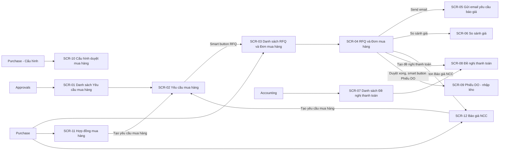
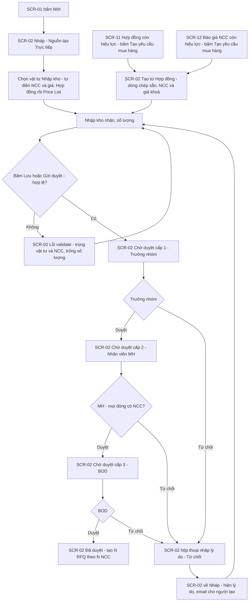
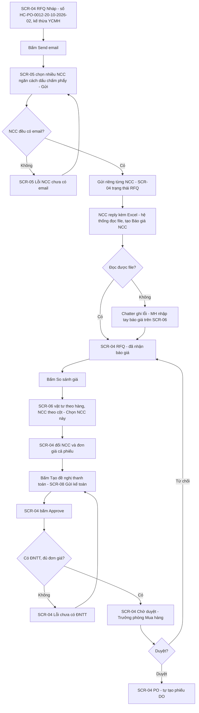
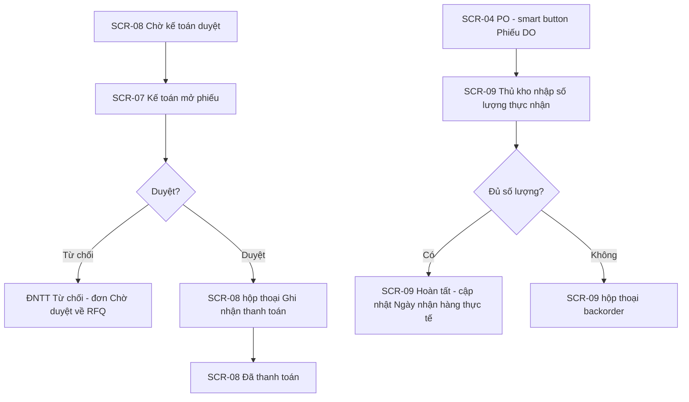
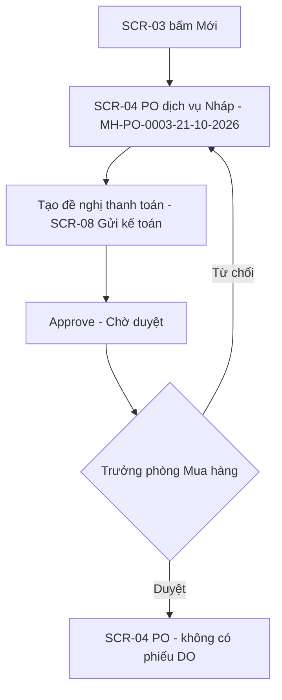

# UI spec — Quy trình mua hàng trên Odoo

> Nguồn: SRS.md mục 3, 6, 7 (v0.3). Toàn bộ màn hình là backend Odoo, khung 1440px.
> v0.3: sửa SCR-02 → SCR-10, SCR-12 (trả lời câu hỏi mở lần 1, khảo sát lần 3 — Yêu cầu báo giá); quy trình nghiệp vụ vẽ bằng Activity – Swimlane (`ui/swimlanes/*.json` → `ui/diagrams/swimlane-*.png`, SRS mục 7.1, 7.5).
> v0.2: sửa SCR-01, SCR-02, SCR-03, SCR-04 (khảo sát lần 2 — Yêu cầu mua hàng); thêm SCR-11, SCR-12.

## 1. Sitemap

### 1.1 Backend

## 2. User flows

### 2.1 Tạo và duyệt Yêu cầu mua hàng (FR-01 → FR-05, FR-22 → FR-24) — sửa v0.3

### 2.2 Hỏi giá, chọn NCC, ĐNTT và duyệt đơn (FR-06, FR-08, FR-09, FR-10, FR-11, FR-26, FR-27) — sửa v0.3

### 2.3 Thanh toán và nhận hàng (FR-12 → FR-14) — sửa v0.3

### 2.4 Mua Dịch vụ (FR-25) — mới v0.3

## 3. Danh sách màn hình cần vẽ
| SCR | Slug | Loại | Khung | Trạng thái cần vẽ | FR |
|---|---|---|---|---|---|
| SCR-01 | danh-sach-yeu-cau-mua-hang | backend | 1440 | default, empty | FR-01, FR-17 |
| SCR-02 | yeu-cau-mua-hang | backend | 1440 | default, from-contract, to-approve, approved, refuse, refused, error | FR-01, FR-02, FR-03, FR-04, FR-17, FR-19, FR-22, FR-23, FR-24 |
| SCR-03 | danh-sach-don-mua-hang | backend | 1440 | default, empty | FR-10, FR-17, FR-25, FR-27 |
| SCR-04 | don-mua-hang | backend | 1440 | default, rfq, error, to-approve, po, service | FR-06, FR-08, FR-09, FR-10, FR-11, FR-13, FR-15, FR-17, FR-19, FR-25, FR-26, FR-27 |
| SCR-05 | gui-email-yeu-cau-bao-gia | backend | 1440 | default, error, sent | FR-06 |
| SCR-06 | so-sanh-bao-gia | backend | 1440 | default, selected, empty | FR-08, FR-26 |
| SCR-07 | danh-sach-de-nghi-thanh-toan | backend | 1440 | default, empty | FR-12 |
| SCR-08 | de-nghi-thanh-toan | backend | 1440 | default, error, submitted, register-payment, paid | FR-11, FR-12 |
| SCR-09 | phieu-do-nhap-kho | backend | 1440 | default, backorder, done | FR-13, FR-14 |
| SCR-10 | cau-hinh-duyet-mua-hang | backend | 1440 | default, error | FR-18 |
| SCR-11 | hop-dong-mua-hang | backend | 1440 | default, expired | FR-20, FR-22 |
| SCR-12 | bao-gia-ncc | backend | 1440 | default, expired | FR-21, FR-23, FR-26 |

### SCR-01 — Danh sách Yêu cầu mua hàng (sửa v0.2)
- **File:** `ui/screens/SCR-01-danh-sach-yeu-cau-mua-hang.html`
- **Mục đích:** Xem, lọc YCMH; tạo YCMH mới.
- **Bố cục (desktop 1440):**
  1. `be-topbar`: app "Phê duyệt", menu "Yêu cầu mua hàng", "Việc cần duyệt", "Cấu hình".
  2. `be-body` > `be-sidebar`: Của tôi, Chờ tôi duyệt, Tất cả.
  3. `be-controlpanel`: breadcrumb "Yêu cầu mua hàng"; `be-search` facet "Của tôi"; nút `wf-btn--primary` "Mới"; `be-pager`.
  4. `be-list` > `wf-table` nhóm theo trạng thái (`be-list__group`): Số phiếu, Người tạo, Bộ phận, Ngày tạo, Nguồn tạo, Tổng dự kiến, Trạng thái (`wf-badge`).
- **Trường:** Số phiếu (`HC_0012_20_10_26`), Người tạo, Bộ phận, Ngày tạo, Nguồn tạo (Trực tiếp / Hợp đồng <số> / Báo giá NCC <số>), Tổng dự kiến, Trạng thái.
- **Hành động:** Mới (primary), Tìm kiếm, Lọc, Nhóm theo.
- **Trạng thái:**
  - Mặc định: 3 nhóm Chờ duyệt / Đã duyệt / Từ chối.
  - Rỗng: `wf-empty` "Chưa có yêu cầu mua hàng nào" + mô tả + nút "Tạo yêu cầu mua hàng".

### SCR-02 — Yêu cầu mua hàng (sửa v0.2)
- **File:** `ui/screens/SCR-02-yeu-cau-mua-hang.html`
- **Mục đích:** Tạo (trực tiếp / từ Hợp đồng / từ Báo giá NCC), gửi, duyệt 3 cấp, từ chối YCMH.
- **Bố cục (desktop 1440):**
  1. `be-topbar` + `be-controlpanel` (breadcrumb "Yêu cầu mua hàng › HC_0012_20_10_26", pager).
  2. `be-form-header`: nút theo trạng thái và cấp duyệt; `be-statusbar` Nháp → Chờ duyệt → Đã duyệt (v0.3: bị từ chối về Nháp).
  3. `be-sheet`: `be-smart-buttons` (RFQ/Đơn mua hàng; Hợp đồng hoặc Báo giá NCC khi tạo từ đó); `be-title` = số phiếu; `be-fields` 2 cột: Người tạo, Ngày tạo, Bộ phận, Nguồn tạo, Ngày cần hàng, Tổng dự kiến, Ghi chú.
  4. `be-notebook` tab "Sản phẩm" (`wf-table--compact`: Vật tư, Đơn vị tính, Nhập kho, Số lượng, Nhà cung cấp, Đơn giá, Nguồn giá, Thành tiền, Ghi chú); tab "Người duyệt" (Cấp, Người duyệt, Vai trò, Trạng thái, Thời điểm — 3 cấp); tab "Đính kèm".
  5. `be-chatter`.
- **Trạng thái:**
  - default (Nháp — tạo trực tiếp): nút "Gửi duyệt" (primary), "Huỷ" (ghost); dòng tự điền: Giấy A4 nguồn "Hợp đồng HĐ-HH-2026-01" (giá khoá 🔒), Bút bi và Mực in nguồn "Price List", Máy in nguồn "Không có" (NCC trống); 2 kho nhận khác nhau.
  - from-contract (Nháp — tạo từ Hợp đồng HĐ-HH-2026-01): Nguồn tạo "Hợp đồng HĐ-HH-2026-01", smart button Hợp đồng; 2 dòng chép từ hợp đồng, số lượng đã nhập.
  - to-approve (Chờ duyệt cấp 2 — góc nhìn Nhân viên MH): nút "Duyệt" (primary), "Từ chối"; tab Người duyệt: cấp 1 Trưởng nhóm "Đã duyệt", cấp 2 MH "Chờ duyệt", cấp 3 BOD "Chờ duyệt".
  - approved: statusbar Đã duyệt; smart button "2 RFQ/Đơn mua hàng"; `wf-alert--success` "Đã tạo 2 RFQ: HC-PO-0012-20-10-2026-01, HC-PO-0012-20-10-2026-02" *(v0.3)*.
  - refuse: `wf-overlay` + `wf-modal` "Từ chối yêu cầu HC_0012_20_10_26" (góc nhìn BOD), textarea Lý do (bắt buộc), nút "Xác nhận" (primary) "Huỷ".
  - refused (Bị từ chối — về Nháp, góc nhìn Người đề xuất, sửa v0.3): statusbar Nháp; `wf-alert--warning` BOD từ chối kèm lý do và "Đã gửi email cho người tạo"; nút "Gửi duyệt" (primary), "Huỷ" (ghost); trường sửa được; tab Người duyệt đặt lại "Chờ duyệt".
  - error: `wf-alert--error` tóm tắt 2 lỗi; dòng trùng vật tư + NCC và dòng trống số lượng có `wf-error-text`.

### SCR-03 — Danh sách RFQ và Đơn mua hàng (sửa v0.3)
- **File:** `ui/screens/SCR-03-danh-sach-don-mua-hang.html`
- **Bố cục:** `be-topbar` app "Mua hàng" (menu Đơn hàng, Sản phẩm, Cấu hình) → `be-controlpanel` (breadcrumb "Yêu cầu báo giá", `be-search` gợi ý tìm theo Mã Yêu cầu mua hàng, facet "Chờ tôi duyệt" tuỳ state, nút "Mới" primary) → `be-list` cột: Số phiếu, Nhà cung cấp, Mã Yêu cầu mua hàng, Loại (Nhập kho / Dịch vụ), Ngày dự kiến nhận hàng, Tổng tiền, Trạng thái.
- **Trạng thái:**
  - default: số phiếu mẫu mới (HC-PO-0012-20-10-2026-01/-02, MH-PO-0003-21-10-2026…); badge Nháp, RFQ, Chờ duyệt, PO, Đã huỷ; không còn thao tác gửi email hàng loạt.
  - empty: facet "Chờ tôi duyệt", `wf-empty` "Không có đơn nào chờ bạn duyệt".

### SCR-04 — RFQ và Đơn mua hàng (sửa v0.3)
- **File:** `ui/screens/SCR-04-don-mua-hang.html`
- **Bố cục:** `be-topbar` → `be-controlpanel` (breadcrumb "Yêu cầu báo giá › HC-PO-0012-20-10-2026-02") → `be-form-header` (nút theo trạng thái + `be-statusbar` Nháp → RFQ → Chờ duyệt → PO; dịch vụ: Nháp → Chờ duyệt → PO) → `be-sheet`: `be-smart-buttons` (Yêu cầu mua hàng, Báo giá NCC, Đề nghị thanh toán, Phiếu DO); `be-title`; `be-fields` 2 cột: Nhà cung cấp, Mã Yêu cầu mua hàng, Người tạo YCMH, Bộ phận, Ngày dự kiến nhận hàng, Ngày nhận hàng thực tế, Ghi chú; `be-notebook` tab "Sản phẩm" (Vật tư, Số lượng, Đơn vị tính, Nhập kho, Đơn giá, Nguồn giá, Ngày giao dự kiến, Thành tiền + tổng), tab "NCC được hỏi giá" (NCC, Email, Ngày gửi, Báo giá), tab "Duyệt" (Người duyệt, Trạng thái, Thời điểm) → `be-chatter`.
- **Trạng thái:**
  - default (Nháp): "Send email" (primary), "Huỷ" (ghost); kế thừa đầu phiếu và đơn giá từ YCMH.
  - rfq (RFQ — đã nhận báo giá): "So sánh giá" (primary), "Tạo đề nghị thanh toán", "Approve", "Send email", "Huỷ"; smart button Báo giá NCC 3; chatter có các email NCC trả lời kèm Excel đã đọc và 1 lỗi đọc file `BaoGia_TGDD.xlsx` (thiếu cột Đơn giá); TGDĐ gửi lại bản v2.
  - error (Lỗi chưa có ĐNTT): `wf-alert--error` "Phải tạo Đề nghị thanh toán trước khi gửi duyệt".
  - to-approve: góc nhìn Trưởng phòng Mua hàng; "Duyệt" (primary), "Từ chối"; 1 cấp duyệt; smart button Đề nghị thanh toán 1.
  - po: statusbar PO; smart button Phiếu DO 1; `wf-alert--success` "Đã duyệt. Phiếu DO WH/IN/00031 (2 dòng) đã gửi Thủ kho."; Ngày nhận hàng thực tế trống đến khi DO hoàn tất.
  - service (PO dịch vụ): MH-PO-0003-21-10-2026, NCC Sao Việt, không có Mã Yêu cầu mua hàng, statusbar Nháp → Chờ duyệt → PO, nút "Tạo đề nghị thanh toán" (primary), "Approve", "Huỷ"; không có "Send email"; ghi chú không có phiếu DO.
- **Ghi chú:** nút chỉ hiện theo trạng thái (FR-09, FR-13); số phiếu theo FR-27.

### SCR-05 — Gửi email yêu cầu báo giá (sửa v0.3)
- **File:** `ui/screens/SCR-05-gui-email-yeu-cau-bao-gia.html`
- **Bố cục:** nền form SCR-04 mờ (`wf-overlay`) + `wf-modal--lg`: Gửi đến (nhiều tag NCC, gợi ý "ngăn cách bằng ;"), Tiêu đề, Nội dung (`wf-textarea` có bảng sản phẩm), Tệp đính kèm (PDF RFQ, `MauBaoGia_HC-PO-0012-20-10-2026-02.xlsx`), Mẫu email, ghi chú "Hệ thống gửi riêng cho từng NCC"; footer "Gửi" (primary), "Huỷ".
- **Trạng thái:**
  - default: 3 NCC Phong Vũ; Thế Giới Di Động; Minh Khoa.
  - error: thêm "Công ty TNHH An Phát", `wf-alert--error` "Nhà cung cấp Công ty TNHH An Phát chưa có email".
  - sent: SCR-04 trạng thái RFQ với `wf-alert--success` "Đã gửi 3 email riêng", tab NCC được hỏi giá "chờ trả lời", chatter liệt kê 3 NCC.

### SCR-06 — So sánh giá (sửa v0.3)
- **File:** `ui/screens/SCR-06-so-sanh-bao-gia.html`
- **Bố cục:** `be-topbar` → `be-controlpanel` (breadcrumb "Yêu cầu báo giá › HC-PO-0012-20-10-2026-02 › So sánh giá"; nút "Nhập tay báo giá", "Đóng") → `be-sheet` > `wf-table`: hàng = vật tư (Vật tư, Số lượng), mỗi NCC 2 cột (Đơn giá, Thành tiền); hàng Tổng, Ngày giao, Nguồn báo giá (Excel / nhập tay); hàng cuối nút "Chọn NCC này" mỗi cột.
- **Trạng thái:**
  - default: 2 vật tư × 3 NCC (Phong Vũ, Thế Giới Di Động, Minh Khoa thiếu giá máy in); nhãn "Giá thấp nhất" theo dòng, "Tổng thấp nhất" cột Phong Vũ; nút cột Minh Khoa khoá.
  - selected: modal "Chọn nhà cung cấp cho cả phiếu": chọn Phong Vũ (BG-PV-2010, 63.570.000₫), NCC của RFQ giữ nguyên, đơn giá 2 dòng cập nhật theo báo giá, 2 báo giá còn lại "Không chọn"; ghi chú chọn NCC khác thì RFQ đổi NCC.
  - empty: `wf-empty` "Chưa có báo giá NCC nào được ghi nhận" + nút "Nhập tay báo giá".

### SCR-07 — Danh sách Đề nghị thanh toán
- **File:** `ui/screens/SCR-07-danh-sach-de-nghi-thanh-toan.html`
- **Bố cục:** `be-topbar` app "Kế toán" → `be-controlpanel` (facet "Chờ kế toán duyệt") → `be-list`: Mã, RFQ / Đơn mua hàng (số mới v0.3), Vendor, Số tiền, Ngày đề nghị, Hình thức, Trạng thái.
- **Trạng thái:** default (nhóm Chờ kế toán duyệt / Đã duyệt / Đã thanh toán); empty `wf-empty` "Không có đề nghị thanh toán nào chờ duyệt".

### SCR-08 — Đề nghị thanh toán
- **File:** `ui/screens/SCR-08-de-nghi-thanh-toan.html`
- **Bố cục:** `be-topbar` → `be-controlpanel` → `be-form-header` (statusbar Nháp → Chờ kế toán duyệt → Đã duyệt → Đã thanh toán) → `be-sheet`: smart button Đơn mua hàng, Thanh toán; `be-fields`: Đơn mua hàng, Vendor, Số tiền, Ngày đề nghị, Hình thức thanh toán, Tài khoản ngân hàng, Nội dung; tab "Đính kèm" → `be-chatter`.
- **Trạng thái:**
  - default (Nháp, góc nhìn MH, tạo từ RFQ HC-PO-0012-20-10-2026-02 trước khi gửi duyệt — v0.3): "Gửi kế toán" (primary), "Huỷ".
  - error: số tiền vượt tổng, tài khoản ngân hàng trống.
  - submitted (góc nhìn Kế toán): "Duyệt" (primary), "Từ chối".
  - register-payment: modal "Ghi nhận thanh toán": Sổ nhật ký, Ngày thanh toán, Số tiền (readonly); "Xác nhận" (primary), "Huỷ".
  - paid: statusbar Đã thanh toán; smart button Thanh toán 1.

### SCR-09 — Phiếu DO - nhập kho
- **File:** `ui/screens/SCR-09-phieu-do-nhap-kho.html`
- **Bố cục:** `be-topbar` app "Tồn kho" → `be-controlpanel` (breadcrumb "Phiếu nhập kho › WH/IN/00031") → `be-form-header` ("Xác nhận" primary; statusbar Nháp → Sẵn sàng → Hoàn tất) → `be-sheet`: Vendor, Chứng từ gốc (HC-PO-0012-20-10-2026-02, v0.3), Ngày dự kiến, Kho nhận; tab "Hoạt động" bảng Sản phẩm, Số lượng yêu cầu, Số lượng thực nhận, Đơn vị tính → `be-chatter`.
- **Trạng thái:** default (Sẵn sàng); backorder (modal "Tạo backorder?" với 2 nút "Tạo backorder" primary, "Không tạo backorder"); done (Hoàn tất, số lượng readonly; ghi chú cập nhật Ngày nhận hàng thực tế của đơn — v0.3).

### SCR-10 — Cấu hình duyệt mua hàng (sửa v0.3)
- **File:** `ui/screens/SCR-10-cau-hinh-duyet-mua-hang.html`
- **Bố cục:** `be-topbar` app "Cài đặt" → `be-controlpanel` (nút "Lưu" primary, "Huỷ bỏ") → `be-sheet` khối "Duyệt đơn mua hàng": Người duyệt đơn mua hàng (1 cấp, không ngưỡng); khối "Mẫu email": Mẫu email RFQ, Mẫu email từ chối; khối "Báo giá NCC": Mẫu file Excel báo giá, Hộp thư nhận báo giá.
- **Trạng thái:** default; error (Người duyệt trống → `be-field--error` "Vui lòng chọn người duyệt đơn mua hàng"; mẫu Excel thiếu cột "Đơn giá").

### SCR-11 — Hợp đồng mua hàng (mới v0.2)
- **File:** `ui/screens/SCR-11-hop-dong-mua-hang.html`
- **Mục đích:** Lưu hợp đồng khung với NCC; tạo YCMH từ hợp đồng.
- **Bố cục:** `be-topbar` app "Mua hàng" → `be-controlpanel` (breadcrumb "Hợp đồng mua hàng › HĐ-HH-2026-01") → `be-form-header` ("Tạo yêu cầu mua hàng" primary, "Đóng hợp đồng"; statusbar Nháp → Đang hiệu lực → Hết hiệu lực) → `be-sheet`: smart button Yêu cầu mua hàng, RFQ/Đơn mua hàng; `be-fields`: Nhà cung cấp, Loại, Hiệu lực từ, Hiệu lực đến, Người phụ trách, Tham chiếu NCC; tab "Vật tư" (Vật tư, Đơn vị tính, Đơn giá, Số lượng hợp đồng, Đã đặt), tab "Tệp hợp đồng" → `be-chatter`.
- **Trạng thái:** default (Đang hiệu lực); expired (HĐ-HH-2025-03 Hết hiệu lực: `be-ribbon` "Hết hiệu lực", không có nút tạo YCMH, `wf-alert--warning`).

### SCR-12 — Báo giá NCC (mới v0.2)
- **File:** `ui/screens/SCR-12-bao-gia-ncc.html`
- **Mục đích:** Lưu báo giá NCC gửi công ty; tạo YCMH từ báo giá.
- **Bố cục:** `be-topbar` app "Mua hàng" → `be-controlpanel` (breadcrumb "Báo giá NCC › BG-PV-1510") → `be-form-header` ("Tạo yêu cầu mua hàng" primary, "Huỷ" ghost; statusbar Nháp → Còn hiệu lực → Hết hiệu lực) → `be-sheet`: smart button Yêu cầu mua hàng; `be-fields`: Nhà cung cấp, Ngày báo giá, Hiệu lực đến, Người nhận, RFQ liên quan (v0.3, có khi tạo từ email NCC); tab "Vật tư" (Vật tư, Đơn vị tính, Đơn giá, Số lượng tối thiểu, Ghi chú); file báo giá `wf-file-list` → `be-chatter`.
- **Trạng thái:** default (Còn hiệu lực); expired (Hết hiệu lực: `be-ribbon`, không có nút tạo YCMH).
