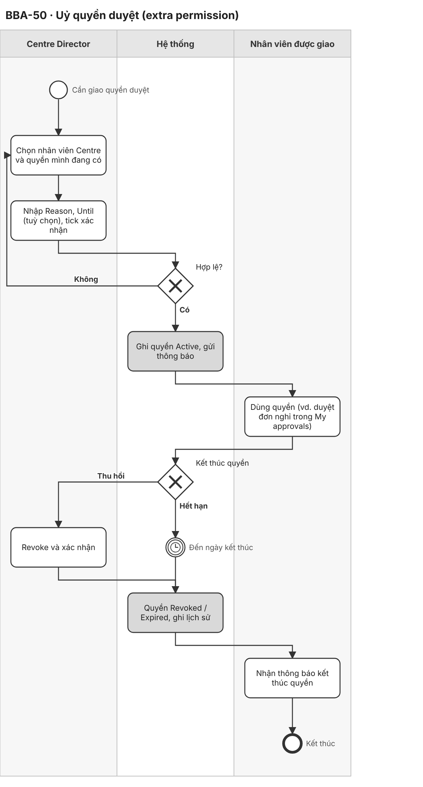
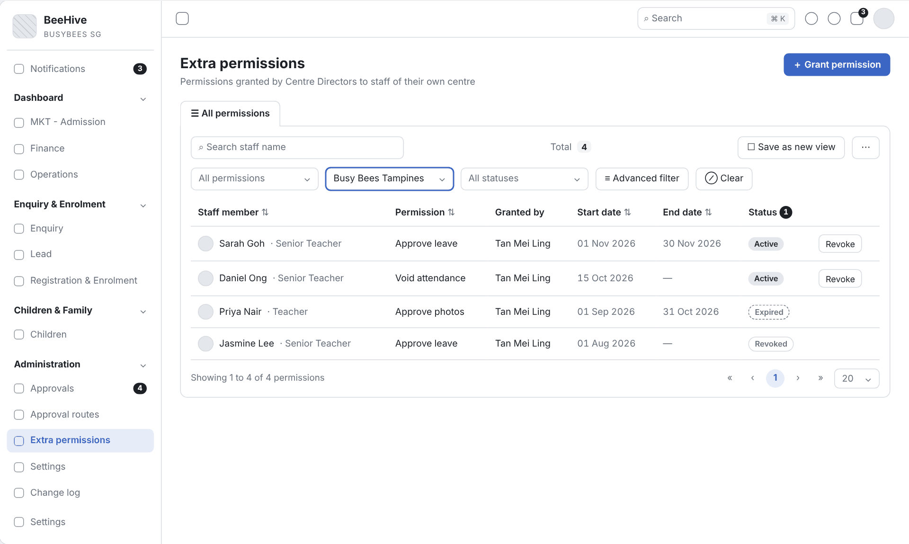
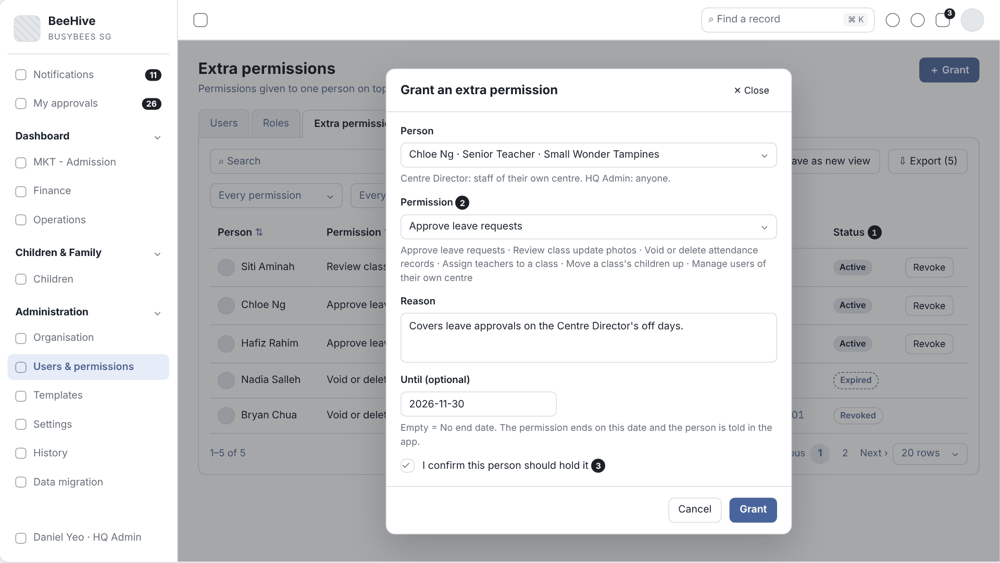
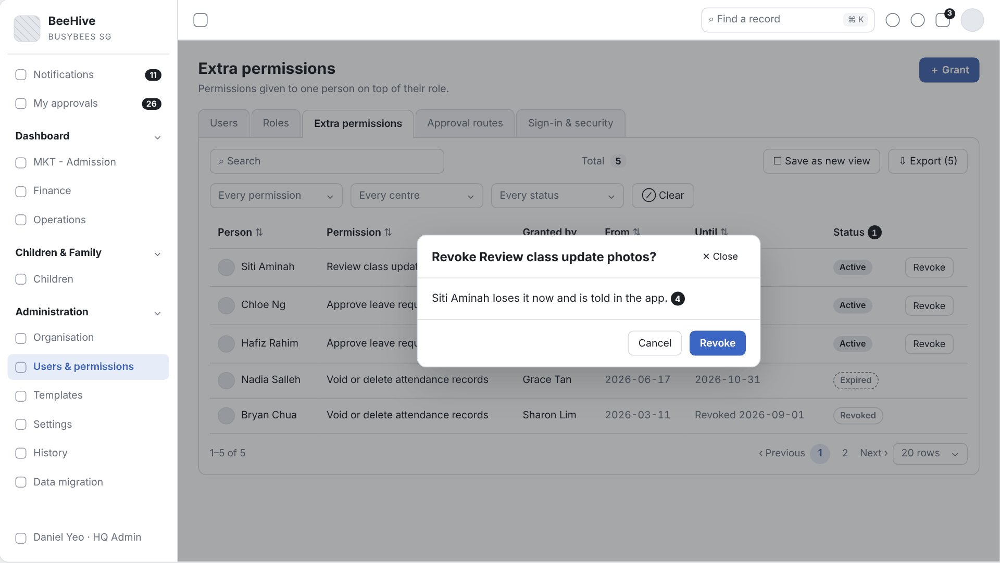

# 2.8 Approval Delegation (Tiếng Việt)

| Thuộc tính | Giá trị |
|---|---|
| Dự án | Busy Bees Asia SMS |
| Module | Administration — Extra permissions |
| Tính năng | BBA-50 Approval delegation |
| Mã tài liệu | FRD-2.8_Approval_Delegation |
| Sprint | 4 |
| Phiên bản | 0.1 |
| Trạng thái | BẢN NHÁP CHỜ XÁC NHẬN |
| Ngày | 10/11/2026 |
| Người soạn | Business Analysis |
| Người review | HaiNguyen |
| Người duyệt | HaiNguyen |

## 1. Kiểm soát tài liệu

| Phiên bản | Ngày | Tác giả | Tóm tắt thay đổi | Duyệt |
|---|---|---|---|---|
| 0.1 | 10/11/2026 | Business Analysis | Tách BBA-50 từ FRD 2.8 CRM Administration v0.3 thành FRD riêng; nội dung giữ nguyên, mã đánh lại từ 001 (đối chiếu mã ở Phụ lục cuối). | HaiNguyen |

**Mức sẵn sàng:** Đã đặc tả đủ User Story, FR, quy tắc, kiểm tra, dữ liệu, tiêu chí nghiệm thu, sơ đồ BPMN và wireframe của BBA-50. Còn 2 câu hỏi mở ở mục 7.

## 2. Mục đích và bối cảnh

Centre Director (hoặc HQ Admin) giao cho một nhân viên một quyền duyệt mình đang có — duyệt nghỉ, void điểm danh, duyệt ảnh… — có lý do, có hạn, thu hồi được, để việc duyệt không dừng khi người duyệt vắng. Người được giao thấy yêu cầu tương ứng trong My approvals.

| Ticket | Tên |
|---|---|
| BBA-50 | Approval delegation |

**Quy trình và tham chiếu SRS:** SRS SMS Administration v0.1 — §3 P4, §4 mục 2.3 Extra permissions, BR-ADM-007, BR-ADM-016, BR-ADM-017, §6.1, AC-ADM-007, AC-ADM-008 · SRS SMS General Requirements v0.1 — §3.1 · SRS Daily Operations — BR-OPS-017, BR-OPS-022, AC-OPS-013 · Prototype: https://bba-sms-crm.lovable.app/organisation/delegations · Wireframe: `Diagram/Wireframe/approvals-sprint4.html#scr-04`.

## 3. Phạm vi và ranh giới phase

| Trong phạm vi | Ngoài phạm vi |
|---|---|
| Danh sách quyền đã giao (Person, Permission, Granted by, From, Until, Status), lọc, tìm, xuất. Giao quyền có lý do, hạn tuỳ chọn, xác nhận. Thu hồi có xác nhận. Tự hết hạn. Thông báo khi giao, thu hồi, hết hạn. Lịch sử. Danh mục 6 quyền giao được. | Thiết kế vai trò và ma trận quyền (Roles). Cấu hình route và nhãn can be delegated (FRD 2.8 CRM Administration, FRD 2.8 Approval Flows Configuration). Uỷ quyền cả My approvals khi vắng (OQ). Centre Director App (Phase 2). |

## 4. Tác nhân, vai trò và quyền truy cập

| Tác nhân | Phạm vi | Quyền / Trách nhiệm |
|---|---|---|
| HQ Admin (BBA IT) | Mọi Country, Brand, Centre. | Mọi quyền; quản lý approval routes, settings; giao extra permission cho nhân viên mọi Centre; quyết định thay vai trò sở hữu một bước duyệt (BR-ADM-001; SRS ADM §2; Prototype). |
| Centre Director | Centre. | Giao quyền bổ sung cho nhân viên Centre; đổi thiết lập cấp Centre được cấp quyền; duyệt yêu cầu của Centre (SRS ADM §2; SRS GEN §3.2). |
| Senior Teacher / nhân viên được giao | Lớp / Centre. | Dùng quyền được giao (vd. duyệt nghỉ, void điểm danh, duyệt ảnh) tới khi bị thu hồi hoặc hết hạn (SRS GEN §3.1). |
| System | Toàn hệ thống. | Định tuyến yêu cầu theo route, tính tác động, tự hết hạn quyền, ghi lịch sử, gửi thông báo. |

Quy tắc chung: chỉ người dùng có quyền Administration mở được màn Administration (BR-ADM-004); điều không được làm thì không hiển thị (BR-GEN-004); lịch sử chỉ thêm, không sửa, không xoá (BR-ADM-048); danh sách chuẩn: tìm kiếm, lọc, sắp xếp, phân trang 20 / 50 / 100, xuất theo bộ lọc (SRS GEN §4.1).

## 5. Tổng quan tính năng và phân rã chức năng

| Module | Tính năng | Chức năng | User Story |
|---|---|---|---|
| Extra permissions | BBA-50 Uỷ quyền duyệt | Giao, thu hồi, tự hết hạn quyền; danh mục quyền; thông báo; lịch sử. | US-001 |

| Mã màn | Tên màn | Ảnh wireframe |
|---|---|---|
| SCR-04 | Extra permissions | `Diagram/Wireframe/png/SCR-04-extra-permissions*.png` |

## 6. Yêu cầu chức năng theo User Story

### 6.1 BBA-50: US-001 - Uỷ quyền duyệt

#### User Story

Là Centre Director, tôi muốn giao quyền duyệt mình đang có cho nhân viên Centre trong một khoảng thời gian để việc duyệt không bị dừng khi tôi vắng.

#### Process Diagram (Sơ đồ BPMN)

#### Functional Requirements (Yêu cầu chức năng)

| FR ID | Yêu cầu chức năng |
|---|---|
| FR-001 | Centre Director giao cho nhân viên của Centre mình một quyền mà Centre Director đang có (vd. duyệt nghỉ, void điểm danh, duyệt ảnh), bắt buộc lý do, ngày kết thúc tuỳ chọn, bắt buộc tick "I confirm this person should hold it" (SRS ADM §4 mục 2.3 Grant permission; BR-ADM-016; Prototype). HQ Admin giao được cho nhân viên mọi Centre (BR-ADM-001; Prototype). |
| FR-002 | Danh sách quyền đã giao: Person, Permission, Granted by, From, Until ("No end date" khi trống), Status (Active / Expired / Revoked, kèm ngày thu hồi); tìm theo tên; lọc theo quyền, Centre, trạng thái; xuất (SRS ADM §4 mục 2.3; Prototype). |
| FR-003 | Thu hồi có hiệu lực ngay; quyền tự kết thúc vào ngày kết thúc (SRS ADM §4 mục 2.3 Revoke, Auto-expire; BR-ADM-017). |
| FR-004 | Nhân viên nhận thông báo in-app khi được giao, bị thu hồi và khi quyền hết hạn (SRS ADM §6.1; BR-ADM-017). |
| FR-005 | Nhân viên dùng được quyền ngay khi được giao; quyền truy cập của người dùng là tổng các vai trò, quyền bổ sung và phạm vi (SRS ADM P4 bước 3; BR-ADM-007). Với quyền duyệt, yêu cầu tương ứng hiện trong My approvals của nhân viên (AC-OPS-013; AS-DLG-02). |
| FR-006 | Lịch sử ghi mọi lần giao, thu hồi, hết hạn (SRS ADM §4 mục 2.3 View history). |
| FR-007 | Danh mục quyền giao được gồm: Approve leave requests, Review class update photos, Void or delete attendance records, Assign teachers to a class, Move a class's children up, Manage users of their own centre. Ba quyền đầu là quyền duyệt, ứng với route có nhãn can be delegated (Child leave, Photos, Attendance void) (Prototype; SRS ADM §4 mục 2.3 ví dụ; AS-DLG-03). |
| FR-008 | Revoke mở hộp xác nhận "Revoke <permission>?" với nội dung "<Person> loses it now and is told in the app."; chọn Revoke thì thu hồi ngay (SRS ADM §4 mục 2.3 Revoke; Prototype). |

#### Functional Flow - Main (Luồng chính)

1. Centre Director mở Extra permissions và chọn Grant permission (FR-001).
2. Centre Director chọn nhân viên của Centre và quyền mình đang có (FR-007), nhập lý do, ngày kết thúc, tick xác nhận (FR-001; VAL-001, VAL-002, VAL-003).
3. Hệ thống ghi quyền Active và gửi thông báo (FR-003, FR-004).
4. Nhân viên dùng quyền, vd. duyệt đơn nghỉ trong My approvals (FR-005; AS-DLG-02).

#### Functional Flow - Alternative (Luồng thay thế)

1. Centre Director chọn Revoke và xác nhận: quyền Revoked ngay, nhân viên nhận thông báo (FR-003, FR-004, FR-008).
3. HQ Admin giao quyền cho nhân viên một Centre bất kỳ (FR-001).
2. Đến ngày kết thúc: quyền Expired, nhân viên nhận thông báo (FR-003, FR-004).

#### Functional Flow - Exception (Luồng ngoại lệ)

1. Quyền Centre Director không có: không có trong danh sách chọn (VAL-001).
2. Thiếu lý do: không lưu (VAL-002).
3. Chưa tick xác nhận: không giao (VAL-003).

#### Business Rules (Quy tắc nghiệp vụ)

| BR ID | Quy tắc |
|---|---|
| BR-001 | Centre Director chỉ giao quyền cho nhân viên Centre mình và chỉ quyền mình đang có; bắt buộc lý do (BR-ADM-016). |
| BR-002 | Quyền bổ sung kết thúc khi bị thu hồi hoặc tới ngày kết thúc; nhân viên được thông báo cả hai trường hợp (BR-ADM-017). |

#### Validation Rules (Quy tắc kiểm tra)

| VAL ID | Điều kiện | Phản hồi của hệ thống |
|---|---|---|
| VAL-001 | Quyền Centre Director không có, hoặc nhân viên ngoài Centre. | Không có trong danh sách chọn (AC-ADM-007). |
| VAL-002 | Thiếu lý do, hoặc ngày kết thúc trước hôm nay. | Không lưu; hiển thị "Enter a reason for granting this permission." tại trường lý do (AS-DLG-01). |
| VAL-003 | Chưa tick "I confirm this person should hold it". | Nút Grant không thực hiện; ô xác nhận được đánh dấu bắt buộc (Prototype). |

#### UI Reference (Tham chiếu giao diện)

| Mã màn hình / Phiên bản | Tham chiếu / Link |
|---|---|
| SCR-04 - Extra permissions | Prototype: https://bba-sms-crm.lovable.app/organisation/delegations · Wireframe: `Diagram/Wireframe/approvals-sprint4.html#scr-04` |

#### UI Components / Field Specification (Thành phần giao diện)

| Trường / Điều khiển | Loại | Bắt buộc | Mặc định / Trạng thái | Kiểm tra | Hành vi |
|---|---|---|---|---|---|
| Grant | Action | Centre Director, HQ Admin | — | — | Mở dialog "Grant an extra permission". |
| Person | Selector có tìm kiếm | Có | "Choose a person" | VAL-001. | Centre Director: nhân viên Centre mình; HQ Admin: mọi nhân viên. |
| Permission | Selector | Có | "Choose a permission" | VAL-001. | Danh mục FR-007, chỉ quyền người giao đang có. |
| Reason | Text area | Có | Trống | VAL-002. | — |
| Until (optional) | Date | Không | Trống | VAL-002. | Trống = "No end date"; tự hết hạn vào ngày này. |
| I confirm this person should hold it | Checkbox | Có | Bỏ chọn | VAL-003. | — |
| Revoke | Action | Centre Director, HQ Admin | Dòng Active | — | Mở hộp xác nhận (FR-008). |

#### Data and Audit (Dữ liệu và audit)

| ID | Yêu cầu |
|---|---|
| DATA-001 | Mỗi quyền bổ sung lưu người giữ, quyền, người giao, lý do, ngày bắt đầu, ngày kết thúc, trạng thái, kênh giao (CRM hoặc Centre Director app), người thu hồi và thời điểm. |

#### Acceptance Criteria (Tiêu chí nghiệm thu)

| AC ID | Given (Cho trước) | When (Khi) | Then (Thì) | Linked Rule |
|---|---|---|---|---|
| AC-001 | Centre Director không có quyền "approve refunds" | Centre Director giao quyền cho nhân viên | quyền "approve refunds" không có trong danh sách (AC-ADM-007) | FR-001; BR-001; VAL-001 |
| AC-002 | Senior Teacher được giao "approve leave" tới 30/11 | bắt đầu ngày 01/12 | quyền thành Expired và Senior Teacher nhận thông báo (AC-ADM-008) | FR-003; FR-004; BR-002 |
| AC-003 | Centre Director uỷ quyền duyệt nghỉ cho Senior Teacher Sarah | có đơn nghỉ mới | Sarah duyệt hoặc từ chối được (AC-OPS-013) | FR-005 |
| AC-004 | Centre Director để trống lý do | Centre Director lưu | không lưu và trường lý do hiển thị thông báo | VAL-002 |
| AC-005 | quyền đang Active | Centre Director thu hồi | quyền thành Revoked ngay, nhân viên nhận thông báo, lịch sử ghi người thu hồi và thời điểm | FR-003; FR-006; DATA-001 |
| AC-006 | Centre có 4 quyền đã giao | Centre Director lọc trạng thái Active | 2 quyền Active hiển thị | FR-002 |
| AC-007 | Centre Director đã chọn người, quyền, nhập lý do | Centre Director chọn Grant khi chưa tick xác nhận | quyền không được giao và ô xác nhận được đánh dấu | FR-001; VAL-003 |
| AC-008 | Siti Aminah giữ quyền "Review class update photos" | Centre Director chọn Revoke | hộp xác nhận hiển thị "Siti Aminah loses it now and is told in the app."; chọn Revoke thì quyền thành Revoked ngay | FR-008; FR-003 |
| AC-009 | HQ Admin mở Grant | HQ Admin mở danh sách Person và Permission | Person có nhân viên của mọi Centre; Permission có đúng 6 quyền của danh mục | FR-001; FR-007 |

#### Dependencies (Phụ thuộc)

Roles và special permissions (Administration › Roles); My approvals (FRD 2.8 Change Request with Second Approval); route can be delegated (FRD 2.8 CRM Administration (BBA-49)); OQ-DLG-01, OQ-DLG-02.

## 7. Câu hỏi mở

| Mã câu hỏi | Quyết định cần có | Người quyết định | Ưu tiên | Quyết định của BBA |
|---|---|---|---|---|
| OQ-DLG-01 | BBA-50 "Approval delegation": SRS và prototype chỉ có extra permission (giao từng quyền duyệt, route đánh dấu can be delegated). Có cần uỷ quyền cả My approvals khi người duyệt vắng (out-of-office) không? | Business Owner | Trung bình | |
| OQ-DLG-02 | Route Authorised pickup và Progress report có nhãn "can be delegated" nhưng danh mục extra permission không có quyền tương ứng: thêm quyền hay bỏ nhãn? | Business Owner | Trung bình | |

### Giả định của BA (SRS chưa nêu — cần xác nhận cùng mục 7)

| Mã | Giả định | Dùng ở |
|---|---|---|
| AS-DLG-01 | Ngày kết thúc quyền bổ sung không trước hôm nay. | VAL-002 |
| AS-DLG-02 | Nhân viên được giao quyền duyệt (vd. approve leave) thấy yêu cầu tương ứng trong My approvals cùng người duyệt của route (AC-OPS-013). | FR-005 |
| AS-DLG-03 | Nhãn can be delegated gắn với quyền duyệt giao được: Child leave ↔ Approve leave requests, Photos ↔ Review class update photos, Attendance void ↔ Void or delete attendance records. | FR-007; nhãn can be delegated ở FRD 2.8 CRM Administration — chờ OQ-DLG-02 |

## 8. Phụ lục

### Phụ lục A. Thuật ngữ

| Thuật ngữ | Định nghĩa trong FRD này |
|---|---|
| Extra permission | Quyền bổ sung Centre Director (hoặc HQ Admin) giao cho nhân viên Centre, có thể có ngày kết thúc. |
| Can be delegated | Nhãn trên route có quyền duyệt giao được cho nhân viên qua Extra permissions. |
| My approvals | Màn chứa mọi yêu cầu chờ người dùng duyệt (tab Waiting) và đã quyết (tab Done); trước bản 0.3 gọi là Approvals inbox. |

### Phụ lục B. Đối chiếu mã với FRD 2.8 CRM Administration v0.3

| Loại | Số cũ (FRD 2.8 v0.3) → số mới |
|---|---|
| FR | 007 → 001, 008 → 002, 009 → 003, 010 → 004, 011 → 005, 012 → 006, 035 → 007, 036 → 008 |
| BR | 004 → 001, 005 → 002 |
| VAL | 002 → 001, 003 → 002, 010 → 003 |
| DATA | 002 → 001 |
| AC | 008 → 001, 009 → 002, 010 → 003, 011 → 004, 012 → 005, 013 → 006, 036 → 007, 037 → 008, 038 → 009 |
| OQ | ADM 03 → OQ-DLG-01, ADM 15 → OQ-DLG-02 |
| AS | ADM 04 → AS-DLG-01, ADM 06 → AS-DLG-02, ADM 09 → AS-DLG-03 |
