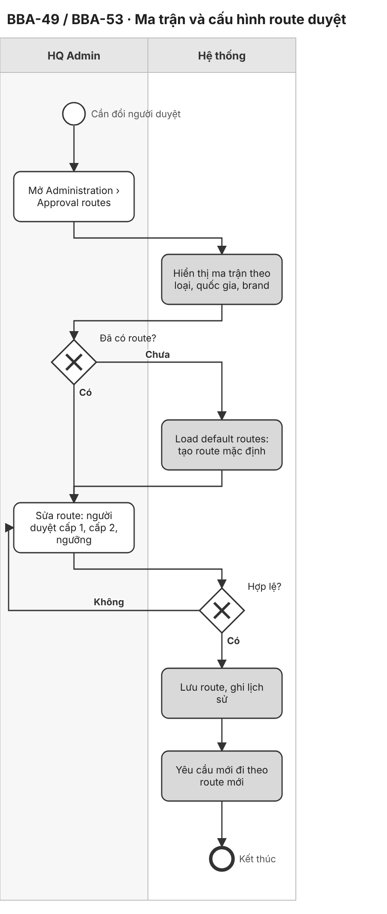
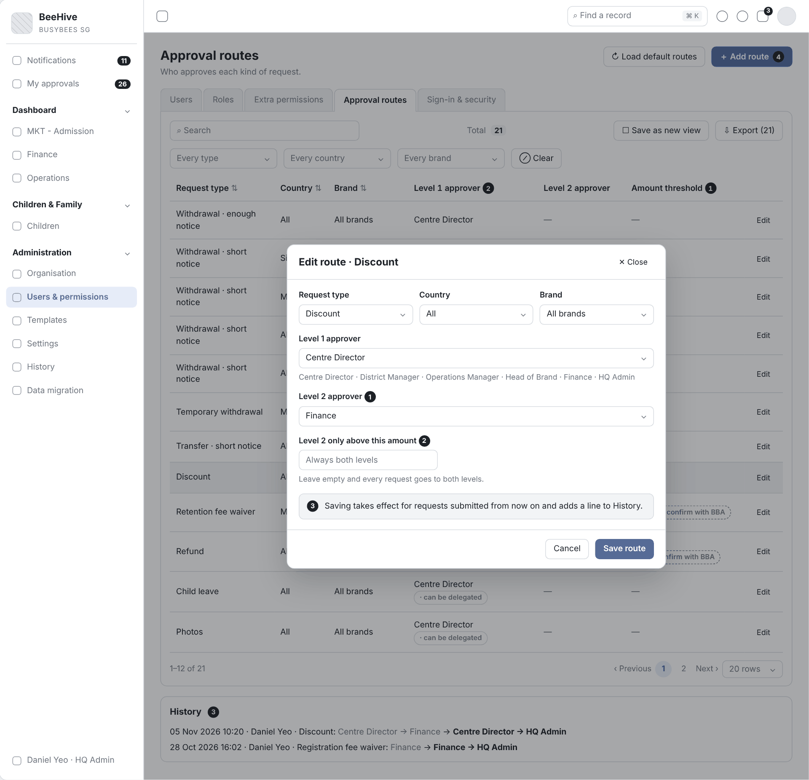
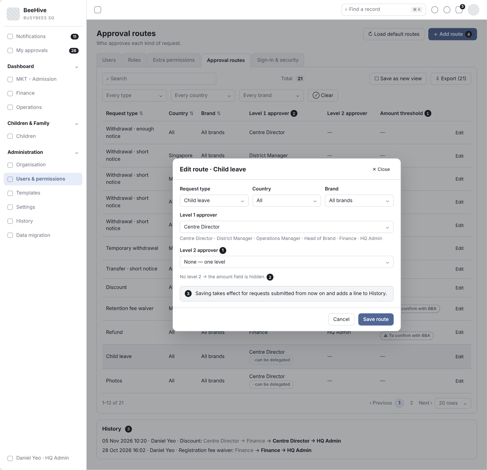
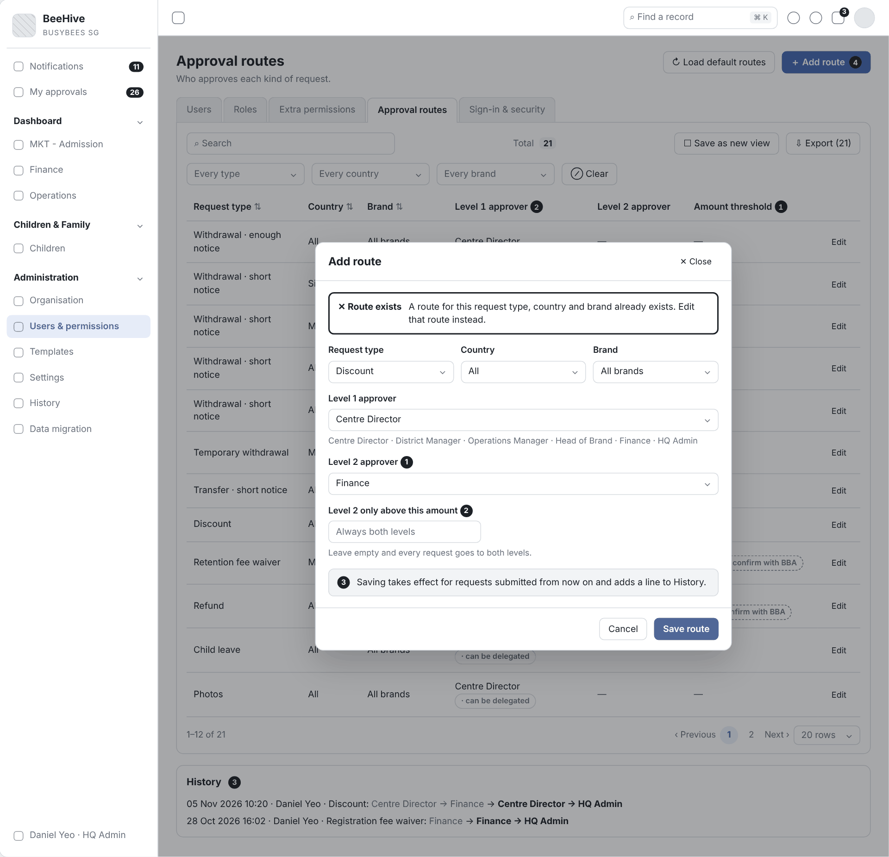

# 2.8 Approval Flows Configuration (Tiếng Việt)

| Thuộc tính | Giá trị |
|---|---|
| Dự án | Busy Bees Asia SMS |
| Module | Administration — Approval routes |
| Tính năng | BBA-53 BBA approval flows configuration (withdrawal, transfer, refund, leave, photo, discount…) |
| Mã tài liệu | FRD-2.8_Approval_Flows_Configuration |
| Sprint | 4 |
| Phiên bản | 0.1 |
| Trạng thái | BẢN NHÁP CHỜ XÁC NHẬN |
| Ngày | 10/11/2026 |
| Người soạn | Business Analysis |
| Người review | HaiNguyen |
| Người duyệt | HaiNguyen |

## 1. Kiểm soát tài liệu

| Phiên bản | Ngày | Tác giả | Tóm tắt thay đổi | Duyệt |
|---|---|---|---|---|
| 0.1 | 10/11/2026 | Business Analysis | Tách BBA-53 từ FRD 2.8 CRM Administration v0.3 thành FRD riêng; nội dung giữ nguyên, mã đánh lại từ 001 (đối chiếu mã ở Phụ lục cuối). | HaiNguyen |

**Mức sẵn sàng:** Đã đặc tả đủ User Story, FR, quy tắc, kiểm tra, dữ liệu, tiêu chí nghiệm thu, sơ đồ BPMN và wireframe của BBA-53. Còn 7 câu hỏi mở ở mục 7.

## 2. Mục đích và bối cảnh

HQ Admin nạp route duyệt mặc định cho mọi loại yêu cầu của BBA (thôi học, chuyển Centre, hoàn tiền, nghỉ, ảnh, giảm giá…), thêm route riêng theo quốc gia, brand và sửa người duyệt từng cấp, ngưỡng tiền, để luồng duyệt khớp cách BBA vận hành.

| Ticket | Tên |
|---|---|
| BBA-53 | BBA approval flows configuration (withdrawal, transfer, refund, leave, photo, discount…) |

**Quy trình và tham chiếu SRS:** SRS SMS Administration v0.1 — §4 mục 2.4 Approval routes (Edit route, Load default routes, View history), BR-ADM-018 đến BR-ADM-023, AC-ADM-010 · SRS SMS General Requirements v0.1 — §3.3 · Prototype: https://bba-sms-crm.lovable.app/organisation/approvals · Wireframe: `Diagram/Wireframe/approvals-sprint4.html#scr-01`, `#scr-02`.

## 3. Phạm vi và ranh giới phase

| Trong phạm vi | Ngoài phạm vi |
|---|---|
| Load default routes cho mọi loại yêu cầu (Phụ lục A). Add route, Edit route: loại yêu cầu, quốc gia, brand, người duyệt cấp 1, cấp 2 (hoặc một cấp), ngưỡng tiền. Kiểm tra trùng tổ hợp. Hiệu lực cho yêu cầu mới. Lịch sử thay đổi route. | Xem ma trận, lọc, xuất (FRD 2.8 CRM Administration — BBA-49). Định tuyến và duyệt yêu cầu (FRD 2.8 Change Request with Second Approval). Danh mục vai trò (Roles). |

## 4. Tác nhân, vai trò và quyền truy cập

| Tác nhân | Phạm vi | Quyền / Trách nhiệm |
|---|---|---|
| HQ Admin (BBA IT) | Mọi Country, Brand, Centre. | Mọi quyền; quản lý approval routes, settings; giao extra permission cho nhân viên mọi Centre; quyết định thay vai trò sở hữu một bước duyệt (BR-ADM-001; SRS ADM §2; Prototype). |
| HQ Finance | Country / legal entity. | Đọc route và change log; là người duyệt các route tài chính (credit note, refund, notice waiver, discount cấp 2) (SRS ADM §2; BR-ADM-022, BR-ADM-023). |
| HQ Ops / Head of Brand, District Manager, Operations Manager | Brand, cluster, các Centre phụ trách. | Đổi thiết lập được cấp quyền; là người duyệt trong route (SRS ADM §2). |
| System | Toàn hệ thống. | Định tuyến yêu cầu theo route, tính tác động, tự hết hạn quyền, ghi lịch sử, gửi thông báo. |

Quy tắc chung: chỉ người dùng có quyền Administration mở được màn Administration (BR-ADM-004); điều không được làm thì không hiển thị (BR-GEN-004); lịch sử chỉ thêm, không sửa, không xoá (BR-ADM-048); danh sách chuẩn: tìm kiếm, lọc, sắp xếp, phân trang 20 / 50 / 100, xuất theo bộ lọc (SRS GEN §4.1).

## 5. Tổng quan tính năng và phân rã chức năng

| Module | Tính năng | Chức năng | User Story |
|---|---|---|---|
| Approval routes | BBA-53 Cấu hình luồng duyệt của BBA | Nạp route mặc định, thêm, sửa route, lịch sử. | US-001 |

| Mã màn | Tên màn | Ảnh wireframe |
|---|---|---|
| SCR-01 | Approval routes (rỗng) | `Diagram/Wireframe/png/SCR-01-approval-routes--empty.png` |
| SCR-02 | Add / Edit route | `Diagram/Wireframe/png/SCR-02-edit-route*.png` |

## 6. Yêu cầu chức năng theo User Story

### 6.1 BBA-53: US-001 - Cấu hình luồng duyệt của BBA

#### User Story

Là HQ Admin, tôi muốn nạp route mặc định cho mọi loại yêu cầu (thôi học, chuyển Centre, hoàn tiền, nghỉ, ảnh, giảm giá…), thêm route riêng theo quốc gia, brand và sửa người duyệt từng cấp để luồng duyệt khớp cách BBA vận hành.

#### Process Diagram (Sơ đồ BPMN)

#### Functional Requirements (Yêu cầu chức năng)

| FR ID | Yêu cầu chức năng |
|---|---|
| FR-001 | Load default routes tạo sẵn route cho mọi loại yêu cầu theo danh mục mặc định ở Phụ lục A; HQ Admin sửa được sau đó (SRS ADM §4 mục 2.4; BR-ADM-020 đến BR-ADM-023). |
| FR-002 | Dialog Add / Edit route gồm Request type, Country (All / Singapore / Malaysia), Brand (All brands hoặc một brand), Level 1 approver, Level 2 approver ("None — one level" hoặc một vai trò) và "Level 2 only above this amount"; trường ngưỡng chỉ hiện khi đã chọn vai trò cấp 2, để trống nghĩa là luôn qua cả hai cấp ("Always both levels"). Vai trò chọn được: Centre Director, District Manager, Operations Manager, Head of Brand, Finance, HQ Admin (SRS ADM §4 mục 2.4 Edit route; BR-ADM-019; Prototype). |
| FR-003 | Yêu cầu mới gửi sau khi lưu đi theo route mới (AC-ADM-010); yêu cầu đang chờ giữ người duyệt đã định tuyến (AS-FLW-02). |
| FR-004 | Mỗi lần thêm, sửa route ghi một dòng History: thời điểm, người, loại yêu cầu, cấp 1 → cấp 2 cũ và cấp 1 → cấp 2 mới (SRS ADM §4 mục 2.4 View history; Prototype). |
| FR-005 | Add route tạo route cho một tổ hợp Request type + Country + Brand chưa có route, vd. route riêng một brand (SRS ADM §4 mục 2.4; Prototype; AS-FLW-03). |

#### Functional Flow - Main (Luồng chính)

1. HQ Admin mở Approval routes; chưa có route thì chọn Load default routes (FR-001).
2. HQ Admin chọn Edit trên một route, hoặc Add route (FR-002, FR-005).
3. HQ Admin chọn vai trò cấp 1, chọn vai trò cấp 2 (hoặc "None — one level"), nhập ngưỡng nếu cần (FR-002; VAL-001, VAL-002, VAL-003).
4. HQ Admin chọn Save route; hệ thống ghi History; yêu cầu mới đi theo route mới (FR-003, FR-004).

#### Functional Flow - Alternative (Luồng thay thế)

1. Chọn "None — one level" ở cấp 2: trường ngưỡng ẩn và ngưỡng bị xoá; route chỉ còn cấp 1 (FR-002).

#### Functional Flow - Exception (Luồng ngoại lệ)

1. Thiếu vai trò cấp 1: không lưu (VAL-001).
2. Ngưỡng không phải số dương: không lưu (VAL-002).
3. Add route trùng tổ hợp đã có: không lưu (VAL-003).

#### Business Rules (Quy tắc nghiệp vụ)

| BR ID | Quy tắc |
|---|---|
| BR-001 | Route có tối đa 2 cấp và ngưỡng tiền tuỳ chọn (BR-ADM-019). |
| BR-002 | Route mặc định nạp theo BR-ADM-020 đến BR-ADM-023 và sửa được (SRS ADM §4 mục 2.4). |

#### Validation Rules (Quy tắc kiểm tra)

| VAL ID | Điều kiện | Phản hồi của hệ thống |
|---|---|---|
| VAL-001 | Thiếu vai trò duyệt cấp 1. | Không lưu; đánh dấu trường bắt buộc. |
| VAL-002 | Ngưỡng không phải số dương. (Khi chưa chọn cấp 2 thì trường ngưỡng không hiển thị.) | Không lưu; hiển thị "Enter an amount above 0, or leave it empty to always use both levels." (AS-FLW-01). |
| VAL-003 | Add route với tổ hợp Request type + Country + Brand đã có route. | Không lưu; hiển thị "A route for this request type, country and brand already exists. Edit that route instead." (AS-FLW-03). |

#### UI Reference (Tham chiếu giao diện)

| Mã màn hình / Phiên bản | Tham chiếu / Link |
|---|---|
| SCR-02 - Add / Edit route | Prototype: https://bba-sms-crm.lovable.app/organisation/approvals (Add route, Edit) · Wireframe: `Diagram/Wireframe/approvals-sprint4.html#scr-02` |
| SCR-01 - Approval routes (rỗng) | Wireframe: `Diagram/Wireframe/approvals-sprint4.html#scr-01` (trạng thái "Chưa có route") |

#### UI Components / Field Specification (Thành phần giao diện)

| Trường / Điều khiển | Loại | Bắt buộc | Mặc định / Trạng thái | Kiểm tra | Hành vi |
|---|---|---|---|---|---|
| Request type | Selector | Có | Theo route / loại đầu | VAL-003. | 17 loại yêu cầu (Phụ lục A). |
| Country | Selector | Có | All | VAL-003. | All, Singapore, Malaysia. |
| Brand | Selector | Có | All brands | VAL-003. | All brands, Small Wonder, Learning Vision, The Schoolhouse, Agape, Brighton Montessori, Odyssey, Bright Path. |
| Level 1 approver | Selector | Có | Giá trị hiện tại | VAL-001. | 6 vai trò (FR-002). |
| Level 2 approver | Selector | Có | "None — one level" | — | Chọn vai trò thì hiện trường ngưỡng. |
| Level 2 only above this amount | Amount | Không | Trống, placeholder "Always both levels" | VAL-002. | Chỉ hiện khi có cấp 2. |
| Load default routes | Action | HQ Admin | — | — | Nạp route mặc định. |
| Save route / Cancel | Action | HQ Admin | — | — | Lưu hoặc huỷ. |

#### Data and Audit (Dữ liệu và audit)

| ID | Yêu cầu |
|---|---|
| DATA-001 | Mỗi lần đổi route lưu route, giá trị cũ, giá trị mới, người đổi, thời điểm; nguồn (mặc định hoặc chỉnh tay). |

#### Acceptance Criteria (Tiêu chí nghiệm thu)

| AC ID | Given (Cho trước) | When (Khi) | Then (Thì) | Linked Rule |
|---|---|---|---|---|
| AC-001 | chưa có route | HQ Admin chọn Load default routes | route được tạo cho mọi loại yêu cầu ở Phụ lục A và sửa được | FR-001; BR-002; DATA-001 |
| AC-002 | route Discount | HQ Admin đổi cấp 2 thành HQ Finance, ngưỡng 500 SGD và lưu | route lưu 2 cấp, ngưỡng 500,00 SGD và lịch sử ghi thay đổi | FR-002; FR-004; BR-001 |
| AC-003 | route Child leave có cấp 2 "None — one level" | HQ Admin mở Edit | trường "Level 2 only above this amount" không hiển thị; chọn cấp 2 Finance thì trường hiện với placeholder "Always both levels" | FR-002; VAL-002 |
| AC-004 | HQ Admin xoá vai trò cấp 1 | lưu | không lưu và trường cấp 1 được đánh dấu | VAL-001 |
| AC-005 | 3 yêu cầu thôi học đang chờ Centre Director | HQ Admin đổi người duyệt thành District Manager | 3 yêu cầu đang chờ giữ Centre Director; yêu cầu mới tới District Manager | FR-003 |
| AC-006 | chưa có route Discount cho brand Odyssey | HQ Admin chọn Add route: Discount, All, Odyssey, Centre Director, Head of Brand và Save route | ma trận có thêm dòng Discount · Odyssey và History ghi dòng thêm route | FR-005; FR-004 |
| AC-007 | đã có route Discount · All · All brands | HQ Admin Add route với cùng tổ hợp | không lưu và hiển thị thông báo trùng | VAL-003 |

#### Dependencies (Phụ thuộc)

FRD 2.8 CRM Administration (BBA-49); danh mục loại yêu cầu của các module; OQ-FLW-01, OQ-FLW-02, OQ-FLW-03, OQ-FLW-05, OQ-FLW-06, OQ-FLW-07.

## 7. Câu hỏi mở

| Mã câu hỏi | Quyết định cần có | Người quyết định | Ưu tiên | Quyết định của BBA |
|---|---|---|---|---|
| OQ-FLW-01 | Route mặc định "Retention fee waiver (Malaysia)" có 3 cấp (Centre Director → Operations Manager → Finance, BR-ADM-022) nhưng route tối đa 2 cấp (BR-ADM-019). Prototype đang để 2 cấp Centre Director → Operations Manager, đánh dấu ⚠ To confirm. Bỏ cấp Finance hay tăng giới hạn lên 3? | Business Owner | Cao | |
| OQ-FLW-02 | "Transfer with short notice: District Managers of both centres" (BR-ADM-021): là 2 cấp nối tiếp (Centre cũ rồi Centre mới) hay cả hai cùng duyệt song song? | Business Owner | Trung bình | |
| OQ-FLW-03 | Đổi route khi đang có yêu cầu chờ: yêu cầu đang chờ giữ người duyệt cũ hay chuyển theo route mới? | Business Owner | Trung bình | |
| OQ-FLW-04 | Ngưỡng tiền của route "All countries" tính bằng SGD hay MYR? | Business Owner | Trung bình | |
| OQ-FLW-05 | Route mặc định theo SRS hay prototype ở 6 dòng khác nhau (Phụ lục A, cột Khác biệt): Withdrawal not at month end, Retention fee waiver, Credit note, Refund (ngưỡng 1.000, cấp 2 HQ Admin), Notice period waiver, Temporary withdrawal Singapore? | Business Owner | Cao | |
| OQ-FLW-06 | Add route với tổ hợp đã có: báo lỗi (AS-FLW-03) hay ghi đè route cũ? | Business Owner | Trung bình | |
| OQ-FLW-07 | Cho phép route có cấp 1 và cấp 2 cùng vai trò không (ngoài Transfer, nơi hai District Manager thuộc hai Centre)? Prototype đang cho lưu. | Business Owner | Trung bình | |

### Giả định của BA (SRS chưa nêu — cần xác nhận cùng mục 7)

| Mã | Giả định | Dùng ở |
|---|---|---|
| AS-FLW-01 | Chỉ nhập ngưỡng tiền khi route có cấp 2; ngưỡng là số dương. | VAL-002 |
| AS-FLW-02 | Route mới áp cho yêu cầu gửi sau khi lưu; yêu cầu đang chờ giữ người duyệt cũ. | FR-003; AC-005 — chờ OQ-FLW-03 |
| AS-FLW-03 | Mỗi tổ hợp Request type + Country + Brand chỉ có một route; Add route trùng tổ hợp bị chặn. | FR-005; VAL-003 — chờ OQ-FLW-06 |

## 8. Phụ lục

### Phụ lục A. Danh mục luồng duyệt mặc định (BR-ADM-020 đến BR-ADM-023)

FRD nạp route mặc định theo SRS (FR-001). Cột "Prototype" ghi route đang có ở prototype (21 route, khảo sát 10/11/2026); dòng có khác biệt chờ OQ-FLW-05.

| Loại yêu cầu (tên trong prototype) | Phạm vi | Cấp 1 (SRS) | Cấp 2 (SRS) | Nguồn | Prototype | Khác biệt |
|---|---|---|---|---|---|---|
| Withdrawal · enough notice | Mọi quốc gia, mọi brand | Centre Director | — | BR-ADM-020 | Centre Director | Không |
| Withdrawal · short notice | Singapore | District Manager | — | BR-ADM-020 | District Manager | Không |
| Withdrawal · short notice | Malaysia | Operations Manager | — | BR-ADM-020 | Operations Manager | Không |
| Withdrawal · short notice | Brand Odyssey | Centre Director | — | BR-ADM-020 | Centre Director | Không (thứ tự ưu tiên: OQ-ADM-10) |
| Withdrawal · short notice | Brand Brighton Montessori | Head of Brand | — | BR-ADM-020 | Head of Brand | Không |
| Withdrawal · not at month end (SRS: Mid-month withdrawal) | Singapore / Malaysia | Centre Director | District Manager / Operations Manager | BR-ADM-020 | District Manager, 1 cấp, ⚠ | **Có**: prototype 1 cấp, không có Centre Director |
| Temporary withdrawal | Malaysia | Centre Director | Operations Manager | BR-ADM-021 | Centre Director → Operations Manager | Không |
| Temporary withdrawal | Singapore | Centre Director | — | BR-ADM-021 | Centre Director, ⚠ | **Có**: prototype đánh dấu chờ xác nhận |
| Transfer · short notice | Mọi quốc gia | District Manager Centre hiện tại | District Manager Centre mới | BR-ADM-021 | District Manager → District Manager | Không (cách hiểu hai cấp: OQ-FLW-02) |
| Discount | Mọi quốc gia | Centre Director | Finance | BR-ADM-022 | Centre Director → Finance | Không |
| Registration fee waiver | Mọi quốc gia | Finance | — | BR-ADM-022 | Finance | Không |
| Retention fee waiver | Malaysia | Centre Director | Operations Manager → Finance (3 cấp) | BR-ADM-022 | Centre Director → Operations Manager, ⚠ | **Có**: prototype 2 cấp, bỏ Finance (OQ-FLW-01) |
| Credit note | Mọi quốc gia | Finance (không ngưỡng) | — | BR-ADM-023 | Finance → HQ Admin, ngưỡng 1.000, ⚠ | **Có**: prototype thêm cấp 2 và ngưỡng |
| Refund | Mọi quốc gia | Finance (không ngưỡng) | — | BR-ADM-023 | Finance → HQ Admin, ngưỡng 1.000, ⚠ | **Có**: prototype thêm cấp 2 và ngưỡng |
| Notice period waiver | Mọi quốc gia | Finance | — | BR-ADM-023 | Finance, ⚠ | **Có**: prototype đánh dấu chờ xác nhận |
| Attendance void | Mọi quốc gia | Centre Director | — | BR-ADM-023 | Centre Director · can be delegated | Không |
| Child leave | Mọi quốc gia | Centre Director | — | BR-ADM-023 | Centre Director · can be delegated | Không |
| Authorised pickup (SRS: pickup changes) | Mọi quốc gia | Centre Director | — | BR-ADM-023 | Centre Director · can be delegated | Không (quyền giao: OQ-ADM-15) |
| Photos | Mọi quốc gia | Centre Director | — | BR-ADM-023 | Centre Director · can be delegated | Không |
| Progress report (SRS: reports) | Mọi quốc gia | Centre Director | — | BR-ADM-023 | Centre Director · can be delegated | Không (quyền giao: OQ-ADM-15) |
| Portfolio | Mọi quốc gia | Centre Director | — | BR-ADM-023 | Có trong danh sách loại yêu cầu | Không |

### Phụ lục B. Thuật ngữ

| Thuật ngữ | Định nghĩa trong FRD này |
|---|---|
| Approval route | Cấu hình ai duyệt một loại yêu cầu theo quốc gia, brand: cấp 1, cấp 2, ngưỡng tiền. |
| To confirm with BBA | Dấu ⚠ trên route hoặc thiết lập có giá trị mặc định BBA chưa xác nhận. |
| Can be delegated | Nhãn trên route có quyền duyệt giao được cho nhân viên qua Extra permissions. |

### Phụ lục C. Đối chiếu mã với FRD 2.8 CRM Administration v0.3

| Loại | Số cũ (FRD 2.8 v0.3) → số mới |
|---|---|
| FR | 029 → 001, 030 → 002, 031 → 003, 032 → 004, 041 → 005 |
| BR | 012 → 001, 013 → 002 |
| VAL | 008 → 001, 009 → 002, 012 → 003 |
| DATA | 005 → 001 |
| AC | 029 → 001, 030 → 002, 031 → 003, 032 → 004, 033 → 005, 044 → 006, 045 → 007 |
| OQ | ADM 01 → OQ-FLW-01, ADM 02 → OQ-FLW-02, ADM 04 → OQ-FLW-03, ADM 06 → OQ-FLW-04, ADM 14 → OQ-FLW-05, ADM 16 → OQ-FLW-06, ADM 17 → OQ-FLW-07 |
| AS | ADM 01 → AS-FLW-01, ADM 02 → AS-FLW-02, ADM 08 → AS-FLW-03 |
