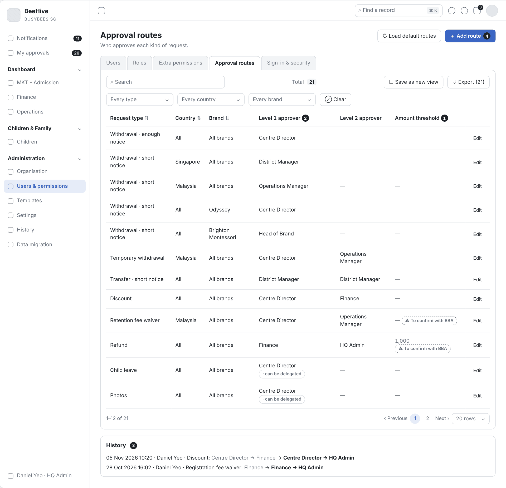
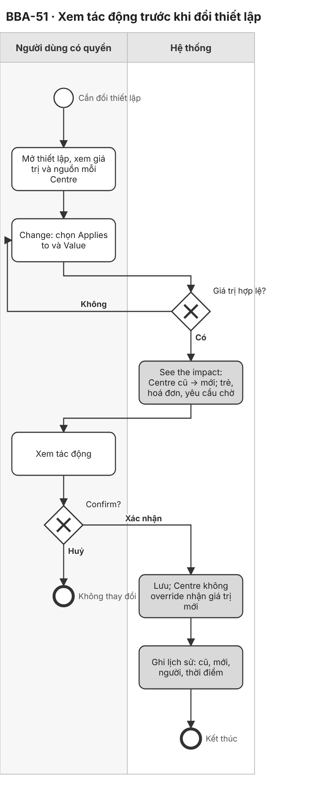
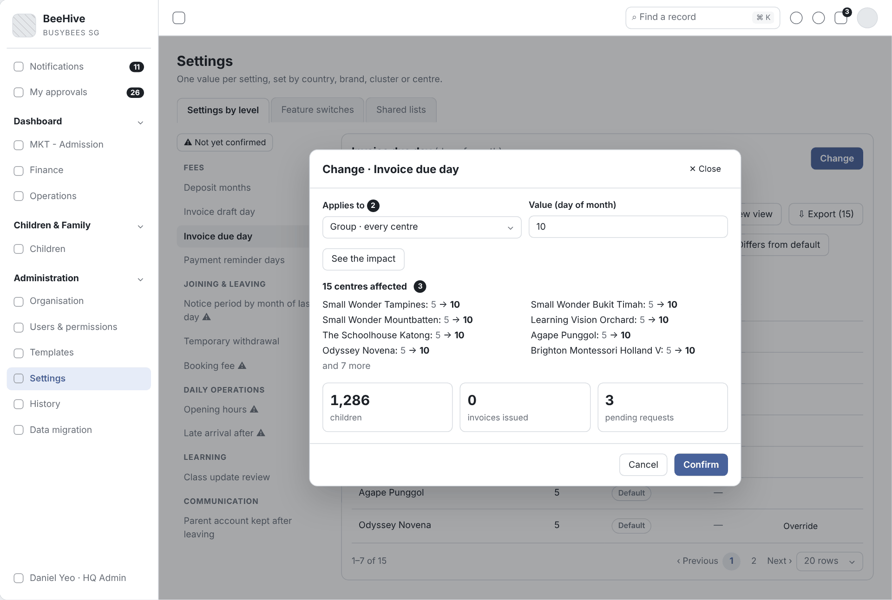
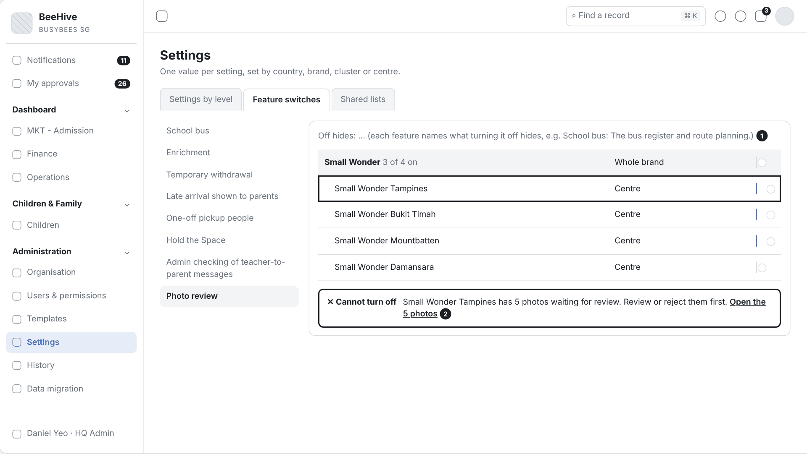
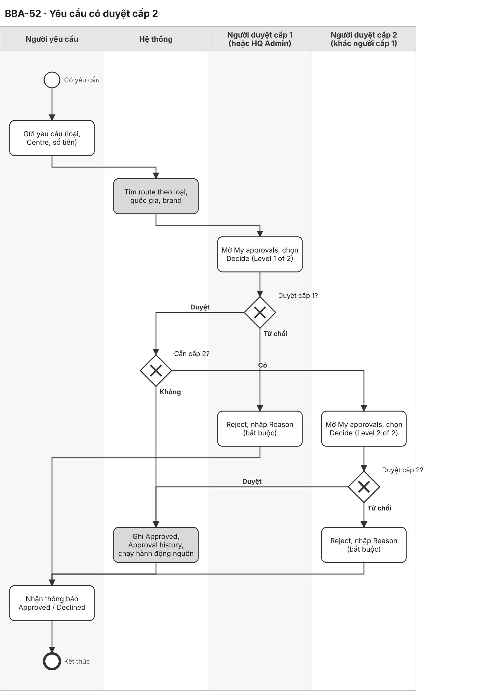
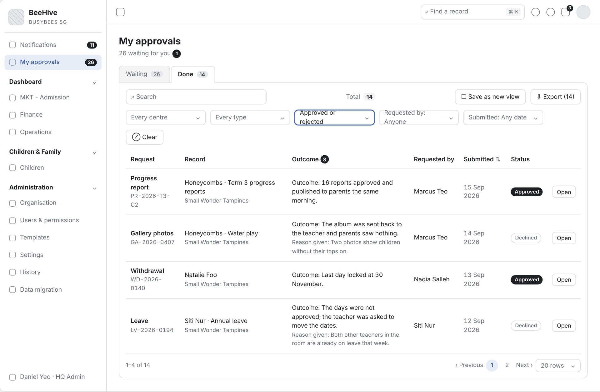
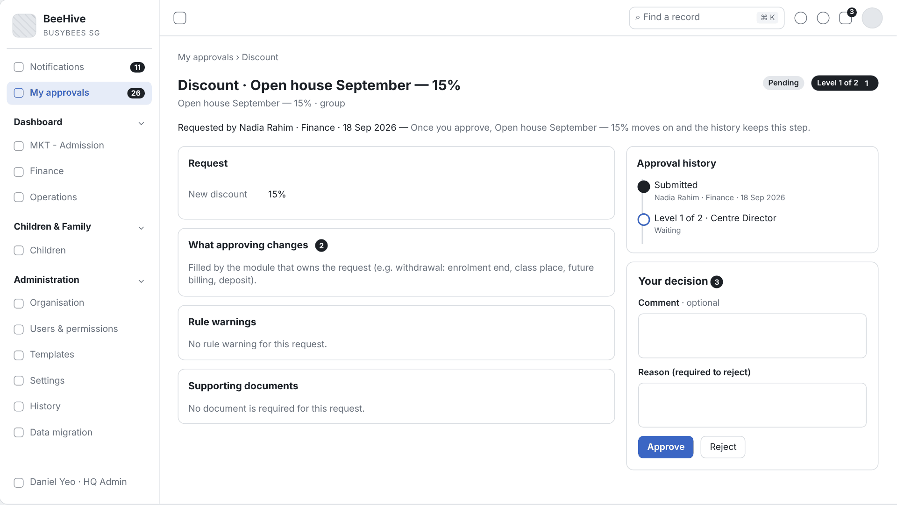
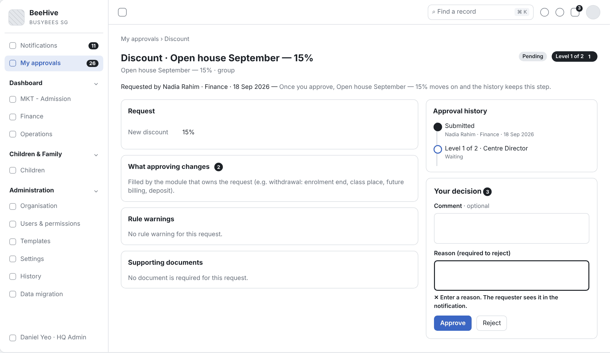
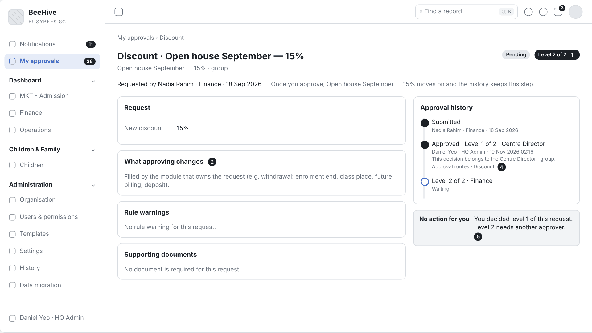

# 2.8 CRM Administration (Tiếng Việt)

| Thuộc tính | Giá trị |
|---|---|
| Dự án | Busy Bees Asia SMS |
| Module | Administration — Approvals |
| Tính năng | 2.8 CRM Administration: BBA-49, BBA-50, BBA-51, BBA-52, BBA-53 |
| Mã tài liệu | FRD-2.8_CRM_Administration |
| Sprint | 4 |
| Phiên bản | 0.3 |
| Trạng thái | BẢN NHÁP CHỜ XÁC NHẬN |
| Ngày | 10/11/2026 |
| Người soạn | Business Analysis |
| Người review | HaiNguyen |
| Người duyệt | HaiNguyen |

## 1. Kiểm soát tài liệu

| Phiên bản | Ngày | Tác giả | Tóm tắt thay đổi | Duyệt |
|---|---|---|---|---|
| 0.1 | 09/11/2026 | Business Analysis | Bản đầu theo WBS CRM 2.8 (Journey Settings, Visit Slot Schedule). | HaiNguyen |
| 0.2 | 09/11/2026 | Business Analysis | Viết lại theo phạm vi user chốt: Approvals (Administration) gồm BBA-49 đến BBA-53. Nguồn: SRS SMS General Requirements v0.1 và SRS SMS Administration v0.1. Thêm sơ đồ BPMN và wireframe. | HaiNguyen |
| 0.3 | 10/11/2026 | Business Analysis | Đối chiếu prototype https://bba-sms-crm.lovable.app (Approval routes, Extra permissions, My approvals, Settings) và chỉnh 5 User Story: ma trận có dấu To confirm, nhãn can be delegated, History chung; Add route và dialog route theo prototype; danh mục quyền giao được, xác nhận khi giao và thu hồi; tác động gồm danh sách Centre đổi giá trị; My approvals và trang chi tiết duyệt, người đã duyệt cấp 1 không duyệt cấp 2, HQ Admin quyết thay. Phụ lục A ghi khác biệt route mặc định SRS ↔ prototype. | HaiNguyen |

**Mức sẵn sàng:** Đã đặc tả ma trận người duyệt theo brand, uỷ quyền duyệt, xem tác động trước khi đổi thiết lập, duyệt hai cấp và cấu hình luồng duyệt. Bản 0.3 đã đối chiếu với prototype. Còn 17 câu hỏi mở ở mục 7; cần chốt sớm OQ-ADM-14 (route mặc định theo SRS hay prototype, 6 dòng khác nhau), OQ-ADM-01 (Retention fee waiver 3 cấp hay 2 cấp), OQ-ADM-10 (thứ tự ưu tiên route theo brand / quốc gia) và OQ-ADM-07 (nội dung tác động khi đổi thiết lập).

## 2. Mục đích và bối cảnh

Mọi yêu cầu cần duyệt trong SMS (thôi học, chuyển Centre, hoàn tiền, nghỉ, ảnh, giảm giá…) đi qua **một hộp duyệt** và **một nơi cấu hình người duyệt** (SRS GEN §3.3; BR-GEN-008). FRD này đặc tả 5 ticket:

| Ticket | Tên | Nguồn chính |
|---|---|---|
| BBA-49 | Approval authority matrix by brand | SRS ADM §4 mục 2.4; BR-ADM-018 đến BR-ADM-023 |
| BBA-50 | Approval delegation | SRS ADM §4 mục 2.3, P4; BR-ADM-016, BR-ADM-017; SRS GEN §3.1 |
| BBA-51 | Impact preview before a setting change | SRS ADM §4 mục 4.1, 4.2, P5; BR-ADM-036, BR-ADM-037, BR-ADM-042; SRS GEN §4.4 |
| BBA-52 | Change request with second approval | SRS GEN §3.3; SRS ADM §4 mục 2.4, 5.1; BR-ADM-019; AC-ADM-009 |
| BBA-53 | BBA approval flows configuration (withdrawal, transfer, refund, leave, photo, discount…) | SRS ADM §4 mục 2.4; BR-ADM-020 đến BR-ADM-023; AC-ADM-010 |

Ghi chú: tên FRD giữ "2.8 CRM Administration" theo danh mục Sprint 4, nhưng nội dung thuộc module **Administration của SMS** (OQ-ADM-12).

**Quy trình và tham chiếu SRS:** SRS SMS General Requirements v0.1 — §3.1 Principles, §3.2 Default roles, §3.3 Approvals, §4.2 Records, §4.4 Settings, BR-GEN-004, BR-GEN-006 đến BR-GEN-010, AC-GEN-008, AC-GEN-009 · SRS SMS Administration v0.1 — §2, §3 P4 và P5, §4 mục 2.3 Extra permissions, 2.4 Approval routes, 4.1 Settings by level, 4.2 Feature switches, 5.1 Change log, §5 BR-ADM-004, BR-ADM-016 đến BR-ADM-023, BR-ADM-036 đến BR-ADM-042, BR-ADM-048, §6.1, §7, §8 AC-ADM-007 đến AC-ADM-010, AC-ADM-013 đến AC-ADM-015, AC-ADM-018 · Liên quan: SRS Daily Operations BR-OPS-017, BR-OPS-022, AC-OPS-013 (uỷ quyền duyệt nghỉ, void); SRS Fees & Payments BR-FEE-050, BR-FEE-051 (Finance approvals) · Prototype (SRS ADM §1 yêu cầu đọc kèm; khảo sát 10/11/2026 với tài khoản demo HQ Admin): https://bba-sms-crm.lovable.app/organisation/approvals, /organisation/delegations, /approvals, /organisation/features. Chỗ prototype khác SRS được ghi OQ, FRD giữ quy tắc SRS · Wireframe: `Diagram/Wireframe/approvals-sprint4.html`.

## 3. Phạm vi và ranh giới phase

| Trong phạm vi | Ngoài phạm vi |
|---|---|
| BBA-49: xem ma trận route theo loại yêu cầu, quốc gia, brand (cấp 1, cấp 2, ngưỡng tiền); lọc; xuất; lịch sử route. BBA-50: Centre Director giao, thu hồi quyền bổ sung (extra permission) cho nhân viên Centre mình, quyền tự hết hạn, thông báo, lịch sử. BBA-51: xem giá trị thiết lập theo Centre và nguồn, đổi theo phạm vi, kiểm tra giá trị, xem tác động trước khi lưu, override và gỡ override, chặn tắt tính năng khi còn việc mở. BBA-52: định tuyến yêu cầu theo route, duyệt cấp 1 rồi cấp 2 theo ngưỡng, My approvals (Waiting / Done) và trang chi tiết duyệt, từ chối bắt buộc lý do, thông báo, lịch sử quyết định. BBA-53: thêm, sửa route (vai trò từng cấp, tối đa 2 cấp, ngưỡng), nạp route mặc định cho mọi loại yêu cầu. | Tạo tài khoản, gán vai trò tự động từ Microsoft Entra (SCIM); đồng bộ HRMS; tuỳ biến trường và bố cục màn hình (SRS ADM §1.2). Thiết kế vai trò và ma trận quyền (Roles) — chỉ dẫn chiếu. Giao dịch của từng loại yêu cầu (thôi học, hoàn tiền, nghỉ…) thuộc FRD của module sở hữu (Joining & Leaving, Fees & Payments, Daily Operations). Centre Director App (Phase 2). Vietnam không thuộc SMS Phase 1 (SRS GEN §2.2). Duyệt tại cửa (pickup, leave, refused collections — màn Daily operations › Approvals của prototype). Shared lists trong Settings. |

## 4. Tác nhân, vai trò và quyền truy cập

| Tác nhân | Phạm vi | Quyền / Trách nhiệm |
|---|---|---|
| HQ Admin (BBA IT) | Mọi Country, Brand, Centre. | Mọi quyền; quản lý approval routes, settings; giao extra permission cho nhân viên mọi Centre; quyết định thay vai trò sở hữu một bước duyệt (BR-ADM-001; SRS ADM §2; Prototype). |
| HQ Finance | Country / legal entity. | Đọc route và change log; là người duyệt các route tài chính (credit note, refund, notice waiver, discount cấp 2) (SRS ADM §2; BR-ADM-022, BR-ADM-023). |
| HQ Ops / Head of Brand, District Manager, Operations Manager | Brand, cluster, các Centre phụ trách. | Đổi thiết lập được cấp quyền; là người duyệt trong route (SRS ADM §2). |
| Centre Director | Centre. | Giao quyền bổ sung cho nhân viên Centre; đổi thiết lập cấp Centre được cấp quyền; duyệt yêu cầu của Centre (SRS ADM §2; SRS GEN §3.2). |
| Senior Teacher / nhân viên được giao | Lớp / Centre. | Dùng quyền được giao (vd. duyệt nghỉ, void điểm danh, duyệt ảnh) tới khi bị thu hồi hoặc hết hạn (SRS GEN §3.1). |
| Người yêu cầu | Theo module sở hữu yêu cầu. | Gửi yêu cầu; nhận thông báo kết quả (SRS GEN §3.3). |
| System | Toàn hệ thống. | Định tuyến yêu cầu theo route, tính tác động, tự hết hạn quyền, ghi lịch sử, gửi thông báo. |
| External Auditor | Theo cấp. | Chỉ đọc change log (SRS ADM §2). |

Quy tắc chung: chỉ người dùng có quyền Administration mở được màn Administration (BR-ADM-004); điều không được làm thì không hiển thị (BR-GEN-004); lịch sử chỉ thêm, không sửa, không xoá (BR-ADM-048); danh sách chuẩn: tìm kiếm, lọc, sắp xếp, phân trang 20 / 50 / 100, xuất theo bộ lọc (SRS GEN §4.1).

## 5. Tổng quan tính năng và phân rã chức năng

| Module | Tính năng | Chức năng | User Story |
|---|---|---|---|
| Approval routes | BBA-49 Ma trận thẩm quyền duyệt theo brand | Xem, lọc, xuất ma trận route; lịch sử route. | US-001 |
| Extra permissions | BBA-50 Uỷ quyền duyệt | Giao, thu hồi, tự hết hạn quyền; thông báo. | US-002 |
| Settings | BBA-51 Xem tác động trước khi đổi thiết lập | Giá trị theo Centre, đổi theo phạm vi, tác động, override, chặn tắt tính năng. | US-003 |
| My approvals | BBA-52 Yêu cầu có duyệt cấp 2 | Định tuyến, duyệt cấp 1 / cấp 2, My approvals, trang chi tiết, từ chối, thông báo. | US-004 |
| Approval routes | BBA-53 Cấu hình luồng duyệt | Thêm, sửa route, nạp route mặc định. | US-005 |

| Mã màn | Tên màn | Ticket | Ảnh wireframe |
|---|---|---|---|
| SCR-01 | Approval routes | BBA-49, BBA-53 | `Diagram/Wireframe/png/SCR-01-approval-routes*.png` |
| SCR-02 | Add / Edit route | BBA-53, BBA-52 | `Diagram/Wireframe/png/SCR-02-edit-route*.png` |
| SCR-03 | My approvals | BBA-52 | `Diagram/Wireframe/png/SCR-03-my-approvals*.png` |
| SCR-04 | Extra permissions | BBA-50 | `Diagram/Wireframe/png/SCR-04-extra-permissions*.png` |
| SCR-05 | Setting impact preview | BBA-51 | `Diagram/Wireframe/png/SCR-05-setting-impact-preview*.png` |
| SCR-06 | Approval detail | BBA-52 | `Diagram/Wireframe/png/SCR-06-approval-detail*.png` |

## 6. Yêu cầu chức năng theo User Story

### 6.1 BBA-49: US-001 - Ma trận thẩm quyền duyệt theo brand

#### User Story

Là HQ Admin, tôi muốn xem trên một ma trận ai duyệt từng loại yêu cầu theo quốc gia và brand để kiểm soát thẩm quyền duyệt của toàn BBA.

#### Process Diagram (Sơ đồ BPMN)

#### Functional Requirements (Yêu cầu chức năng)

| FR ID | Yêu cầu chức năng |
|---|---|
| FR-001 | Màn Approval routes (Users & permissions › Approval routes) hiển thị mỗi route một dòng: Request type, Country, Brand, Level 1 approver, Level 2 approver, Amount threshold, thao tác Edit (SRS ADM §4 mục 2.4 View routes; Prototype). |
| FR-002 | Lọc theo loại yêu cầu, quốc gia, brand; bộ lọc kết hợp được và có Clear (SRS ADM §4 mục 2.4 Filter; SRS GEN §4.1). |
| FR-003 | Xuất toàn bộ route ra Excel (báo cáo "Approval routes" cho HQ Admin, HQ Finance) (SRS ADM §4 mục 2.4 Export; §7). |
| FR-004 | Khối History cuối màn liệt kê mọi lần đổi route, mới nhất trước: thời điểm, người đổi, loại yêu cầu, người duyệt cũ → mới; chưa có thay đổi thì hiển thị "No change yet." (SRS ADM §4 mục 2.4 View history; BR-ADM-048; Prototype). |
| FR-005 | Approval routes là nơi duy nhất đặt người duyệt; không màn nào khác đặt người duyệt cho yêu cầu (BR-ADM-018; BR-GEN-008). |
| FR-006 | Ma trận thể hiện route khác nhau theo brand khi quy tắc mặc định khác nhau, vd. thôi học báo trước ngắn: Centre Director (Odyssey), Head of Brand (Brighton) (BR-ADM-020). |
| FR-033 | Route BBA chưa xác nhận hiển thị dấu "⚠ To confirm with BBA" cạnh giá trị chưa chốt (Prototype; tương tự "Mark as confirmed" của Settings, SRS ADM §4 mục 4.1). |
| FR-034 | Người duyệt cấp 1 có nhãn "· can be delegated" khi quyền duyệt của loại yêu cầu đó giao được cho nhân viên qua Extra permissions (US-002) (Prototype; AS-ADM-09). |

#### Functional Flow - Main (Luồng chính)

1. HQ Admin mở Administration › Approval routes (FR-001).
2. Hệ thống hiển thị ma trận route trong phạm vi (FR-001, FR-006).
3. HQ Admin lọc theo loại yêu cầu, quốc gia, brand (FR-002).
4. HQ Admin xem History cuối màn hoặc xuất ma trận (FR-003, FR-004); route có dấu ⚠ là route chờ BBA xác nhận (FR-033).

#### Functional Flow - Alternative (Luồng thay thế)

1. Chưa có route nào: màn hiển thị trạng thái rỗng và thao tác Load default routes (US-005).
2. Không có route khớp bộ lọc: hiển thị thông báo danh sách rỗng chuẩn (SRS GEN §4.1).

#### Functional Flow - Exception (Luồng ngoại lệ)

1. Người dùng không có quyền Administration: không thấy menu Approval routes (VAL-001).

#### Business Rules (Quy tắc nghiệp vụ)

| BR ID | Quy tắc |
|---|---|
| BR-001 | Người duyệt chỉ được cấu hình trong Approval routes (BR-ADM-018). |
| BR-002 | Một route có tối đa 2 cấp và một ngưỡng tiền tuỳ chọn; vượt ngưỡng thì cần cấp 2 (BR-ADM-019). |
| BR-003 | Khi có route theo brand và route theo quốc gia cho cùng loại yêu cầu, route cụ thể hơn được dùng (AS-ADM-05, chờ OQ-ADM-10). |

#### Validation Rules (Quy tắc kiểm tra)

| VAL ID | Điều kiện | Phản hồi của hệ thống |
|---|---|---|
| VAL-001 | Người dùng không có quyền Administration. | Không hiển thị menu và màn Approval routes (BR-ADM-004). |

#### UI Reference (Tham chiếu giao diện)

| Mã màn hình / Phiên bản | Tham chiếu / Link |
|---|---|
| SCR-01 - Approval routes | Prototype: https://bba-sms-crm.lovable.app/organisation/approvals · Wireframe: `Diagram/Wireframe/approvals-sprint4.html#scr-01` |

#### UI Components / Field Specification (Thành phần giao diện)

| Trường / Điều khiển | Loại | Bắt buộc | Mặc định / Trạng thái | Kiểm tra | Hành vi |
|---|---|---|---|---|---|
| Ô tìm kiếm | Search field | Không | Trống | — | Tìm theo loại yêu cầu, vai trò duyệt. |
| Lọc loại yêu cầu, quốc gia, brand | Filter | Không | Tất cả | — | FR-002. |
| Bảng ma trận | Table | Có | Sắp theo loại yêu cầu | — | Cột: Request type, Country, Brand, Level 1 approver, Level 2 approver, Amount threshold. Dấu ⚠ (FR-033), nhãn can be delegated (FR-034). Phân trang 20 / 50 / 100. |
| Add route | Action | HQ Admin | — | — | Mở SCR-02 ở chế độ thêm (US-005). |
| Edit | Action | HQ Admin | Mỗi dòng | — | Mở SCR-02 (US-005). |
| History | Section | Có | Cuối màn | — | FR-004. |
| Export (n) | Action | Theo quyền | — | BR-GEN-012. | Xuất các route theo bộ lọc; nhãn hiển thị số route. |

#### Data and Audit (Dữ liệu và audit)

| ID | Yêu cầu |
|---|---|
| DATA-001 | Mỗi route lưu loại yêu cầu, quốc gia, brand, vai trò cấp 1, vai trò cấp 2, ngưỡng, trạng thái xác nhận BBA, cho phép uỷ quyền, người đổi cuối, thời điểm đổi cuối. |

#### Acceptance Criteria (Tiêu chí nghiệm thu)

| AC ID | Given (Cho trước) | When (Khi) | Then (Thì) | Linked Rule |
|---|---|---|---|---|
| AC-001 | có route thôi học báo trước ngắn cho Singapore, Malaysia, Odyssey, Brighton | HQ Admin lọc loại "Withdrawal – short notice" | 4 dòng hiển thị với người duyệt District Manager, Operations Manager, Centre Director, Head of Brand | FR-001; FR-002; FR-006 |
| AC-002 | ma trận có 21 route | HQ Admin chọn Export (21) | file có 21 route với người duyệt và ngưỡng | FR-003; DATA-001 |
| AC-003 | route Discount đổi cấp 2 từ Finance thành HQ Admin ngày 05/11/2026 | HQ Admin xem History cuối màn | dòng đầu ghi thời điểm, người đổi, "Discount", Centre Director → Finance cũ và Centre Director → HQ Admin mới | FR-004 |
| AC-004 | người duyệt thôi học được đổi trong Approval routes | một yêu cầu thôi học báo trước ngắn mới được gửi ở Singapore | yêu cầu đi tới vai trò mới đặt trong Approval routes (AC-ADM-010) | FR-005; BR-001 |
| AC-005 | route discount có 2 cấp và ngưỡng 500 SGD | HQ Admin xem dòng route | dòng hiển thị cấp 1, cấp 2 và ngưỡng 500,00 SGD | BR-002 |
| AC-006 | có route Leave cho "All brands" và route Leave riêng cho brand Odyssey | một yêu cầu nghỉ của Centre Odyssey được gửi | yêu cầu đi theo route của Odyssey | BR-003 |
| AC-007 | Teacher không có quyền Administration | Teacher đăng nhập | không có menu Approval routes | VAL-001 |
| AC-034 | route Refund có ngưỡng chưa được BBA xác nhận | HQ Admin mở Approval routes | ô ngưỡng của Refund hiển thị "⚠ To confirm with BBA" | FR-033 |
| AC-035 | quyền duyệt nghỉ giao được qua Extra permissions | HQ Admin xem route Child leave | cột Level 1 approver hiển thị "Centre Director · can be delegated" | FR-034 |

#### Dependencies (Phụ thuộc)

Danh mục loại yêu cầu của các module; danh sách vai trò (Administration › Roles); danh mục extra permission (US-002); OQ-ADM-10, OQ-ADM-15.

### 6.2 BBA-50: US-002 - Uỷ quyền duyệt

#### User Story

Là Centre Director, tôi muốn giao quyền duyệt mình đang có cho nhân viên Centre trong một khoảng thời gian để việc duyệt không bị dừng khi tôi vắng.

#### Process Diagram (Sơ đồ BPMN)

#### Functional Requirements (Yêu cầu chức năng)

| FR ID | Yêu cầu chức năng |
|---|---|
| FR-007 | Centre Director giao cho nhân viên của Centre mình một quyền mà Centre Director đang có (vd. duyệt nghỉ, void điểm danh, duyệt ảnh), bắt buộc lý do, ngày kết thúc tuỳ chọn, bắt buộc tick "I confirm this person should hold it" (SRS ADM §4 mục 2.3 Grant permission; BR-ADM-016; Prototype). HQ Admin giao được cho nhân viên mọi Centre (BR-ADM-001; Prototype). |
| FR-008 | Danh sách quyền đã giao: Person, Permission, Granted by, From, Until ("No end date" khi trống), Status (Active / Expired / Revoked, kèm ngày thu hồi); tìm theo tên; lọc theo quyền, Centre, trạng thái; xuất (SRS ADM §4 mục 2.3; Prototype). |
| FR-009 | Thu hồi có hiệu lực ngay; quyền tự kết thúc vào ngày kết thúc (SRS ADM §4 mục 2.3 Revoke, Auto-expire; BR-ADM-017). |
| FR-010 | Nhân viên nhận thông báo in-app khi được giao, bị thu hồi và khi quyền hết hạn (SRS ADM §6.1; BR-ADM-017). |
| FR-011 | Nhân viên dùng được quyền ngay khi được giao; quyền truy cập của người dùng là tổng các vai trò, quyền bổ sung và phạm vi (SRS ADM P4 bước 3; BR-ADM-007). Với quyền duyệt, yêu cầu tương ứng hiện trong My approvals của nhân viên (AC-OPS-013; AS-ADM-06). |
| FR-012 | Lịch sử ghi mọi lần giao, thu hồi, hết hạn (SRS ADM §4 mục 2.3 View history). |
| FR-035 | Danh mục quyền giao được gồm: Approve leave requests, Review class update photos, Void or delete attendance records, Assign teachers to a class, Move a class's children up, Manage users of their own centre. Ba quyền đầu là quyền duyệt, ứng với route có nhãn can be delegated (Child leave, Photos, Attendance void) (Prototype; SRS ADM §4 mục 2.3 ví dụ; AS-ADM-09). |
| FR-036 | Revoke mở hộp xác nhận "Revoke <permission>?" với nội dung "<Person> loses it now and is told in the app."; chọn Revoke thì thu hồi ngay (SRS ADM §4 mục 2.3 Revoke; Prototype). |

#### Functional Flow - Main (Luồng chính)

1. Centre Director mở Extra permissions và chọn Grant permission (FR-007).
2. Centre Director chọn nhân viên của Centre và quyền mình đang có (FR-035), nhập lý do, ngày kết thúc, tick xác nhận (FR-007; VAL-002, VAL-003, VAL-010).
3. Hệ thống ghi quyền Active và gửi thông báo (FR-009, FR-010).
4. Nhân viên dùng quyền, vd. duyệt đơn nghỉ trong My approvals (FR-011; AS-ADM-06).

#### Functional Flow - Alternative (Luồng thay thế)

1. Centre Director chọn Revoke và xác nhận: quyền Revoked ngay, nhân viên nhận thông báo (FR-009, FR-010, FR-036).
3. HQ Admin giao quyền cho nhân viên một Centre bất kỳ (FR-007).
2. Đến ngày kết thúc: quyền Expired, nhân viên nhận thông báo (FR-009, FR-010).

#### Functional Flow - Exception (Luồng ngoại lệ)

1. Quyền Centre Director không có: không có trong danh sách chọn (VAL-002).
2. Thiếu lý do: không lưu (VAL-003).
3. Chưa tick xác nhận: không giao (VAL-010).

#### Business Rules (Quy tắc nghiệp vụ)

| BR ID | Quy tắc |
|---|---|
| BR-004 | Centre Director chỉ giao quyền cho nhân viên Centre mình và chỉ quyền mình đang có; bắt buộc lý do (BR-ADM-016). |
| BR-005 | Quyền bổ sung kết thúc khi bị thu hồi hoặc tới ngày kết thúc; nhân viên được thông báo cả hai trường hợp (BR-ADM-017). |

#### Validation Rules (Quy tắc kiểm tra)

| VAL ID | Điều kiện | Phản hồi của hệ thống |
|---|---|---|
| VAL-002 | Quyền Centre Director không có, hoặc nhân viên ngoài Centre. | Không có trong danh sách chọn (AC-ADM-007). |
| VAL-003 | Thiếu lý do, hoặc ngày kết thúc trước hôm nay. | Không lưu; hiển thị "Enter a reason for granting this permission." tại trường lý do (AS-ADM-04). |
| VAL-010 | Chưa tick "I confirm this person should hold it". | Nút Grant không thực hiện; ô xác nhận được đánh dấu bắt buộc (Prototype). |

#### UI Reference (Tham chiếu giao diện)

| Mã màn hình / Phiên bản | Tham chiếu / Link |
|---|---|
| SCR-04 - Extra permissions | Prototype: https://bba-sms-crm.lovable.app/organisation/delegations · Wireframe: `Diagram/Wireframe/approvals-sprint4.html#scr-04` |

#### UI Components / Field Specification (Thành phần giao diện)

| Trường / Điều khiển | Loại | Bắt buộc | Mặc định / Trạng thái | Kiểm tra | Hành vi |
|---|---|---|---|---|---|
| Grant | Action | Centre Director, HQ Admin | — | — | Mở dialog "Grant an extra permission". |
| Person | Selector có tìm kiếm | Có | "Choose a person" | VAL-002. | Centre Director: nhân viên Centre mình; HQ Admin: mọi nhân viên. |
| Permission | Selector | Có | "Choose a permission" | VAL-002. | Danh mục FR-035, chỉ quyền người giao đang có. |
| Reason | Text area | Có | Trống | VAL-003. | — |
| Until (optional) | Date | Không | Trống | VAL-003. | Trống = "No end date"; tự hết hạn vào ngày này. |
| I confirm this person should hold it | Checkbox | Có | Bỏ chọn | VAL-010. | — |
| Revoke | Action | Centre Director, HQ Admin | Dòng Active | — | Mở hộp xác nhận (FR-036). |

#### Data and Audit (Dữ liệu và audit)

| ID | Yêu cầu |
|---|---|
| DATA-002 | Mỗi quyền bổ sung lưu người giữ, quyền, người giao, lý do, ngày bắt đầu, ngày kết thúc, trạng thái, kênh giao (CRM hoặc Centre Director app), người thu hồi và thời điểm. |

#### Acceptance Criteria (Tiêu chí nghiệm thu)

| AC ID | Given (Cho trước) | When (Khi) | Then (Thì) | Linked Rule |
|---|---|---|---|---|
| AC-008 | Centre Director không có quyền "approve refunds" | Centre Director giao quyền cho nhân viên | quyền "approve refunds" không có trong danh sách (AC-ADM-007) | FR-007; BR-004; VAL-002 |
| AC-009 | Senior Teacher được giao "approve leave" tới 30/11 | bắt đầu ngày 01/12 | quyền thành Expired và Senior Teacher nhận thông báo (AC-ADM-008) | FR-009; FR-010; BR-005 |
| AC-010 | Centre Director uỷ quyền duyệt nghỉ cho Senior Teacher Sarah | có đơn nghỉ mới | Sarah duyệt hoặc từ chối được (AC-OPS-013) | FR-011 |
| AC-011 | Centre Director để trống lý do | Centre Director lưu | không lưu và trường lý do hiển thị thông báo | VAL-003 |
| AC-012 | quyền đang Active | Centre Director thu hồi | quyền thành Revoked ngay, nhân viên nhận thông báo, lịch sử ghi người thu hồi và thời điểm | FR-009; FR-012; DATA-002 |
| AC-013 | Centre có 4 quyền đã giao | Centre Director lọc trạng thái Active | 2 quyền Active hiển thị | FR-008 |
| AC-036 | Centre Director đã chọn người, quyền, nhập lý do | Centre Director chọn Grant khi chưa tick xác nhận | quyền không được giao và ô xác nhận được đánh dấu | FR-007; VAL-010 |
| AC-037 | Siti Aminah giữ quyền "Review class update photos" | Centre Director chọn Revoke | hộp xác nhận hiển thị "Siti Aminah loses it now and is told in the app."; chọn Revoke thì quyền thành Revoked ngay | FR-036; FR-009 |
| AC-038 | HQ Admin mở Grant | HQ Admin mở danh sách Person và Permission | Person có nhân viên của mọi Centre; Permission có đúng 6 quyền của danh mục | FR-007; FR-035 |

#### Dependencies (Phụ thuộc)

Roles và special permissions (Administration › Roles); My approvals (US-004); route can be delegated (US-001); OQ-ADM-03, OQ-ADM-15.

### 6.3 BBA-51: US-003 - Xem tác động trước khi đổi thiết lập

#### User Story

Là HQ Admin, tôi muốn thấy giá trị hiện tại của từng Centre và tác động của thay đổi trước khi lưu để không đổi nhầm thiết lập đang ảnh hưởng nhiều trẻ, hoá đơn và yêu cầu.

#### Process Diagram (Sơ đồ BPMN)

#### Functional Requirements (Yêu cầu chức năng)

| FR ID | Yêu cầu chức năng |
|---|---|
| FR-013 | Thiết lập nhóm theo Fees, Joining & leaving, Daily operations, Learning, Communication; tìm theo tên thiết lập (SRS ADM §4 mục 4.1). |
| FR-014 | Một thiết lập hiển thị tên, đơn vị, "Set at" (các cấp được đặt và giá trị mặc định, vd. "Set at: Group · default 5") và bảng "Value at every centre": Centre, Value, Comes from (Default, Group, Country, Brand, Cluster, Centre), Set by (người, thời điểm), Override; lọc Centre theo country, brand, cluster, "Differs from default", "Not yet confirmed" (SRS ADM §4 mục 4.1; Prototype). |
| FR-015 | Người dùng có quyền chọn Change, chọn "Applies to" trong các cấp mà "Set at" cho phép (Group, Country, Brand, Cluster hoặc Centre) và giá trị mới; hệ thống kiểm tra giá trị (SRS ADM §4 mục 4.1 Change a setting; P5 bước 2–3; Prototype). |
| FR-016 | Chọn "See the impact" trước khi Confirm: hệ thống hiển thị số Centre bị ảnh hưởng và danh sách "Centre: giá trị cũ → giá trị mới" (8 dòng đầu, sau đó "and n more") (Prototype), cùng số trẻ, số hoá đơn, số yêu cầu đang chờ bị ảnh hưởng (SRS ADM §4 mục 4.1 See impact; BR-ADM-037; SRS GEN §4.4; OQ-ADM-07). |
| FR-017 | Khi xác nhận, các Centre không có override nhận giá trị mới; Centre có override giữ giá trị của mình (BR-ADM-036; AC-ADM-013). |
| FR-018 | Override cho một Centre thay giá trị kế thừa; gỡ override đưa Centre về giá trị kế thừa (SRS ADM §4 mục 4.1; AC-ADM-014). |
| FR-019 | Thiết lập có giá trị mặc định chưa xác nhận hiển thị "⚠" trong danh sách và "⚠ To confirm with BBA" trong chi tiết, kèm thao tác "Mark as confirmed by BBA" (SRS ADM §4 mục 4.1 Mark as confirmed; Prototype). |
| FR-020 | Tắt một tính năng (feature switch) bị chặn khi còn việc đang mở; hệ thống hiển thị link tới việc đó (BR-ADM-042; AC-ADM-015). |
| FR-021 | Mỗi thay đổi ghi lịch sử: thiết lập, giá trị cũ, giá trị mới, người đổi, thời điểm; xuất thiết lập theo Centre (BR-ADM-037; SRS ADM §4 mục 4.1). |
| FR-037 | Tab Feature switches: mỗi tính năng có mô tả "Off hides: …" và công tắc theo brand ("Whole brand", "x of y on") và theo từng Centre; tắt vẫn qua kiểm tra FR-020 (SRS ADM §4 mục 4.2; BR-ADM-042; Prototype). |

#### Functional Flow - Main (Luồng chính)

1. Người dùng mở một thiết lập; hệ thống hiển thị giá trị và nguồn của từng Centre (FR-014).
2. Người dùng chọn Change, chọn Applies to và giá trị mới (FR-015).
3. Người dùng chọn See the impact; hệ thống kiểm tra giá trị (VAL-004) và hiển thị tác động (FR-016).
4. Người dùng chọn Confirm; hệ thống lưu, Centre không override nhận giá trị mới, cột Comes from và Set by cập nhật, ghi lịch sử (FR-017, FR-021).

#### Functional Flow - Alternative (Luồng thay thế)

1. Người dùng huỷ ở bước xem tác động: không thay đổi gì.
2. Override hoặc gỡ override cho một Centre (FR-018).
3. Chọn "Mark as confirmed by BBA" cho thiết lập có dấu ⚠ (FR-019).
4. Bật / tắt tính năng cho cả brand hoặc từng Centre ở tab Feature switches (FR-037).

#### Functional Flow - Exception (Luồng ngoại lệ)

1. Giá trị không hợp lệ: không cho xem tác động và lưu (VAL-004).
2. Tắt tính năng còn việc mở: chặn và hiển thị link (FR-020; VAL-005).

#### Business Rules (Quy tắc nghiệp vụ)

| BR ID | Quy tắc |
|---|---|
| BR-006 | Thiết lập kế thừa từ country → brand → cluster → centre; cấp dưới override được; gỡ override khôi phục giá trị kế thừa (BR-ADM-036). |
| BR-007 | Mọi thay đổi thiết lập được kiểm tra, hiển thị tác động trước khi lưu và ghi lịch sử (BR-ADM-037). |
| BR-008 | Tắt tính năng bị chặn khi còn việc liên quan đang mở (BR-ADM-042). |

#### Validation Rules (Quy tắc kiểm tra)

| VAL ID | Điều kiện | Phản hồi của hệ thống |
|---|---|---|
| VAL-004 | Giá trị không đúng kiểu hoặc ngoài khoảng cho phép của thiết lập. | Không hiển thị tác động, không lưu; báo lỗi tại trường giá trị (quy tắc từng thiết lập chờ OQ-ADM-07). |
| VAL-005 | Tắt tính năng khi còn việc mở (vd. ảnh chờ duyệt, trẻ đang đi xe). | Chặn; hiển thị số việc và link tới việc đó. |

#### UI Reference (Tham chiếu giao diện)

| Mã màn hình / Phiên bản | Tham chiếu / Link |
|---|---|
| SCR-05 - Setting impact preview | Prototype: https://bba-sms-crm.lovable.app/organisation/features · Wireframe: `Diagram/Wireframe/approvals-sprint4.html#scr-05` |

#### UI Components / Field Specification (Thành phần giao diện)

| Trường / Điều khiển | Loại | Bắt buộc | Mặc định / Trạng thái | Kiểm tra | Hành vi |
|---|---|---|---|---|---|
| Tab Settings by level / Feature switches | Tabs | Có | Settings by level | — | Shared lists ngoài phạm vi. |
| Danh sách thiết lập | Navigation | Có | Thiết lập đầu | — | Nhóm FEES, JOINING & LEAVING, DAILY OPERATIONS, LEARNING, COMMUNICATION; dấu ⚠; bộ lọc Not yet confirmed. |
| Set at | Display | Có | Theo thiết lập | — | Các cấp được đặt và giá trị mặc định. |
| Mark as confirmed by BBA | Action | Theo quyền | Chỉ thiết lập có ⚠ | — | FR-019. |
| Bảng Value at every centre | Table | Có | Mọi Centre trong phạm vi | — | Centre, Value, Comes from, Set by, Override. |
| Applies to | Selector | Có | Cấp cao nhất trong Set at | — | Group / Country / Brand / Cluster / Centre. |
| Value | Input theo kiểu thiết lập | Có | Giá trị hiện tại | VAL-004. | — |
| See the impact | Action | Có | — | VAL-004. | Hiển thị tác động (FR-016). |
| Tác động | Panel | Có | Sau See the impact | — | "n centres affected", danh sách Centre cũ → mới; số trẻ, hoá đơn, yêu cầu đang chờ. |
| Confirm | Action | Có | Bật sau See the impact | — | Lưu. |
| Công tắc tính năng | Switch | Có | Theo dữ liệu | VAL-005. | Theo brand và từng Centre (FR-037). |

#### Data and Audit (Dữ liệu và audit)

| ID | Yêu cầu |
|---|---|
| DATA-003 | Mỗi thay đổi thiết lập lưu thiết lập, phạm vi, giá trị cũ, giá trị mới, tác động đã hiển thị, người đổi, thời điểm. |

#### Acceptance Criteria (Tiêu chí nghiệm thu)

| AC ID | Given (Cho trước) | When (Khi) | Then (Thì) | Linked Rule |
|---|---|---|---|---|
| AC-014 | thời hạn báo trước của brand là 1 tháng, Centre A không override | HQ Admin đổi giá trị brand thành 2 tháng | Centre A hiển thị 2 tháng, nguồn Brand; Centre có override giữ giá trị của mình (AC-ADM-013) | FR-017; BR-006 |
| AC-015 | Centre A override giờ cut-off đi trễ thành 9:30 | HQ Admin gỡ override | Centre A hiển thị lại giá trị brand và thay đổi được ghi lịch sử (AC-ADM-014) | FR-018; FR-021 |
| AC-016 | Centre A có 5 ảnh chờ duyệt | HQ Admin tắt Photo review cho Centre A | hệ thống chặn và link tới 5 ảnh (AC-ADM-015) | FR-020; BR-008; VAL-005 |
| AC-017 | đổi thời hạn báo trước của brand Busy Bees | HQ Admin chọn giá trị mới | trước khi lưu hệ thống hiển thị số trẻ, hoá đơn, yêu cầu đang chờ bị ảnh hưởng | FR-015; FR-016; BR-007 |
| AC-018 | thay đổi được lưu | HQ Admin mở lịch sử thiết lập | một dòng ghi giá trị cũ, mới, người đổi, thời điểm | DATA-003 |
| AC-019 | người dùng nhập giá trị không hợp lệ | người dùng chọn xem tác động | không hiển thị tác động và trường báo lỗi | VAL-004 |
| AC-020 | thiết lập "late cut-off" | người dùng mở thiết lập và lọc "different from default" | chỉ Centre có giá trị khác mặc định hiển thị, kèm nguồn, người đặt, thời điểm | FR-013; FR-014 |
| AC-021 | thiết lập "Notice period by month of last day" có giá trị mặc định chưa xác nhận | người dùng mở thiết lập và chọn "Mark as confirmed by BBA" | trước khi chọn, thiết lập hiển thị "⚠ To confirm with BBA"; sau khi chọn, dấu ⚠ mất và lịch sử ghi người xác nhận | FR-019; FR-021 |
| AC-039 | Invoice due day mặc định 5 ở 15 Centre, không Centre nào override | HQ Admin chọn Change, Applies to Group, Value 10, chọn See the impact | hiển thị "15 centres affected", 8 dòng "<Centre>: 5 → 10" và "and 7 more"; chọn Confirm thì 15 Centre có Value 10, Comes from Group | FR-016; FR-017 |
| AC-040 | School bus bật ở 3 trong 4 Centre Small Wonder | HQ Admin mở tab Feature switches | dòng brand hiển thị "Small Wonder 3 of 4 on", mô tả "Off hides: The bus register and route planning." | FR-037 |

#### Dependencies (Phụ thuộc)

Danh mục thiết lập của các module (BR-ADM-038 đến BR-ADM-041); dữ liệu trẻ, hoá đơn, yêu cầu để tính tác động; OQ-ADM-07.

### 6.4 BBA-52: US-004 - Yêu cầu có duyệt cấp 2

#### User Story

Là người duyệt, tôi muốn yêu cầu đi qua cấp 1 rồi cấp 2 theo route và ngưỡng tiền, có đủ lịch sử từng quyết định, để các thay đổi lớn luôn có người thứ hai duyệt.

#### Process Diagram (Sơ đồ BPMN)

#### Functional Requirements (Yêu cầu chức năng)

| FR ID | Yêu cầu chức năng |
|---|---|
| FR-022 | Khi có yêu cầu, hệ thống tìm route theo loại yêu cầu, quốc gia, brand của Centre và gửi tới người duyệt cấp 1 (SRS GEN §3.3; BR-ADM-018). |
| FR-023 | Sau khi cấp 1 duyệt, yêu cầu đi tới cấp 2 khi route có cấp 2 và (route không có ngưỡng, hoặc số tiền vượt ngưỡng); cấp 2 chỉ mở sau khi cấp 1 duyệt (BR-ADM-019; AC-ADM-009; AS-ADM-03). |
| FR-024 | Mọi yêu cầu chờ người dùng nằm trong màn My approvals (menu chính, badge số yêu cầu chờ): tiêu đề "n waiting for you", tab Waiting (n) và Done (n); lọc Centre, Type, Requested by, Submitted (tab Done thêm Status); cột Request (loại, số), Record (đối tượng, Centre), What happens next, Requested by, Submitted, Status, thao tác Decide; mặc định cũ nhất trước (SRS GEN §3.3; BR-FEE-050; Prototype). |
| FR-025 | Trang chi tiết yêu cầu (Decide) hiển thị: loại · đối tượng, số · Centre, trạng thái, "Level x of y" khi route có 2 cấp, Requested by, thời điểm, câu "Once you approve, …"; các khối Request (trường của loại yêu cầu), What approving changes, Rule warnings, Supporting documents (trạng thái Verified / Pending review), Approval history (bước, vai trò, người, thời điểm, ghi chú) (SRS GEN §3.3; Prototype). |
| FR-026 | Khối Your decision có Comment (tuỳ chọn), Reason (bắt buộc khi từ chối), Approve, Reject. Duyệt ghi người quyết định và thời điểm; từ chối bắt buộc lý do; người yêu cầu nhận thông báo kết quả (SRS GEN §3.3; BR-GEN-007; Prototype). |
| FR-027 | Duyệt bước cuối chuyển yêu cầu về module sở hữu để thực hiện; từ chối ở bất kỳ cấp nào kết thúc yêu cầu (SRS GEN §3.3; AS-ADM-07). |
| FR-028 | Mỗi quyết định ghi vào Approval history của yêu cầu và change log với loại "Workflow step", From / To (vd. "Pending · level 1 of 2" → "Pending · level 2 of 2") và "Approved by" (SRS GEN §4.2; SRS ADM §4 mục 5.1; Prototype). |
| FR-038 | Người đã quyết định một cấp không quyết định cấp sau của cùng yêu cầu: trang chi tiết không hiển thị Your decision cho người đó (Prototype; OQ-ADM-09). |
| FR-039 | HQ Admin quyết định được thay vai trò sở hữu bước duyệt; Approval history ghi người quyết định, vai trò của họ và dòng "This decision belongs to <vai trò> · <phạm vi>. Approval routes · <loại yêu cầu>." (BR-ADM-001; Prototype). |
| FR-040 | Tab Done liệt kê yêu cầu đã quyết với cột Outcome (kết quả, "Reason given" khi từ chối) và Status Approved / Declined, thao tác Open (Prototype). |

#### Functional Flow - Main (Luồng chính)

1. Người yêu cầu gửi yêu cầu; hệ thống tìm route và gửi tới cấp 1 (FR-022).
2. Người duyệt cấp 1 mở My approvals, chọn Decide, xem chi tiết và chọn Approve (FR-024, FR-025, FR-026).
3. Route cần cấp 2: trạng thái thành "Level 2 of 2", hệ thống gửi tới cấp 2 (FR-023, FR-028).
4. Người duyệt cấp 2 duyệt; hệ thống chạy hành động nguồn, ghi lịch sử, thông báo người yêu cầu (FR-026, FR-027, FR-028).

#### Functional Flow - Alternative (Luồng thay thế)

1. Route không cần cấp 2 (không có cấp 2, hoặc số tiền không vượt ngưỡng): duyệt cấp 1 là bước cuối (FR-023).
2. Từ chối ở cấp 1 hoặc cấp 2 kèm lý do: yêu cầu thành Declined, chuyển sang tab Done, người yêu cầu nhận thông báo (FR-026, FR-027, FR-040).
3. HQ Admin quyết định thay vai trò sở hữu bước (FR-039).

#### Functional Flow - Exception (Luồng ngoại lệ)

1. Từ chối không lý do: không cho phép (VAL-006).
2. Người duyệt cấp 2 mở yêu cầu khi cấp 1 chưa duyệt: không có thao tác duyệt (VAL-007).
3. Người đã duyệt cấp 1 mở lại yêu cầu ở cấp 2: không có Your decision (FR-038; VAL-011).

#### Business Rules (Quy tắc nghiệp vụ)

| BR ID | Quy tắc |
|---|---|
| BR-009 | Mọi yêu cầu duyệt của người dùng nằm trong một màn My approvals (SRS GEN §3.3). |
| BR-010 | Cấp 2 chỉ bắt đầu sau khi cấp 1 duyệt (AC-ADM-009). |
| BR-011 | Từ chối bắt buộc lý do; mọi quyết định ghi người quyết định, thời điểm; người yêu cầu được thông báo (SRS GEN §3.3; BR-GEN-007). |
| BR-014 | Hai cấp của cùng một yêu cầu do hai người khác nhau quyết định (Prototype; OQ-ADM-09). |

#### Validation Rules (Quy tắc kiểm tra)

| VAL ID | Điều kiện | Phản hồi của hệ thống |
|---|---|---|
| VAL-006 | Từ chối không có lý do. | Không cho phép; hiển thị "Enter a reason. The requester sees it in the notification." (AC-GEN-008). |
| VAL-007 | Cấp trước chưa duyệt. | Không hiển thị Approve / Reject cho cấp sau. |
| VAL-011 | Người dùng đã quyết định cấp 1 của yêu cầu. | Không hiển thị Your decision ở cấp 2; Approval history hiển thị bước đã quyết. |

#### UI Reference (Tham chiếu giao diện)

| Mã màn hình / Phiên bản | Tham chiếu / Link |
|---|---|
| SCR-03 - My approvals | Prototype: https://bba-sms-crm.lovable.app/approvals · Wireframe: `Diagram/Wireframe/approvals-sprint4.html#scr-03` |
| SCR-06 - Approval detail | Prototype: https://bba-sms-crm.lovable.app/approvals (Decide) · Wireframe: `Diagram/Wireframe/approvals-sprint4.html#scr-06` |

#### UI Components / Field Specification (Thành phần giao diện)

| Trường / Điều khiển | Loại | Bắt buộc | Mặc định / Trạng thái | Kiểm tra | Hành vi |
|---|---|---|---|---|---|
| My approvals (badge) | Menu | Có | Số yêu cầu chờ | — | Mở SCR-03. |
| Tab Waiting (n) / Done (n) | Tabs | Có | Waiting | — | FR-024, FR-040. |
| Lọc Centre, Type, Requested by, Submitted (Done: Status) | Filter | Không | Tất cả | — | FR-024. |
| Bảng yêu cầu | Table | Có | Cũ nhất trước | — | SCR-03: Request, Record, What happens next / Outcome, Requested by, Submitted, Status, Decide / Open. |
| Badge Level x of y | Display | Khi route 2 cấp | Cấp đang chờ | — | SCR-06. |
| Khối Request, What approving changes, Rule warnings, Supporting documents, Approval history | Section | Có | Theo loại yêu cầu | — | FR-025. |
| Comment | Text area | Không | Trống | — | Lưu cùng quyết định. |
| Reason (required to reject) | Text area | Có khi Reject | Trống | VAL-006. | — |
| Approve | Action | Người duyệt cấp hiện tại, HQ Admin | Hiện ở cấp đang chờ | VAL-007, VAL-011. | Ghi duyệt. |
| Reject | Action | Người duyệt cấp hiện tại, HQ Admin | Hiện ở cấp đang chờ | VAL-006. | Ghi từ chối, trạng thái Declined. |

#### Data and Audit (Dữ liệu và audit)

| ID | Yêu cầu |
|---|---|
| DATA-004 | Mỗi bước duyệt lưu yêu cầu, cấp (x of y), vai trò sở hữu, người quyết định và vai trò của họ, kết quả, comment, lý do, thời điểm, route đã áp dụng. |

#### Acceptance Criteria (Tiêu chí nghiệm thu)

| AC ID | Given (Cho trước) | When (Khi) | Then (Thì) | Linked Rule |
|---|---|---|---|---|
| AC-022 | route discount là Centre Director rồi Finance | một yêu cầu giảm giá được gửi ở Centre A | yêu cầu tới Centre Director trước và chỉ tới Finance sau khi cấp 1 duyệt (AC-ADM-009) | FR-022; FR-023; BR-010 |
| AC-023 | route credit note có ngưỡng 1.000 SGD | credit note 600 SGD được cấp 1 duyệt | yêu cầu kết thúc ở cấp 1, không tới cấp 2 | FR-023 |
| AC-024 | một yêu cầu trong Approvals | người duyệt từ chối không lý do | hệ thống không cho phép (AC-GEN-008) | FR-026; BR-011; VAL-006 |
| AC-025 | Centre Director có 4 yêu cầu chờ ở 3 loại | Centre Director mở Approvals và lọc loại Leave | chỉ yêu cầu nghỉ hiển thị, cũ nhất trước | FR-024; BR-009 |
| AC-026 | yêu cầu giảm giá đã qua cấp 1 | người duyệt cấp 2 duyệt | yêu cầu thành Approved, giảm giá được áp, người yêu cầu nhận thông báo, lịch sử ghi 2 bước | FR-026; FR-027; FR-028; DATA-004 |
| AC-027 | yêu cầu chờ cấp 1 | người duyệt cấp 2 mở yêu cầu | không có Approve / Reject | VAL-007 |
| AC-028 | yêu cầu thôi học WD-2026-0142 chờ duyệt | người duyệt chọn Decide | trang chi tiết có Request, What approving changes, Rule warnings, Supporting documents, Approval history và Your decision | FR-025 |
| AC-041 | giảm giá "Open house September — 15%" chờ "Level 1 of 2" | người dùng A duyệt cấp 1 rồi mở lại yêu cầu | badge hiển thị "Level 2 of 2", Approval history có bước cấp 1 của A, không có Your decision cho A | FR-028; FR-038; BR-014; VAL-011 |
| AC-042 | yêu cầu giảm giá chờ Centre Director | HQ Admin duyệt cấp 1 | Approval history ghi HQ Admin, vai trò HQ Admin và "This decision belongs to the Centre Director · group. Approval routes · Discount." | FR-039 |
| AC-043 | đơn nghỉ LV-2026-0194 bị từ chối với lý do | người duyệt mở tab Done | dòng đơn có Status Declined, Outcome và "Reason given" | FR-040 |

#### Dependencies (Phụ thuộc)

US-005 (route); module sở hữu từng loại yêu cầu (nội dung khối Request, What approving changes, Rule warnings); dịch vụ notification; OQ-ADM-05, OQ-ADM-09.

### 6.5 BBA-53: US-005 - Cấu hình luồng duyệt của BBA

#### User Story

Là HQ Admin, tôi muốn nạp route mặc định cho mọi loại yêu cầu (thôi học, chuyển Centre, hoàn tiền, nghỉ, ảnh, giảm giá…), thêm route riêng theo quốc gia, brand và sửa người duyệt từng cấp để luồng duyệt khớp cách BBA vận hành.

#### Process Diagram (Sơ đồ BPMN)

Dùng chung sơ đồ BBA-49 / BBA-53 ở mục 6.1.

#### Functional Requirements (Yêu cầu chức năng)

| FR ID | Yêu cầu chức năng |
|---|---|
| FR-029 | Load default routes tạo sẵn route cho mọi loại yêu cầu theo danh mục mặc định ở Phụ lục A; HQ Admin sửa được sau đó (SRS ADM §4 mục 2.4; BR-ADM-020 đến BR-ADM-023). |
| FR-030 | Dialog Add / Edit route gồm Request type, Country (All / Singapore / Malaysia), Brand (All brands hoặc một brand), Level 1 approver, Level 2 approver ("None — one level" hoặc một vai trò) và "Level 2 only above this amount"; trường ngưỡng chỉ hiện khi đã chọn vai trò cấp 2, để trống nghĩa là luôn qua cả hai cấp ("Always both levels"). Vai trò chọn được: Centre Director, District Manager, Operations Manager, Head of Brand, Finance, HQ Admin (SRS ADM §4 mục 2.4 Edit route; BR-ADM-019; Prototype). |
| FR-031 | Yêu cầu mới gửi sau khi lưu đi theo route mới (AC-ADM-010); yêu cầu đang chờ giữ người duyệt đã định tuyến (AS-ADM-02). |
| FR-032 | Mỗi lần thêm, sửa route ghi một dòng History: thời điểm, người, loại yêu cầu, cấp 1 → cấp 2 cũ và cấp 1 → cấp 2 mới (SRS ADM §4 mục 2.4 View history; Prototype). |
| FR-041 | Add route tạo route cho một tổ hợp Request type + Country + Brand chưa có route, vd. route riêng một brand (SRS ADM §4 mục 2.4; Prototype; AS-ADM-08). |

#### Functional Flow - Main (Luồng chính)

1. HQ Admin mở Approval routes; chưa có route thì chọn Load default routes (FR-029).
2. HQ Admin chọn Edit trên một route, hoặc Add route (FR-030, FR-041).
3. HQ Admin chọn vai trò cấp 1, chọn vai trò cấp 2 (hoặc "None — one level"), nhập ngưỡng nếu cần (FR-030; VAL-008, VAL-009, VAL-012).
4. HQ Admin chọn Save route; hệ thống ghi History; yêu cầu mới đi theo route mới (FR-031, FR-032).

#### Functional Flow - Alternative (Luồng thay thế)

1. Chọn "None — one level" ở cấp 2: trường ngưỡng ẩn và ngưỡng bị xoá; route chỉ còn cấp 1 (FR-030).

#### Functional Flow - Exception (Luồng ngoại lệ)

1. Thiếu vai trò cấp 1: không lưu (VAL-008).
2. Ngưỡng không phải số dương: không lưu (VAL-009).
3. Add route trùng tổ hợp đã có: không lưu (VAL-012).

#### Business Rules (Quy tắc nghiệp vụ)

| BR ID | Quy tắc |
|---|---|
| BR-012 | Route có tối đa 2 cấp và ngưỡng tiền tuỳ chọn (BR-ADM-019). |
| BR-013 | Route mặc định nạp theo BR-ADM-020 đến BR-ADM-023 và sửa được (SRS ADM §4 mục 2.4). |

#### Validation Rules (Quy tắc kiểm tra)

| VAL ID | Điều kiện | Phản hồi của hệ thống |
|---|---|---|
| VAL-008 | Thiếu vai trò duyệt cấp 1. | Không lưu; đánh dấu trường bắt buộc. |
| VAL-009 | Ngưỡng không phải số dương. (Khi chưa chọn cấp 2 thì trường ngưỡng không hiển thị.) | Không lưu; hiển thị "Enter an amount above 0, or leave it empty to always use both levels." (AS-ADM-01). |
| VAL-012 | Add route với tổ hợp Request type + Country + Brand đã có route. | Không lưu; hiển thị "A route for this request type, country and brand already exists. Edit that route instead." (AS-ADM-08). |

#### UI Reference (Tham chiếu giao diện)

| Mã màn hình / Phiên bản | Tham chiếu / Link |
|---|---|
| SCR-02 - Add / Edit route | Prototype: https://bba-sms-crm.lovable.app/organisation/approvals (Add route, Edit) · Wireframe: `Diagram/Wireframe/approvals-sprint4.html#scr-02` |
| SCR-01 - Approval routes (rỗng) | Wireframe: `Diagram/Wireframe/approvals-sprint4.html#scr-01` (trạng thái "Chưa có route") |

#### UI Components / Field Specification (Thành phần giao diện)

| Trường / Điều khiển | Loại | Bắt buộc | Mặc định / Trạng thái | Kiểm tra | Hành vi |
|---|---|---|---|---|---|
| Request type | Selector | Có | Theo route / loại đầu | VAL-012. | 17 loại yêu cầu (Phụ lục A). |
| Country | Selector | Có | All | VAL-012. | All, Singapore, Malaysia. |
| Brand | Selector | Có | All brands | VAL-012. | All brands, Small Wonder, Learning Vision, The Schoolhouse, Agape, Brighton Montessori, Odyssey, Bright Path. |
| Level 1 approver | Selector | Có | Giá trị hiện tại | VAL-008. | 6 vai trò (FR-030). |
| Level 2 approver | Selector | Có | "None — one level" | — | Chọn vai trò thì hiện trường ngưỡng. |
| Level 2 only above this amount | Amount | Không | Trống, placeholder "Always both levels" | VAL-009. | Chỉ hiện khi có cấp 2. |
| Load default routes | Action | HQ Admin | — | — | Nạp route mặc định. |
| Save route / Cancel | Action | HQ Admin | — | — | Lưu hoặc huỷ. |

#### Data and Audit (Dữ liệu và audit)

| ID | Yêu cầu |
|---|---|
| DATA-005 | Mỗi lần đổi route lưu route, giá trị cũ, giá trị mới, người đổi, thời điểm; nguồn (mặc định hoặc chỉnh tay). |

#### Acceptance Criteria (Tiêu chí nghiệm thu)

| AC ID | Given (Cho trước) | When (Khi) | Then (Thì) | Linked Rule |
|---|---|---|---|---|
| AC-029 | chưa có route | HQ Admin chọn Load default routes | route được tạo cho mọi loại yêu cầu ở Phụ lục A và sửa được | FR-029; BR-013; DATA-005 |
| AC-030 | route Discount | HQ Admin đổi cấp 2 thành HQ Finance, ngưỡng 500 SGD và lưu | route lưu 2 cấp, ngưỡng 500,00 SGD và lịch sử ghi thay đổi | FR-030; FR-032; BR-012 |
| AC-031 | route Child leave có cấp 2 "None — one level" | HQ Admin mở Edit | trường "Level 2 only above this amount" không hiển thị; chọn cấp 2 Finance thì trường hiện với placeholder "Always both levels" | FR-030; VAL-009 |
| AC-032 | HQ Admin xoá vai trò cấp 1 | lưu | không lưu và trường cấp 1 được đánh dấu | VAL-008 |
| AC-033 | 3 yêu cầu thôi học đang chờ Centre Director | HQ Admin đổi người duyệt thành District Manager | 3 yêu cầu đang chờ giữ Centre Director; yêu cầu mới tới District Manager | FR-031 |
| AC-044 | chưa có route Discount cho brand Odyssey | HQ Admin chọn Add route: Discount, All, Odyssey, Centre Director, Head of Brand và Save route | ma trận có thêm dòng Discount · Odyssey và History ghi dòng thêm route | FR-041; FR-032 |
| AC-045 | đã có route Discount · All · All brands | HQ Admin Add route với cùng tổ hợp | không lưu và hiển thị thông báo trùng | VAL-012 |

#### Dependencies (Phụ thuộc)

US-001; danh mục loại yêu cầu của các module; OQ-ADM-01, OQ-ADM-02, OQ-ADM-04, OQ-ADM-14, OQ-ADM-16, OQ-ADM-17.

## 7. Câu hỏi mở

| Mã câu hỏi | Quyết định cần có | Người quyết định | Ưu tiên | Quyết định của BBA |
|---|---|---|---|---|
| OQ-ADM-01 | Route mặc định "Retention fee waiver (Malaysia)" có 3 cấp (Centre Director → Operations Manager → Finance, BR-ADM-022) nhưng route tối đa 2 cấp (BR-ADM-019). Prototype đang để 2 cấp Centre Director → Operations Manager, đánh dấu ⚠ To confirm. Bỏ cấp Finance hay tăng giới hạn lên 3? | Business Owner | Cao | |
| OQ-ADM-02 | "Transfer with short notice: District Managers of both centres" (BR-ADM-021): là 2 cấp nối tiếp (Centre cũ rồi Centre mới) hay cả hai cùng duyệt song song? | Business Owner | Trung bình | |
| OQ-ADM-03 | BBA-50 "Approval delegation": SRS và prototype chỉ có extra permission (giao từng quyền duyệt, route đánh dấu can be delegated). Có cần uỷ quyền cả My approvals khi người duyệt vắng (out-of-office) không? | Business Owner | Trung bình | |
| OQ-ADM-04 | Đổi route khi đang có yêu cầu chờ: yêu cầu đang chờ giữ người duyệt cũ hay chuyển theo route mới? | Business Owner | Trung bình | |
| OQ-ADM-05 | BBA-52 "Change request with second approval" áp dụng cho loại yêu cầu nào: mọi route có cấp 2 (prototype có ví dụ định nghĩa giảm giá "Open house September — 15%" do Finance gửi, đi 2 cấp), hay cả thay đổi hồ sơ và thay đổi thiết lập? SRS và prototype không yêu cầu duyệt khi đổi thiết lập hoặc route (lưu là có hiệu lực). | Business Owner | Cao | |
| OQ-ADM-06 | Ngưỡng tiền của route "All countries" tính bằng SGD hay MYR? | Business Owner | Trung bình | |
| OQ-ADM-07 | Nội dung tác động: SRS yêu cầu số trẻ, hoá đơn, yêu cầu đang chờ (BR-ADM-037); prototype chỉ hiển thị số Centre và danh sách Centre cũ → mới. Hiển thị cả hai hay theo một nguồn? Quy tắc kiểm tra giá trị của từng thiết lập? | Business Owner | Cao | |
| OQ-ADM-08 | Quyền đổi từng thiết lập được cấp theo thiết lập hay theo nhóm (SRS: "change the settings they are granted")? | Business Owner | Trung bình | |
| OQ-ADM-09 | Prototype không cho người đã duyệt cấp 1 duyệt tiếp cấp 2 (FR-038, BR-014). BBA xác nhận quy tắc này, kể cả khi người đó giữ cả hai vai trò? | Business Owner | Cao | |
| OQ-ADM-10 | Thứ tự ưu tiên khi có route theo brand và route theo quốc gia cho cùng loại yêu cầu (vd. Odyssey ở Singapore). | Business Owner | Cao | |
| OQ-ADM-11 | Link Figma các màn Approval routes, Approvals, Extra permissions, Settings. | Design | Trung bình | |
| OQ-ADM-12 | Đổi tên FRD từ "2.8 CRM Administration" sang "Administration — Approvals" để khớp nội dung? | Business Owner | Thấp | |
| OQ-ADM-13 | Chỉ số thành công của Approvals ở Sprint 4 (vd. thời gian chờ duyệt)? SRS không nêu. | Business Owner | Thấp | |
| OQ-ADM-14 | Route mặc định theo SRS hay prototype ở 6 dòng khác nhau (Phụ lục A, cột Khác biệt): Withdrawal not at month end, Retention fee waiver, Credit note, Refund (ngưỡng 1.000, cấp 2 HQ Admin), Notice period waiver, Temporary withdrawal Singapore? | Business Owner | Cao | |
| OQ-ADM-15 | Route Authorised pickup và Progress report có nhãn "can be delegated" nhưng danh mục extra permission không có quyền tương ứng: thêm quyền hay bỏ nhãn? | Business Owner | Trung bình | |
| OQ-ADM-16 | Add route với tổ hợp đã có: báo lỗi (AS-ADM-08) hay ghi đè route cũ? | Business Owner | Trung bình | |
| OQ-ADM-17 | Cho phép route có cấp 1 và cấp 2 cùng vai trò không (ngoài Transfer, nơi hai District Manager thuộc hai Centre)? Prototype đang cho lưu. | Business Owner | Trung bình | |

### Giả định của BA (SRS chưa nêu — cần xác nhận cùng mục 7)

| Mã | Giả định | Dùng ở |
|---|---|---|
| AS-ADM-01 | Chỉ nhập ngưỡng tiền khi route có cấp 2; ngưỡng là số dương. | VAL-009 |
| AS-ADM-02 | Route mới áp cho yêu cầu gửi sau khi lưu; yêu cầu đang chờ giữ người duyệt cũ. | FR-031; AC-033 — chờ OQ-ADM-04 |
| AS-ADM-03 | Route có cấp 2 và không có ngưỡng thì mọi yêu cầu qua cấp 2; có ngưỡng thì chỉ yêu cầu vượt ngưỡng qua cấp 2 (đọc từ BR-ADM-019 và AC-ADM-009). | FR-023 |
| AS-ADM-04 | Ngày kết thúc quyền bổ sung không trước hôm nay. | VAL-003 |
| AS-ADM-05 | Route cụ thể hơn được dùng: brand + quốc gia > quốc gia > tất cả. | BR-003 — chờ OQ-ADM-10 |
| AS-ADM-06 | Nhân viên được giao quyền duyệt (vd. approve leave) thấy yêu cầu tương ứng trong My approvals cùng người duyệt của route (AC-OPS-013). | FR-011 |
| AS-ADM-07 | Từ chối ở cấp nào cũng kết thúc yêu cầu; không quay lại cấp trước. | FR-027 |
| AS-ADM-08 | Mỗi tổ hợp Request type + Country + Brand chỉ có một route; Add route trùng tổ hợp bị chặn. | FR-041; VAL-012 — chờ OQ-ADM-16 |
| AS-ADM-09 | Nhãn can be delegated gắn với quyền duyệt giao được: Child leave ↔ Approve leave requests, Photos ↔ Review class update photos, Attendance void ↔ Void or delete attendance records. | FR-034; FR-035 — chờ OQ-ADM-15 |

## 8. Phụ lục

### Phụ lục A. Danh mục luồng duyệt mặc định (BR-ADM-020 đến BR-ADM-023) và đối chiếu prototype

FRD nạp route mặc định theo SRS (FR-029). Cột "Prototype" ghi route đang có ở prototype (21 route, khảo sát 10/11/2026); dòng có khác biệt chờ OQ-ADM-14.

| Loại yêu cầu (tên trong prototype) | Phạm vi | Cấp 1 (SRS) | Cấp 2 (SRS) | Nguồn | Prototype | Khác biệt |
|---|---|---|---|---|---|---|
| Withdrawal · enough notice | Mọi quốc gia, mọi brand | Centre Director | — | BR-ADM-020 | Centre Director | Không |
| Withdrawal · short notice | Singapore | District Manager | — | BR-ADM-020 | District Manager | Không |
| Withdrawal · short notice | Malaysia | Operations Manager | — | BR-ADM-020 | Operations Manager | Không |
| Withdrawal · short notice | Brand Odyssey | Centre Director | — | BR-ADM-020 | Centre Director | Không (thứ tự ưu tiên: OQ-ADM-10) |
| Withdrawal · short notice | Brand Brighton Montessori | Head of Brand | — | BR-ADM-020 | Head of Brand | Không |
| Withdrawal · not at month end (SRS: Mid-month withdrawal) | Singapore / Malaysia | Centre Director | District Manager / Operations Manager | BR-ADM-020 | District Manager, 1 cấp, ⚠ | **Có**: prototype 1 cấp, không có Centre Director |
| Temporary withdrawal | Malaysia | Centre Director | Operations Manager | BR-ADM-021 | Centre Director → Operations Manager | Không |
| Temporary withdrawal | Singapore | Centre Director | — | BR-ADM-021 | Centre Director, ⚠ | **Có**: prototype đánh dấu chờ xác nhận |
| Transfer · short notice | Mọi quốc gia | District Manager Centre hiện tại | District Manager Centre mới | BR-ADM-021 | District Manager → District Manager | Không (cách hiểu hai cấp: OQ-ADM-02) |
| Discount | Mọi quốc gia | Centre Director | Finance | BR-ADM-022 | Centre Director → Finance | Không |
| Registration fee waiver | Mọi quốc gia | Finance | — | BR-ADM-022 | Finance | Không |
| Retention fee waiver | Malaysia | Centre Director | Operations Manager → Finance (3 cấp) | BR-ADM-022 | Centre Director → Operations Manager, ⚠ | **Có**: prototype 2 cấp, bỏ Finance (OQ-ADM-01) |
| Credit note | Mọi quốc gia | Finance (không ngưỡng) | — | BR-ADM-023 | Finance → HQ Admin, ngưỡng 1.000, ⚠ | **Có**: prototype thêm cấp 2 và ngưỡng |
| Refund | Mọi quốc gia | Finance (không ngưỡng) | — | BR-ADM-023 | Finance → HQ Admin, ngưỡng 1.000, ⚠ | **Có**: prototype thêm cấp 2 và ngưỡng |
| Notice period waiver | Mọi quốc gia | Finance | — | BR-ADM-023 | Finance, ⚠ | **Có**: prototype đánh dấu chờ xác nhận |
| Attendance void | Mọi quốc gia | Centre Director | — | BR-ADM-023 | Centre Director · can be delegated | Không |
| Child leave | Mọi quốc gia | Centre Director | — | BR-ADM-023 | Centre Director · can be delegated | Không |
| Authorised pickup (SRS: pickup changes) | Mọi quốc gia | Centre Director | — | BR-ADM-023 | Centre Director · can be delegated | Không (quyền giao: OQ-ADM-15) |
| Photos | Mọi quốc gia | Centre Director | — | BR-ADM-023 | Centre Director · can be delegated | Không |
| Progress report (SRS: reports) | Mọi quốc gia | Centre Director | — | BR-ADM-023 | Centre Director · can be delegated | Không (quyền giao: OQ-ADM-15) |
| Portfolio | Mọi quốc gia | Centre Director | — | BR-ADM-023 | Có trong danh sách loại yêu cầu | Không |

### Phụ lục B. Thuật ngữ

| Thuật ngữ | Định nghĩa trong FRD này |
|---|---|
| Approval route | Cấu hình ai duyệt một loại yêu cầu theo quốc gia, brand: cấp 1, cấp 2, ngưỡng tiền. |
| Ma trận thẩm quyền duyệt | Bảng mọi route theo loại yêu cầu, quốc gia, brand. |
| My approvals | Màn chứa mọi yêu cầu chờ người dùng duyệt (tab Waiting) và đã quyết (tab Done); trước bản 0.3 gọi là Approvals inbox. |
| Declined | Trạng thái yêu cầu bị từ chối (nhãn trong prototype). |
| Can be delegated | Nhãn trên route có quyền duyệt giao được cho nhân viên qua Extra permissions. |
| To confirm with BBA | Dấu ⚠ trên route hoặc thiết lập có giá trị mặc định BBA chưa xác nhận. |
| Extra permission | Quyền bổ sung Centre Director (hoặc HQ Admin) giao cho nhân viên Centre, có thể có ngày kết thúc. |
| Impact preview | Số Centre đổi giá trị (cũ → mới) và số trẻ, hoá đơn, yêu cầu đang chờ bị ảnh hưởng, hiển thị khi chọn See the impact, trước Confirm. |
| Override | Giá trị riêng của cấp dưới thay giá trị kế thừa. |
