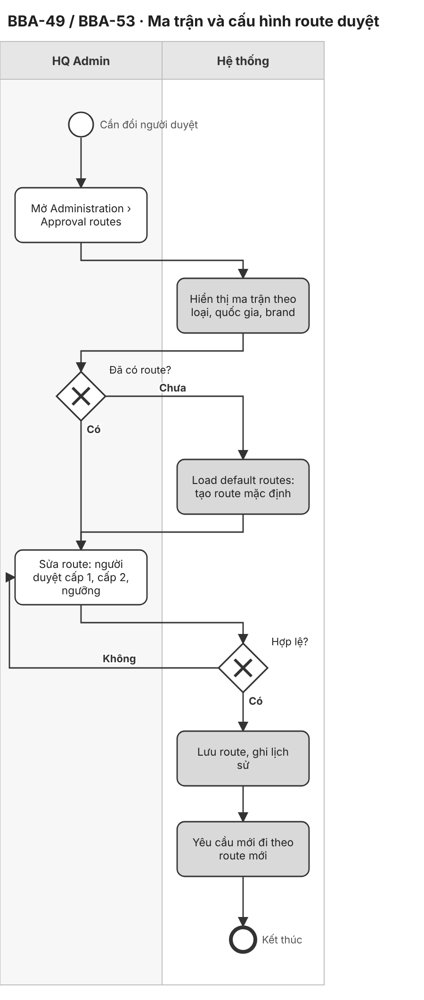
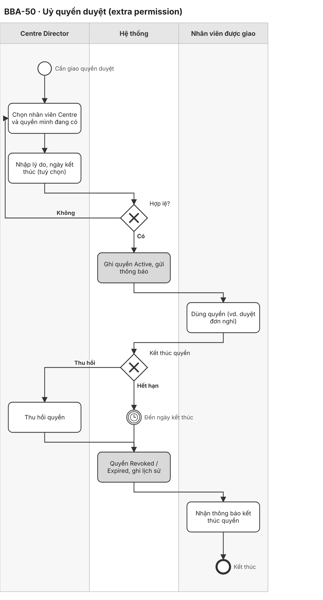
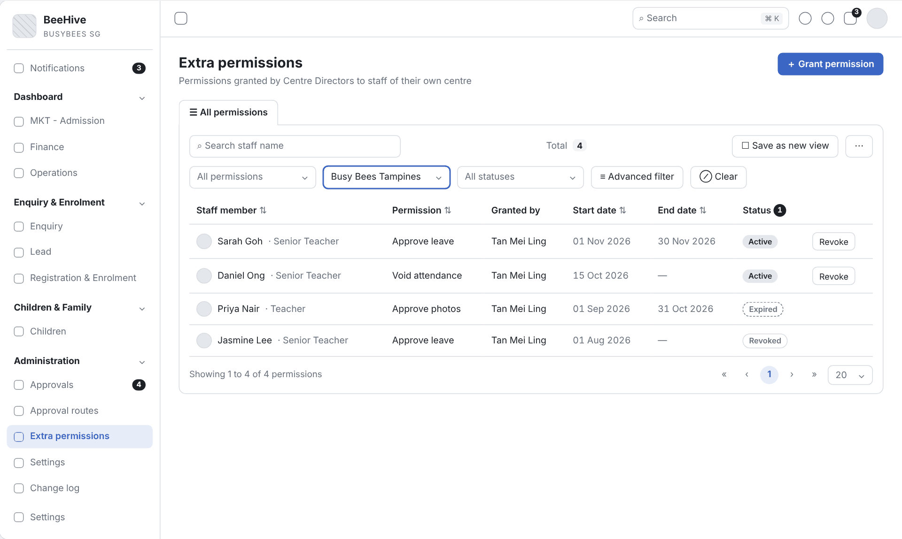
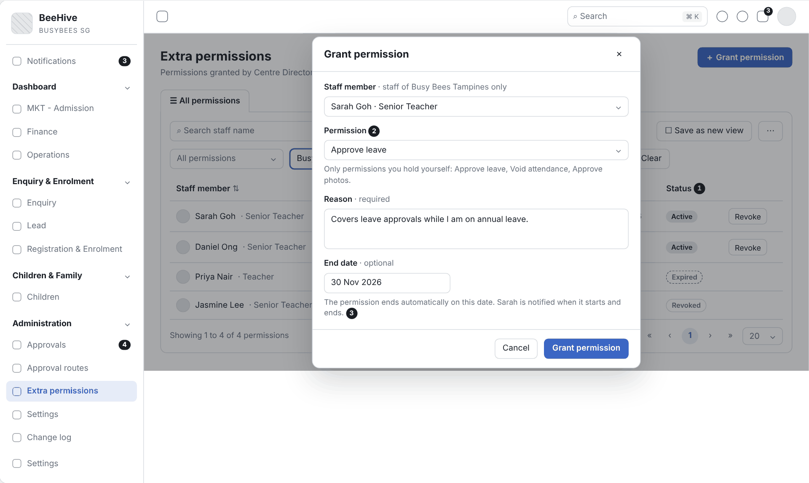
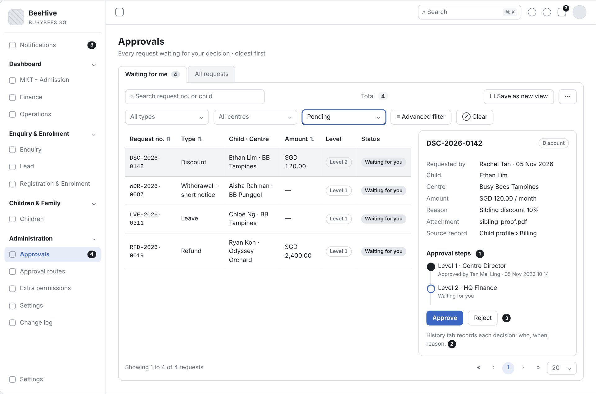
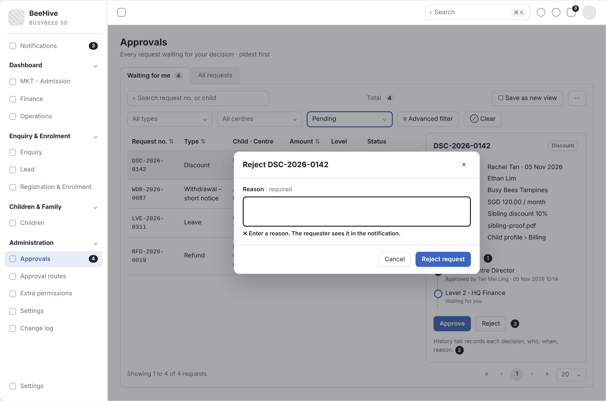
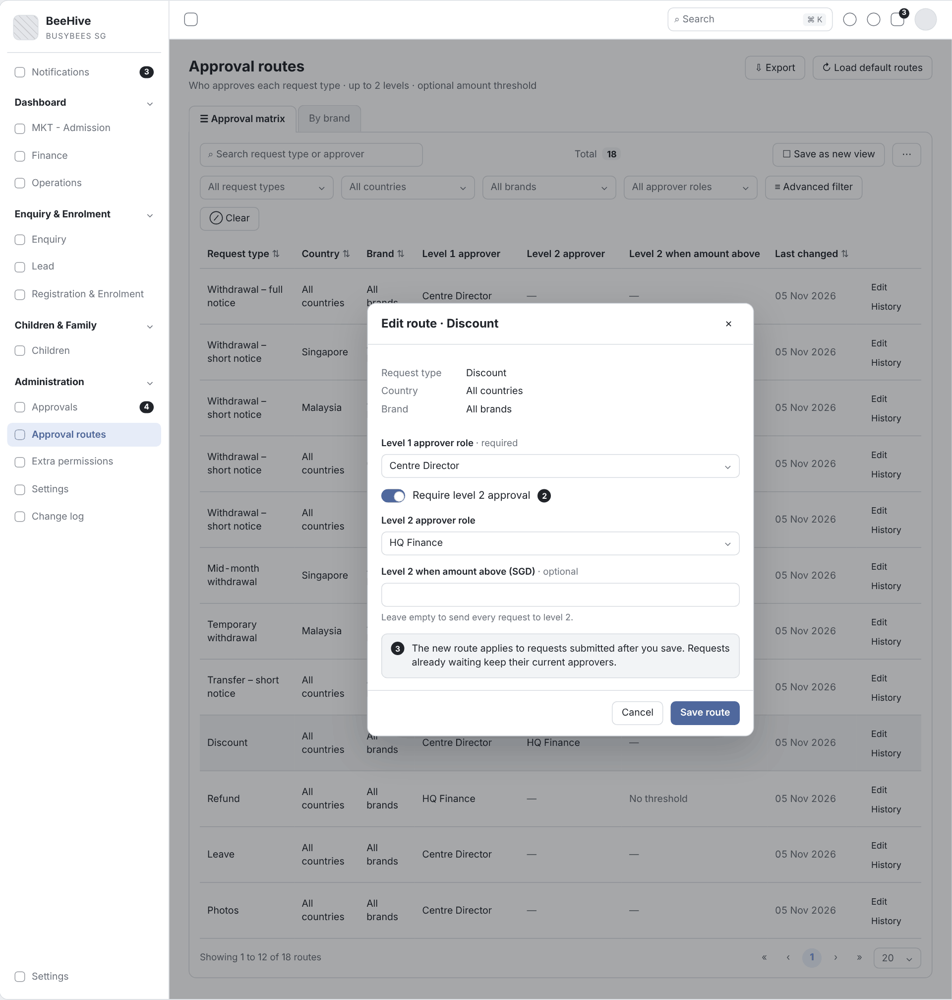
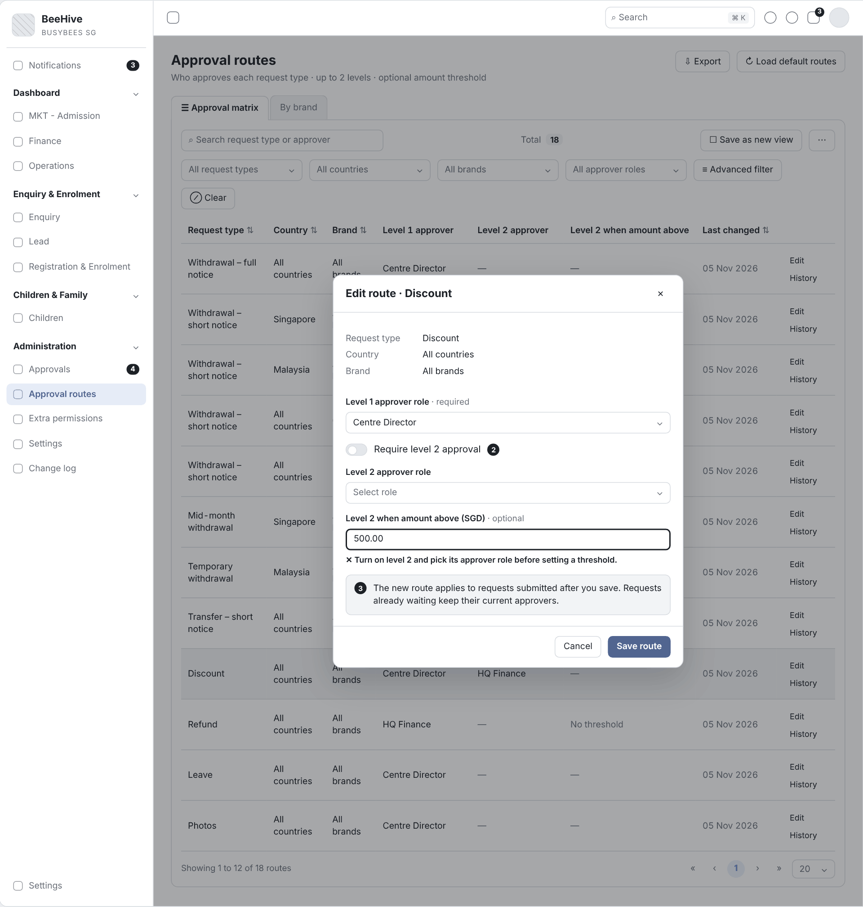

# 2.8 CRM Administration (Tiếng Việt)

| Thuộc tính | Giá trị |
|---|---|
| Dự án | Busy Bees Asia SMS |
| Module | Administration — Approvals |
| Tính năng | 2.8 CRM Administration: BBA-49, BBA-50, BBA-51, BBA-52, BBA-53 |
| Mã tài liệu | FRD-2.8_CRM_Administration |
| Sprint | 4 |
| Phiên bản | 0.2 |
| Trạng thái | BẢN NHÁP CHỜ XÁC NHẬN |
| Ngày | 09/11/2026 |
| Người soạn | Business Analysis |
| Người review | HaiNguyen |
| Người duyệt | HaiNguyen |

## 1. Kiểm soát tài liệu

| Phiên bản | Ngày | Tác giả | Tóm tắt thay đổi | Duyệt |
|---|---|---|---|---|
| 0.1 | 09/11/2026 | Business Analysis | Bản đầu theo WBS CRM 2.8 (Journey Settings, Visit Slot Schedule). | HaiNguyen |
| 0.2 | 09/11/2026 | Business Analysis | Viết lại theo phạm vi user chốt: Approvals (Administration) gồm BBA-49 đến BBA-53. Nguồn: SRS SMS General Requirements v0.1 và SRS SMS Administration v0.1. Thêm sơ đồ BPMN và wireframe. | HaiNguyen |

**Mức sẵn sàng:** Đã đặc tả ma trận người duyệt theo brand, uỷ quyền duyệt, xem tác động trước khi đổi thiết lập, duyệt hai cấp và cấu hình luồng duyệt. Còn 12 câu hỏi mở ở mục 7; cần chốt sớm OQ-ADM-01 (route mặc định 3 cấp mâu thuẫn giới hạn 2 cấp), OQ-ADM-10 (thứ tự ưu tiên route theo brand / quốc gia) và OQ-ADM-03 (cách người được uỷ quyền nhận yêu cầu).

## 2. Mục đích và bối cảnh

Mọi yêu cầu cần duyệt trong SMS (thôi học, chuyển Centre, hoàn tiền, nghỉ, ảnh, giảm giá…) đi qua **một hộp duyệt** và **một nơi cấu hình người duyệt** (SRS GEN §3.3; BR-GEN-008). FRD này đặc tả 5 ticket:

| Ticket | Tên | Nguồn chính |
|---|---|---|
| BBA-49 | Approval authority matrix by brand | SRS ADM §4 mục 2.4; BR-ADM-018 đến BR-ADM-023 |
| BBA-50 | Approval delegation | SRS ADM §4 mục 2.3, P4; BR-ADM-016, BR-ADM-017; SRS GEN §3.1 |
| BBA-51 | Impact preview before a setting change | SRS ADM §4 mục 4.1, 4.2, P5; BR-ADM-036, BR-ADM-037, BR-ADM-042; SRS GEN §4.4 |
| BBA-52 | Change request with second approval | SRS GEN §3.3; SRS ADM §4 mục 2.4, 5.1; BR-ADM-019; AC-ADM-009 |
| BBA-53 | BBA approval flows configuration (withdrawal, transfer, refund, leave, photo, discount…) | SRS ADM §4 mục 2.4; BR-ADM-020 đến BR-ADM-023; AC-ADM-010 |

Ghi chú: tên FRD giữ "2.8 CRM Administration" theo danh mục Sprint 4, nhưng nội dung thuộc module **Administration của SMS** (OQ-ADM-12).

**Quy trình và tham chiếu SRS:** SRS SMS General Requirements v0.1 — §3.1 Principles, §3.2 Default roles, §3.3 Approvals, §4.2 Records, §4.4 Settings, BR-GEN-004, BR-GEN-006 đến BR-GEN-010, AC-GEN-008, AC-GEN-009 · SRS SMS Administration v0.1 — §2, §3 P4 và P5, §4 mục 2.3 Extra permissions, 2.4 Approval routes, 4.1 Settings by level, 4.2 Feature switches, 5.1 Change log, §5 BR-ADM-004, BR-ADM-016 đến BR-ADM-023, BR-ADM-036 đến BR-ADM-042, BR-ADM-048, §6.1, §7, §8 AC-ADM-007 đến AC-ADM-010, AC-ADM-013 đến AC-ADM-015, AC-ADM-018 · Liên quan: SRS Daily Operations BR-OPS-017, BR-OPS-022, AC-OPS-013 (uỷ quyền duyệt nghỉ, void); SRS Fees & Payments BR-FEE-050, BR-FEE-051 (Finance approvals) · Prototype: https://bba-sms-crm.lovable.app/organisation/approvals, /organisation/delegations, /organisation/features · Wireframe: `Diagram/Wireframe/approvals-sprint4.html`.

## 3. Phạm vi và ranh giới phase

| Trong phạm vi | Ngoài phạm vi |
|---|---|
| BBA-49: xem ma trận route theo loại yêu cầu, quốc gia, brand (cấp 1, cấp 2, ngưỡng tiền); lọc; xuất; lịch sử route. BBA-50: Centre Director giao, thu hồi quyền bổ sung (extra permission) cho nhân viên Centre mình, quyền tự hết hạn, thông báo, lịch sử. BBA-51: xem giá trị thiết lập theo Centre và nguồn, đổi theo phạm vi, kiểm tra giá trị, xem tác động trước khi lưu, override và gỡ override, chặn tắt tính năng khi còn việc mở. BBA-52: định tuyến yêu cầu theo route, duyệt cấp 1 rồi cấp 2 theo ngưỡng, Approvals inbox, từ chối bắt buộc lý do, thông báo, lịch sử quyết định. BBA-53: sửa route (vai trò từng cấp, tối đa 2 cấp, ngưỡng), nạp route mặc định cho mọi loại yêu cầu. | Tạo tài khoản, gán vai trò tự động từ Microsoft Entra (SCIM); đồng bộ HRMS; tuỳ biến trường và bố cục màn hình (SRS ADM §1.2). Thiết kế vai trò và ma trận quyền (Roles) — chỉ dẫn chiếu. Giao dịch của từng loại yêu cầu (thôi học, hoàn tiền, nghỉ…) thuộc FRD của module sở hữu (Joining & Leaving, Fees & Payments, Daily Operations). Centre Director App (Phase 2). Vietnam không thuộc SMS Phase 1 (SRS GEN §2.2). |

## 4. Tác nhân, vai trò và quyền truy cập

| Tác nhân | Phạm vi | Quyền / Trách nhiệm |
|---|---|---|
| HQ Admin (BBA IT) | Mọi Country, Brand, Centre. | Mọi quyền; quản lý approval routes, settings; không bị giới hạn phạm vi (BR-ADM-001; SRS ADM §2). |
| HQ Finance | Country / legal entity. | Đọc route và change log; là người duyệt các route tài chính (credit note, refund, notice waiver, discount cấp 2) (SRS ADM §2; BR-ADM-022, BR-ADM-023). |
| HQ Ops / Head of Brand, District Manager, Operations Manager | Brand, cluster, các Centre phụ trách. | Đổi thiết lập được cấp quyền; là người duyệt trong route (SRS ADM §2). |
| Centre Director | Centre. | Giao quyền bổ sung cho nhân viên Centre; đổi thiết lập cấp Centre được cấp quyền; duyệt yêu cầu của Centre (SRS ADM §2; SRS GEN §3.2). |
| Senior Teacher / nhân viên được giao | Lớp / Centre. | Dùng quyền được giao (vd. duyệt nghỉ, void điểm danh, duyệt ảnh) tới khi bị thu hồi hoặc hết hạn (SRS GEN §3.1). |
| Người yêu cầu | Theo module sở hữu yêu cầu. | Gửi yêu cầu; nhận thông báo kết quả (SRS GEN §3.3). |
| System | Toàn hệ thống. | Định tuyến yêu cầu theo route, tính tác động, tự hết hạn quyền, ghi lịch sử, gửi thông báo. |
| External Auditor | Theo cấp. | Chỉ đọc change log (SRS ADM §2). |

Quy tắc chung: chỉ người dùng có quyền Administration mở được màn Administration (BR-ADM-004); điều không được làm thì không hiển thị (BR-GEN-004); lịch sử chỉ thêm, không sửa, không xoá (BR-ADM-048); danh sách chuẩn: tìm kiếm, lọc, sắp xếp, phân trang 20 / 50 / 100, xuất theo bộ lọc (SRS GEN §4.1).

## 5. Tổng quan tính năng và phân rã chức năng

| Module | Tính năng | Chức năng | User Story |
|---|---|---|---|
| Approval routes | BBA-49 Ma trận thẩm quyền duyệt theo brand | Xem, lọc, xuất ma trận route; lịch sử route. | US-001 |
| Extra permissions | BBA-50 Uỷ quyền duyệt | Giao, thu hồi, tự hết hạn quyền; thông báo. | US-002 |
| Settings | BBA-51 Xem tác động trước khi đổi thiết lập | Giá trị theo Centre, đổi theo phạm vi, tác động, override, chặn tắt tính năng. | US-003 |
| Approvals | BBA-52 Yêu cầu có duyệt cấp 2 | Định tuyến, duyệt cấp 1 / cấp 2, inbox, từ chối, thông báo. | US-004 |
| Approval routes | BBA-53 Cấu hình luồng duyệt | Sửa route, nạp route mặc định. | US-005 |

| Mã màn | Tên màn | Ticket | Ảnh wireframe |
|---|---|---|---|
| SCR-01 | Approval routes | BBA-49, BBA-53 | `Diagram/Wireframe/png/SCR-01-approval-routes*.png` |
| SCR-02 | Edit route | BBA-53, BBA-52 | `Diagram/Wireframe/png/SCR-02-edit-route*.png` |
| SCR-03 | Approvals inbox | BBA-52 | `Diagram/Wireframe/png/SCR-03-approvals-inbox*.png` |
| SCR-04 | Extra permissions | BBA-50 | `Diagram/Wireframe/png/SCR-04-extra-permissions*.png` |
| SCR-05 | Setting impact preview | BBA-51 | `Diagram/Wireframe/png/SCR-05-setting-impact-preview*.png` |

## 6. Yêu cầu chức năng theo User Story

### 6.1 BBA-49: US-001 - Ma trận thẩm quyền duyệt theo brand

#### User Story

Là HQ Admin, tôi muốn xem trên một ma trận ai duyệt từng loại yêu cầu theo quốc gia và brand để kiểm soát thẩm quyền duyệt của toàn BBA.

#### Process Diagram (Sơ đồ BPMN)

#### Functional Requirements (Yêu cầu chức năng)

| FR ID | Yêu cầu chức năng |
|---|---|
| FR-001 | Màn Approval routes hiển thị mỗi route một dòng theo loại yêu cầu, quốc gia và brand, gồm người duyệt cấp 1, người duyệt cấp 2, ngưỡng tiền và lần đổi gần nhất (SRS ADM §4 mục 2.4 View routes). |
| FR-002 | Lọc theo loại yêu cầu, quốc gia, brand; bộ lọc kết hợp được và có Clear (SRS ADM §4 mục 2.4 Filter; SRS GEN §4.1). |
| FR-003 | Xuất toàn bộ route ra Excel (báo cáo "Approval routes" cho HQ Admin, HQ Finance) (SRS ADM §4 mục 2.4 Export; §7). |
| FR-004 | Mỗi route có lịch sử: mọi lần đổi, người đổi, thời điểm, giá trị cũ và mới (SRS ADM §4 mục 2.4 View history; BR-ADM-048). |
| FR-005 | Approval routes là nơi duy nhất đặt người duyệt; không màn nào khác đặt người duyệt cho yêu cầu (BR-ADM-018; BR-GEN-008). |
| FR-006 | Ma trận thể hiện route khác nhau theo brand khi quy tắc mặc định khác nhau, vd. thôi học báo trước ngắn: Centre Director (Odyssey), Head of Brand (Brighton) (BR-ADM-020). |

#### Functional Flow - Main (Luồng chính)

1. HQ Admin mở Administration › Approval routes (FR-001).
2. Hệ thống hiển thị ma trận route trong phạm vi (FR-001, FR-006).
3. HQ Admin lọc theo loại yêu cầu, quốc gia, brand (FR-002).
4. HQ Admin mở lịch sử một route hoặc xuất ma trận (FR-003, FR-004).

#### Functional Flow - Alternative (Luồng thay thế)

1. Chưa có route nào: màn hiển thị trạng thái rỗng và thao tác Load default routes (US-005).
2. Không có route khớp bộ lọc: hiển thị thông báo danh sách rỗng chuẩn (SRS GEN §4.1).

#### Functional Flow - Exception (Luồng ngoại lệ)

1. Người dùng không có quyền Administration: không thấy menu Approval routes (VAL-001).

#### Business Rules (Quy tắc nghiệp vụ)

| BR ID | Quy tắc |
|---|---|
| BR-001 | Người duyệt chỉ được cấu hình trong Approval routes (BR-ADM-018). |
| BR-002 | Một route có tối đa 2 cấp và một ngưỡng tiền tuỳ chọn; vượt ngưỡng thì cần cấp 2 (BR-ADM-019). |
| BR-003 | Khi có route theo brand và route theo quốc gia cho cùng loại yêu cầu, route cụ thể hơn được dùng (AS-ADM-05, chờ OQ-ADM-10). |

#### Validation Rules (Quy tắc kiểm tra)

| VAL ID | Điều kiện | Phản hồi của hệ thống |
|---|---|---|
| VAL-001 | Người dùng không có quyền Administration. | Không hiển thị menu và màn Approval routes (BR-ADM-004). |

#### UI Reference (Tham chiếu giao diện)

| Mã màn hình / Phiên bản | Tham chiếu / Link |
|---|---|
| SCR-01 - Approval routes | Prototype: https://bba-sms-crm.lovable.app/organisation/approvals · Wireframe: `Diagram/Wireframe/approvals-sprint4.html#scr-01` |

#### UI Components / Field Specification (Thành phần giao diện)

| Trường / Điều khiển | Loại | Bắt buộc | Mặc định / Trạng thái | Kiểm tra | Hành vi |
|---|---|---|---|---|---|
| Ô tìm kiếm | Search field | Không | Trống | — | Tìm theo loại yêu cầu, vai trò duyệt. |
| Lọc loại yêu cầu, quốc gia, brand | Filter | Không | Tất cả | — | FR-002. |
| Bảng ma trận | Table | Có | Sắp theo loại yêu cầu | — | Cột: Request type, Country, Brand, Level 1 approver, Level 2 approver, Level 2 when amount above, Last changed. |
| Edit | Action | HQ Admin | Mỗi dòng | — | Mở SCR-02 (US-005). |
| History | Action | Theo quyền | Mỗi dòng | — | Mở lịch sử route. |
| Export | Action | Theo quyền | — | BR-GEN-012. | Xuất mọi route. |

#### Data and Audit (Dữ liệu và audit)

| ID | Yêu cầu |
|---|---|
| DATA-001 | Mỗi route lưu loại yêu cầu, quốc gia, brand, vai trò cấp 1, vai trò cấp 2, ngưỡng, người đổi cuối, thời điểm đổi cuối. |

#### Acceptance Criteria (Tiêu chí nghiệm thu)

| AC ID | Given (Cho trước) | When (Khi) | Then (Thì) | Linked Rule |
|---|---|---|---|---|
| AC-001 | có route thôi học báo trước ngắn cho Singapore, Malaysia, Odyssey, Brighton | HQ Admin lọc loại "Withdrawal – short notice" | 4 dòng hiển thị với người duyệt District Manager, Operations Manager, Centre Director, Head of Brand | FR-001; FR-002; FR-006 |
| AC-002 | ma trận có 18 route | HQ Admin chọn Export | file có 18 route với người duyệt và ngưỡng | FR-003; DATA-001 |
| AC-003 | route Discount đổi người duyệt cấp 2 ngày 05/11/2026 | HQ Admin mở History của route | lịch sử hiển thị giá trị cũ, mới, người đổi, thời điểm | FR-004 |
| AC-004 | người duyệt thôi học được đổi trong Approval routes | một yêu cầu thôi học báo trước ngắn mới được gửi ở Singapore | yêu cầu đi tới vai trò mới đặt trong Approval routes (AC-ADM-010) | FR-005; BR-001 |
| AC-005 | route discount có 2 cấp và ngưỡng 500 SGD | HQ Admin xem dòng route | dòng hiển thị cấp 1, cấp 2 và ngưỡng 500,00 SGD | BR-002 |
| AC-006 | có route Leave cho "All brands" và route Leave riêng cho brand Odyssey | một yêu cầu nghỉ của Centre Odyssey được gửi | yêu cầu đi theo route của Odyssey | BR-003 |
| AC-007 | Teacher không có quyền Administration | Teacher đăng nhập | không có menu Approval routes | VAL-001 |

#### Dependencies (Phụ thuộc)

Danh mục loại yêu cầu của các module; danh sách vai trò (Administration › Roles); OQ-ADM-10.

### 6.2 BBA-50: US-002 - Uỷ quyền duyệt

#### User Story

Là Centre Director, tôi muốn giao quyền duyệt mình đang có cho nhân viên Centre trong một khoảng thời gian để việc duyệt không bị dừng khi tôi vắng.

#### Process Diagram (Sơ đồ BPMN)

#### Functional Requirements (Yêu cầu chức năng)

| FR ID | Yêu cầu chức năng |
|---|---|
| FR-007 | Centre Director giao cho nhân viên của Centre mình một quyền mà Centre Director đang có (vd. duyệt nghỉ, void điểm danh, duyệt ảnh), bắt buộc lý do, ngày kết thúc tuỳ chọn (SRS ADM §4 mục 2.3 Grant permission; BR-ADM-016). |
| FR-008 | Danh sách quyền đã giao: người giữ quyền, quyền, người giao, ngày bắt đầu, ngày kết thúc, trạng thái (Active / Expired / Revoked); tìm theo tên; lọc theo quyền, Centre, trạng thái; xuất (SRS ADM §4 mục 2.3). |
| FR-009 | Thu hồi có hiệu lực ngay; quyền tự kết thúc vào ngày kết thúc (SRS ADM §4 mục 2.3 Revoke, Auto-expire; BR-ADM-017). |
| FR-010 | Nhân viên nhận thông báo in-app khi được giao, bị thu hồi và khi quyền hết hạn (SRS ADM §6.1; BR-ADM-017). |
| FR-011 | Nhân viên dùng được quyền ngay khi được giao; quyền truy cập của người dùng là tổng các vai trò, quyền bổ sung và phạm vi (SRS ADM P4 bước 3; BR-ADM-007). |
| FR-012 | Lịch sử ghi mọi lần giao, thu hồi, hết hạn (SRS ADM §4 mục 2.3 View history). |

#### Functional Flow - Main (Luồng chính)

1. Centre Director mở Extra permissions và chọn Grant permission (FR-007).
2. Centre Director chọn nhân viên của Centre và quyền mình đang có, nhập lý do, ngày kết thúc (FR-007; VAL-002, VAL-003).
3. Hệ thống ghi quyền Active và gửi thông báo (FR-009, FR-010).
4. Nhân viên dùng quyền, vd. duyệt đơn nghỉ trong Approvals inbox (FR-011; AS-ADM-06).

#### Functional Flow - Alternative (Luồng thay thế)

1. Centre Director thu hồi: quyền Revoked ngay, nhân viên nhận thông báo (FR-009, FR-010).
2. Đến ngày kết thúc: quyền Expired, nhân viên nhận thông báo (FR-009, FR-010).

#### Functional Flow - Exception (Luồng ngoại lệ)

1. Quyền Centre Director không có: không có trong danh sách chọn (VAL-002).
2. Thiếu lý do: không lưu (VAL-003).

#### Business Rules (Quy tắc nghiệp vụ)

| BR ID | Quy tắc |
|---|---|
| BR-004 | Centre Director chỉ giao quyền cho nhân viên Centre mình và chỉ quyền mình đang có; bắt buộc lý do (BR-ADM-016). |
| BR-005 | Quyền bổ sung kết thúc khi bị thu hồi hoặc tới ngày kết thúc; nhân viên được thông báo cả hai trường hợp (BR-ADM-017). |

#### Validation Rules (Quy tắc kiểm tra)

| VAL ID | Điều kiện | Phản hồi của hệ thống |
|---|---|---|
| VAL-002 | Quyền Centre Director không có, hoặc nhân viên ngoài Centre. | Không có trong danh sách chọn (AC-ADM-007). |
| VAL-003 | Thiếu lý do, hoặc ngày kết thúc trước hôm nay. | Không lưu; hiển thị "Enter a reason for granting this permission." tại trường lý do (AS-ADM-04). |

#### UI Reference (Tham chiếu giao diện)

| Mã màn hình / Phiên bản | Tham chiếu / Link |
|---|---|
| SCR-04 - Extra permissions | Prototype: https://bba-sms-crm.lovable.app/organisation/delegations · Wireframe: `Diagram/Wireframe/approvals-sprint4.html#scr-04` |

#### UI Components / Field Specification (Thành phần giao diện)

| Trường / Điều khiển | Loại | Bắt buộc | Mặc định / Trạng thái | Kiểm tra | Hành vi |
|---|---|---|---|---|---|
| Grant permission | Action | Centre Director | — | — | Mở form giao quyền. |
| Nhân viên | Selector | Có | Trống | VAL-002. | Chỉ nhân viên Centre của Centre Director. |
| Quyền | Selector | Có | Trống | VAL-002. | Chỉ quyền Centre Director đang có. |
| Lý do | Text | Có | Trống | VAL-003. | — |
| Ngày kết thúc | Date | Không | Trống | VAL-003. | Tự hết hạn vào ngày này. |
| Revoke | Action | Centre Director | Dòng Active | — | Thu hồi ngay. |

#### Data and Audit (Dữ liệu và audit)

| ID | Yêu cầu |
|---|---|
| DATA-002 | Mỗi quyền bổ sung lưu người giữ, quyền, người giao, lý do, ngày bắt đầu, ngày kết thúc, trạng thái, người thu hồi và thời điểm. |

#### Acceptance Criteria (Tiêu chí nghiệm thu)

| AC ID | Given (Cho trước) | When (Khi) | Then (Thì) | Linked Rule |
|---|---|---|---|---|
| AC-008 | Centre Director không có quyền "approve refunds" | Centre Director giao quyền cho nhân viên | quyền "approve refunds" không có trong danh sách (AC-ADM-007) | FR-007; BR-004; VAL-002 |
| AC-009 | Senior Teacher được giao "approve leave" tới 30/11 | bắt đầu ngày 01/12 | quyền thành Expired và Senior Teacher nhận thông báo (AC-ADM-008) | FR-009; FR-010; BR-005 |
| AC-010 | Centre Director uỷ quyền duyệt nghỉ cho Senior Teacher Sarah | có đơn nghỉ mới | Sarah duyệt hoặc từ chối được (AC-OPS-013) | FR-011 |
| AC-011 | Centre Director để trống lý do | Centre Director lưu | không lưu và trường lý do hiển thị thông báo | VAL-003 |
| AC-012 | quyền đang Active | Centre Director thu hồi | quyền thành Revoked ngay, nhân viên nhận thông báo, lịch sử ghi người thu hồi và thời điểm | FR-009; FR-012; DATA-002 |
| AC-013 | Centre có 4 quyền đã giao | Centre Director lọc trạng thái Active | 2 quyền Active hiển thị | FR-008 |

#### Dependencies (Phụ thuộc)

Roles và special permissions (Administration › Roles); Approvals inbox (US-004); OQ-ADM-03.

### 6.3 BBA-51: US-003 - Xem tác động trước khi đổi thiết lập

#### User Story

Là HQ Admin, tôi muốn thấy giá trị hiện tại của từng Centre và tác động của thay đổi trước khi lưu để không đổi nhầm thiết lập đang ảnh hưởng nhiều trẻ, hoá đơn và yêu cầu.

#### Process Diagram (Sơ đồ BPMN)

#### Functional Requirements (Yêu cầu chức năng)

| FR ID | Yêu cầu chức năng |
|---|---|
| FR-013 | Thiết lập nhóm theo Fees, Joining & leaving, Daily operations, Learning, Communication; tìm theo tên thiết lập (SRS ADM §4 mục 4.1). |
| FR-014 | Một thiết lập hiển thị giá trị của từng Centre, nguồn (default, country, brand, cluster, centre), người đặt, thời điểm; lọc Centre theo country, brand, cluster, "different from default", "not confirmed" (SRS ADM §4 mục 4.1). |
| FR-015 | Người dùng có quyền chọn phạm vi (country, brand, cluster hoặc các Centre) và giá trị mới; hệ thống kiểm tra giá trị (SRS ADM §4 mục 4.1 Change a setting; P5 bước 2–3). |
| FR-016 | Trước khi lưu, hệ thống hiển thị tác động: số trẻ, số hoá đơn, số yêu cầu đang chờ bị ảnh hưởng (SRS ADM §4 mục 4.1 See impact; BR-ADM-037; SRS GEN §4.4). |
| FR-017 | Khi xác nhận, các Centre không có override nhận giá trị mới; Centre có override giữ giá trị của mình (BR-ADM-036; AC-ADM-013). |
| FR-018 | Override cho một Centre thay giá trị kế thừa; gỡ override đưa Centre về giá trị kế thừa (SRS ADM §4 mục 4.1; AC-ADM-014). |
| FR-019 | Giá trị mặc định hiển thị "To confirm" cho tới khi người dùng xác nhận (SRS ADM §4 mục 4.1 Mark as confirmed). |
| FR-020 | Tắt một tính năng (feature switch) bị chặn khi còn việc đang mở; hệ thống hiển thị link tới việc đó (BR-ADM-042; AC-ADM-015). |
| FR-021 | Mỗi thay đổi ghi lịch sử: thiết lập, giá trị cũ, giá trị mới, người đổi, thời điểm; xuất thiết lập theo Centre (BR-ADM-037; SRS ADM §4 mục 4.1). |

#### Functional Flow - Main (Luồng chính)

1. Người dùng mở một thiết lập; hệ thống hiển thị giá trị và nguồn của từng Centre (FR-014).
2. Người dùng chọn phạm vi và giá trị mới (FR-015).
3. Hệ thống kiểm tra giá trị (VAL-004) và hiển thị tác động (FR-016).
4. Người dùng xác nhận; hệ thống lưu, Centre không override nhận giá trị mới, ghi lịch sử (FR-017, FR-021).

#### Functional Flow - Alternative (Luồng thay thế)

1. Người dùng huỷ ở bước xem tác động: không thay đổi gì.
2. Override hoặc gỡ override cho một Centre (FR-018).
3. Xác nhận giá trị mặc định "To confirm" (FR-019).

#### Functional Flow - Exception (Luồng ngoại lệ)

1. Giá trị không hợp lệ: không cho xem tác động và lưu (VAL-004).
2. Tắt tính năng còn việc mở: chặn và hiển thị link (FR-020; VAL-005).

#### Business Rules (Quy tắc nghiệp vụ)

| BR ID | Quy tắc |
|---|---|
| BR-006 | Thiết lập kế thừa từ country → brand → cluster → centre; cấp dưới override được; gỡ override khôi phục giá trị kế thừa (BR-ADM-036). |
| BR-007 | Mọi thay đổi thiết lập được kiểm tra, hiển thị tác động trước khi lưu và ghi lịch sử (BR-ADM-037). |
| BR-008 | Tắt tính năng bị chặn khi còn việc liên quan đang mở (BR-ADM-042). |

#### Validation Rules (Quy tắc kiểm tra)

| VAL ID | Điều kiện | Phản hồi của hệ thống |
|---|---|---|
| VAL-004 | Giá trị không đúng kiểu hoặc ngoài khoảng cho phép của thiết lập. | Không hiển thị tác động, không lưu; báo lỗi tại trường giá trị (quy tắc từng thiết lập chờ OQ-ADM-07). |
| VAL-005 | Tắt tính năng khi còn việc mở (vd. ảnh chờ duyệt, trẻ đang đi xe). | Chặn; hiển thị số việc và link tới việc đó. |

#### UI Reference (Tham chiếu giao diện)

| Mã màn hình / Phiên bản | Tham chiếu / Link |
|---|---|
| SCR-05 - Setting impact preview | Prototype: https://bba-sms-crm.lovable.app/organisation/features · Wireframe: `Diagram/Wireframe/approvals-sprint4.html#scr-05` |

#### UI Components / Field Specification (Thành phần giao diện)

| Trường / Điều khiển | Loại | Bắt buộc | Mặc định / Trạng thái | Kiểm tra | Hành vi |
|---|---|---|---|---|---|
| Nhóm thiết lập | Navigation | Có | Nhóm đầu | — | Fees, Joining & leaving, Daily operations, Learning, Communication, Feature switches, Shared lists. |
| Bảng giá trị theo Centre | Table | Có | Mọi Centre trong phạm vi | — | Centre, Value, Source, Set by, When. |
| Phạm vi | Selector | Có | Trống | — | Country / Brand / Cluster / các Centre. |
| Giá trị mới | Input theo kiểu thiết lập | Có | Trống | VAL-004. | — |
| Tác động | Panel | Có | Sau khi kiểm tra | — | Số trẻ, hoá đơn, yêu cầu đang chờ; số Centre nhận giá trị mới, số Centre giữ override. |
| Save setting / Cancel | Action | Có | — | — | Lưu hoặc huỷ. |

#### Data and Audit (Dữ liệu và audit)

| ID | Yêu cầu |
|---|---|
| DATA-003 | Mỗi thay đổi thiết lập lưu thiết lập, phạm vi, giá trị cũ, giá trị mới, tác động đã hiển thị, người đổi, thời điểm. |

#### Acceptance Criteria (Tiêu chí nghiệm thu)

| AC ID | Given (Cho trước) | When (Khi) | Then (Thì) | Linked Rule |
|---|---|---|---|---|
| AC-014 | thời hạn báo trước của brand là 1 tháng, Centre A không override | HQ Admin đổi giá trị brand thành 2 tháng | Centre A hiển thị 2 tháng, nguồn Brand; Centre có override giữ giá trị của mình (AC-ADM-013) | FR-017; BR-006 |
| AC-015 | Centre A override giờ cut-off đi trễ thành 9:30 | HQ Admin gỡ override | Centre A hiển thị lại giá trị brand và thay đổi được ghi lịch sử (AC-ADM-014) | FR-018; FR-021 |
| AC-016 | Centre A có 5 ảnh chờ duyệt | HQ Admin tắt Photo review cho Centre A | hệ thống chặn và link tới 5 ảnh (AC-ADM-015) | FR-020; BR-008; VAL-005 |
| AC-017 | đổi thời hạn báo trước của brand Busy Bees | HQ Admin chọn giá trị mới | trước khi lưu hệ thống hiển thị số trẻ, hoá đơn, yêu cầu đang chờ bị ảnh hưởng | FR-015; FR-016; BR-007 |
| AC-018 | thay đổi được lưu | HQ Admin mở lịch sử thiết lập | một dòng ghi giá trị cũ, mới, người đổi, thời điểm | DATA-003 |
| AC-019 | người dùng nhập giá trị không hợp lệ | người dùng chọn xem tác động | không hiển thị tác động và trường báo lỗi | VAL-004 |
| AC-020 | thiết lập "late cut-off" | người dùng mở thiết lập và lọc "different from default" | chỉ Centre có giá trị khác mặc định hiển thị, kèm nguồn, người đặt, thời điểm | FR-013; FR-014 |
| AC-021 | thiết lập mới có giá trị mặc định chưa xác nhận | người dùng mở thiết lập | giá trị hiển thị "To confirm" tới khi được xác nhận | FR-019 |

#### Dependencies (Phụ thuộc)

Danh mục thiết lập của các module (BR-ADM-038 đến BR-ADM-041); dữ liệu trẻ, hoá đơn, yêu cầu để tính tác động; OQ-ADM-07.

### 6.4 BBA-52: US-004 - Yêu cầu có duyệt cấp 2

#### User Story

Là người duyệt, tôi muốn yêu cầu đi qua cấp 1 rồi cấp 2 theo route và ngưỡng tiền, có đủ lịch sử từng quyết định, để các thay đổi lớn luôn có người thứ hai duyệt.

#### Process Diagram (Sơ đồ BPMN)

#### Functional Requirements (Yêu cầu chức năng)

| FR ID | Yêu cầu chức năng |
|---|---|
| FR-022 | Khi có yêu cầu, hệ thống tìm route theo loại yêu cầu, quốc gia, brand của Centre và gửi tới người duyệt cấp 1 (SRS GEN §3.3; BR-ADM-018). |
| FR-023 | Sau khi cấp 1 duyệt, yêu cầu đi tới cấp 2 khi route có cấp 2 và (route không có ngưỡng, hoặc số tiền vượt ngưỡng); cấp 2 chỉ mở sau khi cấp 1 duyệt (BR-ADM-019; AC-ADM-009; AS-ADM-03). |
| FR-024 | Mọi yêu cầu chờ người dùng nằm trong một Approvals inbox; lọc theo loại, Centre, trạng thái; mặc định cũ nhất trước (SRS GEN §3.3; BR-FEE-050). |
| FR-025 | Chi tiết yêu cầu hiển thị người yêu cầu, bản ghi nguồn, số tiền, lý do, tệp và các bước duyệt (cấp, vai trò, người quyết định, thời điểm) (SRS GEN §3.3). |
| FR-026 | Duyệt ghi người quyết định và thời điểm; từ chối bắt buộc lý do; người yêu cầu nhận thông báo kết quả (SRS GEN §3.3; BR-GEN-007). |
| FR-027 | Duyệt bước cuối chuyển yêu cầu về module sở hữu để thực hiện; từ chối ở bất kỳ cấp nào kết thúc yêu cầu (SRS GEN §3.3; AS-ADM-07). |
| FR-028 | Mỗi quyết định ghi vào History của bản ghi và change log với loại "approval step" và "approved by" (SRS GEN §4.2; SRS ADM §4 mục 5.1). |

#### Functional Flow - Main (Luồng chính)

1. Người yêu cầu gửi yêu cầu; hệ thống tìm route và gửi tới cấp 1 (FR-022).
2. Người duyệt cấp 1 mở yêu cầu trong Approvals inbox và duyệt (FR-024, FR-025, FR-026).
3. Route cần cấp 2: hệ thống gửi tới cấp 2 (FR-023).
4. Người duyệt cấp 2 duyệt; hệ thống chạy hành động nguồn, ghi lịch sử, thông báo người yêu cầu (FR-026, FR-027, FR-028).

#### Functional Flow - Alternative (Luồng thay thế)

1. Route không cần cấp 2 (không có cấp 2, hoặc số tiền không vượt ngưỡng): duyệt cấp 1 là bước cuối (FR-023).
2. Từ chối ở cấp 1 hoặc cấp 2 kèm lý do: yêu cầu kết thúc, người yêu cầu nhận thông báo (FR-026, FR-027).

#### Functional Flow - Exception (Luồng ngoại lệ)

1. Từ chối không lý do: không cho phép (VAL-006).
2. Người duyệt cấp 2 mở yêu cầu khi cấp 1 chưa duyệt: không có thao tác duyệt (VAL-007).

#### Business Rules (Quy tắc nghiệp vụ)

| BR ID | Quy tắc |
|---|---|
| BR-009 | Mọi yêu cầu duyệt của người dùng nằm trong một Approvals inbox (SRS GEN §3.3). |
| BR-010 | Cấp 2 chỉ bắt đầu sau khi cấp 1 duyệt (AC-ADM-009). |
| BR-011 | Từ chối bắt buộc lý do; mọi quyết định ghi người quyết định, thời điểm; người yêu cầu được thông báo (SRS GEN §3.3; BR-GEN-007). |

#### Validation Rules (Quy tắc kiểm tra)

| VAL ID | Điều kiện | Phản hồi của hệ thống |
|---|---|---|
| VAL-006 | Từ chối không có lý do. | Không cho phép; hiển thị "Enter a reason. The requester sees it in the notification." (AC-GEN-008). |
| VAL-007 | Cấp trước chưa duyệt. | Không hiển thị Approve / Reject cho cấp sau. |

#### UI Reference (Tham chiếu giao diện)

| Mã màn hình / Phiên bản | Tham chiếu / Link |
|---|---|
| SCR-03 - Approvals inbox | Wireframe: `Diagram/Wireframe/approvals-sprint4.html#scr-03` |

#### UI Components / Field Specification (Thành phần giao diện)

| Trường / Điều khiển | Loại | Bắt buộc | Mặc định / Trạng thái | Kiểm tra | Hành vi |
|---|---|---|---|---|---|
| Tab Waiting for me / All requests | Tabs | Có | Waiting for me | — | Số yêu cầu chờ trên tab. |
| Lọc loại, Centre, trạng thái | Filter | Không | Pending | — | FR-024. |
| Bảng yêu cầu | Table | Có | Cũ nhất trước | — | Request no., Type, Child · Centre, Amount, Level, Status. |
| Panel chi tiết | Panel | Có | Yêu cầu đang chọn | — | FR-025; các bước duyệt. |
| Approve | Action | Người duyệt cấp hiện tại | Hiện ở cấp đang chờ | VAL-007. | Ghi duyệt. |
| Reject | Action | Người duyệt cấp hiện tại | Hiện ở cấp đang chờ | VAL-006. | Mở form lý do. |

#### Data and Audit (Dữ liệu và audit)

| ID | Yêu cầu |
|---|---|
| DATA-004 | Mỗi bước duyệt lưu yêu cầu, cấp, vai trò, người quyết định, kết quả, lý do, thời điểm, route đã áp dụng. |

#### Acceptance Criteria (Tiêu chí nghiệm thu)

| AC ID | Given (Cho trước) | When (Khi) | Then (Thì) | Linked Rule |
|---|---|---|---|---|
| AC-022 | route discount là Centre Director rồi Finance | một yêu cầu giảm giá được gửi ở Centre A | yêu cầu tới Centre Director trước và chỉ tới Finance sau khi cấp 1 duyệt (AC-ADM-009) | FR-022; FR-023; BR-010 |
| AC-023 | route credit note có ngưỡng 1.000 SGD | credit note 600 SGD được cấp 1 duyệt | yêu cầu kết thúc ở cấp 1, không tới cấp 2 | FR-023 |
| AC-024 | một yêu cầu trong Approvals | người duyệt từ chối không lý do | hệ thống không cho phép (AC-GEN-008) | FR-026; BR-011; VAL-006 |
| AC-025 | Centre Director có 4 yêu cầu chờ ở 3 loại | Centre Director mở Approvals và lọc loại Leave | chỉ yêu cầu nghỉ hiển thị, cũ nhất trước | FR-024; BR-009 |
| AC-026 | yêu cầu giảm giá đã qua cấp 1 | người duyệt cấp 2 duyệt | yêu cầu thành Approved, giảm giá được áp, người yêu cầu nhận thông báo, lịch sử ghi 2 bước | FR-026; FR-027; FR-028; DATA-004 |
| AC-027 | yêu cầu chờ cấp 1 | người duyệt cấp 2 mở yêu cầu | không có Approve / Reject | VAL-007 |
| AC-028 | người duyệt mở yêu cầu | panel chi tiết hiển thị | có người yêu cầu, bản ghi nguồn, số tiền, lý do, tệp và các bước duyệt | FR-025 |

#### Dependencies (Phụ thuộc)

US-005 (route); module sở hữu từng loại yêu cầu; dịch vụ notification; OQ-ADM-05.

### 6.5 BBA-53: US-005 - Cấu hình luồng duyệt của BBA

#### User Story

Là HQ Admin, tôi muốn nạp route mặc định cho mọi loại yêu cầu (thôi học, chuyển Centre, hoàn tiền, nghỉ, ảnh, giảm giá…) và sửa người duyệt từng cấp để luồng duyệt khớp cách BBA vận hành.

#### Process Diagram (Sơ đồ BPMN)

Dùng chung sơ đồ BBA-49 / BBA-53 ở mục 6.1.

#### Functional Requirements (Yêu cầu chức năng)

| FR ID | Yêu cầu chức năng |
|---|---|
| FR-029 | Load default routes tạo sẵn route cho mọi loại yêu cầu theo danh mục mặc định ở Phụ lục A; HQ Admin sửa được sau đó (SRS ADM §4 mục 2.4; BR-ADM-020 đến BR-ADM-023). |
| FR-030 | Sửa route: chọn vai trò duyệt cho từng cấp, tối đa 2 cấp, ngưỡng tiền tuỳ chọn (SRS ADM §4 mục 2.4 Edit route; BR-ADM-019). |
| FR-031 | Yêu cầu mới gửi sau khi lưu đi theo route mới (AC-ADM-010); yêu cầu đang chờ giữ người duyệt đã định tuyến (AS-ADM-02). |
| FR-032 | Mỗi thay đổi route ghi lịch sử (SRS ADM §4 mục 2.4 View history). |

#### Functional Flow - Main (Luồng chính)

1. HQ Admin mở Approval routes; chưa có route thì chọn Load default routes (FR-029).
2. HQ Admin chọn Edit trên một route (FR-030).
3. HQ Admin chọn vai trò cấp 1, bật cấp 2 và chọn vai trò, nhập ngưỡng nếu cần (FR-030; VAL-008, VAL-009).
4. HQ Admin lưu; hệ thống ghi lịch sử; yêu cầu mới đi theo route mới (FR-031, FR-032).

#### Functional Flow - Alternative (Luồng thay thế)

1. Bỏ cấp 2: route chỉ còn cấp 1, ngưỡng bị xoá (FR-030).

#### Functional Flow - Exception (Luồng ngoại lệ)

1. Thiếu vai trò cấp 1: không lưu (VAL-008).
2. Nhập ngưỡng khi chưa có cấp 2: không lưu (VAL-009).

#### Business Rules (Quy tắc nghiệp vụ)

| BR ID | Quy tắc |
|---|---|
| BR-012 | Route có tối đa 2 cấp và ngưỡng tiền tuỳ chọn (BR-ADM-019). |
| BR-013 | Route mặc định nạp theo BR-ADM-020 đến BR-ADM-023 và sửa được (SRS ADM §4 mục 2.4). |

#### Validation Rules (Quy tắc kiểm tra)

| VAL ID | Điều kiện | Phản hồi của hệ thống |
|---|---|---|
| VAL-008 | Thiếu vai trò duyệt cấp 1. | Không lưu; đánh dấu trường bắt buộc. |
| VAL-009 | Có ngưỡng tiền nhưng chưa bật cấp 2, hoặc ngưỡng không phải số dương. | Không lưu; hiển thị "Turn on level 2 and pick its approver role before setting a threshold." (AS-ADM-01). |

#### UI Reference (Tham chiếu giao diện)

| Mã màn hình / Phiên bản | Tham chiếu / Link |
|---|---|
| SCR-02 - Edit route | Wireframe: `Diagram/Wireframe/approvals-sprint4.html#scr-02` |
| SCR-01 - Approval routes (rỗng) | Wireframe: `Diagram/Wireframe/approvals-sprint4.html#scr-01` (trạng thái "Chưa có route") |

#### UI Components / Field Specification (Thành phần giao diện)

| Trường / Điều khiển | Loại | Bắt buộc | Mặc định / Trạng thái | Kiểm tra | Hành vi |
|---|---|---|---|---|---|
| Loại yêu cầu, quốc gia, brand | Display | Có | Theo route | — | Chỉ đọc. |
| Vai trò duyệt cấp 1 | Selector | Có | Giá trị hiện tại | VAL-008. | Danh sách vai trò. |
| Cần duyệt cấp 2 | Toggle | Không | Theo route | — | Bật thì hiện vai trò cấp 2. |
| Vai trò duyệt cấp 2 | Selector | Có khi bật cấp 2 | Giá trị hiện tại | VAL-009. | — |
| Ngưỡng tiền (tiền tệ quốc gia) | Amount | Không | Trống | VAL-009. | Trống = mọi yêu cầu qua cấp 2. |
| Load default routes | Action | HQ Admin | — | — | Nạp route mặc định. |
| Save route / Cancel | Action | HQ Admin | — | — | Lưu hoặc huỷ. |

#### Data and Audit (Dữ liệu và audit)

| ID | Yêu cầu |
|---|---|
| DATA-005 | Mỗi lần đổi route lưu route, giá trị cũ, giá trị mới, người đổi, thời điểm; nguồn (mặc định hoặc chỉnh tay). |

#### Acceptance Criteria (Tiêu chí nghiệm thu)

| AC ID | Given (Cho trước) | When (Khi) | Then (Thì) | Linked Rule |
|---|---|---|---|---|
| AC-029 | chưa có route | HQ Admin chọn Load default routes | route được tạo cho mọi loại yêu cầu ở Phụ lục A và sửa được | FR-029; BR-013; DATA-005 |
| AC-030 | route Discount | HQ Admin đổi cấp 2 thành HQ Finance, ngưỡng 500 SGD và lưu | route lưu 2 cấp, ngưỡng 500,00 SGD và lịch sử ghi thay đổi | FR-030; FR-032; BR-012 |
| AC-031 | route Leave có 1 cấp | HQ Admin nhập ngưỡng 500 khi chưa bật cấp 2 | không lưu và hiển thị thông báo lỗi | VAL-009 |
| AC-032 | HQ Admin xoá vai trò cấp 1 | lưu | không lưu và trường cấp 1 được đánh dấu | VAL-008 |
| AC-033 | 3 yêu cầu thôi học đang chờ Centre Director | HQ Admin đổi người duyệt thành District Manager | 3 yêu cầu đang chờ giữ Centre Director; yêu cầu mới tới District Manager | FR-031 |

#### Dependencies (Phụ thuộc)

US-001; danh mục loại yêu cầu của các module; OQ-ADM-01, OQ-ADM-02, OQ-ADM-04.

## 7. Câu hỏi mở

| Mã câu hỏi | Quyết định cần có | Người quyết định | Ưu tiên | Quyết định của BBA |
|---|---|---|---|---|
| OQ-ADM-01 | Route mặc định "Retention fee waiver (Malaysia)" có 3 cấp (Centre Director → Operations Manager → Finance, BR-ADM-022) nhưng route tối đa 2 cấp (BR-ADM-019). Bỏ một cấp hay tăng giới hạn lên 3? | Business Owner | Cao | |
| OQ-ADM-02 | "Transfer with short notice: District Managers of both centres" (BR-ADM-021): là 2 cấp nối tiếp (Centre cũ rồi Centre mới) hay cả hai cùng duyệt song song? | Business Owner | Trung bình | |
| OQ-ADM-03 | BBA-50 "Approval delegation": SRS chỉ có extra permission do Centre Director giao. Cần thêm uỷ quyền hộp duyệt khi người duyệt vắng (out-of-office) không? Người được giao quyền nhận yêu cầu trong Approvals inbox như thế nào khi BR-ADM-018 quy định người duyệt chỉ đặt trong Approval routes? | Business Owner | Cao | |
| OQ-ADM-04 | Đổi route khi đang có yêu cầu chờ: yêu cầu đang chờ giữ người duyệt cũ hay chuyển theo route mới? | Business Owner | Trung bình | |
| OQ-ADM-05 | BBA-52 "Change request with second approval" áp dụng cho loại yêu cầu nào: mọi route có cấp 2, hay cả thay đổi hồ sơ (change record "approved by") và thay đổi thiết lập? SRS không yêu cầu duyệt khi đổi thiết lập. | Business Owner | Cao | |
| OQ-ADM-06 | Ngưỡng tiền của route "All countries" tính bằng SGD hay MYR? | Business Owner | Trung bình | |
| OQ-ADM-07 | Mỗi thiết lập hiển thị những chỉ số tác động nào (trẻ, hoá đơn, yêu cầu đang chờ) và quy tắc kiểm tra giá trị của từng thiết lập; có xem danh sách chi tiết bản ghi bị ảnh hưởng không? | Business Owner | Trung bình | |
| OQ-ADM-08 | Quyền đổi từng thiết lập được cấp theo thiết lập hay theo nhóm (SRS: "change the settings they are granted")? | Business Owner | Trung bình | |
| OQ-ADM-09 | Một người giữ cả vai trò cấp 1 và cấp 2 có được duyệt cả hai cấp của cùng một yêu cầu không? | Business Owner | Cao | |
| OQ-ADM-10 | Thứ tự ưu tiên khi có route theo brand và route theo quốc gia cho cùng loại yêu cầu (vd. Odyssey ở Singapore). | Business Owner | Cao | |
| OQ-ADM-11 | Link Figma các màn Approval routes, Approvals, Extra permissions, Settings. | Design | Trung bình | |
| OQ-ADM-12 | Đổi tên FRD từ "2.8 CRM Administration" sang "Administration — Approvals" để khớp nội dung? | Business Owner | Thấp | |

### Giả định của BA (SRS chưa nêu — cần xác nhận cùng mục 7)

| Mã | Giả định | Dùng ở |
|---|---|---|
| AS-ADM-01 | Chỉ nhập ngưỡng tiền khi route có cấp 2; ngưỡng là số dương. | VAL-009 |
| AS-ADM-02 | Route mới áp cho yêu cầu gửi sau khi lưu; yêu cầu đang chờ giữ người duyệt cũ. | FR-031; AC-033 — chờ OQ-ADM-04 |
| AS-ADM-03 | Route có cấp 2 và không có ngưỡng thì mọi yêu cầu qua cấp 2; có ngưỡng thì chỉ yêu cầu vượt ngưỡng qua cấp 2 (đọc từ BR-ADM-019 và AC-ADM-009). | FR-023 |
| AS-ADM-04 | Ngày kết thúc quyền bổ sung không trước hôm nay. | VAL-003 |
| AS-ADM-05 | Route cụ thể hơn được dùng: brand + quốc gia > quốc gia > tất cả. | BR-003 — chờ OQ-ADM-10 |
| AS-ADM-06 | Nhân viên được giao quyền duyệt (vd. approve leave) thấy yêu cầu tương ứng trong Approvals inbox cùng người duyệt của route (AC-OPS-013). | FR-011 — chờ OQ-ADM-03 |
| AS-ADM-07 | Từ chối ở cấp nào cũng kết thúc yêu cầu; không quay lại cấp trước. | FR-027 |

## 8. Phụ lục

### Phụ lục A. Danh mục luồng duyệt mặc định (BR-ADM-020 đến BR-ADM-023)

| Loại yêu cầu | Phạm vi | Cấp 1 | Cấp 2 | Nguồn |
|---|---|---|---|---|
| Withdrawal – full notice | Mọi quốc gia | Centre Director | — | BR-ADM-020 |
| Withdrawal – short notice | Singapore | District Manager | — | BR-ADM-020 |
| Withdrawal – short notice | Malaysia | Operations Manager | — | BR-ADM-020 |
| Withdrawal – short notice | Brand Odyssey | Centre Director | — | BR-ADM-020 |
| Withdrawal – short notice | Brand Brighton | Head of Brand | — | BR-ADM-020 |
| Mid-month withdrawal | Singapore / Malaysia | Centre Director | District Manager / Operations Manager | BR-ADM-020 |
| Temporary withdrawal | Malaysia | Centre Director | Operations Manager | BR-ADM-021 |
| Temporary withdrawal | Singapore | Centre Director | — | BR-ADM-021 |
| Transfer – short notice | Mọi quốc gia | District Manager Centre hiện tại | District Manager Centre mới | BR-ADM-021 (OQ-ADM-02) |
| Discount | Mọi quốc gia | Centre Director | Finance | BR-ADM-022 |
| Registration fee waiver | Mọi quốc gia | Finance | — | BR-ADM-022 |
| Retention fee waiver | Malaysia | Centre Director | Operations Manager → Finance (3 cấp) | BR-ADM-022 (OQ-ADM-01) |
| Void attendance, leave, pickup changes, photos, reports and portfolios | Mọi quốc gia | Centre Director | — | BR-ADM-023 |
| Credit note, refund, notice waiver | Mọi quốc gia | Finance (mặc định không ngưỡng) | — | BR-ADM-023 |

### Phụ lục B. Thuật ngữ

| Thuật ngữ | Định nghĩa trong FRD này |
|---|---|
| Approval route | Cấu hình ai duyệt một loại yêu cầu theo quốc gia, brand: cấp 1, cấp 2, ngưỡng tiền. |
| Ma trận thẩm quyền duyệt | Bảng mọi route theo loại yêu cầu, quốc gia, brand. |
| Approvals inbox | Hộp chứa mọi yêu cầu chờ người dùng duyệt. |
| Extra permission | Quyền bổ sung Centre Director giao cho nhân viên Centre, có thể có ngày kết thúc. |
| Impact preview | Số trẻ, hoá đơn, yêu cầu đang chờ bị ảnh hưởng, hiển thị trước khi lưu thiết lập. |
| Override | Giá trị riêng của cấp dưới thay giá trị kế thừa. |
