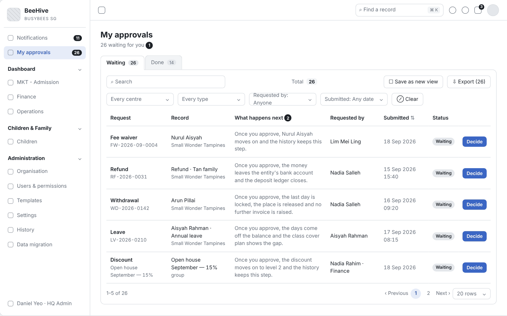

# 2.8 Change Request with Second Approval

| Item | Value |
|---|---|
| Project | Busy Bees Asia SMS |
| Module | Administration — My approvals |
| Feature | BBA-52 Change request with second approval |
| Document code | FRD-2.8_Change_Request_Second_Approval |
| Sprint | 4 |
| Version | 0.1 |
| Status | DRAFT FOR CONFIRMATION |
| Date | 10/11/2026 |
| Prepared by | Business Analysis |
| Reviewed by | HaiNguyen |
| Approved by | HaiNguyen |

## 1. Document control

| Version | Date | Author | Summary of changes | Approved |
|---|---|---|---|---|
| 0.1 | 10/11/2026 | Business Analysis | BBA-52 split out of FRD 2.8 CRM Administration v0.3 into its own FRD. English version of the reviewed Vietnamese document. | HaiNguyen |

**Readiness:** The user story, requirements, rules, checks, data, acceptance criteria and wireframe for BBA-52 are written.

## 2. Purpose and background

A change request (discount, refund, withdrawal…) goes to the level 1 approver and then, where needed, to the level 2 approver, following the approval route and the amount threshold. Every request waiting for a user sits in one My approvals screen, and every decision records who made it, when and why.

## 3. Scope

| In scope | Out of scope |
|---|---|
| Sending each request to its approvers by route. Level 1 then level 2 approval by threshold. My approvals (Waiting / Done), the request detail page, Approve / Reject with a reason. The person who approved level 1 cannot also approve level 2. HQ Admin can decide on behalf of the owning role. Notifications, approval history, change log. | Setting up approval routes (FRD 2.8 Approval Flows Configuration). The content of the Request, What approving changes and Rule warnings sections for each request type (FRD of the owning module). Approvals at the door (Daily operations). Centre Director App (Phase 2). |

## 4. Users, roles and access

| User | Scope | Rights / Responsibilities |
|---|---|---|
| HQ Admin (BBA IT) | Every country, brand and centre. | Full rights; manages approval routes and settings; can give extra permissions to staff of any centre; can decide an approval step on behalf of the role that owns it. |
| HQ Finance | Country / legal entity. | Reads routes and the change log; approves the finance routes (credit note, refund, notice waiver, discount level 2). |
| HQ Ops / Head of Brand, District Manager, Operations Manager | Brand, cluster and the centres they look after. | Changes the settings they are allowed to change; approves requests in approval routes. |
| Centre Director | Own centre. | Gives extra permissions to staff of the centre; changes centre-level settings they are allowed to change; approves the centre's requests. |
| Requester | As per the module that owns the request. | Submits the request; is told the outcome. |
| System | Whole system. | Sends requests to approvers by route, keeps history, sends notifications. |

**General rules:** only users with Administration rights can open the Administration screens; actions a user may not take are not shown; history can only be added to, never edited or deleted; standard lists offer search, filters, sorting, 20 / 50 / 100 rows per page and export of the filtered list.

## 5. Feature overview

| Module | Feature | Functions | User Story |
|---|---|---|---|
| My approvals | BBA-52 Request with second approval | Routing, level 1 / level 2 approval, My approvals, detail page, decline, notifications. | US-001 |

## 6. Requirements by user story

### 6.1 BBA-52: US-001 - Request with second approval

#### User Story

As an approver, I want requests to go through level 1 and then level 2 according to the route and the amount threshold, with a full history of each decision, so that large changes always have a second person approving them.

#### Functional Requirements

| FR ID | Requirement |
|---|---|
| FR-001 | When a request is submitted, the system finds the route for the request type and the centre's country and brand, and sends the request to the level 1 approver. |
| FR-002 | After level 1 approves, the request goes to level 2 when the route has a level 2 and (the route has no threshold, or the amount is above the threshold); level 2 only opens after level 1 has approved. |
| FR-003 | Every request waiting for the user is in the My approvals screen (main menu, with a counter of waiting requests): heading "n waiting for you", tabs Waiting (n) and Done (n); filters Centre, Type, Requested by, Submitted (the Done tab adds Status); columns Request (type, number), Record (child or item, centre), What happens next, Requested by, Submitted, Status, and the Decide action; oldest first by default. |
| FR-004 | The request detail page (Decide) shows: type · child or item, number · centre, status, "Level x of y" when the route has 2 levels, Requested by, time, the sentence "Once you approve, …"; and the sections Request (fields of the request type), What approving changes, Rule warnings, Supporting documents (status Verified / Pending review), Approval history (step, role, person, time, note). |
| FR-005 | The Your decision section has Comment (optional), Reason (required to reject), Approve and Reject. Approving records who decided and when; rejecting needs a reason; the requester is told the outcome. |
| FR-006 | Approval at the last level sends the request back to its owning module to be carried out; a rejection at any level ends the request. |
| FR-007 | Each decision is recorded in the request's approval history and in the change log as a "Workflow step" with From / To (for example "Pending · level 1 of 2" → "Pending · level 2 of 2") and "Approved by". |
| FR-008 | The person who decided one level cannot decide the next level of the same request: the detail page does not show Your decision to that person. |
| FR-009 | HQ Admin can decide a step on behalf of the role that owns it; the approval history records the person, their role and the line "This decision belongs to <role> · <scope>. Approval routes · <request type>." |
| FR-010 | The Done tab lists decided requests with the Outcome column (result, and "Reason given" when declined), Status Approved / Declined, and the Open action. |

#### Functional Flow - Main

1. The requester submits a request; the system finds the route and sends it to level 1 (FR-001).
2. The level 1 approver opens My approvals, chooses Decide, reviews the detail and chooses Approve (FR-003, FR-004, FR-005).
3. If the route needs level 2: the status becomes "Level 2 of 2" and the system sends it to level 2 (FR-002, FR-007).
4. The level 2 approver approves; the system carries out the original action, records history and tells the requester (FR-005, FR-006, FR-007).

#### Functional Flow - Alternative

1. The route does not need level 2 (no level 2, or the amount is not above the threshold): level 1 approval is the last step (FR-002).
2. Rejected at level 1 or level 2 with a reason: the request becomes Declined, moves to the Done tab and the requester is told (FR-005, FR-006, FR-010).
3. HQ Admin decides on behalf of the role that owns the step (FR-009).

#### Functional Flow - Exception

1. Reject without a reason: not allowed (VAL-001).
2. The level 2 approver opens a request that level 1 has not yet approved: no approve action (VAL-002).
3. The person who approved level 1 opens the request again at level 2: no Your decision section (FR-008; VAL-003).

#### Business Rules

| BR ID | Rule |
|---|---|
| BR-001 | All of a user's approval requests are in one My approvals screen. |
| BR-002 | Level 2 only starts after level 1 has approved. |
| BR-003 | Rejecting needs a reason; every decision records who decided and when; the requester is told. |
| BR-004 | The two levels of the same request are decided by two different people. |

#### Validation Rules

| VAL ID | Condition | System response |
|---|---|---|
| VAL-001 | Reject without a reason. | Not allowed; shows "Enter a reason. The requester sees it in the notification." |
| VAL-002 | The earlier level has not approved yet. | Approve / Reject are not shown for the later level. |
| VAL-003 | The user has already decided level 1 of the request. | Your decision is not shown at level 2; the approval history shows the step already decided. |

#### UI Reference

| Screen / Version | Reference / Link |
|---|---|
| SCR-03 - My approvals | Wireframe: `Diagram/Wireframe/approvals-sprint4.html#scr-03` |
| SCR-06 - Approval detail | Wireframe: `Diagram/Wireframe/approvals-sprint4.html#scr-06` |

#### UI Components / Field Specification

| Field / Control | Type | Required | Default / State | Check | Behaviour |
|---|---|---|---|---|---|
| My approvals (counter) | Menu | Yes | Number of waiting requests | — | Opens SCR-03. |
| Waiting (n) / Done (n) tabs | Tabs | Yes | Waiting | — | FR-003; FR-010. |
| Filters Centre, Type, Requested by, Submitted (Done: Status) | Filter | No | All | — | FR-003. |
| Request table | Table | Yes | Oldest first | — | SCR-03: Request, Record, What happens next / Outcome, Requested by, Submitted, Status, Decide / Open. |
| Level x of y label | Display | When the route has 2 levels | Level waiting | — | SCR-06. |
| Sections Request, What approving changes, Rule warnings, Supporting documents, Approval history | Section | Yes | By request type | — | FR-004. |
| Comment | Text box | No | Empty | — | Saved with the decision. |
| Reason (required to reject) | Text box | Yes when rejecting | Empty | VAL-001. | — |
| Approve | Button | Approver of the current level, HQ Admin | Shown at the level waiting | VAL-002; VAL-003. | Records the approval. |
| Reject | Button | Approver of the current level, HQ Admin | Shown at the level waiting | VAL-001. | Records the rejection; status Declined. |

#### Data and Audit

| ID | Requirement |
|---|---|
| DATA-001 | Each approval step keeps the request, level (x of y), owning role, the person who decided and their role, outcome, comment, reason, time and the route used. |

#### Acceptance Criteria

| AC ID | Given | When | Then | Linked Rule |
|---|---|---|---|---|
| AC-001 | the discount route is Centre Director then Finance | a discount request is submitted at Centre A | the request goes to the Centre Director first and only goes to Finance after level 1 approves | FR-001; FR-002; BR-002 |
| AC-002 | the credit note route has a threshold of SGD 1,000 | a credit note of SGD 600 is approved at level 1 | the request ends at level 1 and does not go to level 2 | FR-002 |
| AC-003 | a request in My approvals | the approver rejects without a reason | the system does not allow it | FR-005; BR-003; VAL-001 |
| AC-004 | the Centre Director has 4 waiting requests of 3 types | the Centre Director opens My approvals and filters by type Leave | only leave requests are shown, oldest first | FR-003; BR-001 |
| AC-005 | a discount request has passed level 1 | the level 2 approver approves | the request becomes Approved, the discount is applied, the requester is told, and history records 2 steps | FR-005; FR-006; FR-007; DATA-001 |
| AC-006 | a request is waiting at level 1 | the level 2 approver opens it | there is no Approve / Reject | VAL-002 |
| AC-007 | withdrawal request WD-2026-0142 is waiting | the approver chooses Decide | the detail page has Request, What approving changes, Rule warnings, Supporting documents, Approval history and Your decision | FR-004 |
| AC-008 | discount "Open house September — 15%" is waiting at "Level 1 of 2" | user A approves level 1 and opens the request again | the label shows "Level 2 of 2", the approval history shows A's level 1 step, and there is no Your decision for A | FR-007; FR-008; BR-004; VAL-003 |
| AC-009 | a discount request is waiting for the Centre Director | HQ Admin approves level 1 | the approval history records HQ Admin, the role HQ Admin and "This decision belongs to the Centre Director · group. Approval routes · Discount." | FR-009 |
| AC-010 | leave request LV-2026-0194 was declined with a reason | the approver opens the Done tab | the row shows Status Declined, the Outcome and "Reason given" | FR-010 |

#### Dependencies

The module that owns each request type (content of the Request, What approving changes and Rule warnings sections); notification service.

## 7. Open questions

| Question ID | Decision needed | Decision owner | Priority | BBA decision |
|---|---|---|---|---|
| OQ-SEC-01 | The prototype does not let the person who approved level 1 also approve level 2 (FR-008, BR-004). Does BBA confirm this rule, even when the person holds both roles? | Business Owner | High | |

## 8. Appendix

### Appendix A. Glossary

| Term | Meaning in this FRD |
|---|---|
| My approvals | The screen holding every request waiting for the user's decision (Waiting tab) and those already decided (Done tab). |
| Declined | Status of a request that was rejected. |
| Approval route | The set-up of who approves a request type by country and brand: level 1, level 2 and the amount threshold. |
