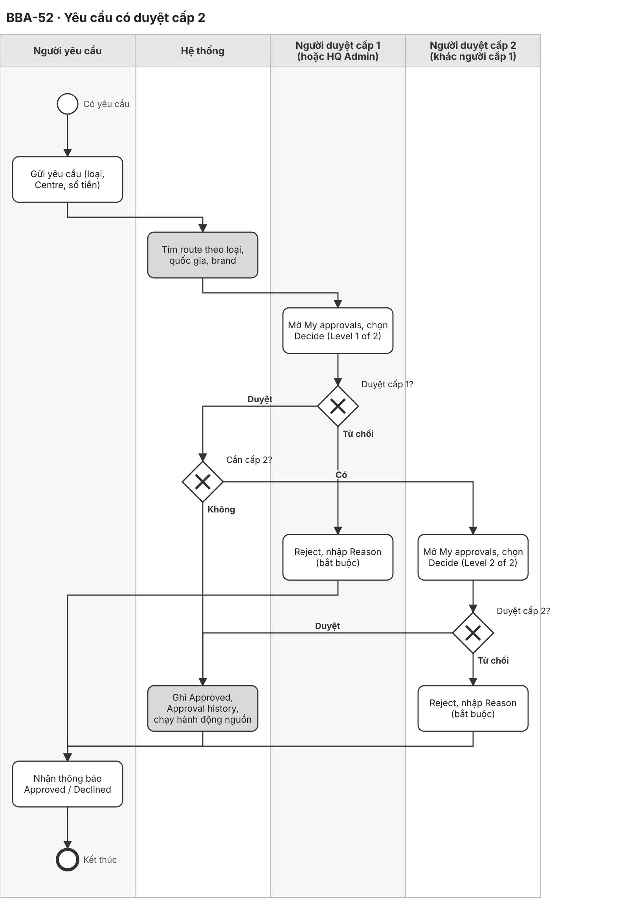
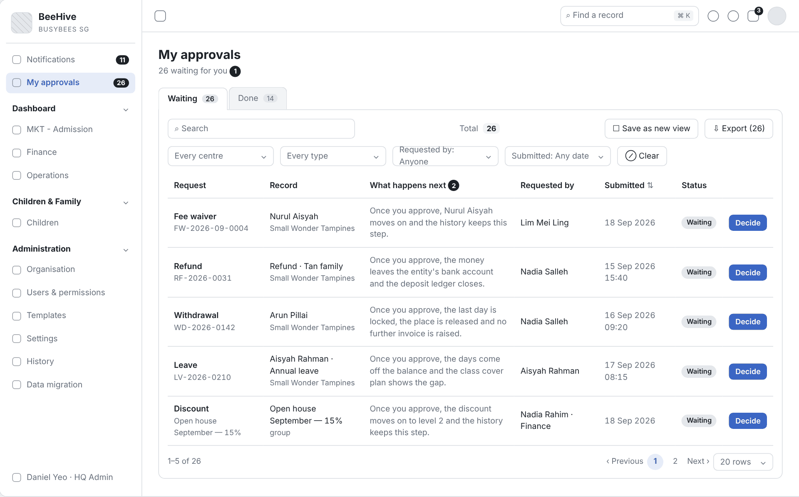
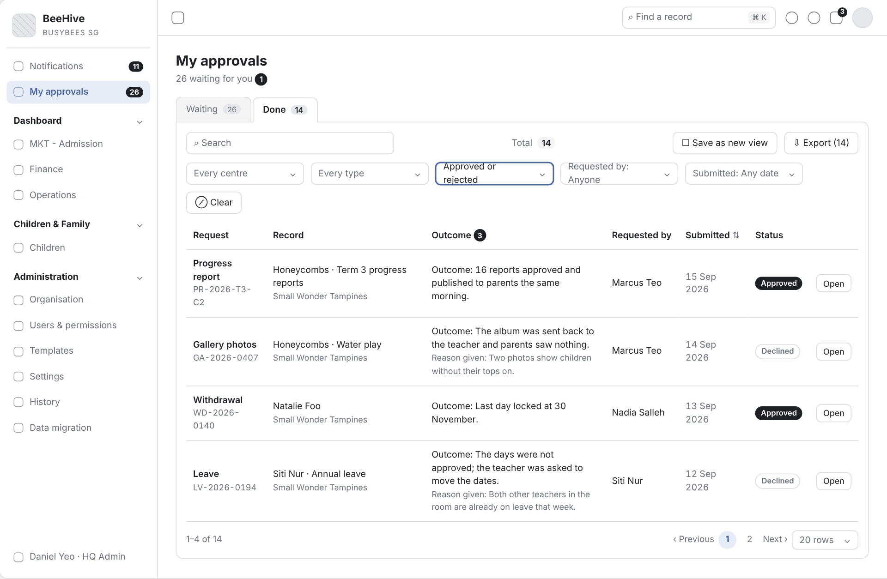
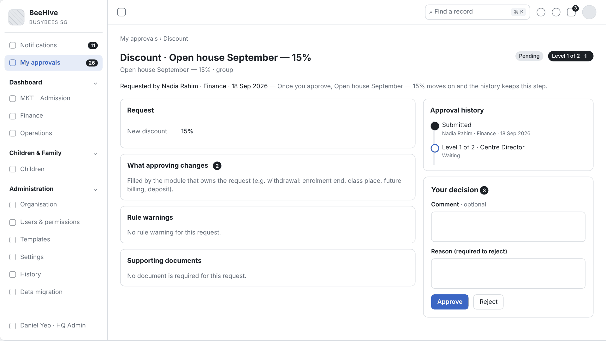
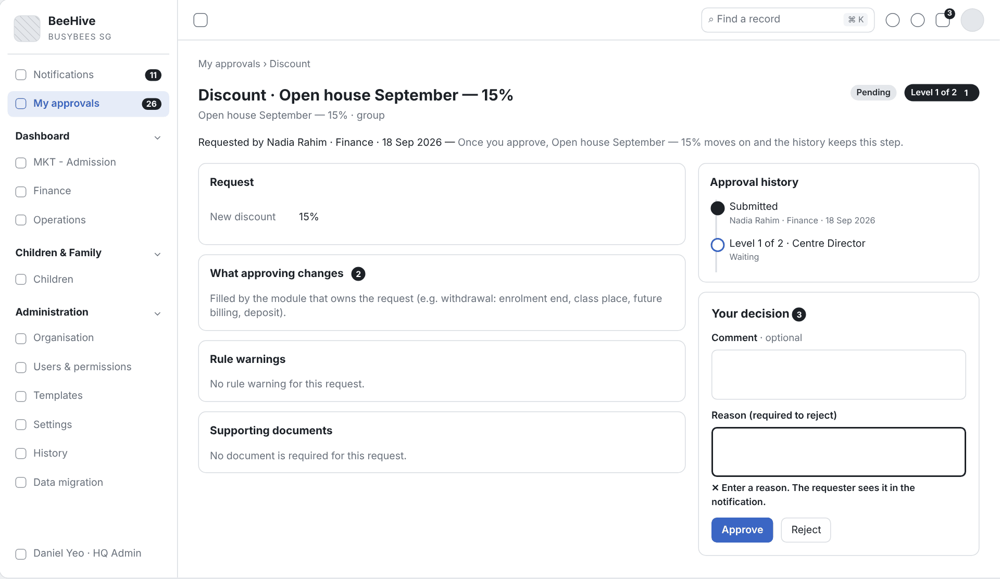
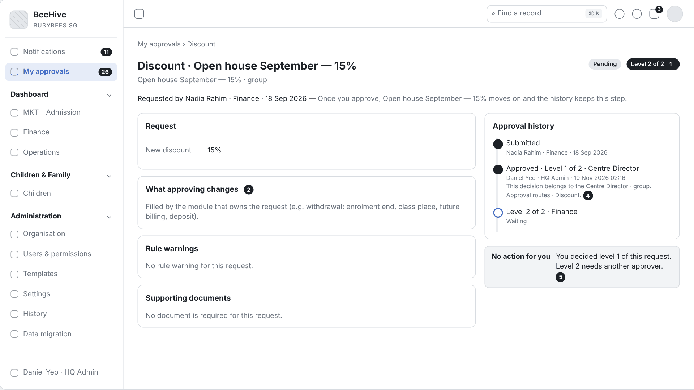

# 2.8 Change Request with Second Approval (Tiếng Việt)

| Thuộc tính | Giá trị |
|---|---|
| Dự án | Busy Bees Asia SMS |
| Module | Administration — My approvals |
| Tính năng | BBA-52 Change request with second approval |
| Mã tài liệu | FRD-2.8_Change_Request_Second_Approval |
| Sprint | 4 |
| Phiên bản | 0.1 |
| Trạng thái | BẢN NHÁP CHỜ XÁC NHẬN |
| Ngày | 10/11/2026 |
| Người soạn | Business Analysis |
| Người review | HaiNguyen |
| Người duyệt | HaiNguyen |

## 1. Kiểm soát tài liệu

| Phiên bản | Ngày | Tác giả | Tóm tắt thay đổi | Duyệt |
|---|---|---|---|---|
| 0.1 | 10/11/2026 | Business Analysis | Tách BBA-52 từ FRD 2.8 CRM Administration v0.3 thành FRD riêng; nội dung giữ nguyên, mã đánh lại từ 001 (đối chiếu mã ở Phụ lục cuối). | HaiNguyen |

**Mức sẵn sàng:** Đã đặc tả đủ User Story, FR, quy tắc, kiểm tra, dữ liệu, tiêu chí nghiệm thu, sơ đồ BPMN và wireframe của BBA-52. Còn 2 câu hỏi mở ở mục 7.

## 2. Mục đích và bối cảnh

Yêu cầu thay đổi (giảm giá, hoàn tiền, thôi học…) đi qua người duyệt cấp 1 rồi cấp 2 theo route và ngưỡng tiền; mọi yêu cầu chờ người dùng nằm trong một màn My approvals; mỗi quyết định có người, thời điểm, lý do và được ghi lịch sử.

| Ticket | Tên |
|---|---|
| BBA-52 | Change request with second approval |

**Quy trình và tham chiếu SRS:** SRS SMS General Requirements v0.1 — §3.3 Approvals, §4.2 Records, BR-GEN-007, BR-GEN-008, AC-GEN-008 · SRS SMS Administration v0.1 — §4 mục 2.4, 5.1 Change log, BR-ADM-018, BR-ADM-019, AC-ADM-009 · SRS Fees & Payments — BR-FEE-050, BR-FEE-051 · Prototype: https://bba-sms-crm.lovable.app/approvals · Wireframe: `Diagram/Wireframe/approvals-sprint4.html#scr-03`, `#scr-06`.

## 3. Phạm vi và ranh giới phase

| Trong phạm vi | Ngoài phạm vi |
|---|---|
| Định tuyến yêu cầu theo route. Duyệt cấp 1 rồi cấp 2 theo ngưỡng. My approvals (Waiting / Done), trang chi tiết duyệt, Approve / Reject có lý do. Người đã duyệt cấp 1 không duyệt cấp 2. HQ Admin quyết thay. Thông báo, Approval history, change log. | Cấu hình route (FRD 2.8 Approval Flows Configuration). Nội dung khối Request, What approving changes, Rule warnings của từng loại yêu cầu (FRD module sở hữu). Duyệt tại cửa (Daily operations). Centre Director App (Phase 2). |

## 4. Tác nhân, vai trò và quyền truy cập

| Tác nhân | Phạm vi | Quyền / Trách nhiệm |
|---|---|---|
| HQ Admin (BBA IT) | Mọi Country, Brand, Centre. | Mọi quyền; quản lý approval routes, settings; giao extra permission cho nhân viên mọi Centre; quyết định thay vai trò sở hữu một bước duyệt (BR-ADM-001; SRS ADM §2; Prototype). |
| HQ Finance | Country / legal entity. | Đọc route và change log; là người duyệt các route tài chính (credit note, refund, notice waiver, discount cấp 2) (SRS ADM §2; BR-ADM-022, BR-ADM-023). |
| HQ Ops / Head of Brand, District Manager, Operations Manager | Brand, cluster, các Centre phụ trách. | Đổi thiết lập được cấp quyền; là người duyệt trong route (SRS ADM §2). |
| Centre Director | Centre. | Giao quyền bổ sung cho nhân viên Centre; đổi thiết lập cấp Centre được cấp quyền; duyệt yêu cầu của Centre (SRS ADM §2; SRS GEN §3.2). |
| Người yêu cầu | Theo module sở hữu yêu cầu. | Gửi yêu cầu; nhận thông báo kết quả (SRS GEN §3.3). |
| System | Toàn hệ thống. | Định tuyến yêu cầu theo route, tính tác động, tự hết hạn quyền, ghi lịch sử, gửi thông báo. |

Quy tắc chung: chỉ người dùng có quyền Administration mở được màn Administration (BR-ADM-004); điều không được làm thì không hiển thị (BR-GEN-004); lịch sử chỉ thêm, không sửa, không xoá (BR-ADM-048); danh sách chuẩn: tìm kiếm, lọc, sắp xếp, phân trang 20 / 50 / 100, xuất theo bộ lọc (SRS GEN §4.1).

## 5. Tổng quan tính năng và phân rã chức năng

| Module | Tính năng | Chức năng | User Story |
|---|---|---|---|
| My approvals | BBA-52 Yêu cầu có duyệt cấp 2 | Định tuyến, duyệt cấp 1 / cấp 2, My approvals, trang chi tiết, từ chối, thông báo. | US-001 |

| Mã màn | Tên màn | Ảnh wireframe |
|---|---|---|
| SCR-03 | My approvals | `Diagram/Wireframe/png/SCR-03-my-approvals*.png` |
| SCR-06 | Approval detail | `Diagram/Wireframe/png/SCR-06-approval-detail*.png` |

## 6. Yêu cầu chức năng theo User Story

### 6.1 BBA-52: US-001 - Yêu cầu có duyệt cấp 2

#### User Story

Là người duyệt, tôi muốn yêu cầu đi qua cấp 1 rồi cấp 2 theo route và ngưỡng tiền, có đủ lịch sử từng quyết định, để các thay đổi lớn luôn có người thứ hai duyệt.

#### Process Diagram (Sơ đồ BPMN)

#### Functional Requirements (Yêu cầu chức năng)

| FR ID | Yêu cầu chức năng |
|---|---|
| FR-001 | Khi có yêu cầu, hệ thống tìm route theo loại yêu cầu, quốc gia, brand của Centre và gửi tới người duyệt cấp 1 (SRS GEN §3.3; BR-ADM-018). |
| FR-002 | Sau khi cấp 1 duyệt, yêu cầu đi tới cấp 2 khi route có cấp 2 và (route không có ngưỡng, hoặc số tiền vượt ngưỡng); cấp 2 chỉ mở sau khi cấp 1 duyệt (BR-ADM-019; AC-ADM-009; AS-SEC-01). |
| FR-003 | Mọi yêu cầu chờ người dùng nằm trong màn My approvals (menu chính, badge số yêu cầu chờ): tiêu đề "n waiting for you", tab Waiting (n) và Done (n); lọc Centre, Type, Requested by, Submitted (tab Done thêm Status); cột Request (loại, số), Record (đối tượng, Centre), What happens next, Requested by, Submitted, Status, thao tác Decide; mặc định cũ nhất trước (SRS GEN §3.3; BR-FEE-050; Prototype). |
| FR-004 | Trang chi tiết yêu cầu (Decide) hiển thị: loại · đối tượng, số · Centre, trạng thái, "Level x of y" khi route có 2 cấp, Requested by, thời điểm, câu "Once you approve, …"; các khối Request (trường của loại yêu cầu), What approving changes, Rule warnings, Supporting documents (trạng thái Verified / Pending review), Approval history (bước, vai trò, người, thời điểm, ghi chú) (SRS GEN §3.3; Prototype). |
| FR-005 | Khối Your decision có Comment (tuỳ chọn), Reason (bắt buộc khi từ chối), Approve, Reject. Duyệt ghi người quyết định và thời điểm; từ chối bắt buộc lý do; người yêu cầu nhận thông báo kết quả (SRS GEN §3.3; BR-GEN-007; Prototype). |
| FR-006 | Duyệt bước cuối chuyển yêu cầu về module sở hữu để thực hiện; từ chối ở bất kỳ cấp nào kết thúc yêu cầu (SRS GEN §3.3; AS-SEC-02). |
| FR-007 | Mỗi quyết định ghi vào Approval history của yêu cầu và change log với loại "Workflow step", From / To (vd. "Pending · level 1 of 2" → "Pending · level 2 of 2") và "Approved by" (SRS GEN §4.2; SRS ADM §4 mục 5.1; Prototype). |
| FR-008 | Người đã quyết định một cấp không quyết định cấp sau của cùng yêu cầu: trang chi tiết không hiển thị Your decision cho người đó (Prototype; OQ-SEC-02). |
| FR-009 | HQ Admin quyết định được thay vai trò sở hữu bước duyệt; Approval history ghi người quyết định, vai trò của họ và dòng "This decision belongs to <vai trò> · <phạm vi>. Approval routes · <loại yêu cầu>." (BR-ADM-001; Prototype). |
| FR-010 | Tab Done liệt kê yêu cầu đã quyết với cột Outcome (kết quả, "Reason given" khi từ chối) và Status Approved / Declined, thao tác Open (Prototype). |

#### Functional Flow - Main (Luồng chính)

1. Người yêu cầu gửi yêu cầu; hệ thống tìm route và gửi tới cấp 1 (FR-001).
2. Người duyệt cấp 1 mở My approvals, chọn Decide, xem chi tiết và chọn Approve (FR-003, FR-004, FR-005).
3. Route cần cấp 2: trạng thái thành "Level 2 of 2", hệ thống gửi tới cấp 2 (FR-002, FR-007).
4. Người duyệt cấp 2 duyệt; hệ thống chạy hành động nguồn, ghi lịch sử, thông báo người yêu cầu (FR-005, FR-006, FR-007).

#### Functional Flow - Alternative (Luồng thay thế)

1. Route không cần cấp 2 (không có cấp 2, hoặc số tiền không vượt ngưỡng): duyệt cấp 1 là bước cuối (FR-002).
2. Từ chối ở cấp 1 hoặc cấp 2 kèm lý do: yêu cầu thành Declined, chuyển sang tab Done, người yêu cầu nhận thông báo (FR-005, FR-006, FR-010).
3. HQ Admin quyết định thay vai trò sở hữu bước (FR-009).

#### Functional Flow - Exception (Luồng ngoại lệ)

1. Từ chối không lý do: không cho phép (VAL-001).
2. Người duyệt cấp 2 mở yêu cầu khi cấp 1 chưa duyệt: không có thao tác duyệt (VAL-002).
3. Người đã duyệt cấp 1 mở lại yêu cầu ở cấp 2: không có Your decision (FR-008; VAL-003).

#### Business Rules (Quy tắc nghiệp vụ)

| BR ID | Quy tắc |
|---|---|
| BR-001 | Mọi yêu cầu duyệt của người dùng nằm trong một màn My approvals (SRS GEN §3.3). |
| BR-002 | Cấp 2 chỉ bắt đầu sau khi cấp 1 duyệt (AC-ADM-009). |
| BR-003 | Từ chối bắt buộc lý do; mọi quyết định ghi người quyết định, thời điểm; người yêu cầu được thông báo (SRS GEN §3.3; BR-GEN-007). |
| BR-004 | Hai cấp của cùng một yêu cầu do hai người khác nhau quyết định (Prototype; OQ-SEC-02). |

#### Validation Rules (Quy tắc kiểm tra)

| VAL ID | Điều kiện | Phản hồi của hệ thống |
|---|---|---|
| VAL-001 | Từ chối không có lý do. | Không cho phép; hiển thị "Enter a reason. The requester sees it in the notification." (AC-GEN-008). |
| VAL-002 | Cấp trước chưa duyệt. | Không hiển thị Approve / Reject cho cấp sau. |
| VAL-003 | Người dùng đã quyết định cấp 1 của yêu cầu. | Không hiển thị Your decision ở cấp 2; Approval history hiển thị bước đã quyết. |

#### UI Reference (Tham chiếu giao diện)

| Mã màn hình / Phiên bản | Tham chiếu / Link |
|---|---|
| SCR-03 - My approvals | Prototype: https://bba-sms-crm.lovable.app/approvals · Wireframe: `Diagram/Wireframe/approvals-sprint4.html#scr-03` |
| SCR-06 - Approval detail | Prototype: https://bba-sms-crm.lovable.app/approvals (Decide) · Wireframe: `Diagram/Wireframe/approvals-sprint4.html#scr-06` |

#### UI Components / Field Specification (Thành phần giao diện)

| Trường / Điều khiển | Loại | Bắt buộc | Mặc định / Trạng thái | Kiểm tra | Hành vi |
|---|---|---|---|---|---|
| My approvals (badge) | Menu | Có | Số yêu cầu chờ | — | Mở SCR-03. |
| Tab Waiting (n) / Done (n) | Tabs | Có | Waiting | — | FR-003, FR-010. |
| Lọc Centre, Type, Requested by, Submitted (Done: Status) | Filter | Không | Tất cả | — | FR-003. |
| Bảng yêu cầu | Table | Có | Cũ nhất trước | — | SCR-03: Request, Record, What happens next / Outcome, Requested by, Submitted, Status, Decide / Open. |
| Badge Level x of y | Display | Khi route 2 cấp | Cấp đang chờ | — | SCR-06. |
| Khối Request, What approving changes, Rule warnings, Supporting documents, Approval history | Section | Có | Theo loại yêu cầu | — | FR-004. |
| Comment | Text area | Không | Trống | — | Lưu cùng quyết định. |
| Reason (required to reject) | Text area | Có khi Reject | Trống | VAL-001. | — |
| Approve | Action | Người duyệt cấp hiện tại, HQ Admin | Hiện ở cấp đang chờ | VAL-002, VAL-003. | Ghi duyệt. |
| Reject | Action | Người duyệt cấp hiện tại, HQ Admin | Hiện ở cấp đang chờ | VAL-001. | Ghi từ chối, trạng thái Declined. |

#### Data and Audit (Dữ liệu và audit)

| ID | Yêu cầu |
|---|---|
| DATA-001 | Mỗi bước duyệt lưu yêu cầu, cấp (x of y), vai trò sở hữu, người quyết định và vai trò của họ, kết quả, comment, lý do, thời điểm, route đã áp dụng. |

#### Acceptance Criteria (Tiêu chí nghiệm thu)

| AC ID | Given (Cho trước) | When (Khi) | Then (Thì) | Linked Rule |
|---|---|---|---|---|
| AC-001 | route discount là Centre Director rồi Finance | một yêu cầu giảm giá được gửi ở Centre A | yêu cầu tới Centre Director trước và chỉ tới Finance sau khi cấp 1 duyệt (AC-ADM-009) | FR-001; FR-002; BR-002 |
| AC-002 | route credit note có ngưỡng 1.000 SGD | credit note 600 SGD được cấp 1 duyệt | yêu cầu kết thúc ở cấp 1, không tới cấp 2 | FR-002 |
| AC-003 | một yêu cầu trong Approvals | người duyệt từ chối không lý do | hệ thống không cho phép (AC-GEN-008) | FR-005; BR-003; VAL-001 |
| AC-004 | Centre Director có 4 yêu cầu chờ ở 3 loại | Centre Director mở Approvals và lọc loại Leave | chỉ yêu cầu nghỉ hiển thị, cũ nhất trước | FR-003; BR-001 |
| AC-005 | yêu cầu giảm giá đã qua cấp 1 | người duyệt cấp 2 duyệt | yêu cầu thành Approved, giảm giá được áp, người yêu cầu nhận thông báo, lịch sử ghi 2 bước | FR-005; FR-006; FR-007; DATA-001 |
| AC-006 | yêu cầu chờ cấp 1 | người duyệt cấp 2 mở yêu cầu | không có Approve / Reject | VAL-002 |
| AC-007 | yêu cầu thôi học WD-2026-0142 chờ duyệt | người duyệt chọn Decide | trang chi tiết có Request, What approving changes, Rule warnings, Supporting documents, Approval history và Your decision | FR-004 |
| AC-008 | giảm giá "Open house September — 15%" chờ "Level 1 of 2" | người dùng A duyệt cấp 1 rồi mở lại yêu cầu | badge hiển thị "Level 2 of 2", Approval history có bước cấp 1 của A, không có Your decision cho A | FR-007; FR-008; BR-004; VAL-003 |
| AC-009 | yêu cầu giảm giá chờ Centre Director | HQ Admin duyệt cấp 1 | Approval history ghi HQ Admin, vai trò HQ Admin và "This decision belongs to the Centre Director · group. Approval routes · Discount." | FR-009 |
| AC-010 | đơn nghỉ LV-2026-0194 bị từ chối với lý do | người duyệt mở tab Done | dòng đơn có Status Declined, Outcome và "Reason given" | FR-010 |

#### Dependencies (Phụ thuộc)

FRD 2.8 Approval Flows Configuration (route); module sở hữu từng loại yêu cầu (nội dung khối Request, What approving changes, Rule warnings); dịch vụ notification; OQ-SEC-01, OQ-SEC-02.

## 7. Câu hỏi mở

| Mã câu hỏi | Quyết định cần có | Người quyết định | Ưu tiên | Quyết định của BBA |
|---|---|---|---|---|
| OQ-SEC-01 | BBA-52 "Change request with second approval" áp dụng cho loại yêu cầu nào: mọi route có cấp 2 (prototype có ví dụ định nghĩa giảm giá "Open house September — 15%" do Finance gửi, đi 2 cấp), hay cả thay đổi hồ sơ và thay đổi thiết lập? SRS và prototype không yêu cầu duyệt khi đổi thiết lập hoặc route (lưu là có hiệu lực). | Business Owner | Cao | |
| OQ-SEC-02 | Prototype không cho người đã duyệt cấp 1 duyệt tiếp cấp 2 (FR-008, BR-004). BBA xác nhận quy tắc này, kể cả khi người đó giữ cả hai vai trò? | Business Owner | Cao | |

### Giả định của BA (SRS chưa nêu — cần xác nhận cùng mục 7)

| Mã | Giả định | Dùng ở |
|---|---|---|
| AS-SEC-01 | Route có cấp 2 và không có ngưỡng thì mọi yêu cầu qua cấp 2; có ngưỡng thì chỉ yêu cầu vượt ngưỡng qua cấp 2 (đọc từ BR-ADM-019 và AC-ADM-009). | FR-002 |
| AS-SEC-02 | Từ chối ở cấp nào cũng kết thúc yêu cầu; không quay lại cấp trước. | FR-006 |

## 8. Phụ lục

### Phụ lục A. Thuật ngữ

| Thuật ngữ | Định nghĩa trong FRD này |
|---|---|
| My approvals | Màn chứa mọi yêu cầu chờ người dùng duyệt (tab Waiting) và đã quyết (tab Done); trước bản 0.3 gọi là Approvals inbox. |
| Declined | Trạng thái yêu cầu bị từ chối (nhãn trong prototype). |
| Approval route | Cấu hình ai duyệt một loại yêu cầu theo quốc gia, brand: cấp 1, cấp 2, ngưỡng tiền. |

### Phụ lục B. Đối chiếu mã với FRD 2.8 CRM Administration v0.3

| Loại | Số cũ (FRD 2.8 v0.3) → số mới |
|---|---|
| FR | 022 → 001, 023 → 002, 024 → 003, 025 → 004, 026 → 005, 027 → 006, 028 → 007, 038 → 008, 039 → 009, 040 → 010 |
| BR | 009 → 001, 010 → 002, 011 → 003, 014 → 004 |
| VAL | 006 → 001, 007 → 002, 011 → 003 |
| DATA | 004 → 001 |
| AC | 022 → 001, 023 → 002, 024 → 003, 025 → 004, 026 → 005, 027 → 006, 028 → 007, 041 → 008, 042 → 009, 043 → 010 |
| OQ | ADM 05 → OQ-SEC-01, ADM 09 → OQ-SEC-02 |
| AS | ADM 03 → AS-SEC-01, ADM 07 → AS-SEC-02 |
