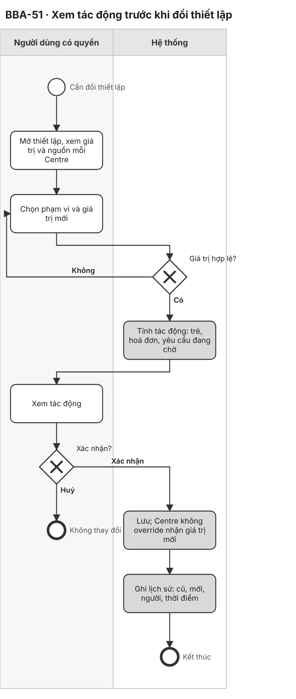
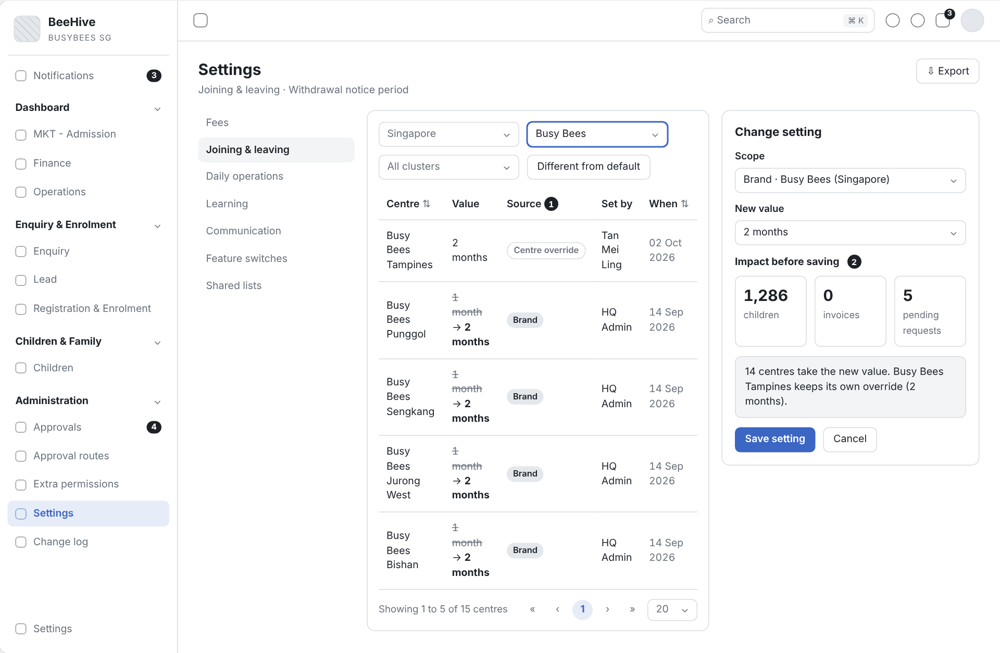
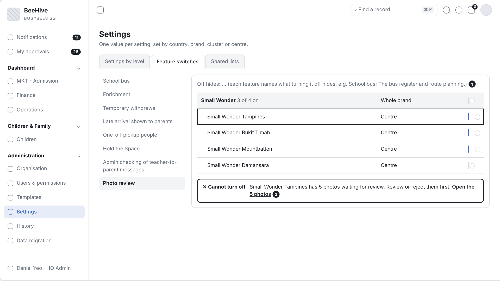

# 2.8 Impact Preview Before Change (Tiếng Việt)

| Thuộc tính | Giá trị |
|---|---|
| Dự án | Busy Bees Asia SMS |
| Module | Administration — Settings |
| Tính năng | BBA-51 Impact preview before a setting change |
| Mã tài liệu | FRD-2.8_Impact_Preview_Before_Change |
| Sprint | 4 |
| Phiên bản | 0.1 |
| Trạng thái | BẢN NHÁP CHỜ XÁC NHẬN |
| Ngày | 10/11/2026 |
| Người soạn | Business Analysis |
| Người review | HaiNguyen |
| Người duyệt | HaiNguyen |

## 1. Kiểm soát tài liệu

| Phiên bản | Ngày | Tác giả | Tóm tắt thay đổi | Duyệt |
|---|---|---|---|---|
| 0.1 | 10/11/2026 | Business Analysis | Tách BBA-51 từ FRD 2.8 CRM Administration v0.3 thành FRD riêng; nội dung giữ nguyên, mã đánh lại từ 001 (đối chiếu mã ở Phụ lục cuối). | HaiNguyen |

**Mức sẵn sàng:** Đã đặc tả đủ User Story, FR, quy tắc, kiểm tra, dữ liệu, tiêu chí nghiệm thu, sơ đồ BPMN và wireframe của BBA-51. Còn 2 câu hỏi mở ở mục 7.

## 2. Mục đích và bối cảnh

Trước khi đổi một thiết lập (vd. ngày đến hạn hoá đơn, thời hạn báo trước), người dùng thấy giá trị hiện tại của từng Centre và tác động của thay đổi — Centre nào đổi giá trị, bao nhiêu trẻ, hoá đơn, yêu cầu đang chờ bị ảnh hưởng — rồi mới xác nhận.

| Ticket | Tên |
|---|---|
| BBA-51 | Impact preview before a setting change |

**Quy trình và tham chiếu SRS:** SRS SMS Administration v0.1 — §3 P5, §4 mục 4.1 Settings by level, 4.2 Feature switches, BR-ADM-036 đến BR-ADM-042, AC-ADM-013 đến AC-ADM-015 · SRS SMS General Requirements v0.1 — §4.4 Settings · Prototype: https://bba-sms-crm.lovable.app/organisation/features · Wireframe: `Diagram/Wireframe/approvals-sprint4.html#scr-05`.

## 3. Phạm vi và ranh giới phase

| Trong phạm vi | Ngoài phạm vi |
|---|---|
| Danh sách thiết lập theo nhóm, giá trị từng Centre và nguồn, Set at, Mark as confirmed by BBA. Đổi thiết lập theo cấp (Applies to), kiểm tra giá trị, See the impact, Confirm. Override và gỡ override. Feature switches theo brand / Centre, chặn tắt khi còn việc mở. Lịch sử thay đổi. | Danh mục thiết lập của từng module (chỉ dẫn chiếu, BR-ADM-038 đến BR-ADM-041). Shared lists. Duyệt thay đổi thiết lập (OQ trong FRD 2.8 Change Request with Second Approval). |

## 4. Tác nhân, vai trò và quyền truy cập

| Tác nhân | Phạm vi | Quyền / Trách nhiệm |
|---|---|---|
| HQ Admin (BBA IT) | Mọi Country, Brand, Centre. | Mọi quyền; quản lý approval routes, settings; giao extra permission cho nhân viên mọi Centre; quyết định thay vai trò sở hữu một bước duyệt (BR-ADM-001; SRS ADM §2; Prototype). |
| HQ Ops / Head of Brand, District Manager, Operations Manager | Brand, cluster, các Centre phụ trách. | Đổi thiết lập được cấp quyền; là người duyệt trong route (SRS ADM §2). |
| Centre Director | Centre. | Giao quyền bổ sung cho nhân viên Centre; đổi thiết lập cấp Centre được cấp quyền; duyệt yêu cầu của Centre (SRS ADM §2; SRS GEN §3.2). |
| System | Toàn hệ thống. | Định tuyến yêu cầu theo route, tính tác động, tự hết hạn quyền, ghi lịch sử, gửi thông báo. |

Quy tắc chung: chỉ người dùng có quyền Administration mở được màn Administration (BR-ADM-004); điều không được làm thì không hiển thị (BR-GEN-004); lịch sử chỉ thêm, không sửa, không xoá (BR-ADM-048); danh sách chuẩn: tìm kiếm, lọc, sắp xếp, phân trang 20 / 50 / 100, xuất theo bộ lọc (SRS GEN §4.1).

## 5. Tổng quan tính năng và phân rã chức năng

| Module | Tính năng | Chức năng | User Story |
|---|---|---|---|
| Settings | BBA-51 Xem tác động trước khi đổi thiết lập | Giá trị theo Centre, đổi theo cấp, See the impact, override, Feature switches. | US-001 |

| Mã màn | Tên màn | Ảnh wireframe |
|---|---|---|
| SCR-05 | Setting impact preview | `Diagram/Wireframe/png/SCR-05-setting-impact-preview*.png` |

## 6. Yêu cầu chức năng theo User Story

### 6.1 BBA-51: US-001 - Xem tác động trước khi đổi thiết lập

#### User Story

Là HQ Admin, tôi muốn thấy giá trị hiện tại của từng Centre và tác động của thay đổi trước khi lưu để không đổi nhầm thiết lập đang ảnh hưởng nhiều trẻ, hoá đơn và yêu cầu.

#### Process Diagram (Sơ đồ BPMN)

#### Functional Requirements (Yêu cầu chức năng)

| FR ID | Yêu cầu chức năng |
|---|---|
| FR-001 | Thiết lập nhóm theo Fees, Joining & leaving, Daily operations, Learning, Communication; tìm theo tên thiết lập (SRS ADM §4 mục 4.1). |
| FR-002 | Một thiết lập hiển thị tên, đơn vị, "Set at" (các cấp được đặt và giá trị mặc định, vd. "Set at: Group · default 5") và bảng "Value at every centre": Centre, Value, Comes from (Default, Group, Country, Brand, Cluster, Centre), Set by (người, thời điểm), Override; lọc Centre theo country, brand, cluster, "Differs from default", "Not yet confirmed" (SRS ADM §4 mục 4.1; Prototype). |
| FR-003 | Người dùng có quyền chọn Change, chọn "Applies to" trong các cấp mà "Set at" cho phép (Group, Country, Brand, Cluster hoặc Centre) và giá trị mới; hệ thống kiểm tra giá trị (SRS ADM §4 mục 4.1 Change a setting; P5 bước 2–3; Prototype). |
| FR-004 | Chọn "See the impact" trước khi Confirm: hệ thống hiển thị số Centre bị ảnh hưởng và danh sách "Centre: giá trị cũ → giá trị mới" (8 dòng đầu, sau đó "and n more") (Prototype), cùng số trẻ, số hoá đơn, số yêu cầu đang chờ bị ảnh hưởng (SRS ADM §4 mục 4.1 See impact; BR-ADM-037; SRS GEN §4.4; OQ-IMP-01). |
| FR-005 | Khi xác nhận, các Centre không có override nhận giá trị mới; Centre có override giữ giá trị của mình (BR-ADM-036; AC-ADM-013). |
| FR-006 | Override cho một Centre thay giá trị kế thừa; gỡ override đưa Centre về giá trị kế thừa (SRS ADM §4 mục 4.1; AC-ADM-014). |
| FR-007 | Thiết lập có giá trị mặc định chưa xác nhận hiển thị "⚠" trong danh sách và "⚠ To confirm with BBA" trong chi tiết, kèm thao tác "Mark as confirmed by BBA" (SRS ADM §4 mục 4.1 Mark as confirmed; Prototype). |
| FR-008 | Tắt một tính năng (feature switch) bị chặn khi còn việc đang mở; hệ thống hiển thị link tới việc đó (BR-ADM-042; AC-ADM-015). |
| FR-009 | Mỗi thay đổi ghi lịch sử: thiết lập, giá trị cũ, giá trị mới, người đổi, thời điểm; xuất thiết lập theo Centre (BR-ADM-037; SRS ADM §4 mục 4.1). |
| FR-010 | Tab Feature switches: mỗi tính năng có mô tả "Off hides: …" và công tắc theo brand ("Whole brand", "x of y on") và theo từng Centre; tắt vẫn qua kiểm tra FR-008 (SRS ADM §4 mục 4.2; BR-ADM-042; Prototype). |

#### Functional Flow - Main (Luồng chính)

1. Người dùng mở một thiết lập; hệ thống hiển thị giá trị và nguồn của từng Centre (FR-002).
2. Người dùng chọn Change, chọn Applies to và giá trị mới (FR-003).
3. Người dùng chọn See the impact; hệ thống kiểm tra giá trị (VAL-001) và hiển thị tác động (FR-004).
4. Người dùng chọn Confirm; hệ thống lưu, Centre không override nhận giá trị mới, cột Comes from và Set by cập nhật, ghi lịch sử (FR-005, FR-009).

#### Functional Flow - Alternative (Luồng thay thế)

1. Người dùng huỷ ở bước xem tác động: không thay đổi gì.
2. Override hoặc gỡ override cho một Centre (FR-006).
3. Chọn "Mark as confirmed by BBA" cho thiết lập có dấu ⚠ (FR-007).
4. Bật / tắt tính năng cho cả brand hoặc từng Centre ở tab Feature switches (FR-010).

#### Functional Flow - Exception (Luồng ngoại lệ)

1. Giá trị không hợp lệ: không cho xem tác động và lưu (VAL-001).
2. Tắt tính năng còn việc mở: chặn và hiển thị link (FR-008; VAL-002).

#### Business Rules (Quy tắc nghiệp vụ)

| BR ID | Quy tắc |
|---|---|
| BR-001 | Thiết lập kế thừa từ country → brand → cluster → centre; cấp dưới override được; gỡ override khôi phục giá trị kế thừa (BR-ADM-036). |
| BR-002 | Mọi thay đổi thiết lập được kiểm tra, hiển thị tác động trước khi lưu và ghi lịch sử (BR-ADM-037). |
| BR-003 | Tắt tính năng bị chặn khi còn việc liên quan đang mở (BR-ADM-042). |

#### Validation Rules (Quy tắc kiểm tra)

| VAL ID | Điều kiện | Phản hồi của hệ thống |
|---|---|---|
| VAL-001 | Giá trị không đúng kiểu hoặc ngoài khoảng cho phép của thiết lập. | Không hiển thị tác động, không lưu; báo lỗi tại trường giá trị (quy tắc từng thiết lập chờ OQ-IMP-01). |
| VAL-002 | Tắt tính năng khi còn việc mở (vd. ảnh chờ duyệt, trẻ đang đi xe). | Chặn; hiển thị số việc và link tới việc đó. |

#### UI Reference (Tham chiếu giao diện)

| Mã màn hình / Phiên bản | Tham chiếu / Link |
|---|---|
| SCR-05 - Setting impact preview | Prototype: https://bba-sms-crm.lovable.app/organisation/features · Wireframe: `Diagram/Wireframe/approvals-sprint4.html#scr-05` |

#### UI Components / Field Specification (Thành phần giao diện)

| Trường / Điều khiển | Loại | Bắt buộc | Mặc định / Trạng thái | Kiểm tra | Hành vi |
|---|---|---|---|---|---|
| Tab Settings by level / Feature switches | Tabs | Có | Settings by level | — | Shared lists ngoài phạm vi. |
| Danh sách thiết lập | Navigation | Có | Thiết lập đầu | — | Nhóm FEES, JOINING & LEAVING, DAILY OPERATIONS, LEARNING, COMMUNICATION; dấu ⚠; bộ lọc Not yet confirmed. |
| Set at | Display | Có | Theo thiết lập | — | Các cấp được đặt và giá trị mặc định. |
| Mark as confirmed by BBA | Action | Theo quyền | Chỉ thiết lập có ⚠ | — | FR-007. |
| Bảng Value at every centre | Table | Có | Mọi Centre trong phạm vi | — | Centre, Value, Comes from, Set by, Override. |
| Applies to | Selector | Có | Cấp cao nhất trong Set at | — | Group / Country / Brand / Cluster / Centre. |
| Value | Input theo kiểu thiết lập | Có | Giá trị hiện tại | VAL-001. | — |
| See the impact | Action | Có | — | VAL-001. | Hiển thị tác động (FR-004). |
| Tác động | Panel | Có | Sau See the impact | — | "n centres affected", danh sách Centre cũ → mới; số trẻ, hoá đơn, yêu cầu đang chờ. |
| Confirm | Action | Có | Bật sau See the impact | — | Lưu. |
| Công tắc tính năng | Switch | Có | Theo dữ liệu | VAL-002. | Theo brand và từng Centre (FR-010). |

#### Data and Audit (Dữ liệu và audit)

| ID | Yêu cầu |
|---|---|
| DATA-001 | Mỗi thay đổi thiết lập lưu thiết lập, phạm vi, giá trị cũ, giá trị mới, tác động đã hiển thị, người đổi, thời điểm. |

#### Acceptance Criteria (Tiêu chí nghiệm thu)

| AC ID | Given (Cho trước) | When (Khi) | Then (Thì) | Linked Rule |
|---|---|---|---|---|
| AC-001 | thời hạn báo trước của brand là 1 tháng, Centre A không override | HQ Admin đổi giá trị brand thành 2 tháng | Centre A hiển thị 2 tháng, nguồn Brand; Centre có override giữ giá trị của mình (AC-ADM-013) | FR-005; BR-001 |
| AC-002 | Centre A override giờ cut-off đi trễ thành 9:30 | HQ Admin gỡ override | Centre A hiển thị lại giá trị brand và thay đổi được ghi lịch sử (AC-ADM-014) | FR-006; FR-009 |
| AC-003 | Centre A có 5 ảnh chờ duyệt | HQ Admin tắt Photo review cho Centre A | hệ thống chặn và link tới 5 ảnh (AC-ADM-015) | FR-008; BR-003; VAL-002 |
| AC-004 | đổi thời hạn báo trước của brand Busy Bees | HQ Admin chọn giá trị mới | trước khi lưu hệ thống hiển thị số trẻ, hoá đơn, yêu cầu đang chờ bị ảnh hưởng | FR-003; FR-004; BR-002 |
| AC-005 | thay đổi được lưu | HQ Admin mở lịch sử thiết lập | một dòng ghi giá trị cũ, mới, người đổi, thời điểm | DATA-001 |
| AC-006 | người dùng nhập giá trị không hợp lệ | người dùng chọn xem tác động | không hiển thị tác động và trường báo lỗi | VAL-001 |
| AC-007 | thiết lập "late cut-off" | người dùng mở thiết lập và lọc "different from default" | chỉ Centre có giá trị khác mặc định hiển thị, kèm nguồn, người đặt, thời điểm | FR-001; FR-002 |
| AC-008 | thiết lập "Notice period by month of last day" có giá trị mặc định chưa xác nhận | người dùng mở thiết lập và chọn "Mark as confirmed by BBA" | trước khi chọn, thiết lập hiển thị "⚠ To confirm with BBA"; sau khi chọn, dấu ⚠ mất và lịch sử ghi người xác nhận | FR-007; FR-009 |
| AC-009 | Invoice due day mặc định 5 ở 15 Centre, không Centre nào override | HQ Admin chọn Change, Applies to Group, Value 10, chọn See the impact | hiển thị "15 centres affected", 8 dòng "<Centre>: 5 → 10" và "and 7 more"; chọn Confirm thì 15 Centre có Value 10, Comes from Group | FR-004; FR-005 |
| AC-010 | School bus bật ở 3 trong 4 Centre Small Wonder | HQ Admin mở tab Feature switches | dòng brand hiển thị "Small Wonder 3 of 4 on", mô tả "Off hides: The bus register and route planning." | FR-010 |

#### Dependencies (Phụ thuộc)

Danh mục thiết lập của các module (BR-ADM-038 đến BR-ADM-041); dữ liệu trẻ, hoá đơn, yêu cầu để tính tác động; OQ-IMP-01.

## 7. Câu hỏi mở

| Mã câu hỏi | Quyết định cần có | Người quyết định | Ưu tiên | Quyết định của BBA |
|---|---|---|---|---|
| OQ-IMP-01 | Nội dung tác động: SRS yêu cầu số trẻ, hoá đơn, yêu cầu đang chờ (BR-ADM-037); prototype chỉ hiển thị số Centre và danh sách Centre cũ → mới. Hiển thị cả hai hay theo một nguồn? Quy tắc kiểm tra giá trị của từng thiết lập? | Business Owner | Cao | |
| OQ-IMP-02 | Quyền đổi từng thiết lập được cấp theo thiết lập hay theo nhóm (SRS: "change the settings they are granted")? | Business Owner | Trung bình | |

## 8. Phụ lục

### Phụ lục A. Thuật ngữ

| Thuật ngữ | Định nghĩa trong FRD này |
|---|---|
| Impact preview | Số Centre đổi giá trị (cũ → mới) và số trẻ, hoá đơn, yêu cầu đang chờ bị ảnh hưởng, hiển thị khi chọn See the impact, trước Confirm. |
| Override | Giá trị riêng của cấp dưới thay giá trị kế thừa. |
| To confirm with BBA | Dấu ⚠ trên route hoặc thiết lập có giá trị mặc định BBA chưa xác nhận. |

### Phụ lục B. Đối chiếu mã với FRD 2.8 CRM Administration v0.3

| Loại | Số cũ (FRD 2.8 v0.3) → số mới |
|---|---|
| FR | 013 → 001, 014 → 002, 015 → 003, 016 → 004, 017 → 005, 018 → 006, 019 → 007, 020 → 008, 021 → 009, 037 → 010 |
| BR | 006 → 001, 007 → 002, 008 → 003 |
| VAL | 004 → 001, 005 → 002 |
| DATA | 003 → 001 |
| AC | 014 → 001, 015 → 002, 016 → 003, 017 → 004, 018 → 005, 019 → 006, 020 → 007, 021 → 008, 039 → 009, 040 → 010 |
| OQ | ADM 07 → OQ-IMP-01, ADM 08 → OQ-IMP-02 |
