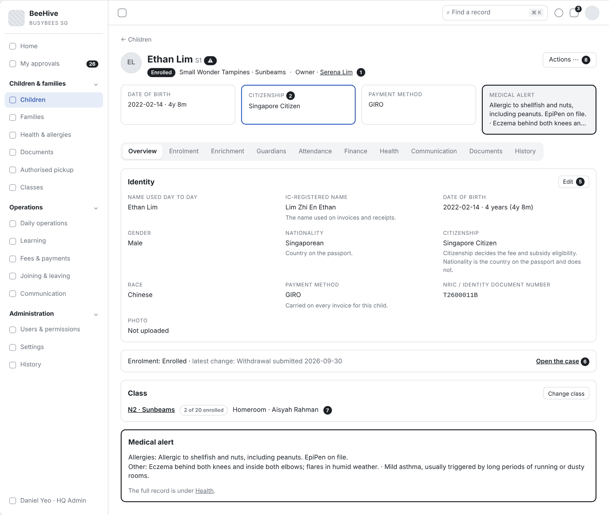
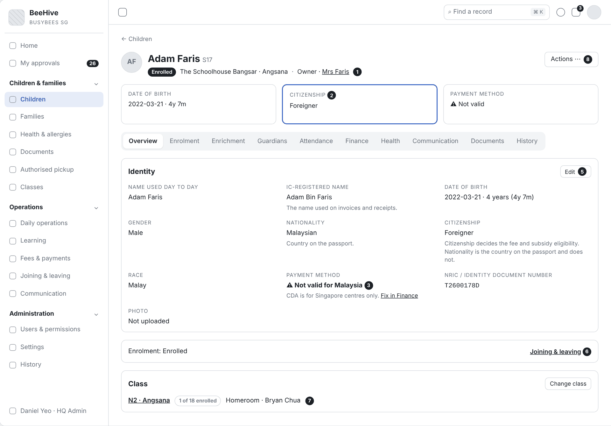
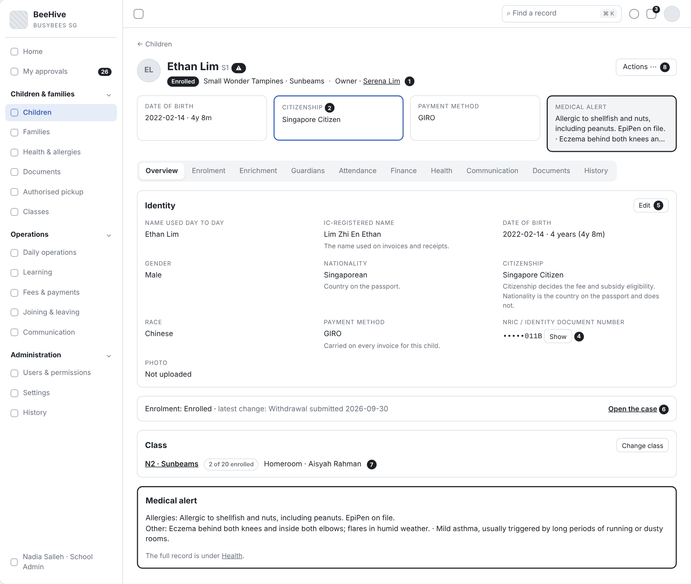
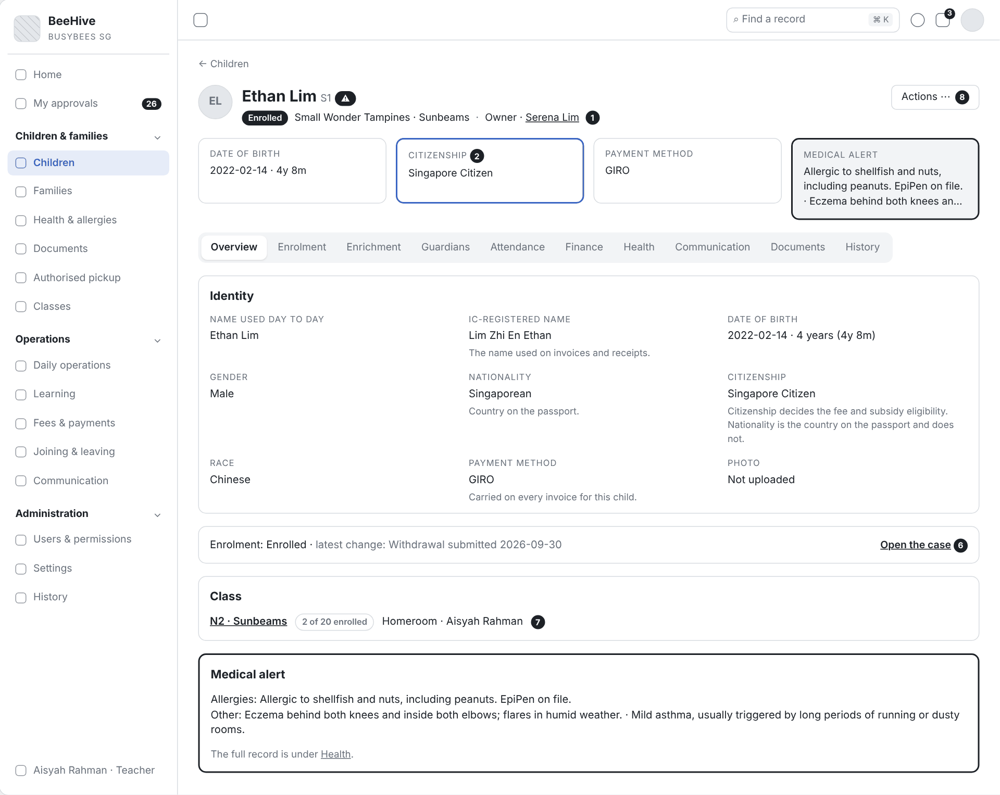
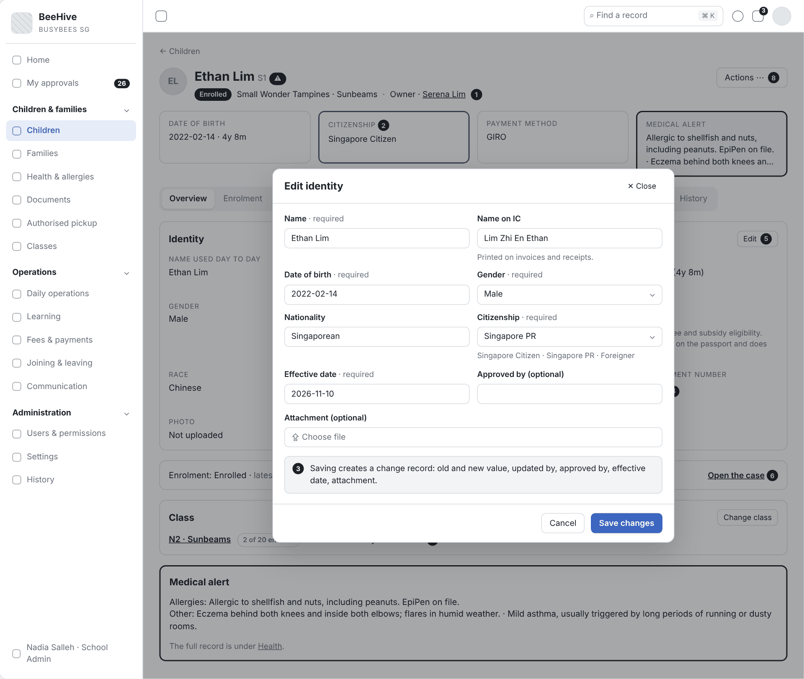
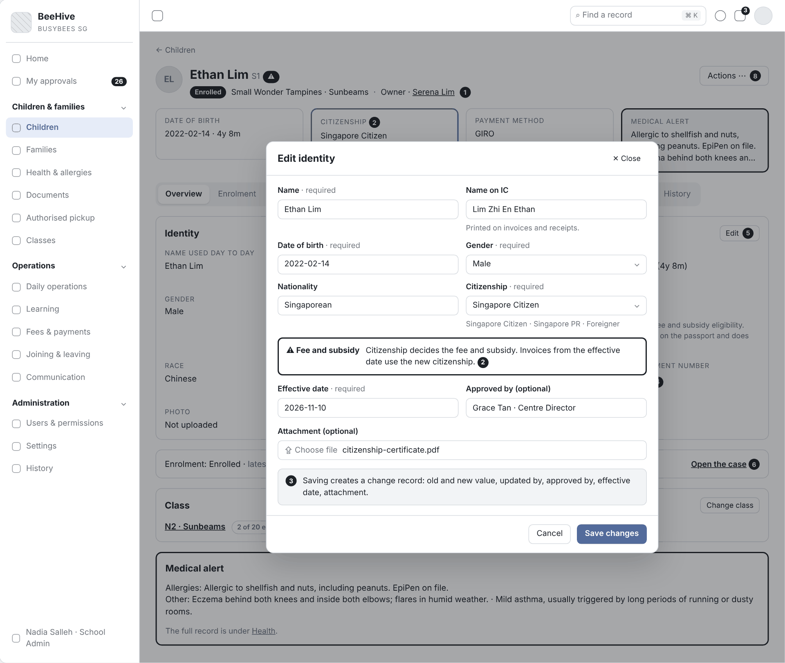
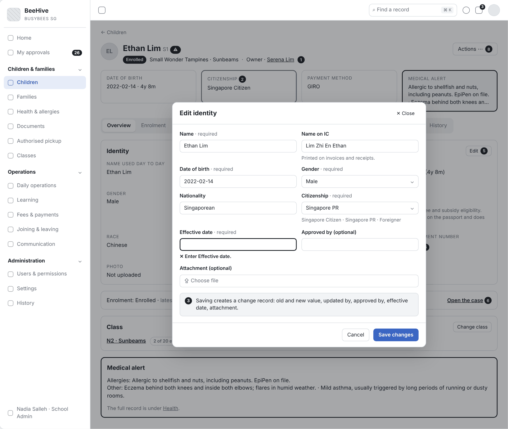
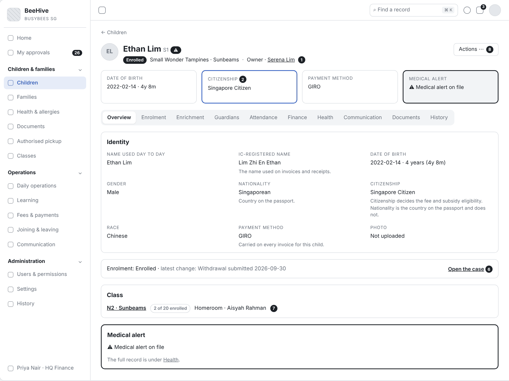
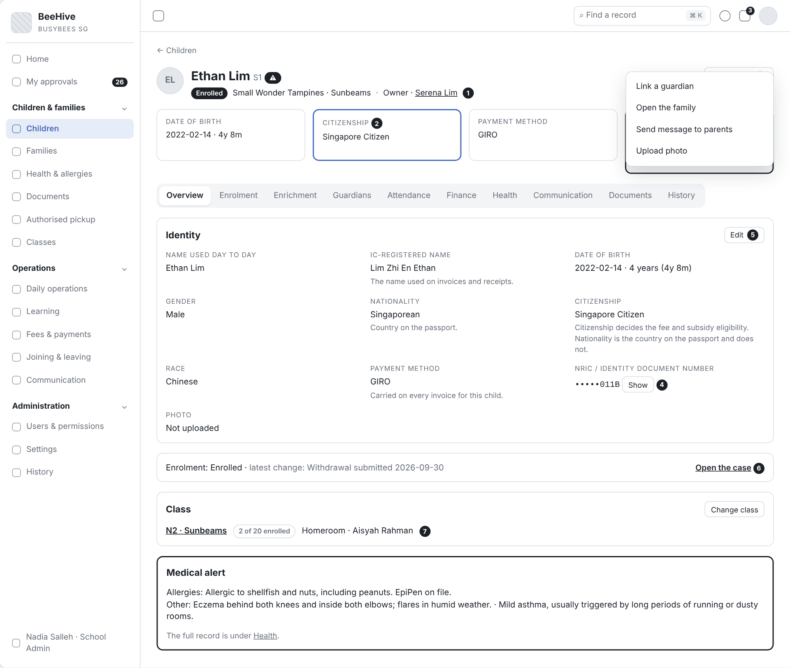
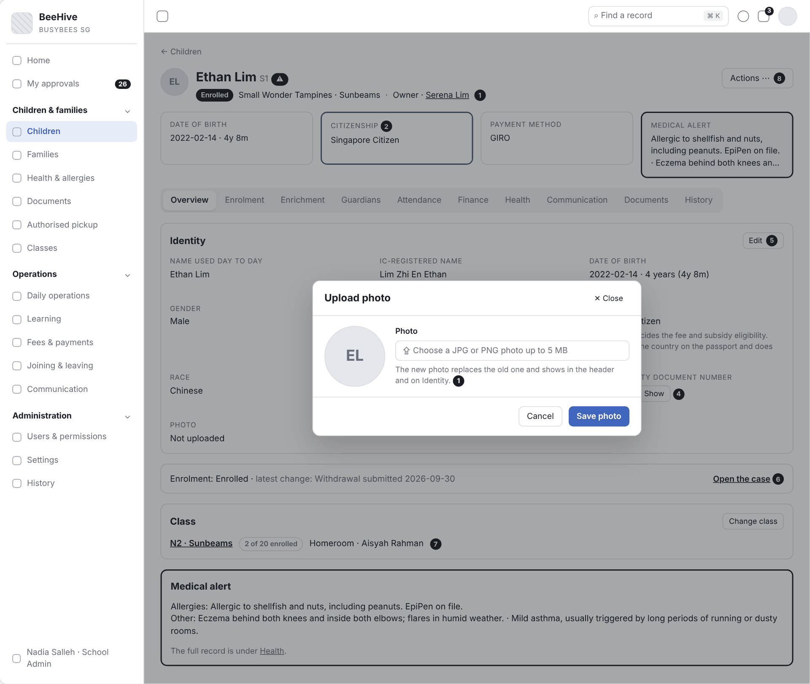

Functional Requirements Specification

# Child Record Overview

| Thuộc tính | Giá trị |
|---|---|
| Dự án | Busy Bees Asia SMS |
| Module | Children & Families — Child record |
| Tính năng | 3.1 Child record – Overview (identity, citizenship vs nationality, payment method) |
| Mã tài liệu | FRD-3.1_Child_Record_Overview |
| Sprint | 4 |
| Phiên bản | 0.1 |
| Trạng thái | BẢN NHÁP CHỜ XÁC NHẬN |
| Ngày | 10/11/2026 |
| Người soạn | Business Analysis |
| Người review | HaiNguyen |
| Người duyệt | HaiNguyen |

## 1. Kiểm soát tài liệu

| Phiên bản | Ngày | Tác giả | Tóm tắt thay đổi | Duyệt |
|---|---|---|---|---|
| 0.1 | 10/11/2026 | Business Analysis | Bản đầu: header và tab Overview của hồ sơ trẻ theo mô tả của khách, SRS SMS Children & Families v0.1 và prototype /records/child. Có danh mục tab (SRS ↔ prototype) và đề xuất trường bổ sung để khách chọn. Không vẽ sơ đồ theo yêu cầu. | HaiNguyen |

**Mức sẵn sàng:** Đã đặc tả header, 4 thẻ tóm tắt, khối Identity, che số giấy tờ theo vai trò, sửa Identity có change record, thẻ Enrolment / Class / Medical alert, menu Actions và tải ảnh.

## 2. Mục tiêu và bối cảnh

Hồ sơ trẻ là nơi Centre và HQ xem một bản ghi chính xác của từng trẻ.

## 3. Phạm vi và ranh giới

| Trong phạm vi | Ngoài phạm vi |
|---|---|
| Header hồ sơ trẻ: ảnh, tên, student ID, status, Centre · class, owner, menu Actions. 4 thẻ tóm tắt: ngày sinh và tuổi, citizenship, payment method, medical alert. Tab Overview: khối Identity (tên hằng ngày, tên trên IC, ngày sinh và tuổi, giới tính, nationality, citizenship, race, payment method, số giấy tờ định danh, ảnh), thẻ Enrolment, thẻ Class có homeroom teacher, thẻ Medical alert. Che số giấy tờ theo vai trò và ghi log khi xem đầy đủ. Sửa Identity có change record. Tải ảnh trẻ. | Nội dung chi tiết các tab khác (Enrolment, Enrichment, Guardians, Attendance, Finance, Health, Communication, Documents, History) |

## 4. Tác nhân, vai trò và quyền truy cập

| Tác nhân | Phạm vi | Quyền / Trách nhiệm |
|---|---|---|
| HQ Admin | Mọi Centre. | Xem, sửa Identity, tải ảnh; số giấy tờ hiển thị đầy đủ \ |
| HQ Enrolment | Mọi Centre. | Xem, sửa hồ sơ trẻ và gia đình |
| Centre Director | Centre của mình. | Xem, sửa hồ sơ trẻ; thấy chi tiết medical alert |
| School Admin | Centre của mình. | Xem, sửa hồ sơ trẻ; số giấy tờ ở dạng che |
| Teacher | Lớp của mình. | Chỉ xem; không thấy số giấy tờ; thấy chi tiết medical alert |
| HQ Finance | Mọi Centre. | Xem hồ sơ trẻ; dùng billing contact |
| System | Toàn hệ thống. | Tính tuổi, lấy status từ Joining & leaving, payment method từ Fees & Payments, medical alert từ Health; ghi change record và log xem dữ liệu được bảo vệ. |

Quy tắc chung: quyền gồm 3 lớp — quyền theo khu vực, quyền đặc biệt và protected field (Hidden / Masked / Read / Edit); điều không được làm thì không hiển thị ; dữ liệu cá nhân chỉ hiện cho người cần, truy cập dữ liệu được bảo vệ được ghi log).

## 5. Tổng quan tính năng và phân rã chức năng

| Khu vực | Chức năng | User Story |
|---|---|---|
| Header | Ảnh, tên, student ID, status, Centre · class, owner, 4 thẻ tóm tắt. | US-001 |
| Overview › Identity | Hiển thị định danh, citizenship và nationality, payment method. | US-002 |
| Overview › Identity | Che, ẩn, xem đầy đủ số giấy tờ theo vai trò. | US-003 |
| Overview › Identity › Edit | Sửa Identity có change record. | US-004 |
| Overview › Enrolment, Class, Medical alert | Thẻ trạng thái ghi danh, lớp và homeroom teacher, tóm tắt cảnh báo y tế. | US-005 |
| Header › Actions, ảnh | Menu Actions và tải ảnh trẻ. | US-006 |

## 6. Yêu cầu chức năng theo User Story

### 6.1 US-001 - Header hồ sơ trẻ

#### User Story

Là nhân viên Centre hoặc HQ, tôi muốn nhìn phần đầu hồ sơ là biết trẻ là ai, đang ở đâu, ai liên hệ chính, đóng phí thế nào và có cảnh báo y tế không, để xử lý việc nhanh mà không phải mở từng tab.

#### Functional Requirements (Yêu cầu chức năng)

| FR ID | Yêu cầu chức năng |
|---|---|
| FR-001 | Header hiển thị: liên kết quay lại "Children", ảnh trẻ (chưa có ảnh thì hiện chữ cái đầu của tên), tên dùng hằng ngày, student ID, badge status, "Centre · class", "Owner · <tên>" và nút Actions |
| FR-002 | Badge status lấy từ Joining & leaving: Enrolled, Temporary withdrawal, Withdrawn, Graduated; không có thao tác đổi status trên hồ sơ . |
| FR-003 | "Owner" là primary contact của trẻ; chọn tên mở tab Guardians . |
| FR-004 | Dưới header có 4 thẻ tóm tắt: Date of birth (ngày sinh · tuổi), Citizenship, Payment method, Medical alert. Thẻ Medical alert chỉ hiện khi trẻ có dị ứng hoặc bệnh, nối các tình trạng bằng " · " . |
| FR-005 | Thẻ Citizenship được nhấn mạnh (viền màu) vì quyết định giá học phí và trợ cấp . |
| FR-006 | Vai trò không được xem chi tiết y tế chỉ thấy biểu tượng cảnh báo trong header, không thấy nội dung thẻ Medical alert (BR-CHF-025). |
| FR-007 | Tabs dưới header theo thứ tự: Overview, Enrolment, Enrichment, Guardians, Attendance, Finance, Health, Communication, Documents, History; mở hồ sơ thì Overview được chọn (Prototype; khác danh mục tab SRS — xem Phụ lục A, OQ-OVW-12). |

#### Functional Flow - Main (Luồng chính)

1. Người dùng chọn một trẻ trong danh sách Children .
2. Hệ thống mở hồ sơ ở tab Overview với header và 4 thẻ tóm tắt (FR-001, FR-004, FR-007).
3. Người dùng chọn Owner để mở tab Guardians, hoặc chọn một tab khác (FR-003, FR-007).

#### Functional Flow - Alternative (Luồng thay thế)

1. Trẻ không có dị ứng / bệnh: không có thẻ Medical alert, 3 thẻ còn lại giữ nguyên (FR-004).
2. Trẻ chưa sinh: thẻ Date of birth hiện "Expected · <ngày dự sinh>", không có tuổi (BR-CHF-002; AS-OVW-02).

#### Functional Flow - Exception (Luồng ngoại lệ)

1. Người dùng mở hồ sơ trẻ ngoài phạm vi của mình (vd. Teacher mở trẻ lớp khác): hệ thống không mở hồ sơ (VAL-001).

#### Business Rules (Quy tắc nghiệp vụ)

| BR ID | Quy tắc |
|---|---|
| BR-001 | Status chỉ đổi qua Joining & leaving; hồ sơ trẻ chỉ hiển thị |
| BR-002 | HQ thấy trẻ mọi Centre; nhân viên Centre thấy trẻ Centre mình; Teacher thấy trẻ lớp mình |

#### Validation Rules (Quy tắc kiểm tra)

| VAL ID | Điều kiện | Phản hồi của hệ thống |
|---|---|---|
| VAL-001 | Hồ sơ ngoài phạm vi truy cập của người dùng. | Không hiển thị hồ sơ; trẻ không có trong danh sách và kết quả tìm kiếm của người dùng |

#### UI Reference (Tham chiếu giao diện)

| Mã màn hình / Phiên bản | Tham chiếu / Link |
|---|---|
| SCR-01 - Child record — Overview |  |

#### UI Components / Field Specification (Thành phần giao diện)

| Trường / Điều khiển | Loại | Bắt buộc | Mặc định / Trạng thái | Kiểm tra | Hành vi |
|---|---|---|---|---|---|
|  | Link | Có | — | — | Về danh sách, giữ bộ lọc trước đó. |
| Ảnh / chữ cái đầu | Avatar | Có | Chữ cái đầu khi chưa có ảnh | — | — |
| Tên · Student ID | Text | Có | — | — | Tên dùng hằng ngày; student ID dạng chữ nhỏ cạnh tên. |
| Status | Badge | Có | Theo Joining & leaving | — | Chỉ đọc (FR-002). |
| Centre · class | Text | Có | — | — | — |
| Owner · <tên> | Link | Không | Primary contact | — | Mở tab Guardians. |
| Actions | Menu | Theo quyền | — | — | US-006. |
| Thẻ Date of birth | Card | Có | "<yyyy-mm-dd> · <x>y <y>m" | — | FR-004. |
| Thẻ Citizenship | Card (nhấn mạnh) | Có | Giá trị citizenship | — | FR-005. |
| Thẻ Payment method | Card | Có | Giá trị payment method | — | FR-004. |
| Thẻ Medical alert | Card (cảnh báo) | Khi có | Ẩn khi không có | — | FR-004; FR-006. |
| Tabs | Tabs | Có | Overview | — | FR-007. |

#### Data and Audit (Dữ liệu và audit)

| ID | Yêu cầu |
|---|---|
| DATA-001 | Header đọc: student ID, tên dùng hằng ngày, ảnh, status (Joining & leaving), Centre, class, primary contact (Guardians), ngày sinh hoặc ngày dự sinh, citizenship, payment method (Fees & Payments), danh sách tình trạng y tế (Health). |

#### Acceptance Criteria (Tiêu chí nghiệm thu)

| AC ID | Given (Cho trước) | When (Khi) | Then (Thì) | Linked Rule |
|---|---|---|---|---|
| AC-001 | Ethan Lim (S1), Small Wonder Tampines, lớp Sunbeams, primary contact Serena Lim | HQ Admin mở hồ sơ | header hiển thị "Ethan Lim S1", badge status, "Small Wonder Tampines · Sunbeams", "Owner · Serena Lim", nút Actions; tab Overview được chọn | FR-001; FR-003; FR-007; DATA-001 |
| AC-002 | Ethan có status Enrolled | Centre Director mở hồ sơ | không có thao tác đổi status trên hồ sơ (AC-CHF-005) | FR-002; BR-001 |
| AC-003 | Ethan dị ứng hải sản và hạt, có chàm và hen nhẹ | HQ Admin mở hồ sơ | thẻ Medical alert hiển thị 3 tình trạng nối bằng " · "; thẻ Citizenship có viền nhấn mạnh | FR-004; FR-005 |
| AC-004 | Adam Faris không có dị ứng / bệnh | HQ Admin mở hồ sơ | header có 3 thẻ: Date of birth, Citizenship, Payment method | FR-004 |
| AC-005 | HQ Finance không được xem chi tiết y tế | HQ Finance mở hồ sơ Ethan | header có biểu tượng cảnh báo y tế, không có nội dung tình trạng | FR-006 |
| AC-006 | Teacher dạy lớp Sunbeams | Teacher tìm trẻ lớp Honeycombs | trẻ lớp Honeycombs không có trong kết quả và hồ sơ không mở | VAL-001; BR-002 |
| AC-007 | header hiển thị "Owner · Serena Lim" | người dùng chọn Serena Lim | tab Guardians mở | FR-003 |

#### Dependencies (Phụ thuộc)

- Joining & leaving (status);
- Guardians (primary contact);
- Fees & Payments (payment method);
- Health (tình trạng y tế);
- Roles & permissions (chi tiết y tế)

### 6.2 US-002 - Khối Identity: định danh, citizenship và payment method

#### User Story

Là School Admin, tôi muốn thấy tách bạch tên hằng ngày với tên trên IC và nationality với citizenship, cùng payment method của trẻ, để hoá đơn in đúng tên và học phí, trợ cấp tính đúng nhóm.

#### Functional Requirements (Yêu cầu chức năng)

| FR ID | Yêu cầu chức năng |
|---|---|
| FR-008 | Khối Identity của tab Overview hiển thị theo thứ tự: Name used day to day, IC-registered name, Date of birth, Gender, Nationality, Citizenship, Race, Payment method, NRIC / identity document number, Photo; nút Edit theo quyền |
| FR-009 | IC-registered name có ghi chú "The name used on invoices and receipts."; hoá đơn và biên lai của trẻ in tên này |
| FR-010 | Date of birth hiển thị "<yyyy-mm-dd> · <x> years (<x>y <y>m)"; tuổi tính tại ngày xem (Prototype). |
| FR-011 | Nationality có ghi chú "Country on the passport."; Citizenship có ghi chú "Citizenship decides the fee and subsidy eligibility. Nationality is the country on the passport and does not." |
| FR-012 | Citizenship nhận một giá trị trong danh mục theo quốc gia của Centre; Singapore: Singapore Citizen, Singapore PR, Foreigner |
| FR-013 | Payment method chỉ đọc, có ghi chú "Carried on every invoice for this child."; giá trị lấy từ Fees & Payments |
| FR-014 | Danh mục payment method theo quốc gia của Centre: GIRO và CDA chỉ cho Centre Singapore; Centre Singapore không hiện phương thức của Malaysia |
| FR-015 | Photo hiển thị ảnh hiện tại hoặc "Not uploaded" |
| FR-016 | Trường chưa có giá trị hiển thị "—" |

#### Functional Flow - Main (Luồng chính)

1. Người dùng mở tab Overview
2. Hệ thống hiển thị khối Identity với ghi chú cho IC-registered name, Nationality, Citizenship, Payment method (FR-008 đến FR-013).
3. Người dùng đọc citizenship để biết nhóm học phí và trợ cấp của trẻ (FR-011).

#### Functional Flow - Alternative (Luồng thay thế)

1. Trẻ chưa sinh: Date of birth hiện "Expected · <ngày dự sinh>"
2. Trẻ chưa có ảnh: Photo hiện "Not uploaded" (FR-015).

#### Functional Flow - Exception (Luồng ngoại lệ)

1. Centre Malaysia có payment method GIRO hoặc CDA trong dữ liệu (dữ liệu demo của prototype): hệ thống báo lỗi dữ liệu cho HQ Admin thay vì hiển thị (VAL-002).

#### Business Rules (Quy tắc nghiệp vụ)

| BR ID | Quy tắc |
|---|---|
| BR-003 | Citizenship quyết định giá học phí và quyền nhận trợ cấp; nationality không ảnh hưởng |
| BR-004 | GIRO, CDA và ECDA chỉ áp cho Singapore; DuitNow và e-invoice chỉ áp cho Malaysia |
| BR-005 | Hoá đơn và biên lai dùng IC-registered name |

#### Validation Rules (Quy tắc kiểm tra)

| VAL ID | Điều kiện | Phản hồi của hệ thống |
|---|---|---|
| VAL-002 | Payment method không thuộc danh mục của quốc gia Centre. | Payment method hiện "⚠ Not valid for <country>"; HQ Admin thấy liên kết tới tab Finance để sửa |

#### UI Reference (Tham chiếu giao diện)

| Mã màn hình / Phiên bản | Tham chiếu / Link |
|---|---|
| SCR-01 - Child record — Overview |  |

#### UI Components / Field Specification (Thành phần giao diện)

| Trường / Điều khiển | Loại | Bắt buộc | Mặc định / Trạng thái | Kiểm tra | Hành vi |
|---|---|---|---|---|---|
| Name used day to day | Text | Có | — | — | Tên trong lớp, app, header. |
| IC-registered name | Text | Theo OQ-OVW-04 | "—" | — | Ghi chú: "The name used on invoices and receipts." |
| Date of birth | Date + tuổi | Có | — | — | FR-010. |
| Gender | Text | Có | — | — | Female / Male. |
| Nationality | Text | Không | "—" | — | Ghi chú: "Country on the passport." |
| Citizenship | Text | Có | — | — | Ghi chú FR-011. |
| Race | Text | Không | "—" | — | Danh mục chờ OQ-OVW-07. |
| Payment method | Text (chỉ đọc) | Có | Theo Fees & Payments | VAL-002. | Ghi chú: "Carried on every invoice for this child." |
| NRIC / identity document number | Text (protected) | Không | Theo vai trò | — | US-003. |
| Photo | Text / thumbnail | Không | "Not uploaded" | — | US-006. |
| Edit | Action | Theo quyền | — | — | Mở SCR-02 (US-004). |

#### Data and Audit (Dữ liệu và audit)

| ID | Yêu cầu |
|---|---|
| DATA-002 | Child lưu: name, IC-registered name, date of birth hoặc expected birth date, gender, nationality, citizenship, race, identity document number (protected field), photo. Payment method đọc từ Fees & Payments, không lưu trùng ở hồ sơ trẻ (AS-OVW-03). |

#### Acceptance Criteria (Tiêu chí nghiệm thu)

| AC ID | Given (Cho trước) | When (Khi) | Then (Thì) | Linked Rule |
|---|---|---|---|---|
| AC-008 | Ethan: tên hằng ngày "Ethan Lim", tên trên IC "Lim Zhi En Ethan" | School Admin mở tab Overview | khối Identity hiển thị đủ 10 trường theo thứ tự FR-008; IC-registered name có ghi chú "The name used on invoices and receipts." | FR-008; FR-009; DATA-002 |
| AC-009 | hoá đơn tháng 11 của Ethan được tạo | Finance mở hoá đơn | tên trẻ trên hoá đơn là "Lim Zhi En Ethan" | FR-009; BR-005 |
| AC-010 | Ethan sinh 2022-02-14, ngày xem 10/11/2026 | người dùng mở Overview | Date of birth hiện "2022-02-14 · 4 years (4y 8m)" | FR-010 |
| AC-011 | Ethan có nationality Singaporean, citizenship Singapore Citizen | người dùng mở Overview | Nationality có ghi chú "Country on the passport."; Citizenship có ghi chú về học phí và trợ cấp | FR-011; BR-003 |
| AC-012 | trẻ thuộc Centre Singapore | người dùng mở danh sách chọn citizenship trong Edit identity | danh sách có đúng Singapore Citizen, Singapore PR, Foreigner | FR-012 |
| AC-013 | Ethan có tài khoản GIRO Active và "Pays by GIRO = Yes" | người dùng mở Overview | Payment method hiện "GIRO" với ghi chú "Carried on every invoice for this child." và không có thao tác sửa | FR-013; DATA-002 |
| AC-014 | Adam Faris thuộc Centre Malaysia có payment method CDA trong dữ liệu | HQ Admin mở Overview | Payment method hiện "⚠ Not valid for Malaysia" kèm liên kết tới tab Finance | FR-014; BR-004; VAL-002 |
| AC-015 | Ethan chưa có ảnh, chưa có race | người dùng mở Overview | Photo hiện "Not uploaded"; Race hiện "—" | FR-015; FR-016 |

#### Dependencies (Phụ thuộc)

Fees & Payments (payment method, giá theo citizenship); danh mục citizenship và race;

### 6.3 US-003 - Che số giấy tờ định danh theo vai trò

#### User Story

Là HQ Admin, tôi muốn số giấy tờ định danh của trẻ hiện đầy đủ, bị che hoặc bị ẩn tùy vai trò, và mọi lần xem đầy đủ đều được ghi lại, để bảo vệ dữ liệu cá nhân theo PDPA.

#### Functional Requirements (Yêu cầu chức năng)

| FR ID | Yêu cầu chức năng |
|---|---|
| FR-017 | Trường "NRIC / identity document number" hiển thị theo protected field của vai trò: Read / Edit hiện đầy đủ; Masked hiện dạng che; Hidden không hiện cả nhãn và giá trị . |
| FR-018 | Mặc định theo prototype: HQ Admin hiện đầy đủ; School Admin dạng che; Teacher ẩn. Vai trò khác theo cấu hình Roles & permissions (Prototype). |
| FR-019 | Dạng che hiện "•••••" kèm 4 ký tự cuối (vd. "•••••011B") và nút "Show"; chọn Show hiện số đầy đủ một lần cho tới khi rời hồ sơ |
| FR-020 | Mỗi lần xem đầy đủ ghi một dòng vào History của trẻ: "Identity number viewed in full", "Masked → Full number shown once", thời điểm, người, vai trò, kênh |
| FR-021 | Xuất danh sách trẻ không có NRIC với vai trò không được xem |

#### Functional Flow - Main (Luồng chính)

1. School Admin mở tab Overview; số giấy tờ ở dạng che (FR-017, FR-019).
2. School Admin chọn Show; hệ thống hiện số đầy đủ và ghi History (FR-019, FR-020).

#### Functional Flow - Alternative (Luồng thay thế)

1. HQ Admin mở Overview: số hiện đầy đủ (FR-018).
2. Teacher mở Overview: không có trường số giấy tờ (FR-017).

#### Functional Flow - Exception (Luồng ngoại lệ)

1. Vai trò Hidden gọi xem số qua liên kết trực tiếp hoặc xuất dữ liệu: hệ thống không trả số (VAL-003).

#### Business Rules (Quy tắc nghiệp vụ)

| BR ID | Quy tắc |
|---|---|
| BR-006 | NRIC bị ẩn trên màn và trong tệp xuất với vai trò không được xem |
| BR-007 | Mọi lần truy cập dữ liệu được bảo vệ ở dạng đầy đủ được ghi log |

#### Validation Rules (Quy tắc kiểm tra)

| VAL ID | Điều kiện | Phản hồi của hệ thống |
|---|---|---|
| VAL-003 | Vai trò Hidden yêu cầu số giấy tờ (màn, tìm kiếm, xuất). | Không trả số; cột NRIC không có trong tệp xuất. |

#### UI Reference (Tham chiếu giao diện)

| Mã màn hình / Phiên bản | Tham chiếu / Link |
|---|---|
| SCR-01 - Child record — Overview | Prototype: https://bba-sms-crm.lovable.app/records/child/s1 (chọn vai trò School Admin, Teacher) · Wireframe: Diagram/Wireframe/child-overview-sprint4.html#scr-01 |

#### UI Components / Field Specification (Thành phần giao diện)

| Trường / Điều khiển | Loại | Bắt buộc | Mặc định / Trạng thái | Kiểm tra | Hành vi |
|---|---|---|---|---|---|
| NRIC / identity document number | Protected text | Không | Theo vai trò | VAL-003. | FR-017. |
| Show | Action | Vai trò Masked | Cạnh số che | — | Hiện đầy đủ một lần, ghi History (FR-019, FR-020). |

#### Data and Audit (Dữ liệu và audit)

| ID | Yêu cầu |
|---|---|
| DATA-003 | Log xem dữ liệu được bảo vệ lưu: trẻ, trường, dạng trước → sau, người, vai trò, thời điểm, kênh (SMS web / app); chỉ thêm, không sửa, không xoá. |

#### Acceptance Criteria (Tiêu chí nghiệm thu)

| AC ID | Given (Cho trước) | When (Khi) | Then (Thì) | Linked Rule |
|---|---|---|---|---|
| AC-016 | số giấy tờ của Ethan là T2600011B | HQ Admin mở Overview | trường hiện "T2600011B" | FR-017; FR-018 |
| AC-017 | School Admin có NRIC = Masked | School Admin mở Overview | trường hiện "•••••011B" và nút Show | FR-017; FR-019 |
| AC-018 | School Admin Nadia Salleh đang xem số dạng che | Nadia chọn Show | số đầy đủ hiện; History có dòng "Identity number viewed in full · Masked → Full number shown once · Nadia Salleh · School Admin" kèm thời điểm | FR-019; FR-020; BR-007; DATA-003 |
| AC-019 | Teacher có NRIC = Hidden | Teacher mở Overview | không có nhãn và giá trị "NRIC / identity document number" | FR-017; BR-006 |
| AC-020 | Teacher có NRIC = Hidden | Teacher xuất danh sách trẻ lớp mình | tệp xuất không có cột NRIC | FR-021; VAL-003 |

#### Dependencies (Phụ thuộc)

Roles & permissions (protected fields); History của trẻ;

### 6.4 US-004 - Sửa Identity có change record

#### User Story

Là School Admin, tôi muốn sửa thông tin định danh của trẻ kèm ngày hiệu lực, người duyệt và tệp đính kèm, để mỗi thay đổi (nhất là citizenship) có căn cứ và truy được khi tính học phí.

#### Process Diagram (Sơ đồ quy trình)

Không vẽ sơ đồ cho FRD này theo yêu cầu của khách.

#### Functional Requirements (Yêu cầu chức năng)

| FR ID | Yêu cầu chức năng |
|---|---|
| FR-022 | Edit trong khối Identity mở dialog "Edit identity" gồm: Name, Name on IC, Date of birth, Gender (Female / Male), Nationality, Citizenship, Effective date (mặc định hôm nay), Approved by (tuỳ chọn), Attachment (tuỳ chọn); nút Cancel, Save changes |
| FR-023 | Edit chỉ hiện với vai trò có quyền sửa hồ sơ trẻ: HQ Admin, HQ Enrolment, Centre Director, School Admin; Teacher không thấy Edit |
| FR-024 | Lưu tạo một change record: trường, giá trị cũ, giá trị mới, updated by, approved by, effective date, tệp đính kèm; History hiển thị change record ory). |
| FR-025 | Đổi Citizenship hiển thị cảnh báo trong dialog: "Citizenship decides the fee and subsidy. Invoices from the effective date use the new citizenship." |
| FR-026 | Sửa Name hoặc Date of birth trùng với trẻ khác (cùng tên và ngày sinh) hiển thị cảnh báo trùng, không chặn |

#### Functional Flow - Main (Luồng chính)

1. School Admin chọn Edit trong khối Identity (FR-022, FR-023).
2. School Admin sửa trường, nhập effective date, approved by, đính kèm tệp nếu có (FR-022).
3. School Admin chọn Save changes; hệ thống kiểm tra (VAL-004, VAL-005), lưu, tạo change record (FR-024).
4. Khối Identity hiển thị giá trị mới; History có change record (FR-024).

#### Functional Flow - Alternative (Luồng thay thế)

1. Đổi Citizenship: dialog hiện cảnh báo về học phí và trợ cấp trước khi lưu (FR-025).
2. Trùng tên và ngày sinh với trẻ khác: hiện cảnh báo, người dùng mở hồ sơ kia hoặc tiếp tục (FR-026).
3. Chọn Cancel: không lưu.

#### Functional Flow - Exception (Luồng ngoại lệ)

1. Thiếu trường bắt buộc: không lưu (VAL-004).
2. Effective date trước ngày bắt đầu học của trẻ khi đổi Citizenship: không lưu (VAL-005).

#### Business Rules (Quy tắc nghiệp vụ)

| BR ID | Quy tắc |
|---|---|
| BR-008 | Mọi lần sửa hồ sơ trẻ tạo change record có updated by, approved by, effective date và tệp tuỳ chọn (BR-CHF-005). |
| BR-009 | Hệ thống cảnh báo khi có trẻ cùng tên và ngày sinh; không chặn (BR-CHF-004). |

#### Validation Rules (Quy tắc kiểm tra)

| VAL ID | Điều kiện | Phản hồi của hệ thống |
|---|---|---|
| VAL-004 | Thiếu Name, Date of birth, Gender, Citizenship hoặc Effective date. | Không lưu; trường thiếu báo "Enter <field>." (BR-CHF-001 trường bắt buộc khi tạo). |
| VAL-005 | Đổi Citizenship với effective date trước start date của trẻ. | Không lưu; hiển thị "The effective date cannot be before the child’s start date." (AS-OVW-06). |

#### UI Reference (Tham chiếu giao diện)

| Mã màn hình / Phiên bản | Tham chiếu / Link |
|---|---|
| SCR-02 - Edit identity | Prototype: https://bba-sms-crm.lovable.app/records/child/s1 (Identity › Edit) · Wireframe: Diagram/Wireframe/child-overview-sprint4.html#scr-02 |

#### UI Components / Field Specification (Thành phần giao diện)

| Trường / Điều khiển | Loại | Bắt buộc | Mặc định / Trạng thái | Kiểm tra | Hành vi |
|---|---|---|---|---|---|
| Name | Text | Có | Giá trị hiện tại | VAL-004. | Tên dùng hằng ngày. |
| Name on IC | Text | Theo OQ-OVW-04 | Giá trị hiện tại | — | In trên hoá đơn, biên lai. |
| Date of birth | Date | Có | Giá trị hiện tại | VAL-004. | FR-026. |
| Gender | Select | Có | Giá trị hiện tại | VAL-004. | Female, Male. |
| Nationality | Text | Không | Giá trị hiện tại | — | Danh mục quốc gia chờ OQ-OVW-06. |
| Citizenship | Select | Có | Giá trị hiện tại | VAL-004. | FR-012; đổi thì hiện cảnh báo FR-025. |
| Effective date | Date | Có | Hôm nay | VAL-004; VAL-005. | — |
| Approved by (optional) | Text | Không | Trống | — | — |
| Attachment (optional) | File | Không | Trống | — | Vd. giấy tờ chứng minh citizenship. |
| Cancel / Save changes | Action | Có | — | — | — |

#### Data and Audit (Dữ liệu và audit)

| ID | Yêu cầu |
|---|---|
| DATA-004 | Change record lưu: trẻ, trường, giá trị cũ, giá trị mới, updated by, approved by, effective date, tệp đính kèm, thời điểm; chỉ thêm, không sửa, không xoá. |

#### Acceptance Criteria (Tiêu chí nghiệm thu)

| AC ID | Given (Cho trước) | When (Khi) | Then (Thì) | Linked Rule |
|---|---|---|---|---|
| AC-021 | School Admin mở hồ sơ Ethan | School Admin chọn Edit | dialog "Edit identity" có Name, Name on IC, Date of birth, Gender, Nationality, Citizenship, Effective date (hôm nay), Approved by, Attachment | FR-022 |
| AC-022 | Teacher mở hồ sơ trẻ lớp mình | Teacher xem khối Identity | không có nút Edit | FR-023 |
| AC-023 | Ethan có Name on IC "Lim Zhi En Ethan" | School Admin sửa thành "Lim Zhi En, Ethan", effective date 10/11/2026, lưu | khối Identity hiện tên mới; History có change record với giá trị cũ, mới, updated by, effective date | FR-024; BR-008; DATA-004 |
| AC-024 | Ethan có citizenship Singapore PR | School Admin chọn Singapore Citizen | dialog hiện cảnh báo "Citizenship decides the fee and subsidy. Invoices from the effective date use the new citizenship." | FR-025 |
| AC-025 | đã có trẻ "Mia Wong" sinh 2023-01-10 | School Admin sửa một trẻ khác thành "Mia Wong", 2023-01-10 và lưu | hệ thống cảnh báo trùng, cho mở hồ sơ kia hoặc tiếp tục | FR-026; BR-009 |
| AC-026 | School Admin xoá Effective date | School Admin chọn Save changes | không lưu; trường báo "Enter Effective date." | VAL-004 |
| AC-027 | Ethan bắt đầu học 2026-01-05 | School Admin đổi citizenship với effective date 2025-12-01 | không lưu; hiển thị "The effective date cannot be before the child’s start date." | VAL-005 |

#### Dependencies (Phụ thuộc)

Fees & Payments (giá theo citizenship từ effective date); History của trẻ; OQ-OVW-04, OQ-OVW-06.

### 6.5 US-005 - Thẻ Enrolment, Class và Medical alert

#### User Story

Là Centre Director, tôi muốn thấy ngay trên Overview trạng thái ghi danh, lớp và giáo viên chủ nhiệm, và tóm tắt cảnh báo y tế của trẻ, để biết trẻ đang ở đâu và cần lưu ý gì.

#### Functional Requirements (Yêu cầu chức năng)

| FR ID | Yêu cầu chức năng |
|---|---|
| FR-027 | Thẻ Enrolment hiển thị "Enrolment: <status>" và thay đổi gần nhất (vd. "latest change: Withdrawal submitted 2026-09-30") kèm "Open the case"; không có case thì hiện liên kết "Joining & leaving" |
| FR-028 | Thẻ Class hiển thị "<level> · <class>" (liên kết mở lớp), "<n> of <max> enrolled", "Homeroom · <tên giáo viên>" |
| FR-029 | Thẻ Class có thao tác Change class theo quyền, mở chọn lớp mới với effective date . |
| FR-030 | Thẻ Medical alert hiển thị dị ứng ("Allergies: …") và các tình trạng khác của trẻ, dòng "The full record is under Health." với liên kết tới tab Health; không có tình trạng thì không có thẻ |
| FR-031 | Nội dung thẻ Medical alert chỉ hiện với vai trò được xem chi tiết y tế; vai trò khác thấy "Medical alert on file" và không có nội dung |

#### Functional Flow - Main (Luồng chính)

1. Người dùng mở tab Overview; hệ thống hiển thị thẻ Enrolment, Class, Medical alert dưới khối Identity (FR-027, FR-028, FR-030).
2. Người dùng chọn "Open the case", tên lớp hoặc "The full record is under Health" để đi tới nơi xử lý (FR-027, FR-028, FR-030).

#### Functional Flow - Alternative (Luồng thay thế)

1. Trẻ chưa xếp lớp: thẻ Class hiện "No class yet" và thao tác Assign class (SRS C&F §4 mục 1.1 Assign class; AS-OVW-07).
2. Vai trò không được xem chi tiết y tế: thẻ hiện "Medical alert on file" (FR-031).

#### Functional Flow - Exception (Luồng ngoại lệ)

1. Lớp đã đủ sĩ số khi Change class: hệ thống chặn theo quy tắc lớp của FRD 3.1 Children & Families (VAL-006).

#### Business Rules (Quy tắc nghiệp vụ)

| BR ID | Quy tắc |
|---|---|
| BR-010 | Trẻ có dị ứng hoặc bệnh có biểu tượng cảnh báo ở mọi nơi tên trẻ xuất hiện (BR-CHF-024). |
| BR-011 | Chỉ vai trò được phép trong Roles & permissions xem chi tiết y tế; mặc định Centre Director, Teacher, School Admin, HQ Admin (BR-CHF-025). |

#### Validation Rules (Quy tắc kiểm tra)

| VAL ID | Điều kiện | Phản hồi của hệ thống |
|---|---|---|
| VAL-006 | Lớp mới đã đủ sĩ số tối đa. | Không đổi lớp; hiển thị "<class> is full (<max> of <max>)." |

#### UI Reference (Tham chiếu giao diện)

| Mã màn hình / Phiên bản | Tham chiếu / Link |
|---|---|
| SCR-01 - Child record — Overview | Prototype: https://bba-sms-crm.lovable.app/records/child/s1 · Wireframe: Diagram/Wireframe/child-overview-sprint4.html#scr-01 |

#### UI Components / Field Specification (Thành phần giao diện)

| Trường / Điều khiển | Loại | Bắt buộc | Mặc định / Trạng thái | Kiểm tra | Hành vi |
|---|---|---|---|---|---|
| Enrolment: <status> · latest change | Card | Có | Theo Joining & leaving | — | FR-027. |
| Open the case / Joining & leaving | Link | Có | Theo việc có case | — | Mở case hoặc màn Joining & leaving. |
| <level> · <class> | Link | Khi có lớp | — | — | Mở lớp. |
| <n> of <max> enrolled | Badge | Khi có lớp | — | — | — |
| Homeroom · <tên> | Text | Khi có lớp | — | — | — |
| Change class / Assign class | Action | Theo quyền | — | VAL-006. | FR-029. |
| Medical alert | Card (cảnh báo) | Khi có | — | — | FR-030; FR-031. |

#### Data and Audit (Dữ liệu và audit)

| ID | Yêu cầu |
|---|---|
| DATA-005 | Thẻ đọc: status và case gần nhất (Joining & leaving); level, class, số trẻ trong lớp, sĩ số tối đa, homeroom teacher (Classes); tình trạng y tế (Health). Đổi lớp tạo change record có effective date. |

#### Acceptance Criteria (Tiêu chí nghiệm thu)

| AC ID | Given (Cho trước) | When (Khi) | Then (Thì) | Linked Rule |
|---|---|---|---|---|
| AC-028 | Ethan có đơn thôi học gửi 2026-09-30 | người dùng mở Overview | thẻ Enrolment hiện "latest change: Withdrawal submitted 2026-09-30" và "Open the case" | FR-027 |
| AC-029 | Ethan học N2 · Sunbeams, lớp có 2 / 20 trẻ, homeroom Aisyah Rahman | người dùng mở Overview | thẻ Class hiện "N2 · Sunbeams", "2 of 20 enrolled", "Homeroom · Aisyah Rahman" | FR-028; DATA-005 |
| AC-030 | Centre Director mở hồ sơ Ethan | Centre Director chọn Change class, lớp Honeycombs, effective date 01/12/2026 | Ethan chuyển lớp từ 01/12/2026 và History có change record | FR-029 |
| AC-031 | lớp Honeycombs có 22 / 22 trẻ | Centre Director đổi Ethan sang Honeycombs | không đổi; hiển thị "Honeycombs is full (22 of 22)." | VAL-006 |
| AC-032 | Ethan dị ứng hải sản và hạt | Teacher mở Overview | thẻ Medical alert hiện "Allergies: …" và "The full record is under Health." | FR-030; BR-010 |
| AC-033 | HQ Finance không được xem chi tiết y tế | HQ Finance mở Overview của Ethan | thẻ hiện "Medical alert on file", không có nội dung dị ứng | FR-031; BR-011 |

#### Dependencies (Phụ thuộc)

Joining & leaving; Classes (FRD 3.1 Children & Families US-009, US-010); Health; OQ-OVW-10.

### 6.6 US-006 - Menu Actions và ảnh trẻ

#### User Story

Là School Admin, tôi muốn các thao tác thường dùng trên hồ sơ nằm trong một menu Actions và tải được ảnh trẻ, để không phải tìm thao tác ở từng tab.

#### Functional Requirements (Yêu cầu chức năng)

| FR ID | Yêu cầu chức năng |
|---|---|
| FR-032 | Menu Actions gồm: Link a guardian, Open the family (Prototype); Send message to parents (mở Communication › Messages với phụ huynh của trẻ), Upload photo Danh sách cuối chờ OQ-OVW-11. |
| FR-033 | Mỗi mục chỉ hiện khi vai trò có quyền tương ứng |
| FR-034 | Upload photo mở dialog chọn ảnh; ảnh mới thay ảnh cũ; header và Photo cập nhật |
| FR-035 | Tải ảnh tạo change record với trường Photo . |

#### Functional Flow - Main (Luồng chính)

1. School Admin chọn Actions (FR-032).
2. School Admin chọn Upload photo, chọn tệp, lưu (FR-034).
3. Hệ thống thay ảnh, cập nhật header và khối Identity, ghi change record (FR-034, FR-035).

#### Functional Flow - Alternative (Luồng thay thế)

1. Chọn Link a guardian: mở tìm guardian để liên kết với trẻ (FRD 3.1 Children & Families US-004).
2. Chọn Open the family: mở trang gia đình của trẻ.
3. Chọn Send message to parents: mở Communication › Messages với phụ huynh của trẻ đã chọn sẵn.

#### Functional Flow - Exception (Luồng ngoại lệ)

1. Tệp không phải ảnh hoặc vượt dung lượng: không lưu (VAL-007).

#### Business Rules (Quy tắc nghiệp vụ)

| BR ID | Quy tắc |
|---|---|
| BR-012 | Ảnh mới thay ảnh cũ . |

#### Validation Rules (Quy tắc kiểm tra)

| VAL ID | Điều kiện | Phản hồi của hệ thống |
|---|---|---|
| VAL-007 | Tệp không phải JPG / PNG hoặc lớn hơn 5 MB. | Không lưu; hiển thị "Choose a JPG or PNG photo up to 5 MB.". |

#### UI Reference (Tham chiếu giao diện)

| Mã màn hình / Phiên bản | Tham chiếu / Link |
|---|---|
| SCR-01 - Child record — Overview (Actions mở) | Prototype: https://bba-sms-crm.lovable.app/records/child/s1 · Wireframe: Diagram/Wireframe/child-overview-sprint4.html#scr-01 |
| SCR-03 - Upload photo | Wireframe: Diagram/Wireframe/child-overview-sprint4.html#scr-03 |

#### UI Components / Field Specification (Thành phần giao diện)

| Trường / Điều khiển | Loại | Bắt buộc | Mặc định / Trạng thái | Kiểm tra | Hành vi |
|---|---|---|---|---|---|
| Actions | Menu | Theo quyền | Đóng | — | FR-032. |
| Link a guardian | Menu item | Theo quyền | — | — | Mở liên kết guardian. |
| Open the family | Menu item | Có | — | — | Mở trang gia đình. |
| Send message to parents | Menu item | Theo quyền | — | — | Mở Communication › Messages. |
| Upload photo | Menu item | Theo quyền | — | — | Mở SCR-03. |
| Chọn ảnh | File | Có | Trống | VAL-007. | Xem trước ảnh. |
| Cancel / Save photo | Action | Có | — | — | — |

#### Data and Audit (Dữ liệu và audit)

| ID | Yêu cầu |
|---|---|
| DATA-006 | Ảnh lưu kèm người tải, thời điểm; change record ghi Photo cũ → mới. |

#### Acceptance Criteria (Tiêu chí nghiệm thu)

| AC ID | Given (Cho trước) | When (Khi) | Then (Thì) | Linked Rule |
|---|---|---|---|---|
| AC-034 | School Admin mở hồ sơ Ethan | School Admin chọn Actions | menu có Link a guardian, Open the family, Send message to parents, Upload photo | FR-032 |
| AC-035 | Teacher không có quyền liên kết guardian | Teacher chọn Actions | menu không có Link a guardian | FR-033 |
| AC-036 | Ethan chưa có ảnh | School Admin tải ảnh ethan.jpg 1 MB và lưu | header và Photo hiện ảnh mới; History có change record Photo | FR-034; FR-035; BR-012; DATA-006 |
| AC-037 | School Admin chọn tệp report.pdf | School Admin chọn Save photo | không lưu; hiển thị "Choose a JPG or PNG photo up to 5 MB." | VAL-007 |
| AC-038 | School Admin chọn Send message to parents | Communication › Messages mở | Serena Lim và Marcus Ng đã được chọn làm người nhận | FR-032 |

#### Dependencies (Phụ thuộc)

Guardians và Families (FRD 3.1 Children & Families US-004); Communication › Messages; OQ-OVW-11.

## 7. Câu hỏi mở

| Mã câu hỏi | Quyết định cần có | Người quyết định | Ưu tiên | Quyết định của BBA |
|---|---|---|---|---|
| OQ-OVW-02 | Nhãn status: SRS dùng Enrolled / Temporary withdrawal / Withdrawn / Graduated; prototype hiện "Active". Dùng nhãn nào? | Business Owner | Trung bình |  |
| OQ-OVW-03 | "Owner" trên header là primary contact hay người khác (vd. người phụ trách hồ sơ ở Centre)? | Business Owner | Trung bình |  |
| OQ-OVW-04 | IC-registered name bắt buộc khi nào? Trẻ chưa có IC (chưa sinh, người nước ngoài chỉ có passport) thì hoá đơn in tên nào? | Business Owner | Cao |  |
| OQ-OVW-05 | Danh mục citizenship cho Centre Malaysia (prototype dùng Singapore Citizen / Singapore PR / Foreigner và đang để trẻ Malaysia ở Centre Malaysia là "Foreigner"). | Business Owner | Cao |  |
| OQ-OVW-07 | Race: danh mục giá trị, bắt buộc hay không, sửa ở đâu (prototype hiển thị nhưng không có trong Edit identity)? | Business Owner | Trung bình |  |
| OQ-OVW-08 | Payment method: nguồn (Fees & Payments hay nhập ở hồ sơ trẻ), danh mục theo quốc gia (Singapore: GIRO, CDA, PayNow, bank transfer, AXS, cheque; Malaysia: DuitNow…), và quy tắc khi có cả GIRO và CDA. Prototype có trẻ Centre Malaysia dùng CDA. | Business Owner | Cao |  |
| OQ-OVW-09 | Loại giấy tờ định danh của trẻ (NRIC / FIN / Passport / Birth certificate) có cần lưu kèm số không; dạng che hiện 4 ký tự cuối hay chỉ dấu chấm như prototype? | Business Owner | Trung bình |  |
| OQ-OVW-10 | Prototype ghi "Change class applies to infants only. A whole class moves up a level from the class itself." còn SRS cho Change class mọi trẻ. Áp dụng thế nào? | Business Owner | Trung bình |  |
| OQ-OVW-11 | Danh sách cuối của menu Actions (prototype chỉ có Link a guardian, Open the family; SRS thêm Send message to parents, Upload photo; "Start a case" đang ở tab Enrolment). | Business Owner | Trung bình |  |
| OQ-OVW-12 | Danh mục tab: theo SRS (8 tab) hay prototype (10 tab)? "Class history" của SRS đặt ở đâu? (Phụ lục A) | Business Owner | Cao |  |
| OQ-OVW-13 | Hiển thị trẻ chưa sinh trên header và Overview (AS-OVW-02). | Business Owner | Thấp |  |

## 8. Phụ lục

### Phụ lục A. Danh mục tab của hồ sơ trẻ: SRS ↔ prototype (để khách làm rõ)

| SRS (View child profile) | Prototype | Nội dung trong prototype | FRD chi tiết |
|---|---|---|---|
| Overview | Overview | Identity, Enrolment, Class, Medical alert. | FRD này |
| Family | Guardians | Guardian, quan hệ, liên hệ; Primary / Emergency / Billing contact, Authorised to collect; siblings; authorised pickup. | FRD 3.1 Children & Families US-004, US-008 |
| Pickup | (trong Guardians) | Danh sách người đón đã duyệt. | FRD 3.1 Children & Families US-008 |
| Health | Health | Thông tin từ gia đình, note từ nhà, note của staff, tệp, tiêm chủng, nhiệt độ. | FRD 3.1 Children & Families US-005, US-006 |
| Documents | Documents | Giấy tờ (Verified / Awaiting verification), hạn, phiên bản; consents. | FRD 3.1 Children & Families US-007 |
| Consents (read-only) | (trong Documents) | PDPA, Media release, Outings, Medical authorisation. | Communication › Surveys & consents |
| Billing (read-only) | Finance | Việc cần làm (hoá đơn quá hạn), flags, trợ cấp, Bill to, GIRO / CDA, payment method. | FRD 3.6 Finance |
| Class history | — | Không có tab riêng. | OQ-OVW-12 |
| — | Enrolment | Flags (SUG / Staff / KA child), bắt đầu case (thôi học, tạm nghỉ, chuyển Centre), enrolment hiện tại. | FRD Joining & leaving |
| — | Enrichment | Chương trình enrichment, ngày giờ, thời hạn. | FRD Fees & Payments (enrichment) |
| — | Attendance | Xe buýt, số ngày đi học, giờ vào ra, nhiệt độ. | FRD 3.2 Daily Operations |
| — | Communication | Hội thoại như phụ huynh thấy. | FRD Communication |
| — | History | Change record và log xem dữ liệu được bảo vệ. | FRD này (US-003, US-004) |

### Phụ lục B. Đề xuất trường bổ sung cho Overview (đề xuất của BA — khách chọn trước khi đưa vào yêu cầu)

| Trường đề xuất | Lý do | Nguồn liên quan |
|---|---|---|
| Start date | Trường bắt buộc khi tạo hồ sơ; dùng để kiểm tra effective date khi đổi citizenship. | BR-CHF-001; VAL-005 |
| Programme (Full day / Half day) | Giá học phí theo programme và citizenship; prototype đang để ở tab Enrolment. | BR-FEE-013 |
| Loại giấy tờ định danh | Nhãn hiện tại "NRIC / identity document number" gộp nhiều loại. | OQ-OVW-09 |
| Billing contact | Đặt cạnh payment method để biết ai nhận hoá đơn. | BR-CHF-017 |
| Expected birth date + nhãn "Unborn" | Trẻ chưa sinh có hồ sơ. | BR-CHF-002 |
| Ngày hiệu lực của citizenship hiện tại | Biết học phí theo citizenship áp từ ngày nào. | BR-FEE-013; FR-024 |

### Phụ lục C. Thuật ngữ

| Thuật ngữ | Định nghĩa trong FRD này |
|---|---|
| Name used day to day | Tên gọi hằng ngày, hiển thị trong lớp, app và header. |
| IC-registered name | Tên đăng ký trên giấy tờ định danh, in trên hoá đơn và biên lai. |
| Nationality | Quốc gia trên hộ chiếu; không ảnh hưởng học phí, trợ cấp. |
| Citizenship | Tư cách công dân (vd. Singapore Citizen, Singapore PR, Foreigner); quyết định giá học phí và quyền nhận trợ cấp. |
| Payment method | Cách gia đình trả học phí của trẻ (vd. GIRO, CDA, PayNow); in trên mọi hoá đơn của trẻ. |
| Protected field | Trường có quyền xem theo vai trò: Hidden, Masked, Read, Edit. |
| Change record | Bản ghi mỗi lần sửa hồ sơ: updated by, approved by, effective date, tệp đính kèm. |
| Homeroom teacher | Giáo viên chủ nhiệm của lớp. |
