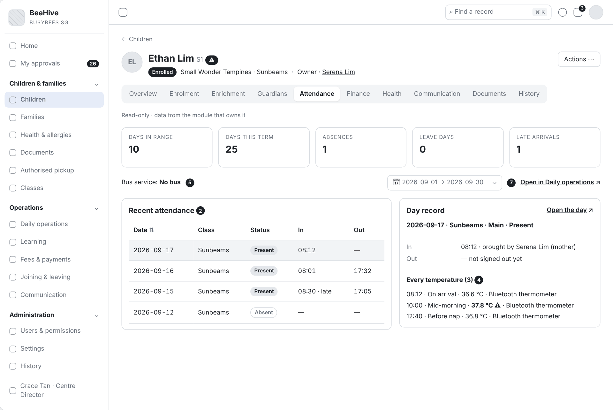
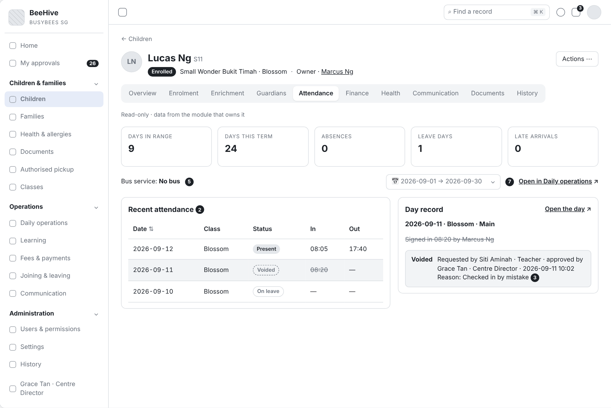
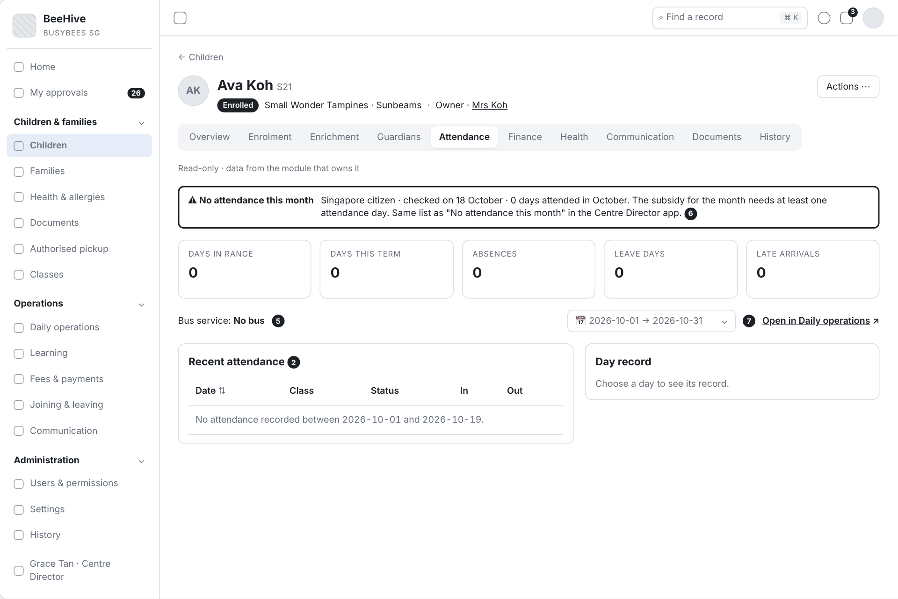
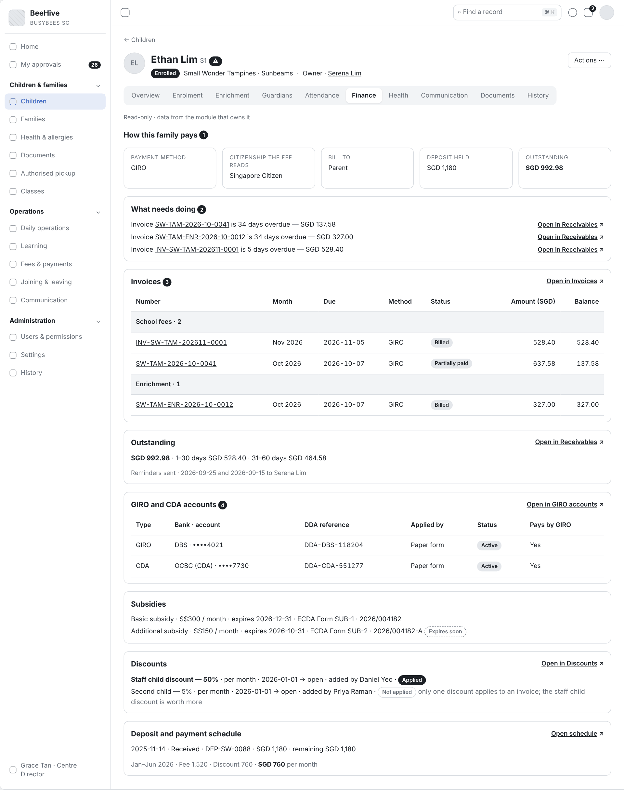
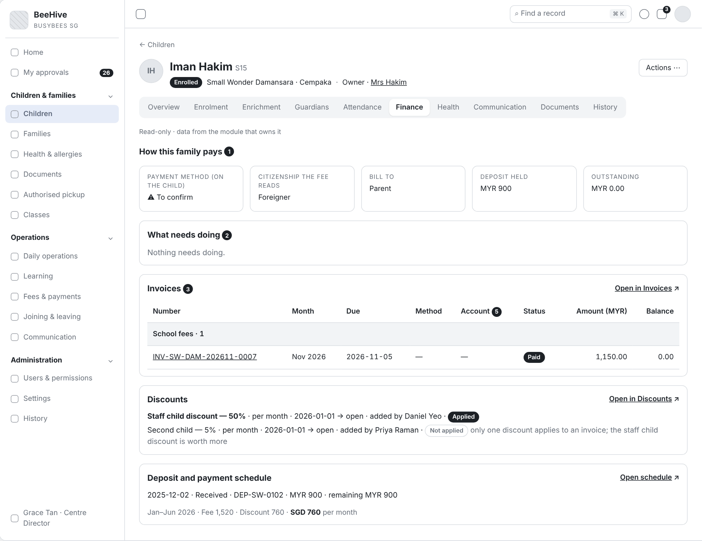
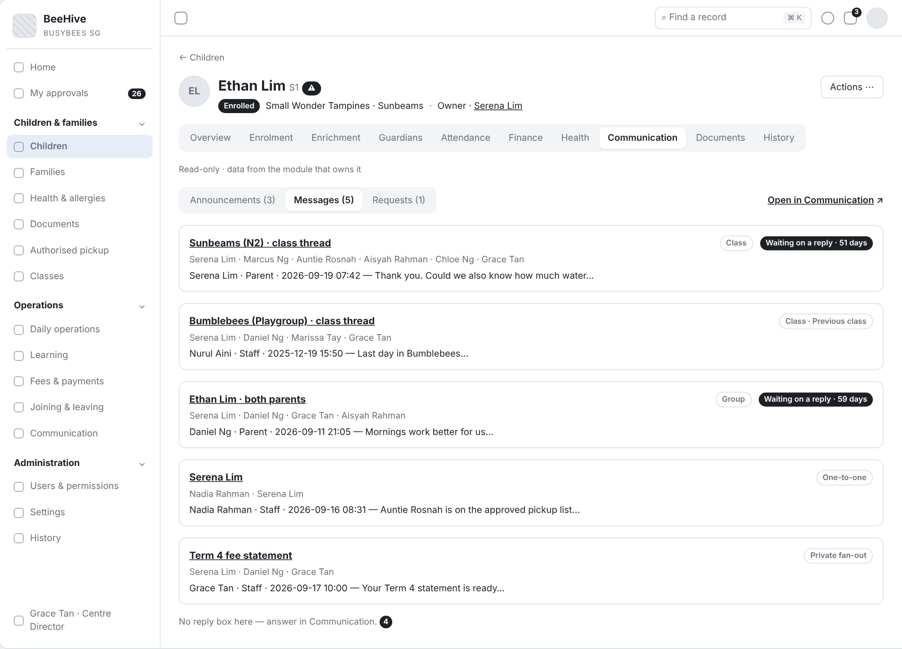
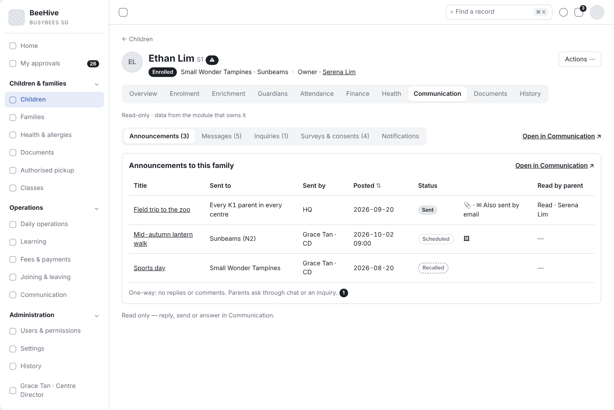
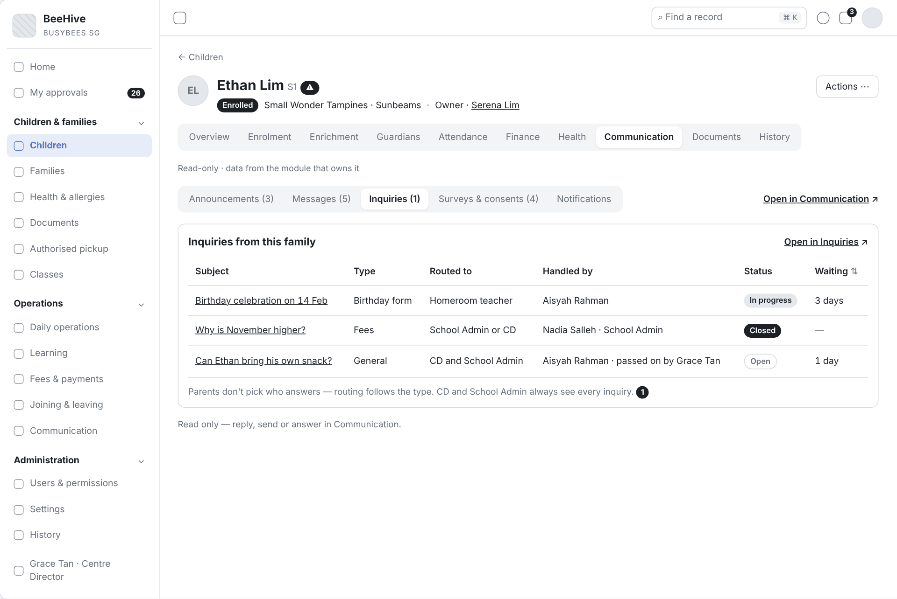
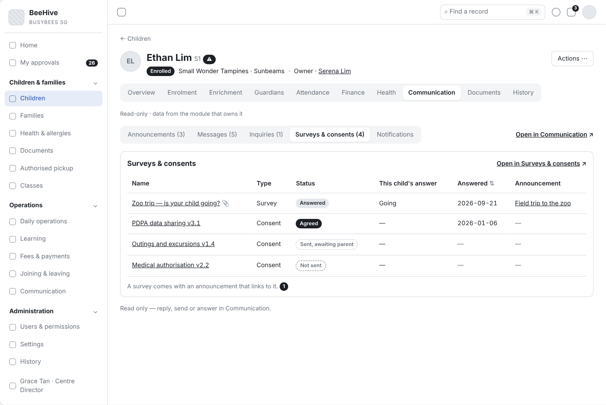
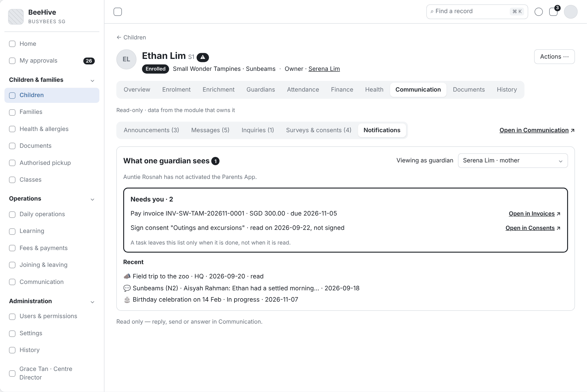

# Functional Requirements Specification

# Child Record Tabs – Read Views

| Thuộc tính | Giá trị |
|---|---|
| Dự án | Busy Bees Asia SMS |
| Module | Children & Families — Child record |
| Tính năng | 3.1 Child record tabs: Enrolment, Enrichment, Attendance, Finance, Communication (read views) |
| Mã tài liệu | FRD-3.1_Child_Record_Read_Tabs |
| Sprint | 4 |
| Phiên bản | 0.5 |
| Trạng thái | BẢN NHÁP CHỜ XÁC NHẬN |
| Ngày | 11/11/2026 |
| Người soạn | Business Analysis |
| Người review | HaiNguyen |
| Người duyệt | HaiNguyen |

## 1. Kiểm soát tài liệu

| Phiên bản | Ngày | Tác giả | Tóm tắt thay đổi | Duyệt |
|---|---|---|---|---|
| 0.1 | 10/11/2026 | Business Analysis | Khởi tạo | HaiNguyen |
| 0.3 | 11/11/2026 | Business Analysis | Viết lại US-001 (tab Enrolment) theo đúng nghĩa của Enrolment trong SRS Children & Families: ghi danh là bước xác nhận sau đăng ký, mọi thay đổi sau đó thuộc Joining & leaving; tab chỉ mô tả thông tin ghi danh và các thay đổi sau ghi danh. Bỏ khối Cases, liên kết bắt đầu case và khối Flags khỏi tab Enrolment, chuyển thành câu hỏi mở. Thêm OQ-RT-12, 13, 16, 17, 19 và AS-RT-07. | HaiNguyen |
| 0.4 | 11/11/2026 | Business Analysis | Đánh số lại toàn bộ mã FR, BR, VAL, AC, OQ, AS liên tục theo thứ tự xuất hiện trong tài liệu; cập nhật mọi chỗ tham chiếu. Nội dung không đổi. | HaiNguyen |
| 0.5 | 11/11/2026 | Business Analysis | Viết lại US-002 (tab Enrichment) theo SRS Learning mục 7.1, 7.2: tab là cửa sổ nhìn sang Learning, không có thao tác; hiển thị tên lớp, chương trình, lịch học, trainer, phí mỗi buổi, ngày bắt đầu, ngày kết thúc, trạng thái Active / Left; giữ các quy tắc hiển thị. Bỏ quy tắc rút qua Parents App và đổi chương trình, chuyển thành câu hỏi mở OQ-RT-17; viết lại OQ-RT-03; bỏ giả định Current / Past theo End date. Đánh số lại mã liên tục. | HaiNguyen |

**Mức sẵn sàng:** Đã đặc tả nội dung, bộ lọc, trạng thái rỗng, quyền xem và liên kết của 5 tab.

## 2. Mục tiêu và bối cảnh

Hồ sơ trẻ gom về một chỗ những gì các module khác ghi nhận về trẻ, để nhân viên Centre và HQ trả lời phụ huynh, kiểm tra học phí hay điểm danh mà không phải mở từng module. Mô tả của task:

## 3. Phạm vi và ranh giới phase

| Trong phạm vi | Ngoài phạm vi |
|---|---|
| Tab Enrolment: thông tin ghi danh của trẻ và các thay đổi sau ghi danh (tạm nghỉ, thôi học, tốt nghiệp). Tab Enrichment: các lớp enrichment của trẻ đang học và đã kết thúc (tên lớp, chương trình, lịch học, trainer, phí mỗi buổi, ngày bắt đầu, ngày kết thúc, trạng thái); muốn thay đổi thì vào Learning › Enrichment. Tab Attendance: tóm tắt điểm danh, danh sách ngày, chi tiết một ngày (vào ra, nhiệt độ, void), dịch vụ xe buýt. Tab Finance: tóm tắt thanh toán, việc cần làm, hoá đơn, công nợ, tài khoản GIRO / CDA, trợ cấp, giảm giá, đặt cọc, lịch thanh toán. Tab Communication: Announcements, Messages, Inquiries, Surveys & consents và Notifications (phụ huynh thấy gì, việc còn phải làm). Liên kết sang màn module, quyền xem, trạng thái rỗng. | Các thao tác sửa, tạo, gửi (thuộc module sở hữu). Header và tab Overview Tab Guardians, Health, Documents, History Xem dưới góc nhìn phụ huynh Báo cáo và xuất dữ liệu của từng module. |

## 4. Tác nhân, vai trò và quyền truy cập

| Tác nhân | Phạm vi | 5 tab |
|---|---|---|
| HQ Admin | Mọi Centre. | Thấy đủ 5 tab, mọi dữ liệu. |
| HQ Enrolment | Mọi Centre. | Enrolment, Enrichment, Attendance, Communication; Finance theo quyền |
| HQ Finance | Mọi Centre. | Thấy đủ 5 tab; trọng tâm Finance. |
| Centre Director, School Admin | Centre của mình. | Thấy đủ 5 tab. |
| Teacher | Lớp của mình. | Enrolment, Enrichment, Attendance, Communication (Class thread lớp mình, Group chat mình tham gia, inquiry được giao; không thấy Private chat Centre Director – phụ huynh); không thấy Finance |
| Enrichment Trainer | Lớp enrichment của mình. | Chỉ Enrichment |
| System | Toàn hệ thống. | Đọc dữ liệu module, tính tóm tắt, áp quyền, ẩn hoặc che trường được bảo vệ. |

**Quy tắc chung:** quyền theo khu vực, quyền đặc biệt và trường được bảo vệ (Hidden / Masked / Read / Edit), điều không được làm thì không hiển thị ; HQ thấy trẻ mọi Centre, nhân viên Centre thấy trẻ Centre mình, Teacher thấy trẻ lớp mình .

## 5. Tổng quan tính năng và phân rã chức năng

| Tab | Chức năng | Module sở hữu | User Story |
|---|---|---|---|
| Enrolment | Thông tin ghi danh, thay đổi sau ghi danh. | Enrolment; Joining & Leaving | US-001 |
| Enrichment | Các lớp enrichment của trẻ: lớp, lịch học, trainer, phí mỗi buổi, trạng thái. | Learning › Enrichment | US-002 |
| Attendance | Tóm tắt, danh sách ngày, chi tiết ngày, xe buýt. | Daily Operations › Attendance | US-003 |
| Finance | Tóm tắt, việc cần làm, hoá đơn, công nợ, GIRO / CDA, trợ cấp, giảm giá, đặt cọc. | Fees & Payments | US-004 |
| Communication | Announcements, Messages, Inquiries, Surveys & consents, Notifications. | Communication | US-005 |
| Chung | Tải tab, liên kết module, trạng thái rỗng, quyền. | — | US-006 |

## 6. Yêu cầu chức năng theo User Story

### 6.1 US-001 - Tab Enrolment: thông tin ghi danh của trẻ

#### User Story

Là School Admin, tôi muốn xem trên hồ sơ trẻ trẻ được ghi danh vào Centre, lớp, chương trình nào, từ ngày nào và sau đó đã có thay đổi gì, để trả lời phụ huynh mà không phải mở Joining & leaving.

#### Functional Requirements (Yêu cầu chức năng)

| FR ID | Yêu cầu chức năng |
|---|---|
| FR-001 | Tab Enrolment chỉ hiển thị, không có thao tác sửa hay tạo; gồm 2 phần: Thông tin ghi danh, Thay đổi sau ghi danh. |
| FR-002 | Phần "Thông tin ghi danh" hiển thị: Centre, level, lớp, programme (Full day / Half day), ngày ghi danh (ngày xác nhận), ngày bắt đầu học, trạng thái hiện tại (Enrolled, Temporary withdrawal, Withdrawn, Graduated). |
| FR-003 | Trẻ chưa tới ngày bắt đầu học: trạng thái vẫn là Enrolled, ngày bắt đầu học hiển thị như bình thường. Trẻ chưa sinh: hiển thị thêm ngày dự sinh. |
| FR-004 | Phần "Thay đổi sau ghi danh" liệt kê các thay đổi do Joining & leaving ghi nhận (tạm nghỉ, thôi học, tốt nghiệp), mới nhất trước; mỗi dòng ghi loại thay đổi và ngày hiệu lực. Chưa có thay đổi nào thì hiển thị một dòng thông báo chưa có thay đổi. |
| FR-005 | Chọn thông tin ghi danh mở màn ghi danh của module Enrolment; chọn một thay đổi mở màn tương ứng của Joining & leaving. |

#### Functional Flow - Main (Luồng chính)

1. School Admin mở hồ sơ trẻ và chọn tab Enrolment (FR-001).
2. Hệ thống hiển thị thông tin ghi danh và các thay đổi sau ghi danh (FR-002, FR-004).
3. School Admin chọn thông tin ghi danh hoặc một thay đổi để mở màn của module sở hữu (FR-005).

#### Functional Flow - Alternative (Luồng thay thế)

1. Trẻ đã ghi danh nhưng chưa tới ngày bắt đầu học: trạng thái Enrolled kèm ngày bắt đầu học (FR-003; BR-001).
2. Trẻ chưa sinh: thông tin ghi danh có ngày dự sinh (FR-003).
3. Trẻ đã thôi học hoặc tốt nghiệp: tab vẫn hiển thị đủ thông tin ghi danh và các thay đổi (FR-004; BR-003).

#### Functional Flow - Exception (Luồng ngoại lệ)

1. Không có. Tab chỉ hiển thị; quyền mở hồ sơ trẻ theo FRD Child Record Overview.

#### Business Rules (Quy tắc nghiệp vụ)

| BR ID | Quy tắc |
|---|---|
| BR-001 | Trẻ có trạng thái Enrolled ngay khi ghi danh được xác nhận, kể cả trước ngày bắt đầu học (AC-CHF-001). |
| BR-002 | Mọi thay đổi sau ghi danh (tạm nghỉ, thôi học, tốt nghiệp) thuộc Joining & leaving; tab Enrolment chỉ hiển thị (BR-CHF-006; AC-CHF-005). |
| BR-003 | Thông tin ghi danh và các thay đổi không bị xoá; trẻ đã thôi học, tốt nghiệp vẫn xem được (BR-CHF-007; BR-CHF-008). |

#### UI Reference (Tham chiếu giao diện)

| Mã màn hình / Phiên bản | Tham chiếu / Link |
|---|---|
| SCR-01 - Tab Enrolment | Chưa có wireframe cho bản nháp này. |

#### UI Components / Field Specification (Thành phần giao diện)

| Trường / Điều khiển | Loại | Bắt buộc | Mặc định / Trạng thái | Kiểm tra | Hành vi |
|---|---|---|---|---|---|
| Thông tin ghi danh | Phần | Có | — | — | FR-002; FR-003; chọn mở màn ghi danh (FR-005). |
| Thay đổi sau ghi danh | Danh sách | Có | Mới nhất trước; dòng thông báo khi chưa có thay đổi | — | FR-004; chọn mở màn Joining & leaving (FR-005). |

#### Data and Audit (Dữ liệu và audit)

| ID | Yêu cầu |
|---|---|
| DATA-001 | Tab đọc từ Enrolment: Centre, level, lớp, programme, ngày ghi danh, ngày bắt đầu học; từ hồ sơ trẻ: ngày dự sinh; từ Joining & leaving: trạng thái hiện tại, các thay đổi (loại, ngày hiệu lực). Tab không ghi dữ liệu. |

#### Acceptance Criteria (Tiêu chí nghiệm thu)

| AC ID | Given (Cho trước) | When (Khi) | Then (Thì) | Linked Rule |
|---|---|---|---|---|
| AC-001 | Ethan được ghi danh ở Small Wonder Tampines ngày 2025-11-24, bắt đầu học 2026-01-05, N2 · Sunbeams, Full day | School Admin mở tab Enrolment | phần Thông tin ghi danh hiện đủ Centre, level, lớp, programme, 2 ngày và trạng thái Enrolled; không có nút sửa | FR-001; FR-002; DATA-001 |
| AC-002 | ghi danh của Chloe được xác nhận ngày 2026-11-11, ngày bắt đầu học 2027-01-04 | School Admin mở tab Enrolment ngày 2026-11-12 | trạng thái Enrolled, ngày bắt đầu học 2027-01-04 | FR-003; BR-001 |
| AC-003 | trẻ chưa sinh, ngày dự sinh 2027-01-15, đã ghi danh infant care | School Admin mở tab Enrolment | thông tin ghi danh có ngày dự sinh 2027-01-15 | FR-003 |
| AC-004 | Mia Wong thôi học tháng 6/2026 | School Admin mở tab Enrolment của Mia | trạng thái Withdrawn; phần Thay đổi sau ghi danh có dòng thôi học kèm ngày hiệu lực | FR-004; BR-003 |
| AC-005 | Ethan chưa có thay đổi nào sau ghi danh | School Admin mở tab Enrolment | phần Thay đổi sau ghi danh hiện dòng thông báo chưa có thay đổi | FR-004 |
| AC-006 | Ethan có trạng thái Enrolled | Centre Director mở tab Enrolment | không có thao tác đổi trạng thái trên tab | BR-002 |
| AC-007 | Mia có dòng thôi học | người dùng chọn dòng đó | màn tương ứng của Joining & leaving mở | FR-005 |

#### Dependencies (Phụ thuộc)

Enrolment (thông tin ghi danh); Joining & leaving (trạng thái và các thay đổi sau ghi danh); hồ sơ trẻ (ngày dự sinh).

### 6.2 US-002 - Tab Enrichment: các lớp enrichment của trẻ

#### User Story

Là School Admin, tôi muốn xem trẻ đang học thêm những lớp enrichment nào, từ khi nào, với trainer nào, lịch học và phí mỗi buổi, để trả lời phụ huynh, giải thích hoá đơn enrichment và biết lịch của trẻ trong ngày.

#### Functional Requirements (Yêu cầu chức năng)

| FR ID | Yêu cầu chức năng |
|---|---|
| FR-006 | Tab Enrichment chỉ hiển thị; không có nút thêm, sửa hay gỡ trẻ khỏi lớp. Mọi thay đổi thực hiện ở Learning › Enrichment. |
| FR-007 | Section "Enrichment programmes" hiển thị mỗi lớp enrichment của trẻ một dòng: Class name, Programme, Schedule (thứ và giờ, ví dụ "Tue 15:30–16:15"), Trainer, Fee per session (ví dụ "SGD 30"), Start date, End date, Status (Active / Left). |
| FR-008 | Bộ lọc Current / Past: mặc định Current (lớp có trạng thái Active); Past hiển thị lớp có trạng thái Left. |
| FR-009 | Lớp trẻ đang học có End date "—"; End date chỉ có khi trẻ rời lớp. Các dòng sắp theo Start date, mới nhất trước. |
| FR-010 | Dòng lớp đã kết thúc ghi cách kết thúc: "Removed from the class" (Enrichment team gỡ trẻ, kèm End date); "Class closed" (lớp bị đóng, End date là ngày đóng lớp); "Left the school · enrichment invoices stop after" kèm ngày học cuối (trẻ thôi học ở Centre). |
| FR-011 | Chọn tên lớp tại màn hình enrichment. Hệ thống tự chuyển người dùng đến Learning để xem chi tiết |
| FR-012 | Trẻ chưa học lớp enrichment nào: hiển thị "No enrichment programme for this child." |

#### Functional Flow - Main (Luồng chính)

1. Người dùng chọn tab Enrichment; hệ thống hiển thị các lớp đang học (FR-006, FR-007, FR-008).
2. Người dùng xem lịch học, trainer, phí mỗi buổi để trả lời phụ huynh (FR-007).
3. Người dùng chọn tên lớp (FR-011).

#### Functional Flow - Alternative (Luồng thay thế)

1. Người dùng chọn Past để xem các lớp đã kết thúc và cách kết thúc (FR-008, FR-010).
2. Trẻ thôi học ở Centre: mọi lớp enrichment đang học kết thúc vào ngày học cuối (FR-010; BR-008).
3. Trẻ chưa học enrichment: trạng thái rỗng (FR-012).

#### Functional Flow - Exception (Luồng ngoại lệ)

1. Enrichment Trainer mở hồ sơ trẻ không thuộc lớp enrichment của mình: hồ sơ không mở (VAL-001).

#### Business Rules (Quy tắc nghiệp vụ)

| BR ID | Quy tắc |
|---|---|
| BR-004 | Enrichment Trainer chỉ thấy lớp enrichment được giao cho mình (BR-LRN-033). |
| BR-005 | HQ Enrichment team quản lý lớp và học sinh enrichment; hồ sơ trẻ chỉ hiển thị (BR-LRN-033). |
| BR-006 | Một trẻ có thể học nhiều lớp enrichment; mọi lớp đều hiện trên hồ sơ trẻ (BR-LRN-036). |
| BR-007 | Mỗi trẻ trong lớp có ngày bắt đầu; gỡ trẻ khỏi lớp phải có ngày kết thúc; không tính phí sau ngày kết thúc (BR-LRN-035; SRS Learning §7.2 Remove student). |
| BR-008 | Trẻ thôi học ở Centre thì mọi lớp enrichment kết thúc vào ngày học cuối của trẻ (BR-LRN-037). |
| BR-009 | Lớp bị đóng thì trẻ đang học có ngày kết thúc là ngày đóng lớp (SRS Learning §7.1 Close class). |
| BR-010 | Phí enrichment hằng tháng của mỗi lớp = số buổi theo lịch trong tháng, từ ngày bắt đầu đến ngày kết thúc, × phí mỗi buổi; ngày lễ vẫn tính, buổi vắng không trừ (BR-LRN-040; BR-LRN-042). |

#### Validation Rules (Quy tắc kiểm tra)

| VAL ID | Điều kiện | Phản hồi của hệ thống |
|---|---|---|
| VAL-001 | Trẻ không thuộc lớp enrichment nào của Enrichment Trainer. | Không hiển thị hồ sơ trẻ cho Enrichment Trainer. |

#### UI Reference (Tham chiếu giao diện)

| Mã màn hình / Phiên bản | Tham chiếu / Link |
|---|---|
| SCR-02 - Tab Enrichment | Chưa có wireframe cho bản nháp này. |

#### UI Components / Field Specification (Thành phần giao diện)

| Trường / Điều khiển | Loại | Bắt buộc | Mặc định / Trạng thái | Kiểm tra | Hành vi |
|---|---|---|---|---|---|
| Current / Past | Bộ lọc | Có | Current | — | FR-008. |
| Section Enrichment programmes | Danh sách | Có | Start date mới nhất trước | — | Các cột ở FR-007; tên lớp là liên kết (FR-011). |
| Cách kết thúc | Text | Khi trạng thái Left | — | — | FR-010. |
| Trạng thái rỗng | Text | Khi không có lớp | "No enrichment programme for this child." | — | FR-012. |

#### Data and Audit (Dữ liệu và audit)

| ID | Yêu cầu |
|---|---|
| DATA-002 | Tab đọc từ Learning › Enrichment: lớp (class name, programme, weekdays, start time, end time, trainer, fee per session, status Active / Closed, ngày đóng lớp), trẻ trong lớp (start date, end date, status Active / Left, cách kết thúc: gỡ khỏi lớp, lớp đóng, thôi học ở Centre). Tab không ghi dữ liệu. |

#### Acceptance Criteria (Tiêu chí nghiệm thu)

| AC ID | Given (Cho trước) | When (Khi) | Then (Thì) | Linked Rule |
|---|---|---|---|---|
| AC-008 | Ethan học Mandarin Explorers (thứ Ba 15:30–16:15, SGD 30 mỗi buổi) và Speech & Drama (thứ Năm 15:30–16:30) từ 2026-07-01 | School Admin mở tab Enrichment | có 2 dòng, mỗi dòng có Class name, Programme, Schedule, Trainer, Fee per session, Start date 2026-07-01, End date "—", Status Active | FR-007; FR-008; FR-009; DATA-002 |
| AC-009 | Ethan học 2 lớp enrichment | School Admin xem tab Enrichment | không có nút thêm, sửa hay gỡ trẻ khỏi lớp | FR-006; BR-005; BR-006 |
| AC-010 | Enrichment team gỡ Ethan khỏi Little Chefs, End date 2026-06-30 | School Admin chọn Past | Little Chefs hiện Status Left, End date 2026-06-30, "Removed from the class" | FR-008; FR-010; BR-007 |
| AC-011 | lớp Art Explorers bị đóng ngày 2026-12-18 khi Ethan đang học | School Admin chọn Past | Art Explorers hiện Status Left, End date 2026-12-18, "Class closed" | FR-010; BR-009 |
| AC-012 | Lucas thôi học ở Centre, ngày học cuối 2026-10-31, đang học Speech & Drama | School Admin mở tab Enrichment sau 2026-10-31 | Speech & Drama ở Past với End date 2026-10-31 và "Left the school · enrichment invoices stop after 2026-10-31" | FR-010; BR-008 |
| AC-013 | lớp Mandarin Explorers học thứ Ba, SGD 30 mỗi buổi; tháng 10/2026 có 4 thứ Ba | phụ huynh hỏi vì sao hoá đơn enrichment tháng 10 của Ethan có SGD 120 | School Admin thấy trên tab Schedule "Tue" và Fee per session "SGD 30", đủ để giải thích 4 buổi × SGD 30 | FR-007; BR-010 |
| AC-014 | School Admin đang xem tab Enrichment | chọn "Mandarin Explorers" | màn chi tiết lớp Mandarin Explorers trong Learning › Enrichment mở | FR-011 |
| AC-015 | Adam chưa học enrichment | School Admin mở tab Enrichment | hiện "No enrichment programme for this child." | FR-012 |
| AC-016 | Enrichment Trainer dạy Speech & Drama, Adam không học lớp này | trainer tìm Adam | không mở được hồ sơ Adam | VAL-001; BR-004 |

#### Dependencies (Phụ thuộc)

Learning › Enrichment (lớp, trẻ trong lớp); Joining & leaving (ngày học cuối khi trẻ thôi học); Fees & Payments (hoá đơn enrichment).

### 6.3 US-003 - Tab Attendance: tóm tắt và chi tiết ngày

#### User Story

Là Centre Director, tôi muốn xem tóm tắt điểm danh của trẻ và chi tiết từng ngày (giờ vào ra, người đưa đón, nhiệt độ, void), để trả lời phụ huynh và kiểm tra khi có thắc mắc về trợ cấp hay học phí.

#### Functional Requirements (Yêu cầu chức năng)

| FR ID | Yêu cầu chức năng |
|---|---|
| FR-013 | Khối tóm tắt cho khoảng ngày đang chọn: số ngày có mặt, số ngày có mặt trong kỳ, số ngày vắng, số ngày nghỉ phép (leave), số lần đến muộn (SRS Daily Operations — Child attendance). Khoảng ngày mặc định là tháng hiện tại của enrolment đang hiệu lực; có bộ chọn khoảng ngày (từ ngày – đến ngày). |
| FR-014 | Danh sách "Recent attendance" theo ngày, mới nhất trước: ngày, class, buổi (Main / enrichment), status (Present, Absent, On leave, Signed in, Signed out), giờ vào, giờ ra, cờ đến muộn; lọc theo khoảng ngày đang chọn; phân trang 20 / 50 / 100 (SRS DOPS — View class attendance; SRS GEN §4.1). |
| FR-015 | Chọn một ngày mở "Day record": status, class, buổi, giờ vào và người đưa, giờ ra và người đón, mọi lần đo nhiệt độ (giờ, thời điểm đo, nhiệt độ, thiết bị), lý do vắng hoặc loại nghỉ phép. |
| FR-016 | Bản ghi đã void hiển thị gạch ngang với nhãn "Voided", người yêu cầu, người duyệt, thời điểm, lý do; không tính vào số ngày có mặt (BR-OPS-020, BR-OPS-024). |
| FR-017 | Nhiệt độ từ 37,5 °C trở lên được đánh dấu cảnh báo trong Day record (AS-RT-03). |
| FR-018 | Khối "Bus service" hiển thị chỉ đọc tuyến xe buýt của trẻ hoặc "No bus". |
| FR-019 | Liên kết "Open in Daily operations" mở màn điểm danh lớp của trẻ tại ngày đang xem. |
| FR-020 | Trẻ là công dân Singapore: từ ngày chạy kiểm tra (mặc định ngày 18) của tháng hiện tại, nếu trẻ chưa có buổi nào trong tháng thì tab hiện cảnh báo "No attendance this month" kèm ghi chú giữ trợ cấp — cùng danh sách mà Centre Director thấy ở mục "No attendance this month" của Centre Director app (BR-OPS-025). |

#### Functional Flow - Main (Luồng chính)

1. Người dùng chọn tab Attendance; hệ thống hiển thị tóm tắt, xe buýt và danh sách ngày của tháng hiện tại thuộc enrolment đang hiệu lực (FR-013, FR-014, FR-018).
2. Người dùng chọn một ngày; hệ thống hiển thị Day record (FR-015).
3. Người dùng chọn "Open in Daily operations" để xử lý tại màn điểm danh (FR-019).

#### Functional Flow - Alternative (Luồng thay thế)

1. Người dùng chọn khoảng ngày khác: tóm tắt và danh sách cập nhật (FR-013, FR-014).
2. Trẻ công dân Singapore chưa có buổi nào trong tháng, đã qua ngày 18: tab hiện cảnh báo "No attendance this month" (FR-020).
3. Ngày có bản ghi đã void: Day record hiển thị bản ghi gạch ngang và thông tin void (FR-016).

#### Functional Flow - Exception (Luồng ngoại lệ)

1. Chọn khoảng ngày trong tương lai hoặc trước ngày bắt đầu học: không có dữ liệu, hiện thông báo rỗng (VAL-002).

#### Business Rules (Quy tắc nghiệp vụ)

| BR ID | Quy tắc |
|---|---|
| BR-011 | Bản ghi điểm danh sai được void, không xoá; bản ghi đã void không tính là có mặt và vẫn hiển thị trong lịch sử (BR-OPS-020). |
| BR-012 | Mọi void lưu người yêu cầu, người duyệt, thời điểm và lý do (BR-OPS-024). |
| BR-013 | Điểm danh tính theo tháng. Ngày 18 (ngày chạy, cấu hình được) hệ thống kiểm tra trẻ công dân Singapore có 0 buổi trong tháng để giữ trợ cấp (BR-OPS-025). |

#### Validation Rules (Quy tắc kiểm tra)

| VAL ID | Điều kiện | Phản hồi của hệ thống |
|---|---|---|
| VAL-002 | Khoảng ngày được chọn không có bản ghi điểm danh, hoặc nằm ngoài thời gian ghi danh của trẻ. | Hiển thị "No attendance recorded between <from> and <to>." |

#### UI Reference (Tham chiếu giao diện)

| Mã màn hình / Phiên bản | Tham chiếu / Link |
|---|---|
| SCR-03 - Tab Attendance |  |

#### UI Components / Field Specification (Thành phần giao diện)

| Trường / Điều khiển | Loại | Bắt buộc | Mặc định / Trạng thái | Kiểm tra | Hành vi |
|---|---|---|---|---|---|
| Days attended | Stat cards | Có | Tháng hiện tại | — | FR-013. |
| Bus service | Text (chỉ đọc) | Có | Tuyến hoặc "No bus" | — | FR-018. |
| Khoảng ngày | Date range picker | Có | Tháng hiện tại của enrolment đang hiệu lực | VAL-002. | Lọc tóm tắt và danh sách. |
| No attendance this month | Banner cảnh báo | Khi điều kiện FR-020 | Ẩn | — | FR-020. |
| Recent attendance | List | Có | Mới nhất trước | — | FR-014; chọn ngày mở Day record. |
| Day record | Panel | Có | Ngày gần nhất | — | FR-015; FR-016; FR-017. |
| Open in Daily operations | Link | Có | — | — | FR-019. |

#### Data and Audit (Dữ liệu và audit)

| ID | Yêu cầu |
|---|---|
| DATA-003 | Tab đọc từ Daily Operations: attendance record (date, class, session, status, check-in time và người đưa, check-out time và người đón, late flag), temperature (time, point, value, device), absence / leave (type, reason), void (requested by, approved by, time, reason), bus route. |

#### Acceptance Criteria (Tiêu chí nghiệm thu)

| AC ID | Given (Cho trước) | When (Khi) | Then (Thì) | Linked Rule |
|---|---|---|---|---|
| AC-017 | tháng 9 Ethan có mặt 10 ngày, kỳ này 25 ngày, không vắng | người dùng mở tab Attendance | khối tóm tắt hiện "10 this month", "25 this term", "0 absences recorded" | FR-013 |
| AC-018 | ngày 17/09 Ethan vào 08:12, đo 36,6 °C lúc đến và 36,8 °C trước giờ ngủ | người dùng chọn ngày 17/09 | Day record hiện status Present, class Sunbeams, giờ vào 08:12 và 2 lần đo nhiệt độ với giờ, thời điểm, thiết bị | FR-014; FR-015; DATA-003 |
| AC-019 | bản ghi ngày 11/09 của Lucas bị void, lý do "Checked in by mistake" | người dùng chọn ngày 11/09 | bản ghi hiện gạch ngang, nhãn "Voided", người yêu cầu, người duyệt, thời điểm, lý do; ngày 11/09 không tính vào số ngày có mặt | FR-016; BR-011; BR-012 |
| AC-020 | Ethan đo 37,8 °C lúc 10:00 | người dùng mở Day record | dòng 37,8 °C có dấu cảnh báo | FR-017 |
| AC-021 | Ethan không đi xe buýt | người dùng mở tab Attendance | Bus service hiện "No bus", không có thao tác sửa | FR-018 |
| AC-022 | người dùng đang xem Day record ngày 17/09 | người dùng chọn "Open in Daily operations" | màn điểm danh lớp Sunbeams ngày 17/09 mở | FR-019 |
| AC-023 | Ethan bắt đầu học 05/01/2026 | người dùng chọn từ 01/12/2025 đến 31/12/2025 | hiện "No attendance recorded between 2025-12-01 and 2025-12-31." | VAL-002 |
| AC-024 | hôm nay 19/10/2026, Ava là công dân Singapore và chưa có buổi nào trong tháng 10 | người dùng mở tab Attendance của Ava | tab hiện cảnh báo "No attendance this month"; trẻ nước ngoài Ben trong cùng tình huống không có cảnh báo | FR-020; BR-013 |
| AC-025 | Ethan có enrolment đang hiệu lực, hôm nay 17/09/2026 | người dùng mở tab Attendance | bộ chọn ngày mặc định từ 01/09/2026 đến 30/09/2026 | FR-013 |

#### Dependencies (Phụ thuộc)

Daily Operations (attendance, temperature, leave, void, bus);

### 6.4 US-004 - Tab Finance: hoá đơn, công nợ, GIRO

#### User Story

Là HQ Finance, tôi muốn xem trên hồ sơ trẻ tình hình tài chính của trẻ — phương thức thanh toán, hoá đơn, số còn nợ, tài khoản GIRO / CDA, trợ cấp, giảm giá, tiền đặt cọc — và mở nhanh màn của Fees & Payments, để trả lời phụ huynh và xử lý công nợ.

#### Functional Requirements (Yêu cầu chức năng)

| FR ID | Yêu cầu chức năng |
|---|---|
| FR-021 | Khối "How this family pays": Payment method của trẻ (GIRO, GIRO CDA hoặc PayNow — giá trị ghi trên hồ sơ trẻ), citizenship dùng để tính học phí, Bill to (Parent / Company), tiền đặt cọc đang giữ và pháp nhân, tổng còn nợ (Outstanding). |
| FR-022 | Khối "What needs doing": hoá đơn quá hạn ("Invoice <số> is <n> days overdue — <tiền>"), GIRO bị từ chối, hoàn tiền không thành công; mỗi dòng mở màn tương ứng của Fees & Payments (Receivables, GIRO accounts, Refunds). |
| FR-023 | Bảng "Invoices" nhóm theo loại (School fees, Enrichment, Registration, Ad hoc): số hoá đơn, tháng, hạn thanh toán, phương thức mà hoá đơn mang theo, tài khoản (CDA / non-CDA), status (Draft, Billed, Paid, Partially paid, Void), số tiền, số còn lại; mới nhất trước; chọn số hoá đơn mở chi tiết hoá đơn (SRS F&P — Invoices). |
| FR-024 | Khối "Outstanding": tổng còn nợ, từng hóa đơn chưa trả với hạn và nhóm tuổi nợ (1–30, 31–60, 61–90, trên 90 ngày), lịch sử nhắc phí đã gửi (ngày, người nhận); liên kết "Open in Receivables". |
| FR-025 | Bảng "GIRO and CDA accounts" (một trẻ có tối đa 2 tài khoản GIRO: CDA và non-CDA): loại (GIRO / CDA), ngân hàng, số tài khoản che chỉ còn 4 số cuối, DDA reference, cách nộp (paper form / e-GIRO), status (Pending with bank, Active, Rejected, Inactive), "Pays by GIRO"; liên kết "Open in GIRO accounts" (SRS F&P §4.1). |
| FR-026 | Khối "Subsidies": loại (Basic, Additional), số tiền mỗi tháng, ngày hết hạn, mẫu ECDA và số tham chiếu; trợ cấp sắp hết hạn (trong 30 ngày) được đánh dấu (AS-RT-04). |
| FR-027 | Khối "Discounts": giảm giá đang áp (tên, mức, kỳ, từ ngày → đến ngày, người thêm), và giảm giá không áp kèm lý do (vd. "only one discount applies to an invoice"). |
| FR-028 | Khối "Deposit": ngày nhận, số tham chiếu, số tiền, số còn lại; liên kết "Open in Deposits". Khối "Payment schedule": học phí, giảm giá, số phải trả theo từng tháng của năm học; liên kết "Open schedule". |
| FR-029 | Số tài khoản ngân hàng và tiền đặt cọc là trường được bảo vệ: hiển thị đầy đủ, che hoặc ẩn theo vai trò (SRS GEN §3.1; SRS ADM — Edit protected fields). |

#### Functional Flow - Main (Luồng chính)

1. HQ Finance chọn tab Finance; hệ thống hiển thị How this family pays, What needs doing, Invoices, Outstanding, GIRO and CDA accounts, Subsidies, Discounts, Deposit, Payment schedule (FR-021 đến FR-028).
2. HQ Finance chọn một hoá đơn hoặc một việc cần làm để mở màn của Fees & Payments (FR-022, FR-023).

#### Functional Flow - Alternative (Luồng thay thế)

1. Không có việc cần làm: khối What needs doing hiện "Nothing needs doing." (FR-022).
2. Trẻ ở Centre Malaysia: không có khối GIRO and CDA accounts và không có Subsidies ECDA (VAL-003).

#### Functional Flow - Exception (Luồng ngoại lệ)

1. Vai trò không được xem tab Finance: tab không hiển thị (VAL-004).

#### Business Rules (Quy tắc nghiệp vụ)

| BR ID | Quy tắc |
|---|---|
| BR-014 | GIRO, CDA và ECDA chỉ áp cho Centre Singapore |
| BR-015 | Số tài khoản GIRO chỉ hiện 4 số cuối ngoài màn chi tiết tài khoản |
| BR-016 | Mỗi hoá đơn chỉ áp một giảm giá; giảm giá có giá trị cao hơn được áp |
| BR-017 | Payment method thuộc hồ sơ trẻ: GIRO, GIRO CDA hoặc PayNow. Mỗi hoá đơn mang theo phương thức này để Finance lọc hàng loạt. |
| BR-018 | Một trẻ có thể có 2 tài khoản GIRO (CDA và non-CDA); phần thu từ CDA và non-CDA được xuất thành hoá đơn riêng. |

#### Validation Rules (Quy tắc kiểm tra)

| VAL ID | Điều kiện | Phản hồi của hệ thống |
|---|---|---|
| VAL-003 | Trẻ thuộc Centre Malaysia. | Ẩn khối GIRO and CDA accounts và trợ cấp ECDA |
| VAL-004 | Vai trò không có quyền xem Fees & Payments. | Không hiển thị tab Finance |

#### UI Reference (Tham chiếu giao diện)

| Mã màn hình / Phiên bản | Tham chiếu / Link |
|---|---|
| SCR-04 - Tab Finance |  |

#### UI Components / Field Specification (Thành phần giao diện)

| Trường / Điều khiển | Loại | Bắt buộc | Mặc định / Trạng thái | Kiểm tra | Hành vi |
|---|---|---|---|---|---|
| How this family pays | Summary cards | Có | — | — | FR-021. |
| What needs doing | List | Có | Mới nhất trước | — | FR-022; mỗi dòng là liên kết. |
| Invoices | Grouped table | Có | Mới nhất trước | — | FR-023. |
| Outstanding | Section | Có | — | — | FR-024. |
| GIRO and CDA accounts | Table | Singapore | — | VAL-003. | FR-025; số tài khoản che (BR-015). |
| Subsidies | List | Singapore | — | VAL-003. | FR-026. |
| Discounts | List | Có | — | — | FR-027. |
| Deposit, Payment schedule | Section | Có | — | — | FR-028. |

#### Data and Audit (Dữ liệu và audit)

| ID | Yêu cầu |
|---|---|
| DATA-004 | Tab đọc payment method từ hồ sơ trẻ; đọc từ Fees & Payments: billing profile (citizenship used, bill to), invoice (number, type, month, due date, payment method carried, account CDA / non-CDA, status, amount, balance), receivable ageing và reminders, GIRO / CDA account (type, bank, masked number, DDA reference, method, status, pays by GIRO), subsidy (type, amount, expiry, form, reference), discount (name, rate, period, from, to, added by, applied / not applied reason), deposit (date, reference, amount, remaining), schedule (month, fee, discount, net). |

#### Acceptance Criteria (Tiêu chí nghiệm thu)

| AC ID | Given (Cho trước) | When (Khi) | Then (Thì) | Linked Rule |
|---|---|---|---|---|
| AC-026 | hồ sơ Ethan ghi payment method GIRO, citizenship Singapore Citizen, cọc 1.180 SGD ở Small Wonder Preschools Pte Ltd | HQ Finance mở tab Finance | How this family pays hiện GIRO, Singapore Citizen, "SGD 1,180 · Small Wonder Preschools Pte Ltd" và tổng còn nợ | FR-021; DATA-004 |
| AC-027 | hoá đơn SW-TAM-2026-10-0041 quá hạn 34 ngày, còn 137,58 SGD | HQ Finance mở tab Finance | What needs doing hiện "Invoice SW-TAM-2026-10-0041 is 34 days overdue — SGD 137.58"; chọn dòng mở Receivables | FR-022 |
| AC-028 | Ethan có 2 hoá đơn học phí và 1 hoá đơn enrichment | HQ Finance mở tab Finance | bảng Invoices có nhóm "School fees · 2" và "Enrichment · 1" với số, tháng, hạn, phương thức, tài khoản, status, số tiền; chọn số hoá đơn mở chi tiết | FR-023; BR-017 |
| AC-029 | Ethan có tài khoản GIRO CDA (OCBC) và GIRO non-CDA (DBS); học phí tháng 11 thu một phần từ CDA | HQ Finance mở tab Finance | bảng GIRO and CDA accounts có 2 dòng CDA và non-CDA; bảng Invoices có 2 hoá đơn học phí tháng 11 riêng, một dòng tài khoản CDA, một dòng non-CDA | FR-023; FR-025; BR-018 |
| AC-030 | Ethan còn nợ 992,98 SGD qua 3 hoá đơn | HQ Finance mở khối Outstanding | tổng "SGD 992.98", từng hoá đơn với nhóm tuổi nợ, ngày nhắc phí đã gửi | FR-024 |
| AC-031 | Ethan có tài khoản GIRO DBS 072-311-4021 Active | School Admin mở tab Finance | bảng hiện "DBS · ••••4021", DDA reference, Paper form, Active, Pays by GIRO | FR-025; BR-015 |
| AC-032 | Additional subsidy của Ethan hết hạn 31/10/2026, hôm nay 10/10/2026 | người dùng mở Subsidies | dòng Additional subsidy có dấu sắp hết hạn | FR-026 |
| AC-033 | Ethan có Staff child 50% và Second child 5% | người dùng mở Discounts | Staff child discount hiện "applied"; Second child hiện "not applied" kèm lý do | FR-027; BR-016 |
| AC-034 | cọc của Ethan là trường che với School Admin | School Admin mở khối Deposit | số tiền cọc hiện dạng che | FR-028; FR-029 |
| AC-035 | Adam thuộc Centre Malaysia | HQ Finance mở tab Finance | không có khối GIRO and CDA accounts và Subsidies ECDA | VAL-003; BR-014 |
| AC-036 | Teacher không có quyền xem Fees & Payments | Teacher mở hồ sơ Ethan | không có tab Finance | VAL-004 |

#### Dependencies (Phụ thuộc)

Fees & Payments (invoices, receivables, GIRO accounts, subsidy, discounts, deposits, schedule); hồ sơ trẻ (payment method); Roles & permissions (trường bảo vệ);

### 6.5 US-005 - Tab Communication: thông báo, chat, inquiry, khảo sát, thông báo tới phụ huynh

#### User Story

Là Centre Director, tôi muốn xem trên hồ sơ trẻ mọi thông báo, cuộc chat, inquiry, khảo sát và giấy đồng ý liên quan đến trẻ, và thấy được phụ huynh đang thấy gì và còn phải làm gì, để biết gia đình đã được báo gì, đang chờ trả lời gì trước khi gọi cho họ.

#### Functional Requirements (Yêu cầu chức năng)

| FR ID | Yêu cầu chức năng |
|---|---|
| FR-030 | Tab Communication có 5 phần chọn bằng segmented control, mỗi phần ghi số mục: Announcements, Messages, Inquiries, Surveys & consents, Notifications. Mặc định mở Messages. |
| FR-031 | **Announcements** (thông báo chung, một chiều): liệt kê thông báo đã gửi tới phụ huynh của trẻ — tiêu đề, phạm vi gửi (HQ, brand, Centre, lớp, hoặc level ở mọi Centre, vd. "Every K1 parent in every centre"), người gửi (HQ hoặc Centre Director), ngày đăng hoặc ngày hẹn đăng, status (Scheduled, Sent, Recalled), biểu tượng có tệp đính kèm, nhãn "Also sent by email" khi bật gửi kèm email, phụ huynh đã đọc hay chưa; mới nhất trước. Không có ô trả lời hay bình luận. |
| FR-032 | **Messages** (chat hằng ngày): liệt kê các cuộc chat có phụ huynh của trẻ, nhóm theo loại: (1) Class thread của lớp hiện tại — có sẵn cho mỗi trẻ, gồm phụ huynh, mọi giáo viên lớp và Centre Director; (2) Class thread của lớp cũ — nhãn "Previous class · read only", giữ tới khi trẻ rời trường; (3) Group chat — gắn theo người, không theo lớp (vd. cho sự kiện); (4) Private chat Centre Director – phụ huynh. Mỗi dòng: tên, loại, người tham gia, tin gần nhất (người, thời điểm, đoạn đầu), "Waiting on a reply · <n> days" khi tin cuối là của phụ huynh. |
| FR-033 | **Inquiries** (ticket cần văn phòng xử lý hoặc form cần điền): tiêu đề, loại (vd. Fees, Birthday, General), người nhận theo quy tắc chia, người đang phụ trách (kể cả khi được Centre Director chuyển cho giáo viên), status (Open, In progress, Closed), thời gian chờ; mặc định chờ lâu nhất trước. |
| FR-034 | Chọn một thông báo, cuộc chat, inquiry, khảo sát hoặc giấy đồng ý mở màn tương ứng trong Communication; tab không có ô trả lời, không tạo tin nhắn. |
| FR-035 | Teacher chỉ thấy Class thread và Group chat mình tham gia, và inquiry được giao cho mình; Teacher không thấy Private chat Centre Director – phụ huynh. Centre Director và School Admin thấy mọi cuộc chat giữa giáo viên và phụ huynh của Centre và mọi inquiry. |
| FR-036 | **Surveys & consents**: liệt kê khảo sát và giấy đồng ý gửi tới phụ huynh của trẻ — tên, loại (Survey / Consent), phiên bản, status (Not sent, Sent awaiting parent, Answered / Agreed, Declined), ngày trả lời, câu trả lời của trẻ này (vd. "Going" / "Not going" cho khảo sát dã ngoại), biểu tượng tệp đính kèm, liên kết tới announcement đi kèm khảo sát. |
| FR-037 | **Notifications** — màn mô phỏng phụ huynh thấy gì: tiêu đề "What one guardian sees", ô chọn "Viewing as guardian" liệt kê các guardian có tài khoản Parents App của trẻ, mặc định primary contact. Màn hiển thị thông báo, chat, inquiry, khảo sát của guardian đó như trong Parents App, chỉ đọc. |
| FR-038 | Khối **"Needs you"** đầu màn Notifications: việc guardian phải làm — trả hoá đơn, ký consent, trả lời khảo sát, điền form inquiry — mỗi việc có hạn và liên kết sang màn module. Việc chỉ biến mất khi đã làm xong (đã trả, đã ký, đã trả lời), không biến mất khi guardian chỉ đọc. |
| FR-039 | Mỗi tin nhắn gửi theo trẻ hiển thị người nhận thực tế: mặc định cả bố và mẹ; khi một guardian bị bỏ chọn (vd. ly hôn), dòng chat ghi "Sent to <tên> only". |

#### Functional Flow - Main (Luồng chính)

1. Người dùng chọn tab Communication; hệ thống mở phần Messages với số mục của 5 phần (FR-030, FR-032).
2. Người dùng chọn Announcements, Inquiries hoặc Surveys & consents (FR-031, FR-033, FR-036).
3. Người dùng chọn Notifications, chọn guardian ở "Viewing as guardian" để xem phụ huynh đó thấy gì và còn việc gì trong "Needs you" (FR-037, FR-038).
4. Người dùng chọn một mục để mở màn Communication và xử lý ở đó (FR-034).

#### Functional Flow - Alternative (Luồng thay thế)

1. Phần không có mục: hiện "No <announcements / messages / inquiries / surveys or consents> for this child."
2. Teacher mở tab: chỉ thấy chat và inquiry của mình, không có Private chat Centre Director – phụ huynh (FR-035).
3. Trẻ đã lên lớp: Class thread lớp mới ở đầu, thread lớp cũ có nhãn "Previous class · read only" (FR-032).
4. Inquiry đã được Centre Director chuyển cho giáo viên: dòng hiện người đang phụ trách là giáo viên, Centre Director vẫn thấy (FR-033; BR-024).

#### Functional Flow - Exception (Luồng ngoại lệ)

1. Thông báo đã thu hồi (Recalled): vẫn hiển thị với nhãn Recalled, mở chi tiết chỉ đọc (VAL-005).
2. Guardian chưa kích hoạt Parents App: không có trong "Viewing as guardian" (VAL-006).

#### Business Rules (Quy tắc nghiệp vụ)

| BR ID | Quy tắc |
|---|---|
| BR-019 | Announcement là một chiều: không trả lời, không bình luận; phụ huynh muốn hỏi thì dùng chat hoặc inquiry. Người gửi là HQ hoặc Centre Director (quyền cấu hình được), Teacher chỉ xem. Không có bước duyệt; có hẹn giờ đăng; mọi announcement đính kèm được tệp, chèn ảnh vào thân bài và có lựa chọn gửi kèm email. Thông báo thu hồi bị gỡ khỏi Parents App nhưng bản ghi được giữ với status Recalled. |
| BR-020 | Inquiry đi qua Open → In progress → Closed; mỗi lần trả lời và đổi status, phụ huynh được thông báo. |
| BR-021 | Mỗi trẻ có sẵn một Class thread cho lớp hiện tại; phụ huynh không tự tạo cuộc chat. Trẻ lên lớp thì có thread mới; thread cũ chỉ đọc và được giữ tới khi trẻ rời trường. |
| BR-022 | Private chat Centre Director – phụ huynh dành cho việc nhạy cảm, chỉ Centre Director khởi tạo, giáo viên không thấy. Không có chat Centre Director – giáo viên trong module này, không có chat nhiều phụ huynh của nhiều lớp. Centre Director xem được mọi cuộc chat giữa giáo viên và phụ huynh. |
| BR-023 | Ở Malaysia, School Admin được báo mỗi khi giáo viên nhắn phụ huynh, để kiểm tra tiếng Anh. |
| BR-024 | Phụ huynh không tự chọn người nhận inquiry; hệ thống chia theo loại: Fees → School Admin hoặc Centre Director; Birthday form → giáo viên chủ nhiệm; loại khác → Centre Director và School Admin. Centre Director và School Admin luôn thấy mọi inquiry; Centre Director chuyển được inquiry cho giáo viên và vẫn theo dõi được. |
| BR-025 | Survey đính kèm được tệp; tạo survey thì có announcement kèm liên kết tới survey (vd. thông báo đi dã ngoại, rồi survey hỏi bé nào đi). |
| BR-026 | Việc trong "Needs you" chỉ biến mất khi guardian đã làm xong, không biến mất khi đã đọc. |

#### Validation Rules (Quy tắc kiểm tra)

| VAL ID | Điều kiện | Phản hồi của hệ thống |
|---|---|---|
| VAL-005 | Thông báo có status Recalled. | Hiển thị nhãn "Recalled"; chi tiết mở ở chế độ chỉ đọc. |
| VAL-006 | Guardian chưa có tài khoản Parents App đã kích hoạt. | Không có trong ô "Viewing as guardian"; dưới ô ghi "<tên> has not activated the Parents App." |

#### UI Reference (Tham chiếu giao diện)

| Mã màn hình / Phiên bản | Tham chiếu / Link |
|---|---|
| SCR-05 - Tab Communication | Prototype: https://bba-sms-crm.lovable.app/records/child/s1 (tab Communication), https://bba-sms-crm.lovable.app/communication · Wireframe: Diagram/Wireframe/child-tabs-sprint4.html#scr-05 |

#### UI Components / Field Specification (Thành phần giao diện)

| Trường / Điều khiển | Loại | Bắt buộc | Mặc định / Trạng thái | Kiểm tra | Hành vi |
|---|---|---|---|---|---|
| Announcements (n) / Messages (n) / Inquiries (n) / Surveys & consents (n) / Notifications | Segmented | Có | Messages | — | FR-030. |
| Danh sách thông báo | Table | Có | Mới nhất trước | VAL-005. | FR-031; biểu tượng tệp, nhãn "Also sent by email". |
| Danh sách chat | Grouped list | Có | Class thread hiện tại ở đầu | — | FR-032; FR-039. |
| Danh sách inquiry | Table | Có | Chờ lâu nhất trước | — | FR-033. |
| Danh sách khảo sát và giấy đồng ý | Table | Có | Mới nhất trước | — | FR-036. |
| Viewing as guardian | Select | Có | Primary contact | VAL-006. | FR-037. |
| Needs you | Card list | Có | Việc chưa xong | — | FR-038; mỗi việc là liên kết. |
| Open in Communication | Link | Có | Mỗi mục | — | FR-034. |

#### Data and Audit (Dữ liệu và audit)

| ID | Yêu cầu |
|---|---|
| DATA-005 | Tab đọc từ Communication: announcement (title, audience scope, sender, scheduled / sent date, status, attachments, email flag, read by guardian), thread (type: class / previous class / group / private CD, participants, recipients per child, last message, waiting time, read-only flag), inquiry (subject, category, routed to, current assignee, status, waiting time), survey / consent (name, type, version, status, answer for this child, answered date, linked announcement, attachments), guardian feed và danh sách "Needs you" (task type, due date, done flag). |

#### Acceptance Criteria (Tiêu chí nghiệm thu)

| AC ID | Given (Cho trước) | When (Khi) | Then (Thì) | Linked Rule |
|---|---|---|---|---|
| AC-037 | phụ huynh Ethan có 3 thông báo, 5 cuộc chat, 1 inquiry, 4 khảo sát / giấy đồng ý | Centre Director mở tab Communication | segmented hiện "Announcements (3)", "Messages (5)", "Inquiries (1)", "Surveys & consents (4)", "Notifications"; phần Messages được chọn | FR-030 |
| AC-038 | Serena Lim gửi tin cuối trong class thread Sunbeams 51 ngày trước | Centre Director xem Messages | dòng Sunbeams (N2) ở đầu, loại "Class thread", người tham gia gồm phụ huynh, mọi giáo viên lớp và Centre Director, "Waiting on a reply · 51 days" | FR-032; BR-021; DATA-005 |
| AC-039 | Ethan lên lớp từ Bumblebees sang Sunbeams | người dùng xem Messages | thread Bumblebees có nhãn "Previous class · read only" | FR-032; BR-021 |
| AC-040 | thông báo "Field trip to the zoo" gửi tới mọi phụ huynh K1 ở mọi Centre, có tệp đính kèm, bật gửi kèm email | người dùng chọn Announcements | dòng hiện phạm vi "Every K1 parent in every centre", người gửi, biểu tượng tệp, nhãn "Also sent by email"; không có ô trả lời | FR-031; BR-019 |
| AC-041 | thông báo "Sports day" đã bị thu hồi | người dùng xem Announcements | dòng có nhãn "Recalled"; mở chi tiết ở chế độ chỉ đọc | VAL-005; BR-019 |
| AC-042 | inquiry Birthday của Ethan được chia cho giáo viên chủ nhiệm Aisyah Rahman | người dùng chọn Inquiries | dòng hiện loại Birthday, người nhận "Homeroom teacher", người phụ trách Aisyah Rahman, status, thời gian chờ | FR-033; BR-020; BR-024 |
| AC-043 | người dùng đang xem Messages | người dùng chọn hội thoại "Ethan Lim · both parents" | màn hội thoại trong Communication mở; tab không có ô trả lời | FR-034 |
| AC-044 | Grace Tan (Centre Director) có Private chat với Serena Lim | Teacher Aisyah mở tab Communication | Messages không có Private chat đó; Grace Tan mở tab thì thấy | FR-035; BR-022 |
| AC-045 | survey "Zoo trip — is your child going?" đi kèm announcement, Serena trả lời "Going" | người dùng chọn Surveys & consents | dòng hiện loại Survey, status Answered, câu trả lời "Going", ngày trả lời, liên kết tới announcement | FR-036; BR-025 |
| AC-046 | Ethan có hoá đơn tháng 11 chưa trả và consent "Outings and excursions" chưa ký | người dùng chọn Notifications, Viewing as guardian = Serena Lim | tiêu đề "What one guardian sees"; khối "Needs you" có 2 việc: trả hoá đơn, ký consent | FR-037; FR-038 |
| AC-047 | Serena đã đọc nhưng chưa ký consent "Outings and excursions" | người dùng mở Notifications của Serena | consent vẫn nằm trong "Needs you" | FR-038; BR-026 |
| AC-048 | Auntie Rosnah chưa kích hoạt Parents App | người dùng mở ô "Viewing as guardian" | danh sách không có Auntie Rosnah; dưới ô ghi "Auntie Rosnah has not activated the Parents App." | VAL-006 |
| AC-049 | Centre Director bỏ chọn Daniel Ng khi nhắn tin về Ethan | người dùng xem Messages | tin nhắn đó ghi "Sent to Serena Lim only" | FR-039 |
| AC-050 | Centre Malaysia, giáo viên nhắn phụ huynh Iman | School Admin xem Communication của Iman | cuộc chat hiển thị bình thường; School Admin đã nhận thông báo trong Communication (quy tắc của module) | BR-023 |

#### Dependencies (Phụ thuộc)

Communication (announcements, messages, inquiries, surveys & consents, Parents App feed); Fees & Payments (việc trả hoá đơn trong "Needs you"); OQ-RT-07, OQ-RT-08, OQ-RT-10.

## 7. Câu hỏi mở

| Mã câu hỏi | Quyết định cần có | Người quyết định | Ưu tiên | Quyết định của BBA |
|---|---|---|---|---|
| OQ-RT-01 | Vai trò nào thấy tab Finance (Teacher, HQ Enrolment, Enrolment Specialist) và tab Communication (Enrichment Trainer)? | Business Owner | Cao |  |
| OQ-RT-02 | Enrichment Trainer mở hồ sơ trẻ ở mức nào: đủ tab hay chỉ Enrichment? | Business Owner | Trung bình |  |
| OQ-RT-03 | Tab Enrichment có cần hiển thị số buổi tham dự hoặc chi tiết từng buổi (có mặt / vắng) không? SRS Learning §7.3 có điểm danh từng buổi nhưng chỉ để theo dõi, không ảnh hưởng phí. | Business Owner | Thấp |  |
| OQ-RT-04 | Đánh dấu SUG child, Staff child, KA child có cần hiển thị trên hồ sơ trẻ không, nếu có thì ở tab nào (đề xuất: tab Finance); sửa ở đâu, ai được sửa; ý nghĩa của SUG và KA? | Business Owner | Cao |  |
| OQ-RT-05 | Ngưỡng cảnh báo nhiệt độ (giả định 37,5 °C) và các thời điểm đo chuẩn. | Business Owner | Trung bình |  |
| OQ-RT-06 | Danh sách status hoá đơn cuối cùng (Draft, Billed, Paid, Partially paid, Void…) và các nhóm tuổi nợ. | Business Owner | Trung bình |  |
| OQ-RT-07 | Announcements trên tab: hiển thị mọi thông báo phụ huynh của trẻ nhận (HQ, brand, Centre, lớp, level) — xác nhận có cần lọc theo phạm vi không? | Business Owner | Thấp |  |
| OQ-RT-08 | Inquiries: gồm cả inquiry nhân viên ghi nhận qua điện thoại / email không? Có hiện inquiry đã đóng không? | Business Owner | Thấp |  |
| OQ-RT-09 | Có cần xuất (export) dữ liệu từng tab trên hồ sơ trẻ không, hay chỉ xuất ở module? | Business Owner | Thấp |  |
| OQ-RT-10 | Notifications "What one guardian sees": BBA thích cách chia khối "Needs you"; design có thể làm gọn hơn — chốt bố cục với Design. | Design | Trung bình |  |
| OQ-RT-11 | Payment method của Centre Malaysia (BBA mới nêu GIRO, GIRO CDA, PayNow cho Singapore). | Business Owner | Cao |  |
| OQ-RT-12 | Chuyển Centre có nằm trong các thay đổi sau ghi danh không, và trạng thái của trẻ khi chuyển là gì? SRS chỉ có Enrolled, Temporary withdrawal, Withdrawn, Graduated. | Business Owner | Cao |  |
| OQ-RT-13 | Thông tin ghi danh có cần thêm brand, pháp nhân, loại chương trình, năm học không? Ticket BBA-67 chỉ nêu Centre, lớp, programme, các ngày, thay đổi trạng thái. | Business Owner | Trung bình |  |
| OQ-RT-14 | Lịch sử lớp học (tab "Class history" trong SRS) hiển thị ở đâu trên hồ sơ trẻ? | Business Owner | Trung bình |  |
| OQ-RT-15 | Tab Enrolment có cần hiển thị case đang mở (thôi học, tạm nghỉ đang chờ duyệt) và liên kết bắt đầu case không? | Business Owner | Trung bình |  |
| OQ-RT-16 | Một trẻ có thể có nhiều lần ghi danh không (ví dụ thôi học rồi ghi danh lại)? Nếu có, tab hiển thị tất cả hay chỉ lần gần nhất? | Business Owner | Trung bình |  |
| OQ-RT-17 | FRD v0.4 có quy tắc "rút enrichment qua Parents App, không hoàn tiền" và "đổi chương trình báo trước 1 tháng". SRS Learning §1.2 ghi đăng ký và rút qua Parents App không thuộc Phase 1, và không nói tới đổi chương trình. Hai quy tắc này có áp dụng ở Phase 1 không? | Business Owner | Cao |  |

### Giả định của BA (SRS chưa nêu — cần xác nhận cùng mục 7)

| Mã | Giả định | Dùng ở |
|---|---|---|
| AS-RT-01 | Teacher không thấy tab Finance; vai trò không có quyền Fees & Payments không thấy tab Finance. | Mục 4; VAL-004 — chờ OQ-RT-01 |
| AS-RT-02 | Enrichment Trainer chỉ thấy tab Enrichment của trẻ thuộc lớp mình. | Mục 4 — chờ OQ-RT-02 |
| AS-RT-03 | Nhiệt độ từ 37,5 °C trở lên được cảnh báo. | FR-017 — chờ OQ-RT-05 |
| AS-RT-04 | Trợ cấp hết hạn trong 30 ngày được đánh dấu sắp hết hạn. | FR-026 |
| AS-RT-05 | Mỗi hoá đơn chỉ áp một giảm giá, chọn giảm giá cao hơn. | BR-016 |
| AS-RT-06 | Teacher thấy Group chat mình tham gia (ngoài Class thread lớp mình). | FR-035 |
| AS-RT-07 | Tab hiển thị một lần ghi danh (lần gần nhất) của trẻ. | FR-002 — chờ OQ-RT-16 |

## 8. Phụ lục

### Phụ lục A. Thuật ngữ

| Thuật ngữ | Định nghĩa trong FRD này |
|---|---|
| Read view | Tab chỉ hiển thị dữ liệu của module khác, không có thao tác sửa. |
| Enrolment | Ghi danh: bước xác nhận sau cùng sau khi đăng ký (Registration); từ lúc này trẻ có trạng thái Enrolled, kể cả khi chưa tới ngày bắt đầu học hoặc chưa sinh. |
| Day record | Toàn bộ dữ liệu điểm danh của trẻ trong một ngày. |
| Void | Huỷ một bản ghi điểm danh sai; bản ghi giữ lại trong lịch sử, không tính có mặt. |
| GIRO / CDA | Ghi nợ tự động từ tài khoản ngân hàng / Child Development Account (Singapore). |
| DDA reference | Số tham chiếu uỷ quyền ghi nợ trực tiếp với ngân hàng. |
| Inquiry | "Ticket" cần văn phòng trả lời hoặc form cần điền, theo loại (vd. Fees, Birthday); có status Open, In progress, Closed. |
| Announcement | Thông báo chung một chiều từ HQ hoặc Centre Director; không trả lời, không bình luận. |
| Class thread | Cuộc chat có sẵn của lớp hiện tại của trẻ: phụ huynh, mọi giáo viên lớp, Centre Director. |
| Private chat | Chat Centre Director – phụ huynh cho việc nhạy cảm; giáo viên không thấy. |
| Needs you | Việc phụ huynh còn phải làm (trả tiền, ký consent…); chỉ biến mất khi đã làm xong. |
| GIRO CDA / non-CDA | Hai tài khoản GIRO của trẻ: từ Child Development Account và từ tài khoản ngân hàng thường; xuất hoá đơn riêng. |
