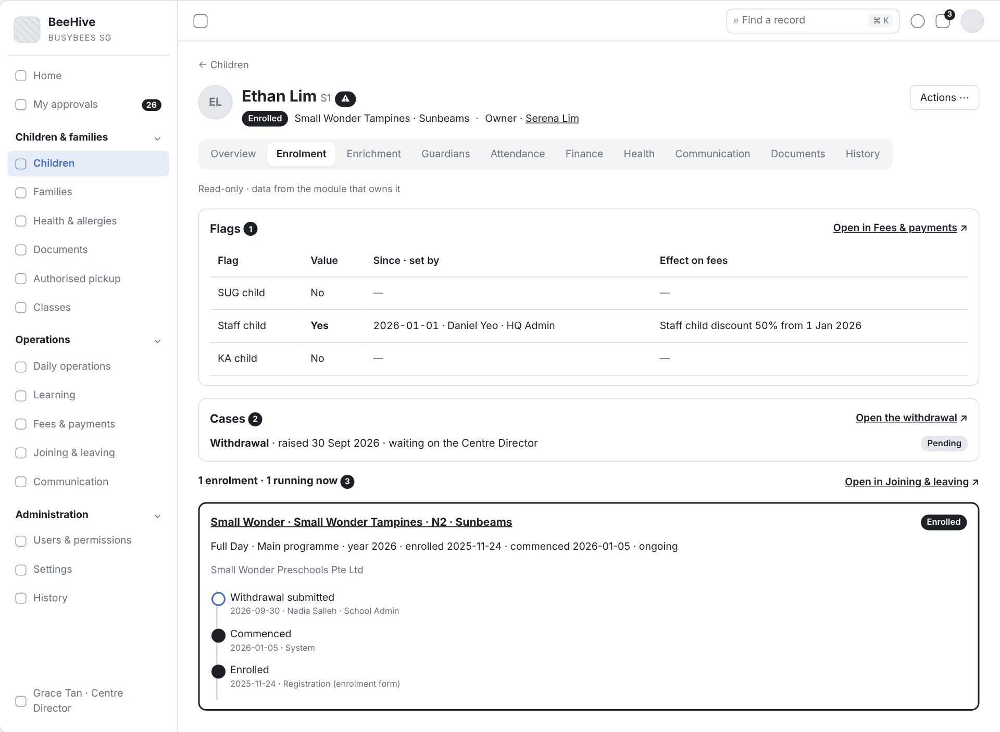
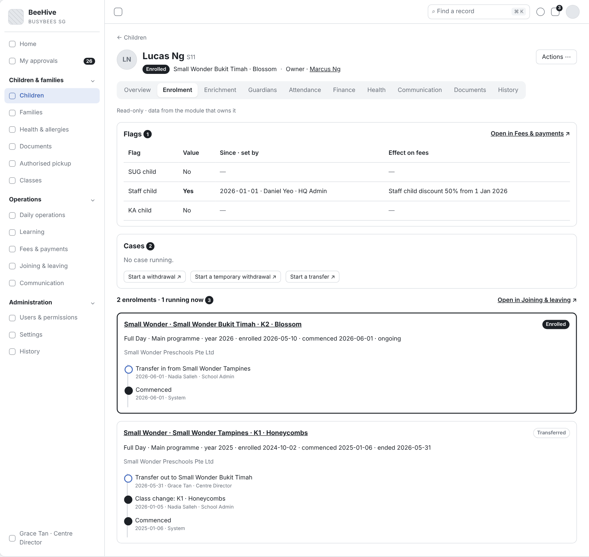
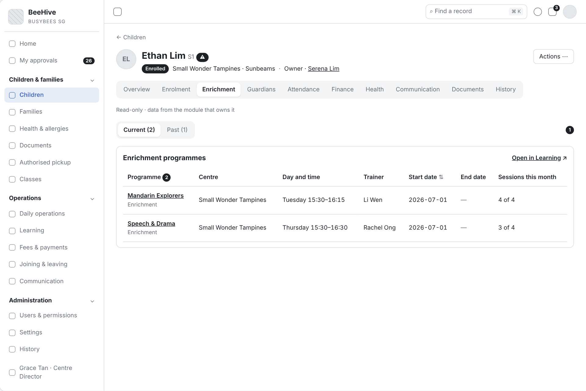
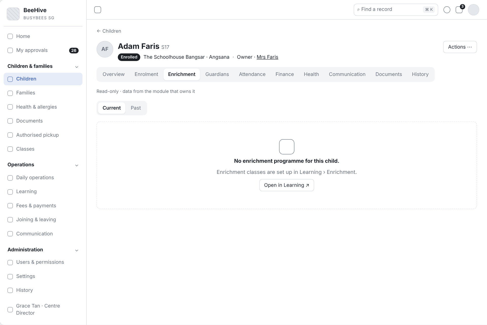
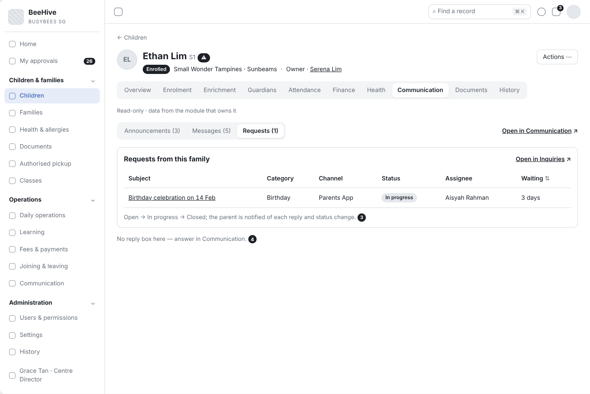
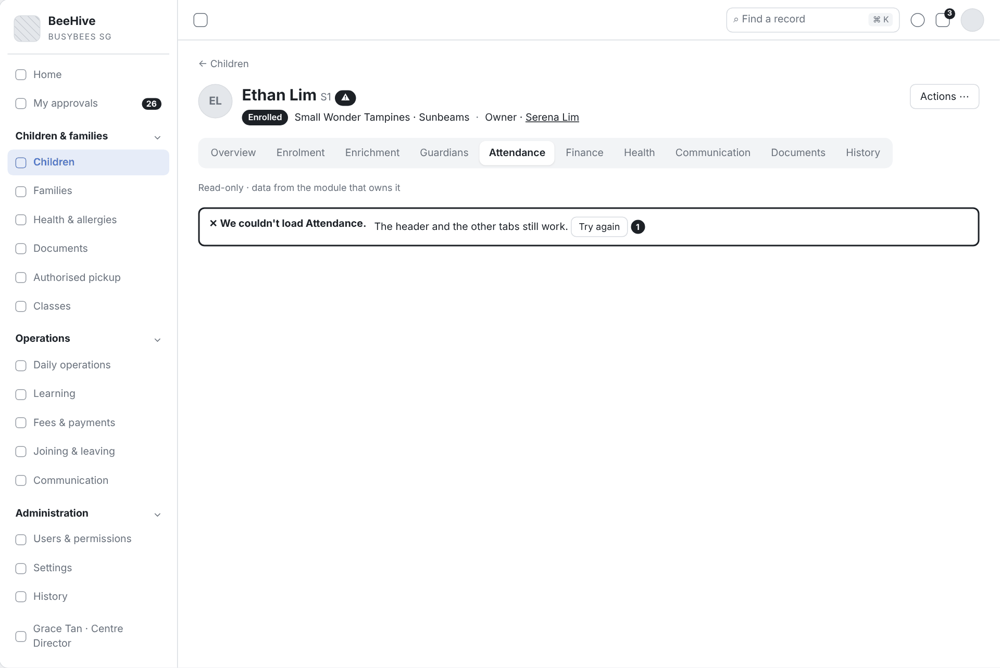

# 3.1 Child Record Tabs – Read Views (Tiếng Việt)

| Thuộc tính | Giá trị |
|---|---|
| Dự án | Busy Bees Asia SMS |
| Module | Children & Families — Child record |
| Tính năng | 3.1 Child record tabs: Enrolment, Enrichment, Attendance, Finance, Communication (read views) |
| Mã tài liệu | FRD-3.1_Child_Record_Read_Tabs |
| Sprint | 4 |
| Phiên bản | 0.1 |
| Trạng thái | BẢN NHÁP CHỜ XÁC NHẬN |
| Ngày | 10/11/2026 |
| Người soạn | Business Analysis |
| Người review | HaiNguyen |
| Người duyệt | HaiNguyen |

## 1. Kiểm soát tài liệu

| Phiên bản | Ngày | Tác giả | Tóm tắt thay đổi | Duyệt |
|---|---|---|---|---|
| 0.1 | 10/11/2026 | Business Analysis | Bản đầu: 5 tab chỉ đọc của hồ sơ trẻ — Enrolment, Enrichment, Attendance, Finance, Communication — mỗi tab có liên kết sang màn của module sở hữu dữ liệu. Không vẽ sơ đồ theo yêu cầu. | HaiNguyen |

**Mức sẵn sàng:** Đã đặc tả nội dung, bộ lọc, trạng thái rỗng, quyền xem và liên kết của 5 tab. Còn 9 câu hỏi mở ở mục 7; cần chốt sớm OQ-RT-01 (vai trò nào thấy tab Finance và Communication) và OQ-RT-04 (các cờ SUG / Staff / KA child sửa ở đâu).

## 2. Mục tiêu và bối cảnh

Hồ sơ trẻ gom về một chỗ những gì các module khác ghi nhận về trẻ, để nhân viên Centre và HQ trả lời phụ huynh, kiểm tra học phí hay điểm danh mà không phải mở từng module. Mô tả của task:

> "Read-only tabs on the child record: enrolment history (centre, class, programme, dates, status changes), enrichment programmes, attendance summary and day records, finance (invoices, balances, GIRO), communication (announcements, messages, requests) – each linking to the module screen."

Nguyên tắc chung của 5 tab:
- **Chỉ đọc.** Tab hiển thị dữ liệu, không sửa. Mọi thao tác (gửi nhắc phí, bắt đầu thôi học, trả lời tin nhắn, void điểm danh…) thực hiện ở màn của module sở hữu, mở bằng liên kết trên tab.
- **Một nguồn dữ liệu.** Tab đọc trực tiếp dữ liệu của module (Joining & Leaving, Learning, Daily Operations, Fees & Payments, Communication), không lưu bản sao trên hồ sơ trẻ.
- **Theo quyền.** Người dùng chỉ thấy tab và dữ liệu mà vai trò của mình được xem.

**Tham chiếu:** SRS SMS Children & Families v0.1 — §4 mục 1.1 (View child profile, Apply access scope), BR-CHF-006, BR-CHF-011 đến BR-CHF-013 · SRS Joining & Leaving v0.1 — §1.1, §3 P1 đến P5 · SRS Learning v0.1 — Enrichment (§3 P5, P6) · SRS Daily Operations v0.1 — Child attendance, BR-OPS-020 đến BR-OPS-024 · SRS Fees & Payments v0.1 — Invoices, GIRO accounts, Deposits, Subsidy, Discounts, Receivables · SRS Communication v0.1 — §4 mục 1.1 Announcements, 2.1 Messages, 3.1 Inquiries · SRS General Requirements v0.1 — §3.1 quyền 3 lớp, §4.1 danh sách chuẩn, §4 Personal data · Prototype: https://bba-sms-crm.lovable.app/records/child/s1 · Wireframe: `Diagram/Wireframe/child-tabs-sprint4.html`.

## 3. Phạm vi và ranh giới phase

| Trong phạm vi | Ngoài phạm vi |
|---|---|
| Tab Enrolment: các lần ghi danh, lịch sử thay đổi trạng thái, case đang mở, cờ của trẻ. Tab Enrichment: chương trình enrichment hiện tại và đã kết thúc, số buổi tham dự. Tab Attendance: tóm tắt điểm danh, danh sách ngày, chi tiết một ngày (vào ra, nhiệt độ, void), dịch vụ xe buýt. Tab Finance: tóm tắt thanh toán, việc cần làm, hoá đơn, công nợ, tài khoản GIRO / CDA, trợ cấp, giảm giá, đặt cọc, lịch thanh toán. Tab Communication: thông báo, hội thoại, yêu cầu (inquiry) liên quan đến trẻ. Liên kết sang màn module, quyền xem, trạng thái rỗng. | Các thao tác sửa, tạo, gửi (thuộc module sở hữu). Header và tab Overview (FRD 3.1 Child Record Overview). Tab Guardians, Health, Documents, History (FRD 3.1 Children & Families). Xem dưới góc nhìn phụ huynh ("See what the parent sees"). Báo cáo và xuất dữ liệu của từng module. |

## 4. Tác nhân, vai trò và quyền truy cập

| Tác nhân | Phạm vi | 5 tab |
|---|---|---|
| HQ Admin | Mọi Centre. | Thấy đủ 5 tab, mọi dữ liệu. |
| HQ Enrolment | Mọi Centre. | Enrolment, Enrichment, Attendance, Communication; Finance theo quyền (AS-RT-01). |
| HQ Finance | Mọi Centre. | Thấy đủ 5 tab; trọng tâm Finance. |
| Centre Director, School Admin | Centre của mình. | Thấy đủ 5 tab. |
| Teacher | Lớp của mình. | Enrolment, Enrichment, Attendance, Communication (chỉ hội thoại có giáo viên tham gia); không thấy Finance (AS-RT-01). |
| Enrichment Trainer | Lớp enrichment của mình. | Chỉ Enrichment (AS-RT-02). |
| System | Toàn hệ thống. | Đọc dữ liệu module, tính tóm tắt, áp quyền, ẩn hoặc che trường được bảo vệ. |

Quy tắc chung: quyền theo khu vực, quyền đặc biệt và trường được bảo vệ (Hidden / Masked / Read / Edit) (SRS GEN §3.1); điều không được làm thì không hiển thị (BR-GEN-004); HQ thấy trẻ mọi Centre, nhân viên Centre thấy trẻ Centre mình, Teacher thấy trẻ lớp mình (BR-CHF-011 đến BR-CHF-013).

## 5. Tổng quan tính năng và phân rã chức năng

| Tab | Chức năng | Module sở hữu | User Story |
|---|---|---|---|
| Enrolment | Lần ghi danh, thay đổi trạng thái, case, cờ. | Joining & Leaving | US-001 |
| Enrichment | Chương trình enrichment, số buổi tham dự. | Learning › Enrichment | US-002 |
| Attendance | Tóm tắt, danh sách ngày, chi tiết ngày, xe buýt. | Daily Operations › Attendance | US-003 |
| Finance | Tóm tắt, việc cần làm, hoá đơn, công nợ, GIRO / CDA, trợ cấp, giảm giá, đặt cọc. | Fees & Payments | US-004 |
| Communication | Thông báo, hội thoại, yêu cầu. | Communication | US-005 |
| Chung | Tải tab, liên kết module, trạng thái rỗng, quyền. | — | US-006 |

| Mã màn | Tên màn | User Story | Ảnh wireframe |
|---|---|---|---|
| SCR-01 | Tab Enrolment | US-001 | `Diagram/Wireframe/png/SCR-01-tab-enrolment*.png` |
| SCR-02 | Tab Enrichment | US-002 | `Diagram/Wireframe/png/SCR-02-tab-enrichment*.png` |
| SCR-03 | Tab Attendance | US-003 | `Diagram/Wireframe/png/SCR-03-tab-attendance*.png` |
| SCR-04 | Tab Finance | US-004 | `Diagram/Wireframe/png/SCR-04-tab-finance*.png` |
| SCR-05 | Tab Communication | US-005 | `Diagram/Wireframe/png/SCR-05-tab-communication*.png` |

## 6. Yêu cầu chức năng theo User Story

### 6.1 US-001 - Tab Enrolment: lịch sử ghi danh

#### User Story

Là School Admin, tôi muốn xem trên hồ sơ trẻ mọi lần ghi danh và các lần đổi trạng thái của trẻ, để trả lời phụ huynh về ngày bắt đầu, chương trình học hay tiến độ thôi học mà không phải mở Joining & Leaving.

#### Process Diagram (Sơ đồ quy trình)

Không vẽ sơ đồ cho FRD này theo yêu cầu của khách.

#### Functional Requirements (Yêu cầu chức năng)

| FR ID | Yêu cầu chức năng |
|---|---|
| FR-001 | Tab Enrolment hiển thị dòng tóm tắt "<n> enrolment(s) · <m> running now" và danh sách các lần ghi danh, mới nhất trước. |
| FR-002 | Mỗi lần ghi danh hiển thị: brand, Centre, level, class, status (Enrolled, Temporary withdrawal, Withdrawn, Graduated, Transferred), programme (Full day / Half day), loại chương trình, năm học, ngày ghi danh, ngày bắt đầu học (commenced), ngày kết thúc hoặc "ongoing", pháp nhân (legal entity) (SRS J&L §3 P1; BR-CHF-006). |
| FR-003 | Mỗi lần ghi danh có dòng thời gian thay đổi trạng thái: loại thay đổi (bắt đầu học, tạm nghỉ, quay lại, chuyển Centre, thôi học, tốt nghiệp, đổi lớp), ngày hiệu lực, người thực hiện (SRS J&L §3 P2 đến P5). |
| FR-004 | Khối "Cases" liệt kê case đang mở của trẻ (thôi học, tạm nghỉ, chuyển Centre) với trạng thái và bước đang chờ, vd. "Withdrawal raised 30 Sept, waiting on the Centre Director"; chọn case mở màn case trong Joining & Leaving. |
| FR-005 | Khi không có case đang mở, khối Cases có liên kết "Start a withdrawal", "Start a temporary withdrawal", "Start a transfer" mở màn tương ứng của Joining & Leaving, chỉ hiện với vai trò có quyền tạo case. |
| FR-006 | Khối "Flags" hiển thị chỉ đọc các cờ của trẻ: SUG child, Staff child, KA child — Yes / No, ngày bắt đầu, người đặt và tác động lên học phí (vd. "Staff child discount 50% from 1 Jan 2026") (OQ-RT-04). |
| FR-007 | Chọn một lần ghi danh mở màn chi tiết ghi danh trong Joining & Leaving. |

#### Functional Flow - Main (Luồng chính)

1. Người dùng mở hồ sơ trẻ và chọn tab Enrolment (FR-001).
2. Hệ thống hiển thị Flags, Cases và danh sách ghi danh với dòng thời gian trạng thái (FR-002, FR-003, FR-004, FR-006).
3. Người dùng chọn một lần ghi danh hoặc một case để mở màn của Joining & Leaving (FR-004, FR-007).

#### Functional Flow - Alternative (Luồng thay thế)

1. Trẻ không có case đang mở: khối Cases hiển thị các liên kết bắt đầu case theo quyền (FR-005).
2. Trẻ có nhiều lần ghi danh (vd. chuyển Centre, ghi danh lại): danh sách hiển thị đủ, lần đang chạy ở đầu (FR-001).

#### Functional Flow - Exception (Luồng ngoại lệ)

1. Vai trò không có quyền tạo case: không có liên kết bắt đầu case (VAL-001).

#### Business Rules (Quy tắc nghiệp vụ)

| BR ID | Quy tắc |
|---|---|
| BR-001 | Trạng thái của trẻ chỉ đổi qua Joining & Leaving; tab Enrolment chỉ hiển thị (BR-CHF-006). |
| BR-002 | Lịch sử ghi danh không bị xoá; trẻ đã thôi học hoặc tốt nghiệp vẫn xem được (BR-CHF-007, BR-CHF-008). |

#### Validation Rules (Quy tắc kiểm tra)

| VAL ID | Điều kiện | Phản hồi của hệ thống |
|---|---|---|
| VAL-001 | Vai trò không có quyền tạo case thôi học, tạm nghỉ hoặc chuyển Centre. | Không hiển thị liên kết bắt đầu case tương ứng (BR-GEN-004). |

#### UI Reference (Tham chiếu giao diện)

| Mã màn hình / Phiên bản | Tham chiếu / Link |
|---|---|
| SCR-01 - Tab Enrolment | Prototype: https://bba-sms-crm.lovable.app/records/child/s1 (tab Enrolment) · Wireframe: `Diagram/Wireframe/child-tabs-sprint4.html#scr-01` |

#### UI Components / Field Specification (Thành phần giao diện)

| Trường / Điều khiển | Loại | Bắt buộc | Mặc định / Trạng thái | Kiểm tra | Hành vi |
|---|---|---|---|---|---|
| Flags | Section (chỉ đọc) | Có | 3 cờ | — | FR-006. |
| Cases | Section | Có | Case đang mở hoặc liên kết bắt đầu case | VAL-001. | FR-004, FR-005. |
| "<n> enrolment(s) · <m> running now" | Text | Có | — | — | FR-001. |
| Thẻ ghi danh | Card | Có | Mới nhất trước | — | Brand, Centre · level · class, status, programme, năm, ngày ghi danh, commenced, kết thúc, legal entity; chọn mở chi tiết (FR-002, FR-007). |
| Dòng thời gian trạng thái | Timeline | Có | Mới nhất trước | — | Loại thay đổi, ngày hiệu lực, người thực hiện (FR-003). |

#### Data and Audit (Dữ liệu và audit)

| ID | Yêu cầu |
|---|---|
| DATA-001 | Tab đọc từ Joining & Leaving: enrolment (brand, centre, level, class, status, programme, programme type, year, enrolled date, commenced date, end date, legal entity), status change (type, effective date, by), case (type, status, waiting step); từ Fees & Payments: flags (SUG / Staff / KA child, from date, set by, effect). |

#### Acceptance Criteria (Tiêu chí nghiệm thu)

| AC ID | Given (Cho trước) | When (Khi) | Then (Thì) | Linked Rule |
|---|---|---|---|---|
| AC-001 | Ethan có 1 lần ghi danh đang chạy ở Small Wonder Tampines, N2 · Sunbeams | School Admin mở tab Enrolment | dòng tóm tắt "1 enrolment · 1 running now"; thẻ ghi danh hiện "Full Day · Main programme · year 2026 · enrolled 2025-11-24 · commenced 2026-01-05 · ongoing" và "Small Wonder Preschools Pte Ltd" | FR-001; FR-002; DATA-001 |
| AC-002 | Ethan có đơn thôi học tạo 30/09, chờ Centre Director | School Admin mở tab Enrolment | khối Cases hiện "Withdrawal raised 30 Sept, waiting on the Centre Director"; chọn mở màn case thôi học | FR-004 |
| AC-003 | Lucas đã chuyển từ Small Wonder Tampines sang Bukit Timah ngày 01/06/2026 | người dùng mở tab Enrolment | có 2 thẻ ghi danh, lần đang chạy ở đầu; lần cũ có trạng thái Transferred và dòng thời gian ghi "Transfer · 2026-06-01" | FR-001; FR-003; BR-002 |
| AC-004 | Ethan là Staff child từ 01/01/2026 | người dùng mở tab Enrolment | khối Flags hiện Staff child "Yes", ngày bắt đầu, người đặt và "staff child discount 50%"; không có nút sửa | FR-006 |
| AC-005 | trẻ không có case đang mở, School Admin có quyền tạo case | School Admin mở tab Enrolment | khối Cases có "Start a withdrawal", "Start a temporary withdrawal", "Start a transfer" | FR-005 |
| AC-006 | Teacher không có quyền tạo case | Teacher mở tab Enrolment | không có liên kết bắt đầu case | VAL-001 |
| AC-007 | Ethan đã có đơn thôi học | Centre Director mở tab Enrolment | không có thao tác đổi trạng thái trên tab | BR-001 |
| AC-008 | người dùng đang xem tab Enrolment | người dùng chọn thẻ ghi danh Sunbeams | màn chi tiết ghi danh của Joining & Leaving mở | FR-007 |

#### Dependencies (Phụ thuộc)

Joining & Leaving (enrolment, case); Fees & Payments (flags); OQ-RT-04.

### 6.2 US-002 - Tab Enrichment: chương trình enrichment

#### User Story

Là School Admin, tôi muốn xem trẻ đang học những lớp enrichment nào, lịch học và số buổi đã tham dự, để trả lời phụ huynh và đối chiếu khi phụ huynh hỏi về hoá đơn enrichment.

#### Process Diagram (Sơ đồ quy trình)

Không vẽ sơ đồ cho FRD này theo yêu cầu của khách.

#### Functional Requirements (Yêu cầu chức năng)

| FR ID | Yêu cầu chức năng |
|---|---|
| FR-008 | Tab Enrichment hiển thị bảng "Enrichment programmes": Programme (tên, loại), Centre, Day and time, Trainer, Start date, End date ("—" khi đang học), Sessions attended this month (SRS Learning §3 P5). |
| FR-009 | Bộ lọc Current / Past: mặc định Current (chương trình chưa kết thúc); Past hiển thị chương trình đã kết thúc (AS-RT-03). |
| FR-010 | Chọn tên chương trình mở màn lớp enrichment trong Learning › Enrichment. |
| FR-011 | Trẻ chưa có chương trình nào: hiển thị "No enrichment programme for this child." |

#### Functional Flow - Main (Luồng chính)

1. Người dùng chọn tab Enrichment; hệ thống hiển thị chương trình hiện tại (FR-008, FR-009).
2. Người dùng chọn một chương trình để mở lớp enrichment (FR-010).

#### Functional Flow - Alternative (Luồng thay thế)

1. Người dùng chọn Past để xem chương trình đã kết thúc (FR-009).
2. Trẻ chưa có chương trình: trạng thái rỗng (FR-011).

#### Functional Flow - Exception (Luồng ngoại lệ)

1. Enrichment Trainer mở hồ sơ trẻ không thuộc lớp enrichment của mình: hồ sơ không mở (VAL-002).

#### Business Rules (Quy tắc nghiệp vụ)

| BR ID | Quy tắc |
|---|---|
| BR-003 | Enrichment Trainer chỉ thấy lớp enrichment được giao cho mình (SRS Learning §2). |

#### Validation Rules (Quy tắc kiểm tra)

| VAL ID | Điều kiện | Phản hồi của hệ thống |
|---|---|---|
| VAL-002 | Trẻ không thuộc lớp enrichment nào của Enrichment Trainer. | Không hiển thị hồ sơ trẻ cho Enrichment Trainer. |

#### UI Reference (Tham chiếu giao diện)

| Mã màn hình / Phiên bản | Tham chiếu / Link |
|---|---|
| SCR-02 - Tab Enrichment | Prototype: https://bba-sms-crm.lovable.app/records/child/s1 (tab Enrichment) · Wireframe: `Diagram/Wireframe/child-tabs-sprint4.html#scr-02` |

#### UI Components / Field Specification (Thành phần giao diện)

| Trường / Điều khiển | Loại | Bắt buộc | Mặc định / Trạng thái | Kiểm tra | Hành vi |
|---|---|---|---|---|---|
| Current / Past | Segmented | Có | Current | — | FR-009. |
| Bảng Enrichment programmes | Table | Có | Start date mới nhất trước | — | Cột FR-008; tên chương trình là liên kết (FR-010). |
| Trạng thái rỗng | Empty state | Khi không có | — | — | FR-011. |

#### Data and Audit (Dữ liệu và audit)

| ID | Yêu cầu |
|---|---|
| DATA-002 | Tab đọc từ Learning › Enrichment: class (name, type, centre, weekday, time, trainer), student in class (start date, end date), session attendance (sessions attended in the month). |

#### Acceptance Criteria (Tiêu chí nghiệm thu)

| AC ID | Given (Cho trước) | When (Khi) | Then (Thì) | Linked Rule |
|---|---|---|---|---|
| AC-009 | Ethan học Mandarin Explorers (thứ Ba 15:30–16:15) và Speech & Drama (thứ Năm 15:30–16:30) từ 01/07/2026 | người dùng mở tab Enrichment | bảng có 2 dòng với Centre, Day and time, Trainer, Start date 2026-07-01, End date "—", số buổi tham dự tháng này | FR-008; DATA-002 |
| AC-010 | Ethan đã học xong Little Chefs (kết thúc 30/06/2026) | người dùng chọn Past | bảng hiện Little Chefs với End date 2026-06-30 | FR-009 |
| AC-011 | người dùng xem tab Enrichment | người dùng chọn "Mandarin Explorers" | màn lớp enrichment Mandarin Explorers mở | FR-010 |
| AC-012 | Adam chưa học enrichment | người dùng mở tab Enrichment | hiện "No enrichment programme for this child." | FR-011 |
| AC-013 | Enrichment Trainer dạy Speech & Drama, Adam không học lớp này | trainer tìm Adam | không mở được hồ sơ Adam | VAL-002; BR-003 |

#### Dependencies (Phụ thuộc)

Learning › Enrichment; OQ-RT-03.

### 6.3 US-003 - Tab Attendance: tóm tắt và chi tiết ngày

#### User Story

Là Centre Director, tôi muốn xem tóm tắt điểm danh của trẻ và chi tiết từng ngày (giờ vào ra, người đưa đón, nhiệt độ, void), để trả lời phụ huynh và kiểm tra khi có thắc mắc về trợ cấp hay học phí.

#### Process Diagram (Sơ đồ quy trình)

Không vẽ sơ đồ cho FRD này theo yêu cầu của khách.

#### Functional Requirements (Yêu cầu chức năng)

| FR ID | Yêu cầu chức năng |
|---|---|
| FR-012 | Khối tóm tắt "Days attended": số ngày có mặt tháng này, kỳ này; số ngày vắng; số ngày nghỉ phép (leave); số lần đến muộn (SRS Daily Operations — Child attendance). |
| FR-013 | Danh sách "Recent attendance" theo ngày, mới nhất trước: ngày, class, buổi (Main / enrichment), status (Present, Absent, On leave, Signed in, Signed out), giờ vào, giờ ra, cờ đến muộn; lọc theo tháng; phân trang 20 / 50 / 100 (SRS DOPS — View class attendance; SRS GEN §4.1). |
| FR-014 | Chọn một ngày mở "Day record": status, class, buổi, giờ vào và người đưa, giờ ra và người đón, mọi lần đo nhiệt độ (giờ, thời điểm đo, nhiệt độ, thiết bị), lý do vắng hoặc loại nghỉ phép. |
| FR-015 | Bản ghi đã void hiển thị gạch ngang với nhãn "Voided", người yêu cầu, người duyệt, thời điểm, lý do; không tính vào số ngày có mặt (BR-OPS-020, BR-OPS-024). |
| FR-016 | Nhiệt độ từ 37,5 °C trở lên được đánh dấu cảnh báo trong Day record (AS-RT-04). |
| FR-017 | Khối "Bus service" hiển thị chỉ đọc tuyến xe buýt của trẻ hoặc "No bus". |
| FR-018 | Liên kết "Open in Daily operations" mở màn điểm danh lớp của trẻ tại ngày đang xem. |

#### Functional Flow - Main (Luồng chính)

1. Người dùng chọn tab Attendance; hệ thống hiển thị tóm tắt, xe buýt và danh sách ngày tháng hiện tại (FR-012, FR-013, FR-017).
2. Người dùng chọn một ngày; hệ thống hiển thị Day record (FR-014).
3. Người dùng chọn "Open in Daily operations" để xử lý tại màn điểm danh (FR-018).

#### Functional Flow - Alternative (Luồng thay thế)

1. Người dùng đổi tháng: tóm tắt tháng và danh sách cập nhật (FR-013).
2. Ngày có bản ghi đã void: Day record hiển thị bản ghi gạch ngang và thông tin void (FR-015).

#### Functional Flow - Exception (Luồng ngoại lệ)

1. Chọn tháng trong tương lai hoặc trước ngày bắt đầu học: không có dữ liệu, hiện thông báo rỗng (VAL-003).

#### Business Rules (Quy tắc nghiệp vụ)

| BR ID | Quy tắc |
|---|---|
| BR-004 | Bản ghi điểm danh sai được void, không xoá; bản ghi đã void không tính là có mặt và vẫn hiển thị trong lịch sử (BR-OPS-020). |
| BR-005 | Mọi void lưu người yêu cầu, người duyệt, thời điểm và lý do (BR-OPS-024). |

#### Validation Rules (Quy tắc kiểm tra)

| VAL ID | Điều kiện | Phản hồi của hệ thống |
|---|---|---|
| VAL-003 | Tháng được chọn không có bản ghi điểm danh. | Hiển thị "No attendance recorded in <month>." |

#### UI Reference (Tham chiếu giao diện)

| Mã màn hình / Phiên bản | Tham chiếu / Link |
|---|---|
| SCR-03 - Tab Attendance | Prototype: https://bba-sms-crm.lovable.app/records/child/s1 (tab Attendance) · Wireframe: `Diagram/Wireframe/child-tabs-sprint4.html#scr-03` |

#### UI Components / Field Specification (Thành phần giao diện)

| Trường / Điều khiển | Loại | Bắt buộc | Mặc định / Trạng thái | Kiểm tra | Hành vi |
|---|---|---|---|---|---|
| Days attended | Stat cards | Có | Tháng hiện tại | — | FR-012. |
| Bus service | Text (chỉ đọc) | Có | Tuyến hoặc "No bus" | — | FR-017. |
| Tháng | Month picker | Có | Tháng hiện tại | VAL-003. | Lọc danh sách. |
| Recent attendance | List | Có | Mới nhất trước | — | FR-013; chọn ngày mở Day record. |
| Day record | Panel | Có | Ngày gần nhất | — | FR-014, FR-015, FR-016. |
| Open in Daily operations | Link | Có | — | — | FR-018. |

#### Data and Audit (Dữ liệu và audit)

| ID | Yêu cầu |
|---|---|
| DATA-003 | Tab đọc từ Daily Operations: attendance record (date, class, session, status, check-in time và người đưa, check-out time và người đón, late flag), temperature (time, point, value, device), absence / leave (type, reason), void (requested by, approved by, time, reason), bus route. |

#### Acceptance Criteria (Tiêu chí nghiệm thu)

| AC ID | Given (Cho trước) | When (Khi) | Then (Thì) | Linked Rule |
|---|---|---|---|---|
| AC-014 | tháng 9 Ethan có mặt 10 ngày, kỳ này 25 ngày, không vắng | người dùng mở tab Attendance | khối tóm tắt hiện "10 this month", "25 this term", "0 absences recorded" | FR-012 |
| AC-015 | ngày 17/09 Ethan vào 08:12, đo 36,6 °C lúc đến và 36,8 °C trước giờ ngủ | người dùng chọn ngày 17/09 | Day record hiện status Present, class Sunbeams, giờ vào 08:12 và 2 lần đo nhiệt độ với giờ, thời điểm, thiết bị | FR-013; FR-014; DATA-003 |
| AC-016 | bản ghi ngày 11/09 của Lucas bị void, lý do "Checked in by mistake" | người dùng chọn ngày 11/09 | bản ghi hiện gạch ngang, nhãn "Voided", người yêu cầu, người duyệt, thời điểm, lý do; ngày 11/09 không tính vào số ngày có mặt | FR-015; BR-004; BR-005 |
| AC-017 | Ethan đo 37,8 °C lúc 10:00 | người dùng mở Day record | dòng 37,8 °C có dấu cảnh báo | FR-016 |
| AC-018 | Ethan không đi xe buýt | người dùng mở tab Attendance | Bus service hiện "No bus", không có thao tác sửa | FR-017 |
| AC-019 | người dùng đang xem Day record ngày 17/09 | người dùng chọn "Open in Daily operations" | màn điểm danh lớp Sunbeams ngày 17/09 mở | FR-018 |
| AC-020 | Ethan bắt đầu học 05/01/2026 | người dùng chọn tháng 12/2025 | hiện "No attendance recorded in December 2025." | VAL-003 |

#### Dependencies (Phụ thuộc)

Daily Operations (attendance, temperature, leave, void, bus); OQ-RT-05.

### 6.4 US-004 - Tab Finance: hoá đơn, công nợ, GIRO

#### User Story

Là HQ Finance, tôi muốn xem trên hồ sơ trẻ tình hình tài chính của trẻ — phương thức thanh toán, hoá đơn, số còn nợ, tài khoản GIRO / CDA, trợ cấp, giảm giá, tiền đặt cọc — và mở nhanh màn của Fees & Payments, để trả lời phụ huynh và xử lý công nợ.

#### Process Diagram (Sơ đồ quy trình)

Không vẽ sơ đồ cho FRD này theo yêu cầu của khách.

#### Functional Requirements (Yêu cầu chức năng)

| FR ID | Yêu cầu chức năng |
|---|---|
| FR-019 | Khối "How this family pays": Payment method, citizenship dùng để tính học phí, Bill to (Parent / Company), tiền đặt cọc đang giữ và pháp nhân, tổng còn nợ (Outstanding). |
| FR-020 | Khối "What needs doing": hoá đơn quá hạn ("Invoice <số> is <n> days overdue — <tiền>"), GIRO bị từ chối, hoàn tiền không thành công; mỗi dòng mở màn tương ứng của Fees & Payments (Receivables, GIRO accounts, Refunds). |
| FR-021 | Bảng "Invoices" nhóm theo loại (School fees, Enrichment, Registration, Ad hoc): số hoá đơn, tháng, hạn thanh toán, phương thức, status (Draft, Billed, Paid, Partially paid, Void), số tiền, số còn lại; mới nhất trước; chọn số hoá đơn mở chi tiết hoá đơn (SRS F&P — Invoices). |
| FR-022 | Khối "Outstanding": tổng còn nợ, từng hoá đơn chưa trả với hạn và nhóm tuổi nợ (1–30, 31–60, 61–90, trên 90 ngày), lịch sử nhắc phí đã gửi (ngày, người nhận); liên kết "Open in Receivables". |
| FR-023 | Bảng "GIRO and CDA accounts": loại (GIRO / CDA), ngân hàng, số tài khoản che chỉ còn 4 số cuối, DDA reference, cách nộp (paper form / e-GIRO), status (Pending with bank, Active, Rejected, Inactive), "Pays by GIRO"; liên kết "Open in GIRO accounts" (SRS F&P §4.1). |
| FR-024 | Khối "Subsidies": loại (Basic, Additional), số tiền mỗi tháng, ngày hết hạn, mẫu ECDA và số tham chiếu; trợ cấp sắp hết hạn (trong 30 ngày) được đánh dấu (AS-RT-05). |
| FR-025 | Khối "Discounts": giảm giá đang áp (tên, mức, kỳ, từ ngày → đến ngày, người thêm), và giảm giá không áp kèm lý do (vd. "only one discount applies to an invoice"). |
| FR-026 | Khối "Deposit": ngày nhận, số tham chiếu, số tiền, số còn lại; liên kết "Open in Deposits". Khối "Payment schedule": học phí, giảm giá, số phải trả theo từng tháng của năm học; liên kết "Open schedule". |
| FR-027 | Số tài khoản ngân hàng và tiền đặt cọc là trường được bảo vệ: hiển thị đầy đủ, che hoặc ẩn theo vai trò (SRS GEN §3.1; SRS ADM — Edit protected fields). |

#### Functional Flow - Main (Luồng chính)

1. HQ Finance chọn tab Finance; hệ thống hiển thị How this family pays, What needs doing, Invoices, Outstanding, GIRO and CDA accounts, Subsidies, Discounts, Deposit, Payment schedule (FR-019 đến FR-026).
2. HQ Finance chọn một hoá đơn hoặc một việc cần làm để mở màn của Fees & Payments (FR-020, FR-021).

#### Functional Flow - Alternative (Luồng thay thế)

1. Không có việc cần làm: khối What needs doing hiện "Nothing needs doing." (FR-020).
2. Trẻ ở Centre Malaysia: không có khối GIRO and CDA accounts và không có Subsidies ECDA (VAL-004).

#### Functional Flow - Exception (Luồng ngoại lệ)

1. Vai trò không được xem tab Finance: tab không hiển thị (VAL-005).

#### Business Rules (Quy tắc nghiệp vụ)

| BR ID | Quy tắc |
|---|---|
| BR-006 | GIRO, CDA và ECDA chỉ áp cho Centre Singapore (BR-ADM-038). |
| BR-007 | Số tài khoản GIRO chỉ hiện 4 số cuối ngoài màn chi tiết tài khoản (SRS F&P §4.1 Mask account number). |
| BR-008 | Mỗi hoá đơn chỉ áp một giảm giá; giảm giá có giá trị cao hơn được áp (AS-RT-06). |

#### Validation Rules (Quy tắc kiểm tra)

| VAL ID | Điều kiện | Phản hồi của hệ thống |
|---|---|---|
| VAL-004 | Trẻ thuộc Centre Malaysia. | Ẩn khối GIRO and CDA accounts và trợ cấp ECDA (BR-ADM-038). |
| VAL-005 | Vai trò không có quyền xem Fees & Payments. | Không hiển thị tab Finance (BR-GEN-004; AS-RT-01). |

#### UI Reference (Tham chiếu giao diện)

| Mã màn hình / Phiên bản | Tham chiếu / Link |
|---|---|
| SCR-04 - Tab Finance | Prototype: https://bba-sms-crm.lovable.app/records/child/s1 (tab Finance) · Wireframe: `Diagram/Wireframe/child-tabs-sprint4.html#scr-04` |

#### UI Components / Field Specification (Thành phần giao diện)

| Trường / Điều khiển | Loại | Bắt buộc | Mặc định / Trạng thái | Kiểm tra | Hành vi |
|---|---|---|---|---|---|
| How this family pays | Summary cards | Có | — | — | FR-019. |
| What needs doing | List | Có | Mới nhất trước | — | FR-020; mỗi dòng là liên kết. |
| Invoices | Grouped table | Có | Mới nhất trước | — | FR-021. |
| Outstanding | Section | Có | — | — | FR-022. |
| GIRO and CDA accounts | Table | Singapore | — | VAL-004. | FR-023; số tài khoản che (BR-007). |
| Subsidies | List | Singapore | — | VAL-004. | FR-024. |
| Discounts | List | Có | — | — | FR-025. |
| Deposit, Payment schedule | Section | Có | — | — | FR-026. |

#### Data and Audit (Dữ liệu và audit)

| ID | Yêu cầu |
|---|---|
| DATA-004 | Tab đọc từ Fees & Payments: billing profile (payment method, citizenship used, bill to), invoice (number, type, month, due date, method, status, amount, balance), receivable ageing và reminders, GIRO / CDA account (type, bank, masked number, DDA reference, method, status, pays by GIRO), subsidy (type, amount, expiry, form, reference), discount (name, rate, period, from, to, added by, applied / not applied reason), deposit (date, reference, amount, remaining), schedule (month, fee, discount, net). |

#### Acceptance Criteria (Tiêu chí nghiệm thu)

| AC ID | Given (Cho trước) | When (Khi) | Then (Thì) | Linked Rule |
|---|---|---|---|---|
| AC-021 | Ethan trả bằng GIRO, citizenship Singapore Citizen, cọc 1.180 SGD ở Small Wonder Preschools Pte Ltd | HQ Finance mở tab Finance | How this family pays hiện GIRO, Singapore Citizen, "SGD 1,180 · Small Wonder Preschools Pte Ltd" và tổng còn nợ | FR-019; DATA-004 |
| AC-022 | hoá đơn SW-TAM-2026-10-0041 quá hạn 34 ngày, còn 137,58 SGD | HQ Finance mở tab Finance | What needs doing hiện "Invoice SW-TAM-2026-10-0041 is 34 days overdue — SGD 137.58"; chọn dòng mở Receivables | FR-020 |
| AC-023 | Ethan có 2 hoá đơn học phí và 1 hoá đơn enrichment | HQ Finance mở tab Finance | bảng Invoices có nhóm "School fees · 2" và "Enrichment · 1" với số, tháng, hạn, phương thức, status, số tiền; chọn số hoá đơn mở chi tiết | FR-021 |
| AC-024 | Ethan còn nợ 992,98 SGD qua 3 hoá đơn | HQ Finance mở khối Outstanding | tổng "SGD 992.98", từng hoá đơn với nhóm tuổi nợ, ngày nhắc phí đã gửi | FR-022 |
| AC-025 | Ethan có tài khoản GIRO DBS 072-311-4021 Active | School Admin mở tab Finance | bảng hiện "DBS · ••••4021", DDA reference, Paper form, Active, Pays by GIRO | FR-023; BR-007 |
| AC-026 | Additional subsidy của Ethan hết hạn 31/10/2026, hôm nay 10/10/2026 | người dùng mở Subsidies | dòng Additional subsidy có dấu sắp hết hạn | FR-024 |
| AC-027 | Ethan có Staff child 50% và Second child 5% | người dùng mở Discounts | Staff child discount hiện "applied"; Second child hiện "not applied" kèm lý do | FR-025; BR-008 |
| AC-028 | cọc của Ethan là trường che với School Admin | School Admin mở khối Deposit | số tiền cọc hiện dạng che | FR-026; FR-027 |
| AC-029 | Adam thuộc Centre Malaysia | HQ Finance mở tab Finance | không có khối GIRO and CDA accounts và Subsidies ECDA | VAL-004; BR-006 |
| AC-030 | Teacher không có quyền xem Fees & Payments | Teacher mở hồ sơ Ethan | không có tab Finance | VAL-005 |

#### Dependencies (Phụ thuộc)

Fees & Payments (invoices, receivables, GIRO accounts, subsidy, discounts, deposits, schedule); Roles & permissions (trường bảo vệ); OQ-RT-01, OQ-RT-06.

### 6.5 US-005 - Tab Communication: thông báo, hội thoại, yêu cầu

#### User Story

Là Centre Director, tôi muốn xem trên hồ sơ trẻ mọi thông báo, hội thoại và yêu cầu liên quan đến trẻ và gia đình, để biết phụ huynh đã được báo gì, đang chờ trả lời gì trước khi gọi cho họ.

#### Process Diagram (Sơ đồ quy trình)

Không vẽ sơ đồ cho FRD này theo yêu cầu của khách.

#### Functional Requirements (Yêu cầu chức năng)

| FR ID | Yêu cầu chức năng |
|---|---|
| FR-028 | Tab Communication có 3 phần chọn bằng segmented control: Announcements, Messages, Requests; mỗi phần ghi số mục (SRS Communication §4 mục 1.1, 2.1, 3.1). |
| FR-029 | Announcements: thông báo đã gửi tới phụ huynh của trẻ (theo hệ thống, Centre, level hoặc lớp của trẻ): tiêu đề, category, người đăng, ngày gửi, status (Sent, Recalled), phụ huynh đã đọc hay chưa; mới nhất trước. |
| FR-030 | Messages: hội thoại có phụ huynh của trẻ tham gia: tên hội thoại, loại (Class thread, Group, One-to-one, Private fan-out), người tham gia, tin gần nhất (người, thời điểm, đoạn đầu nội dung), "Waiting on a reply · <n> days" khi tin cuối là của phụ huynh; hội thoại của lớp cũ ghi "Previous class". |
| FR-031 | Requests: yêu cầu (inquiry) của phụ huynh về trẻ: tiêu đề, category, kênh, status (Open, In progress, Closed), người phụ trách, thời gian chờ; mặc định chờ lâu nhất trước (SRS Communication §4 mục 3.1). |
| FR-032 | Chọn một thông báo, hội thoại hoặc yêu cầu mở màn tương ứng trong Communication (chi tiết thông báo, hội thoại, chi tiết yêu cầu); tab không có ô trả lời. |
| FR-033 | Teacher chỉ thấy hội thoại mình tham gia và yêu cầu được giao cho mình (AS-RT-07). |

#### Functional Flow - Main (Luồng chính)

1. Người dùng chọn tab Communication; hệ thống mở phần Messages với số mục của từng phần (FR-028, FR-030).
2. Người dùng chọn Announcements hoặc Requests (FR-029, FR-031).
3. Người dùng chọn một mục để mở màn Communication và trả lời ở đó (FR-032).

#### Functional Flow - Alternative (Luồng thay thế)

1. Phần không có mục: hiện "No <announcements / messages / requests> for this child." (FR-028).
2. Teacher mở tab: chỉ hội thoại và yêu cầu của mình (FR-033).

#### Functional Flow - Exception (Luồng ngoại lệ)

1. Thông báo đã thu hồi (Recalled): vẫn hiển thị với nhãn Recalled, mở chi tiết chỉ đọc (VAL-006).

#### Business Rules (Quy tắc nghiệp vụ)

| BR ID | Quy tắc |
|---|---|
| BR-009 | Thông báo thu hồi bị gỡ khỏi Parents App nhưng bản ghi được giữ với status Recalled (SRS Communication §4 mục 1.1 Recall announcement). |
| BR-010 | Yêu cầu đi qua Open → In progress → Closed; mỗi lần trả lời và đổi status, phụ huynh được thông báo (SRS Communication §3 P4). |

#### Validation Rules (Quy tắc kiểm tra)

| VAL ID | Điều kiện | Phản hồi của hệ thống |
|---|---|---|
| VAL-006 | Thông báo có status Recalled. | Hiển thị nhãn "Recalled"; chi tiết mở ở chế độ chỉ đọc. |

#### UI Reference (Tham chiếu giao diện)

| Mã màn hình / Phiên bản | Tham chiếu / Link |
|---|---|
| SCR-05 - Tab Communication | Prototype: https://bba-sms-crm.lovable.app/records/child/s1 (tab Communication) · Wireframe: `Diagram/Wireframe/child-tabs-sprint4.html#scr-05` |

#### UI Components / Field Specification (Thành phần giao diện)

| Trường / Điều khiển | Loại | Bắt buộc | Mặc định / Trạng thái | Kiểm tra | Hành vi |
|---|---|---|---|---|---|
| Announcements (n) / Messages (n) / Requests (n) | Segmented | Có | Messages | — | FR-028. |
| Danh sách thông báo | List | Có | Mới nhất trước | VAL-006. | FR-029. |
| Danh sách hội thoại | List | Có | Tin mới nhất trước | — | FR-030. |
| Danh sách yêu cầu | Table | Có | Chờ lâu nhất trước | — | FR-031. |
| Open in Communication | Link | Có | Mỗi mục | — | FR-032. |

#### Data and Audit (Dữ liệu và audit)

| ID | Yêu cầu |
|---|---|
| DATA-005 | Tab đọc từ Communication: announcement (title, category, posted by, sent date, status, read by parent), thread (name, type, participants, last message, waiting time, previous class flag), inquiry (subject, category, channel, status, assignee, waiting time). |

#### Acceptance Criteria (Tiêu chí nghiệm thu)

| AC ID | Given (Cho trước) | When (Khi) | Then (Thì) | Linked Rule |
|---|---|---|---|---|
| AC-031 | phụ huynh Ethan có 5 hội thoại, 3 thông báo, 1 yêu cầu | Centre Director mở tab Communication | segmented hiện "Announcements (3)", "Messages (5)", "Requests (1)"; phần Messages được chọn | FR-028 |
| AC-032 | Serena Lim gửi tin cuối trong class thread Sunbeams 51 ngày trước | Centre Director xem Messages | dòng Sunbeams (N2) hiện loại "Class", người tham gia và "Waiting on a reply · 51 days" | FR-030; DATA-005 |
| AC-033 | thread Bumblebees là lớp cũ của Ethan | người dùng xem Messages | dòng Bumblebees có nhãn "Previous class" | FR-030 |
| AC-034 | thông báo "Term 4 fee statement" gửi 17/09, Serena đã đọc | người dùng chọn Announcements | dòng hiện tiêu đề, category, người đăng, ngày gửi, Sent, "Read" | FR-029 |
| AC-035 | thông báo "Sports day" đã bị thu hồi | người dùng xem Announcements | dòng có nhãn "Recalled"; mở chi tiết ở chế độ chỉ đọc | VAL-006; BR-009 |
| AC-036 | yêu cầu "Birthday celebration" của Ethan đang In progress, giao cho Aisyah Rahman | người dùng chọn Requests | bảng hiện tiêu đề, category Birthday, status In progress, người phụ trách, thời gian chờ | FR-031; BR-010 |
| AC-037 | người dùng đang xem Messages | người dùng chọn hội thoại "Ethan Lim · both parents" | màn hội thoại trong Communication mở; tab không có ô trả lời | FR-032 |
| AC-038 | Teacher Aisyah chỉ tham gia class thread Sunbeams | Aisyah mở tab Communication | Messages chỉ hiện class thread Sunbeams | FR-033 |

#### Dependencies (Phụ thuộc)

Communication (announcements, messages, inquiries); OQ-RT-07, OQ-RT-08.

### 6.6 US-006 - Quy tắc chung của tab chỉ đọc

#### User Story

Là người dùng hồ sơ trẻ, tôi muốn các tab chỉ đọc mở nhanh, nói rõ khi chưa có dữ liệu và đưa tôi tới đúng màn để xử lý, để không phải tìm lại trẻ trong từng module.

#### Process Diagram (Sơ đồ quy trình)

Không vẽ sơ đồ cho FRD này theo yêu cầu của khách.

#### Functional Requirements (Yêu cầu chức năng)

| FR ID | Yêu cầu chức năng |
|---|---|
| FR-034 | Mỗi tab chỉ tải dữ liệu khi được chọn; trong lúc tải hiển thị khung chờ (skeleton). |
| FR-035 | Mỗi khối có liên kết "Open in <module>" mở màn của module với trẻ đã được lọc sẵn (vd. Receivables lọc theo trẻ). |
| FR-036 | Không có thao tác tạo, sửa, xoá dữ liệu module trên 5 tab; thao tác thực hiện ở màn module mở bằng liên kết. |
| FR-037 | Tab chọn gần nhất được ghi trong địa chỉ trang (vd. `/records/child/s1?tab=finance`); mở lại liên kết thì đúng tab đó. |
| FR-038 | Lỗi tải dữ liệu của một tab hiển thị trong tab đó kèm "Try again", không ảnh hưởng header và tab khác. |

#### Functional Flow - Main (Luồng chính)

1. Người dùng chọn một tab; hệ thống hiển thị khung chờ rồi dữ liệu (FR-034).
2. Người dùng chọn "Open in <module>" để xử lý; hệ thống mở màn module đã lọc theo trẻ (FR-035).

#### Functional Flow - Alternative (Luồng thay thế)

1. Người dùng mở liên kết có `?tab=`: hồ sơ mở đúng tab (FR-037).

#### Functional Flow - Exception (Luồng ngoại lệ)

1. Module không trả dữ liệu: tab hiện lỗi và "Try again" (FR-038; VAL-007).

#### Business Rules (Quy tắc nghiệp vụ)

| BR ID | Quy tắc |
|---|---|
| BR-011 | Dữ liệu trên tab là dữ liệu của module sở hữu tại thời điểm xem; hồ sơ trẻ không lưu bản sao. |

#### Validation Rules (Quy tắc kiểm tra)

| VAL ID | Điều kiện | Phản hồi của hệ thống |
|---|---|---|
| VAL-007 | Không tải được dữ liệu của tab. | Hiển thị "We couldn't load <tab>. Try again." và nút Try again. |

#### UI Reference (Tham chiếu giao diện)

| Mã màn hình / Phiên bản | Tham chiếu / Link |
|---|---|
| SCR-01 đến SCR-05 | Wireframe: `Diagram/Wireframe/child-tabs-sprint4.html` (trạng thái "Đang tải", "Lỗi" ở SCR-03) |

#### UI Components / Field Specification (Thành phần giao diện)

| Trường / Điều khiển | Loại | Bắt buộc | Mặc định / Trạng thái | Kiểm tra | Hành vi |
|---|---|---|---|---|---|
| Khung chờ | Skeleton | Có | Khi đang tải | — | FR-034. |
| Open in <module> | Link | Có | Mỗi khối | — | FR-035. |
| Lỗi + Try again | Inline error | Khi lỗi | — | VAL-007. | FR-038. |

#### Data and Audit (Dữ liệu và audit)

| ID | Yêu cầu |
|---|---|
| DATA-006 | Không lưu dữ liệu module trên hồ sơ trẻ; xem dữ liệu được bảo vệ ở dạng đầy đủ được ghi log như ở tab Overview (SRS GEN §4 Personal data). |

#### Acceptance Criteria (Tiêu chí nghiệm thu)

| AC ID | Given (Cho trước) | When (Khi) | Then (Thì) | Linked Rule |
|---|---|---|---|---|
| AC-039 | hồ sơ Ethan mở ở tab Overview | người dùng chọn tab Finance | khung chờ hiện tới khi dữ liệu Finance tải xong | FR-034 |
| AC-040 | người dùng ở khối Outstanding | người dùng chọn "Open in Receivables" | màn Receivables mở, đã lọc theo Ethan | FR-035 |
| AC-041 | người dùng ở tab Communication | người dùng tìm ô trả lời tin nhắn | không có ô trả lời; chỉ có liên kết mở hội thoại | FR-036 |
| AC-042 | người dùng gửi liên kết `/records/child/s1?tab=finance` | người khác mở liên kết | hồ sơ Ethan mở ở tab Finance | FR-037 |
| AC-043 | Daily Operations không phản hồi | người dùng chọn tab Attendance | tab hiện "We couldn't load Attendance. Try again."; header và tab khác vẫn dùng được | FR-038; VAL-007 |
| AC-044 | hoá đơn của Ethan vừa được trả trong Fees & Payments | người dùng mở lại tab Finance | hoá đơn hiện status Paid | BR-011; DATA-006 |

#### Dependencies (Phụ thuộc)

Các module sở hữu dữ liệu; OQ-RT-09.

## 7. Câu hỏi mở

| Mã câu hỏi | Quyết định cần có | Người quyết định | Ưu tiên | Quyết định của BBA |
|---|---|---|---|---|
| OQ-RT-01 | Vai trò nào thấy tab Finance (Teacher, HQ Enrolment, Enrolment Specialist) và tab Communication (Enrichment Trainer)? | Business Owner | Cao | |
| OQ-RT-02 | Enrichment Trainer mở hồ sơ trẻ ở mức nào: đủ tab hay chỉ Enrichment? | Business Owner | Trung bình | |
| OQ-RT-03 | Tab Enrichment có cần hiển thị chi tiết từng buổi (có mặt / vắng) hay chỉ số buổi tháng này? | Business Owner | Thấp | |
| OQ-RT-04 | Cờ SUG child, Staff child, KA child sửa ở đâu (Fees & Payments hay hồ sơ trẻ) và ai được sửa; ý nghĩa của SUG và KA? | Business Owner | Cao | |
| OQ-RT-05 | Ngưỡng cảnh báo nhiệt độ (giả định 37,5 °C) và các thời điểm đo chuẩn. | Business Owner | Trung bình | |
| OQ-RT-06 | Danh sách status hoá đơn cuối cùng (Draft, Billed, Paid, Partially paid, Void…) và các nhóm tuổi nợ. | Business Owner | Trung bình | |
| OQ-RT-07 | Announcements: hiển thị mọi thông báo theo phạm vi của trẻ hay chỉ thông báo gửi riêng tới phụ huynh của trẻ? | Business Owner | Trung bình | |
| OQ-RT-08 | Requests: gồm cả yêu cầu nhân viên ghi nhận qua điện thoại / email không? Có hiện yêu cầu đã đóng không? | Business Owner | Thấp | |
| OQ-RT-09 | Có cần xuất (export) dữ liệu từng tab trên hồ sơ trẻ không, hay chỉ xuất ở module? | Business Owner | Thấp | |

### Giả định của BA (SRS chưa nêu — cần xác nhận cùng mục 7)

| Mã | Giả định | Dùng ở |
|---|---|---|
| AS-RT-01 | Teacher không thấy tab Finance; vai trò không có quyền Fees & Payments không thấy tab Finance. | Mục 4; VAL-005 — chờ OQ-RT-01 |
| AS-RT-02 | Enrichment Trainer chỉ thấy tab Enrichment của trẻ thuộc lớp mình. | Mục 4 — chờ OQ-RT-02 |
| AS-RT-03 | Chương trình enrichment chia Current / Past theo End date. | FR-009 |
| AS-RT-04 | Nhiệt độ từ 37,5 °C trở lên được cảnh báo. | FR-016 — chờ OQ-RT-05 |
| AS-RT-05 | Trợ cấp hết hạn trong 30 ngày được đánh dấu sắp hết hạn. | FR-024 |
| AS-RT-06 | Mỗi hoá đơn chỉ áp một giảm giá, chọn giảm giá cao hơn. | BR-008 |
| AS-RT-07 | Teacher chỉ thấy hội thoại mình tham gia và yêu cầu được giao cho mình. | FR-033 — chờ OQ-RT-01 |

## 8. Phụ lục

### Phụ lục A. Thuật ngữ

| Thuật ngữ | Định nghĩa trong FRD này |
|---|---|
| Read view | Tab chỉ hiển thị dữ liệu của module khác, không có thao tác sửa. |
| Enrolment | Một lần trẻ ghi danh ở một Centre, có ngày ghi danh, ngày bắt đầu học, ngày kết thúc. |
| Case | Quy trình đang chạy của Joining & Leaving cho trẻ: thôi học, tạm nghỉ, chuyển Centre. |
| Day record | Toàn bộ dữ liệu điểm danh của trẻ trong một ngày. |
| Void | Huỷ một bản ghi điểm danh sai; bản ghi giữ lại trong lịch sử, không tính có mặt. |
| GIRO / CDA | Ghi nợ tự động từ tài khoản ngân hàng / Child Development Account (Singapore). |
| DDA reference | Số tham chiếu uỷ quyền ghi nợ trực tiếp với ngân hàng. |
| Inquiry (Request) | Yêu cầu của phụ huynh theo category (vd. Fees, Birthday), có status Open, In progress, Closed. |
