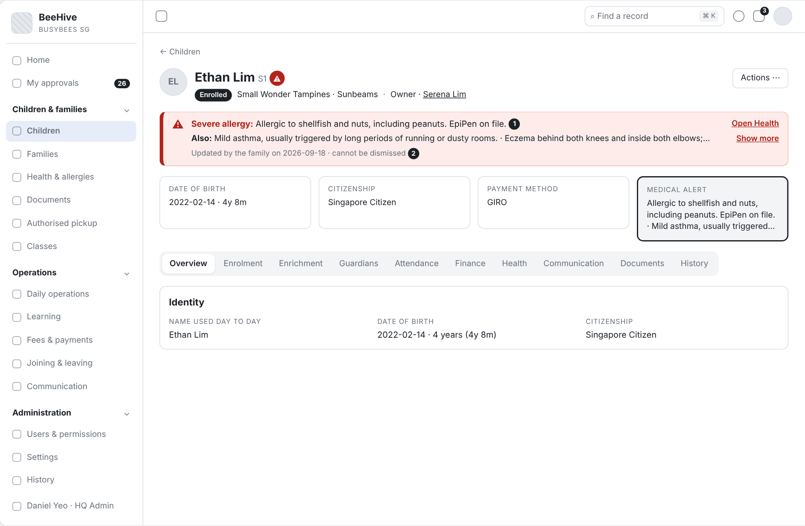
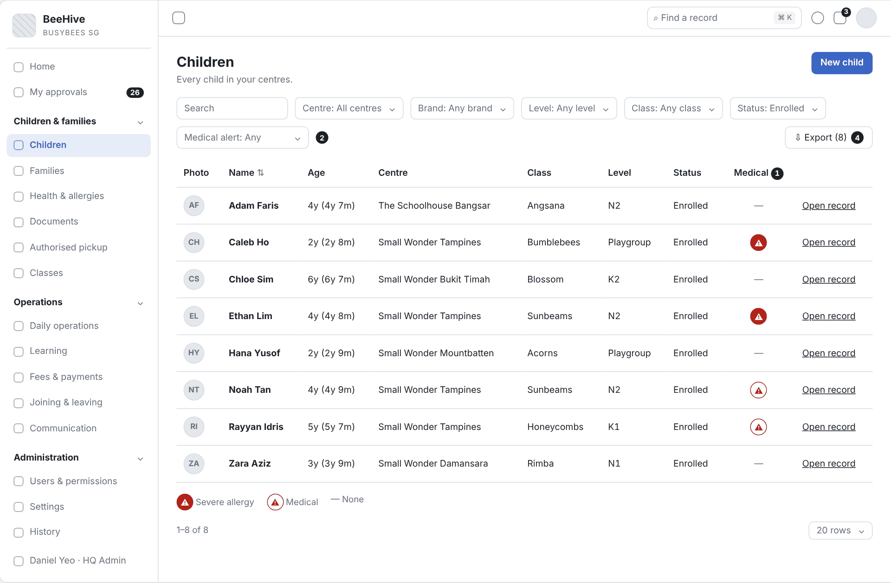
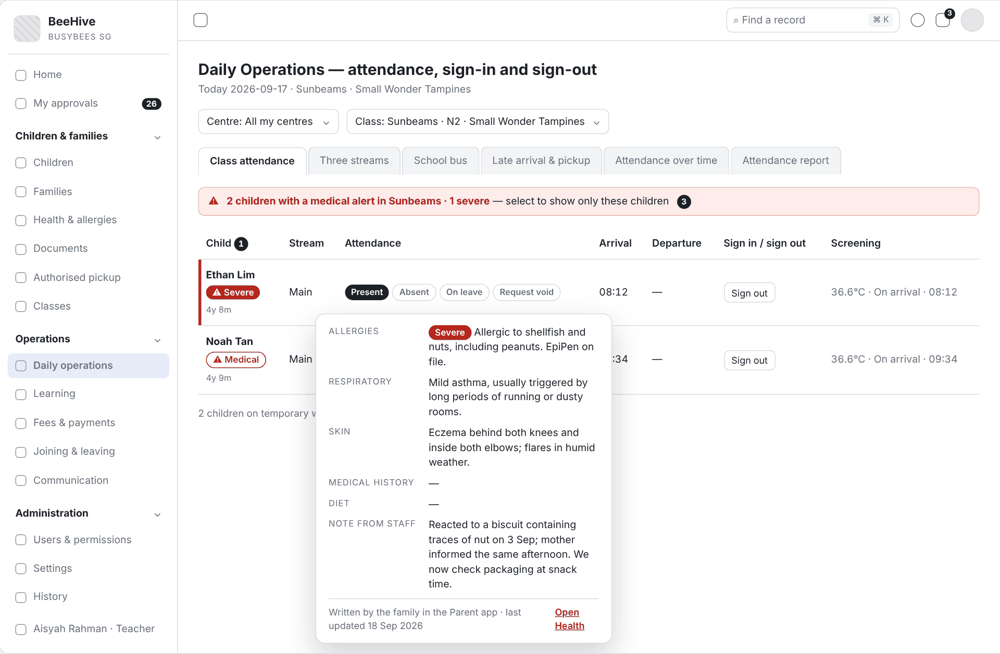
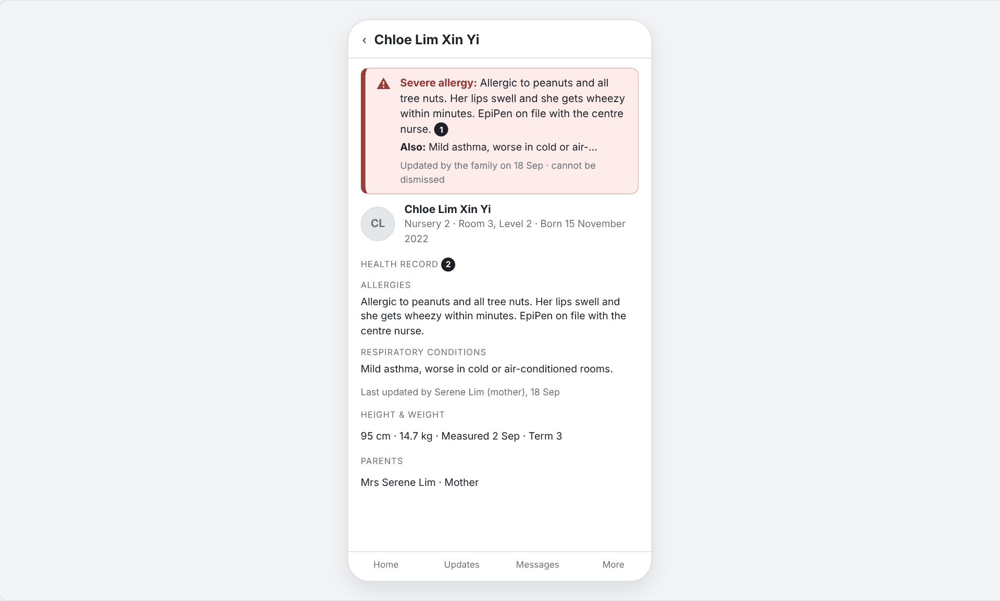

# Functional Requirements Specification

# Medical Alert Banner

| Thuộc tính | Giá trị |
|---|---|
| Dự án | Busy Bees Asia SMS |
| Module | Children & Families — Health & allergies |
| Tính năng | 3.1 Medical alert banner (child record, class lists, attendance, teacher screens; cột Medical trên danh sách trẻ) |
| Mã tài liệu | FRD-3.1_Medical_Alert_Banner |
| Sprint | 4 |
| Phiên bản | 0.1 |
| Trạng thái | BẢN NHÁP CHỜ XÁC NHẬN |
| Ngày | 10/11/2026 |
| Người soạn | Business Analysis |
| Người review | HaiNguyen |
| Người duyệt | HaiNguyen |

## 1. Kiểm soát tài liệu

| Phiên bản | Ngày | Tác giả | Tóm tắt thay đổi | Duyệt |
|---|---|---|---|---|
| 0.1 | 10/11/2026 | Business Analysis | Bản đầu: quy tắc cảnh báo y tế, red banner trên hồ sơ trẻ, cột Medical trên danh sách trẻ và danh sách lớp, cảnh báo trên màn điểm danh và Teacher App; edge case và tiêu chí nghiệm thu để chốt với vận hành Centre (Centre Director) và HQ Ops. Không vẽ sơ đồ theo yêu cầu. | HaiNguyen |

**Mức sẵn sàng:** Đã đặc tả 5 user story, quy tắc phân loại cảnh báo, edge case, tiêu chí nghiệm thu và wireframe. 8 câu hỏi mở ở mục 7 cần Centre Director / HQ Ops chốt.

## 2. Mục tiêu và bối cảnh

Giáo viên và nhân viên Centre phải thấy ngay trẻ nào có dị ứng nặng hoặc tình trạng sức khoẻ cần lưu ý, ở đúng màn hình họ dùng khi chăm trẻ: hồ sơ trẻ, danh sách lớp, điểm danh và màn hình của giáo viên. Nội dung cảnh báo lấy từ Health record do phụ huynh khai; nhân viên không gõ lại.

Hai mức cảnh báo:

- **Red banner** — dải đỏ, cho tình trạng nghiêm trọng (dị ứng mức Severe, ví dụ sốc phản vệ, EpiPen on file). Hiện trên hồ sơ trẻ và màn hình giáo viên, không tắt được.
- **Medical flag** — biểu tượng cạnh tên trẻ trên mọi danh sách, cho mọi trẻ có dị ứng, bệnh hoặc nhu cầu ăn uống đặc biệt; flag màu đỏ khi trẻ có red banner.

Mục tiêu đo được: trẻ có dị ứng Severe hiển thị red banner trên 100% các màn trong phạm vi; giáo viên thấy cảnh báo mà không phải mở tab Health.

## 3. Phạm vi và ranh giới phase

| Trong phạm vi | Ngoài phạm vi |
|---|---|
| Quy tắc phân loại cảnh báo từ Health record (Severe / Medical / không có). Red banner trên hồ sơ trẻ (mọi tab). Cột Medical và bộ lọc Medical alert trên danh sách trẻ; xuất danh sách. Flag và tóm tắt trên tab Children của lớp. Flag và cửa sổ chi tiết trên màn Class attendance. Teacher App: tag trên Student list, red banner trên hồ sơ trẻ. Ẩn chi tiết theo vai trò. Thông báo khi cảnh báo của trẻ thay đổi. | Nhập và sửa Health record (phụ huynh, Parents App). Danh sách Health & allergies và in danh sách dị ứng cho bếp (FRD 3.1 Children & Families). Cảnh báo dị ứng trên sự kiện có đồ ăn (Daily Operations, BR-OPS-038). Centre Director App (Phase 2). Khai báo thuốc và ghi nhận cho uống thuốc. Trường thuốc khẩn cấp riêng (EpiPen) — SRS loại khỏi Phase 1, nên "EpiPen on file" là chữ phụ huynh ghi trong mục dị ứng. |

## 4. Tác nhân, vai trò và quyền truy cập

| Tác nhân | Phạm vi | Quyền / Trách nhiệm |
|---|---|---|
| HQ Admin | Mọi Centre. | Thấy chi tiết y tế; cấu hình vai trò được xem chi tiết y tế và thang mức độ dị ứng. |
| HQ Ops (District Manager, Operations Manager, Head of Brand) | Cluster / brand mình phụ trách. | Thấy cảnh báo theo quyền vai trò; chốt quy tắc cảnh báo với BA. |
| Centre Director | Centre của mình. | Thấy chi tiết y tế; nhận thông báo khi cảnh báo của trẻ thay đổi; liên hệ phụ huynh khi thông tin thiếu hoặc sai. |
| School Admin | Centre của mình. | Thấy chi tiết y tế; nhận thông báo khi cảnh báo của trẻ thay đổi. |
| Teacher / Senior Teacher | Lớp của mình. | Thấy chi tiết y tế của trẻ lớp mình; nhận thông báo khi cảnh báo thay đổi; thêm Note from staff. |
| HQ Finance và vai trò không được xem chi tiết y tế | Theo vai trò. | Chỉ thấy biểu tượng cảnh báo, không thấy nội dung (BR-CHF-025). |
| Parent (Parents App) | Con của mình. | Nguồn duy nhất của Health record; khai, sửa dị ứng, bệnh, chế độ ăn và mức độ. |
| System | Toàn hệ thống. | Tính mức cảnh báo từ Health record, hiển thị banner / flag, gửi thông báo, ghi lịch sử. |

Quy tắc chung: chỉ vai trò được phép trong Roles & permissions xem chi tiết y tế (mặc định Centre Director, Teacher, School Admin, HQ Admin); vai trò khác chỉ thấy biểu tượng; điều không được làm thì không hiển thị; xuất dữ liệu được bảo vệ được ghi log.

## 5. Tổng quan tính năng và phân rã chức năng

| Khu vực | Chức năng | User Story |
|---|---|---|
|  | Phân loại Severe / Medical / không có; thông báo khi thay đổi. | US-001 |
| Hồ sơ trẻ (SMS web) | Red banner dưới header, hiện trên mọi tab. | US-002 |
| Danh sách trẻ, tab Children của lớp | Cột Medical, bộ lọc Medical alert, tóm tắt theo lớp, xuất. | US-003 |
| Daily operations › Class attendance | Flag cạnh tên trẻ, cửa sổ chi tiết, tóm tắt lớp. | US-004 |
| Teacher App | Tag trên Student list, red banner trên hồ sơ trẻ. | US-005 |

| Màn hình | Tên | Ảnh wireframe |
|---|---|---|
| SCR-01 | Child record — red banner | Diagram/Wireframe/png/SCR-01-child-banner*.png |
| SCR-02 | Children list — cột Medical | Diagram/Wireframe/png/SCR-02-children-list*.png |
| SCR-03 | Class — tab Children | Diagram/Wireframe/png/SCR-03-class-children*.png |
| SCR-04 | Class attendance | Diagram/Wireframe/png/SCR-04-class-attendance*.png |
| SCR-05 | Teacher App — Student list | Diagram/Wireframe/png/SCR-05-teacher-students*.png |
| SCR-06 | Teacher App — Child profile | Diagram/Wireframe/png/SCR-06-teacher-child*.png |

## 6. Yêu cầu chức năng theo User Story

### 6.1 US-001 - Quy tắc cảnh báo y tế từ Health record

#### User Story

Là Centre Director, tôi muốn hệ thống tự xác định trẻ nào cần red banner và trẻ nào chỉ cần Medical flag theo đúng Health record phụ huynh khai, để mọi màn hình cảnh báo giống nhau và không phụ thuộc vào việc nhân viên tự nhớ.

#### Functional Requirements (Yêu cầu chức năng)

| FR ID | Yêu cầu chức năng |
|---|---|
| FR-001 | Hệ thống tính mức cảnh báo của mỗi trẻ từ Health record: **Severe** khi trẻ có ít nhất một dị ứng mức Severe (mức cao nhất của thang mức độ); **Medical** khi trẻ có dị ứng mức khác, skin condition, respiratory condition, medical history hoặc nhu cầu ăn uống (diet) và không có dị ứng Severe; **None** khi Health record không có mục nào. |
| FR-002 | Dị ứng chưa chọn mức độ được tính như Severe và ghi "Severity not set" cho tới khi phụ huynh chọn mức độ. |
| FR-003 | Nội dung cảnh báo lấy nguyên văn chữ phụ huynh ghi, theo thứ tự: dị ứng Severe, dị ứng khác, respiratory, skin, medical history, diet; các mục nối bằng " · ". |
| FR-004 | Note from staff không làm thay đổi mức cảnh báo; Note from staff chỉ hiện trong cửa sổ chi tiết (US-004) và tab Health. |
| FR-005 | Mức cảnh báo được tính lại ngay khi phụ huynh lưu Health record; màn hình đang mở hiển thị mức mới khi người dùng mở lại hoặc làm mới màn. |
| FR-006 | Khi mức cảnh báo của trẻ đổi (None → Medical / Severe, Medical ↔ Severe, Severe / Medical → None) hoặc nội dung dị ứng Severe đổi, Centre Director, School Admin và giáo viên các lớp của trẻ nhận thông báo trong app: "<Tên trẻ>: <mức mới> — <nội dung ngắn>. Updated by the family on <ngày>." |
| FR-007 | Trẻ chưa có Health record (phụ huynh chưa hoàn tất Part A, trẻ chưa sinh) có mức None và hồ sơ trẻ ghi "Health record not completed by the family" với vai trò được xem chi tiết y tế. |

#### Functional Flow - Main (Luồng chính)

1. Phụ huynh lưu Health record trong Parents App, chọn mức độ cho từng dị ứng.
2. Hệ thống tính mức cảnh báo (FR-001, FR-002) và nội dung cảnh báo (FR-003).
3. Hệ thống hiển thị red banner hoặc Medical flag trên các màn của US-002 đến US-005 (FR-005).
4. Nếu mức hoặc nội dung Severe đổi, hệ thống gửi thông báo (FR-006).

#### Functional Flow - Alternative (Luồng thay thế)

1. Phụ huynh xoá hết dị ứng và bệnh: mức về None, banner và flag biến mất, thông báo được gửi (FR-001, FR-006).
2. Phụ huynh hạ mức dị ứng từ Severe xuống Moderate: banner biến mất, flag chuyển từ đỏ sang Medical (FR-001, FR-006).
3. Nhân viên thêm Note from staff: mức cảnh báo không đổi (FR-004).

#### Functional Flow - Exception (Luồng ngoại lệ)

1. Dị ứng không có mức độ: tính như Severe, ghi "Severity not set" (FR-002; VAL-001).
2. Trẻ chưa có Health record: mức None, hồ sơ ghi "Health record not completed by the family" (FR-007).

#### Business Rules (Quy tắc nghiệp vụ)

| BR ID | Quy tắc nghiệp vụ |
|---|---|
| BR-001 | Phụ huynh là nguồn duy nhất của Health record; nhân viên không sửa chữ phụ huynh ghi, chỉ thêm Note from staff |
| BR-002 | Red banner chỉ dành cho mức Severe; mọi tình trạng khác chỉ có Medical flag, để giáo viên không bị quá nhiều cảnh báo đỏ. |
| BR-003 | Khi thiếu thông tin mức độ, hệ thống chọn mức an toàn hơn (Severe). |
| BR-004 | Một trẻ chỉ có một mức cảnh báo; mọi màn hình dùng cùng mức và cùng nội dung. |

#### Validation Rules (Quy tắc kiểm tra)

| VAL ID | Điều kiện | Phản hồi hệ thống |
|---|---|---|
| VAL-001 | Dị ứng không có mức độ. | Tính như Severe; banner thêm dòng "Severity not set — treated as severe until the family chooses a severity." |

#### UI Reference (Tham chiếu giao diện)

| Mã màn hình / Phiên bản | Tham chiếu / Link |
|---|---|
| SCR-01 - Child record — red banner | Wireframe: Diagram/Wireframe/medical-alert-sprint4.html#scr-01 |

#### UI Components / Field Specification (Thành phần giao diện)

| Trường / Điều khiển | Loại | Bắt buộc | Mặc định / Trạng thái | Kiểm tra | Hành vi |
|---|---|---|---|---|---|
| Mức cảnh báo | Giá trị tính | Có | None | VAL-001. | Severe / Medical / None (FR-001). |
| Nội dung cảnh báo | Text | Khi có | — | — | Nguyên văn chữ phụ huynh, nối " · " (FR-003). |
| Thông báo thay đổi cảnh báo | Thông báo trong app | Có | — | — | FR-006. |

#### Data and Audit (Dữ liệu và audit)

| ID | Yêu cầu |
|---|---|
| DATA-001 | Hệ thống đọc từ Health record: từng dị ứng (nội dung, mức độ), skin, respiratory, medical history, diet, người cập nhật, ngày cập nhật. Không lưu bản sao nội dung cảnh báo. |
| DATA-002 | Mỗi lần mức cảnh báo đổi được ghi lịch sử của trẻ: mức cũ, mức mới, do thay đổi nào của Health record, thời điểm, người nhận thông báo. |

#### Acceptance Criteria (Tiêu chí nghiệm thu)

| AC ID | Given | When | Then | Linked Rule |
|---|---|---|---|---|
| AC-001 | Ethan có dị ứng "shellfish and nuts… EpiPen on file" mức Severe | hệ thống tính mức cảnh báo | mức là Severe; nội dung theo thứ tự dị ứng Severe, respiratory, skin, nối bằng " · " | FR-001; FR-003; BR-002 |
| AC-002 | Rayyan chỉ có respiratory "Asthma…" | hệ thống tính mức cảnh báo | mức là Medical, không có banner | FR-001; BR-002 |
| AC-003 | Caleb có dị ứng trứng chưa chọn mức độ | hệ thống tính mức cảnh báo | mức là Severe và banner có dòng "Severity not set — treated as severe until the family chooses a severity." | FR-002; BR-003; VAL-001 |
| AC-004 | Ethan đang mức Severe | phụ huynh đổi dị ứng xuống Moderate | mức là Medical; Centre Director, School Admin và giáo viên lớp Sunbeams nhận thông báo; lịch sử ghi mức cũ và mức mới; danh sách trẻ, màn điểm danh và Teacher App cùng hiện mức Medical | FR-005; FR-006; BR-004; DATA-002 |
| AC-005 | Ethan đang mức Severe | giáo viên thêm Note from staff | mức vẫn là Severe | FR-004; BR-001 |
| AC-006 | trẻ mới, phụ huynh chưa hoàn tất Part A | Centre Director mở hồ sơ trẻ | không có banner, không có flag, hồ sơ ghi "Health record not completed by the family" | FR-007 |
| AC-007 | Noah chưa có mục y tế | phụ huynh thêm dị ứng mức Severe | Centre Director nhận thông báo "Noah Tan: Severe — …" | FR-006 |

#### Dependencies (Phụ thuộc)

Health record (Parents App, BR-CHF-021 đến BR-CHF-029); thang mức độ dị ứng do HQ Admin cấu hình (BR-CHF-022); dịch vụ thông báo.

### 6.2 US-002 - Red banner trên hồ sơ trẻ

#### User Story

Là giáo viên, tôi muốn mở hồ sơ trẻ ở bất kỳ tab nào cũng thấy ngay dải đỏ ghi dị ứng nghiêm trọng của trẻ, để không bỏ sót khi xử lý việc khác của trẻ.

#### Functional Requirements (Yêu cầu chức năng)

| FR ID | Yêu cầu chức năng |
|---|---|
| FR-008 | Trẻ mức Severe có red banner ngay dưới dòng tên / status / Centre của hồ sơ trẻ, trên các thẻ tóm tắt; banner hiện trên mọi tab (Overview, Enrolment, Enrichment, Guardians, Attendance, Finance, Health, Communication, Documents, History). |
| FR-009 | Banner gồm: biểu tượng ⚠, tiêu đề "Severe allergy", nội dung dị ứng Severe (FR-003); dòng "Also:" liệt kê các mục khác (dị ứng khác, respiratory, skin, medical history, diet); dòng "Updated by the family on <yyyy-mm-dd>"; liên kết "Open Health". |
| FR-010 | Nội dung banner hiển thị tối đa 2 dòng; dài hơn thì có "Show more" mở toàn bộ ngay trong banner. |
| FR-011 | Banner không có nút đóng; người dùng không ẩn được banner. |
| FR-012 | Vai trò không được xem chi tiết y tế không thấy banner; header chỉ có biểu tượng ⚠ cạnh tên với chú thích "Medical alert on file". |
| FR-013 | Trẻ mức Medical không có banner; header có Medical flag cạnh tên; chi tiết ở thẻ Medical alert của tab Overview (FRD 3.1 Child Record Overview) và tab Health. |
| FR-014 | Banner vẫn hiện trên hồ sơ trẻ đã Withdrawn, Graduated hoặc Temporary withdrawal. |

#### Functional Flow - Main (Luồng chính)

1. Người dùng mở hồ sơ trẻ mức Severe.
2. Hệ thống hiển thị red banner dưới header (FR-008, FR-009).
3. Người dùng chuyển tab; banner giữ nguyên (FR-008).
4. Người dùng chọn "Open Health" để xem đủ Health record.

#### Functional Flow - Alternative (Luồng thay thế)

1. Nội dung dài: người dùng chọn "Show more" (FR-010).
2. Trẻ mức Medical: không banner, có Medical flag (FR-013).

#### Functional Flow - Exception (Luồng ngoại lệ)

1. Vai trò không được xem chi tiết y tế: chỉ biểu tượng ⚠ (FR-012; VAL-002).

#### Business Rules (Quy tắc nghiệp vụ)

| BR ID | Quy tắc nghiệp vụ |
|---|---|
| BR-005 | Cảnh báo Severe luôn hiển thị và không tắt được trên hồ sơ trẻ. |
| BR-006 | Chỉ vai trò được phép trong Roles & permissions thấy nội dung y tế; vai trò khác thấy biểu tượng (BR-CHF-025). |

#### Validation Rules (Quy tắc kiểm tra)

| VAL ID | Điều kiện | Phản hồi hệ thống |
|---|---|---|
| VAL-002 | Vai trò không có quyền xem chi tiết y tế mở hồ sơ trẻ có cảnh báo. | Không hiển thị banner và nội dung; chỉ biểu tượng ⚠ "Medical alert on file". |

#### UI Reference (Tham chiếu giao diện)

| Mã màn hình / Phiên bản | Tham chiếu / Link |
|---|---|
| SCR-01 - Child record — red banner | Wireframe: Diagram/Wireframe/medical-alert-sprint4.html#scr-01 |

#### UI Components / Field Specification (Thành phần giao diện)

| Trường / Điều khiển | Loại | Bắt buộc | Mặc định / Trạng thái | Kiểm tra | Hành vi |
|---|---|---|---|---|---|
| Red banner | Banner (đỏ) | Khi mức Severe | Hiện | VAL-002. | FR-008; FR-009; không có nút đóng (FR-011). |
| Severe allergy | Text | Có | Nội dung dị ứng Severe | — | FR-003. |
| Also: | Text | Khi có | Các mục khác nối " · " | — | FR-009. |
| Show more | Link | Khi nội dung quá 2 dòng | — | — | FR-010. |
| Updated by the family on | Text | Có | Ngày cập nhật Health record | — | — |
| Open Health | Link | Có | — | — | Mở tab Health. |
| Biểu tượng ⚠ cạnh tên | Icon | Khi mức Severe / Medical | Đỏ (Severe), viền (Medical) | — | Chú thích khi rê chuột: nội dung (vai trò được phép) hoặc "Medical alert on file". |

#### Data and Audit (Dữ liệu và audit)

| ID | Yêu cầu |
|---|---|
| DATA-003 | Banner đọc mức cảnh báo, nội dung và ngày cập nhật của US-001; không ghi log khi hiển thị. |

#### Acceptance Criteria (Tiêu chí nghiệm thu)

| AC ID | Given | When | Then | Linked Rule |
|---|---|---|---|---|
| AC-008 | Ethan mức Severe | Teacher lớp Sunbeams mở hồ sơ Ethan | red banner "Severe allergy: Allergic to shellfish and nuts, including peanuts. EpiPen on file." hiện dưới header, có "Also:" eczema và asthma, "Updated by the family on 2026-09-18" và "Open Health" | FR-008; FR-009 |
| AC-009 | hồ sơ Ethan đang mở ở tab Overview | Teacher chọn tab Attendance | banner vẫn hiện ở vị trí cũ | FR-008; BR-005 |
| AC-010 | banner đang hiện | người dùng tìm cách đóng banner | không có nút đóng | FR-011; BR-005 |
| AC-011 | HQ Finance không được xem chi tiết y tế | HQ Finance mở hồ sơ Ethan | không có banner; cạnh tên có biểu tượng ⚠ với chú thích "Medical alert on file" | FR-012; BR-006; VAL-002 |
| AC-012 | Rayyan mức Medical | Centre Director mở hồ sơ Rayyan | không có banner; cạnh tên có Medical flag | FR-013 |
| AC-013 | trẻ mức Severe có nội dung dài hơn 2 dòng | người dùng chọn "Show more" | banner hiện toàn bộ nội dung | FR-010 |
| AC-014 | trẻ mức Severe đã Withdrawn | Centre Director mở hồ sơ | banner vẫn hiện | FR-014 |

#### Dependencies (Phụ thuộc)

US-001; FRD 3.1 Child Record Overview (header, thẻ Medical alert); Roles & permissions (quyền xem chi tiết y tế).

### 6.3 US-003 - Cột Medical trên danh sách trẻ và danh sách lớp

#### User Story

Là Centre Director, tôi muốn danh sách trẻ và danh sách lớp có cột Medical và bộ lọc theo cảnh báo, để biết ngay lớp nào có trẻ dị ứng nặng và lấy danh sách khi cần.

#### Functional Requirements (Yêu cầu chức năng)

| FR ID | Yêu cầu chức năng |
|---|---|
| FR-015 | Danh sách trẻ (Children & families › Children) có cột Medical: biểu tượng ⚠ đỏ đặc cho mức Severe, biểu tượng ⚠ viền cho mức Medical, "—" cho mức None. |
| FR-016 | Rê chuột hoặc chạm vào biểu tượng hiện chú thích: nội dung cảnh báo (FR-003) với vai trò được xem chi tiết y tế; "Medical alert on file" với vai trò khác. |
| FR-017 | Bộ lọc "Medical alert": Any, Has a medical alert (Severe và Medical), Severe allergy, No medical alert; kết hợp với các bộ lọc khác. Vai trò không được xem chi tiết y tế không thấy bộ lọc này. |
| FR-018 | Xuất danh sách trẻ ghi cột Medical bằng "Severe", "Yes" hoặc "No", không ghi nội dung y tế; lần xuất được ghi log. |
| FR-019 | Tab Children của lớp (Classes › lớp › Children) có flag cạnh tên mỗi trẻ (như FR-015) và dòng tóm tắt "<n> children with a medical alert · <m> severe" với liên kết "Allergy list for this class" tới Health & allergies đã lọc theo lớp. |
| FR-020 | Trẻ chuyển lớp: flag hiện ở lớp mới từ effective date của việc chuyển lớp. |

#### Functional Flow - Main (Luồng chính)

1. Centre Director mở danh sách trẻ; cột Medical hiển thị theo mức (FR-015).
2. Centre Director chọn bộ lọc "Severe allergy" (FR-017).
3. Centre Director rê chuột lên biểu tượng để đọc nội dung (FR-016).
4. Centre Director xuất danh sách (FR-018).

#### Functional Flow - Alternative (Luồng thay thế)

1. Giáo viên mở lớp › Children: thấy flag và dòng tóm tắt, chọn "Allergy list for this class" (FR-019).

#### Functional Flow - Exception (Luồng ngoại lệ)

1. Vai trò không được xem chi tiết y tế: chú thích "Medical alert on file", không có bộ lọc Medical alert (FR-016, FR-017; VAL-002).

#### Business Rules (Quy tắc nghiệp vụ)

| BR ID | Quy tắc nghiệp vụ |
|---|---|
| BR-007 | Trẻ có cảnh báo có biểu tượng ở mọi nơi tên trẻ xuất hiện trong danh sách (BR-CHF-024). |
| BR-008 | File xuất không chứa nội dung y tế; mọi lần xuất được ghi log. |

#### Validation Rules (Quy tắc kiểm tra)

| VAL ID | Điều kiện | Phản hồi hệ thống |
|---|---|---|
| VAL-003 | Lọc "Severe allergy" không có trẻ nào. | Danh sách trống với dòng "No children with a severe allergy match these filters." |

#### UI Reference (Tham chiếu giao diện)

| Mã màn hình / Phiên bản | Tham chiếu / Link |
|---|---|
| SCR-02 - Children list — cột Medical | Wireframe: Diagram/Wireframe/medical-alert-sprint4.html#scr-02 |
| SCR-03 - Class — tab Children | Wireframe: Diagram/Wireframe/medical-alert-sprint4.html#scr-03 |

#### UI Components / Field Specification (Thành phần giao diện)

| Trường / Điều khiển | Loại | Bắt buộc | Mặc định / Trạng thái | Kiểm tra | Hành vi |
|---|---|---|---|---|---|
| Cột Medical | Icon | Có | "—" | — | FR-015; FR-016. |
| Medical alert | Bộ lọc | Không | Any | VAL-003. | FR-017. |
| Export | Nút | Theo quyền | — | — | FR-018. |
| Dòng tóm tắt lớp | Text + link | Khi lớp có trẻ có cảnh báo | — | — | FR-019. |

#### Data and Audit (Dữ liệu và audit)

| ID | Yêu cầu |
|---|---|
| DATA-004 | Log xuất ghi: người xuất, thời điểm, bộ lọc, số dòng. |

#### Acceptance Criteria (Tiêu chí nghiệm thu)

| AC ID | Given | When | Then | Linked Rule |
|---|---|---|---|---|
| AC-015 | Ethan Severe, Rayyan Medical, Adam None | HQ Admin mở danh sách trẻ | cột Medical: Ethan ⚠ đỏ đặc, Rayyan ⚠ viền, Adam "—" | FR-015; BR-007 |
| AC-016 | Centre Director Small Wonder Tampines | chọn Medical alert = Severe allergy | chỉ trẻ mức Severe của Centre hiện | FR-017 |
| AC-017 | HQ Finance mở danh sách trẻ | rê chuột lên biểu tượng của Ethan | chú thích "Medical alert on file"; không có bộ lọc Medical alert | FR-016; FR-017; VAL-002 |
| AC-018 | Centre Director xuất danh sách 19 trẻ | mở file xuất | cột Medical chỉ có "Severe", "Yes", "No"; log ghi người xuất và thời điểm | FR-018; BR-008; DATA-004 |
| AC-019 | lớp Sunbeams có Ethan (Severe) và Noah (Medical) | Teacher mở Sunbeams › Children | dòng "2 children with a medical alert · 1 severe" và liên kết "Allergy list for this class" | FR-019 |
| AC-020 | Caleb chuyển từ Bumblebees sang Sunbeams từ 2026-10-01 | ngày 2026-10-01 Teacher mở Sunbeams › Children | Caleb có flag trong lớp Sunbeams | FR-020 |
| AC-021 | không trẻ nào mức Severe ở Centre đang lọc | chọn Severe allergy | danh sách trống với "No children with a severe allergy match these filters." | VAL-003 |

#### Dependencies (Phụ thuộc)

US-001; danh sách trẻ và Classes (FRD 3.1 Children & Families); Health & allergies (danh sách theo lớp).

### 6.4 US-004 - Cảnh báo trên màn điểm danh

#### User Story

Là giáo viên, khi điểm danh lớp mỗi sáng tôi muốn thấy cảnh báo cạnh tên trẻ và mở chi tiết ngay tại chỗ, để biết hôm nay lớp có những trẻ nào cần lưu ý.

#### Functional Requirements (Yêu cầu chức năng)

| FR ID | Yêu cầu chức năng |
|---|---|
| FR-021 | Màn Daily operations › Class attendance có chip cạnh tên trẻ: "⚠ Severe" (đỏ) cho mức Severe, "⚠ Medical" (viền) cho mức Medical. |
| FR-022 | Chọn chip mở cửa sổ chi tiết: Allergies (kèm mức độ), Respiratory, Skin, Medical history, Diet, Note from staff, dòng "Written by the family in the Parent app · last updated <ngày>" và liên kết "Open Health". |
| FR-023 | Trên bảng điểm danh có dòng tóm tắt "<n> children with a medical alert in <lớp> · <m> severe"; chọn dòng này lọc bảng chỉ còn trẻ có cảnh báo. |
| FR-024 | Hàng của trẻ mức Severe có vạch đỏ ở mép trái. |
| FR-025 | Trẻ Temporary withdrawal không có trên bảng điểm danh nên không có cảnh báo trên màn này; cảnh báo vẫn ở hồ sơ trẻ. |

#### Functional Flow - Main (Luồng chính)

1. Giáo viên mở Class attendance của lớp mình.
2. Hệ thống hiển thị chip và dòng tóm tắt (FR-021, FR-023, FR-024).
3. Giáo viên chọn chip để đọc chi tiết (FR-022).

#### Functional Flow - Alternative (Luồng thay thế)

1. Giáo viên chọn dòng tóm tắt để lọc trẻ có cảnh báo (FR-023).

#### Functional Flow - Exception (Luồng ngoại lệ)

1. Vai trò không được xem chi tiết y tế mở được màn điểm danh: chip không mở cửa sổ chi tiết, chú thích "Medical alert on file" (VAL-002).

#### Business Rules (Quy tắc nghiệp vụ)

| BR ID | Quy tắc nghiệp vụ |
|---|---|
| BR-009 | Màn điểm danh dùng cùng mức cảnh báo và nội dung với hồ sơ trẻ (BR-004). |

#### Validation Rules (Quy tắc kiểm tra)

| VAL ID | Điều kiện | Phản hồi hệ thống |
|---|---|---|
| VAL-004 | Lớp không có trẻ nào có cảnh báo. | Không hiện dòng tóm tắt. |

#### UI Reference (Tham chiếu giao diện)

| Mã màn hình / Phiên bản | Tham chiếu / Link |
|---|---|
| SCR-04 - Class attendance | Wireframe: Diagram/Wireframe/medical-alert-sprint4.html#scr-04 |

#### UI Components / Field Specification (Thành phần giao diện)

| Trường / Điều khiển | Loại | Bắt buộc | Mặc định / Trạng thái | Kiểm tra | Hành vi |
|---|---|---|---|---|---|
| Chip ⚠ Severe / ⚠ Medical | Chip | Khi có cảnh báo | — | VAL-002. | Mở cửa sổ chi tiết (FR-022). |
| Cửa sổ chi tiết | Popover | — | Đóng | — | FR-022. |
| Dòng tóm tắt lớp | Link | Khi lớp có cảnh báo | — | VAL-004. | Lọc bảng (FR-023). |
| Vạch đỏ hàng Severe | Đánh dấu hàng | Khi mức Severe | — | — | FR-024. |

#### Data and Audit (Dữ liệu và audit)

| ID | Yêu cầu |
|---|---|
| DATA-005 | Cửa sổ chi tiết đọc Health record và Note from staff hiện hành của trẻ. |

#### Acceptance Criteria (Tiêu chí nghiệm thu)

| AC ID | Given | When | Then | Linked Rule |
|---|---|---|---|---|
| AC-022 | lớp Sunbeams có Ethan (Severe) và Noah (Medical) | Teacher mở Class attendance | Ethan có chip "⚠ Severe" và vạch đỏ; Noah có chip "⚠ Medical"; dòng "2 children with a medical alert in Sunbeams · 1 severe"; chip dùng cùng mức với hồ sơ trẻ | FR-021; FR-023; FR-024; BR-009 |
| AC-023 | Ethan có Note from staff về phản ứng với bánh quy | Teacher chọn chip của Ethan | cửa sổ hiện Allergies (Severe), Respiratory, Skin, Medical history "—", Note from staff và "Written by the family in the Parent app · last updated 18 Sep 2026" | FR-022 |
| AC-024 | dòng tóm tắt đang hiện | Teacher chọn dòng tóm tắt | bảng chỉ còn Ethan và Noah | FR-023 |
| AC-025 | lớp không có trẻ có cảnh báo | Teacher mở Class attendance | không có dòng tóm tắt | VAL-004 |
| AC-026 | 2 trẻ đang Temporary withdrawal | Teacher mở Class attendance | 2 trẻ này không có trên bảng; hồ sơ của trẻ vẫn có banner nếu mức Severe | FR-025; FR-014 |

#### Dependencies (Phụ thuộc)

US-001; Daily operations › Class attendance (FRD 3.2 Daily Operations).

### 6.5 US-005 - Cảnh báo trên Teacher App

#### User Story

Là giáo viên dùng Teacher App, tôi muốn danh sách học sinh đánh dấu trẻ có dị ứng nặng và hồ sơ trẻ có dải đỏ ở trên cùng, để thấy cảnh báo cả khi không ngồi máy tính.

#### Functional Requirements (Yêu cầu chức năng)

| FR ID | Yêu cầu chức năng |
|---|---|
| FR-026 | Student list có tag dưới tên trẻ: "⚠ Severe allergy" (đỏ) cho mức Severe, "Medical" (viền) cho mức Medical; trẻ None không có tag. |
| FR-027 | Hồ sơ trẻ trong Teacher App có red banner ở trên cùng, trên phần Health record, với nội dung như FR-009 (Severe allergy, Also:, ngày cập nhật); banner không đóng được. |
| FR-028 | Trên mọi danh sách trẻ trong Teacher App (Student list, Routines, Allergies), trẻ có cảnh báo có biểu tượng cạnh tên (BR-TCH-014). |
| FR-029 | Teacher App chỉ hiển thị trẻ các lớp giáo viên được phân công; giáo viên đổi lớp thì thấy cảnh báo của trẻ lớp mới từ ngày được phân công. |

#### Functional Flow - Main (Luồng chính)

1. Giáo viên mở Student list; hệ thống hiển thị tag theo mức (FR-026).
2. Giáo viên chạm vào trẻ có tag "Severe allergy"; hồ sơ trẻ có red banner ở trên cùng (FR-027).

#### Functional Flow - Alternative (Luồng thay thế)

1. Giáo viên mở Routines: trẻ có cảnh báo có biểu tượng cạnh tên (FR-028).

#### Functional Flow - Exception (Luồng ngoại lệ)

1. Trẻ không thuộc lớp của giáo viên: không có trong danh sách (FR-029).

#### Business Rules (Quy tắc nghiệp vụ)

| BR ID | Quy tắc nghiệp vụ |
|---|---|
| BR-010 | Teacher App dùng cùng mức cảnh báo, nội dung và màu với SMS web (BR-004); Health record chỉ đọc trong Teacher App (BR-TCH-011). |

#### Validation Rules (Quy tắc kiểm tra)

| VAL ID | Điều kiện | Phản hồi hệ thống |
|---|---|---|
| VAL-005 | Giáo viên mở hồ sơ trẻ không thuộc lớp mình qua đường dẫn. | Không mở; hiện "This child is not in your classes." |

#### UI Reference (Tham chiếu giao diện)

| Mã màn hình / Phiên bản | Tham chiếu / Link |
|---|---|
| SCR-05 - Teacher App — Student list | Wireframe: Diagram/Wireframe/medical-alert-sprint4.html#scr-05 |
| SCR-06 - Teacher App — Child profile | Wireframe: Diagram/Wireframe/medical-alert-sprint4.html#scr-06 |

#### UI Components / Field Specification (Thành phần giao diện)

| Trường / Điều khiển | Loại | Bắt buộc | Mặc định / Trạng thái | Kiểm tra | Hành vi |
|---|---|---|---|---|---|
| Tag Severe allergy / Medical | Tag | Khi có cảnh báo | — | — | FR-026. |
| Red banner (Teacher App) | Banner (đỏ) | Khi mức Severe | Hiện | — | FR-027; không đóng được. |
| Biểu tượng cạnh tên | Icon | Khi có cảnh báo | — | — | FR-028. |

#### Data and Audit (Dữ liệu và audit)

| ID | Yêu cầu |
|---|---|
| DATA-006 | Teacher App đọc mức cảnh báo và nội dung của US-001 theo lớp được phân công của giáo viên. |

#### Acceptance Criteria (Tiêu chí nghiệm thu)

| AC ID | Given | When | Then | Linked Rule |
|---|---|---|---|---|
| AC-027 | Nursery 2 có Chloe (dị ứng hạt, Severe) và Hana (dị ứng mức Mild) | giáo viên mở Student list | Chloe có tag "⚠ Severe allergy", Hana có tag "Medical", trẻ khác không có tag | FR-026 |
| AC-028 | Chloe mức Severe | giáo viên mở hồ sơ Chloe | red banner ở trên cùng: "Severe allergy: Allergic to peanuts and all tree nuts… EpiPen on file with the centre nurse.", "Also:" asthma, ngày cập nhật | FR-027; BR-010 |
| AC-029 | Chloe mức Severe | giáo viên mở Routines | Chloe có biểu tượng cạnh tên | FR-028 |
| AC-030 | giáo viên được phân công thêm lớp K1 Blue từ hôm nay | giáo viên mở Student list | trẻ lớp K1 Blue hiện kèm tag theo mức | FR-029 |
| AC-031 | trẻ không thuộc lớp của giáo viên | giáo viên mở hồ sơ trẻ qua đường dẫn | hiện "This child is not in your classes." | VAL-005 |

#### Dependencies (Phụ thuộc)

US-001; Teacher App (Student list, child profile, Routines, Allergies).

## 7. Câu hỏi mở

| Mã câu hỏi | Quyết định cần có | Người quyết định | Ưu tiên | Quyết định của BBA |
|---|---|---|---|---|
| OQ-MAB-01 | Red banner chỉ cho dị ứng mức Severe (BR-002)? Có cần banner cho bệnh không có mức độ (ví dụ co giật do sốt, hen cần inhaler) không? | Centre Director / HQ Ops | Cao |  |
| OQ-MAB-02 | Dị ứng chưa chọn mức độ tính như Severe (FR-002) — đồng ý? | Centre Director / HQ Ops | Cao |  |
| OQ-MAB-03 | Diet (ví dụ không ăn thịt heo, ăn chay) chỉ là Medical flag, hay cần banner riêng khi liên quan tôn giáo / y tế? | Centre Director / HQ Ops | Trung bình |  |
| OQ-MAB-04 | Prototype không cho HQ Finance thấy gì (không biểu tượng); SRS cho thấy biểu tượng (BR-CHF-025). Chốt hành vi cho vai trò không được xem chi tiết y tế. | Business Owner | Trung bình |  |
| OQ-MAB-05 | Centre Director có được tự đánh dấu một trẻ là Severe (ví dụ sau sự cố ở Centre) khi phụ huynh chưa cập nhật, hay mọi thay đổi phải qua phụ huynh? | Centre Director / HQ Ops | Cao |  |
| OQ-MAB-06 | Ai nhận thông báo khi cảnh báo đổi: chỉ Centre Director, School Admin, giáo viên lớp (FR-006) hay thêm bếp / HQ Safeguarding? | Centre Director / HQ Ops | Trung bình |  |
| OQ-MAB-07 | Hồ sơ trẻ chưa có Health record có cần cảnh báo riêng (ví dụ "Health record not completed") trên danh sách và màn điểm danh không, hay chỉ trên hồ sơ trẻ (FR-007)? | Centre Director / HQ Ops | Trung bình |  |
| OQ-MAB-08 | Giáo viên dạy thay / giáo viên Enrichment có thấy banner của trẻ không thuộc lớp chính của mình không? | Business Owner | Thấp |  |

## 8. Phụ lục

### Phụ lục A. Thuật ngữ

| Thuật ngữ | Định nghĩa trong FRD này |
|---|---|
| Health record | Thông tin sức khoẻ phụ huynh khai trong Parents App: dị ứng (kèm mức độ), skin, respiratory, medical history, diet, ghi chú của gia đình. |
| Severe | Mức cao nhất của thang mức độ dị ứng (mặc định Mild, Moderate, Severe). |
| Red banner | Dải đỏ dưới header hồ sơ trẻ (SMS web) hoặc trên cùng hồ sơ trẻ (Teacher App), cho mức Severe. |
| Medical flag | Biểu tượng ⚠ cạnh tên trẻ trên danh sách; đỏ đặc khi Severe, viền khi Medical. |
| Note from staff | Ghi chú của nhân viên, tách khỏi chữ phụ huynh, không thay đổi mức cảnh báo. |
| Anaphylaxis | Sốc phản vệ — phản ứng dị ứng nặng, có thể cần EpiPen (adrenaline auto-injector). |
