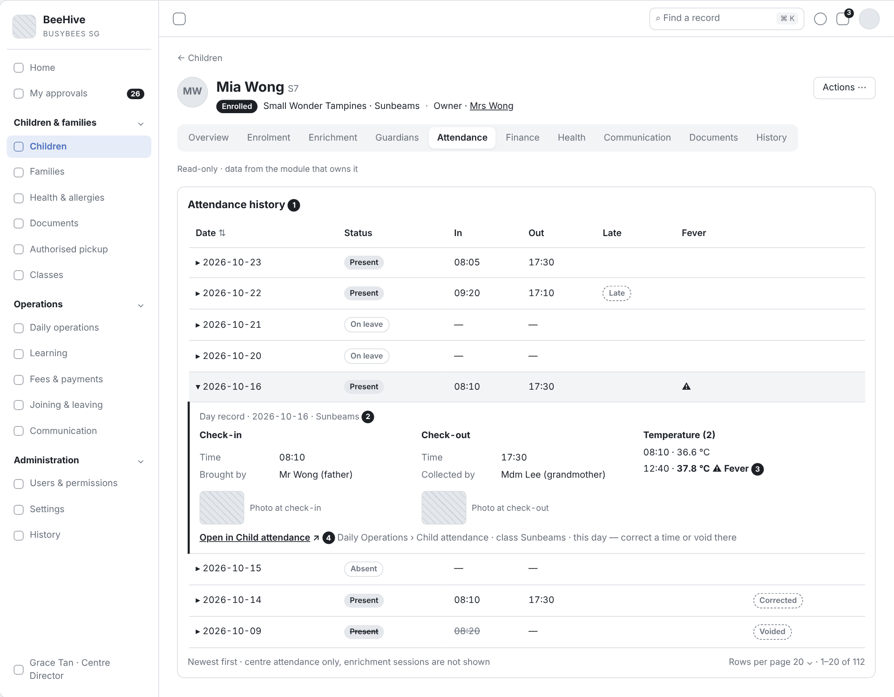
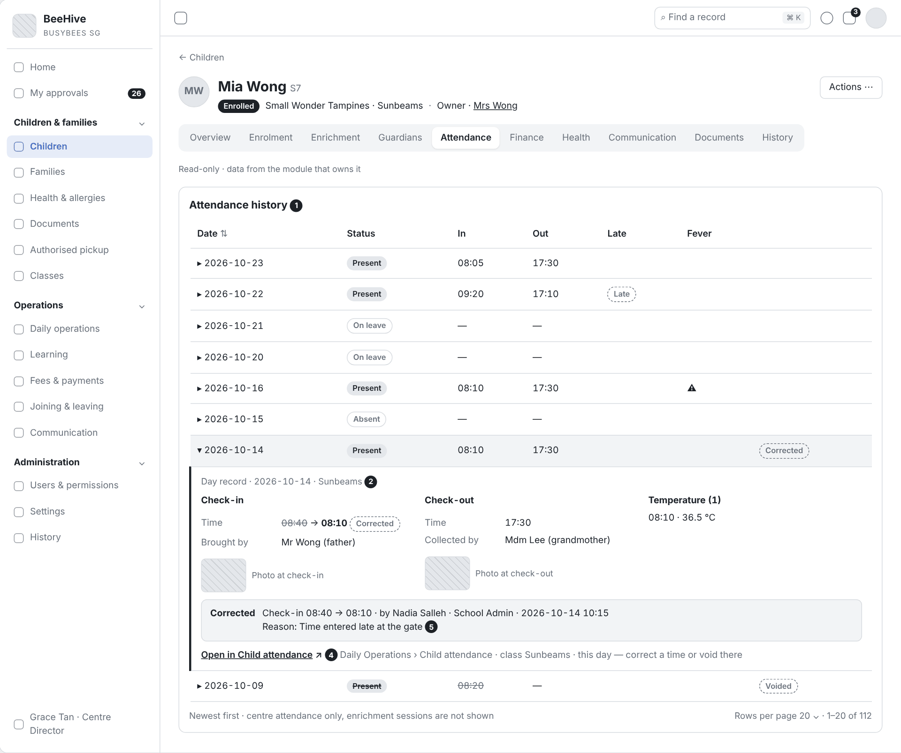
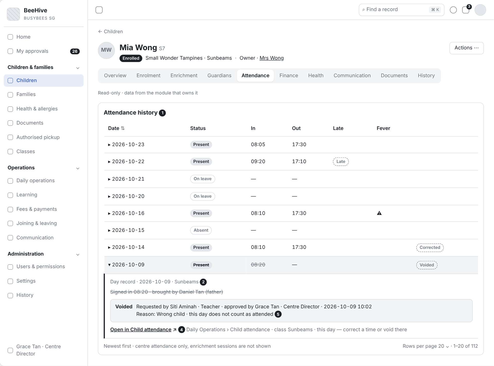
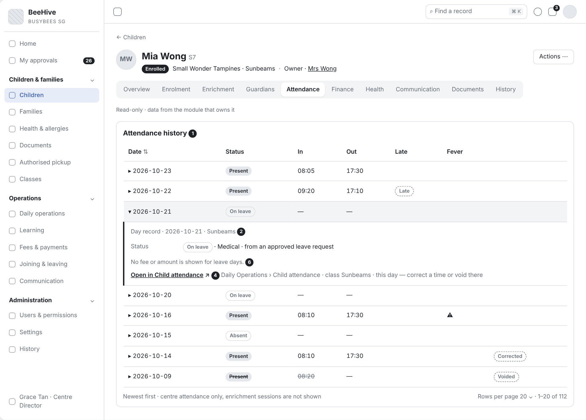
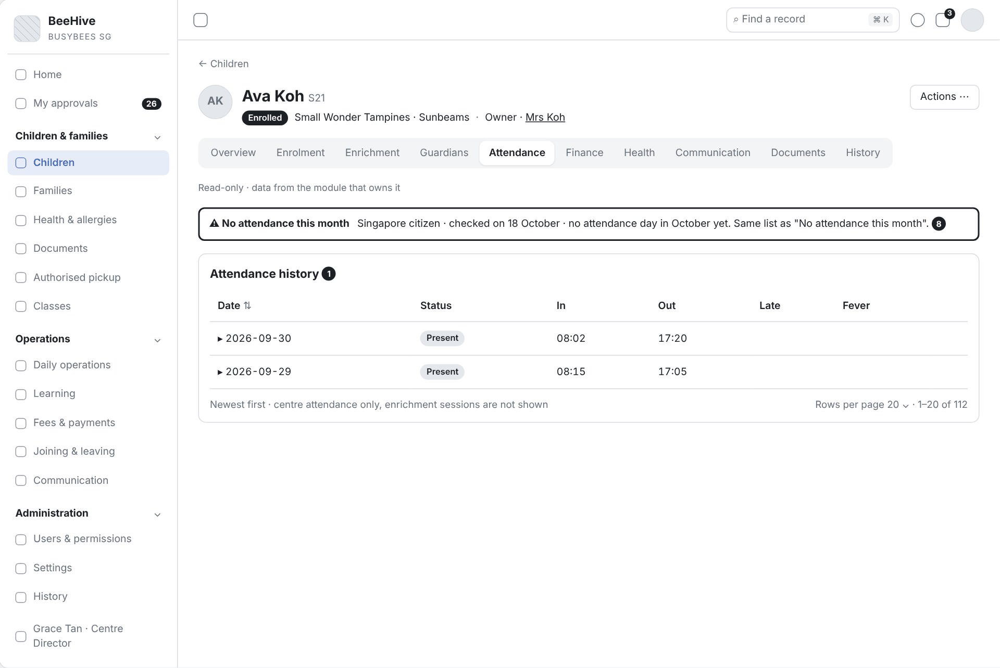
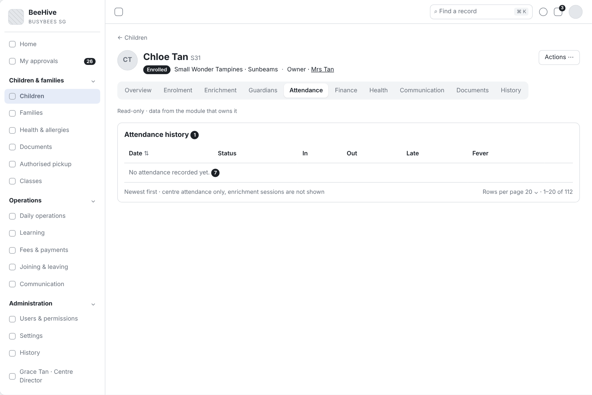

# BBA-67 US-003 Tab Attendance – bản nháp (Tiếng Việt)

| Thuộc tính | Giá trị |
|---|---|
| Dự án | Busy Bees Asia SMS |
| Module | Children & Families — Child record |
| Tính năng | 3.1.1.02 Child record tabs – Read views › Tab Attendance (US-003) |
| Mã ticket | BBA-67 |
| Mã WBS | 3.1.1.02 |
| Mã tài liệu | FRD-3.1_Child_Record_Read_Tabs — bản nháp US-003 |
| Sprint | 4 |
| Phiên bản | 0.3 (nháp) |
| Trạng thái | BẢN NHÁP ĐỂ RÀ SOÁT |
| Ngày | 11/11/2026 |
| Người soạn | Business Analysis |
| Người review | HaiNguyen |
| Người duyệt | HaiNguyen |

## 1. Kiểm soát tài liệu

| Phiên bản | Ngày | Tác giả | Tóm tắt thay đổi | Duyệt |
|---|---|---|---|---|
| 0.1 (nháp) | 11/11/2026 | Business Analysis | Bản nháp riêng cho US-003 theo SRS Daily Operations v0.1, SRS Attendance App v0.1 và SRS Learning v0.1. Mã FR, BR, VAL, AC đánh tiếp theo FRD v0.5. | HaiNguyen |
| 0.2 (nháp) | 11/11/2026 | Business Analysis | Bỏ bộ chọn tháng: tab chỉ hiện tổng quan, tóm tắt luôn là tháng hiện tại. Chi tiết một ngày mở ngay trong tab, không chuyển màn hình. Ghi rõ liên kết duy nhất mở sang màn Daily Operations › Child attendance. Ghi rõ nguồn của FR-019. | HaiNguyen |
| 0.3 (nháp) | 11/11/2026 | Business Analysis | Bỏ khối tóm tắt (tab chỉ hiện lịch sử theo ngày). Thêm wireframe cho chi tiết ngày mở rộng trong dòng. Đánh số lại FR, AC. | HaiNguyen |

**Mức sẵn sàng:** Đã mô tả danh sách ngày, chi tiết một ngày (check-in, check-out, nhiệt độ, đi muộn, nghỉ phép, void, giờ đã sửa), cảnh báo trợ cấp ngày 18 và hai lưu ý khi đọc tab. 1 câu hỏi mở ở mục 5 cần BBA chốt.

## 2. Tab Attendance hiểu theo SRS

| Điểm chính | Căn cứ |
|---|---|
| Tab là lịch sử đi học của một trẻ, khác màn Child attendance (xem theo ngày, theo lớp, cả Centre). | SRS Daily Operations §4 mục 1.1 View class attendance (tr.5) |
| Mỗi trẻ được điểm danh một lần mỗi ngày tại cổng (iPad) hoặc trên SMS web; lần check-in đó là bản ghi điểm danh. | BR-OPS-001 (tr.9) |
| Check-in ghi giờ, người lớn đưa trẻ, ảnh; check-out ghi giờ, người đón (trong danh sách đón đã duyệt), ảnh. | §4 mục 1.1 Check in, Check out (tr.5–6); BR-OPS-003, 004, 005 (tr.9) |
| Một ngày có thể đo nhiệt độ nhiều lần; lần đo từ ngưỡng sốt trở lên được đánh dấu (ngưỡng cài theo quốc gia, mặc định 37,5 °C). | BR-OPS-010, 012 (tr.10) |
| Đi muộn được đánh dấu tự động khi check-in sau giờ chốt của Centre (mặc định 9:15); chỉ nhân viên thấy. | BR-OPS-014, 015 (tr.10) |
| Ngày nghỉ phép hiện On leave tự động từ đơn đã duyệt; nghỉ phép không làm giảm học phí. | BR-OPS-016, 019 (tr.10); §4 mục 2.2 (tr.7) |
| Bản ghi sai được void, không xoá; giữ lịch sử ai, khi nào, vì sao. Sửa và void làm trên SMS web, bắt buộc có lý do; void cần người duyệt hoặc do người có quyền duyệt thực hiện. | BR-OPS-002 (tr.9); BR-OPS-020 đến 024 (tr.10); §4 mục 1.1 View history (tr.6); SRS Attendance App §1 (tr.2) |
| Trợ cấp: ngày 18 hệ thống liệt kê trẻ công dân Singapore chưa có ngày đi học nào trong tháng. | BR-OPS-025 (tr.10) |
| Điểm danh enrichment tách riêng, không tính vào chuyên cần. | SRS Learning §7.3 (tr.9); BR-LRN-039 (tr.11) |

## 3. Những gì thay đổi so với US-003 hiện tại (FRD v0.5)

| Nội dung | US-003 hiện tại | Bản nháp này | Lý do |
|---|---|---|---|
| Tóm tắt | Ngày có mặt, ngày có mặt trong kỳ, vắng, nghỉ phép, đi muộn; có bộ chọn khoảng ngày. | Bỏ khối tóm tắt và bộ chọn. | Tab chỉ hiện lịch sử theo ngày. |
| Danh sách ngày | Có buổi "Main / enrichment", trạng thái Signed in / Signed out. | Chỉ điểm danh tại Centre; trạng thái ngày Present / Absent / On leave. | BR-LRN-039: enrichment không tính vào chuyên cần. |
| Ảnh check-in, check-out | Chưa có. | Có. | BR-OPS-005. |
| Giờ đã sửa | Chưa có. | Hiện giờ cũ → giờ mới, người sửa, thời điểm, lý do. | §4 mục 1.1 View history. |
| Ngưỡng sốt | Giả định 37,5 °C (AS-RT-03, OQ-RT-05). | Theo SRS: cài theo quốc gia, mặc định 37,5 °C. | BR-OPS-012; khi gộp bỏ AS-RT-03 và OQ-RT-05. |
| Nghỉ phép | Chỉ đếm số ngày. | Ghi rõ không hiển thị bất kỳ thông tin tiền nào cạnh ngày nghỉ phép. | BR-OPS-019. |
| Khối Bus service | Có. | Không đưa vào. | Không thuộc danh sách thông tin theo ngày; chờ OQ-RT-18. |
| Chi tiết một ngày | Khung "Day record" riêng. | Mở rộng ngay trong dòng của ngày, không chuyển màn hình. | Mô tả rõ cách hiển thị. |
| Liên kết | "Open in Daily operations". | "Open in Child attendance": mở màn Daily Operations › Child attendance, đúng lớp và ngày đang xem — nơi sửa giờ và void. | Theo định hướng; ghi rõ màn hình đích. |
| Cảnh báo "No attendance this month" | Có. | Giữ. | BR-OPS-025, phục vụ trợ cấp. |

## 4. Yêu cầu chức năng

### 4.1 US-003 - Tab Attendance: lịch sử đi học của trẻ

#### User Story

Là Centre Director, tôi muốn xem lịch sử đi học của một trẻ theo từng ngày (ai đưa, ai đón, mấy giờ, nhiệt độ, đi muộn, nghỉ phép) và tóm tắt theo tháng, để trả lời phụ huynh, theo dõi chuyên cần và kiểm tra điều kiện trợ cấp.

#### Functional Requirements (Yêu cầu chức năng)

| FR ID | Yêu cầu chức năng |
|---|---|
| FR-013 | Tab Attendance là lịch sử đi học của một trẻ, chỉ hiển thị; không có thao tác sửa giờ hay void. Ở chi tiết một ngày có liên kết "Open in Child attendance": mở màn Daily Operations › Child attendance (màn điểm danh theo lớp và ngày), chọn sẵn lớp của trẻ và ngày đang xem; việc sửa giờ và void làm ở màn đó. |
| FR-014 | Danh sách các ngày đã có bản ghi điểm danh, mới nhất trước, phân trang 20 / 50 / 100; mỗi dòng: ngày, trạng thái (Present, Absent, On leave), giờ check-in, giờ check-out, dấu đi muộn, dấu sốt (nếu trong ngày có lần đo sốt), nhãn "Voided" hoặc "Corrected" (nếu có). |
| FR-015 | Chọn một ngày thì dòng đó mở rộng ngay trong tab (không chuyển sang màn hình khác) để hiện chi tiết ngày: check-in (giờ, người đưa, ảnh); check-out (giờ, người đón, ảnh); các lần đo nhiệt độ (giờ, nhiệt độ), lần đo từ ngưỡng sốt trở lên được đánh dấu; ngày nghỉ phép ghi loại nghỉ (Personal / Medical). |
| FR-016 | Bản ghi đã void hiển thị gạch ngang, nhãn "Voided", người yêu cầu, người duyệt, thời điểm, lý do; không tính là ngày đi học. |
| FR-017 | Giờ đã sửa hiển thị giờ cũ → giờ mới, người sửa, thời điểm, lý do. |
| FR-018 | Ngày nghỉ phép chỉ hiển thị như một trạng thái điểm danh (On leave, loại nghỉ). Tab không hiển thị số tiền, khoản giảm hay bất kỳ thông tin học phí nào cạnh ngày nghỉ phép. |
| FR-019 | Tab chỉ hiển thị điểm danh tại Centre; điểm danh lớp enrichment không có trong tab và không tính vào chuyên cần (BR-LRN-039; SRS Learning §7.3 Keep separate from main attendance). |
| FR-020 | Trẻ công dân Singapore: từ ngày chạy kiểm tra (mặc định ngày 18) của tháng hiện tại, nếu trẻ chưa có ngày đi học nào trong tháng thì tab hiện cảnh báo "No attendance this month" — cùng danh sách Centre Director thấy ở mục "No attendance this month". |
| FR-021 | Trẻ chưa có bản ghi điểm danh nào (ví dụ chưa tới ngày bắt đầu học): hiển thị "No attendance recorded yet." |

#### Functional Flow - Main (Luồng chính)

1. Người dùng chọn tab Attendance; hệ thống hiển thị danh sách ngày, mới nhất trước (FR-014).
2. Người dùng chọn một ngày; dòng đó mở rộng để hiện chi tiết ngày (FR-015).
3. Cần sửa giờ hoặc void: người dùng chọn "Open in Child attendance" ở chi tiết ngày để sang màn Daily Operations › Child attendance (FR-013).

#### Functional Flow - Alternative (Luồng thay thế)

1. Người dùng chuyển trang để xem các ngày cũ hơn (FR-014).
2. Ngày có bản ghi đã void hoặc giờ đã sửa: chi tiết ngày hiển thị thông tin void hoặc giờ cũ → giờ mới (FR-016, FR-017).
3. Trẻ công dân Singapore chưa có ngày đi học nào trong tháng, đã qua ngày 18: tab hiện cảnh báo "No attendance this month" (FR-020).

#### Functional Flow - Exception (Luồng ngoại lệ)

1. Trẻ chưa có bản ghi điểm danh nào: hiển thị thông báo rỗng (VAL-002).

#### Business Rules (Quy tắc nghiệp vụ)

| BR ID | Quy tắc |
|---|---|
| BR-011 | Mỗi trẻ được điểm danh một lần mỗi ngày; lần check-in đó là bản ghi điểm danh; ngày có check-in không bị void là một ngày đi học (BR-OPS-001). |
| BR-012 | Check-in ghi người lớn đưa trẻ; check-out chỉ cho người trong danh sách đón đã duyệt; mỗi lần check-in, check-out có ảnh (BR-OPS-003, 004, 005). |
| BR-013 | Một ngày có thể đo nhiệt độ nhiều lần; lần đo từ ngưỡng sốt trở lên được đánh dấu; ngưỡng cài theo quốc gia, mặc định 37,5 °C (BR-OPS-010, 012). |
| BR-014 | Đi muộn được đánh dấu tự động khi check-in sau giờ chốt của Centre (mặc định 9:15); dấu đi muộn chỉ nhân viên thấy, không bao giờ hiển thị cho phụ huynh (BR-OPS-014, 015). |
| BR-015 | Ngày nghỉ phép hiện On leave tự động từ đơn đã duyệt; nghỉ phép không làm giảm học phí (BR-OPS-016, 019). |
| BR-016 | Bản ghi sai được void, không xoá; bản ghi đã void không tính là đi học, vẫn nằm trong lịch sử với người yêu cầu, người duyệt, thời điểm, lý do (BR-OPS-020, 024). |
| BR-017 | Sửa giờ và void chỉ làm trên SMS web ở màn Child attendance, bắt buộc có lý do; mọi thay đổi lưu ai, khi nào, vì sao (BR-OPS-002; SRS Daily Operations §4 mục 1.1 View history). |
| BR-018 | Điểm danh enrichment tách riêng, không tính vào chuyên cần của trẻ (BR-LRN-039). |
| BR-019 | Ngày chạy kiểm tra (mặc định ngày 18) chỉ áp cho trẻ công dân Singapore, liệt kê trẻ chưa có ngày đi học nào trong tháng (BR-OPS-025). |

#### Validation Rules (Quy tắc kiểm tra)

| VAL ID | Điều kiện | Phản hồi của hệ thống |
|---|---|---|
| VAL-002 | Trẻ chưa có bản ghi điểm danh nào. | Hiển thị "No attendance recorded yet." (FR-021). |

#### UI Reference (Tham chiếu giao diện)

| Mã màn hình / Phiên bản | Tham chiếu / Link |
|---|---|
| SCR-03 - Tab Attendance | Wireframe: Diagram/Wireframe/attendance-draft-sprint4.html |

#### UI Components / Field Specification (Thành phần giao diện)

| Trường / Điều khiển | Loại | Bắt buộc | Mặc định / Trạng thái | Kiểm tra | Hành vi |
|---|---|---|---|---|---|
| No attendance this month | Cảnh báo | Khi đủ điều kiện FR-020 | Ẩn | — | FR-020. |
| Danh sách ngày | Danh sách | Có | Mới nhất trước; 20 dòng mỗi trang | VAL-002. | FR-014; chọn ngày để mở rộng dòng. |
| Chi tiết ngày | Dòng mở rộng | Khi chọn ngày | — | — | FR-015; FR-016; FR-017. |
| Open in Child attendance | Liên kết | Trong chi tiết ngày | — | — | Mở Daily Operations › Child attendance, đúng lớp và ngày (FR-013). |

#### Data and Audit (Dữ liệu và audit)

| ID | Yêu cầu |
|---|---|
| DATA-003 | Tab đọc từ Daily Operations › Child attendance: bản ghi điểm danh (ngày, lớp, trạng thái, giờ check-in, người đưa, ảnh check-in, giờ check-out, người đón, ảnh check-out, dấu đi muộn), các lần đo nhiệt độ (giờ, nhiệt độ, dấu sốt), nghỉ phép (loại), void (người yêu cầu, người duyệt, thời điểm, lý do), lịch sử sửa (giá trị cũ, giá trị mới, người sửa, thời điểm, lý do); danh sách "No attendance this month". Tab không đọc điểm danh enrichment và không ghi dữ liệu. |

#### Acceptance Criteria (Tiêu chí nghiệm thu)

| AC ID | Given (Cho trước) | When (Khi) | Then (Thì) | Linked Rule |
|---|---|---|---|---|
| AC-017 | Mia được check-in lúc 8:10 với bố là người đưa, có ảnh; check-out lúc 17:30 với bà là người đón, có ảnh | Centre Director chọn ngày đó | dòng của ngày mở rộng ngay trong tab, hiện giờ, người đưa, ảnh check-in; giờ, người đón, ảnh check-out | FR-014; FR-015; BR-012; DATA-003 |
| AC-018 | Mia đo 36,6 °C lúc đến và 37,8 °C lúc ngủ trưa; ngưỡng sốt 37,5 °C | Centre Director chọn ngày đó | chi tiết ngày có 2 lần đo; lần 37,8 °C được đánh dấu sốt; dòng của ngày trong danh sách có dấu sốt | FR-014; FR-015; BR-013 |
| AC-019 | giờ chốt đi muộn của Centre là 9:15; Noah check-in lúc 9:20 | Centre Director mở tab Attendance của Noah | ngày đó có dấu đi muộn | FR-014; BR-014 |
| AC-020 | Mia nghỉ phép Medical ngày 20 và 21/10/2026, đơn đã duyệt | Centre Director mở tab Attendance | hai ngày hiện On leave, loại Medical; không có số tiền hay thông tin học phí cạnh hai ngày này | FR-015; FR-018; BR-015 |
| AC-021 | Liam bị check-in nhầm, Centre Admin void với lý do "Wrong child" | Centre Director chọn ngày đó | bản ghi gạch ngang, nhãn "Voided", người yêu cầu, người duyệt, thời điểm, lý do "Wrong child"; ngày đó không tính vào số ngày đi học | FR-016; BR-011; BR-016 |
| AC-022 | giờ check-in của Mia được sửa từ 8:40 thành 8:10, lý do "Time entered late at the gate" | Centre Director chọn ngày đó | chi tiết ngày hiện "8:40 → 8:10", người sửa, thời điểm, lý do; dòng của ngày có nhãn "Corrected" | FR-014; FR-017; BR-017 |
| AC-023 | Centre Director đang xem tab Attendance | Centre Director mở chi tiết ngày 2026-10-14 của Mia (lớp N2 · Sunbeams) và chọn "Open in Child attendance" | tab không có thao tác sửa hay void; màn Daily Operations › Child attendance mở với lớp N2 · Sunbeams, ngày 2026-10-14 | FR-013; BR-017 |
| AC-024 | Mia học lớp enrichment Art Explorers và được điểm danh có mặt ở lớp đó ngày 14/10/2026 | Centre Director mở tab Attendance | không có buổi Art Explorers trong danh sách | FR-019; BR-018 |
| AC-025 | ngày 19/10/2026, Ava là công dân Singapore và Ben là trẻ nước ngoài, cả hai chưa có ngày đi học nào trong tháng 10 | Centre Director mở tab Attendance của Ava, rồi của Ben | tab của Ava hiện cảnh báo "No attendance this month"; tab của Ben không có cảnh báo | FR-020; BR-019 |
| AC-026 | Chloe đã ghi danh, ngày bắt đầu học 2027-01-04, chưa có bản ghi điểm danh | Centre Director mở tab Attendance của Chloe | hiện "No attendance recorded yet." | FR-021; VAL-002 |

#### Dependencies (Phụ thuộc)

Daily Operations › Child attendance (điểm danh, nhiệt độ, đi muộn, void, lịch sử sửa, danh sách ngày 18); Daily Operations › Child leave requests (nghỉ phép); Learning › Enrichment (điểm danh enrichment tách riêng).

## 5. Câu hỏi mở

| Mã câu hỏi | Quyết định cần có | Người quyết định | Ưu tiên | Quyết định của BBA |
|---|---|---|---|---|
| OQ-RT-18 | Khối "Bus service" (tuyến xe buýt của trẻ) có cần trên tab Attendance không? SRS cho gán trẻ vào xe buýt từ hồ sơ trẻ, nhưng không nói hiển thị ở tab nào. | Business Owner | Thấp |  |

Khi gộp vào FRD chính: bỏ OQ-RT-05 và AS-RT-03 (ngưỡng sốt) vì SRS đã nêu ngưỡng cài theo quốc gia, mặc định 37,5 °C (BR-OPS-012).

## 6. Tài liệu tham khảo

Số trang tính theo bản Word gốc của SRS khi xuất PDF khổ A4.

| STT | Tài liệu | Mục | Trang | Dùng cho |
|---|---|---|---|---|
| 1 | Plane — dự án BBA Phase 1, ticket BBA-67 (WBS 3.1.1.02) | Description: attendance summary and day records, each linking to the module screen | — | Phạm vi US-003. |
| 2 | BBA-SMS-SRS-Daily-Operations-v0.1 | §2 Who uses it | 4 | Vai trò duyệt void. |
| 3 | BBA-SMS-SRS-Daily-Operations-v0.1 | §3 Process overview (check in, check out, void, leave, day-18) | 4–5 | Mục 2. |
| 4 | BBA-SMS-SRS-Daily-Operations-v0.1 | §4 mục 1.1 Child attendance (View class attendance, Check in, Check out, Record temperature, Flag fever, Flag late arrival, Hide late flag from parents, void, Send day-18 alert, View history) | 5–6 | FR-013 đến FR-017, FR-020. |
| 5 | BBA-SMS-SRS-Daily-Operations-v0.1 | §4 mục 2.2 Child leave requests | 7 | FR-015, FR-018. |
| 6 | BBA-SMS-SRS-Daily-Operations-v0.1 | §4 mục 5.1 Bus services (Assign child to a bus service) | 9 | OQ-RT-18. |
| 7 | BBA-SMS-SRS-Daily-Operations-v0.1 | §5 Check in and check out (BR-OPS-001 đến 005) | 9 | BR-011, BR-012, BR-017. |
| 8 | BBA-SMS-SRS-Daily-Operations-v0.1 | §5 Temperature; Absence, late arrival and leave; Attendance void; Subsidy and ECDA (BR-OPS-010, 012, 014, 015, 016, 019, 020 đến 025) | 10 | BR-013 đến BR-016, BR-019. |
| 9 | BBA-SMS-SRS-Daily-Operations-v0.1 | §8 Acceptance criteria (AC-OPS-001, 004, 005, 007, 008, 010, 012) | 13–14 | Dữ liệu ví dụ cho AC. |
| 10 | BBA-SMS-SRS-Attendance-App-v0.1 | §1 Purpose & scope (sửa, void, duyệt làm trên SMS web) | 2 | BR-017. |
| 11 | BBA-SMS-SRS-Learning-v0.1 | §7.3 Enrichment attendance (Keep separate from main attendance) | 9 | FR-019. |
| 12 | BBA-SMS-SRS-Learning-v0.1 | §5 Enrichment classes and students (BR-LRN-039) | 11 | BR-018. |
