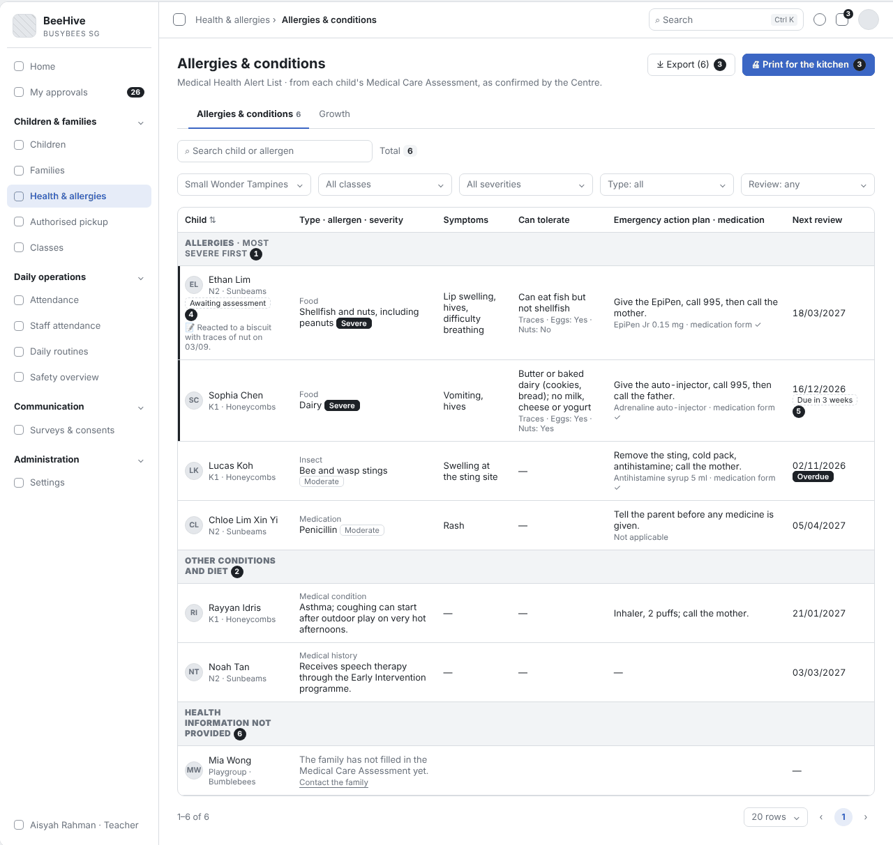
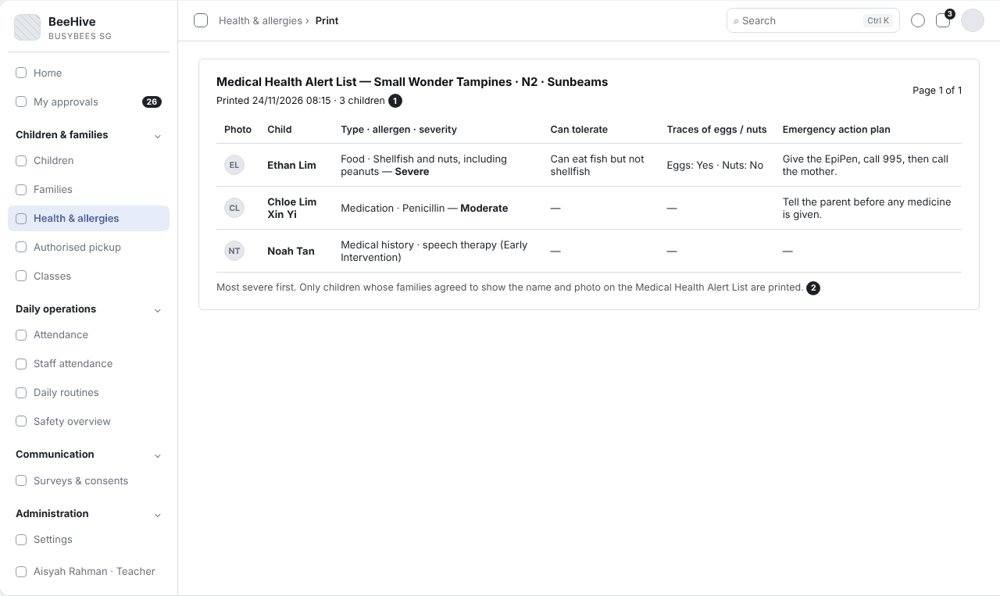

# BBA-69 Allergies list (most severe first) (Tiếng Việt)

| Thuộc tính | Giá trị |
|---|---|
| Dự án | Busy Bees Asia SMS |
| Module | Children & Families — Health & allergies |
| Tính năng | Allergies list (most severe first) |
| Mã ticket | BBA-69 |
| Mã WBS | 3.1.3.02 |
| Mã tài liệu | FRD-BBA-69 |
| Sprint | 4 |
| Phiên bản | 0.2 |
| Trạng thái | BẢN NHÁP CHỜ XÁC NHẬN |
| Ngày | 13/11/2026 |
| Người soạn | Business Analysis |
| Người review | HaiNguyen |
| Người duyệt | HaiNguyen |

## 1. Kiểm soát tài liệu

| Phiên bản | Ngày | Tác giả | Tóm tắt thay đổi | Duyệt |
|---|---|---|---|---|
| 0.1 | 10/11/2026 | Business Analysis | Bản đầu cho ticket BBA-69: quy tắc nghiệp vụ, trường hợp đặc biệt và tiêu chí nghiệm thu để chốt với vận hành Centre (Centre Director) và HQ Ops. | HaiNguyen |
| 0.2 | 13/11/2026 | Business Analysis | Cập nhật theo câu trả lời của BBA (Plane BBA-1058, file câu hỏi phản hồi Sprint 4) và form Medical Care Assessment Checklist / Review (đính kèm BBA-1058): cột theo các trường của form (loại, triệu chứng, điều kiện dung nạp, vết trứng / hạt, kế hoạch xử trí, thuốc); Teacher được in / xuất, không lưu nhật ký in / xuất; chỉ hiện trẻ có phụ huynh đồng ý hiện tên và ảnh; theo dõi hạn đánh giá lại 6 tháng; giữ thông tin đã xác nhận khi phụ huynh sửa; nhóm "Health information not provided". Sửa FR-001 đến FR-004, FR-007, FR-008, BR-001, BR-003, BR-004, DATA-001; thêm FR-011 đến FR-014, BR-005, BR-006, DATA-003, AC-012 đến AC-017, OQ-05 đến OQ-09, AS-04; bỏ yêu cầu ô "Chưa có thông tin" màu đỏ và nhật ký in / xuất cùng AC tương ứng (mã cũ không dùng lại); thêm wireframe SCR-01, SCR-02. | HaiNguyen |

**Mức sẵn sàng:** Đã đặc tả danh sách dị ứng theo Centre / lớp theo các trường của form Medical Care Assessment, thứ tự theo mức độ, hạn đánh giá lại, lọc, in cho bếp, xuất file và quyền xem; có wireframe. 8 câu hỏi mở ở mục 7 cần BBA chốt.

## 2. Mục tiêu và bối cảnh

Giáo viên và bếp cần một danh sách dị ứng của cả lớp hoặc cả Centre, trẻ bị nặng nhất ở trên cùng, để chuẩn bị bữa ăn và xử lý đúng khi trẻ có phản ứng. Nội dung lấy từ Medical Care Assessment do phụ huynh khai và Centre Director / Senior Staff xác nhận; nhân viên không gõ lại. Trên form của BBA, danh sách này gọi là "Medical Overview / Medical Health Alert List".

Mục tiêu đo được: danh sách hiển thị 100% trẻ đang đi học có dị ứng, theo đúng thứ tự mức độ; bản in cho bếp luôn ghi thời điểm in.

## 3. Phạm vi

| Trong phạm vi | Ngoài phạm vi |
|---|---|
| Danh sách dị ứng theo Centre và lớp, trẻ nặng nhất lên đầu. Các cột theo form Medical Care Assessment Checklist: trẻ (ảnh), lớp, loại, chất gây dị ứng, mức độ, triệu chứng, điều kiện dung nạp, vết trứng / hạt, kế hoạch xử trí và thuốc dùng ngay, hạn đánh giá lại, ghi chú của nhân viên. Phần riêng cho trẻ chỉ có bệnh hoặc chế độ ăn đặc biệt; nhóm trẻ chưa khai thông tin sức khoẻ. Tìm kiếm, lọc, in cho bếp, xuất file. Quyền xem theo vai trò. | Phụ huynh nhập và sửa Medical Care Assessment (Parents App); quy trình đánh giá và đánh giá lại 6 tháng (BBA-68). Cảnh báo đỏ trên hồ sơ trẻ và các danh sách khác (BBA-68). Biểu đồ tăng trưởng (BBA-70). Khai báo và ghi nhận cho trẻ uống thuốc. |

## 4. Tác nhân, vai trò và quyền truy cập

| Tác nhân | Phạm vi | Quyền / Trách nhiệm |
|---|---|---|
| Teacher / Senior Teacher | Lớp của mình. | Xem danh sách lớp mình, in cho bếp, xuất file. |
| Centre Director, School Admin | Centre của mình. | Xem toàn Centre, in, xuất file; liên hệ phụ huynh khi thông tin dị ứng thiếu. |
| HQ Admin | Mọi Centre. | Xem, in, xuất file mọi Centre. |
| HQ Ops (District Manager, Operations Manager) | Các Centre mình phụ trách. | Xem theo quyền được cấp. |
| Bếp | Centre. | Dùng bản in do Centre đưa (AS-01). |
| Phụ huynh (Parents App) | Con mình. | Khai thông tin dị ứng; đồng ý cho hiện tên và ảnh trên Medical Health Alert List. |
| Hệ thống | Toàn hệ thống. | Sắp xếp theo mức độ, ghi thời điểm in, tính hạn đánh giá lại. |

Quy tắc chung: chỉ vai trò được phép xem chi tiết y tế mới mở được danh sách này (mặc định Centre Director, Teacher, School Admin, HQ Admin); không lưu nhật ký in / xuất (BBA-1058 Q2).

## 5. Tổng quan tính năng

| Khu vực | Chức năng | User Story |
|---|---|---|
| Children & families › Health & allergies | Danh sách dị ứng theo Centre / lớp (Medical Health Alert List), in cho bếp, xuất file. | US-001 |

## 6. Yêu cầu chức năng

### 6.1 US-001 - Danh sách dị ứng, trẻ nặng nhất lên đầu

#### User Story

Là giáo viên, tôi muốn xem và in danh sách dị ứng của lớp mình, trẻ bị nặng nhất ở trên cùng, để tôi và bếp biết ngay trẻ nào cần tránh món gì và xử lý ra sao khi trẻ có phản ứng.

#### Functional Requirements (Yêu cầu chức năng)

| FR ID | Yêu cầu chức năng |
|---|---|
| FR-001 | Danh sách có một dòng cho mỗi trẻ có ít nhất một dị ứng, theo các trường của Medical Care Assessment Checklist (Appendix 1): ảnh và tên trẻ, lớp, "Note from staff"; loại (Food, Environmental, Medication, Insect) và các chất gây dị ứng, mỗi chất kèm mức độ (Mild / Moderate / Severe); Symptoms; Can tolerate (điều kiện dung nạp) kèm "Traces · Eggs: Yes/No · Nuts: Yes/No"; Emergency action plan (các bước xử trí) kèm thuốc dùng ngay và trạng thái Medication Held On Site Form; Next review (FR-013). |
| FR-002 | Thứ tự mặc định: trẻ có mức nặng nhất ở trên cùng (Severe — tương ứng "Life Threatening" trên form của BBA — rồi Moderate, rồi Mild); cùng mức thì xếp theo lớp, rồi theo tên trẻ. Dị ứng chưa chọn mức độ được xếp cùng nhóm Severe và ghi "Severity not set". |
| FR-003 | Bên dưới danh sách dị ứng có phần riêng "Other conditions and diet" cho trẻ không có dị ứng nhưng có Medical Condition, Medical Conditions & History (Appendix 1 tr. 1) hoặc chế độ ăn đặc biệt; mỗi dòng có loại, mô tả, kế hoạch xử trí, Next review. |
| FR-004 | Tìm theo tên trẻ hoặc chất gây dị ứng; lọc theo Centre, lớp, mức độ, loại (Food, Environmental, Medication, Insect, Medical condition — theo Appendix 1) và hạn đánh giá lại (Any, Due within 1 month, Overdue); các bộ lọc dùng kết hợp được. |
| FR-005 | Giáo viên mở danh sách thì mặc định lọc theo lớp của mình; Centre Director và School Admin mặc định thấy toàn Centre. |
| FR-007 | "Print for the kitchen" in "Medical Health Alert List" theo bộ lọc đang chọn (một lớp hoặc cả Centre); đầu trang ghi tên Centre, lớp, ngày giờ in (ví dụ "Printed 24/11/2026 08:15") và số trẻ; cột: Photo, Child, Type · allergen · severity, Can tolerate, Traces of eggs / nuts, Emergency action plan (chờ OQ-04). |
| FR-008 | "Export" xuất danh sách theo bộ lọc đang chọn ra Excel. Hệ thống không lưu nhật ký in / xuất. |
| FR-009 | Chọn tên trẻ mở tab Health trong hồ sơ trẻ. |
| FR-010 | Danh sách chỉ gồm trẻ đang đi học; trẻ đang tạm nghỉ, đã thôi học hoặc đã tốt nghiệp không có trong danh sách. |
| FR-011 | Trẻ mà phụ huynh chưa ký đồng ý cho hiện tên và ảnh trên danh sách y tế (Medical Care Assessment Checklist) không có trong danh sách và bản in. |
| FR-012 | Trẻ chưa khai Health record ("chưa cung cấp") được phân biệt với trẻ đã khai không có dị ứng: cuối danh sách có nhóm "Health information not provided" để Centre liên hệ phụ huynh. Trẻ chưa sinh không nằm trong nhóm này (Q-70-09). Mỗi dòng có "Contact the family". |
| FR-013 | Cột "Next review" hiện Date of Next Review của lần đánh giá gần nhất (mỗi 6 tháng — Appendix 3); từ 1 tháng trước ngày đó hiện "Due in …" (lúc hệ thống nhắc và gửi form đánh giá lại cho phụ huynh — BBA-1058 Q1); qua ngày đó chưa đánh giá hiện "Overdue". |
| FR-014 | Khi phụ huynh sửa thông tin sức khoẻ trong Parents App, danh sách và bản in giữ thông tin đã được xác nhận gần nhất và gắn nhãn "Awaiting assessment" cho tới khi CD / Admin hoàn tất đánh giá (BBA-1058 Q1). |

#### Functional Flow - Main (Luồng chính)

1. Giáo viên mở Children & families › Health & allergies; danh sách mặc định lọc theo lớp của mình (FR-005).
2. Hệ thống hiển thị trẻ có dị ứng, trẻ nặng nhất lên đầu (FR-001, FR-002), và phần "Other conditions and diet" (FR-003).
3. Giáo viên chọn "Print for the kitchen" và đưa bản in cho bếp (FR-007).

#### Functional Flow - Alternative (Luồng thay thế)

1. Centre Director lọc toàn Centre theo mức Severe để rà soát (FR-004).
2. Centre Director, School Admin hoặc giáo viên xuất danh sách ra Excel (FR-008).
3. Người dùng chọn tên trẻ để xem đủ Health record (FR-009).

#### Functional Flow - Exception (Luồng ngoại lệ)

1. Bộ lọc không có trẻ nào: hiện thông báo trống (VAL-001).
2. Vai trò không được xem chi tiết y tế: không mở được danh sách (VAL-002).

#### Business Rules (Quy tắc nghiệp vụ)

| BR ID | Quy tắc nghiệp vụ |
|---|---|
| BR-001 | Phụ huynh khai thông tin dị ứng (Medical Care Assessment); Centre Director hoặc Senior Staff kiểm tra và xác nhận (Appendix 1 tr. 3, BBA-1058 Q1). Danh sách chỉ đọc; nhân viên chỉ thêm "Note from staff" ở tab Health. |
| BR-002 | Trẻ nặng nhất luôn ở trên cùng; dị ứng chưa chọn mức độ được coi như Severe. |
| BR-003 | Bản in luôn ghi ngày giờ in, để bếp biết bản nào là bản mới nhất. |
| BR-004 | Centre Director, School Admin và Teacher được xem, in và xuất danh sách; không lưu nhật ký in / xuất. |
| BR-005 | Một trẻ không bị giới hạn số dị ứng hoặc bệnh (Q-70-02). |
| BR-006 | Mỗi Medical Care Assessment được đánh giá lại tối đa 6 tháng một lần, hoặc sớm hơn khi có thay đổi / sự cố (Appendix 3). |

#### Validation Rules (Quy tắc kiểm tra)

| VAL ID | Điều kiện | Phản hồi hệ thống |
|---|---|---|
| VAL-001 | Bộ lọc không có trẻ nào. | Hiện "No children with allergies match these filters."; nút in và xuất file bị mờ. |
| VAL-002 | Người dùng không có quyền xem chi tiết y tế mở danh sách. | Không có mục Health & allergies trong menu; mở bằng đường dẫn thì hiện "You do not have access to medical details." |

#### UI Reference (Tham chiếu giao diện)

| Mã màn hình / Phiên bản | Tham chiếu / Link |
|---|---|
| SCR-01 - Allergies & conditions (Medical Health Alert List) | Wireframe: `Diagram/Wireframe/allergies-list-sprint4.html` |
| SCR-02 - Print for the kitchen | Wireframe: `Diagram/Wireframe/allergies-list-sprint4.html` (trạng thái "Bản in cho bếp") |

#### UI Components / Field Specification (Thành phần giao diện)

| Trường / Điều khiển | Loại | Bắt buộc | Mặc định / Trạng thái | Kiểm tra | Hành vi |
|---|---|---|---|---|---|
| Tìm kiếm | Ô nhập | Không | Trống | — | Tên trẻ, chất gây dị ứng. |
| Centre, Class, Severity, Type, Review | Bộ lọc | Không | Theo vai trò (FR-005) | VAL-001. | FR-004. |
| Danh sách dị ứng | Bảng | Có | Nặng nhất lên đầu | — | Cột: Child (kèm Note from staff), Type · allergen · severity, Symptoms, Can tolerate, Emergency action plan · medication, Next review (FR-001; FR-002; FR-013). |
| Awaiting assessment | Nhãn dưới tên trẻ | Khi có | — | — | FR-014. |
| Health information not provided | Nhóm cuối danh sách | Khi có | — | — | Kèm "Contact the family" (FR-012). |
| Other conditions and diet | Bảng | Khi có | — | — | FR-003. |
| Print for the kitchen | Nút | Có | — | VAL-001. | FR-007. |
| Export | Nút | Có | — | VAL-001. | FR-008. |

#### Data and Audit (Dữ liệu và audit)

| ID | Yêu cầu |
|---|---|
| DATA-001 | Danh sách đọc từ Medical Care Assessment đã xác nhận: loại, chất gây dị ứng, mức độ, triệu chứng, điều kiện dung nạp, traces of eggs / nuts, menu modifications, các bước xử trí, thuốc dùng ngay, Medication Held On Site Form, bệnh và tiền sử, đồng ý hiện tên và ảnh, người xác nhận và ngày; "Note from staff". |
| DATA-003 | Mỗi lần đánh giá lại lưu: số thứ tự, Date of Review, Date of Next Review, còn phù hợp không, có thay đổi không, thuốc còn hạn tới lần đánh giá sau không, người đánh giá, xác nhận của phụ huynh (Appendix 3). |

#### Acceptance Criteria (Tiêu chí nghiệm thu)

| AC ID | Given | When | Then | Linked Rule |
|---|---|---|---|---|
| AC-001 | lớp Sunbeams có Ethan (hải sản và hạt, Severe) và một trẻ dị ứng trứng mức Mild | giáo viên lớp Sunbeams mở danh sách | Ethan ở dòng đầu, trẻ dị ứng trứng ở dưới; mỗi chất gây dị ứng ghi kèm mức độ | FR-001; FR-002; BR-002 |
| AC-002 | một trẻ dị ứng trứng chưa chọn mức độ | danh sách hiển thị | trẻ nằm trong nhóm Severe và ghi "Severity not set" | FR-002; BR-002 |
| AC-003 | Rayyan chỉ có hen suyễn, không có dị ứng | danh sách hiển thị | Rayyan nằm ở phần "Other conditions and diet" | FR-003 |
| AC-005 | giáo viên đang lọc lớp Sunbeams | giáo viên chọn "Print for the kitchen" | bản in chỉ có trẻ lớp Sunbeams, đầu trang ghi Centre, lớp, ngày giờ in và số trẻ | FR-007; BR-003 |
| AC-006 | giáo viên lọc lớp Sunbeams | giáo viên chọn Export | file Excel có đúng các trẻ đang hiện; không có bản ghi nhật ký xuất | FR-008; BR-004 |
| AC-007 | giáo viên lớp Sunbeams | giáo viên mở danh sách | bộ lọc lớp mặc định là Sunbeams | FR-005 |
| AC-008 | một trẻ dị ứng đang tạm nghỉ | Centre Director mở danh sách toàn Centre | trẻ đó không có trong danh sách | FR-010 |
| AC-009 | HQ Finance không được xem chi tiết y tế | HQ Finance mở đường dẫn danh sách | hiện "You do not have access to medical details." | VAL-002; BR-004 |
| AC-010 | lớp không có trẻ dị ứng | giáo viên mở danh sách | hiện "No children with allergies match these filters."; nút in và xuất file bị mờ | VAL-001 |
| AC-011 | đang xem danh sách | giáo viên chọn tên Ethan | mở tab Health trong hồ sơ Ethan | FR-009; BR-001 |
| AC-012 | phụ huynh của Caleb chưa ký đồng ý cho hiện trên danh sách y tế | giáo viên mở danh sách và in cho bếp | Caleb không có trong danh sách và bản in | FR-011 |
| AC-013 | phụ huynh của Mia chưa khai Health record | Centre Director mở danh sách toàn Centre | Mia ở nhóm "Health information not provided", không nằm trong nhóm dị ứng | FR-012 |
| AC-014 | lần đánh giá gần nhất của Sophia có Date of Next Review 16/12/2026; hôm nay 24/11/2026 | Centre Director mở danh sách | Next review của Sophia ghi "16/12/2026 · Due in 3 weeks" | FR-013; BR-006 |
| AC-015 | Next review của Lucas là 02/11/2026, chưa đánh giá lại | Centre Director lọc Review: Overdue | Lucas có trong kết quả, nhãn "Overdue" | FR-004; FR-013 |
| AC-016 | mẹ của Ethan sửa triệu chứng trong Parents App, CD chưa đánh giá | giáo viên mở danh sách | dòng Ethan vẫn hiện triệu chứng đã xác nhận, có nhãn "Awaiting assessment" | FR-014 |
| AC-017 | Lucas khai 5 chất gây dị ứng | danh sách hiển thị | dòng của Lucas liệt kê đủ 5 chất, mỗi chất kèm mức độ | BR-005; AS-02 |

#### Dependencies (Phụ thuộc)

Medical Care Assessment (phụ huynh khai trong Parents App, Centre Director / Admin hoàn tất đánh giá — BBA-68); đánh giá lại 6 tháng (BBA-68); quyền xem chi tiết y tế (Roles & permissions); hồ sơ trẻ; BBA-68 (quy tắc mức cảnh báo).

## 7. Câu hỏi mở

| Mã câu hỏi | Quyết định cần có | Người quyết định | Ưu tiên | Quyết định của BBA |
|---|---|---|---|---|
| OQ-01 | Phản ứng, cách xử trí và nơi để thuốc khẩn cấp có thành trường riêng không? | Centre Director / HQ Ops | Cao | Form Medical Care Assessment Checklist có trường riêng Symptoms, Steps to follow, Medication for immediate administration → đã tách cột. Nơi để thuốc chuyển sang OQ-02. |
| OQ-02 | Nơi để thuốc khẩn cấp có cần ghi không, ai ghi? Form chỉ có "Medication Held On Site Form Has Been Completed? Yes / Not Applicable". | Centre Director / HQ Ops | Cao |  |
| OQ-03 | Bếp dùng bản in hay có tài khoản xem trên máy; được xem dữ liệu nhận dạng nào? | Centre Director / HQ Ops | Trung bình |  |
| OQ-04 | Bản in cho bếp dùng các cột Photo, Child, Type · allergen · severity, Can tolerate, Traces of eggs / nuts, Emergency action plan; có cần thêm Menu modifications không? | Centre Director / HQ Ops | Thấp |  |
| OQ-05 | "Chưa ký đồng ý thì không hiện" áp cho toàn bộ thông tin sức khoẻ (giáo viên cũng không thấy) hay chỉ tên / ảnh trên danh sách và bản in? Ẩn toàn bộ có rủi ro an toàn. | Centre Director / HQ Ops | Cao |  |
| OQ-06 | Thang mức độ có cần cấu hình theo brand / Centre ngay Phase 1 không? | HQ Ops | Trung bình |  |
| OQ-07 | Medical condition, medical history nằm chung danh sách dị ứng hay nhóm riêng? Form vừa có "Medical Condition" trong Type of Allergies, vừa có mục "Medical Conditions & History" riêng. FRD đang để nhóm riêng. | Centre Director / HQ Ops | Trung bình |  |
| OQ-08 | Can tolerate, traces of eggs / nuts, menu modifications do phụ huynh khai trong Parents App hay Centre ghi khi đánh giá ("Menu reviewed with parents")? | Centre Director / HQ Ops | Trung bình |  |
| OQ-09 | Tên màn hình dùng "Allergies & conditions" hay theo form "Medical Health Alert List"? | HQ Ops | Thấp |  |

### Giả định của BA (cần xác nhận cùng mục 7)

| Mã | Giả định | Dùng ở |
|---|---|---|
| AS-01 | Bếp nhận bản in do Centre đưa; nhân viên bếp không có tài khoản. | Mục 4 — chờ OQ-03 |
| AS-02 | Mỗi trẻ một dòng; trẻ có nhiều dị ứng thì liệt kê các chất trong cùng dòng. | FR-001 |
| AS-03 | Trẻ đang tạm nghỉ không có trong danh sách vì không đến trường. | FR-010 |
| AS-04 | Bản in chỉ ghi ngày giờ in, không ghi tên người in. | FR-007; BR-003 |

## 8. Phụ lục

### Phụ lục A. Thuật ngữ

| Thuật ngữ | Định nghĩa trong FRD này |
|---|---|
| Medical Care Assessment | Form thông tin sức khoẻ của trẻ (Medical Care Assessment Checklist): loại dị ứng, chất gây dị ứng, mức độ, triệu chứng, điều kiện dung nạp, yêu cầu chăm sóc hằng ngày, kế hoạch xử trí, thuốc, bác sĩ, đồng ý của phụ huynh. Phụ huynh khai, Centre Director hoặc Senior Staff kiểm tra và xác nhận. |
| Medical Health Alert List | Tên danh sách y tế trên form của BBA ("Medical Overview / Medical Health Alert List"); trong hệ thống là màn Allergies & conditions. |
| Mức độ dị ứng | Mild (nhẹ), Moderate (vừa), Severe (nặng — tương ứng "Life Threatening" trên form của BBA). |
| Next review | Ngày đánh giá lại Medical Care Assessment (Date of Next Review), tối đa 6 tháng sau lần đánh giá gần nhất. |
| Can tolerate | Điều kiện trẻ vẫn dùng được chất gây dị ứng (ví dụ ăn được bánh nướng có trứng nhưng không ăn trứng luộc). |
| EpiPen | Bút tiêm adrenaline dùng khi trẻ bị sốc phản vệ. |
| Ghi chú của nhân viên | Ghi chú do nhân viên Centre thêm ở tab Health, tách khỏi thông tin phụ huynh khai. |
