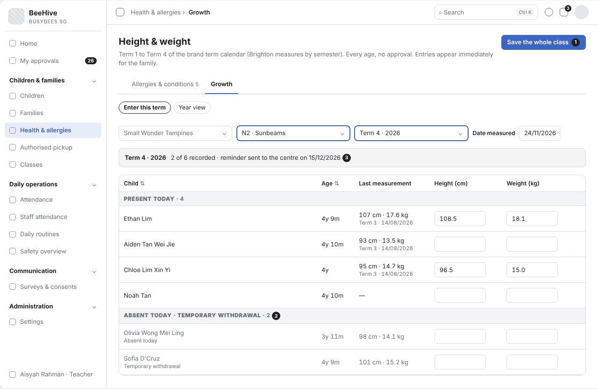
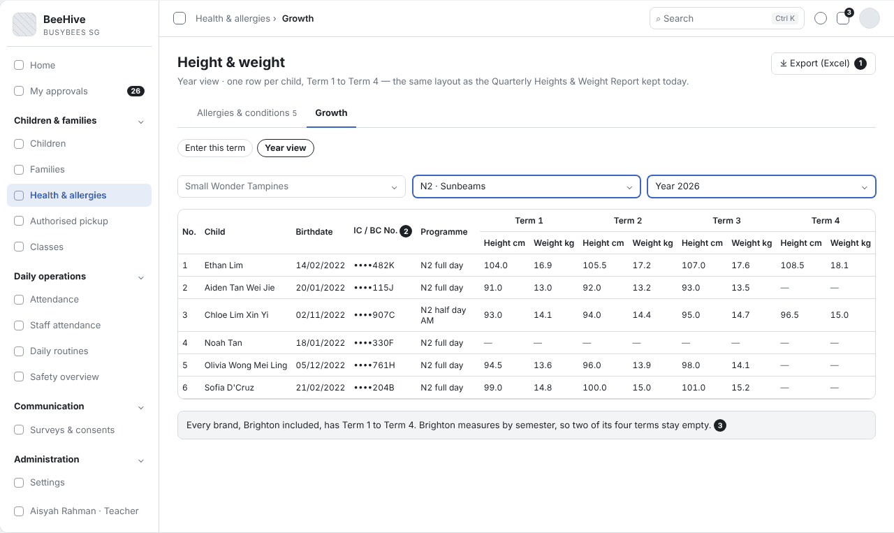
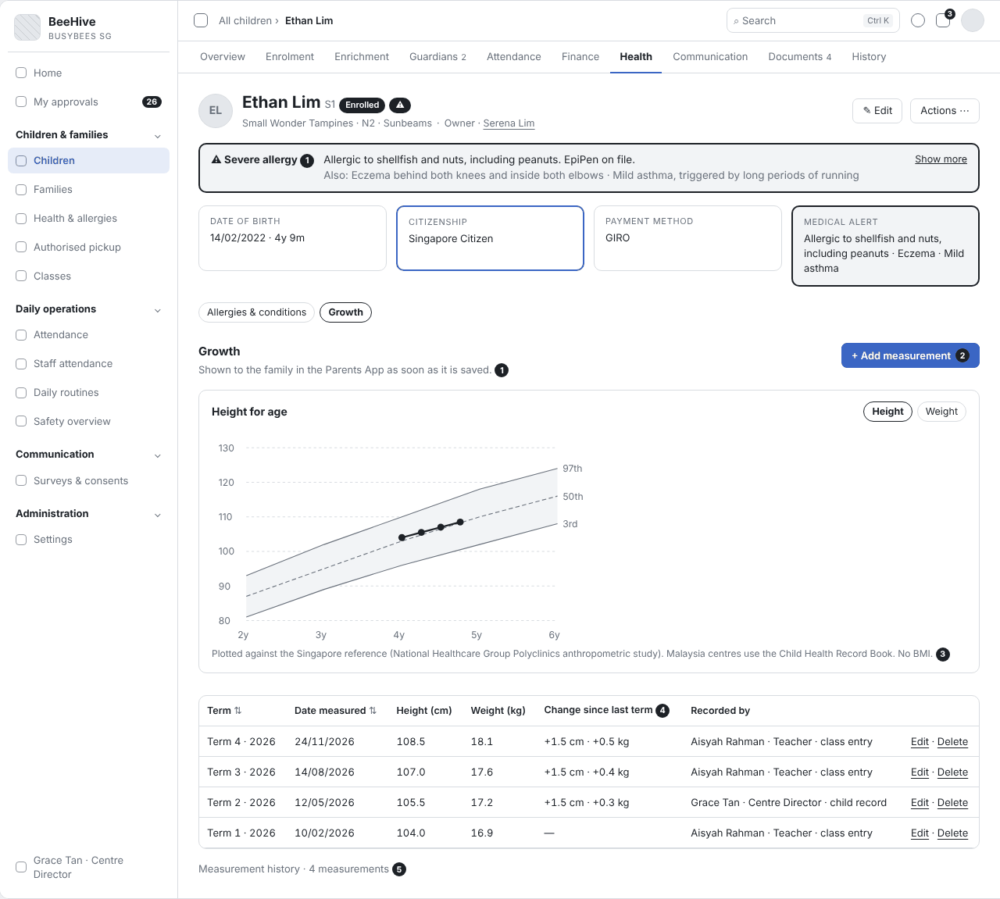
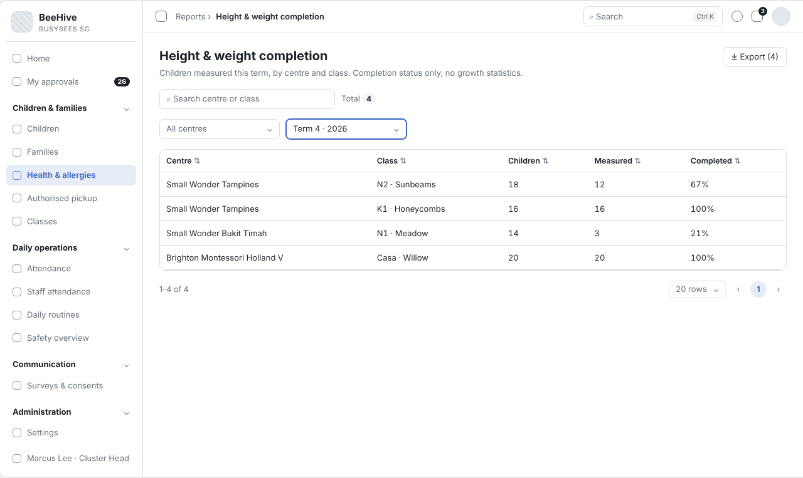

# BBA-70 Growth – termly height & weight entry by class (Tiếng Việt)

| Thuộc tính | Giá trị |
|---|---|
| Dự án | Busy Bees Asia SMS |
| Module | Children & Families — Health & allergies (Growth) |
| Tính năng | Growth – termly height & weight entry by class |
| Mã ticket | BBA-70 |
| Mã WBS | 3.1.3.03 |
| Mã tài liệu | FRD-BBA-70 |
| Sprint | 4 |
| Phiên bản | 0.2 |
| Trạng thái | BẢN NHÁP CHỜ XÁC NHẬN |
| Ngày | 13/11/2026 |
| Người soạn | Business Analysis |
| Người review | HaiNguyen |
| Người duyệt | HaiNguyen |

## 1. Kiểm soát tài liệu

| Phiên bản | Ngày | Tác giả | Tóm tắt thay đổi | Duyệt |
|---|---|---|---|---|
| 0.1 | 10/11/2026 | Business Analysis | Bản đầu cho ticket BBA-70: quy tắc nghiệp vụ, trường hợp đặc biệt và tiêu chí nghiệm thu để chốt với vận hành Centre (Centre Director) và HQ Ops. | HaiNguyen |
| 0.2 | 13/11/2026 | Business Analysis | Cập nhật theo câu trả lời của BBA (Plane BBA-529, BBA-1059, BBA-489, BBA-524; file câu hỏi phản hồi Sprint 4) và tệp đính kèm (file export "Quarterly Heights & Weight Report" của Taidii, bảng quyền Taidii, Parent App Requirements, Centre Terms Setup): bỏ BMI; biểu đồ theo chuẩn Singapore / Malaysia; Term 1–4 theo lịch term của brand do HQ đặt; trẻ vắng và tạm nghỉ ở nhóm riêng; lưu cả lớp không bị dòng lỗi chặn; xoá số đo; nhắc giữa tháng cuối mỗi term; báo cáo completion chỉ có trạng thái hoàn thành; Measurement history và biểu đồ trên hồ sơ trẻ; Year view và Export theo bố cục Taidii. Sửa FR-001 đến FR-004, FR-008, FR-009, BR-003, DATA-001, AC-001, AC-002, AC-007, AC-009; thêm FR-010 đến FR-013, BR-005, DATA-003, AC-011 đến AC-017, OQ-06 đến OQ-09, AS-05, AS-06; thêm wireframe SCR-01 đến SCR-04 và mục 9 Tài liệu tham khảo. | HaiNguyen |

**Mức sẵn sàng:** Đã đặc tả màn nhập chiều cao, cân nặng theo lớp mỗi term, xem cả năm và xuất Excel, biểu đồ và lịch sử đo trên hồ sơ trẻ, xoá số đo, nhắc nhập, cảnh báo số liệu bất thường, phụ huynh xem ngay và báo cáo completion; có wireframe. 5 câu hỏi mở ở mục 7 cần BBA chốt (OQ-03, OQ-06 đến OQ-09).

## 2. Mục tiêu và bối cảnh

Mỗi term, giáo viên đo chiều cao và cân nặng của trẻ trong lớp và ghi vào hệ thống một lần cho cả lớp, thay cho báo cáo "Quarterly Heights & Weight Report" đang giữ trên Taidii. Hệ thống vẽ biểu đồ tăng trưởng theo chuẩn Singapore / Malaysia (không tính BMI); phụ huynh xem ngay trong Parents App; Centre Director, School Admin và Cluster Head theo dõi lớp nào đã đo đủ, vì nhiều Centre quên nhập khiến portfolio bị trống (BBA-1059 Q5).

Mục tiêu đo được: giáo viên nhập xong một lớp trong một lần lưu; 100% số đo đã lưu hiện cho phụ huynh ngay sau khi lưu, không cần duyệt.

## 3. Phạm vi

| Trong phạm vi | Ngoài phạm vi |
|---|---|
| Màn nhập theo lớp và term: chiều cao, cân nặng, ngày đo; trẻ vắng và tạm nghỉ ở nhóm riêng. Year view theo năm và xuất Excel. Vị trí trên biểu đồ tăng trưởng. Cảnh báo số liệu bất thường. Nhập cho một trẻ từ hồ sơ trẻ. Xoá số đo. Biểu đồ và Measurement history trên hồ sơ trẻ và trong Parents App. Nhắc nhập giữa tháng cuối mỗi term. Báo cáo completion. | BMI (SRS Children & Families §1.2). Thống kê tăng trưởng trong báo cáo (BBA-1059 Q5). Thiết bị đo kết nối tự động. Nhận xét dinh dưỡng, tư vấn sức khoẻ. Danh sách dị ứng (BBA-69). |

## 4. Tác nhân, vai trò và quyền truy cập

| Tác nhân | Phạm vi | Quyền / Trách nhiệm |
|---|---|---|
| Teacher / Senior Teacher | Lớp của mình. | Nhập, sửa, xoá số đo của trẻ lớp mình; xem cả năm, xuất Excel. |
| Centre Director, School Admin | Centre của mình. | Nhập, sửa, xoá số đo của mọi trẻ; xem báo cáo completion. |
| HQ Admin | Mọi Centre. | Thiết lập lịch term theo brand. |
| Cluster Head (trước đây District Manager — BBA-524) | Các Centre mình phụ trách. | Xem báo cáo completion. |
| Phụ huynh (Parents App) | Con mình. | Xem số đo, biểu đồ tăng trưởng và lịch sử đo ngay khi lưu. |
| Hệ thống | Toàn hệ thống. | Tính tuổi, vị trí trên biểu đồ; nhắc nhập giữa tháng cuối mỗi term; lưu lịch sử. |

## 5. Tổng quan tính năng

| Khu vực | Chức năng | User Story |
|---|---|---|
| Health & allergies › Growth | Nhập số đo theo lớp và term, Year view, xuất Excel. | US-001 |
| Child record › Health › Growth | Biểu đồ tăng trưởng, Measurement history, nhập cho một trẻ. | US-001 |
| Reports › Height & weight completion | Trạng thái hoàn thành theo Centre, lớp, term. | US-001 |

## 6. Yêu cầu chức năng

### 6.1 US-001 - Nhập chiều cao, cân nặng theo lớp mỗi kỳ

#### User Story

Là giáo viên, tôi muốn nhập chiều cao và cân nặng của cả lớp trên một màn hình và lưu một lần, để không phải mở từng hồ sơ trẻ và phụ huynh thấy ngay sự phát triển của con.

#### Functional Requirements (Yêu cầu chức năng)

| FR ID | Yêu cầu chức năng |
|---|---|
| FR-001 | Màn "Height & weight" cho chọn lớp, kỳ đo và ngày đo (mặc định hôm nay, không được sau hôm nay). Kỳ đo là Term 1–4 theo lịch term của brand do HQ đặt (Centre không sửa): năm học bắt đầu 1/1, ngày term đổi theo từng năm (Q-71-03; Centre Terms Setup — BBA-489). Brighton Montessori cũng dùng Term 1–4 nhưng đo theo học kỳ, tức đo ở 2 trong 4 term (BBA-529; term nào chờ OQ-08). |
| FR-002 | Bảng chia 2 nhóm: "Present today" và "Absent today · Temporary withdrawal". Mỗi trẻ một dòng: tên, tuổi (năm và tháng tại ngày đo), số đo lần trước (chiều cao, cân nặng, ngày đo), ô nhập chiều cao (cm) và cân nặng (kg). Trẻ nhóm thứ hai để trống được và nhập sau trong cùng kỳ. |
| FR-003 | "Save the whole class" lưu một lần mọi dòng đã nhập đủ cả chiều cao và cân nặng; dòng để trống không được lưu và vẫn là "Not recorded yet" trong kỳ; dòng lỗi không chặn các dòng hợp lệ (DOTB quyết định, Q-71-09). Số đo có hiệu lực ngay, không cần duyệt. |
| FR-004 | Hệ thống tính vị trí của trẻ trên biểu đồ tăng trưởng theo tuổi và giới tính: Centre Singapore dùng chuẩn nhân trắc của Singapore National Healthcare Group Polyclinics; Centre Malaysia dùng Child Health Record Book. Không tính BMI. |
| FR-005 | Số đo ngoài khoảng hợp lệ bị chặn (VAL-001). Chiều cao thấp hơn lần đo trước hiện cảnh báo "Height is lower than the last measurement. Check before saving."; người dùng vẫn lưu được. |
| FR-006 | Một trẻ chỉ có một số đo cho mỗi kỳ; nhập lại trong cùng kỳ thì số mới thay số cũ, số cũ giữ trong lịch sử kèm người sửa và thời điểm. |
| FR-007 | Từ hồ sơ trẻ, người dùng có quyền nhập được số đo cho riêng một trẻ, bất kỳ ngày nào, cho trẻ ở mọi độ tuổi. |
| FR-008 | Hồ sơ trẻ và mục Health & growth trong Parents App hiển thị chiều cao, cân nặng, ngày đo và biểu đồ tăng trưởng; số đo mới hiện cho phụ huynh ngay sau khi lưu. |
| FR-009 | Báo cáo "Height & weight completion" theo Centre, lớp và kỳ đo: số trẻ, số trẻ đã đo, tỷ lệ hoàn thành; lọc theo Centre và kỳ đo; xuất ra Excel. Không có thống kê tăng trưởng. Người dùng ban đầu: Centre Director, School Admin, Cluster Head (BBA-1059 Q5). |
| FR-010 | "Delete" ở một số đo đã lưu mở hộp xác nhận "Delete this measurement?"; xoá thì phụ huynh không còn thấy số đo đó; lịch sử ghi việc xoá, người xoá, thời điểm. |
| FR-011 | Hệ thống gửi nhắc nhập chiều cao, cân nặng vào giữa tháng cuối mỗi term (tháng 3, 6, 9, 12) cho mọi brand, kể cả Brighton (Q-71-03, BBA-529). |
| FR-012 | Hồ sơ trẻ, tab Health › Growth có biểu đồ chiều cao / cân nặng theo tuổi (FR-004) và "Measurement history": mọi lần đo theo ngày đo — term, ngày đo, chiều cao, cân nặng, thay đổi so với kỳ trước, người nhập và nơi nhập (class entry / child record); mỗi dòng có Edit, Delete theo quyền (Q-71-07, Q-71-08, Q-71-11). |
| FR-013 | Màn Height & weight có "Year view" cho một lớp và một năm: mỗi trẻ một dòng gồm No., tên, ngày sinh, IC / BC No. (che theo vai trò như hồ sơ trẻ — BBA-66), chương trình học, và Height cm / Weight kg của Term 1 đến Term 4; "Export (Excel)" xuất đúng bố cục này, đầu file ghi Centre, Class, Year, Generated on — giống báo cáo "Quarterly Heights & Weight Report" của Taidii (BBA-529). |

#### Functional Flow - Main (Luồng chính)

1. Giáo viên mở Growth, chọn lớp, kỳ đo và ngày đo (FR-001).
2. Hệ thống hiển thị trẻ theo 2 nhóm kèm số đo lần trước (FR-002).
3. Giáo viên nhập chiều cao, cân nặng và chọn "Save the whole class" (FR-003; VAL-001, VAL-002).
4. Hệ thống tính vị trí trên biểu đồ (FR-004) và hiện cho phụ huynh ngay (FR-008).

#### Functional Flow - Alternative (Luồng thay thế)

1. Trẻ vắng hoặc tạm nghỉ: để trống ở nhóm thứ hai, nhập vào ngày khác trong kỳ (FR-002, FR-003).
2. Nhập sai: nhập lại trong cùng kỳ, số cũ vào lịch sử (FR-006).
3. Nhập cho một trẻ từ hồ sơ trẻ (FR-007).
4. Centre Director, School Admin, Cluster Head xem báo cáo lớp nào chưa đo đủ (FR-009).
5. Xoá một số đo nhập nhầm (FR-010).
6. Giữa tháng cuối quý, Centre nhận nhắc nhập số đo (FR-011).
7. Giáo viên chuyển sang Year view để xem cả năm của lớp và xuất Excel (FR-013).
8. Centre Director mở hồ sơ trẻ, tab Health › Growth, xem biểu đồ và lịch sử đo (FR-012).

#### Functional Flow - Exception (Luồng ngoại lệ)

1. Số đo ngoài khoảng hợp lệ: không lưu dòng đó (VAL-001).
2. Chỉ nhập một trong hai số: không lưu dòng đó (VAL-002).
3. Ngày đo sau hôm nay: không lưu (VAL-003).

#### Business Rules (Quy tắc nghiệp vụ)

| BR ID | Quy tắc nghiệp vụ |
|---|---|
| BR-001 | Số đo do nhân viên ghi trực tiếp, không cần duyệt. |
| BR-002 | Mỗi trẻ một số đo cho mỗi kỳ; số mới thay số cũ, lịch sử được giữ. |
| BR-003 | Vị trí trên biểu đồ do hệ thống tính, người dùng không sửa tay. |
| BR-004 | Phụ huynh chỉ xem số đo của con mình. |
| BR-005 | Thêm, sửa và xoá số đo là một quyền chung (BBA-1059); Teacher thao tác trên lớp mình, Centre Director và School Admin trên mọi trẻ của Centre (Q-71-10). |

#### Validation Rules (Quy tắc kiểm tra)

| VAL ID | Điều kiện | Phản hồi hệ thống |
|---|---|---|
| VAL-001 | Chiều cao hoặc cân nặng ngoài khoảng hợp lệ (AS-02). | Dòng đó không được lưu; ô bị đánh dấu với chữ "Check this value." |
| VAL-002 | Chỉ nhập chiều cao hoặc chỉ nhập cân nặng. | Dòng đó không được lưu; ô còn trống bị đánh dấu "Enter both height and weight." |
| VAL-003 | Ngày đo sau hôm nay. | Không lưu; hiện "The measurement date cannot be in the future." |

#### UI Reference (Tham chiếu giao diện)

| Mã màn hình / Phiên bản | Tham chiếu / Link |
|---|---|
| SCR-01 - Height & weight — nhập theo lớp | Wireframe: `Diagram/Wireframe/growth-height-weight-sprint4.html` (Nhập · Đã lưu · Xoá số đo) |
| SCR-02 - Height & weight — Year view, Export | Wireframe: `Diagram/Wireframe/growth-height-weight-sprint4.html` (Xem cả năm · Export) |
| SCR-03 - Child record — Health › Growth | Wireframe: `Diagram/Wireframe/growth-height-weight-sprint4.html` |
| SCR-04 - Height & weight completion | Wireframe: `Diagram/Wireframe/growth-height-weight-sprint4.html` |

#### UI Components / Field Specification (Thành phần giao diện)

| Trường / Điều khiển | Loại | Bắt buộc | Mặc định / Trạng thái | Kiểm tra | Hành vi |
|---|---|---|---|---|---|
| Class | Danh sách chọn | Có | Lớp đầu tiên của giáo viên | — | Giáo viên chỉ thấy lớp mình. |
| Term | Danh sách chọn | Có | Term hiện tại | — | Term 1–4 theo lịch term của brand, mọi brand kể cả Brighton. |
| Date measured | Ngày | Có | Hôm nay | VAL-003. | — |
| Height (cm) | Số, 1 chữ số thập phân | Khi nhập dòng | Trống | VAL-001; VAL-002. | — |
| Weight (kg) | Số, 1 chữ số thập phân | Khi nhập dòng | Trống | VAL-001; VAL-002. | — |
| Nhóm "Absent today · Temporary withdrawal" | Nhóm dòng | Khi có | — | — | FR-002. |
| Save the whole class | Nút | Có | — | — | FR-003. |
| Delete | Nút ở số đo đã lưu | Theo quyền | — | — | FR-010. |
| Enter this term / Year view | Nút chuyển chế độ | Có | Enter this term | — | FR-013. |
| Year | Danh sách chọn (Year view) | Có | Năm hiện tại | — | FR-013. |
| Export (Excel) | Nút (Year view) | Theo quyền | — | — | FR-013. |
| Biểu đồ Height / Weight for age | Biểu đồ trên hồ sơ trẻ | — | Height | — | FR-004; FR-012; chờ OQ-07. |
| Measurement history | Bảng trên hồ sơ trẻ | — | Mới nhất lên đầu | — | FR-012. |

#### Data and Audit (Dữ liệu và audit)

| ID | Yêu cầu |
|---|---|
| DATA-001 | Mỗi số đo lưu: trẻ, kỳ đo, ngày đo, chiều cao, cân nặng, vị trí trên biểu đồ, chuẩn biểu đồ dùng, người nhập, thời điểm nhập. |
| DATA-002 | Mỗi lần sửa lưu giá trị cũ, giá trị mới, người sửa và thời điểm. |
| DATA-003 | Mỗi lần xoá lưu số đo bị xoá, người xoá, thời điểm. |

#### Acceptance Criteria (Tiêu chí nghiệm thu)

| AC ID | Given | When | Then | Linked Rule |
|---|---|---|---|---|
| AC-001 | lớp Nursery 1 có 18 trẻ, 17 trẻ có mặt | giáo viên nhập số đo cho 17 trẻ và chọn "Save the whole class" | 17 số đo được lưu cùng lúc, không cần duyệt; trẻ còn lại ở nhóm "Absent today" với "Not recorded yet" | FR-001; FR-002; FR-003; BR-001 |
| AC-002 | Ethan (Centre Singapore, nam, 4 tuổi 9 tháng) cao 108,5 cm, nặng 18,1 kg | số đo được lưu | biểu đồ của Ethan có điểm mới theo chuẩn Singapore; không có BMI | FR-004; BR-003 |
| AC-003 | giáo viên nhập 1000 cm | chọn Save | dòng đó không được lưu, ô hiện "Check this value." | VAL-001 |
| AC-004 | giáo viên chỉ nhập chiều cao | chọn Save | dòng đó không được lưu, ô cân nặng hiện "Enter both height and weight." | VAL-002 |
| AC-005 | lần trước trẻ cao 98 cm | giáo viên nhập 96 cm | hiện cảnh báo chiều cao thấp hơn lần trước; giáo viên vẫn lưu được | FR-005 |
| AC-006 | trẻ đã có số đo kỳ này | giáo viên nhập lại số khác trong cùng kỳ | số mới thay số cũ; lịch sử ghi số cũ, người sửa, thời điểm | FR-006; BR-002; DATA-002 |
| AC-007 | số đo vừa được lưu | phụ huynh mở Health & growth | thấy ngay chiều cao, cân nặng, ngày đo và điểm mới trên biểu đồ | FR-008; BR-004 |
| AC-008 | ngày đo chọn ngày mai | chọn Save | hiện "The measurement date cannot be in the future." | VAL-003 |
| AC-009 | lớp N2 · Sunbeams đo 12 / 18 trẻ trong Term 4 | Cluster Head mở báo cáo completion | dòng N2 · Sunbeams hiện 18 trẻ, đã đo 12, hoàn thành 67% | FR-009 |
| AC-010 | Centre Director mở hồ sơ một trẻ | nhập số đo cho riêng trẻ đó | số đo được lưu và biểu đồ của trẻ cập nhật | FR-007 |
| AC-011 | Sofia đang tạm nghỉ | giáo viên mở màn nhập lớp của Sofia | Sofia ở nhóm "Absent today · Temporary withdrawal", ô nhập để trống được | FR-002 |
| AC-012 | số đo Term 4 của Ethan nhập nhầm | giáo viên chọn Delete và xác nhận | số đo bị xoá, phụ huynh không còn thấy; lịch sử ghi người xoá và thời điểm | FR-010; BR-005; DATA-003 |
| AC-013 | Centre thuộc brand Brighton Montessori, lịch 2027 bắt đầu Term 2 ngày 01/04/2027 | giáo viên mở danh sách kỳ đo ngày 10/04/2027 | danh sách có Term 1 đến Term 4 của 2027, mặc định Term 2 | FR-001 |
| AC-014 | ngày 15/12/2026 | hệ thống chạy nhắc | Centre nhận nhắc nhập chiều cao, cân nặng | FR-011 |
| AC-015 | lớp N2 · Sunbeams có số đo Term 1–4 năm 2026 | giáo viên chọn Year view, năm 2026 | mỗi trẻ một dòng với ngày sinh, IC / BC No. đã che, chương trình học và Height cm / Weight kg của 4 term; term chưa đo hiện "—" | FR-013 |
| AC-016 | đang ở Year view lớp N2 · Sunbeams năm 2026 | giáo viên chọn Export (Excel) | file có đầu trang Centre, Class, Year, Generated on và các cột như Year view | FR-013 |
| AC-017 | Ethan có số đo Term 3 (107,0 cm, 17,6 kg) và Term 4 (108,5 cm, 18,1 kg) | Centre Director mở hồ sơ Ethan, tab Health › Growth | dòng Term 4 ghi "+1.5 cm · +0.5 kg" và người nhập; biểu đồ có điểm Term 4 | FR-004; FR-012 |

#### Dependencies (Phụ thuộc)

Danh sách lớp và trẻ (gồm trẻ vắng và tạm nghỉ); hồ sơ trẻ (ngày sinh, giới tính, IC / BC No., chương trình học); quy tắc che số giấy tờ theo vai trò (BBA-66); Parents App (Health & growth); lịch term theo brand (HQ Admin); chuẩn biểu đồ Singapore / Malaysia; thông báo nhắc.

## 7. Câu hỏi mở

| Mã câu hỏi | Quyết định cần có | Người quyết định | Ưu tiên | Quyết định của BBA |
|---|---|---|---|---|
| OQ-01 | Các term trong năm học bắt đầu và kết thúc ngày nào, theo từng brand? | HQ Ops | Cao | File "Centre Terms Setup.xlsx" (BBA-489): ngày bắt đầu Term 1–4 năm 2027 của từng brand; term do HQ đặt theo brand, Centre không sửa (Q-71-03). Ngày kết thúc theo AS-06. |
| OQ-02 | Biểu đồ tăng trưởng dùng chuẩn nào? | HQ Ops | Cao | Singapore: nghiên cứu nhân trắc của Singapore National Healthcare Group Polyclinics; Malaysia: Child Health Record Book (BBA-1059 Q1). |
| OQ-03 | Khoảng hợp lệ của chiều cao, cân nặng và số chữ số thập phân? | HQ Ops | Trung bình | Một phần: đơn vị cm, kg (Q-71-05). File mẫu Taidii ghi số nguyên (94 cm, 13 kg). Khoảng hợp lệ chưa chốt. |
| OQ-04 | Báo cáo theo dõi cần thêm gì ngoài số trẻ đã đo / chưa đo? | HQ Ops | Trung bình | Chỉ trạng thái hoàn thành; người dùng ban đầu: Centre Director, School Admin, Cluster Head (BBA-1059 Q5). |
| OQ-05 | Có nhắc khi gần hết term mà lớp chưa đo đủ không? | Centre Director / HQ Ops | Thấp | Nhắc giữa tháng cuối mỗi term (tháng 3, 6, 9, 12) cho mọi brand, kể cả Brighton (BBA-529, Q-71-03). |
| OQ-06 | Nhắc gửi cho ai (Centre Director, School Admin, giáo viên lớp) và qua kênh nào? | Centre Director / HQ Ops | Trung bình |  |
| OQ-07 | Có biểu đồ tăng trưởng không, có hiện đường percentile không? Q-71-02 (09/11): bỏ BMI và percentile, chỉ cần height + weight. BBA-1059 Q1 (13/11): gửi chuẩn biểu đồ Singapore / Malaysia. SRS Children & Families §4 mục 1.3: "View growth chart — height and weight against percentile curves". Taidii hiện vẽ 3 đường 3rd / 50th / 97th. FRD và wireframe đang theo BBA-1059. | HQ Ops | Cao |  |
| OQ-08 | Brighton Montessori đo theo học kỳ nhưng dùng Term 1–4 (Centre Terms Setup; file export Taidii). Brighton đo ở term nào? Báo cáo completion có bỏ qua các term Brighton không đo không? | HQ Ops | Trung bình |  |
| OQ-09 | "Health observations" (Parent App Requirements mục 19b) thuộc tính năng nào, có trong BBA-70 không? | HQ Ops | Thấp |  |

### Giả định của BA (cần xác nhận cùng mục 7)

| Mã | Giả định | Dùng ở |
|---|---|---|
| AS-01 | HQ Admin thiết lập lịch term theo brand. | FR-001 — đã xác nhận (Q-71-03) |
| AS-02 | Khoảng hợp lệ tạm thời: chiều cao 40–150 cm, cân nặng 2–50 kg, cho tới khi BBA chốt. | VAL-001 — chờ OQ-03 |
| AS-03 | Chiều cao và cân nặng nhập 1 chữ số thập phân. | FR-002 — chờ OQ-03 |
| AS-04 | Báo cáo completion đếm số trẻ đã đo / chưa đo theo term. | FR-009 — đã xác nhận (BBA-1059 Q5) |
| AS-05 | "Giữa tháng" là ngày 15. | FR-011 |
| AS-06 | Ngày kết thúc một term là ngày trước ngày bắt đầu term sau; Term 4 kết thúc 31/12. | FR-001 — OQ-01 |

## 8. Phụ lục

### Phụ lục A. Thuật ngữ

| Thuật ngữ | Định nghĩa trong FRD này |
|---|---|
| Term (kỳ đo) | Một trong 4 term của năm học (1/1–31/12) theo lịch term của brand do HQ đặt; Centre đo chiều cao, cân nặng cho trẻ một lần mỗi term. |
| Year view | Bảng một lớp, một năm: mỗi trẻ một dòng, Height cm / Weight kg của Term 1 đến Term 4 — cùng bố cục báo cáo "Quarterly Heights & Weight Report" của Taidii. |
| Measurement history | Danh sách mọi lần đo của một trẻ theo ngày đo, kèm người nhập. |
| Biểu đồ tăng trưởng | Biểu đồ so sánh chiều cao, cân nặng của trẻ với trẻ cùng tuổi, cùng giới tính, theo chuẩn Singapore (NHG Polyclinics) hoặc Malaysia (Child Health Record Book). |
| BMI | Chỉ số khối cơ thể; không dùng trong Phase 1 (SRS Children & Families §1.2). |
| Cluster Head | Tên mới của District Manager, cho cả Singapore và Malaysia (BBA-524). |

## 9. Tài liệu tham khảo

Số trang của SRS tính theo bản Word gốc khi xuất PDF. Tệp của BBA là tệp đính kèm trên Plane.

| STT | Tài liệu | Mục | Trang | Dùng cho |
|---|---|---|---|---|
| 1 | BBA-SMS-SRS-Children-and-Families-v0.1 | §1.1 In scope; §1.2 Not in Phase 1 (BMI) | 3 | Mục 3 — phạm vi, bỏ BMI. |
| 2 | BBA-SMS-SRS-Children-and-Families-v0.1 | §3 P7 Height and weight | 5 | Luồng chính; FR-002, FR-003, FR-004. |
| 3 | BBA-SMS-SRS-Children-and-Families-v0.1 | §4 mục 1.3 Health & allergies (Record height and weight, Bulk record height and weight, View growth chart) | 7 | FR-001, FR-004, FR-007; OQ-07. |
| 4 | BBA-SMS-SRS-Children-and-Families-v0.1 | §5 Business rules › Health and allergies (BR-CHF-026) | 9 | BR-001 — ghi trực tiếp, không cần duyệt. |
| 5 | BBA-SMS-SRS-Children-and-Families-v0.1 | §8 Acceptance criteria (AC-CHF-011 Bulk height and weight) | 12 | AC-001. |
| 6 | BBA-SMS-SRS-Parents-App-v0.1 | §4.1 Health (View height and weight, View measurement history) | 9 | FR-008, FR-012, BR-004. |
| 7 | Plane — BBA-1059 "BBA input: Height and weight – growth chart, absent children, deleting, parent view, HQ report" | Q1 chuẩn biểu đồ; Q2 trẻ vắng / tạm nghỉ; Q3 xoá số đo, một quyền chung; Q4 phụ huynh thấy ngay; Q5 báo cáo completion | — | FR-002, FR-004, FR-008, FR-009, FR-010, BR-005; OQ-02, OQ-04. |
| 8 | Plane — BBA-1059, tệp đính kèm "Taidii - Center Staff Role permissions.xlsx" | Sheet "Center Staff Role", dòng 14 "Update Height and Weight" | — | BR-005. |
| 9 | Plane — BBA-1059, tệp đính kèm "Parent App Requirements Provided to DotB (30 July 2026).pdf" | Mục 19 Child Health Records | 3–4 | FR-008, FR-012; OQ-09. |
| 10 | Plane — BBA-1059, ảnh Taidii Parents App "Height & Weight" | Biểu đồ chiều cao theo tuổi, 3 đường 3rd / 50th / 97th, chuẩn WHO | — | FR-004; OQ-07. |
| 11 | Plane — BBA-529 "BBA input: Height and weight records today" | Lịch đo theo brand (Brighton theo học kỳ), nhắc giữa tháng cuối quý cho mọi brand | — | FR-001, FR-011; OQ-05, OQ-08. |
| 12 | Plane — BBA-529, tệp đính kèm "Student_quarterly_height_weight_2026-sample.xlsx" | Quarterly Heights & Weight Report (Brighton Montessori Frankel, Class N2) | — | FR-013; OQ-03, OQ-08. |
| 13 | Plane — BBA-489, tệp đính kèm "Centre Terms Setup.xlsx" | Sheet "Term Setup" (ngày bắt đầu Term 1–4 năm 2027 theo brand) | — | FR-001; OQ-01, OQ-08; AS-06. |
| 14 | Plane — BBA-524 "BBA input: Approval matrix" | District Manager đổi tên thành Cluster Head | — | Mục 4. |
| 15 | BBA_SMS_S4 — Tổng hợp câu hỏi phản hồi, sheet "Tổng hợp" | Đã chốt: Q-71-02, Q-71-03, Q-71-06, Q-71-07, Q-71-10 · Một phần: Q-71-05, Q-71-08 · DOTB quyết định: Q-71-09 · Chưa phản hồi: Q-71-04, Q-71-11, Q-71-12 | — | FR-001, FR-002, FR-003, FR-011, FR-012, BR-005; OQ-03, OQ-07. |
| 16 | Plane — dự án BBA Phase 1, ticket BBA-70 (WBS 3.1.3.03) | Growth – termly height & weight entry by class | — | Phạm vi tính năng. |
