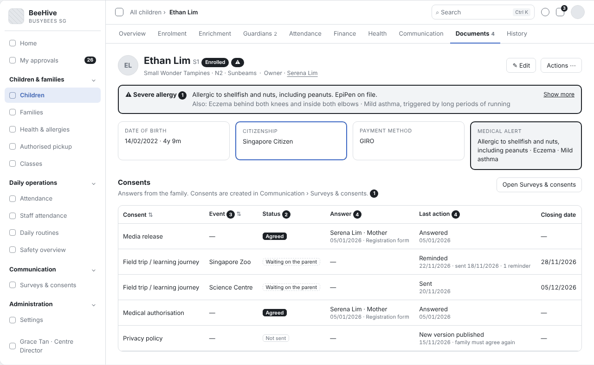
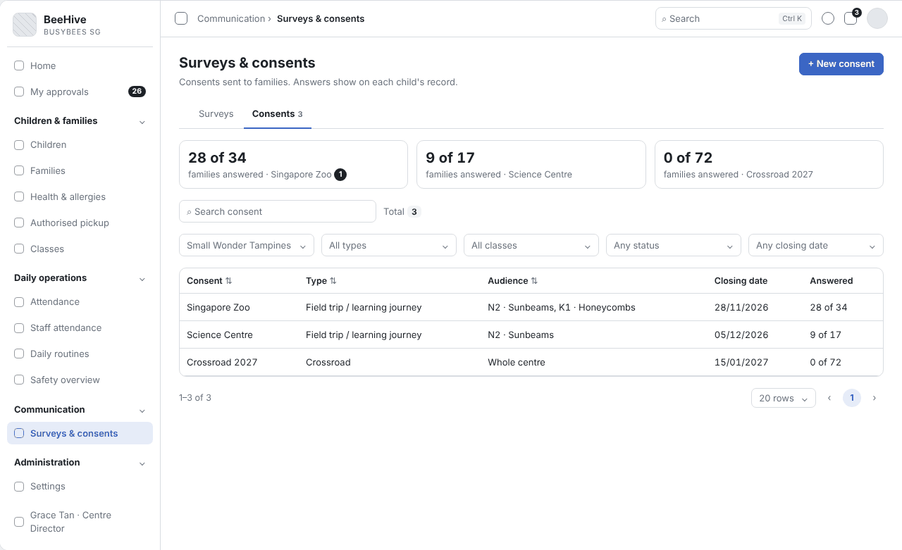
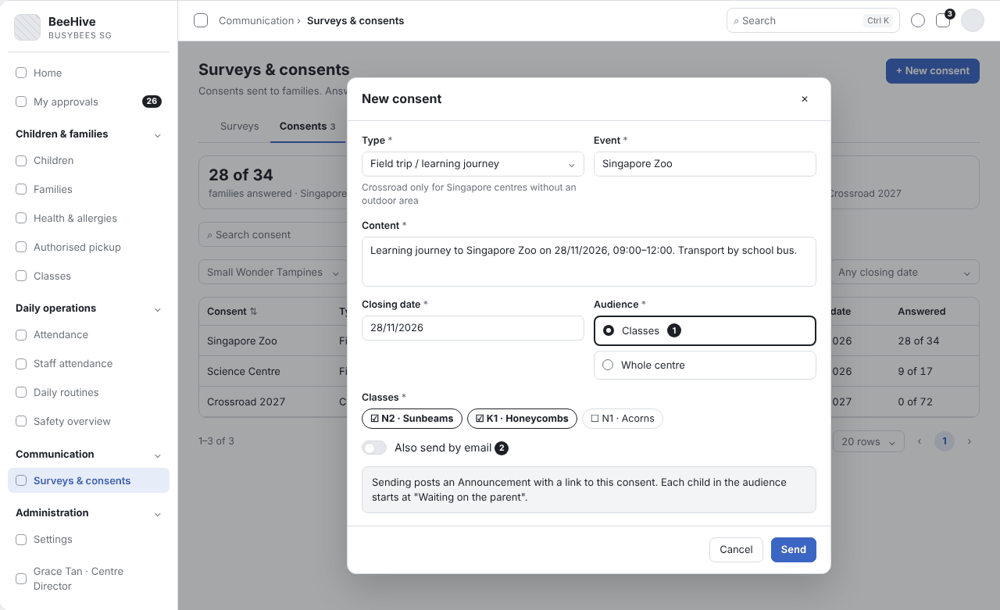
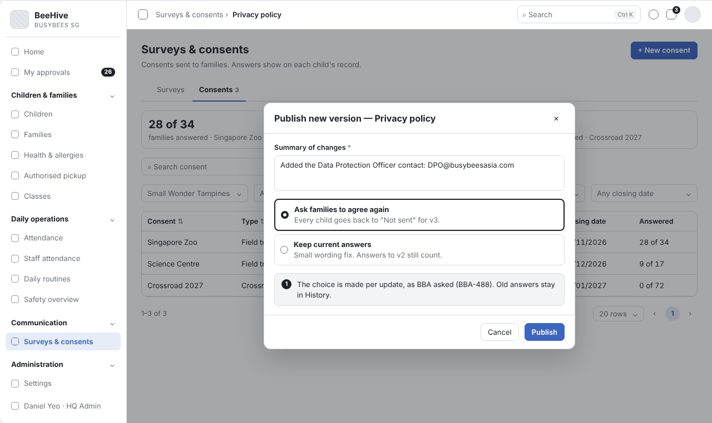
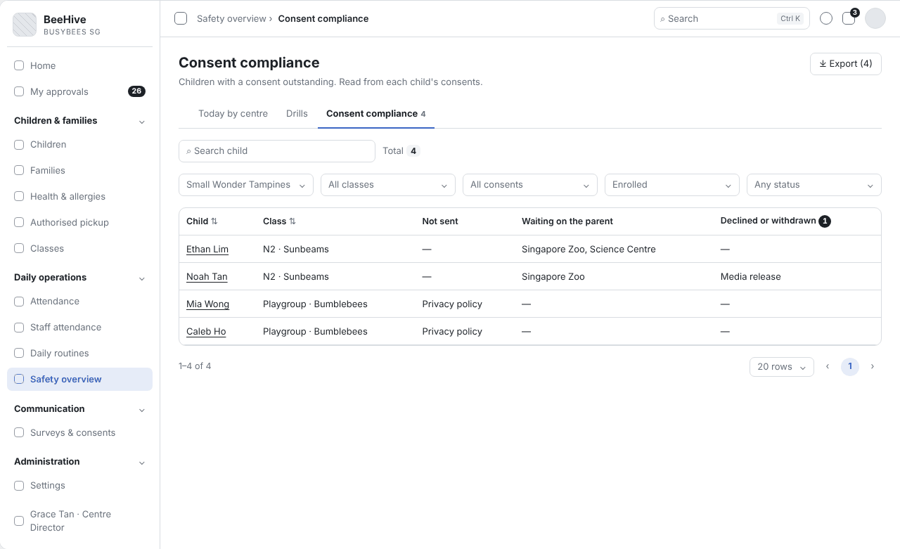

# Consent status per child & send consent request (Tiếng Việt)

| Thuộc tính | Giá trị |
|---|---|
| Dự án | Busy Bees Asia SMS |
| Module | Children & Families — Documents & consents |
| Tính năng | Consent status per child & send consent request |
| Mã ticket | BBA-71 |
| Mã WBS | 3.1.4.01 |
| Mã tài liệu | FRD-BBA-71 |
| Sprint | 4 |
| Phiên bản | 0.2 |
| Trạng thái | BẢN NHÁP CHỜ XÁC NHẬN |
| Ngày | 15/11/2026 |
| Người soạn | Business Analysis |
| Người review | HaiNguyen |
| Người duyệt | HaiNguyen |

## 1. Kiểm soát tài liệu

| Phiên bản | Ngày | Tác giả | Tóm tắt thay đổi | Duyệt |
|---|---|---|---|---|
| 0.1 | 10/11/2026 | Business Analysis | Khởi tạo | HaiNguyen |

**Mức sẵn sàng:** Đã đặc tả tạo và gửi consent theo lớp / Centre, trạng thái consent của từng trẻ, nhắc và gửi lại, ghi nhận câu trả lời, phiên bản, vòng đời theo loại, thẻ tỷ lệ trả lời và Consent compliance; có wireframe.

## 2. Mục tiêu và bối cảnh

Centre cần biết với từng trẻ: phụ huynh đã đồng ý những gì (ví dụ cho phép dùng ảnh của trẻ, cho trẻ đi tham quan), chưa trả lời những gì, và nhắc lại ngay từ hồ sơ trẻ. Privacy policy, Medical authorisation và Media release được thu một lần lúc nhập học; các consent theo sự kiện (Field trip, Ad hoc) và Crossroad do Centre Director tạo ở Surveys & consents và gửi cho lớp hoặc cả Centre kèm Announcement. Mỗi câu trả lời được lưu kèm phụ huynh nào trả lời, ngày nào, qua kênh nào.

Mục tiêu đo được: từ hồ sơ trẻ, nhân viên thấy trạng thái của mọi consent trong một bảng và nhắc hoặc gửi lại bằng một thao tác; với mỗi consent đã gửi, Centre Director thấy ngay bao nhiêu gia đình đã trả lời.

## 3. Phạm vi

| Trong phạm vi | Ngoài phạm vi |
|---|---|
| Bảng consent của từng trẻ: loại, sự kiện, phiên bản, trạng thái, câu trả lời hoặc lần nhắc gần nhất, ngày đóng. Tạo consent và gửi cho lớp hoặc cả Centre (Surveys & consents), kèm Announcement; tuỳ chọn gửi email. Nhắc, gửi lại khi hết hạn hoặc phụ huynh không đồng ý. Thẻ "x of y families answered". Công bố phiên bản mới. Ghi nhận câu trả lời, rút lại consent, tick checklist học sinh. Consent compliance. | Khảo sát (Survey) và khảo sát có thu phí. Nội dung consent thu lúc nhập học trong registration form (Enrolment). Chặn gắn tên trẻ trong ảnh (Teacher App, theo BR-005). |

## 4. Tác nhân, vai trò và quyền truy cập

| Tác nhân | Phạm vi | Quyền / Trách nhiệm |
|---|---|---|
| Authorised User | Consent của trẻ trong phạm vi vai trò và phạm vi dữ liệu hiện có (lớp hoặc Centre). | Tạo, gửi, nhắc, gửi lại consent, công bố phiên bản mới và xem Consent compliance — mỗi thao tác khi vai trò được cấp quyền. |
| Consent Viewer | Consent của trẻ trong phạm vi vai trò và phạm vi dữ liệu hiện có. | Xem trạng thái consent của trẻ; không có nút thao tác. |
| System | Consent đã tạo và câu trả lời của phụ huynh. | Tạo Announcement kèm link, tự nhắc 1 ngày trước ngày đóng, đếm số lần nhắc, chuyển Expired, tick checklist học sinh, gửi thông báo khi Media release bị rút lại, lưu lịch sử. |
| Unauthorised User | Ngoài vai trò hoặc phạm vi dữ liệu được phép. | Không thấy và không thực hiện được thao tác bị giới hạn; không thay đổi dữ liệu. |

Mọi quyền xem và thao tác theo mô hình phân quyền theo vai trò và phạm vi dữ liệu hiện có (Roles & permissions). Tính năng này không tạo vai trò riêng.

## 5. Tổng quan tính năng

| Khu vực | Chức năng | User Story |
|---|---|---|
| Hồ sơ trẻ › Documents › Consents | Trạng thái consent của trẻ, nhắc, gửi lại, lịch sử. | US-001 |
| Communication › Surveys & consents | Tạo và gửi consent, thẻ "x of y families answered", công bố phiên bản mới. | US-001 |
| Daily operations › Safety overview › Consent compliance | Trẻ còn thiếu consent theo Centre, lớp. | US-001 |

## 6. Yêu cầu chức năng

### 6.1 US-001 - Trạng thái consent của từng trẻ và gửi yêu cầu

#### User Story

Là Centre Director, tôi muốn gửi consent cho các lớp hoặc cả Centre và xem trạng thái từng consent của mỗi trẻ, để trước mỗi hoạt động (chụp ảnh, dã ngoại) tôi biết chắc phụ huynh đã đồng ý và nhắc được gia đình còn thiếu.

#### Functional Requirements (Yêu cầu chức năng)

| FR ID | Yêu cầu chức năng |
|---|---|
| FR-001 | Tab Documents của hồ sơ trẻ có bảng "Consents", mỗi dòng một consent của trẻ: loại (Privacy policy, Medical authorisation, Media release, Field trip / learning journey, Ad hoc, Crossroad), tên sự kiện / chuyến đi (với loại theo sự kiện), phiên bản, trạng thái, câu trả lời gần nhất (phụ huynh, kênh, ngày giờ) hoặc ngày gửi và số lần nhắc, ngày đóng. Một trẻ có thể có nhiều dòng cùng loại, mỗi dòng gắn một sự kiện (Q-73-14). |
| FR-002 | Trạng thái của mỗi dòng là một trong: Not sent, Waiting on the parent, Agreed, Declined, Withdrawn, Expired. |
| FR-003 | Centre Director tạo consent ở Communication › Surveys & consents: loại, tên sự kiện (với loại theo sự kiện), nội dung, ngày đóng, đối tượng **theo lớp hoặc cả Centre** (Q-73-04). Khi gửi, hệ thống tạo **Announcement kèm link** tới consent (Q-73-08); email chỉ gửi kèm khi người tạo bật "Also send by email" (Q-73-08). Mỗi trẻ trong đối tượng có dòng trạng thái Waiting on the parent. |
| FR-004 | "Remind" ở dòng Waiting on the parent (trên hồ sơ trẻ hoặc danh sách người chưa trả lời — FR-012) gửi lại thông báo, tăng số lần nhắc và ghi ngày nhắc. Hệ thống tự nhắc 1 ngày trước ngày đóng (SRS Parents App). |
| FR-005 | Khi phụ huynh trả lời trong Parents App, hệ thống lưu câu trả lời, chữ ký (nếu form yêu cầu), tên phụ huynh, ngày giờ, kênh, phiên bản; kết quả về SMS và **tự tick mục Consent trong checklist học sinh** (Q-73-08). |
| FR-006 | Khi người có quyền công bố phiên bản mới của một consent, họ chọn "Ask families to agree again" (mọi trẻ về Not sent cho phiên bản mới) hoặc "Keep current answers" (câu trả lời phiên bản trước vẫn dùng). "Summary of changes" là bắt buộc (Plane BBA-488). |
| FR-007 | Vòng đời theo loại (Q-73-12): Privacy policy, Medical authorisation, Media release — thu một lần lúc nhập học trong registration form, theo từng trẻ, không hết hạn; Field trip / learning journey và Ad hoc — dòng Waiting on the parent chuyển **Expired** khi qua ngày đóng; Crossroad — Agreed có hiệu lực tới hết năm học (tháng 12), đầu năm học sau chuyển Expired và cần gia hạn. |
| FR-008 | "Send again" ở dòng Declined hoặc Expired tạo một yêu cầu mới với ngày đóng mới; câu trả lời cũ giữ trong lịch sử. |
| FR-009 | Phụ huynh rút lại Media release hoặc consent dữ liệu (khi consent cho phép rút) → dòng chuyển Withdrawn; câu đồng ý ban đầu và việc rút lại đều được giữ; Centre Director và HQ Marketing nhận thông báo (Q-73-13: "Marketing cũng phải biết"). |
| FR-010 | "History" ở một dòng mở lịch sử: mọi lần gửi, nhắc, trả lời, rút lại, đổi phiên bản, kèm ngày giờ và người thực hiện. |
| FR-011 | Màn "Consent compliance" (Daily operations › Safety overview) liệt kê trẻ còn thiếu consent theo Centre: Child, Class, Not sent, Waiting on the parent, Declined or withdrawn; lọc Centre, lớp, loại consent; xuất ra Excel. |
| FR-012 | Danh sách consent ở Surveys & consents có thẻ tổng quan mỗi consent "x of y families answered"; chọn thẻ thì chỉ hiện các trẻ chưa trả lời, kèm Remind; có bộ lọc theo loại, lớp, trạng thái, ngày đóng (Q-73-10 — mong muốn của BBA, DOTB thiết kế). |
| FR-013 | Người nhận consent của một trẻ theo cấu hình lúc nhập học: "Both parents" (mặc định) hoặc "Primary contact only"; trường hợp đặc biệt (vd ly hôn) chọn một người (Q-73-07). |
| FR-014 | Loại Crossroad chỉ chọn được cho Centre Singapore được đánh dấu "không có sân ngoài trời" (Q-73-04); nơi đánh dấu chờ OQ-09. |

#### Functional Flow - Main (Luồng chính)

1. Centre Director tạo consent (vd Field trip "Singapore Zoo 28/11"), chọn lớp, ngày đóng, gửi; hệ thống tạo Announcement kèm link (FR-003).
2. Phụ huynh trả lời trong Parents App; kết quả về SMS, tick checklist (FR-005).
3. Centre Director xem thẻ "x of y answered", chọn để thấy trẻ chưa trả lời và nhắc (FR-012, FR-004).
4. Centre Director mở hồ sơ trẻ, tab Documents, xem bảng Consents (FR-001, FR-002).

#### Functional Flow - Alternative (Luồng thay thế)

1. Phụ huynh không đồng ý hoặc consent quá ngày đóng: Centre Director chọn Send again (FR-007, FR-008).
2. Consent có phiên bản mới: người công bố chọn yêu cầu đồng ý lại hoặc giữ câu trả lời (FR-006).
3. Phụ huynh rút lại Media release (FR-009).
4. Đầu năm học: Crossroad của năm trước chuyển Expired, Centre gửi gia hạn (FR-007).
5. Centre Director mở Consent compliance để xem trẻ nào còn thiếu trước một hoạt động (FR-011).

#### Functional Flow - Exception (Luồng ngoại lệ)

1. Trẻ không có phụ huynh nào có tài khoản Parents App và người tạo không bật email: không gửi được cho trẻ đó (VAL-001).
2. Người dùng không có quyền gửi consent: không có nút gửi (VAL-002).
3. Công bố phiên bản mới không có tóm tắt thay đổi: không lưu (VAL-003).
4. Tạo consent không có ngày đóng (loại theo sự kiện): không gửi được (VAL-004).

#### Business Rules (Quy tắc nghiệp vụ)

| BR ID | Quy tắc nghiệp vụ |
|---|---|
| BR-001 | Câu trả lời ghi rõ phụ huynh nào trả lời, ngày giờ, kênh và chữ ký khi form yêu cầu. |
| BR-002 | Câu trả lời cho phiên bản cũ chỉ còn dùng cho phiên bản mới khi người công bố chọn "Keep current answers". |
| BR-003 | Câu trả lời cũ và việc rút lại không bao giờ bị xoá. |
| BR-004 | Tạo, gửi, nhắc và gửi lại consent là quyền cấp theo vai trò (BBA: Centre Director gửi theo lớp — Q-73-04); người dùng chỉ có quyền xem thấy trạng thái consent trong phạm vi của mình, không có nút thao tác. |
| BR-005 | Trẻ không có Media release đã Agreed không được chụp, đăng hay gắn tên; hệ thống chặn hoặc cảnh báo khi gắn tên trẻ (Q-73-13; SRS BR-TCH-030). |
| BR-006 | Privacy policy, Medical authorisation, Media release thu một lần lúc nhập học theo từng trẻ và không hết hạn; Field trip, Ad hoc theo từng sự kiện; Crossroad gia hạn hằng năm (Q-73-12). |
| BR-007 | Email không gửi mặc định; chỉ gửi khi người tạo chọn (Q-73-08). |

#### Validation Rules (Quy tắc kiểm tra)

| VAL ID | Điều kiện | Phản hồi hệ thống |
|---|---|---|
| VAL-001 | Trẻ không có phụ huynh nào có tài khoản Parents App và người tạo không bật email. | Không gửi cho trẻ đó; dòng hiện "No guardian of this child can receive this in the app." |
| VAL-002 | Người dùng không có quyền gửi consent. | Không hiển thị Send, Remind, Send again. |
| VAL-003 | Công bố phiên bản mới mà để trống "Summary of changes". | Không lưu; hiện "Enter a summary of changes." |
| VAL-004 | Consent loại Field trip / Ad hoc / Crossroad không có ngày đóng. | Không gửi; hiện "Choose a closing date." |

#### UI Reference (Tham chiếu giao diện)

| Mã màn hình / Phiên bản | Tham chiếu / Link |
|---|---|
| SCR-01 - Child record — Consents | Wireframe: `Diagram/Wireframe/consent-status-sprint4.html` (Tab Consents) |
| SCR-02 - Surveys & consents — danh sách consent | Wireframe: `Diagram/Wireframe/consent-status-sprint4.html` (Danh sách consent · Chưa trả lời) |
| SCR-03 - New consent | Wireframe: `Diagram/Wireframe/consent-status-sprint4.html` (Tạo consent) |
| SCR-04 - Publish new version | Wireframe: `Diagram/Wireframe/consent-status-sprint4.html` (Phiên bản mới) |
| SCR-05 - Consent compliance | Wireframe: `Diagram/Wireframe/consent-status-sprint4.html` |

#### UI Components / Field Specification (Thành phần giao diện)

| Trường / Điều khiển | Loại | Bắt buộc | Mặc định / Trạng thái | Kiểm tra | Hành vi |
|---|---|---|---|---|---|
| **SCR-01 — Child record — Consents** | | | | | |
| Phần đầu hồ sơ trẻ | Component dùng chung | — | — | — | Ảnh / chữ viết tắt, tên, mã trẻ, trạng thái, biểu tượng ⚠, Centre · Level · Class, Owner, thẻ Date of birth, Citizenship, Payment method, Medical alert, banner Severe allergy, nút Edit / Actions, thanh tab (chi tiết ở BBA-66, BBA-68). Consent nằm trong tab Documents. |
| Consents | Tiêu đề khu vực | — | Chỉ xem | — | Danh sách câu trả lời consent của gia đình cho trẻ này. |
| Open Surveys & consents | Nút | Theo quyền | — | — | Mở Communication › Surveys & consents — nơi tạo, nhắc, gửi lại consent. |
| Consent | Cột | — | — | — | Loại consent theo danh mục Consent Types của BBA: Media release, Field trip / learning journey, Medical authorisation, Privacy policy… (FR-001). |
| Event | Cột | — | "—" khi không theo sự kiện | — | Sự kiện gắn với consent, ví dụ Singapore Zoo. |
| Status | Cột (nhãn) | — | — | — | Not sent · Waiting on the parent · Agreed · Declined · Withdrawn · Expired; nhãn đặc = Agreed, nét đứt = Waiting, viền thường = trạng thái khác (FR-002). |
| Answer | Cột | — | "—" khi chưa trả lời | — | Người trả lời (tên · quan hệ); dòng phụ: ngày trả lời · kênh (Parents App / Registration form) (FR-005). |
| Last action | Cột | — | — | — | Thao tác gần nhất: Sent / Reminded / Answered / New version published; dòng phụ: ngày và chi tiết (ngày gửi, số lần nhắc) (FR-004; FR-010). |
| Closing date | Cột | — | "—" khi không có hạn | — | DD/MM/YYYY (FR-007). |
| **SCR-02 — Surveys & consents — danh sách consent** | | | | | |
| + New consent | Nút chính | Theo quyền | — | VAL-002. | Mở popup New consent (SCR-03). |
| Surveys / Consents | Tab | — | Consents | — | Số trên tab là số consent đang mở. |
| Thẻ "x of y families answered" | Thẻ số liệu, bấm được | — | — | — | Số gia đình đã trả lời / tổng số trẻ trong đối tượng; bấm thẻ → danh sách trẻ chưa trả lời (FR-012). |
| Tìm kiếm, Total | Ô tìm kiếm, số | Không | Trống | — | Tìm theo tên consent / sự kiện; Total là số dòng sau lọc. |
| Centre, Type, Class, Status, Closing date | Bộ lọc | Không | — | — | FR-012. |
| Consent | Cột | — | — | — | Tên sự kiện / tiêu đề consent. |
| Type | Cột | — | — | — | Loại consent. |
| Audience | Cột | — | — | — | Danh sách lớp hoặc Whole centre (FR-003). |
| Closing date | Cột | — | — | — | DD/MM/YYYY. |
| Answered | Cột | — | — | — | "x of y". |
| Breadcrumb (danh sách chưa trả lời) | Đường dẫn | — | — | — | Consent đang xem › Not answered (số trẻ). |
| Child | Cột (danh sách chưa trả lời) | — | — | — | Tên trẻ chưa trả lời; bấm → mở hồ sơ trẻ. |
| Class | Cột (danh sách chưa trả lời) | — | — | — | Lớp của trẻ. |
| Last action | Cột (danh sách chưa trả lời) | — | — | — | Lần gửi / nhắc gần nhất và số lần đã nhắc. |
| Remind | Nút nhỏ | Theo quyền | — | VAL-002. | Gửi nhắc lại cho gia đình trẻ này (FR-004). |
| **SCR-03 — New consent** | | | | | |
| Type | Danh sách chọn | Có | — | — | Danh mục Consent Types; Crossroad chỉ cho Centre Singapore không có sân ngoài trời (FR-014). |
| Event | Ô nhập | Có | — | VAL-004. | Tên sự kiện gắn với consent. |
| Content | Ô nhập nhiều dòng | Có | — | — | Nội dung gia đình đọc trước khi đồng ý. |
| Closing date | Chọn ngày | Có | — | VAL-004. | Hạn trả lời. |
| Audience | Radio | Có | — | — | Classes / Whole centre (FR-003). |
| Classes | Chọn nhiều (chip) | Khi Audience = Classes | — | — | Chọn lớp nhận. |
| Also send by email | Công tắc | Không | Tắt | — | Gửi thêm email; luôn tạo Announcement kèm link (BR-007). |
| Thông báo dưới form | Thông báo | — | — | — | Gửi sẽ tạo Announcement; mỗi trẻ bắt đầu ở Waiting on the parent. |
| Cancel / Send | Nút | — | — | VAL-001; VAL-004. | Huỷ hoặc gửi consent. |
| **SCR-04 — Publish new version** | | | | | |
| Summary of changes | Ô nhập nhiều dòng | Có | — | VAL-003. | Tóm tắt nội dung thay đổi của phiên bản mới (FR-006). |
| Ask families to agree again | Radio | Có (chọn 1) | Chọn sẵn | — | Mọi trẻ quay về Not sent cho phiên bản mới (BR-002). |
| Keep current answers | Radio | Có (chọn 1) | — | — | Sửa nhỏ câu chữ; câu trả lời cũ vẫn tính (BR-002). |
| Cancel / Publish | Nút | — | — | VAL-003. | Huỷ hoặc phát hành phiên bản mới. |
| **SCR-05 — Consent compliance** | | | | | |
| Today by centre / Drills / Consent compliance | Tab | — | Consent compliance | — | Các tab của Safety overview; số trên tab = số trẻ còn thiếu consent. |
| Export (n) | Nút | Theo quyền | n = số dòng | — | Xuất Excel danh sách đang lọc (FR-011). |
| Tìm kiếm, Total | Ô tìm kiếm, số | Không | Trống | — | Tìm theo tên trẻ. |
| Centre, Class, Consent, trạng thái trẻ, Status consent | Bộ lọc | Không | Trạng thái trẻ: Enrolled | — | FR-011. |
| Child | Cột | — | — | — | Tên trẻ; bấm → mở hồ sơ trẻ. |
| Class | Cột | — | — | — | Lớp của trẻ. |
| Not sent | Cột | — | "—" khi không có | — | Các consent chưa gửi cho gia đình trẻ. |
| Waiting on the parent | Cột | — | "—" khi không có | — | Các consent đã gửi, đang chờ trả lời. |
| Declined or withdrawn | Cột | — | "—" khi không có | — | Các consent gia đình từ chối hoặc rút lại. |

#### Data and Audit (Dữ liệu và audit)

| ID | Yêu cầu |
|---|---|
| DATA-001 | Mỗi consent lưu: loại, sự kiện, nội dung, phiên bản, đối tượng (lớp / Centre), ngày đóng, người tạo, có gửi email hay không, Announcement kèm theo. |
| DATA-002 | Mỗi câu trả lời lưu: câu trả lời, chữ ký, phụ huynh, ngày giờ, kênh, phiên bản; việc rút lại lưu thêm ngày giờ rút. |
| DATA-003 | Mỗi phiên bản lưu: số phiên bản, ngày, tóm tắt thay đổi, người công bố, lựa chọn đồng ý lại / giữ câu trả lời. |

#### Acceptance Criteria (Tiêu chí nghiệm thu)

| AC ID | Given | When | Then | Linked Rule |
|---|---|---|---|---|
| AC-001 | Centre Director tạo Field trip "Singapore Zoo" cho lớp N2 · Sunbeams, ngày đóng 26/11/2026 | chọn Send | phụ huynh lớp Sunbeams nhận Announcement có link; mỗi trẻ có dòng "Field trip · Singapore Zoo" Waiting on the parent | FR-001; FR-003 |
| AC-002 | dòng đang Waiting on the parent, đã nhắc 1 lần | Centre Director chọn Remind | số lần nhắc là 2 và có ngày nhắc mới | FR-004 |
| AC-003 | Field trip đóng ngày 26/11 | ngày 25/11 phụ huynh chưa trả lời | hệ thống tự nhắc và số lần nhắc tăng 1 | FR-004 |
| AC-004 | mẹ của Ethan đồng ý Field trip trong Parents App | Centre Director mở bảng consent | dòng hiện Agreed, tên người mẹ, ngày giờ, kênh Parents App; mục Consent trong checklist học sinh được tick | FR-005; BR-001; DATA-002 |
| AC-005 | Ethan đã Agreed Privacy policy phiên bản 2 | HQ Admin công bố phiên bản 3 và chọn "Ask families to agree again" | dòng Privacy policy của Ethan hiện v3, Not sent; câu trả lời v2 vẫn có trong lịch sử | FR-006; BR-002 |
| AC-006 | Field trip của Noah Waiting on the parent | qua ngày đóng | dòng chuyển Expired và có nút Send again | FR-007; FR-008 |
| AC-007 | phụ huynh rút lại Media release | Centre Director mở bảng | dòng hiện Withdrawn; lịch sử có cả câu đồng ý và việc rút lại; Centre Director và HQ Marketing đã nhận thông báo | FR-009; BR-003 |
| AC-008 | trẻ không có phụ huynh nào có Parents App, người tạo không bật email | Centre Director gửi consent cho lớp | dòng của trẻ hiện "No guardian of this child can receive this in the app." | VAL-001 |
| AC-009 | Teacher mở hồ sơ trẻ lớp mình | xem bảng consent | thấy trạng thái, không có nút gửi | VAL-002; BR-004 |
| AC-010 | người tạo bật "Also send by email" | gửi consent | phụ huynh nhận cả Announcement trong app và email | FR-003; BR-007 |
| AC-011 | dòng đã có 3 lần gửi và nhắc | Centre Director chọn History | lịch sử hiện đủ 3 lần với ngày giờ, người thực hiện | FR-010 |
| AC-012 | Ethan đã Agreed Media release v2 | HQ Admin công bố v3 (sửa chính tả) và chọn "Keep current answers" | dòng hiện v3, trạng thái Agreed theo câu trả lời v2 | FR-006; BR-002 |
| AC-013 | HQ Admin công bố phiên bản mới, để trống Summary of changes | chọn Publish | không lưu, hiện "Enter a summary of changes." | VAL-003 |
| AC-014 | Noah chưa trả lời Field trip và đã từ chối Media release | Centre Director mở Consent compliance | dòng Noah có Field trip ở cột Waiting on the parent và Media release ở cột Declined or withdrawn | FR-011 |
| AC-015 | Field trip "Singapore Zoo" gửi cho 18 gia đình, 12 đã trả lời | Centre Director chọn thẻ "12 of 18 families answered" | danh sách chỉ còn 6 trẻ chưa trả lời, mỗi dòng có Remind | FR-012 |
| AC-016 | Ethan đang có Field trip "Singapore Zoo" mở | Centre Director gửi tiếp Ad hoc "Cooking day" | hồ sơ Ethan có 2 dòng mở, mỗi dòng gắn một sự kiện | FR-001 |
| AC-017 | Mia cấu hình "Primary contact only" | consent được gửi cho lớp của Mia | chỉ người liên hệ chính của Mia nhận | FR-013 |
| AC-018 | Centre Malaysia | Centre Director tạo consent | không có loại Crossroad | FR-014 |
| AC-019 | Centre Director tạo Field trip không chọn ngày đóng | chọn Send | không gửi, hiện "Choose a closing date." | VAL-004 |
| AC-020 | Noah chưa có Media release ở trạng thái Agreed | giáo viên gắn tên Noah vào một ảnh | không gắn được tên Noah, hiện lý do chưa có Media release | BR-005 |
| AC-021 | Ethan đồng ý Privacy policy, Medical authorisation, Media release trong registration form ngày 05/01/2026 | Centre Director mở tab Consents ngày 13/11/2026 | ba dòng ở trạng thái Agreed, không có ngày đóng, không chuyển Expired | FR-002; FR-007; BR-006 |

#### Dependencies (Phụ thuộc)

Communication › Surveys & consents và Announcements; registration form (consent một lần); checklist học sinh; Parents App; cấu hình người nhận của trẻ; thông tin Centre (không có sân ngoài trời).

## 7. Câu hỏi mở

| Mã câu hỏi | Quyết định cần có | Người quyết định | Ưu tiên | Quyết định của BBA |
|---|---|---|---|---|
| OQ-01 | Danh sách loại consent và nội dung từng loại; có khác theo brand không? | Centre Director / HQ Ops | Cao | Loại: Privacy policy, Medical authorisation, Media release (thu lúc nhập học), Field trip / learning journey, Ad hoc (theo sự kiện), Crossroad (Q-73-04). Nội dung: file "Consent Types" (BBA-488) — Privacy Policy, Media Consent, Medical, Outing, Accuracy of Information, "Initial setup for all brands". Xem OQ-10. |
| OQ-02 | "Expired" nghĩa là gì; thời hạn hiệu lực của từng loại? | Centre Director / HQ Ops | Cao | Theo vòng đời từng loại (Q-73-12) → FR-007. |
| OQ-03 | Khi consent có phiên bản mới, có cần đồng ý lại không? | Business Owner | Cao | Tuỳ từng lần cập nhật (BBA-488) → FR-006. |
| OQ-04 | Nhắc thủ công hay tự động; giới hạn số lần và khoảng cách? | Centre Director / HQ Ops | Thấp |  |
| OQ-05 | Phụ huynh trả lời qua email có cần ký không? | Business Owner | Trung bình | Email chỉ là kênh báo kèm, phụ huynh trả lời trong app (Q-73-08); câu hỏi còn mở nếu sau này cho trả lời qua email. |
| OQ-06 | Gửi consent ở đâu, ai gửi? | Centre Director / HQ Ops | Cao | Centre Director gửi theo lớp hoặc cả Centre ở Surveys & consents (Q-73-04); hồ sơ trẻ chỉ xem, nhắc, gửi lại. |
| OQ-07 | Consent gửi sau (Field trip, Ad hoc, Crossroad) cần một hay cả hai phụ huynh đồng ý? Form đăng ký cần 2 chữ ký. | Business Owner | Cao |  |
| OQ-08 | Gia hạn Crossroad đầu năm học do hệ thống tạo tự động hay Centre tạo tay? | Centre Director / HQ Ops | Trung bình |  |
| OQ-09 | Ai đánh dấu Centre "không có sân ngoài trời" và đánh dấu ở đâu? | HQ Ops | Trung bình |  |
| OQ-10 | File "Consent Types" có "Accuracy of Information" và "Outing" (thu lúc nhập học); FRD chưa có Accuracy of Information và dùng Field trip theo sự kiện. "Accuracy of Information" có là một loại consent không? "Outing" thu lúc nhập học khác Field trip theo sự kiện thế nào? | Centre Director / HQ Ops | Trung bình |  |

### Giả định của BA (cần xác nhận cùng mục 7)

| Mã | Giả định | Dùng ở |
|---|---|---|
| AS-01 | Có trạng thái Withdrawn cho consent phụ huynh đã rút lại. | FR-002; FR-009 |
| AS-03 | Expired là qua ngày đóng (Field trip, Ad hoc) hoặc hết năm học (Crossroad). | FR-007 — theo Q-73-12 |
| AS-05 | Bảng Consents nằm ở tab Documents của hồ sơ trẻ; SRS Children & Families liệt kê tab Consents riêng. | FR-001 — chờ xác nhận |

Bằng chứng lưu (Q-73-15) và cách đếm lần nhắc (Q-73-10) do DOTB quyết định, theo DATA-002 và FR-004.

## 8. Phụ lục

### Phụ lục A. Thuật ngữ

| Thuật ngữ | Định nghĩa trong FRD này |
|---|---|
| Consent | Sự đồng ý của phụ huynh cho một việc cụ thể, ví dụ cho phép dùng ảnh của trẻ hoặc cho trẻ đi tham quan. |
| Phiên bản | Lần sửa nội dung của một consent; người công bố chọn có yêu cầu đồng ý lại hay không. |
| Ngày đóng (Closing date) | Hạn trả lời của consent theo sự kiện; qua ngày này dòng chưa trả lời chuyển Expired. |
| Crossroad | Consent cho trẻ qua đường (road crossing), chỉ cho Centre Singapore không có sân ngoài trời, gia hạn hằng năm. |
| Consent compliance | Danh sách trẻ còn thiếu consent, đọc từ consent của từng trẻ. |
| PDPA | Luật bảo vệ dữ liệu cá nhân. |

## 9. Tài liệu tham khảo

Số trang của SRS tính theo bản Word gốc khi xuất PDF. Tệp của BBA là tệp đính kèm trên Plane.

| STT | Tài liệu | Mục | Trang | Dùng cho |
|---|---|---|---|---|
| 1 | BBA-SMS-SRS-Children-and-Families-v0.1 | §1.2 Not in Phase 1 (consent quản lý ở Communication › Surveys & consents) | 3 | Mục 3. |
| 2 | BBA-SMS-SRS-Children-and-Families-v0.1 | §4 mục 1.1 Children (View child profile — tab Consents; View consents) | 6 | FR-001; AS-05. |
| 3 | BBA-SMS-SRS-Children-and-Families-v0.1 | §5 Business rules (BR-CHF-010) | 9 | FR-001 — hồ sơ trẻ chỉ đọc consent. |
| 4 | BBA-SMS-SRS-Communication-v0.1 | §3 P6 Consent | 5 | Luồng chính; FR-003, FR-009. |
| 5 | BBA-SMS-SRS-Communication-v0.1 | §4 mục 4.2 Consents (View consent list, Create consent form, Respond, Withdraw, Edit, View consent record) | 8 | FR-003, FR-005, FR-009, FR-010, FR-012. |
| 6 | BBA-SMS-SRS-Communication-v0.1 | §5 Business rules (BR-COM-002, BR-COM-016, BR-COM-039, BR-COM-043, BR-COM-044) | 9–10 | Mục 4; FR-004, FR-005, FR-009; BR-001, BR-003. |
| 7 | BBA-SMS-SRS-Parents-App-v0.1 | §5.1 Announcements (Open linked survey); §5.4 Surveys & consents | 10–12 | FR-003, FR-005, FR-009. |
| 8 | BBA-SMS-SRS-Teacher-App-v0.1 | §5.4 Survey & consent; §5 Business rules (BR-TCH-030, BR-TCH-054) | 11, 13–14 | BR-004, BR-005. |
| 9 | BBA-SMS-SRS-Daily-Operations-v0.1 | §4.2 Safety overview (View consent gaps) | 9 | FR-011. |
| 10 | Plane — BBA-488 "BBA input: Consent types and wording" | Consent thu lúc nhập học; Media consent; đồng ý lại khi đổi nội dung | — | FR-006, FR-007; BR-005; OQ-03. |
| 11 | Plane — BBA-488, tệp đính kèm "Consent Types.xlsx" | Sheet Privacy Policy, Media Consent, Medical, Outing, Accuracy of Information | — | OQ-01, OQ-10. |
| 12 | Plane — BBA-492 "BBA input: Additional document templates" | Consent request letter không dùng, phụ huynh đã đồng ý qua registration form | — | Mục 2; BR-006. |
| 13 | BBA_SMS_S4 — Tổng hợp câu hỏi phản hồi, sheet "Tổng hợp" | Q-73-04 đến Q-73-15 | — | FR-001, FR-003, FR-005, FR-007, FR-009, FR-012 đến FR-014; BR-004 đến BR-007; OQ-04 đến OQ-09. |
| 14 | Plane — dự án BBA Phase 1, ticket BBA-71 (WBS 3.1.4.01) | Consent status per child & send consent request | — | Phạm vi tính năng. |
