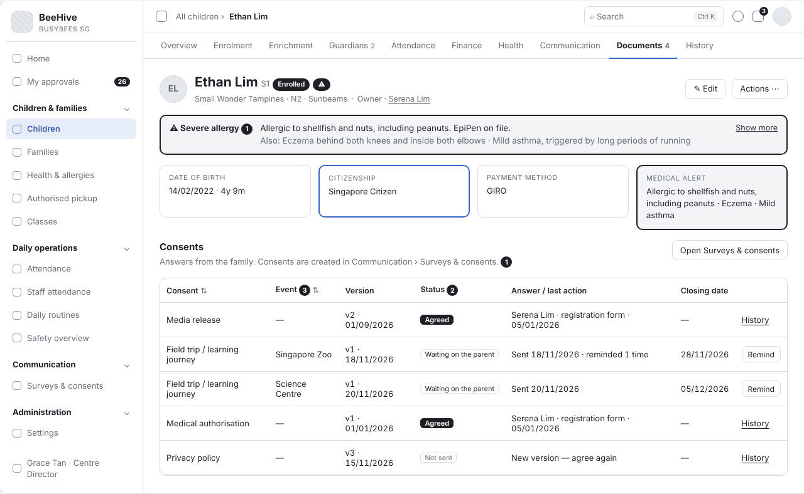
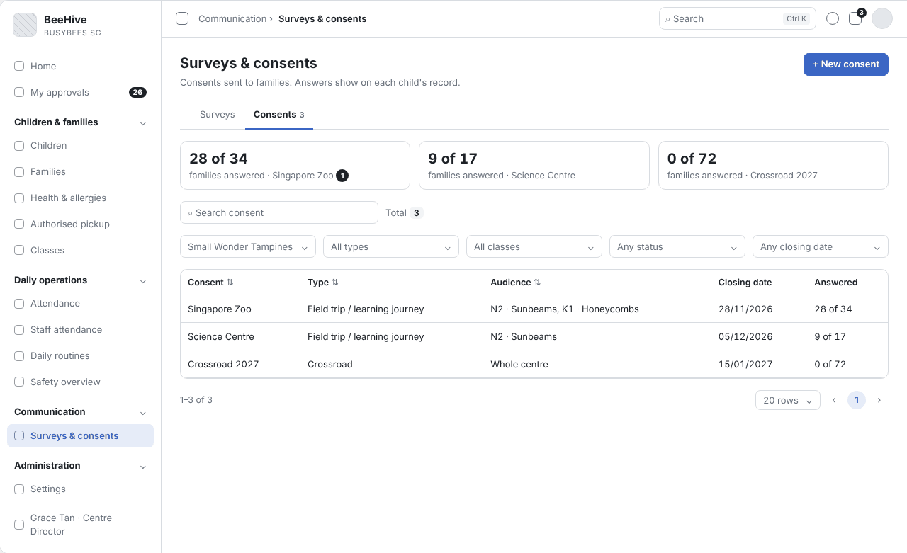
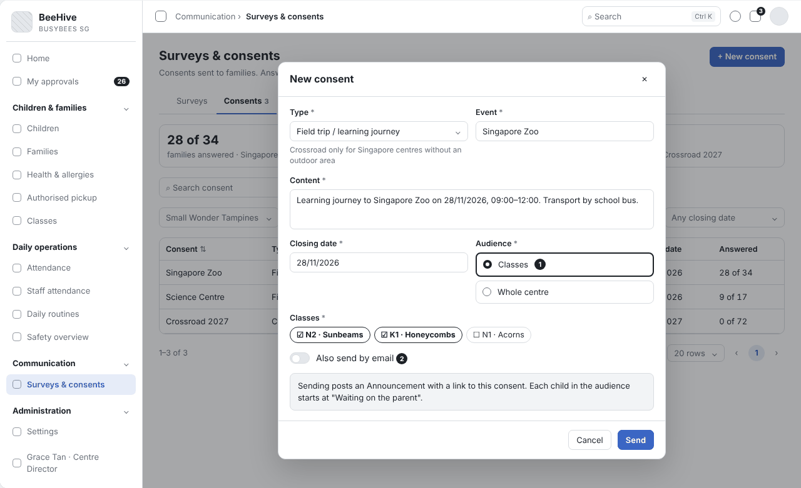
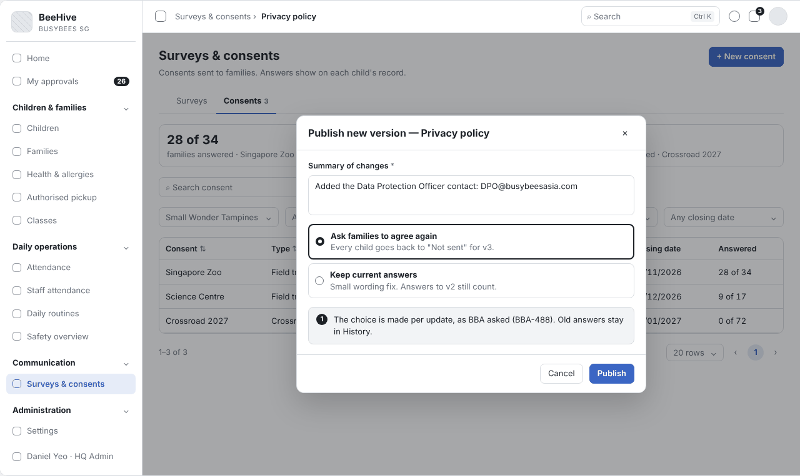
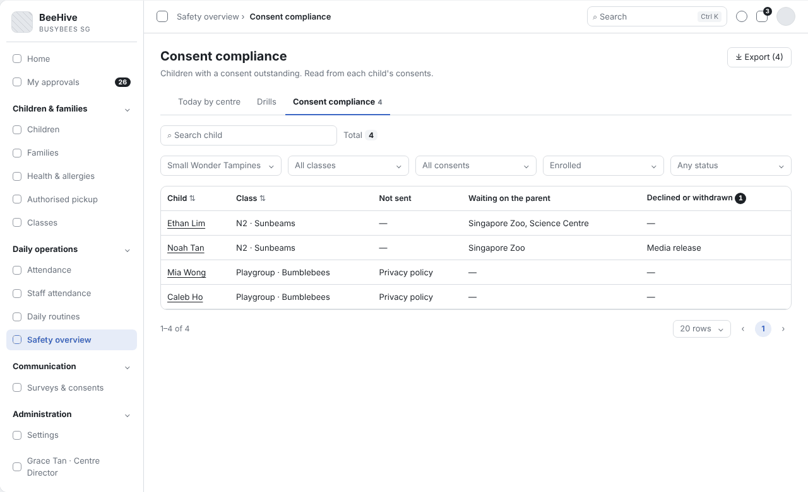

# BBA-71 Consent status per child & send consent request (Tiếng Việt)

| Thuộc tính | Giá trị |
|---|---|
| Dự án | Busy Bees Asia SMS |
| Module | Children & Families — Documents & consents |
| Tính năng | Consent status per child & send consent request |
| Mã ticket | BBA-71 |
| Mã WBS | 3.1.4.01 |
| Mã tài liệu | FRD-BBA-71 |
| Sprint | 4 |
| Phiên bản | 0.2 |
| Trạng thái | BẢN NHÁP CHỜ XÁC NHẬN |
| Ngày | 13/11/2026 |
| Người soạn | Business Analysis |
| Người review | HaiNguyen |
| Người duyệt | HaiNguyen |

## 1. Kiểm soát tài liệu

| Phiên bản | Ngày | Tác giả | Tóm tắt thay đổi | Duyệt |
|---|---|---|---|---|
| 0.1 | 10/11/2026 | Business Analysis | Bản đầu cho ticket BBA-71: quy tắc nghiệp vụ, trường hợp đặc biệt và tiêu chí nghiệm thu để chốt với vận hành Centre (Centre Director) và HQ Ops. | HaiNguyen |
| 0.2 | 13/11/2026 | Business Analysis | Cập nhật theo câu trả lời của BBA (file câu hỏi phản hồi Sprint 4 Q-73; Plane BBA-488, BBA-492) và file "Consent Types" (đính kèm BBA-488): Centre Director tạo và gửi consent theo lớp hoặc cả Centre, luôn kèm Announcement có link, email chỉ gửi khi chọn; loại và vòng đời consent (thu một lần lúc nhập học / theo sự kiện / Crossroad gia hạn hằng năm); nhiều consent cùng loại mỗi cái gắn một sự kiện; người nhận cả hai phụ huynh hoặc chỉ người liên hệ chính; tick checklist học sinh; thẻ "x of y families answered"; tuỳ chọn đồng ý lại khi có phiên bản mới; Consent compliance. Sửa FR-001, FR-003, FR-004, FR-005, FR-007, FR-009, BR-004, VAL-001, DATA-001, AC-001, AC-003, AC-004, AC-006 đến AC-008, AC-010; thêm FR-012 đến FR-014, BR-006, BR-007, VAL-004, AC-015 đến AC-021, OQ-06 đến OQ-10, AS-05; bỏ AS-02, AS-04 (mã cũ không dùng lại); thêm wireframe SCR-01 đến SCR-05 và mục 9 Tài liệu tham khảo. | HaiNguyen |

**Mức sẵn sàng:** Đã đặc tả tạo và gửi consent theo lớp / Centre, trạng thái consent của từng trẻ, nhắc và gửi lại, ghi nhận câu trả lời, phiên bản, vòng đời theo loại, thẻ tỷ lệ trả lời và Consent compliance; có wireframe. 6 câu hỏi mở ở mục 7 cần BBA chốt (OQ-04, OQ-05, OQ-07 đến OQ-10).

## 2. Mục tiêu và bối cảnh

Centre cần biết với từng trẻ: phụ huynh đã đồng ý những gì (ví dụ cho phép dùng ảnh của trẻ, cho trẻ đi tham quan), chưa trả lời những gì, và nhắc lại ngay từ hồ sơ trẻ. Privacy policy, Medical authorisation và Media release được thu một lần lúc nhập học; các consent theo sự kiện (Field trip, Ad hoc) và Crossroad do Centre Director tạo ở Surveys & consents và gửi cho lớp hoặc cả Centre kèm Announcement. Mỗi câu trả lời được lưu kèm phụ huynh nào trả lời, ngày nào, qua kênh nào.

Mục tiêu đo được: từ hồ sơ trẻ, nhân viên thấy trạng thái của mọi consent trong một bảng và nhắc hoặc gửi lại bằng một thao tác; với mỗi consent đã gửi, Centre Director thấy ngay bao nhiêu gia đình đã trả lời.

## 3. Phạm vi

| Trong phạm vi | Ngoài phạm vi |
|---|---|
| Bảng consent của từng trẻ: loại, sự kiện, phiên bản, trạng thái, câu trả lời hoặc lần nhắc gần nhất, ngày đóng. Tạo consent và gửi cho lớp hoặc cả Centre (Surveys & consents), kèm Announcement; tuỳ chọn gửi email. Nhắc, gửi lại khi hết hạn hoặc phụ huynh không đồng ý. Thẻ "x of y families answered". Công bố phiên bản mới. Ghi nhận câu trả lời, rút lại consent, tick checklist học sinh. Consent compliance. | Khảo sát (Survey) và khảo sát có thu phí. Nội dung consent thu lúc nhập học trong registration form (Enrolment). Chặn gắn tên trẻ trong ảnh (Teacher App, theo BR-005). |

## 4. Tác nhân, vai trò và quyền truy cập

| Tác nhân | Phạm vi | Quyền / Trách nhiệm |
|---|---|---|
| Centre Director | Centre của mình. | Tạo và gửi consent cho các lớp hoặc cả Centre; xem, nhắc, gửi lại; xem Consent compliance. |
| School Admin | Centre của mình. | Như Centre Director khi được cấp quyền (Roles & permissions). |
| Teacher | Lớp của mình. | Chỉ xem trạng thái consent của trẻ lớp mình. |
| HQ Admin | Mọi Centre. | Mọi quyền; công bố phiên bản mới của consent. |
| HQ Marketing | Mọi Centre. | Nhận thông báo khi phụ huynh rút lại Media release. |
| Phụ huynh / người giám hộ | Con mình. | Đồng ý hoặc không đồng ý, ký khi biểu mẫu yêu cầu; rút lại consent khi biểu mẫu cho phép. |
| Hệ thống | Toàn hệ thống. | Tạo Announcement kèm link, tự nhắc 1 ngày trước ngày đóng, đếm số lần nhắc, chuyển Expired, tick checklist học sinh, lưu lịch sử. |

## 5. Tổng quan tính năng

| Khu vực | Chức năng | User Story |
|---|---|---|
| Hồ sơ trẻ › Documents › Consents | Trạng thái consent của trẻ, nhắc, gửi lại, lịch sử. | US-001 |
| Communication › Surveys & consents | Tạo và gửi consent, thẻ "x of y families answered", công bố phiên bản mới. | US-001 |
| Daily operations › Safety overview › Consent compliance | Trẻ còn thiếu consent theo Centre, lớp. | US-001 |

## 6. Yêu cầu chức năng

### 6.1 US-001 - Trạng thái consent của từng trẻ và gửi yêu cầu

#### User Story

Là Centre Director, tôi muốn gửi consent cho các lớp hoặc cả Centre và xem trạng thái từng consent của mỗi trẻ, để trước mỗi hoạt động (chụp ảnh, dã ngoại) tôi biết chắc phụ huynh đã đồng ý và nhắc được gia đình còn thiếu.

#### Functional Requirements (Yêu cầu chức năng)

| FR ID | Yêu cầu chức năng |
|---|---|
| FR-001 | Tab Documents của hồ sơ trẻ có bảng "Consents", mỗi dòng một consent của trẻ: loại (Privacy policy, Medical authorisation, Media release, Field trip / learning journey, Ad hoc, Crossroad), tên sự kiện / chuyến đi (với loại theo sự kiện), phiên bản, trạng thái, câu trả lời gần nhất (phụ huynh, kênh, ngày giờ) hoặc ngày gửi và số lần nhắc, ngày đóng. Một trẻ có thể có nhiều dòng cùng loại, mỗi dòng gắn một sự kiện (Q-73-14). |
| FR-002 | Trạng thái của mỗi dòng là một trong: Not sent, Waiting on the parent, Agreed, Declined, Withdrawn, Expired. |
| FR-003 | Centre Director tạo consent ở Communication › Surveys & consents: loại, tên sự kiện (với loại theo sự kiện), nội dung, ngày đóng, đối tượng **theo lớp hoặc cả Centre** (Q-73-04). Khi gửi, hệ thống tạo **Announcement kèm link** tới consent (Q-73-08); email chỉ gửi kèm khi người tạo bật "Also send by email" (Q-73-08). Mỗi trẻ trong đối tượng có dòng trạng thái Waiting on the parent. |
| FR-004 | "Remind" ở dòng Waiting on the parent (trên hồ sơ trẻ hoặc danh sách người chưa trả lời — FR-012) gửi lại thông báo, tăng số lần nhắc và ghi ngày nhắc. Hệ thống tự nhắc 1 ngày trước ngày đóng (SRS Parents App). |
| FR-005 | Khi phụ huynh trả lời trong Parents App, hệ thống lưu câu trả lời, chữ ký (nếu form yêu cầu), tên phụ huynh, ngày giờ, kênh, phiên bản; kết quả về SMS và **tự tick mục Consent trong checklist học sinh** (Q-73-08). |
| FR-006 | Khi người có quyền công bố phiên bản mới của một consent, họ chọn "Ask families to agree again" (mọi trẻ về Not sent cho phiên bản mới) hoặc "Keep current answers" (câu trả lời phiên bản trước vẫn dùng). "Summary of changes" là bắt buộc (Plane BBA-488). |
| FR-007 | Vòng đời theo loại (Q-73-12): Privacy policy, Medical authorisation, Media release — thu một lần lúc nhập học trong registration form, theo từng trẻ, không hết hạn; Field trip / learning journey và Ad hoc — dòng Waiting on the parent chuyển **Expired** khi qua ngày đóng; Crossroad — Agreed có hiệu lực tới hết năm học (tháng 12), đầu năm học sau chuyển Expired và cần gia hạn. |
| FR-008 | "Send again" ở dòng Declined hoặc Expired tạo một yêu cầu mới với ngày đóng mới; câu trả lời cũ giữ trong lịch sử. |
| FR-009 | Phụ huynh rút lại Media release hoặc consent dữ liệu (khi consent cho phép rút) → dòng chuyển Withdrawn; câu đồng ý ban đầu và việc rút lại đều được giữ; Centre Director và HQ Marketing nhận thông báo (Q-73-13: "Marketing cũng phải biết"). |
| FR-010 | "History" ở một dòng mở lịch sử: mọi lần gửi, nhắc, trả lời, rút lại, đổi phiên bản, kèm ngày giờ và người thực hiện. |
| FR-011 | Màn "Consent compliance" (Daily operations › Safety overview) liệt kê trẻ còn thiếu consent theo Centre: Child, Class, Not sent, Waiting on the parent, Declined or withdrawn; lọc Centre, lớp, loại consent; xuất ra Excel. |
| FR-012 | Danh sách consent ở Surveys & consents có thẻ tổng quan mỗi consent "x of y families answered"; chọn thẻ thì chỉ hiện các trẻ chưa trả lời, kèm Remind; có bộ lọc theo loại, lớp, trạng thái, ngày đóng (Q-73-10 — mong muốn của BBA, DOTB thiết kế). |
| FR-013 | Người nhận consent của một trẻ theo cấu hình lúc nhập học: "Both parents" (mặc định) hoặc "Primary contact only"; trường hợp đặc biệt (vd ly hôn) chọn một người (Q-73-07). |
| FR-014 | Loại Crossroad chỉ chọn được cho Centre Singapore được đánh dấu "không có sân ngoài trời" (Q-73-04); nơi đánh dấu chờ OQ-09. |

#### Functional Flow - Main (Luồng chính)

1. Centre Director tạo consent (vd Field trip "Singapore Zoo 28/11"), chọn lớp, ngày đóng, gửi; hệ thống tạo Announcement kèm link (FR-003).
2. Phụ huynh trả lời trong Parents App; kết quả về SMS, tick checklist (FR-005).
3. Centre Director xem thẻ "x of y answered", chọn để thấy trẻ chưa trả lời và nhắc (FR-012, FR-004).
4. Centre Director mở hồ sơ trẻ, tab Documents, xem bảng Consents (FR-001, FR-002).

#### Functional Flow - Alternative (Luồng thay thế)

1. Phụ huynh không đồng ý hoặc consent quá ngày đóng: Centre Director chọn Send again (FR-007, FR-008).
2. Consent có phiên bản mới: người công bố chọn yêu cầu đồng ý lại hoặc giữ câu trả lời (FR-006).
3. Phụ huynh rút lại Media release (FR-009).
4. Đầu năm học: Crossroad của năm trước chuyển Expired, Centre gửi gia hạn (FR-007).
5. Centre Director mở Consent compliance để xem trẻ nào còn thiếu trước một hoạt động (FR-011).

#### Functional Flow - Exception (Luồng ngoại lệ)

1. Trẻ không có phụ huynh nào có tài khoản Parents App và người tạo không bật email: không gửi được cho trẻ đó (VAL-001).
2. Người dùng không có quyền gửi consent: không có nút gửi (VAL-002).
3. Công bố phiên bản mới không có tóm tắt thay đổi: không lưu (VAL-003).
4. Tạo consent không có ngày đóng (loại theo sự kiện): không gửi được (VAL-004).

#### Business Rules (Quy tắc nghiệp vụ)

| BR ID | Quy tắc nghiệp vụ |
|---|---|
| BR-001 | Câu trả lời ghi rõ phụ huynh nào trả lời, ngày giờ, kênh và chữ ký khi form yêu cầu. |
| BR-002 | Câu trả lời cho phiên bản cũ chỉ còn dùng cho phiên bản mới khi người công bố chọn "Keep current answers". |
| BR-003 | Câu trả lời cũ và việc rút lại không bao giờ bị xoá. |
| BR-004 | Centre Director tạo và gửi consent cho các lớp của Centre; Teacher chỉ xem consent của lớp mình (Q-73-04). |
| BR-005 | Trẻ không có Media release đã Agreed không được chụp, đăng hay gắn tên; hệ thống chặn hoặc cảnh báo khi gắn tên trẻ (Q-73-13; SRS BR-TCH-030). |
| BR-006 | Privacy policy, Medical authorisation, Media release thu một lần lúc nhập học theo từng trẻ và không hết hạn; Field trip, Ad hoc theo từng sự kiện; Crossroad gia hạn hằng năm (Q-73-12). |
| BR-007 | Email không gửi mặc định; chỉ gửi khi người tạo chọn (Q-73-08). |

#### Validation Rules (Quy tắc kiểm tra)

| VAL ID | Điều kiện | Phản hồi hệ thống |
|---|---|---|
| VAL-001 | Trẻ không có phụ huynh nào có tài khoản Parents App và người tạo không bật email. | Không gửi cho trẻ đó; dòng hiện "No guardian of this child can receive this in the app." |
| VAL-002 | Người dùng không có quyền gửi consent. | Không hiển thị Send, Remind, Send again. |
| VAL-003 | Công bố phiên bản mới mà để trống "Summary of changes". | Không lưu; hiện "Enter a summary of changes." |
| VAL-004 | Consent loại Field trip / Ad hoc / Crossroad không có ngày đóng. | Không gửi; hiện "Choose a closing date." |

#### UI Reference (Tham chiếu giao diện)

| Mã màn hình / Phiên bản | Tham chiếu / Link |
|---|---|
| SCR-01 - Child record — Consents | Wireframe: `Diagram/Wireframe/consent-status-sprint4.html` (Tab Consents) |
| SCR-02 - Surveys & consents — danh sách consent | Wireframe: `Diagram/Wireframe/consent-status-sprint4.html` (Danh sách consent · Chưa trả lời) |
| SCR-03 - New consent | Wireframe: `Diagram/Wireframe/consent-status-sprint4.html` (Tạo consent) |
| SCR-04 - Publish new version | Wireframe: `Diagram/Wireframe/consent-status-sprint4.html` (Phiên bản mới) |
| SCR-05 - Consent compliance | Wireframe: `Diagram/Wireframe/consent-status-sprint4.html` |

#### UI Components / Field Specification (Thành phần giao diện)

| Trường / Điều khiển | Loại | Bắt buộc | Mặc định / Trạng thái | Kiểm tra | Hành vi |
|---|---|---|---|---|---|
| Bảng Consents | Bảng ở tab Documents | Có | Mỗi consent một dòng | — | Cột: Consent, Event, Version, Status, Answer / last action, Closing date (FR-001). |
| Remind | Nút | Theo quyền | Dòng Waiting on the parent | VAL-002. | FR-004. |
| Send again | Nút | Theo quyền | Dòng Declined, Expired | VAL-001; VAL-002. | FR-008. |
| History | Liên kết | — | — | — | FR-010. |
| New consent | Form ở Surveys & consents | Theo quyền | — | VAL-004. | Loại, Event, nội dung, Closing date, Audience (lớp / cả Centre), "Also send by email" (tắt) (FR-003). |
| Thẻ "x of y answered" | Thẻ trên danh sách consent | — | — | — | Bấm → chỉ trẻ chưa trả lời (FR-012). |
| Publish new version | Hộp thoại | Theo quyền | "Ask families to agree again" | VAL-003. | FR-006. |
| Consent compliance | Màn danh sách | — | Centre của người dùng | — | FR-011. |

#### Data and Audit (Dữ liệu và audit)

| ID | Yêu cầu |
|---|---|
| DATA-001 | Mỗi consent lưu: loại, sự kiện, nội dung, phiên bản, đối tượng (lớp / Centre), ngày đóng, người tạo, có gửi email hay không, Announcement kèm theo. |
| DATA-002 | Mỗi câu trả lời lưu: câu trả lời, chữ ký, phụ huynh, ngày giờ, kênh, phiên bản; việc rút lại lưu thêm ngày giờ rút. |
| DATA-003 | Mỗi phiên bản lưu: số phiên bản, ngày, tóm tắt thay đổi, người công bố, lựa chọn đồng ý lại / giữ câu trả lời. |

#### Acceptance Criteria (Tiêu chí nghiệm thu)

| AC ID | Given | When | Then | Linked Rule |
|---|---|---|---|---|
| AC-001 | Centre Director tạo Field trip "Singapore Zoo" cho lớp N2 · Sunbeams, ngày đóng 26/11/2026 | chọn Send | phụ huynh lớp Sunbeams nhận Announcement có link; mỗi trẻ có dòng "Field trip · Singapore Zoo" Waiting on the parent | FR-001; FR-003 |
| AC-002 | dòng đang Waiting on the parent, đã nhắc 1 lần | Centre Director chọn Remind | số lần nhắc là 2 và có ngày nhắc mới | FR-004 |
| AC-003 | Field trip đóng ngày 26/11 | ngày 25/11 phụ huynh chưa trả lời | hệ thống tự nhắc và số lần nhắc tăng 1 | FR-004 |
| AC-004 | mẹ của Ethan đồng ý Field trip trong Parents App | Centre Director mở bảng consent | dòng hiện Agreed, tên người mẹ, ngày giờ, kênh Parents App; mục Consent trong checklist học sinh được tick | FR-005; BR-001; DATA-002 |
| AC-005 | Ethan đã Agreed Privacy policy phiên bản 2 | HQ Admin công bố phiên bản 3 và chọn "Ask families to agree again" | dòng Privacy policy của Ethan hiện v3, Not sent; câu trả lời v2 vẫn có trong lịch sử | FR-006; BR-002 |
| AC-006 | Field trip của Noah Waiting on the parent | qua ngày đóng | dòng chuyển Expired và có nút Send again | FR-007; FR-008 |
| AC-007 | phụ huynh rút lại Media release | Centre Director mở bảng | dòng hiện Withdrawn; lịch sử có cả câu đồng ý và việc rút lại; Centre Director và HQ Marketing đã nhận thông báo | FR-009; BR-003 |
| AC-008 | trẻ không có phụ huynh nào có Parents App, người tạo không bật email | Centre Director gửi consent cho lớp | dòng của trẻ hiện "No guardian of this child can receive this in the app." | VAL-001 |
| AC-009 | Teacher mở hồ sơ trẻ lớp mình | xem bảng consent | thấy trạng thái, không có nút gửi | VAL-002; BR-004 |
| AC-010 | người tạo bật "Also send by email" | gửi consent | phụ huynh nhận cả Announcement trong app và email | FR-003; BR-007 |
| AC-011 | dòng đã có 3 lần gửi và nhắc | Centre Director chọn History | lịch sử hiện đủ 3 lần với ngày giờ, người thực hiện | FR-010 |
| AC-012 | Ethan đã Agreed Media release v2 | HQ Admin công bố v3 (sửa chính tả) và chọn "Keep current answers" | dòng hiện v3, trạng thái Agreed theo câu trả lời v2 | FR-006; BR-002 |
| AC-013 | HQ Admin công bố phiên bản mới, để trống Summary of changes | chọn Publish | không lưu, hiện "Enter a summary of changes." | VAL-003 |
| AC-014 | Noah chưa trả lời Field trip và đã từ chối Media release | Centre Director mở Consent compliance | dòng Noah có Field trip ở cột Waiting on the parent và Media release ở cột Declined or withdrawn | FR-011 |
| AC-015 | Field trip "Singapore Zoo" gửi cho 18 gia đình, 12 đã trả lời | Centre Director chọn thẻ "12 of 18 families answered" | danh sách chỉ còn 6 trẻ chưa trả lời, mỗi dòng có Remind | FR-012 |
| AC-016 | Ethan đang có Field trip "Singapore Zoo" mở | Centre Director gửi tiếp Ad hoc "Cooking day" | hồ sơ Ethan có 2 dòng mở, mỗi dòng gắn một sự kiện | FR-001 |
| AC-017 | Mia cấu hình "Primary contact only" | consent được gửi cho lớp của Mia | chỉ người liên hệ chính của Mia nhận | FR-013 |
| AC-018 | Centre Malaysia | Centre Director tạo consent | không có loại Crossroad | FR-014 |
| AC-019 | Centre Director tạo Field trip không chọn ngày đóng | chọn Send | không gửi, hiện "Choose a closing date." | VAL-004 |
| AC-020 | Noah chưa có Media release ở trạng thái Agreed | giáo viên gắn tên Noah vào một ảnh | không gắn được tên Noah, hiện lý do chưa có Media release | BR-005 |
| AC-021 | Ethan đồng ý Privacy policy, Medical authorisation, Media release trong registration form ngày 05/01/2026 | Centre Director mở tab Consents ngày 13/11/2026 | ba dòng ở trạng thái Agreed, không có ngày đóng, không chuyển Expired | FR-002; FR-007; BR-006 |

#### Dependencies (Phụ thuộc)

Communication › Surveys & consents và Announcements; registration form (consent một lần); checklist học sinh; Parents App; cấu hình người nhận của trẻ; thông tin Centre (không có sân ngoài trời).

## 7. Câu hỏi mở

| Mã câu hỏi | Quyết định cần có | Người quyết định | Ưu tiên | Quyết định của BBA |
|---|---|---|---|---|
| OQ-01 | Danh sách loại consent và nội dung từng loại; có khác theo brand không? | Centre Director / HQ Ops | Cao | Loại: Privacy policy, Medical authorisation, Media release (thu lúc nhập học), Field trip / learning journey, Ad hoc (theo sự kiện), Crossroad (Q-73-04). Nội dung: file "Consent Types" (BBA-488) — Privacy Policy, Media Consent, Medical, Outing, Accuracy of Information, "Initial setup for all brands". Xem OQ-10. |
| OQ-02 | "Expired" nghĩa là gì; thời hạn hiệu lực của từng loại? | Centre Director / HQ Ops | Cao | Theo vòng đời từng loại (Q-73-12) → FR-007. |
| OQ-03 | Khi consent có phiên bản mới, có cần đồng ý lại không? | Business Owner | Cao | Tuỳ từng lần cập nhật (BBA-488) → FR-006. |
| OQ-04 | Nhắc thủ công hay tự động; giới hạn số lần và khoảng cách? | Centre Director / HQ Ops | Thấp |  |
| OQ-05 | Phụ huynh trả lời qua email có cần ký không? | Business Owner | Trung bình | Email chỉ là kênh báo kèm, phụ huynh trả lời trong app (Q-73-08); câu hỏi còn mở nếu sau này cho trả lời qua email. |
| OQ-06 | Gửi consent ở đâu, ai gửi? | Centre Director / HQ Ops | Cao | Centre Director gửi theo lớp hoặc cả Centre ở Surveys & consents (Q-73-04); hồ sơ trẻ chỉ xem, nhắc, gửi lại. |
| OQ-07 | Consent gửi sau (Field trip, Ad hoc, Crossroad) cần một hay cả hai phụ huynh đồng ý? Form đăng ký cần 2 chữ ký. | Business Owner | Cao |  |
| OQ-08 | Gia hạn Crossroad đầu năm học do hệ thống tạo tự động hay Centre tạo tay? | Centre Director / HQ Ops | Trung bình |  |
| OQ-09 | Ai đánh dấu Centre "không có sân ngoài trời" và đánh dấu ở đâu? | HQ Ops | Trung bình |  |
| OQ-10 | File "Consent Types" có "Accuracy of Information" và "Outing" (thu lúc nhập học); FRD chưa có Accuracy of Information và dùng Field trip theo sự kiện. "Accuracy of Information" có là một loại consent không? "Outing" thu lúc nhập học khác Field trip theo sự kiện thế nào? | Centre Director / HQ Ops | Trung bình |  |

### Giả định của BA (cần xác nhận cùng mục 7)

| Mã | Giả định | Dùng ở |
|---|---|---|
| AS-01 | Có trạng thái Withdrawn cho consent phụ huynh đã rút lại. | FR-002; FR-009 |
| AS-03 | Expired là qua ngày đóng (Field trip, Ad hoc) hoặc hết năm học (Crossroad). | FR-007 — theo Q-73-12 |
| AS-05 | Bảng Consents nằm ở tab Documents của hồ sơ trẻ; SRS Children & Families liệt kê tab Consents riêng. | FR-001 — chờ xác nhận |

Bằng chứng lưu (Q-73-15) và cách đếm lần nhắc (Q-73-10) do DOTB quyết định, theo DATA-002 và FR-004.

## 8. Phụ lục

### Phụ lục A. Thuật ngữ

| Thuật ngữ | Định nghĩa trong FRD này |
|---|---|
| Consent | Sự đồng ý của phụ huynh cho một việc cụ thể, ví dụ cho phép dùng ảnh của trẻ hoặc cho trẻ đi tham quan. |
| Phiên bản | Lần sửa nội dung của một consent; người công bố chọn có yêu cầu đồng ý lại hay không. |
| Ngày đóng (Closing date) | Hạn trả lời của consent theo sự kiện; qua ngày này dòng chưa trả lời chuyển Expired. |
| Crossroad | Consent cho trẻ qua đường (road crossing), chỉ cho Centre Singapore không có sân ngoài trời, gia hạn hằng năm. |
| Consent compliance | Danh sách trẻ còn thiếu consent, đọc từ consent của từng trẻ. |
| PDPA | Luật bảo vệ dữ liệu cá nhân. |

## 9. Tài liệu tham khảo

Số trang của SRS tính theo bản Word gốc khi xuất PDF. Tệp của BBA là tệp đính kèm trên Plane.

| STT | Tài liệu | Mục | Trang | Dùng cho |
|---|---|---|---|---|
| 1 | BBA-SMS-SRS-Children-and-Families-v0.1 | §1.2 Not in Phase 1 (consent quản lý ở Communication › Surveys & consents) | 3 | Mục 3. |
| 2 | BBA-SMS-SRS-Children-and-Families-v0.1 | §4 mục 1.1 Children (View child profile — tab Consents; View consents) | 6 | FR-001; AS-05. |
| 3 | BBA-SMS-SRS-Children-and-Families-v0.1 | §5 Business rules (BR-CHF-010) | 9 | FR-001 — hồ sơ trẻ chỉ đọc consent. |
| 4 | BBA-SMS-SRS-Communication-v0.1 | §3 P6 Consent | 5 | Luồng chính; FR-003, FR-009. |
| 5 | BBA-SMS-SRS-Communication-v0.1 | §4 mục 4.2 Consents (View consent list, Create consent form, Respond, Withdraw, Edit, View consent record) | 8 | FR-003, FR-005, FR-009, FR-010, FR-012. |
| 6 | BBA-SMS-SRS-Communication-v0.1 | §5 Business rules (BR-COM-002, BR-COM-016, BR-COM-039, BR-COM-043, BR-COM-044) | 9–10 | Mục 4; FR-004, FR-005, FR-009; BR-001, BR-003. |
| 7 | BBA-SMS-SRS-Parents-App-v0.1 | §5.1 Announcements (Open linked survey); §5.4 Surveys & consents | 10–12 | FR-003, FR-005, FR-009. |
| 8 | BBA-SMS-SRS-Teacher-App-v0.1 | §5.4 Survey & consent; §5 Business rules (BR-TCH-030, BR-TCH-054) | 11, 13–14 | BR-004, BR-005. |
| 9 | BBA-SMS-SRS-Daily-Operations-v0.1 | §4.2 Safety overview (View consent gaps) | 9 | FR-011. |
| 10 | Plane — BBA-488 "BBA input: Consent types and wording" | Consent thu lúc nhập học; Media consent; đồng ý lại khi đổi nội dung | — | FR-006, FR-007; BR-005; OQ-03. |
| 11 | Plane — BBA-488, tệp đính kèm "Consent Types.xlsx" | Sheet Privacy Policy, Media Consent, Medical, Outing, Accuracy of Information | — | OQ-01, OQ-10. |
| 12 | Plane — BBA-492 "BBA input: Additional document templates" | Consent request letter không dùng, phụ huynh đã đồng ý qua registration form | — | Mục 2; BR-006. |
| 13 | BBA_SMS_S4 — Tổng hợp câu hỏi phản hồi, sheet "Tổng hợp" | Q-73-04 đến Q-73-15 | — | FR-001, FR-003, FR-005, FR-007, FR-009, FR-012 đến FR-014; BR-004 đến BR-007; OQ-04 đến OQ-09. |
| 14 | Plane — dự án BBA Phase 1, ticket BBA-71 (WBS 3.1.4.01) | Consent status per child & send consent request | — | Phạm vi tính năng. |
