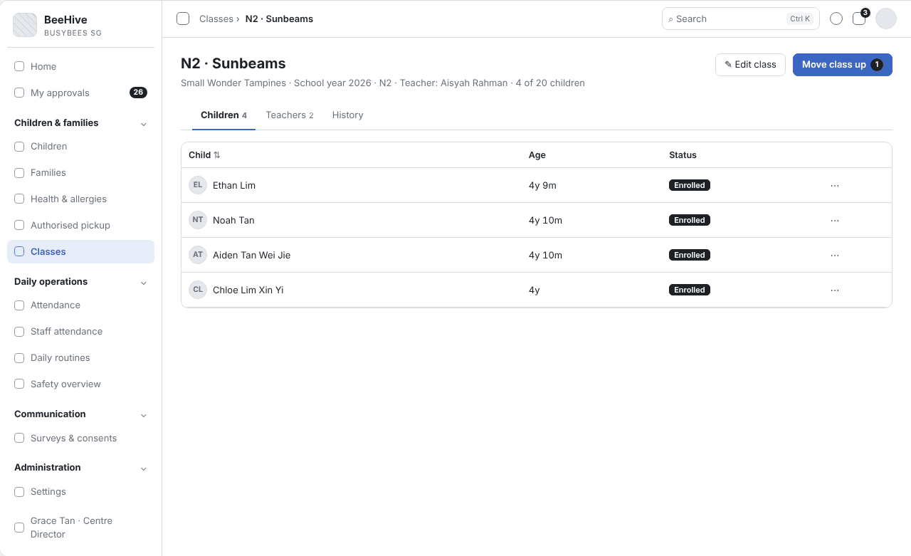
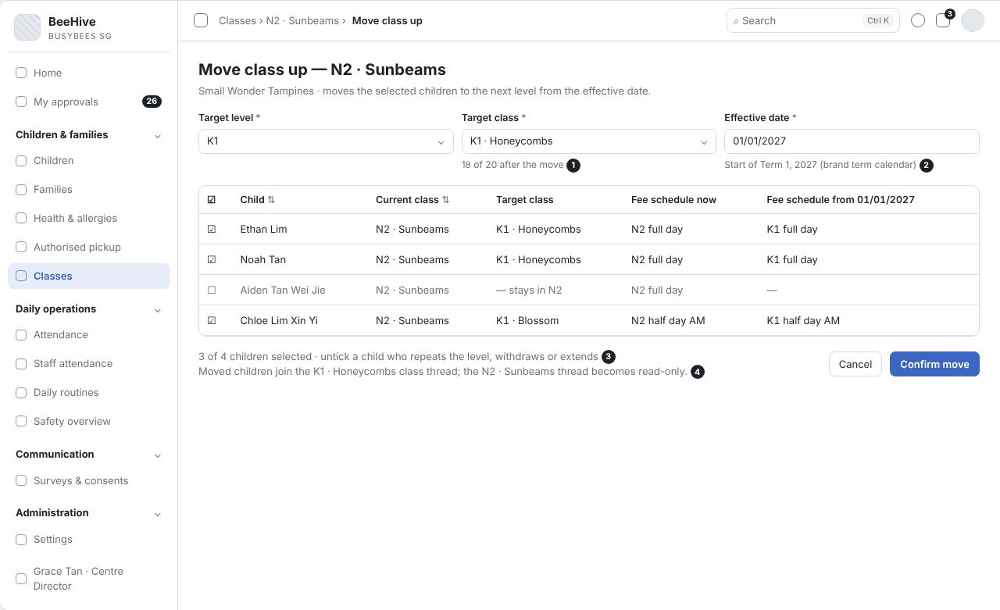
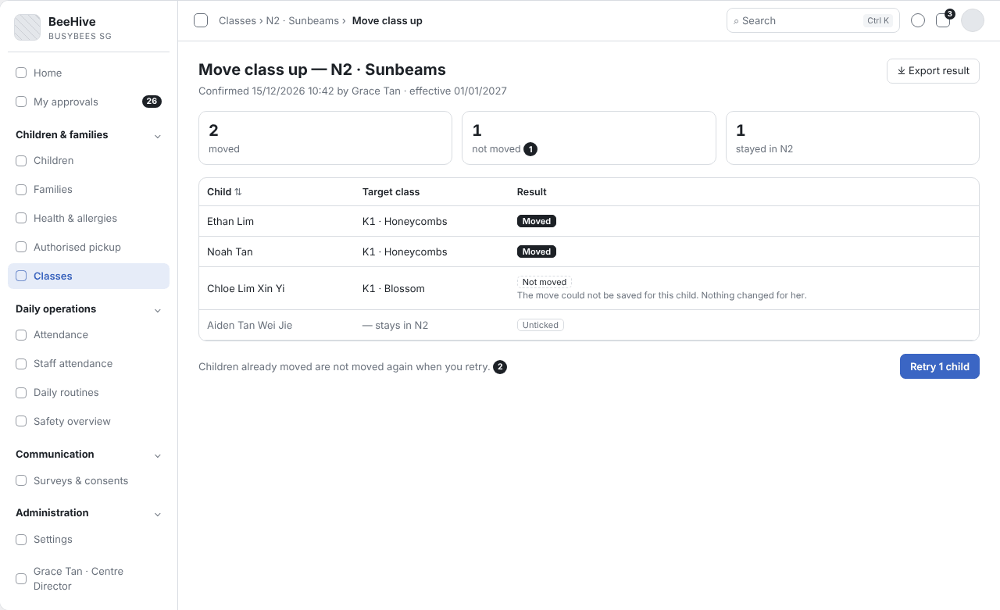

# BBA-72 Move whole class up a level (bulk promotion) (Tiếng Việt)

| Thuộc tính | Giá trị |
|---|---|
| Dự án | Busy Bees Asia SMS |
| Module | Children & Families — Classes |
| Tính năng | Move whole class up a level (bulk promotion) |
| Mã ticket | BBA-72 |
| Mã WBS | 3.1.5.01 |
| Mã tài liệu | FRD-BBA-72 |
| Sprint | 4 |
| Phiên bản | 0.2 |
| Trạng thái | BẢN NHÁP CHỜ XÁC NHẬN |
| Ngày | 14/11/2026 |
| Người soạn | Business Analysis |
| Người review | HaiNguyen |
| Người duyệt | HaiNguyen |

## 1. Kiểm soát tài liệu

| Phiên bản | Ngày | Tác giả | Tóm tắt thay đổi | Duyệt |
|---|---|---|---|---|
| 0.1 | 10/11/2026 | Business Analysis | Khởi tạo | HaiNguyen |

**Mức sẵn sàng:** Đã đặc tả việc cho cả lớp lên level mới trong cùng Centre: chọn lớp đích và ngày hiệu lực, xem trước, bỏ chọn trẻ ở lại, xác nhận, kết quả từng trẻ và chạy lại, cập nhật ghi danh, học phí theo level, danh sách điểm danh, thread của lớp và lịch sử; ranh giới với Graduation và Transfer; có wireframe.

## 2. Mục tiêu và bối cảnh

Năm học chạy từ tháng 1 đến tháng 12. Tháng 11–12, Centre lập lớp cho năm sau; cuối năm, Centre chuyển cả lớp lên level tiếp theo (ví dụ N2 lên K1) cho năm học mới (Q-74-07). Thay vì chuyển từng trẻ, Centre Director chọn lớp, chọn lớp đích và ngày hiệu lực, xem trước danh sách trẻ, bỏ chọn trẻ ngoại lệ, rồi xác nhận một lần.

Màn này chỉ dùng cho annual promotion trong cùng Centre. Infant promotion (từng trẻ, 18 tháng tuổi) và class change là luồng riêng; K2 tốt nghiệp là mass withdrawal ở Joining & leaving; lên level ở Centre khác là Transfer (Q-74-01, Q-74-02).

Mục tiêu đo được: chuyển xong một lớp trong một lần xác nhận; 100% trẻ được chuyển có lịch sử ghi lớp cũ, lớp mới, ngày hiệu lực và người thực hiện; 100% trẻ không chuyển được có trong kết quả kèm lý do.

## 3. Phạm vi

| Trong phạm vi | Ngoài phạm vi |
|---|---|
| Chọn lớp nguồn, level đích, lớp đích, ngày hiệu lực. Xem trước trẻ bị ảnh hưởng, bỏ chọn trẻ ngoại lệ, đổi lớp đích cho từng trẻ, cảnh báo sĩ số. Xác nhận: cập nhật ghi danh, học phí theo level, danh sách điểm danh, thread của lớp. Kết quả từng trẻ và chạy lại trẻ lỗi. Lịch sử từng trẻ. Đề xuất đóng lớp cũ khi hết trẻ. Chỉ dẫn sang Graduation / Transfer ở lớp level cao nhất. | Infant promotion và class change từng trẻ (Q-74-01). K2 graduation — Joining & leaving (BBA-143). Lên level ở Centre khác — Transfer (BBA-304) hoặc Bulk transfer children (Administration). Tạo lớp cho năm học mới (Classes). Sửa hoá đơn đã phát hành — credit note ở Fees & Payments (Q-74-09). |

## 4. Tác nhân, vai trò và quyền truy cập

| Tác nhân | Phạm vi | Quyền / Trách nhiệm |
|---|---|---|
| Centre Director | Centre của mình. | Cho lớp lên level mới, chạy lại trẻ lỗi, đóng lớp cũ (quyền mặc định). |
| HQ Admin | Mọi Centre. | Mọi quyền. |
| School Admin | Centre của mình. | Theo quyền được cấp trong Roles & permissions. |
| Teacher | Lớp của mình. | Xem lớp mới của trẻ từ ngày hiệu lực; không cho lớp lên level. |
| Phụ huynh (Parents App) | Con mình. | Thấy thread lớp mới từ ngày hiệu lực; thread lớp cũ chỉ đọc. |
| Hệ thống | Toàn hệ thống. | Đề xuất level, lớp đích và ngày hiệu lực; chuyển từng trẻ; báo kết quả; cập nhật ghi danh, học phí, danh sách điểm danh, thread; lưu lịch sử. |

## 5. Tổng quan tính năng

| Khu vực | Chức năng | User Story |
|---|---|---|
| Classes › chi tiết lớp | Nút Move class up; chỉ dẫn sang Graduation / Transfer ở lớp level cao nhất. | US-001 |
| Classes › Move class up | Xem trước, xác nhận, kết quả từng trẻ, chạy lại, đề xuất đóng lớp. | US-001 |

## 6. Yêu cầu chức năng

### 6.1 US-001 - Cho cả lớp lên level mới

#### User Story

Là Centre Director, tôi muốn chuyển cả lớp lên level tiếp theo cho năm học mới trong một lần, bỏ chọn được trẻ học lại, để không phải chuyển từng trẻ và không bỏ sót việc đổi học phí, danh sách điểm danh.

#### Functional Requirements (Yêu cầu chức năng)

| FR ID | Yêu cầu chức năng |
|---|---|
| FR-001 | Ở chi tiết lớp, "Move class up" mở màn chuyển lớp với: lớp nguồn (lớp đang xem), level đích (mặc định level kế tiếp trong các level Centre có mở), lớp đích (các lớp của level đích, năm học mới, cùng Centre), ngày hiệu lực (mặc định ngày bắt đầu Term 1 năm học mới theo lịch term của brand — AS-01). |
| FR-002 | Màn xem trước liệt kê mọi trẻ đang học trong lớp nguồn: tên, lớp hiện tại, lớp đích, biểu phí hiện tại và biểu phí theo level mới từ ngày hiệu lực; mỗi trẻ có ô chọn, mặc định được chọn. |
| FR-003 | Người dùng bỏ chọn trẻ ngoại lệ (học lại, rút, gia hạn) và đổi lớp đích cho từng trẻ khi cần; trẻ bị bỏ chọn giữ lớp cũ hoặc được chuyển sang lớp khác cùng level bằng luồng class change (Q-74-03). |
| FR-004 | Xem trước hiện sĩ số lớp đích sau khi chuyển (ví dụ "18 of 20 after the move"); vượt sĩ số tối đa thì cảnh báo, người dùng vẫn xác nhận được (Q-74-08). |
| FR-005 | "Confirm move" chuyển mọi trẻ được chọn từ ngày hiệu lực: cập nhật level và lớp trong ghi danh; áp biểu phí theo level mới cho các hoá đơn tạo sau ngày hiệu lực; đưa trẻ vào danh sách điểm danh của lớp đích; tạo thread cho lớp mới, thread lớp cũ chuyển chỉ đọc và giữ tới khi trẻ rời trường (Q-74-10). |
| FR-006 | Trẻ bị bỏ chọn ở lại lớp nguồn, không thay đổi gì. |
| FR-007 | Mỗi trẻ được chuyển có một dòng lịch sử: lớp cũ, lớp mới, ngày hiệu lực, người thực hiện, thời điểm xác nhận. |
| FR-008 | Trước ngày hiệu lực, lớp của trẻ trên mọi màn hình vẫn là lớp cũ; từ ngày hiệu lực là lớp mới. |
| FR-009 | Sau khi chuyển, nếu lớp nguồn không còn trẻ nào từ ngày hiệu lực, hệ thống đề xuất "Close this class"; lớp đã có trẻ chỉ được đóng, không xoá, lịch sử giữ nguyên (BR-CHF-049). |
| FR-010 | Lớp ở level cao nhất Centre có mở không có nút "Move class up". Nếu level đó là K2: chi tiết lớp chỉ dẫn sang Joining & leaving › Graduation (mass withdrawal, reason Graduation, chỉ K2 rời vào tháng 12 — Q-74-01, Q-74-06). Nếu level đó chưa phải K2 (Centre không mở level kế tiếp, ví dụ junior campus ở Malaysia): chi tiết lớp chỉ dẫn sang Transfer (Joining & leaving) hoặc Bulk transfer children (Administration) (Q-74-02; chờ OQ-08). |
| FR-011 | Sau khi xác nhận, màn kết quả hiện từng trẻ: Moved, Not moved (kèm lý do), Unticked; một trẻ lỗi không chặn trẻ khác và giữ nguyên lớp cũ; "Retry" chỉ chạy lại trẻ lỗi; chạy lại không chuyển trùng trẻ đã chuyển; kết quả xuất được ra Excel (Q-74-11, Q-74-12, Q-74-13 — DOTB quyết định). |

#### Functional Flow - Main (Luồng chính)

1. Centre Director mở lớp N2 · Sunbeams, chọn Move class up (FR-001).
2. Hệ thống đề xuất level K1, lớp đích và ngày bắt đầu Term 1 năm học mới.
3. Centre Director xem trước, bỏ chọn trẻ học lại (FR-002, FR-003, FR-004).
4. Centre Director chọn Confirm move; hệ thống chuyển từng trẻ, ghi lịch sử và hiện kết quả (FR-005, FR-007, FR-011).

#### Functional Flow - Alternative (Luồng thay thế)

1. Lớp đích vượt sĩ số: cảnh báo, Centre Director vẫn xác nhận được (FR-004).
2. Một số trẻ chuyển sang lớp đích khác (FR-003).
3. Một trẻ không chuyển được: Centre Director chọn Retry cho trẻ đó (FR-011).
4. Lớp nguồn hết trẻ: Centre Director đóng lớp (FR-009).
5. Lớp K2: Centre Director đi Graduation (FR-010).
6. Lớp ở level cao nhất Centre có mở nhưng chưa phải K2: Centre Director đi Transfer / Bulk transfer (FR-010).

#### Functional Flow - Exception (Luồng ngoại lệ)

1. Chưa có lớp nào ở level đích cho năm học mới: không chuyển được (VAL-001).
2. Ngày hiệu lực trước hôm nay: không chuyển được (VAL-002).
3. Trẻ đã có một lần chuyển lớp, transfer hoặc withdrawal chờ hiệu lực: trẻ bị bỏ chọn và ghi lý do (VAL-003).
4. Không còn trẻ nào được chọn: không xác nhận được (VAL-004).

#### Business Rules (Quy tắc nghiệp vụ)

| BR ID | Quy tắc nghiệp vụ |
|---|---|
| BR-001 | Việc lên lớp có ngày hiệu lực; mọi thay đổi (lớp, level, học phí, điểm danh, thread) bắt đầu từ ngày đó. |
| BR-002 | Hoá đơn đã phát hành không bị sửa; học phí theo level mới chỉ áp cho hoá đơn tạo sau ngày hiệu lực; chỉnh hoá đơn đã phát hành bằng credit note (Q-74-09). |
| BR-003 | Vượt sĩ số tối đa chỉ cảnh báo, không chặn; Centre Director cấu hình sĩ số tối đa từng lớp (Q-74-08). |
| BR-004 | Lớp đã có trẻ không bị xoá, chỉ được đóng; lịch sử giữ nguyên. |
| BR-005 | Quyền cho lớp lên level theo Roles & permissions; mặc định Centre Director và HQ Admin. |
| BR-006 | Chỉ chuyển trong cùng Centre. Khác Centre cùng brand là Transfer; khác brand là withdrawal ở Centre cũ và đăng ký mới; junior campus → senior campus ở Malaysia (hai brand) là Transfer (Q-74-02). |
| BR-007 | Màn này chỉ dùng cho annual promotion; Infant promotion và class change là luồng riêng (Q-74-01). |

#### Validation Rules (Quy tắc kiểm tra)

| VAL ID | Điều kiện | Phản hồi hệ thống |
|---|---|---|
| VAL-001 | Level đích chưa có lớp nào cho năm học mới. | Không chuyển; ô Target class hiện "Create a class for K1 in the new school year first." (tên level theo lựa chọn). |
| VAL-002 | Ngày hiệu lực trước hôm nay. | Không chuyển; hiện "The effective date cannot be in the past." |
| VAL-003 | Trẻ đã có một lần chuyển lớp, transfer hoặc withdrawal chưa đến ngày hiệu lực (AS-04). | Trẻ bị bỏ chọn, không chọn lại được; ghi "Already has a class change on" (hoặc transfer / withdrawal) kèm ngày. |
| VAL-004 | Không còn trẻ nào được chọn. | Nút Confirm move bị mờ. |

#### UI Reference (Tham chiếu giao diện)

| Mã màn hình / Phiên bản | Tham chiếu / Link |
|---|---|
| SCR-01 - Classes — chi tiết lớp | Wireframe: `Diagram/Wireframe/class-promotion-sprint4.html` (Chi tiết lớp · Lớp K2 · Level cao nhất chưa phải K2) |
| SCR-02 - Move class up — xem trước | Wireframe: `Diagram/Wireframe/class-promotion-sprint4.html` (Xem trước · Vượt sĩ số · Trẻ đã có lần chuyển lớp · Chưa có lớp đích · Bỏ chọn hết) |
| SCR-03 - Move class up — kết quả | Wireframe: `Diagram/Wireframe/class-promotion-sprint4.html` (Kết quả · Lớp nguồn hết trẻ) |

#### UI Components / Field Specification (Thành phần giao diện)

| Trường / Điều khiển | Loại | Bắt buộc | Mặc định / Trạng thái | Kiểm tra | Hành vi |
|---|---|---|---|---|---|
| Move class up | Nút ở chi tiết lớp | Theo quyền | Ẩn ở lớp level cao nhất | — | FR-001; FR-010; BR-005. |
| Target level | Danh sách chọn | Có | Level kế tiếp | VAL-001. | Chỉ các level Centre có mở. |
| Target class | Danh sách chọn | Có | Lớp đầu tiên của level đích | VAL-001. | Đổi được cho từng trẻ (FR-003); hiện sĩ số sau khi chuyển (FR-004). |
| Effective date | Ngày | Có | Ngày bắt đầu Term 1 năm học mới | VAL-002. | AS-01. |
| Danh sách trẻ | Bảng có ô chọn | Có | Tất cả được chọn | VAL-003; VAL-004. | Cột: Child, Current class, Target class, Fee schedule now, Fee schedule from (ngày hiệu lực) (FR-002). |
| Confirm move | Nút | Có | — | VAL-004. | FR-005. |
| Kết quả | Thẻ đếm + bảng | — | Sau khi xác nhận | — | Moved, Not moved, Stayed; cột Child, Target class, Result (FR-011). |
| Retry | Nút ở màn kết quả | Khi có trẻ lỗi | — | — | Chỉ chạy lại trẻ Not moved (FR-011). |
| Export result | Nút ở màn kết quả | — | — | — | Excel (FR-011). |
| Close this class | Nút ở màn kết quả | Khi lớp nguồn hết trẻ | — | — | FR-009. |

#### Data and Audit (Dữ liệu và audit)

| ID | Yêu cầu |
|---|---|
| DATA-001 | Mỗi trẻ được chuyển lưu: lớp và level cũ, lớp và level mới, ngày hiệu lực, người thực hiện, thời điểm xác nhận. |
| DATA-002 | Mỗi lần cho lớp lên level lưu: lớp nguồn, số trẻ được chuyển, số trẻ không chuyển được kèm lý do, số trẻ ở lại, người thực hiện, thời điểm. |

#### Acceptance Criteria (Tiêu chí nghiệm thu)

| AC ID | Given | When | Then | Linked Rule |
|---|---|---|---|---|
| AC-001 | lớp N2 · Sunbeams có 16 trẻ, đã có lớp K1 · Honeycombs cho năm học 2027 | Centre Director chọn Move class up | level đích mặc định K1, lớp đích Honeycombs, ngày hiệu lực 01/01/2027; 16 trẻ được chọn sẵn | FR-001; FR-002 |
| AC-002 | 2 trẻ học lại N2 | Centre Director bỏ chọn 2 trẻ và chọn Confirm move | 14 trẻ chuyển sang Honeycombs từ ngày hiệu lực; 2 trẻ ở lại Sunbeams | FR-003; FR-005; FR-006 |
| AC-003 | lớp Honeycombs tối đa 20 trẻ, đã có 8 trẻ | xem trước 14 trẻ chuyển sang | hiện "22 of 20 after the move" kèm cảnh báo; vẫn xác nhận được | FR-004; BR-003 |
| AC-004 | ngày hiệu lực 01/01/2027, hoá đơn tháng 1 chưa tạo | Centre Director xác nhận | hoá đơn tháng 1 của 14 trẻ dùng biểu phí K1 | FR-005; BR-002 |
| AC-005 | ngày hiệu lực 01/01/2027, hôm nay 15/12/2026 | giáo viên mở danh sách điểm danh lớp Sunbeams ngày 20/12 | 14 trẻ vẫn ở lớp Sunbeams; từ 01/01/2027 trẻ ở lớp Honeycombs | FR-008; BR-001 |
| AC-006 | đã xác nhận | Centre Director mở lịch sử một trẻ | có dòng lớp cũ, lớp mới, ngày hiệu lực, người thực hiện | FR-007; DATA-001 |
| AC-007 | chưa có lớp K1 cho năm học mới | Centre Director chọn Move class up | ô Target class hiện "Create a class for K1 in the new school year first."; Confirm move bị mờ | VAL-001 |
| AC-008 | Centre Director chọn ngày hiệu lực hôm qua | chọn Confirm move | không chuyển, hiện "The effective date cannot be in the past." | VAL-002 |
| AC-009 | một trẻ đã có lần chuyển lớp hiệu lực 01/01/2027 | xem trước | trẻ đó bị bỏ chọn, không chọn lại được, ghi "Already has a class change on 01/01/2027" | VAL-003 |
| AC-010 | lớp Sunbeams không còn trẻ từ ngày hiệu lực | Centre Director chọn Close this class | lớp chuyển trạng thái Closed, lịch sử giữ nguyên | FR-009; BR-004 |
| AC-011 | lớp K2 · Stars là level cao nhất của Centre | Centre Director mở chi tiết lớp | không có nút Move class up; có chỉ dẫn sang Graduation | FR-010; BR-007 |
| AC-012 | Teacher không có quyền cho lớp lên level | Teacher mở chi tiết lớp | không có nút Move class up | BR-005 |
| AC-013 | Centre Director bỏ chọn tất cả trẻ trong xem trước | nhìn nút Confirm move | nút bị mờ, không xác nhận được | VAL-004 |
| AC-014 | 14 trẻ đã chuyển sang Honeycombs từ 01/01/2027 | phụ huynh của một trẻ mở Messages ngày 05/01/2027 | thấy thread lớp Honeycombs mới; thread Sunbeams chỉ đọc | FR-005 |
| AC-015 | 3 trẻ được chọn, việc chuyển của Chloe không lưu được | Centre Director xem kết quả | 2 trẻ Moved, Chloe Not moved kèm lý do và vẫn ở lớp Sunbeams; Retry chỉ chạy lại Chloe | FR-011 |
| AC-016 | Ethan đã Moved trong lần chạy trước | Centre Director chọn Retry | Ethan không bị chuyển lần nữa, lịch sử Ethan chỉ có một dòng | FR-011; DATA-001 |
| AC-017 | Centre chỉ mở Playgroup đến N2 | Centre Director mở chi tiết lớp N2 | không có nút Move class up; có chỉ dẫn sang Transfer / Bulk transfer children | FR-010; BR-006 |
| AC-018 | một trẻ có transfer sang Centre khác, ngày học cuối 31/12/2026 | Centre Director xem trước Move class up | trẻ đó bị bỏ chọn, không chọn lại được, ghi lý do transfer kèm ngày | VAL-003 |

#### Dependencies (Phụ thuộc)

Classes (lớp của năm học mới, sĩ số tối đa); level Centre có mở (Administration › Centres); lịch term theo brand; biểu phí theo level (Fees & Payments); danh sách điểm danh; thread của lớp (Communication); Joining & leaving › Graduation (lớp K2) và Transfer; Bulk transfer children (Administration).

## 7. Câu hỏi mở

| Mã câu hỏi | Quyết định cần có | Người quyết định | Ưu tiên | Quyết định của BBA |
|---|---|---|---|---|
| OQ-01 | Việc cho lớp lên level có cần ai duyệt (ví dụ HQ Ops) trước khi có hiệu lực không? | Centre Director / HQ Ops | Trung bình |  |
| OQ-02 | Ngày hiệu lực mặc định là ngày nào; có cho lên lịch và huỷ trước ngày hiệu lực không? | HQ Ops | Cao | Một phần: năm học tháng 1–12, lập lớp năm sau tháng 11–12 (Q-74-07); Term 1 năm 2027 của mọi brand bắt đầu 01/01/2027 (Centre Terms Setup — BBA-489). Mặc định ngày hiệu lực, lên lịch và huỷ chưa chốt. |
| OQ-03 | Trẻ đang tạm nghỉ (tối đa 3 tháng, vẫn trong hệ thống) có được chuyển cùng lớp không; trạng thái nào đủ điều kiện? | Centre Director / HQ Ops | Trung bình | Một phần: tạm nghỉ tối đa 3 tháng, trẻ vẫn trong hệ thống (Q-74-06, BBA-536). Điều kiện cho annual promotion chưa chốt. |
| OQ-04 | Phụ huynh / giáo viên có nhận thông báo khi lên lớp không; lớp cũ tự đóng hay đóng tay? | Centre Director / HQ Ops | Thấp | Một phần: HQ / Centre dùng Announcement để báo thay đổi lớn (Q-74-15). Thông báo khi annual promotion và cách đóng lớp chưa chốt. |
| OQ-05 | Trẻ K2 cuối năm (tốt nghiệp) xử lý ở đâu? | Business Owner | Trung bình | Graduation ở Joining & leaving (mass withdrawal), chỉ K2 rời vào tháng 12 (Q-74-01, Q-74-06). |
| OQ-06 | Biểu phí level mới áp từ ngày hiệu lực hay từ đầu tháng sau? | Finance | Cao | Một phần: hoá đơn đã phát hành sửa bằng credit note (Q-74-09); giá năm 2027 thay đổi, chốt trong tháng 11 (BBA-522). |
| OQ-07 | Danh sách điểm danh chuyển ngay khi xác nhận hay tại ngày hiệu lực? | Centre Director / HQ Ops | Trung bình | Một phần: thread lớp mới tạo khi lên lớp, thread cũ chỉ đọc (Q-74-10). Danh sách điểm danh chưa chốt. |
| OQ-08 | Centre không mở level kế tiếp (ví dụ junior campus ở Malaysia): cuối năm xử lý bằng Bulk transfer children (Administration) hay Transfer từng trẻ (Joining & leaving); ai làm? | HQ Ops | Cao | Một phần: junior → senior campus là Transfer, không phải promotion (Q-74-02). |
| OQ-09 | Trẻ có transfer hoặc withdrawal chờ hiệu lực có bị loại khỏi danh sách lên lớp không? | Centre Director / HQ Ops | Trung bình |  |
| OQ-10 | Ở junior → senior campus, Centre nhận xếp trẻ vào level nào: level kế tiếp tự động hay admin Centre nhận chọn khi nhận trẻ? | HQ Ops | Trung bình |  |

### Giả định của BA (cần xác nhận cùng mục 7)

| Mã | Giả định | Dùng ở |
|---|---|---|
| AS-01 | Ngày hiệu lực mặc định là ngày bắt đầu Term 1 năm học mới theo lịch term của brand. | FR-001 — chờ OQ-02 |
| AS-02 | Không cần duyệt; xác nhận là có hiệu lực theo ngày đã chọn. | FR-005 — chờ OQ-01 |
| AS-03 | Trẻ đang tạm nghỉ có trong danh sách xem trước và được chuyển như trẻ khác. | FR-002 — chờ OQ-03 |
| AS-04 | Trẻ có transfer hoặc withdrawal chờ hiệu lực bị loại khỏi danh sách lên lớp. | VAL-003 — chờ OQ-09 |

## 8. Phụ lục

### Phụ lục A. Thuật ngữ

| Thuật ngữ | Định nghĩa trong FRD này |
|---|---|
| Level | Cấp lớp theo độ tuổi, ví dụ Playgroup, N1, N2, K1, K2; mỗi Centre chỉ mở một số level. |
| Annual promotion | Cuối năm học, cả lớp lên level kế tiếp trong cùng Centre. |
| Ngày hiệu lực | Ngày việc chuyển lớp bắt đầu áp dụng. |
| Biểu phí theo level | Mức học phí áp cho trẻ theo level đang học. |
| Học lại | Trẻ ở lại level cũ thêm một năm. |
| Transfer | Trẻ chuyển sang Centre khác cùng quốc gia; giữ hồ sơ trẻ, tạo ghi danh mới ở Centre nhận. |
| Graduation | Trẻ K2 rời trường vào tháng 12, xử lý như mass withdrawal. |

## 9. Tài liệu tham khảo

Số trang của SRS tính theo bản Word gốc khi xuất PDF; "—" là chưa đối chiếu được với bản Word gốc. Tệp của BBA là tệp đính kèm trên Plane.

| STT | Tài liệu | Mục | Trang | Dùng cho |
|---|---|---|---|---|
| 1 | BBA-SMS-SRS-Children-and-Families-v0.1 | §1.1 In scope for Phase 1 (Classes: annual promotion) | 3 | Mục 3. |
| 2 | BBA-SMS-SRS-Children-and-Families-v0.1 | §3 P5 Class set-up and assignment; P6 Annual promotion | — | Luồng chính; FR-001 đến FR-005, FR-009. |
| 3 | BBA-SMS-SRS-Children-and-Families-v0.1 | §4 mục 1.6 Classes (Close class, Move children, Run annual promotion, View history) | — | FR-001; FR-002; FR-007; FR-009. |
| 4 | BBA-SMS-SRS-Children-and-Families-v0.1 | §5 Business rules › Classes (BR-CHF-042 đến BR-CHF-049) | — | BR-003; BR-004; BR-005; FR-005; FR-009. |
| 5 | BBA-SMS-SRS-Administration-v0.1 | §1.2 Centres (Set levels offered; Bulk transfer children) | — | FR-010; OQ-08. |
| 6 | BBA-SMS-SRS-Joining-and-Leaving-v0.1 | §3 P4 Transfer between centres; §5 Business rules › Transfers (BR-JNL-038 đến BR-JNL-048) | — | BR-006; FR-010; AC-018. |
| 7 | Plane — ticket BBA-72 (WBS 3.1.5.01) | Annual exercise; preview before commit; async batch job with progress & partial-failure report | — | Phạm vi; FR-002; FR-011. |
| 8 | Plane — BBA-489, tệp đính kèm "Centre Terms Setup.xlsx" | Sheet "Term Setup" (Term 1 năm 2027 của mọi brand bắt đầu 01/01/2027) | — | FR-001; AS-01; OQ-02. |
| 9 | Plane — BBA-536 "BBA input: Temporary withdrawal – reminder before the child returns" | Tạm nghỉ tối đa 3 tháng | — | OQ-03. |
| 10 | Plane — BBA-522 "BBA input: Fee items and prices to set up in the new system" | Comment 12/11/2026: giá năm 2027 thay đổi, chốt trong tháng 11 | — | OQ-06. |
| 11 | BBA_SMS_S4 — Tổng hợp câu hỏi phản hồi, sheet "Tổng hợp" | Đã chốt: Q-74-01, Q-74-02, Q-74-06, Q-74-08 · Một phần: Q-74-03, Q-74-07, Q-74-09, Q-74-10, Q-74-15 · DOTB quyết định: Q-74-11, Q-74-12, Q-74-13 · Chưa phản hồi: Q-74-05 | — | FR-003; FR-005; FR-010; FR-011; BR-002; BR-003; BR-006; BR-007; OQ-02 đến OQ-08. |
| 12 | Plane — dự án BBA Phase 1, ticket BBA-72 (WBS 3.1.5.01) | Move whole class up a level (bulk promotion) | — | Phạm vi tính năng. |
