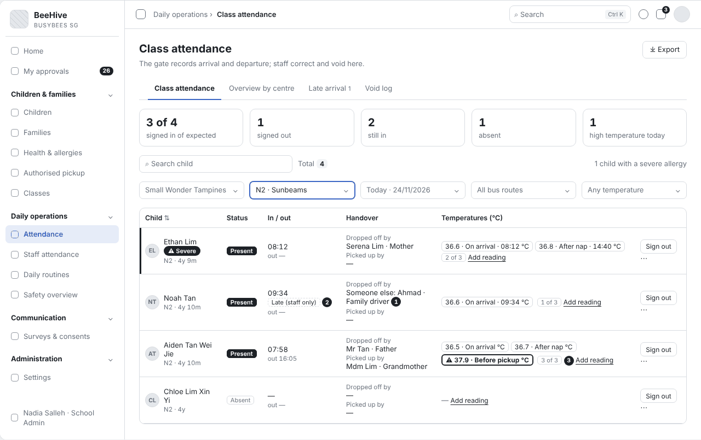
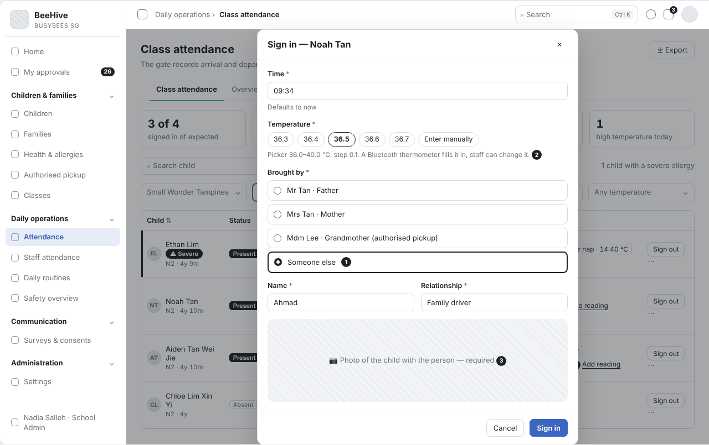
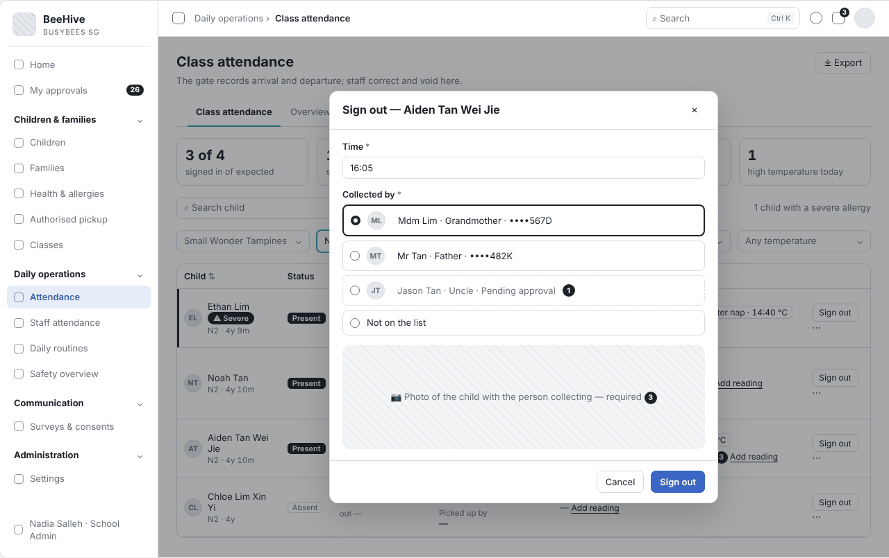
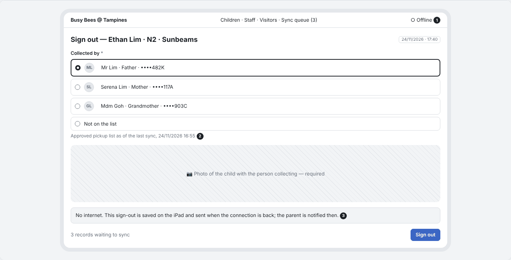

# BBA-73 Handover recording (dropped off by / picked up by) (Tiếng Việt)

| Thuộc tính | Giá trị |
|---|---|
| Dự án | Busy Bees Asia SMS |
| Module | Daily Operations — Attendance |
| Tính năng | Handover recording (dropped off by / picked up by) |
| Mã ticket | BBA-73 |
| Mã WBS | 3.2.1.01 |
| Mã tài liệu | FRD-BBA-73 |
| Sprint | 4 |
| Phiên bản | 0.2 |
| Trạng thái | BẢN NHÁP CHỜ XÁC NHẬN |
| Ngày | 14/11/2026 |
| Người soạn | Business Analysis |
| Người review | HaiNguyen |
| Người duyệt | HaiNguyen |

## 1. Kiểm soát tài liệu

| Phiên bản | Ngày | Tác giả | Tóm tắt thay đổi | Duyệt |
|---|---|---|---|---|
| 0.1 | 10/11/2026 | Business Analysis | Khởi tạo | HaiNguyen |

**Mức sẵn sàng:** Đã đặc tả việc ghi người đưa trẻ đến và người đón trẻ về, chặn trả trẻ cho người ngoài danh sách đã duyệt, ảnh lúc giao nhận, trẻ đi xe, thông báo cho phụ huynh và làm việc khi iPad cổng mất mạng; có wireframe.

## 2. Mục tiêu và bối cảnh

Mỗi lần nhận trẻ buổi sáng và trả trẻ buổi chiều, Centre phải biết ai đưa trẻ đến, ai đón trẻ về và lúc mấy giờ, kèm ảnh trẻ với người giao / nhận. Khi trả trẻ, nhân viên chỉ được giao trẻ cho người có trong danh sách người được phép đón mà phụ huynh đã thêm và Centre đã duyệt; người lạ không được đón cho tới khi phụ huynh thêm và Centre duyệt (Q-75-02, Q-75-04).

Mục tiêu đo được: 100% lượt nhận và trả trẻ có người đưa / người đón, giờ và ảnh; 0 lượt trả trẻ cho người ngoài danh sách đã duyệt được lưu.

## 3. Phạm vi

| Trong phạm vi | Ngoài phạm vi |
|---|---|
| Ghi người đưa khi nhận trẻ: phụ huynh, người được phép đón, hoặc "Someone else" kèm tên và quan hệ. Ghi người đón khi trả trẻ, chỉ từ danh sách đã duyệt; hiện ảnh, quan hệ và 4 ký tự cuối giấy tờ để đối chiếu. Chặn người ngoài danh sách. Ảnh lúc giao nhận. Giờ nhận, giờ trả. Trẻ đi xe: nhận / trả từng trẻ theo bộ lọc xe. Thông báo cho phụ huynh. Nhận / trả khi iPad cổng mất mạng. | Phụ huynh thêm người được phép đón trong Parents App và Centre duyệt (Children & Families, Parents App). Người đón một lần (không có ở Phase 1 — BR-CDP-025, BBA-544). Màn Parents App hiện ảnh giao nhận. Sửa / huỷ lượt điểm danh (BBA-77). Đo nhiệt độ (BBA-74). Phí đón muộn. Nhận diện khuôn mặt, quét mã. |

## 4. Tác nhân, vai trò và quyền truy cập

| Tác nhân | Phạm vi | Quyền / Trách nhiệm |
|---|---|---|
| Nhân viên ở cổng (iPad chung) | Centre của mình. | Nhận và trả trẻ trên ứng dụng điểm danh, chụp ảnh. |
| Centre Admin / School Admin, Teacher | Centre / lớp của mình. | Nhận và trả trẻ trên SMS web; xem cột Handover. |
| Centre Director | Centre của mình. | Như trên; duyệt người được phép đón (cùng School Admin — BR-CDP-024; chờ OQ-06); xem lại các lần "Not on the list". |
| Phụ huynh (Parents App) | Con mình. | Nhận thông báo khi con được nhận và được đón, có tên người đưa / người đón và ảnh. |
| Hệ thống | Toàn hệ thống. | Lấy danh sách người được phép đón, chặn người ngoài danh sách, lưu giờ, ảnh, nhân viên và thiết bị, đồng bộ lượt làm khi mất mạng, gửi thông báo. |

## 5. Tổng quan tính năng

| Khu vực | Chức năng | User Story |
|---|---|---|
| Daily operations › Class attendance (SMS web) | Cột Handover; nhận / trả trẻ; lọc theo xe. | US-001 |
| Ứng dụng điểm danh ở cổng (iPad) | Nhận / trả trẻ, chụp ảnh, làm việc khi mất mạng. | US-001 |

## 6. Yêu cầu chức năng

### 6.1 US-001 - Ghi người đưa trẻ đến và người đón trẻ về

#### User Story

Là nhân viên ở cổng, khi nhận và trả trẻ tôi muốn chọn nhanh người đưa / người đón từ danh sách của trẻ và được hệ thống chặn nếu người đón không có trong danh sách, để trẻ chỉ được giao cho đúng người.

#### Functional Requirements (Yêu cầu chức năng)

| FR ID | Yêu cầu chức năng |
|---|---|
| FR-001 | Khi nhận trẻ, nhân viên chọn "Brought by" từ danh sách gồm phụ huynh và người được phép đón đã duyệt của trẻ, hoặc chọn "Someone else" và nhập Name, Relationship (cả hai bắt buộc). Hai ô Name, Relationship chỉ hiện khi chọn "Someone else" (Q-75-02 — DOTB quyết định). |
| FR-002 | Khi trả trẻ, nhân viên chọn "Collected by" từ danh sách người được phép đón đã duyệt (gồm cả phụ huynh). Mỗi người hiện ảnh, họ tên, quan hệ với trẻ và 4 ký tự cuối giấy tờ, để nhân viên đối chiếu. |
| FR-003 | Người phụ huynh đã thêm nhưng Centre chưa duyệt hiện với chữ "Pending approval" và không chọn được khi trả trẻ. |
| FR-004 | Khi người đến đón không có trong danh sách, nhân viên chọn "Not on the list"; hệ thống không cho trả trẻ và hiện "Do not release the child. Call the parent to add this person in the Parents App. The person can collect the child once approved." Không có cơ chế override (Q-75-04). |
| FR-005 | Giờ nhận và giờ trả mặc định là giờ hiện tại; nhân viên sửa được trong cùng ngày; giờ trả không được trước giờ nhận; trẻ chưa được nhận thì không trả được. |
| FR-006 | Bảng điểm danh của lớp có cột "Handover" ghi "Dropped off by" và "Picked up by" kèm tên người. |
| FR-007 | Mỗi lượt nhận / trả gửi thông báo trong Parents App cho phụ huynh, có tên người đưa / người đón và giờ; không nhắc cờ đến muộn và tên nhân viên ở cổng (BR-ATT-049, BR-ATT-051). |
| FR-008 | Bộ lọc theo xe gom trẻ của một xe vào một danh sách; nhận và trả vẫn làm từng trẻ, mỗi trẻ một bản ghi và ảnh riêng. Lúc xe đến, người giao là tài xế; lúc xe về, người nhận là phụ xe của công ty xe (Q-75-10). |
| FR-009 | Mỗi lượt nhận / trả lưu người đưa / người đón, giờ, ảnh, nhân viên thực hiện và thiết bị (SMS web hoặc ứng dụng điểm danh). |
| FR-010 | Mỗi lượt nhận / trả bắt buộc chụp ảnh trẻ cùng người giao / nhận; Parents App hiện ảnh này để phụ huynh thấy ai đưa / đón (BR-ATT-006; Q-75-10, Q-81-02). |
| FR-011 | Khi iPad cổng mất mạng, nhân viên vẫn nhận / trả trẻ: màn hình báo mất mạng; danh sách người được phép đón lấy theo lần đồng bộ gần nhất và hiện thời điểm đồng bộ; lượt nhận / trả lưu trên iPad với trạng thái Not synced và tự gửi khi có mạng; thông báo cho phụ huynh gửi khi lượt đó tới SMS, ghi giờ thật của lượt (SRS Attendance App P4, BR-ATT-050; Plane BBA-494). |

#### Functional Flow - Main (Luồng chính)

1. Buổi sáng, nhân viên chọn trẻ, chọn người đưa (FR-001), chụp ảnh (FR-010), lưu giờ nhận (FR-005).
2. Buổi chiều, nhân viên chọn trẻ, chọn người đón, đối chiếu ảnh và giấy tờ (FR-002), chụp ảnh, lưu giờ trả (FR-005).
3. Phụ huynh nhận thông báo có tên người đưa / người đón (FR-007).

#### Functional Flow - Alternative (Luồng thay thế)

1. Người đưa không có trong danh sách: chọn "Someone else", nhập tên và quan hệ (FR-001).
2. Trẻ đi xe: lọc theo xe, nhận / trả từng trẻ, người giao là tài xế, người nhận là phụ xe (FR-008).
3. iPad cổng mất mạng: nhận / trả như thường, lượt được gửi khi có mạng (FR-011).

#### Functional Flow - Exception (Luồng ngoại lệ)

1. Người đón không có trong danh sách: không trả trẻ, gọi phụ huynh (FR-004; VAL-002).
2. Người đón đang chờ duyệt: không chọn được (FR-003).
3. "Someone else" thiếu tên hoặc quan hệ: không lưu (VAL-001).
4. Giờ trả trước giờ nhận hoặc sau hiện tại: không lưu (VAL-003).

#### Business Rules (Quy tắc nghiệp vụ)

| BR ID | Quy tắc nghiệp vụ |
|---|---|
| BR-001 | Trẻ chỉ được trả cho người có trong danh sách người được phép đón đã duyệt (BR-OPS-004, BR-ATT-005). |
| BR-002 | Người mới phải được phụ huynh thêm trong Parents App và Centre duyệt trước khi đón trẻ; không có người đón một lần (BR-CDP-024, BR-CDP-025). Phụ huynh xoá người đón thì có hiệu lực ngay (BBA-544). |
| BR-003 | Người đưa trẻ đến được ghi theo người thật sự đưa trẻ, không phải nhân viên bấm nút. |
| BR-004 | Lượt nhận / trả đã đồng bộ không bị xoá; sửa hoặc huỷ theo BBA-77. |
| BR-005 | Mỗi lượt nhận / trả có ảnh và giờ; giờ mặc định là hiện tại (BR-ATT-006). |

#### Validation Rules (Quy tắc kiểm tra)

| VAL ID | Điều kiện | Phản hồi hệ thống |
|---|---|---|
| VAL-001 | Chọn "Someone else" khi nhận trẻ nhưng để trống Name hoặc Relationship. | Không lưu; hiện "Enter the name and relationship of the adult." |
| VAL-002 | Chọn "Not on the list" khi trả trẻ. | Không lưu lượt trả; nút Sign out bị mờ; hiện "Do not release the child. Call the parent to add this person in the Parents App. The person can collect the child once approved." |
| VAL-003 | Giờ trả trước giờ nhận, hoặc giờ sau thời điểm hiện tại. | Không lưu; hiện "Check the time." |
| VAL-004 | Chưa chụp ảnh. | Không lưu; nút Sign in / Sign out bị mờ. |

#### UI Reference (Tham chiếu giao diện)

| Mã màn hình / Phiên bản | Tham chiếu / Link |
|---|---|
| SCR-01 - Class attendance — cột Handover | Wireframe: `Diagram/Wireframe/handover-sprint4.html` (Bảng điểm danh · Lọc theo xe) |
| SCR-02 - Sign in | Wireframe: `Diagram/Wireframe/handover-sprint4.html` (Nhận trẻ · Someone else thiếu quan hệ · Nhận trẻ từ xe) |
| SCR-03 - Sign out | Wireframe: `Diagram/Wireframe/handover-sprint4.html` (Trả trẻ · Người đón ngoài danh sách · Trả trẻ lên xe) |
| SCR-04 - iPad cổng — mất mạng | Wireframe: `Diagram/Wireframe/handover-sprint4.html` (iPad cổng · mất mạng) |

#### UI Components / Field Specification (Thành phần giao diện)

| Trường / Điều khiển | Loại | Bắt buộc | Mặc định / Trạng thái | Kiểm tra | Hành vi |
|---|---|---|---|---|---|
| Brought by | Lựa chọn | Có | Trống | VAL-001. | Phụ huynh, người được phép đón, "Someone else". |
| Name, Relationship | Ô nhập | Khi chọn Someone else | Ẩn | VAL-001. | FR-001. |
| Collected by | Lựa chọn có ảnh | Có | Trống | VAL-002. | Chỉ người đã duyệt; người chờ duyệt bị mờ; có "Not on the list" (FR-002 đến FR-004). |
| Time | Giờ | Có | Giờ hiện tại | VAL-003. | FR-005. |
| Photo | Chụp ảnh | Có | — | VAL-004. | FR-010. |
| Bus service | Bộ lọc | Không | All bus routes | — | Gom trẻ của một xe (FR-008). |
| Handover | Cột bảng | — | — | — | "Dropped off by", "Picked up by" (FR-006). |
| Trạng thái mạng, Sync queue | Thanh trên iPad | — | Online | — | Offline, số lượt chờ đồng bộ, thời điểm đồng bộ danh sách người đón (FR-011). |

#### Data and Audit (Dữ liệu và audit)

| ID | Yêu cầu |
|---|---|
| DATA-001 | Mỗi lượt nhận / trả lưu: trẻ, loại (nhận / trả), người đưa hoặc người đón (hoặc tên và quan hệ khi Someone else), ảnh, giờ, nhân viên thực hiện, thiết bị, trạng thái đồng bộ. |
| DATA-002 | Mỗi lần chọn "Not on the list" được lưu: trẻ, giờ, nhân viên, để Centre Director xem lại. |

#### Acceptance Criteria (Tiêu chí nghiệm thu)

| AC ID | Given | When | Then | Linked Rule |
|---|---|---|---|---|
| AC-001 | bà ngoại của Ethan có trong danh sách người được phép đón | nhân viên nhận Ethan, chọn bà ngoại và chụp ảnh | lượt nhận lưu bà ngoại, ảnh và giờ hiện tại; cột Handover hiện "Dropped off by" tên bà | FR-001; FR-005; FR-006; FR-010 |
| AC-002 | tài xế gia đình đưa Noah đến, không có trong danh sách | nhân viên chọn "Someone else", Name "Ahmad", Relationship "Family driver" | lượt nhận được lưu kèm tên và quan hệ | FR-001; BR-003 |
| AC-003 | nhân viên chọn "Someone else" nhưng để trống Relationship | chọn Sign in | không lưu, hiện "Enter the name and relationship of the adult." | VAL-001 |
| AC-004 | chú của trẻ có trong danh sách đã duyệt | nhân viên trả trẻ | danh sách hiện ảnh, họ tên, quan hệ, 4 ký tự cuối giấy tờ của chú; chọn chú và chụp ảnh thì lượt trả được lưu | FR-002; BR-001 |
| AC-005 | người đến đón không có trong danh sách | nhân viên chọn "Not on the list" | không trả trẻ, nút Sign out bị mờ, hiện hướng dẫn gọi phụ huynh; hệ thống lưu lại lần này | FR-004; VAL-002; DATA-002 |
| AC-006 | phụ huynh vừa thêm chú Jason, Centre chưa duyệt | nhân viên mở danh sách người đón | Jason hiện "Pending approval" và không chọn được | FR-003; BR-002 |
| AC-007 | trẻ được nhận lúc 08:12 | nhân viên sửa giờ trả thành 07:50 | không lưu, hiện "Check the time." | FR-005; VAL-003 |
| AC-008 | bố đón trẻ lúc 17:40 | lượt trả được lưu | phụ huynh nhận thông báo có tên người bố và giờ 17:40 | FR-007 |
| AC-009 | 6 trẻ đi xe Bus 2 đến trường | nhân viên lọc Bus 2 và nhận từng trẻ | 6 bản ghi riêng, mỗi bản ghi có ảnh của trẻ, người đưa là tài xế Bus 2 | FR-008 |
| AC-010 | lượt nhận lưu trên ứng dụng điểm danh ở cổng | Centre Director xem lịch sử | thấy người đưa, giờ, ảnh, nhân viên, thiết bị | FR-009; DATA-001; BR-004 |
| AC-011 | Noah đến lúc 09:34, sau giờ chốt đến muộn | phụ huynh nhận thông báo nhận trẻ | thông báo có tên người đưa và giờ; không có chữ "Late" và không có tên nhân viên ở cổng | FR-007 |
| AC-012 | Ethan được bố đón lúc 17:40, nhân viên chụp ảnh | phụ huynh mở Parents App | thấy ảnh lúc giao nhận và tên người đón | FR-010; BR-005 |
| AC-013 | iPad cổng mất mạng, lần đồng bộ gần nhất 16:55 | nhân viên trả Ethan cho bố lúc 17:40 | lượt trả lưu trên iPad với giờ 17:40, trạng thái Not synced; khi có mạng, lượt được gửi và phụ huynh nhận thông báo ghi 17:40 | FR-011 |
| AC-014 | Chloe đi xe về, phụ xe Bus 2 nhận trẻ lúc 17:20 | nhân viên chọn phụ xe Bus 2 và chụp ảnh | lượt trả của Chloe lưu riêng với người nhận là phụ xe Bus 2 và ảnh | FR-008; FR-010 |
| AC-015 | nhân viên chưa chụp ảnh | nhìn nút Sign out | nút bị mờ, không lưu được | VAL-004; BR-005 |

#### Dependencies (Phụ thuộc)

Danh sách người được phép đón và việc duyệt (Children & Families, Parents App, CD app); ứng dụng điểm danh ở cổng (đồng bộ, Sync queue); dịch vụ xe (Daily Operations › Bus services); đo nhiệt độ khi nhận trẻ (BBA-74); thông báo trong Parents App; sửa / huỷ điểm danh (BBA-77).

## 7. Câu hỏi mở

| Mã câu hỏi | Quyết định cần có | Người quyết định | Ưu tiên | Quyết định của BBA |
|---|---|---|---|---|
| OQ-01 | Khi người đón không có trong danh sách, có cho Centre Director trả trẻ sau khi gọi điện xác nhận với phụ huynh không? | Centre Director / HQ Ops | Cao | Không. Không override; Centre gọi phụ huynh thêm người đó trong Parents App, được duyệt mới đón (Q-75-02, Q-75-04; BR-CDP-025). |
| OQ-02 | Khi nhận trẻ, người đưa có bắt buộc là người trong danh sách không, hay "Someone else" luôn được phép? | Centre Director / HQ Ops | Trung bình | "Someone else" kèm tên và quan hệ luôn được phép khi nhận trẻ (Q-75-02; SRS Attendance App §2.2). |
| OQ-03 | Thông báo cho phụ huynh có cần ghi tên người đưa / người đón không? | Centre Director / HQ Ops | Thấp | Có (SRS Parents App P2; Attendance App §2.3). |
| OQ-04 | Trẻ đi xe về nhà: phụ xe của công ty xe có phải nằm trong danh sách người được phép đón đã duyệt của từng trẻ không? | Centre Director / HQ Ops | Trung bình | Một phần: người nhận lúc xe về là phụ xe (Q-75-10). |
| OQ-05 | Ảnh giao nhận lưu bao lâu, ai xem / xuất, có tự xoá không? | HQ Ops / DPO | Trung bình | Một phần: BBA đang cân nhắc giữ log dữ liệu cá nhân tới 3 năm sau khi trẻ rời trường (BBA-493); Q-75-12 chưa phản hồi. |
| OQ-06 | Ai duyệt người được phép đón mới: Centre Director và School Admin (SRS BR-CDP-024) hay Teacher và Centre Director (workshop, BBA-544)? | Centre Director / HQ Ops | Trung bình |  |
| OQ-07 | Khi iPad cổng mất mạng, người đón vừa được duyệt sau lần đồng bộ gần nhất chưa có trên iPad: nhân viên xử lý thế nào? | Centre Director / HQ Ops | Trung bình |  |

### Giả định của BA (cần xác nhận cùng mục 7)

| Mã | Giả định | Dùng ở |
|---|---|---|
| AS-02 | "Someone else" chỉ dùng khi nhận trẻ, không dùng khi trả trẻ. | FR-001 — theo Q-75-02, BR-ATT-005 |
| AS-04 | Khi mất mạng, người không có trong danh sách của lần đồng bộ gần nhất coi như "Not on the list". | FR-011 — chờ OQ-07 |

## 8. Phụ lục

### Phụ lục A. Thuật ngữ

| Thuật ngữ | Định nghĩa trong FRD này |
|---|---|
| Danh sách người được phép đón | Những người phụ huynh đăng ký trong Parents App (ảnh, họ tên, quan hệ, số giấy tờ, số điện thoại) và Centre đã duyệt. |
| Ứng dụng điểm danh | Ứng dụng trên iPad chung ở cổng Centre dùng để nhận và trả trẻ; chạy được khi mất mạng. |
| Someone else | Người đưa trẻ đến không có trong danh sách (ví dụ tài xế gia đình); ghi tên và quan hệ. |
| Phụ xe | Người của công ty xe đi cùng xe, nhận trẻ khi xe về. |
| Not synced | Lượt đã lưu trên iPad nhưng chưa gửi tới SMS. |

## 9. Tài liệu tham khảo

Số trang của SRS tính theo bản Word gốc khi xuất PDF; "—" là chưa đối chiếu được với bản Word gốc. Tệp của BBA là tệp đính kèm trên Plane.

| STT | Tài liệu | Mục | Trang | Dùng cho |
|---|---|---|---|---|
| 1 | BBA-SMS-SRS-Daily-Operations-v0.1 | §3 Process overview (check in, check out) | 4–5 | Luồng chính. |
| 2 | BBA-SMS-SRS-Daily-Operations-v0.1 | §4 mục 1.1 Child attendance (Check in, Check out) | 5–6 | FR-002; FR-010. |
| 3 | BBA-SMS-SRS-Daily-Operations-v0.1 | §5 Check in and check out (BR-OPS-004); Notifications (BR-OPS-009) | 9 | BR-001; FR-007. |
| 4 | BBA-SMS-SRS-Attendance-App-v0.1 | §1 Purpose & scope | 2 | Mục 4; BR-004. |
| 5 | BBA-SMS-SRS-Attendance-App-v0.1 | §3 P1 Morning arrival; P2 Pickup at the gate; P4 Working offline | — | Luồng chính; FR-011. |
| 6 | BBA-SMS-SRS-Attendance-App-v0.1 | §4 mục 2.2 Check in; 2.3 Check out; 4.1 Sync queue | — | FR-001; FR-002; FR-005; FR-008; FR-011. |
| 7 | BBA-SMS-SRS-Attendance-App-v0.1 | §5 Business rules (BR-ATT-005, 006, 008, 049, 050, 051) | — | BR-001; BR-005; FR-007; FR-011. |
| 8 | BBA-SMS-SRS-Centre-Director-App-v0.1 | §5 Business rules (BR-CDP-024, BR-CDP-025) | — | BR-002; OQ-01; OQ-06. |
| 9 | BBA-SMS-SRS-Parents-App-v0.1 | §3 P2 A child's day; §4 mục 3.1 Attendance (View today's arrival, dropped off by, picked up by) | — | FR-007; FR-010; OQ-03. |
| 10 | Plane — ticket BBA-73 (WBS 3.2.1.01) | Ghi người đưa / đón; cảnh báo người đón ngoài danh sách (đã thay bằng chặn theo Q-75-04) | — | Phạm vi; FR-004. |
| 11 | Plane — BBA-544 "BBA input: Authorised pickup – can a new person collect before approval?" | Không có người đón một lần; xoá có hiệu lực ngay; người duyệt | — | BR-002; OQ-06. |
| 12 | Plane — BBA-494 "BBA input: Apps – working offline, photos and videos" | Attendance app chạy khi mất mạng và tự đồng bộ | — | FR-011; OQ-07. |
| 13 | Plane — BBA-493 "BBA input: Personal data (PDPA) – log retention and contact" | Comment 11/11/2026: giữ log tới 3 năm sau khi trẻ rời trường (đang hỏi) | — | OQ-05. |
| 14 | BBA_SMS_S4 — Tổng hợp câu hỏi phản hồi, sheet "Tổng hợp" | Đã chốt: Q-75-02, Q-75-04, Q-75-10, Q-81-02 · DOTB quyết định: ô nhập ở check-in (Q-75-02) · Chưa phản hồi: Q-75-12 | — | FR-001; FR-004; FR-008; FR-010; OQ-01; OQ-02; OQ-04; OQ-05. |
| 15 | Plane — dự án BBA Phase 1, ticket BBA-73 (WBS 3.2.1.01) | Handover recording (dropped off by / picked up by) | — | Phạm vi tính năng. |
