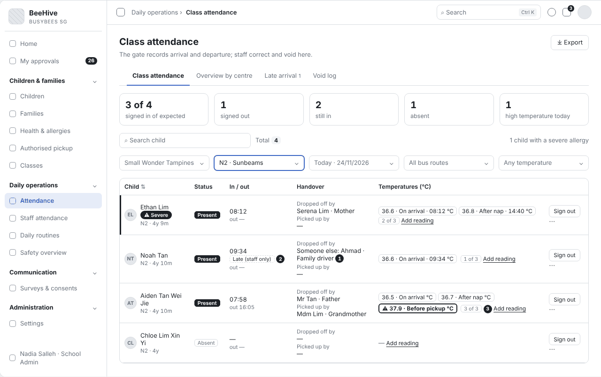
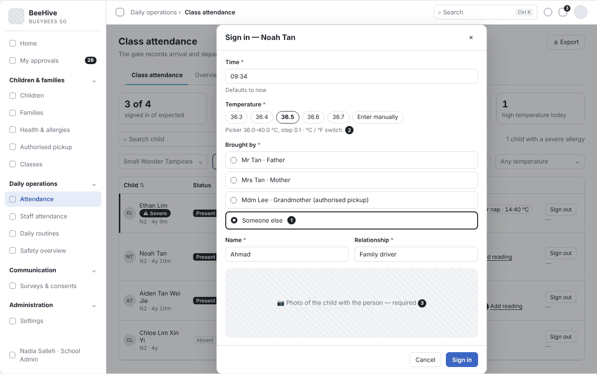
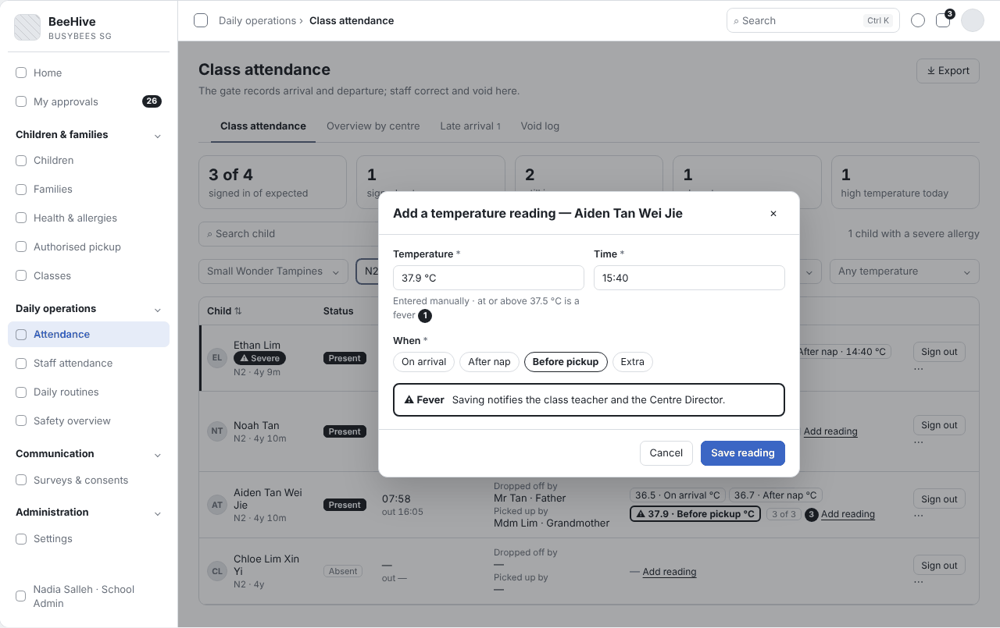
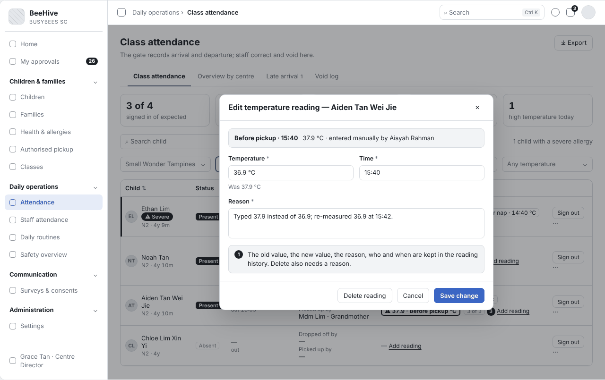
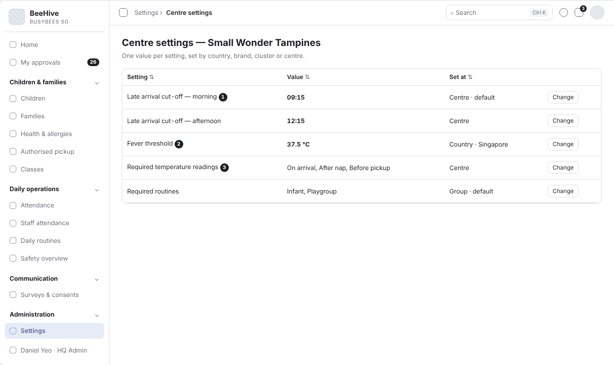

# BBA-74 Temperature readings (≥3/day) (Tiếng Việt)

| Thuộc tính | Giá trị |
|---|---|
| Dự án | Busy Bees Asia SMS |
| Module | Daily Operations — Attendance |
| Tính năng | Temperature readings (≥3/day) |
| Mã ticket | BBA-74 |
| Mã WBS | 3.2.1.02 |
| Mã tài liệu | FRD-BBA-74 |
| Sprint | 4 |
| Phiên bản | 0.2 |
| Trạng thái | BẢN NHÁP CHỜ XÁC NHẬN |
| Ngày | 14/11/2026 |
| Người soạn | Business Analysis |
| Người review | HaiNguyen |
| Người duyệt | HaiNguyen |

## 1. Kiểm soát tài liệu

| Phiên bản | Ngày | Tác giả | Tóm tắt thay đổi | Duyệt |
|---|---|---|---|---|
| 0.1 | 10/11/2026 | Business Analysis | Khởi tạo | HaiNguyen |

**Mức sẵn sàng:** Đã đặc tả việc ghi nhiệt độ của trẻ trong ngày (bắt buộc khi nhận trẻ, các lần đo bắt buộc theo Centre, đo thêm không giới hạn), nhập theo °C hoặc °F, cảnh báo sốt, trẻ còn thiếu lần đo, sửa có lịch sử, phụ huynh xem và xuất danh sách; có wireframe. Nhiệt kế Bluetooth (FR-003) chưa làm ở Sprint 4.

## 2. Mục tiêu và bối cảnh

Mỗi trẻ được đo nhiệt độ khi đến trường (bắt buộc khi nhận trẻ) và đo thêm trong ngày bao nhiêu lần cũng được, ví dụ 4 lần khi có dịch (BBA-535). Một số Centre đo 3 lần: khi đến, sau ngủ trưa và trước khi về (Q-81-02). Lần đo từ ngưỡng sốt trở lên được báo ngay cho giáo viên chủ nhiệm và Centre Director. Phụ huynh xem các lần đo trong ngày của con.

Mục tiêu đo được: 100% lượt nhận trẻ có nhiệt độ; mọi lần đo có giờ và thời điểm đo; mọi lần đo từ ngưỡng sốt trở lên được báo trong vòng 1 phút sau khi lưu.

## 3. Phạm vi

| Trong phạm vi | Ngoài phạm vi |
|---|---|
| Nhiệt độ bắt buộc khi nhận trẻ. Thêm lần đo: nhiệt độ, giờ, thời điểm (On arrival, After nap, Before pickup, Extra kèm lý do). Nhập bằng nút chọn nhanh, bộ chọn hoặc "Enter manually", theo °C hoặc °F. Các lần đo bắt buộc theo Centre; trẻ còn thiếu lần đo. Đánh dấu và báo khi trẻ sốt. Sửa / xoá lần đo có lý do và lịch sử. Phụ huynh xem trong Attendance của Parents App. Xuất danh sách nhiệt độ. Làm việc khi iPad cổng mất mạng. | **Nhiệt kế Bluetooth tự điền nhiệt độ (FR-003) — chưa làm ở Sprint 4, làm ở sprint sau.** Nhiệt độ của nhân viên (BBA-79). Theo dõi bệnh truyền nhiễm, quy định cho trẻ nghỉ ở nhà. Ghi nhận cho uống thuốc. |

## 4. Tác nhân, vai trò và quyền truy cập

| Tác nhân | Phạm vi | Quyền / Trách nhiệm |
|---|---|---|
| Nhân viên ở cổng, Teacher, Centre Admin / School Admin | Lớp / Centre của mình. | Đo và ghi nhiệt độ; sửa lần đo có lý do. |
| Centre Director | Centre của mình. | Như trên; thêm lần đo bằng "Add temperature" (Q-81-02); nhận báo trẻ sốt; xem trẻ còn thiếu lần đo; đặt các lần đo bắt buộc của Centre (AS-04). |
| HQ Admin | Mọi Centre. | Đặt ngưỡng sốt theo quốc gia. |
| Phụ huynh (Parents App) | Con mình. | Xem các lần đo trong ngày. |
| Hệ thống | Toàn hệ thống. | Quy đổi °C / °F, đánh dấu sốt, gửi thông báo, đếm lần đo, đồng bộ lần đo làm khi mất mạng. |

## 5. Tổng quan tính năng

| Khu vực | Chức năng | User Story |
|---|---|---|
| Daily operations › Class attendance | Ghi nhiệt độ, cảnh báo sốt, trẻ còn thiếu lần đo, sửa lần đo, xuất. | US-001 |
| Ứng dụng điểm danh ở cổng (iPad) | Nhiệt độ bắt buộc khi nhận trẻ; làm việc khi mất mạng. | US-001 |
| Settings › Centre settings | Ngưỡng sốt (quốc gia), các lần đo bắt buộc (Centre). | US-001 |

## 6. Yêu cầu chức năng

### 6.1 US-001 - Ghi nhiệt độ của trẻ trong ngày

#### User Story

Là giáo viên, tôi muốn ghi nhanh nhiệt độ của trẻ theo từng thời điểm trong ngày và được hệ thống báo khi trẻ sốt hoặc còn thiếu lần đo, để phát hiện sớm trẻ không khoẻ và báo cho phụ huynh.

#### Functional Requirements (Yêu cầu chức năng)

| FR ID | Yêu cầu chức năng |
|---|---|
| FR-001 | "Add reading" cho mỗi trẻ: nhiệt độ (mặc định 36,5 °C; nút chọn nhanh 36,3 – 36,4 – 36,5 – 36,6 – 36,7; bộ chọn từ 36 đến 40 °C, bước 0,1; nút "Enter manually" để nhập tay), giờ (mặc định hiện tại), thời điểm: On arrival, After nap, Before pickup, Extra (Q-76-05). |
| FR-002 | Thời điểm Extra bắt buộc ghi lý do đo thêm (ví dụ "trẻ mệt, má đỏ"). |
| FR-003 | **[Chưa làm ở Sprint 4 — làm ở sprint sau]** Nhiệt kế Bluetooth đã kết nối với máy tính bảng tự điền nhiệt độ; nhân viên sửa được giá trị (Q-76-06) và vẫn chọn thời điểm. Trong Sprint 4, nhiệt độ chỉ nhập bằng nút chọn nhanh, bộ chọn hoặc "Enter manually" (FR-001). |
| FR-004 | Các thời điểm đo bắt buộc trong ngày là thiết lập theo Centre ("Required temperature readings"; mặc định On arrival; Centre đo 3 lần đặt On arrival, After nap, Before pickup — AS-04). Bảng điểm danh hiện số lần đã đo trên số lần bắt buộc (ví dụ "2 of 3") và các lần đo dạng "36,6 · On arrival · 08:12"; không giới hạn số lần đo thêm (BBA-535). |
| FR-005 | Lần đo từ ngưỡng sốt trở lên (theo quốc gia, mặc định 37,5 °C) hiện nổi bật trên bảng điểm danh; giáo viên chủ nhiệm và Centre Director nhận thông báo trong app có tên trẻ, nhiệt độ và giờ (BR-OPS-012). |
| FR-006 | Bảng điểm danh có bộ lọc "Temperature: Missing a reading" liệt kê trẻ còn thiếu lần đo bắt buộc trong ngày, kèm thời điểm còn thiếu và nút "Add reading". |
| FR-007 | Phụ huynh xem trong mục Attendance của Parents App: mỗi lần đo có giờ, thời điểm, nhiệt độ. |
| FR-008 | Sửa hoặc xoá một lần đo phải có lý do; lịch sử giữ giá trị cũ, giá trị mới, lý do, người sửa, thời điểm. |
| FR-009 | Đo nhiệt độ vẫn dùng được khi ứng dụng điểm danh mất mạng; lần đo lưu trên máy và đồng bộ khi có mạng lại (BBA-73 FR-011). |
| FR-010 | Xuất danh sách nhiệt độ theo khoảng ngày và lớp ra Excel. |
| FR-011 | Lượt nhận trẻ (Sign in) bắt buộc có nhiệt độ On arrival; thiếu nhiệt độ thì không lưu lượt nhận (BR-ATT-012). |
| FR-012 | Centre Director thêm lần đo cho trẻ bằng nút "Add temperature" (Q-81-02). |
| FR-013 | Ô nhiệt độ có nút chuyển đơn vị °C / °F (mặc định °C — AS-05). Chọn °F thì nút chọn nhanh (97,3 – 97,5 – 97,7 – 97,9 – 98,1 °F), bộ chọn (96,8–104,0 °F, bước 0,1) và ô "Enter manually" dùng °F, kèm giá trị quy đổi °C ngay bên cạnh. Quy đổi: °F = °C × 9/5 + 32, làm tròn 1 chữ số thập phân. Hệ thống lưu giá trị và đơn vị đã nhập cùng giá trị °C quy đổi; ngưỡng sốt luôn so bằng °C (37,5 °C = 99,5 °F). Bảng điểm danh, Parents App và file xuất hiện °C kèm °F trong ngoặc, ví dụ "37,9 °C (100,2 °F)". |

#### Functional Flow - Main (Luồng chính)

1. Khi nhận trẻ, nhân viên đo và ghi On arrival ngay trong bước Sign in (FR-001, FR-011).
2. Trong ngày, giáo viên ghi các lần đo bắt buộc của Centre và lần đo thêm (FR-001, FR-004).
3. Phụ huynh xem các lần đo trong Parents App (FR-007).

#### Functional Flow - Alternative (Luồng thay thế)

1. Trẻ có dấu hiệu bất thường: ghi Extra kèm lý do (FR-002).
2. Trẻ sốt: hệ thống báo giáo viên chủ nhiệm và Centre Director (FR-005).
3. Nhân viên đo bằng nhiệt kế °F: chuyển ô sang °F, hệ thống quy đổi (FR-013).
4. Trước giờ về, Centre Director lọc trẻ còn thiếu lần đo và thêm lần đo (FR-006, FR-012).
5. Ghi nhầm: sửa có lý do (FR-008).
6. iPad cổng mất mạng: đo như thường, đồng bộ sau (FR-009).

#### Functional Flow - Exception (Luồng ngoại lệ)

1. Nhập tay ngoài khoảng cho phép: không lưu (VAL-001).
2. Extra không có lý do: không lưu (VAL-002).
3. Giờ đo trước giờ nhận trẻ hoặc sau hiện tại: không lưu (VAL-003).
4. Sign in không có nhiệt độ: không lưu lượt nhận (VAL-004).

#### Business Rules (Quy tắc nghiệp vụ)

| BR ID | Quy tắc nghiệp vụ |
|---|---|
| BR-001 | Mỗi trẻ có đủ các lần đo bắt buộc theo thiết lập của Centre (AS-04); không giới hạn số lần đo thêm (BR-OPS-010, BBA-535). |
| BR-002 | Ngưỡng sốt là thiết lập theo quốc gia (mặc định 37,5 °C); nhân viên dùng cùng ngưỡng (BBA-528). |
| BR-003 | Lần đo đã lưu không bị xoá mất; sửa hoặc xoá đều có lý do và lịch sử. |
| BR-004 | Nhiệt độ là bắt buộc khi nhận trẻ (BR-ATT-012). |
| BR-005 | Hệ thống so ngưỡng sốt và đếm lần đo bằng giá trị °C, dù người nhập dùng °C hay °F. |

#### Validation Rules (Quy tắc kiểm tra)

| VAL ID | Điều kiện | Phản hồi hệ thống |
|---|---|---|
| VAL-001 | Nhập tay nhiệt độ ngoài khoảng 34,0–42,0 °C, tương đương 93,2–107,6 °F (AS-02). | Không lưu; hiện "Check the temperature." |
| VAL-002 | Thời điểm Extra không có lý do. | Không lưu; nút Save reading bị mờ; hiện "Enter why this extra reading was taken." |
| VAL-003 | Giờ đo trước giờ nhận trẻ hoặc sau thời điểm hiện tại. | Không lưu; hiện "Check the time." |
| VAL-004 | Sign in không có nhiệt độ. | Không lưu lượt nhận; hiện "Enter the temperature on arrival." |

#### UI Reference (Tham chiếu giao diện)

| Mã màn hình / Phiên bản | Tham chiếu / Link |
|---|---|
| SCR-01 - Class attendance — nhiệt độ | Wireframe BBA-74 trên Drive: https://drive.google.com/file/d/1eGQdzd65E_6kBQH5tH1YtCdtvZr_nA-x/view (Bảng điểm danh · Trẻ còn thiếu lần đo) |
| SCR-02 - Sign in — nhiệt độ khi nhận trẻ | Như trên (Nhận trẻ) |
| SCR-03 - Add temperature reading | Như trên (Thêm lần đo · sốt · Nhập theo °F · Lần đo Extra thiếu lý do · Nhập tay ngoài khoảng) |
| SCR-04 - Edit temperature reading | Như trên (Sửa lần đo) |
| SCR-05 - Centre settings | Như trên (Centre settings) |

#### UI Components / Field Specification (Thành phần giao diện)

| Trường / Điều khiển | Loại | Bắt buộc | Mặc định / Trạng thái | Kiểm tra | Hành vi |
|---|---|---|---|---|---|
| Temperature (°C / °F) | Nút chọn nhanh + bộ chọn + "Enter manually", nút chuyển °C / °F | Có | 36,5 °C | VAL-001; VAL-004. | Sprint 4: chỉ nhập bằng nút chọn nhanh, bộ chọn, nhập tay. Nhiệt kế Bluetooth tự điền: chưa làm ở Sprint 4 (FR-003). Quy đổi °F: FR-013. |
| When | Nút chọn | Có | Thời điểm bắt buộc còn thiếu sớm nhất | — | On arrival, After nap, Before pickup, Extra. |
| Reason (Extra) | Ô nhập | Khi Extra | Trống | VAL-002. | — |
| Time | Giờ | Có | Hiện tại | VAL-003. | — |
| Số lần đo | Chữ | — | "x of y" | — | y = số lần bắt buộc của Centre (FR-004). |
| Cảnh báo sốt | Khối cảnh báo trong hộp thoại | Khi ≥ ngưỡng | — | — | "Saving notifies the class teacher and the Centre Director." (FR-005). |
| Temperature: Missing a reading | Bộ lọc bảng điểm danh | Không | — | — | Cột Missing, nút Add reading (FR-006). |
| Edit / Delete reading | Hộp thoại | Theo quyền | — | Lý do bắt buộc. | FR-008. |
| Required temperature readings | Dòng ở Centre settings | Có | On arrival | — | AS-04. |
| Export | Nút | Theo quyền | — | — | Excel theo khoảng ngày và lớp (FR-010). |

#### Data and Audit (Dữ liệu và audit)

| ID | Yêu cầu |
|---|---|
| DATA-001 | Mỗi lần đo lưu: trẻ, nhiệt độ, đơn vị đã nhập (°C / °F) và giá trị °C quy đổi, giờ, thời điểm, lý do (Extra), cách nhập (bộ chọn, nhập tay; nhiệt kế khi có FR-003), nhân viên, thiết bị. |
| DATA-002 | Mỗi lần sửa / xoá lưu giá trị cũ, giá trị mới, lý do, người sửa, thời điểm. |

#### Acceptance Criteria (Tiêu chí nghiệm thu)

| AC ID | Given | When | Then | Linked Rule |
|---|---|---|---|---|
| AC-001 | Ethan vừa được nhận lúc 08:12, Centre đặt 3 lần đo bắt buộc | nhân viên ghi 36,6 °C, On arrival | lần đo lưu với giờ 08:12; bảng hiện "1 of 3" | FR-001; FR-004 |
| AC-002 | Aiden đã có On arrival và After nap | giáo viên ghi 37,9 °C, Before pickup | lần đo hiện nổi bật; giáo viên chủ nhiệm và Centre Director nhận thông báo có tên Aiden, 37,9 °C, giờ | FR-005; BR-002 |
| AC-003 | trẻ có dấu hiệu mệt | giáo viên ghi Extra không có lý do | không lưu, hiện "Enter why this extra reading was taken." | FR-002; VAL-002 |
| AC-004 | **[Chưa làm ở Sprint 4]** nhiệt kế đã kết nối | giáo viên đo | nhiệt độ tự điền; giáo viên chọn thời điểm và lưu | FR-003 |
| AC-005 | 16:30, 3 trẻ chưa có đủ lần đo bắt buộc | Centre Director chọn bộ lọc "Missing a reading" | thấy 3 trẻ và thời điểm còn thiếu | FR-006; BR-001 |
| AC-006 | Ethan có 3 lần đo trong ngày | phụ huynh mở Attendance | thấy 3 lần đo với giờ, thời điểm, nhiệt độ | FR-007 |
| AC-007 | giáo viên ghi nhầm 37,9 thay vì 36,9 | giáo viên sửa và nhập lý do | giá trị mới được lưu; lịch sử giữ 37,9, lý do, người sửa | FR-008; BR-003; DATA-002 |
| AC-008 | nhân viên nhập tay 3,7 | chọn lưu | không lưu, hiện "Check the temperature." | VAL-001 |
| AC-009 | ứng dụng điểm danh mất mạng | nhân viên ghi nhiệt độ | lần đo được giữ trên máy và lên hệ thống khi có mạng lại | FR-009 |
| AC-010 | Centre Director chọn lớp Sunbeams, tháng 9 | chọn xuất | file Excel có mọi lần đo của lớp trong tháng | FR-010 |
| AC-011 | trẻ được nhận lúc 08:12 | giáo viên ghi lần đo lúc 07:30 | không lưu, hiện "Check the time." | VAL-003 |
| AC-012 | nhân viên nhận Noah ở cổng | chọn Sign in mà không nhập nhiệt độ | không lưu lượt nhận, hiện "Enter the temperature on arrival." | FR-011; BR-004; VAL-004 |
| AC-013 | giáo viên chuyển ô nhiệt độ sang °F | nhập tay 100,2 °F cho Aiden, Before pickup, và lưu | ô hiện "= 37,9 °C"; lần đo lưu 100,2 °F và 37,9 °C; lần đo hiện nổi bật là sốt và giáo viên chủ nhiệm, Centre Director nhận thông báo | FR-013; FR-005; BR-005 |
| AC-014 | Ethan có lần đo 36,6 °C | phụ huynh mở Attendance | thấy "36,6 °C (97,9 °F)" | FR-013; FR-007 |
| AC-015 | Mia chưa có lần đo nào sau On arrival | Centre Director chọn "Add temperature" cho Mia | hộp thoại thêm lần đo mở cho Mia | FR-012 |

#### Dependencies (Phụ thuộc)

Class attendance và nhận trẻ (BBA-73); ứng dụng điểm danh ở cổng (đồng bộ); Centre settings (ngưỡng sốt, lần đo bắt buộc); thông báo trong app; Parents App (Attendance); nhiệt kế Bluetooth (sprint sau).

## 7. Câu hỏi mở

| Mã câu hỏi | Quyết định cần có | Người quyết định | Ưu tiên | Quyết định của BBA |
|---|---|---|---|---|
| OQ-01 | Phụ huynh có nhận thông báo ngay khi con sốt không, hay chỉ xem trong Attendance? | Centre Director / HQ Ops | Cao |  |
| OQ-02 | Trẻ học nửa ngày (không ngủ trưa) cần những lần đo bắt buộc nào? | Centre Director / HQ Ops | Trung bình |  |
| OQ-03 | Có nhắc lần đo còn thiếu không; gửi cho ai và vào giờ nào? | Centre Director / HQ Ops | Thấp |  |
| OQ-04 | Khoảng nhiệt độ hợp lệ khi nhập tay; ngoài khoảng thì chặn hay chỉ cảnh báo? | HQ Ops | Trung bình | Một phần: thang không cần dưới 36 °C, phải lên 39–40 °C (Q-76-05, BBA-535). |
| OQ-05 | Ngưỡng sốt bao nhiêu °C, Singapore và Malaysia có giống nhau không; đặt ở đâu: HQ Admin theo quốc gia (SRS) hay trên từng iPad (prototype)? | HQ Ops | Cao | Một phần: nhân viên dùng cùng ngưỡng với trẻ (BBA-528). BBA-535 chưa trả lời. |
| OQ-06 | Số lần đo bắt buộc mỗi ngày: có thiết lập theo Centre không, mặc định là gì? | Centre Director / HQ Ops | Cao | Một phần: không giới hạn số lần (BBA-535); một số Centre đo 3 lần — lúc đến, sau ngủ trưa, lúc về (Q-81-02); SRS bắt buộc khi nhận trẻ (BR-ATT-012). |
| OQ-07 | Ai cần °F (nhân viên nhập, phụ huynh xem); đơn vị mặc định theo quốc gia, Centre hay từng người dùng? | HQ Ops | Trung bình |  |

### Giả định của BA (cần xác nhận cùng mục 7)

| Mã | Giả định | Dùng ở |
|---|---|---|
| AS-01 | Danh sách trẻ thiếu lần đo chỉ hiện trên màn hình, không gửi thông báo. | FR-006 — chờ OQ-03 |
| AS-02 | Khoảng hợp lệ khi nhập tay: 34,0–42,0 °C; ngoài khoảng thì chặn. | VAL-001 — chờ OQ-04 |
| AS-04 | Lần đo bắt buộc là thiết lập theo Centre, mặc định On arrival; Centre đo 3 lần đặt On arrival, After nap, Before pickup. | FR-004; BR-001 — chờ OQ-06 |
| AS-05 | Đơn vị mặc định khi nhập là °C; người nhập chuyển sang °F khi cần; mọi nơi hiển thị °C kèm °F. | FR-013 — chờ OQ-07 |

## 8. Phụ lục

### Phụ lục A. Thuật ngữ

| Thuật ngữ | Định nghĩa trong FRD này |
|---|---|
| Thời điểm đo | On arrival (khi đến trường), After nap (sau ngủ trưa), Before pickup (trước khi về), Extra (đo thêm khi thấy bất thường). |
| Lần đo bắt buộc | Các thời điểm Centre yêu cầu đo mỗi ngày; thiết lập theo Centre. |
| Ngưỡng sốt | Nhiệt độ từ mức này trở lên được coi là sốt; thiết lập theo quốc gia, so bằng °C. |
| °F | Độ Fahrenheit; °F = °C × 9/5 + 32. |

## 9. Tài liệu tham khảo

Số trang của SRS tính theo bản Word gốc khi xuất PDF; "—" là chưa đối chiếu được với bản Word gốc. Tệp của BBA là tệp đính kèm trên Plane.

| STT | Tài liệu | Mục | Trang | Dùng cho |
|---|---|---|---|---|
| 1 | BBA-SMS-SRS-Daily-Operations-v0.1 | §3 Process overview (check in) | 4–5 | Luồng chính. |
| 2 | BBA-SMS-SRS-Daily-Operations-v0.1 | §4 mục 1.1 Child attendance (Record temperature, Work offline, Export temperature list) | 5–6 | FR-001; FR-009; FR-010. |
| 3 | BBA-SMS-SRS-Daily-Operations-v0.1 | §5 Temperature (BR-OPS-010, 011, 012) | 10 | BR-001; BR-002; FR-001; FR-005. |
| 4 | BBA-SMS-SRS-Attendance-App-v0.1 | §1 Purpose & scope | 2 | Mục 4. |
| 5 | BBA-SMS-SRS-Attendance-App-v0.1 | §5 Business rules › Temperature (BR-ATT-012, 013, 014) | — | FR-003; FR-011; BR-004. |
| 6 | BBA-SMS-SRS-Parents-App-v0.1 | §4 mục 3.1 Attendance (View today's arrival — temperature) | — | FR-007. |
| 7 | Plane — ticket BBA-74 (WBS 3.2.1.02) | Thời điểm đo, cảnh báo ngưỡng, phụ huynh xem trong Attendance | — | Phạm vi. |
| 8 | Plane — BBA-535 "BBA input: Fever threshold" | Không giới hạn 3 lần / ngày; thang 36 đến 39–40 °C; báo giáo viên lớp và Centre Director | — | FR-004; FR-005; BR-001; OQ-04; OQ-05; OQ-06. |
| 9 | Plane — BBA-528 "BBA input: Staff clock-in / clock-out flow" | Nhiệt độ khi chấm công, cùng ngưỡng sốt với trẻ | — | BR-002; OQ-05. |
| 10 | BBA_SMS_S4 — Tổng hợp câu hỏi phản hồi, sheet "Tổng hợp" | Đã chốt: Q-76-05, Q-76-06, Q-81-02 | — | FR-001; FR-003; FR-004; FR-012. |
| 11 | DOTB — review FRD BBA-74 (14/11/2026) | Bluetooth để sprint sau; bổ sung quy đổi °F | — | FR-003; FR-013. |
| 12 | Plane — dự án BBA Phase 1, ticket BBA-74 (WBS 3.2.1.02) | Temperature readings (≥3/day) | — | Phạm vi tính năng. |
