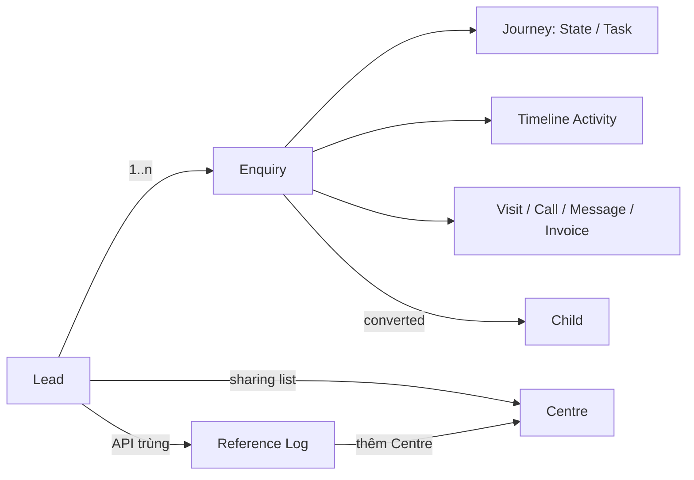

# Tóm tắt FSD — BBA (Busy Bees Asia CRM)

| Thuộc tính | Giá trị |
|---|---|
| Dự án | BBA — Busy Bees Asia CRM (Edtech: chuỗi trường mầm non / giáo dục sớm, nhiều Brand, Centre, quốc gia) |
| Nguồn | 5 tài liệu FRS do user cung cấp ngày 09/11/2026 (bản gốc tiếng Anh, file `.docx`) |
| Người soạn tóm tắt | Claude (BA) — chỉ đọc và phân tích, chưa chỉnh sửa hay chuyển đổi tài liệu |
| Ngày | 2026-11-09 |

## 1. Danh mục tài liệu đã đọc

| Mã | Tài liệu | Module | Phiên bản · Trạng thái · Ngày | US | FR | BR | VAL | DATA | AC | OQ |
|---|---|---|---|---|---|---|---|---|---|---|
| BBA-40 | 2.1.1.00 Inactive Lead | Lead | 0.2 · Draft for Confirmation · 04/11/2026 | 2 | 11 | 9 | 6 | 4 | 14 | 3 |
| BBA-41 | 2.1.1.01 Centre Sharing | Lead | 0.1 · Draft for Confirmation · 30/10/2026 | 2 | 15 | 14 | 13 | 8 | 19 | 0 |
| BBA-42 | 2.1.1.02 Duplicate Detection | Lead + Enquiry | 0.2 · Draft for **Clarification** · 06/11/2026 | 3 | 8 | 31 | 21 | 8 | 33 | 1 (đã có quyết định) |
| BBA-43 | 2.1.2.01 Enquiry Detail Page | Enquiry | 0.1 · Draft for Confirmation · 02/11/2026 | 4 | 34 | 18 | 15 | 8 | 19 | 0 |
| BBA-44 | 2.1.2.03 View Timeline | Lead / Enquiry | 0.1 · Draft for Confirmation · 03/11/2026 | 2 | 21 | 18 | 11 | 7 | 16 | 0 |
| **Tổng** | | | | **13** | **89** | **90** | **66** | **35** | **101** | **4** |

Người review / duyệt cả 5 tài liệu: HaiNguyen. Mã FR/BR/AC được đánh **riêng trong từng tài liệu** (FR-001 của BBA-40 khác FR-001 của BBA-41) → khi tham chiếu luôn ghi kèm mã tài liệu, vd. `BBA-42 BR-025`.

**Về "template FSD":** không có file template riêng trong 5 file. Cả 5 tài liệu dùng **cùng một khung** (mục 2 bên dưới) — đây chính là template FSD trên thực tế.

## 2. Khung tài liệu (template FSD dùng chung)

1. **Document Control** — bảng phiên bản, ngày, tác giả, tóm tắt thay đổi, người duyệt.
2. **Purpose and Background** — mục đích, ranh giới nghiệp vụ.
3. **Scope and Phase Boundaries** — In scope / Out of scope + câu "Boundary".
4. **Actors, Roles and Access** — Actor · Scope · Permission.
5. **Feature Overview and Functional Decomposition** — Module · Feature · Function · User Story.
6. **Functional Requirements by User Story** — mỗi US gồm: User Story → Functional Requirements (FR) → Functional Flow (Main / Alternative / Exception) → Business Rules (BR) → Validation Rules (VAL: Condition → System Response) → UI Reference (link Figma) → UI Components / Field Specification → Data and Audit (DATA) → Acceptance Criteria (AC dạng Given/When/Then + Linked Rule) → Dependencies.
7. **Open Questions** (Question ID · Decision Needed · Owner · Priority · BBA Decision) và **Glossary**; một số tài liệu có Appendix (danh mục trạng thái, danh mục Activity).

## 3. Bức tranh nghiệp vụ

### 3.1 Đối tượng chính

| Đối tượng | Ý nghĩa (theo FSD) |
|---|---|
| **Lead** | Hồ sơ gia đình / trẻ tiềm năng. Trạng thái nhắc tới: New, Closed, Inactive. Có **Centre Sharing list** quyết định Centre nào được truy cập. |
| **Enquiry** | Một nhu cầu cụ thể của Lead: Brand, Campus (Centre), Preferred Level, Start Date, Session. Là **chủ sở hữu** của lịch sử chăm sóc (Timeline, Visit, Call, Message, Invoice). 16 trạng thái (mục 3.3). |
| **Child** | Hồ sơ trẻ (sinh khi Enquiry `converted` — đặt cọc). Không dùng để so trùng. |
| **Contact** | Người liên hệ (phụ huynh) của Lead. |
| **Centre / Brand** | Cơ sở và thương hiệu; dữ liệu master. Phân quyền theo Centre scope. |
| **Reference Log** | Bản ghi nguồn (source, campaign, Centre) khi **API** gửi Lead trùng; dùng để tự thêm Centre vào sharing list. |
| **Visit / Call / Message / Invoice / Trial** | Hoạt động chăm sóc gắn với Enquiry. Trial chưa có ở Phase 1. |
| **Customer Journey** | Journey Template gán cho Enquiry → các **State** (giai đoạn) và **Task** (Manual / Automatic). Khác với Enquiry Status. |
| **Timeline Activity** | Sự kiện lịch sử do module sở hữu ghi ra; hiển thị chỉ đọc. |

### 3.2 Quan hệ giữa 5 tính năng

| Tính năng | Phụ thuộc vào | Được dùng bởi |
|---|---|---|
| BBA-40 Inactive Lead | Quyền, audit, trạng thái Enquiry | BBA-41 (Lead Inactive/Closed thì không chia sẻ thủ công), BBA-42 (loại Lead Inactive khỏi so trùng), BBA-43/44 (trạng thái `inactive`, Activity "Inactive Lead/Enquiry") |
| BBA-41 Centre Sharing | Centre master data, Reference Log, quyền | BBA-42 (API trùng / tạo thủ công trùng → thêm Centre) |
| BBA-42 Duplicate Detection | BBA-41, trạng thái Closed + thời điểm Closed, cấu hình ngưỡng theo Brand/Centre | Luồng tạo / sửa Lead, tạo Enquiry, API intake |
| BBA-43 Enquiry Detail Page | **BBA-55** (danh mục Action ↔ Status — chưa có tài liệu), Journey runtime, các module Visit/Call/Message/Invoice | BBA-44 (tab Timeline nằm trong trang này) |
| BBA-44 View Timeline | Các module sở hữu ghi Activity | BBA-43 (tab Timeline), Lead Detail (Timeline gộp) |

### 3.3 Trạng thái Enquiry — Phase 1 (BBA-43 mục 7.1)

| Nhóm | Trạng thái |
|---|---|
| Open | new (Mới), contacted (Đã liên hệ), interested (Quan tâm), visit_scheduled (Đã đặt lịch), visited (Đã tham quan), considering (Đang cân nhắc), follow_up (Đang theo dõi), waitlisted (Danh sách chờ), transferred (Đã chuyển chi nhánh), trial_scheduled (Đã đặt trial), trialed (Đã trial) |
| Closed-Won | converted (Đã ghi danh — đặt cọc, tạo Child) |
| Dormant | future_approach (Tiếp cận sau) |
| Closed-Lost | closed (Đóng Lead — phụ huynh từ chối, không hợp lệ, ngoài khu vực) |
| Closed-System | out_of_service (Ngoài độ tuổi — trẻ > 72 tháng), inactive (Ngừng hoạt động — do Lead bị Inactive) |

### 3.4 Nguyên tắc chung của cả 5 tài liệu
- Dùng **mô hình phân quyền hiện có** (role + Centre scope + object permission); không tạo vai trò mới (trừ "Head of Brand" nhận thông báo ở BBA-42).
- **Không xoá, không merge, không chuyển cha** dữ liệu; chỉ đổi trạng thái hoặc quan hệ chia sẻ. Lịch sử và audit luôn giữ lại.
- Thay đổi quan trọng phải **kiểm tra lại quyền và trạng thái ngay trước khi lưu** (chống sửa đồng thời); giao dịch nhiều bản ghi là **atomic** (BBA-40) hoặc **lưu từng phần** có báo lỗi từng mục (BBA-41).
- Thông báo dùng **message chuẩn** của CRM (không định nghĩa câu chữ riêng, trừ BR-025 của BBA-42).
- **Giới hạn Phase 1:** Enquiry Score để trống; không có đồng hồ SLA (chỉ hiện việc đến hạn hôm nay); Message chỉ là email gửi đi; Trial chưa có.
- Màn hình: mỗi US có link Figma (file `✦-BBA`); FSD không mô tả bố cục chi tiết, chỉ có bảng trường / control.

## 4. Phân tích từng Function

### 4.1 BBA-40 — Inactive Lead (Lead · v0.2)

**Mục đích:** cho người có quyền "ngừng hoạt động" một Lead cùng **mọi Enquiry liên kết** trong một giao dịch, nhưng **giữ lại** toàn bộ dữ liệu để tra cứu. Không xoá, không merge.

| US | Function đang làm gì |
|---|---|
| US-001 Inactivate Lead and Linked Enquiries | Nút **Inactive Lead** ở Lead Detail và menu dòng Lead (chỉ hiện khi Lead chưa Inactive và user có quyền) → mở **màn xác nhận** liệt kê số Enquiry liên kết + ID, tên (mở tab mới), trạng thái, Centre → **Cancel** (không đổi gì) hoặc **Inactive Lead and Enquiries** → hệ thống kiểm tra lại quyền / trạng thái → đổi Lead và mọi Enquiry sang **Inactive** trong **một giao dịch atomic** → ghi audit (người, thời điểm, giá trị trước / sau) → báo kết quả chuẩn. |
| US-002 Find and View an Inactive Lead | Danh sách Lead vẫn trả về Lead Inactive (theo quyền xem thường); tìm theo Lead Status hoặc bộ lọc của user; mở Lead Inactive ở chế độ **chỉ xem** — ẩn / khoá mọi thao tác sửa, tạo đối tượng, tạo / đổi liên kết (Enquiry, Relationship, Visit, Call, Invoice, Contact, Reference Log…). Lead Inactive bị loại khỏi số đếm Lead đang hoạt động và pipeline hiện tại. |

**Quy tắc then chốt:**
- Không cần lý do, phê duyệt, thông báo hay escalation.
- Enquiry đã Inactive thì giữ nguyên và **không ghi thêm audit** (BR-005, DATA-003).
- Một cập nhật thất bại → rollback toàn bộ.
- Có thay đổi đồng thời sau khi mở màn xác nhận → huỷ giao dịch, yêu cầu tải lại.
- Lead có 0 Enquiry vẫn Inactive được.

**Câu hỏi còn mở (OQ-RPT-01..03):** Lead Inactive có tính vào tổng số Lead tạo ra, tỷ lệ chuyển đổi và thống kê nguồn Lead không. Riêng OQ-RPT-01 BBA đã trả lời một phần: Lead Inactive **do trùng** không tính vào báo cáo nào.

**Điểm cần làm rõ / lỗi trong tài liệu:**
- FR và các luồng tham chiếu `VR-001…006`, nhưng bảng Validation đánh mã `VAL-001…006`.
- Bản 0.2 nói đã bỏ mọi chữ "Closed", nhưng vẫn còn sót:
  - tên màn "UI-US-002 – Find and View a **Closed** Lead";
  - control "Executes the atomic **close** transaction";
  - AC-008 "the **close** action".
- Ghi chú thay đổi bản 0.2 viết "Lead Inactive bị loại khỏi **mọi** báo cáo", nhưng BR-008 chỉ loại khỏi số đếm Lead hoạt động và pipeline, còn OQ-RPT-02/03 vẫn mở → mâu thuẫn, cần chốt.
- Ngày ở đầu trang (31/10/2026) khác ngày của bản 0.2 (04/11/2026).
- Lỗi chính tả "Inacitve".
- Luồng thay thế số 2 bị ngắt thành hai dòng (2 và 3).

### 4.2 BBA-41 — Centre Sharing (Lead · v0.1)

**Mục đích:** một Lead được **nhiều Centre** cùng truy cập mà không phải tạo Lead mới. Centre Sharing chỉ **mở rộng phạm vi dữ liệu**, không vượt quyền theo role / object / trạng thái Lead.

| US | Function đang làm gì |
|---|---|
| US-001 Initialise and Automatically Extend Centre Sharing | Khi tạo Lead: sharing list bắt đầu bằng **Centre của người tạo**. Khi có **Reference Log hợp lệ** được lưu: tra Centre trong master data → thêm vào list nếu chưa có (mỗi Centre một dòng). Lead Detail hiển thị tên các Centre được chia sẻ. Thêm tự động thất bại → **giữ Reference Log**, báo user và hiện lỗi ngay trên dòng Reference Log đó. **Báo cáo** (pipeline, conversion, nguồn) tính theo **Centre của từng Enquiry**, không theo sharing list. |
| US-002 Manually Manage Shared Centres | User có quyền mở Lead (đang sửa được) → chọn nhiều Centre để **thêm / bỏ** (cho phép Centre ở quốc gia / Brand / tổ chức khác) → **Save**: kiểm tra lại quyền, trạng thái, trùng, sửa đồng thời → **mỗi thay đổi lưu độc lập** (thành công giữ lại, thất bại liệt kê từng Centre) → audit danh sách trước / sau. Chỉ **bỏ** được Centre khi **không có Enquiry nào** đang dùng Centre đó. Không cần phê duyệt hay thông báo. |

**Quy tắc then chốt:**
- Không tạo Lead, Enquiry hay Reference Log, và không đổi Centre của Enquiry chỉ vì chia sẻ.
- Bỏ chia sẻ thì mất quyền truy cập, nhưng lịch sử và Reference Log vẫn giữ.
- Khác quốc gia / Brand không phải là lý do để chặn.

**Điểm cần làm rõ / lỗi trong tài liệu:**
- Tài liệu vẫn dùng "**Closed** Lead restrictions defined in the Inactive Lead FRS" (BR-006, BR-011, VAL-006, AC-012, luồng ngoại lệ). Sau BBA-40 v0.2 phải là **Inactive**. Nhưng BBA-42 lại có trạng thái **Closed** riêng (mở lại được) → cần chốt: Lead Closed có được chia sẻ Centre không?
- "Qualifying Reference Log" chưa được định nghĩa.
- Glossary viết Reference Log "được tạo khi phát hiện Lead trùng", trong khi BBA-42 chỉ tạo Reference Log cho **trùng qua API**.
- AC-010 có cột Linked Rule là "A1", không rõ trỏ tới đâu.
- Chưa nói Centre của người tạo có bỏ được không, và nếu bỏ hết Centre thì sao.

### 4.3 BBA-42 — Duplicate Detection (Lead + Enquiry · v0.2)

**Mục đích:** chặn trùng Lead khi **tạo thủ công, sửa thủ công, tạo qua API**; chặn trùng Enquiry khi tạo; điều hướng xử lý theo kênh, trạng thái và Centre.

| US | Function đang làm gì |
|---|---|
| US-001 Detect Duplicate Leads on Create or Edit | So trùng **toàn hệ thống** (không giới hạn Centre / Brand / quốc gia), chỉ trên bản ghi Lead. **Trùng** khi: **Họ tên Lead + Email** khớp, **hoặc** **Họ tên Lead + Ngày sinh** khớp. Chuẩn hoá trước khi so: không phân biệt hoa thường, bỏ dấu tiếng Việt, cắt khoảng trắng hai đầu; ngày sinh dạng dd/mm/yyyy; **ô trống = khác**. **Loại khỏi tập so:** Lead Inactive; Lead Closed **quá ngưỡng** (hiện là > 3 năm; đúng 3 năm vẫn so; ngưỡng cấu hình theo Brand và Centre). **Kênh API:** không tạo Lead mới, ghi **Reference Log** (source, campaign, Centre); Lead đang Closed trong ngưỡng → **mở lại thành New**; Lead chưa Closed → giữ nguyên trạng thái; Centre gửi request chưa có trong sharing list → thêm theo BBA-41. |
| US-002 Handle Duplicate Lead Results for Manual CRM Operations | Hiện Lead trùng (che các trường ngoài quyền): tên trẻ, ngày sinh, Contact, Email, SĐT (chỉ để tham khảo), Centre, Preferred Level, Created at / by. Nút theo tình huống: |
| US-003 Prevent Duplicate Enquiry Creation | Khi tạo Enquiry cho Lead đã xác định: so với các Enquiry **của chính Lead đó** (loại Enquiry Inactive / Closed). **Trùng** khi khớp đủ **5 trường**: Brand, Campus, Preferred Level, Start Date, Session (ô trống = khác). Trùng → **không tạo**; trên CRM chỉ có **Cancel**; với API, chi tiết phản hồi nằm ngoài phạm vi. |

**Bảng hành động US-002 (tạo / sửa Lead thủ công bị trùng):**

| Thao tác | Lead trùng | Hành động cho phép | Kết quả |
|---|---|---|---|
| Tạo thủ công | Chưa Closed | Cancel / **Save** | Save = dùng Lead có sẵn, giữ trạng thái; khác Centre thì thêm Centre (BBA-41). Không tạo Lead hay Reference Log. |
| Tạo thủ công | Closed trong ngưỡng | Cancel / **Reopen Lead** | Reopen = Closed → New + áp dụng Centre Sharing. Lịch sử giữ nguyên, có audit. |
| Sửa thủ công | Cùng Centre | Chỉ **Cancel** | Không lưu thay đổi. |
| Sửa thủ công | Khác Centre | Cancel / **Send Request to Share Centre** | Sau khi xác nhận: gửi **thông báo trong hệ thống** cho **Head of Brand**, nội dung "Centre sharing request for Lead {Lead Name} - click the name to open the Lead for Centre {Requesting Centre Name}". Thay đổi bị huỷ, **không tự chia sẻ** Centre. |

**Quyết định của BBA (OQ-DD-001):** khi sửa Lead bị trùng với Lead ở Centre khác → báo **Head of Brand** để cấp quyền cho Centre yêu cầu, giúp Centre đó tạo được Enquiry.

**Điểm cần làm rõ / lỗi trong tài liệu:**
- "**Lead Full Name**" là tên trẻ hay tên phụ huynh? Màn hình hiện tên trẻ (Child Surname / Given Name), trong khi BR-002 nói không so bản ghi Child.
- BR-010 yêu cầu "tối đa một Lead khớp", nhưng không nói xử lý ra sao khi dữ liệu cũ có **nhiều Lead khớp**.
- Lead chia sẻ nhiều Centre / Brand thì áp **ngưỡng Closed** của Brand / Centre nào?
- AC-001 / AC-002 không nói rõ kênh, nhưng kết quả có "tạo Reference Log" (chỉ đúng với API).
- VAL-013 viết bằng **tiếng Việt**, khác phần còn lại.
- Số điện thoại **không** dùng để so trùng (nằm ngoài phạm vi) → rủi ro lọt trùng khi tên và email khác nhau. Cần khách xác nhận đây là chủ đích.
- Việc xử lý xung đột khi hai request đồng thời (rollback, retry, locking) nằm ngoài phạm vi → chưa có tài liệu nào phụ trách.
- Tài liệu vẫn ở trạng thái "Draft for **Clarification**".

### 4.4 BBA-43 — Enquiry Detail Page (Enquiry · v0.1)

**Mục đích:** trang chi tiết đầy đủ của **một Enquiry**, gom thông tin, Journey, Action / SLA và các tab liên quan. Trang chỉ **hiển thị và điều hướng**: không tính điểm, không tạo SLA, không định nghĩa lại nghiệp vụ Visit / Call / Message / Invoice.

| US | Function đang làm gì |
|---|---|
| US-001 View Enquiry Information and Related Records | 3 nhóm trường **chỉ xem**. **Enquiry information:** hồ sơ lấy từ Lead (nickname, tên phụ huynh, SĐT, email, quốc tịch, ngày sinh, tuổi, giới tính, ghi chú) + Enquiry ID + Enquiry Score (trống ở Phase 1). **Source & preference:** Source, mô tả nguồn, Campaign, Channel, UTM Source / Agent, Preferred Centre / Level / Session / Start Date, Promotion Code, "Phụ huynh nói nguồn là". **Administration:** Owner, **Host** (= Visit Host, khác Owner và Task Assignee), Centre, Created / Updated at – by. Link sang **Lead** (bắt buộc) và **Child** (chỉ khi có). Mở hoặc tải lại trang không đổi dữ liệu. Có yêu cầu accessibility (heading, bàn phím, focus, không chỉ dùng màu). |
| US-002 Review Customer Journey and Tasks | Hiện Journey Template gán cho Enquiry (không hiện mã / tên / version): các **State** trên **một hàng ngang** (cuộn ngang nếu nhiều), State hiện tại, Task trong từng State (tên, hoàn thành, người phụ trách, hạn). **Manual Task:** người được giao hoàn thành. **Automatic Task:** chỉ đọc, tự xong khi có sự kiện. Một sự kiện không ghi hoàn thành hai lần. Đổi Enquiry Status không thay Journey đã lưu. Chưa gán Journey → hiện trạng thái "chưa gán". |
| US-003 Use Allowed Actions and SLA Information | Panel **Actions & SLA**: chỉ hiện Action hợp lệ theo **Status + quyền + ràng buộc nghiệp vụ** (danh mục ở BBA-55), độc lập với Journey Task. Không sửa Status trực tiếp. Phase 1: chỉ hiện việc / Action **đến hạn hôm nay**, không có đồng hồ SLA; giá trị SLA mẫu trong prototype không phải mặc định. Bấm Action → chuyển cho luồng sở hữu Action đó → làm mới các vùng liên quan. Không có Action → empty state. |
| US-004 Review Related Timeline and Operational Tabs | 5 tab: **Timeline, Visits, Calls, Messages, Invoices**. Chỉ hiện bản ghi của Enquiry hiện tại, mới nhất trước, có tìm kiếm + lọc, làm mới khi mở trang. **Visits:** Book Visit khoá sẵn Enquiry. **Calls:** Create Log Call (khác Click to call). **Messages:** email hệ thống gửi đi (tiêu đề, ngày gửi, Centre, kênh, trạng thái giao). **Invoices:** mở / tạo theo quyền. Một tab lỗi không làm hỏng tab khác. |

**Điểm cần làm rõ / lỗi trong tài liệu:**
- Mục 7.1 viết "**Closed** is applied when the linked Lead is inactive", nhưng bảng trạng thái có `inactive` riêng ("Inactive because the linked Lead is inactive"), và BBA-40 đổi Enquiry sang Inactive → câu dẫn bị sai.
- Phụ thuộc **BBA-55** (danh mục Action ↔ Status) nhưng chưa có tài liệu này → chưa biết Action nào hiện ở trạng thái nào.
- Ký hiệu `*` / `**` sau tên trường chưa được giải thích (cột Required đã có Yes / No).
- AC-001 yêu cầu hiện "status" của Enquiry, nhưng bảng trường của US-001 **không có trường Status**.
- Tab **Trials** ngoài phạm vi, trong khi bảng trạng thái đã có `trial_scheduled` / `trialed`.
- Messages tab có "trạng thái giao email", còn Timeline (BBA-44) bỏ trạng thái giao. Không mâu thuẫn, nhưng cần thống nhất nguồn dữ liệu.

### 4.5 BBA-44 — View Timeline (Lead / Enquiry · v0.1)

**Mục đích:** xem **lịch sử chăm sóc** theo thời gian, **chỉ đọc**. Enquiry là chủ sở hữu Activity; Lead xem bản **gộp theo Enquiry**.

| US | Function đang làm gì |
|---|---|
| US-001 View an Enquiry Timeline | Hiện Activity **của đúng Enquiry đó**, mới nhất trước (sắp theo thời điểm sự kiện nguồn, chính xác tới giây). Mỗi dòng gồm: **thời gian** ("Hôm nay / Hôm qua" hoặc ngày + giờ:phút theo múi giờ của user), **tên Activity**, **nội dung**, **người thực hiện** (hoặc "System"), **Centre tại thời điểm xảy ra**. Chỉ hiện nội dung user được phép xem. Phân biệt "không có dữ liệu" với "tải lỗi". Email chỉ ghi sự kiện **đã gửi**. Activity chỉ xuất hiện sau khi module sở hữu đã lưu giao dịch. |
| US-002 View a Lead Aggregate Timeline | Timeline của Lead **gộp theo từng Enquiry đang liên kết** (kể cả Enquiry Closed). Không trộn thành một danh sách. Nhóm có Activity mới nhất đứng đầu. Tên Enquiry là link sang Enquiry Detail; không link sang bản ghi nguồn. Không tạo bản sao Activity cho Lead. Một nguồn lỗi → báo kết quả **chưa đầy đủ** (partial). Enquiry ngoài quyền thì ẩn. |

**Danh mục Activity (mục 7.1):**
- Enquiry intake
- Call Log
- Outgoing email
- Visit (đặt / đổi lịch / huỷ / vắng / hoàn thành)
- Follow-up / next action
- Đổi trạng thái Enquiry
- Chuyển Centre
- Waitlist / Conversion
- Trial (sau khi có module)
- Inactive Lead / Enquiry
- Tạo hoá đơn
- Thanh toán hoá đơn

**Điểm cần làm rõ / lỗi trong tài liệu:**
- Mã bị nhảy: thiếu FR-012, FR-022, BR-010, VAL-008, DATA-004, AC-010, AC-014. Cần xác nhận đã bỏ hay chưa viết.
- Timeline gộp có "kể cả Enquiry **Closed**", nhưng chưa nói Enquiry **Inactive** (BBA-40) có hiện không.
- Activity "Inactive Lead / Enquiry" mô tả là "closure" → lẫn thuật ngữ Closed / Inactive.
- Không có Child Timeline (ngoài phạm vi). Phân trang và hiệu năng chỉ ghi "theo chuẩn hiện có", chưa có ngưỡng.

## 5. Vấn đề xuyên suốt cần chốt với khách

| # | Vấn đề | Tài liệu liên quan | Đề xuất câu hỏi |
|---|---|---|---|
| 1 | **Closed và Inactive** đang lẫn nhau. BBA-42: Lead **Closed** (mở lại được trong 3 năm). BBA-40: Lead **Inactive** (vĩnh viễn, chỉ xem). BBA-41 / 43 / 44 còn dùng "Closed" khi ý là Inactive. | 40, 41, 42, 43, 44 | Danh sách trạng thái Lead chính thức là gì? Khác nhau giữa Closed và Inactive? Lead Closed có bị khoá sửa / chia sẻ như Inactive không? |
| 2 | **Báo cáo** với Lead Inactive: ghi chú 0.2 nói loại khỏi mọi báo cáo, nhưng OQ-RPT-02/03 còn mở. | 40 | Chốt OQ-RPT-01..03. |
| 3 | **Họ tên Lead** dùng để so trùng là tên ai (trẻ hay phụ huynh)? | 42 | Định nghĩa trường "Lead Full Name". |
| 4 | **Nhiều Lead cùng khớp** với dữ liệu cũ (vi phạm BR-010). | 42 | Hiện danh sách hay lấy bản nào? |
| 5 | **Ngưỡng Closed** khi Lead thuộc nhiều Brand / Centre. | 42 | Áp ngưỡng của Centre người tạo, Centre yêu cầu hay ngưỡng nhỏ nhất? |
| 6 | **Reference Log** "hợp lệ" là gì; có tạo khi trùng thủ công không (BBA-41 glossary và BBA-42 nói khác nhau). | 41, 42 | Định nghĩa thống nhất. |
| 7 | **BBA-55** (danh mục Action ↔ Status) và tài liệu **2.1.2.02** (bị nhảy số giữa 2.1.2.01 và 2.1.2.03) chưa được cung cấp. | 43 | Xin tài liệu hoặc xác nhận phạm vi. |
| 8 | Tham chiếu mã không khớp (`VR` thay vì `VAL`, Linked Rule "A1"), mã bị nhảy ở BBA-44, VAL-013 viết tiếng Việt. | 40, 41, 42, 44 | Sửa ở bản tiếp theo. |
| 9 | Số điện thoại không dùng để so trùng. | 42 | Xác nhận đây là chủ đích (rủi ro trùng do sai chính tả tên hoặc email). |
| 10 | Trial: trạng thái đã có, nhưng tab và Activity "sau khi có module". | 43, 44 | Trial thuộc Phase nào? |

## 6. Kết luận ngắn
- 5 FSD mô tả **lõi Lead – Enquiry** của CRM tuyển sinh: chống trùng (42) → chia sẻ giữa các Centre (41) → ngừng hoạt động (40) → xem chi tiết Enquiry (43) và lịch sử chăm sóc (44).
- Chất lượng tài liệu **khá tốt**: khung thống nhất; có FR / BR / VAL / AC truy vết được; có luồng ngoại lệ, phân quyền, audit, link Figma.
- Chỗ yếu chính:
  - **thuật ngữ trạng thái Lead** (Closed / Inactive) chưa thống nhất giữa các tài liệu;
  - một số **tham chiếu mã sai hoặc thiếu**;
  - còn **phụ thuộc vào tài liệu chưa có** (BBA-55, 2.1.2.02).
- Cả 5 tài liệu còn ở trạng thái **Draft** (một tài liệu "for Clarification") → nên chốt các mục ở phần 5 trước khi dùng làm đầu vào cho các bước tiếp theo.
