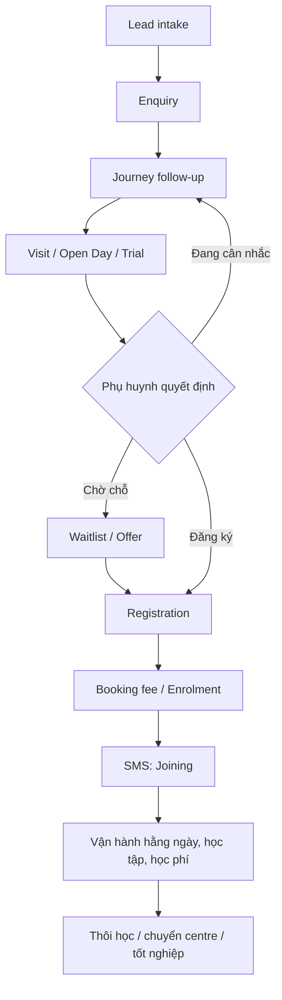

# Work Flow dự án BBA — Busy Bees Asia (CRM + SMS)

| Thuộc tính | Giá trị |
|---|---|
| Dự án | BBA — Busy Bees Asia: CRM tuyển sinh + School Management System (SMS) |
| Nguồn | 13 tài liệu SRS v0.1 (Scope & Flow) trên Google Drive, bản Markdown ở `Document/SRS/` (file gốc .docx ở Drive) |
| Vai trò tài liệu | Nguồn quy trình để viết FSD (tài liệu khách xác nhận). Mỗi FSD phải chỉ ra quy trình `WF-…` và yêu cầu SRS mà nó cụ thể hoá. |
| Ngày tổng hợp | 2026-11-09 |

## 1. Bức tranh tổng thể

### 1.1 Phạm vi hệ thống

| Hệ thống | Phạm vi | Quốc gia Phase 1 | Tài liệu SRS |
|---|---|---|---|
| **CRM — Admissions** | Từ Lead tới khi đặt cọc / đăng ký (Lead, Enquiry, Journey, Visit, Open Day, Trial, Waitlist, Offer, Registration) | Singapore, Malaysia, Vietnam | `BBA_CRM_SRS_v0.1` |
| **SMS — School Management** | Từ khi gia đình **trả booking fee** trở đi: hồ sơ trẻ, giao tiếp, vận hành hằng ngày, học tập, học phí, nhập học / thôi học, quản trị | Singapore, Malaysia (Vietnam không thuộc Phase 1) | 12 tài liệu `BBA-SMS-SRS-*` |

Ranh giới: **SMS bắt đầu khi gia đình trả booking fee**; mọi thứ trước đó thuộc Enquiries (CRM). Hồ sơ Child / Family / Health / Document / Consent được CRM thu thập trong Registration, sau Enrolment thì thuộc SMS Children & Families.

### 1.2 Tổ chức và ứng dụng
- Cấu trúc tổ chức: **Country → Brand → Cluster → Centre**; mỗi Centre thuộc một legal entity.
- Ứng dụng: **SMS web** (HQ + centre staff), **Parents App**, **Teacher App**, **Attendance App** (iPad ở cổng), **Centre Director App** (Phase 2 — Phase 1 Centre Director dùng SMS web).
- Phân quyền 3 lớp: area permission (View / Create / Edit / Delete / Approve / Export / Configure), special permission, protected field (Hidden / Masked / Read / Edit); data scope: class → centre → nhiều centre → cluster → brand → country → all. Centre Director được cấp quyền bổ sung cho staff của centre mình.
- Phê duyệt: một Approvals inbox; tuyến duyệt tối đa 2 cấp, có ngưỡng số tiền, cấu hình ở Administration › Approval routes; từ chối luôn cần lý do.

### 1.3 Vai trò chính

| Vai trò | Hệ thống | Việc chính |
|---|---|---|
| HQ Admin | CRM + SMS | Cấu hình, phân quyền, Country / Brand / Centre; giữ mọi quyền |
| Marketing | CRM | Campaign, attribution, báo cáo Marketing / Admissions |
| Admissions / Customer Service | CRM | Lead, Reference Log, Enquiry, Call, Journey, Visit, Waitlist, Offer, khởi tạo Registration |
| Centre Director | CRM + SMS | Giám sát tuyển sinh và vận hành centre, duyệt yêu cầu, công bố báo cáo |
| Centre Admin / Centralised Admin / School Admin | CRM + SMS | Hồ sơ, đăng ký, điểm danh, việc học phí tại centre |
| HQ Finance | SMS | Học phí, thu, hoàn tiền, duyệt tài chính, khoá sổ tháng |
| HQ Curriculum / HQ Enrichment | SMS | Thiết lập học tập, lớp năng khiếu |
| HQ Ops / Head of Brand, District Manager (SG), Operations Manager (MY) | SMS (+ CRM: Head of Brand nhận yêu cầu chia sẻ Centre) | Giám sát brand / cluster / nhóm centre, nhận phê duyệt theo tuyến |
| Senior Teacher / Teacher / Enrichment Trainer | SMS | Lớp học, routine, cập nhật lớp, báo cáo tiến bộ, điểm danh lớp năng khiếu |
| Safeguarding officer, External Auditor | SMS | Xem centre log / an toàn; kiểm toán chỉ đọc |
| Parent / Public Visitor | CRM + Parents App | Gửi thông tin tuyển sinh, đăng ký, dùng Parents App |
| System | CRM + SMS | So trùng, Reference Log, Centre Sharing tự động, Journey, thông báo, audit |

### 1.4 Vòng đời đầu-cuối

## 2. Quy trình CRM (Admissions)

Mã quy trình dùng trong FSD: `WF-CRM-Pn`. WBS = mã tính năng trong SRS CRM (cũng là số hiệu FSD, vd. FSD `2.1.1.00` ↔ WBS 2.1.1.00).

### WF-CRM-P1 — Lead intake, xử lý trùng và Centre Sharing
| # | Bước | Vai trò |
|---|---|---|
| 1 | Nhận Lead từ staff, website / API, sự kiện hoặc import; áp quy tắc so trùng Lead. | Admissions, System |
| 2 | Trùng đã xác nhận → dùng lại Lead có sẵn, tạo **Reference Log**; không tạo Lead mới, không tự merge. | System |
| 3 | Reference Log đến từ Centre khác → tự thêm Centre đó vào **Centre Sharing list**; không tự tạo Enquiry. | System |
| 4 | User có quyền thêm / bỏ Centre chia sẻ theo quyền và ràng buộc. Preferred Centre độc lập với Centre Sharing. | Admissions, HQ Admin |

Quy tắc SRS: BR-CRM-001, 002, 004, 005, 006, 007, 011 · AC-CRM-026, 028, 029, 041 · WBS 2.1.1.01, 2.1.1.02 (Phase 1), 2.1.1.03–05 (Phase 2).

### WF-CRM-P2 — Enquiry intake, Renewal và attribution
| # | Bước | Vai trò |
|---|---|---|
| 1 | Sau khi xác định Lead: chọn Brand và Centre **đã được chia sẻ** với Lead; nhập Level, Start date mong muốn, Session. | Admissions |
| 2 | So trùng Enquiry độc lập với Lead: khác Lead + Brand + Centre → Enquiry mới; trùng đủ với Enquiry đang hoạt động → không tạo, ghi Duplicate Activity; trùng đủ với Enquiry đã đóng → **Renewal** (mở lại). | System |
| 3 | Lưu snapshot nguồn gốc (true source / Reference Log) bất biến, tách khỏi source tự khai, Campaign, Channel, UTM, Promotion code. | System |
| 4 | Gán owner và Journey phù hợp. | System, Admissions |

Quy tắc SRS: BR-CRM-012–018 · AC-CRM-001, 002, 024, 025, 030, 040 · WBS 2.2.1.02 (danh sách Enquiry dạng bảng), 2.1.2.01, 3.4 Renewal (Phase 2).

### WF-CRM-P3 — Vòng đời Lead và đóng có audit
| # | Bước | Vai trò |
|---|---|---|
| 1 | User có quyền chọn Inactive Lead, xem trước mọi Enquiry liên kết. | Admissions |
| 2 | Hệ thống chuyển Lead + các Enquiry bị ảnh hưởng trong **một giao dịch atomic**, giữ lịch sử. | System |
| 3 | Lead đã đóng vẫn tìm được nhưng chỉ đọc, bị loại khỏi Pipeline; không tạo Enquiry / Reference Log mới. | System |

Quy tắc SRS: BR-CRM-008–010 · AC-CRM-031–033 · WBS 2.1.1.00.

### WF-CRM-P4 — Journey và follow-up
| # | Bước | Vai trò |
|---|---|---|
| 1 | Enquiry nhận Journey có phiên bản (Stage + Task). | System |
| 2 | User ghi Call, Task, Activity, Message. | Admissions |
| 3 | Sự kiện cấu hình tự hoàn thành Task tự động, không tính trùng. Trạng thái Enquiry và Journey runtime là hai khái niệm tách biệt. | System |

Quy tắc SRS: BR-CRM-019–022 · AC-CRM-004, 005 · WBS 2.3.1.01–05, 2.3.1.09 (Action), 2.3.2.03, 05, 07, 08 (Journey automation), 2.8.1.01–04 (Journey admin).

### WF-CRM-P5 — Visit, sự kiện và Trial
| # | Bước | Vai trò |
|---|---|---|
| 1 | Đặt lịch từ Calendar: chọn phụ huynh và các Enquiry hợp lệ **cùng Centre** (Visit gia đình gắn nhiều Enquiry). Đặt từ Enquiry Detail: phụ huynh và Enquiry chọn sẵn, khoá. | Admissions |
| 2 | Chọn Slot đã sinh còn trống, hoặc tạo Visit ad-hoc (chỉ staff có quyền; phụ huynh không được). | Admissions |
| 3 | Ghi điểm danh / kết quả Visit theo đúng Enquiry và Visit. Trial không phải là một loại Book Visit. | Admissions, Centre Director |
| 4 | Open House / Open Day theo Centre hoặc toàn Brand; mỗi người tham dự có kết quả riêng. | Admissions |
| 5 | Trial quản lý riêng, chỉ Malaysia và Vietnam (Singapore không có). | Admissions |
| 6 | Quản trị Slot: lịch Slot định kỳ (Active / Inactive, không cần duyệt); xoá một Slot đã sinh có thể cần duyệt (Malaysia) — đang chờ duyệt thì ngừng nhận đặt; Slot bị xoá có Visit → Visit chuyển Cancelled "Centre cancelled". | HQ Admin, Centre Director |

Quy tắc SRS: BR-CRM-023–036 · AC-CRM-006, 008–011, 036, 037, 039 · WBS 2.4.1.01–02, 2.4.2.01–11, 2.4.3.01–05, 2.8.2.01–03 (Phase 1); 2.4.1.03, 2.4.4.x, 2.8.2.04–07 (Phase 2).

### WF-CRM-P6 — Waitlist, Offer, Registration và Enrolment
| # | Bước | Vai trò |
|---|---|---|
| 1 | "Parent is considering": đề xuất ngày follow-up = thời điểm thực hiện + 48 giờ liên tục (sửa được); **không giữ chỗ**. Có thể đưa Enquiry vào Waitlist. | Admissions |
| 2 | Có chỗ → tạo **Offer** (người tạo nhập hạn hiệu lực). Accepted → mở Registration; Declined / Expired → Waitlist entry về cuối hàng. | Admissions, Centre Director |
| 3 | Lưu và tiếp tục Registration; quản lý Child, Family, Contact, Health, Document, Consent, xếp lớp (kiểm tra sức chứa, ngày bắt đầu). | Admissions, Centre Admin |
| 4 | Nộp Registration và Enrolment **một cách tường minh**; chỉ thanh toán thì chưa là Enrolment. | Centre Admin |

Quy tắc SRS: BR-CRM-037–053 · AC-CRM-012–019 · WBS 2.5.1.01–03, 2.5.2.02–06, 2.5.2.08, 2.5.3.01, 03, 04 (Phase 1); 2.5.1.06, 09, 2.5.2.01, 07, 2.5.3.02 (Phase 2); 2.5.1.04–05, 07–08, 2.5.3.05 (Phase 3).

### WF-CRM-P7 — Giám sát và quản trị
| # | Bước | Vai trò |
|---|---|---|
| 1 | Admin bảo trì Journey, lịch Slot, ngày loại trừ trong phạm vi được phép. | HQ Admin |
| 2 | Marketing / Admissions dùng dashboard, báo cáo; export theo bộ lọc và quyền. | Marketing, Admissions |
| 3 | Thông báo dẫn người nhận tới bản ghi nguồn; thay đổi quan trọng lưu audit. | System |

Quy tắc SRS: BR-CRM-054–056 · AC-CRM-022 · WBS 2.6.x (Campaign), Dashboard (Phase 2).

### 2.1 Danh mục FSD CRM — Phase 1 (từ SRS mục 1.1)

| WBS | Tính năng | Quy trình | FSD |
|---|---|---|---|
| 2.1.1.00 | Inactive Lead | WF-CRM-P3 | **Có** — BBA-40 v0.2 |
| 2.1.1.01 | Centre sharing | WF-CRM-P1 | **Có** — BBA-41 v0.1 |
| 2.1.1.02 | Duplicate detection on create | WF-CRM-P1, P2 | **Có** — BBA-42 v0.2 |
| 2.1.2.01 | Enquiry detail page | WF-CRM-P2, P4 | **Có** — BBA-43 v0.1 |
| 2.1.2.03 | View timeline | WF-CRM-P4 | **Có** — BBA-44 v0.1 |
| 2.2.1.02 | Enquiry list (dạng bảng) | WF-CRM-P2 | Chưa có |
| 2.3.1.01 | Action framework | WF-CRM-P4 | Chưa có (BBA-43 nhắc "BBA-55") |
| 2.3.1.02 | Mark visited | WF-CRM-P5 | Chưa có |
| 2.3.1.03 | Log no-show | WF-CRM-P5 | Chưa có |
| 2.3.1.04 | Parent is considering | WF-CRM-P6 | Chưa có |
| 2.3.1.05 | Log follow-up | WF-CRM-P4 | Chưa có |
| 2.3.1.09 | Hold the space | WF-CRM-P6 | Chưa có |
| 2.3.2.03 / .05 / .07 / .08 | Journey assignment, Event-key engine, Task assignment, Automated messages | WF-CRM-P4 | Chưa có |
| 2.4.1.01–02 | Calendar views và filters | WF-CRM-P5 | Chưa có |
| 2.4.2.01–11 | Visit booking (Slot, ad-hoc, host, xác nhận, đổi lịch, huỷ, chi tiết, xoá mềm, phụ huynh tự đặt, nhiều trẻ) | WF-CRM-P5 | Chưa có |
| 2.4.3.01–05 | Open Day | WF-CRM-P5 | Chưa có |
| 2.5.1.01–03 | Convert / Waitlist, tạo Child, Family, Enrolment, hoá đơn đăng ký / cọc | WF-CRM-P6 | Chưa có |
| 2.5.2.02–06, 08 | Registration (bắt đầu, tiếp tục, chi tiết, kiểm tra thanh toán, xếp lớp, hoá đơn, nộp) | WF-CRM-P6 | Chưa có |
| 2.5.3.01, 03, 04 | Online Registration, review, parent onboarding | WF-CRM-P6 | Chưa có |
| 2.8.1.01–04 | Journey template versioning, builder, preview, Activity Template runtime | WF-CRM-P4, P7 | Chưa có |
| 2.8.2.01–03 | Visit Slot Schedule CRUD, sinh và rà Slot, huỷ Slot | WF-CRM-P5, P7 | Chưa có |

## 3. Quy trình SMS (School Management System)

Mã quy trình: `WF-<phân hệ>-Pn`. Phân hệ: CF Children & Families · COM Communication · OPS Daily Operations · LRN Learning · FEE Fees & Payments · JL Joining & Leaving · ADM Administration · PAR Parents App · TCH Teacher App · ATT Attendance App · CDA Centre Director App (Phase 2).

### 3.1 Joining & Leaving (JL)
| Mã | Quy trình | Các bước chính |
|---|---|---|
| WF-JL-P1 | Nhập học trẻ mới | 1) Gia đình trả booking fee (CRM) → trẻ vào New starters. 2) Tạo tài khoản Parents App, gửi form đăng ký điền sẵn từ Enquiry. 3) Phụ huynh hoàn thành Part A (thông tin, giấy tờ, người đón, dị ứng), ký 2 ô, xác nhận handbook; Part B (GIRO) có thể bỏ qua. 4) Sinh hoá đơn đầu tiên; admin xác minh, chốt level và ngày bắt đầu. 5) Trước ngày bắt đầu: nhắc e-Form 1, gửi thư chào mừng, báo giáo viên. 6) Ngày đầu: trẻ có trong điểm danh; admin nộp e-Form 1 cho ECDA. |
| WF-JL-P2 | Thôi học | 1) Phụ huynh gửi yêu cầu (lý do, ngày cuối mong muốn), báo trước ít → cảnh báo mất cọc. 2) Centre Director + admin được báo; CD ghi nỗ lực giữ chân. 3) Ở lại → đóng "Retained"; không → admin khoá ngày cuối. 4) Kiểm tra thời hạn báo trước + công nợ, chuyển duyệt. 5) Duyệt → ghi Form 3, chuyển hoàn tiền sang FEE. 6) Đến ngày cuối → Completed. |
| WF-JL-P3 | Tạm nghỉ | Lý do y tế / chuyển nơi ở + giấy tờ; admin tạo (≤ 3 tháng) → duyệt theo quốc gia → không điểm danh, không hoá đơn, không trợ cấp, giữ chỗ → hết hạn: Return / Extend / Withdraw. |
| WF-JL-P4 | Chuyển centre | Centre gửi đề xuất ngày cuối → xác nhận công nợ sạch → centre nhận xác nhận chỗ → khoá ngày cuối, Form 3 → centre nhận tạo enrolment mới (T&C, e-Form 1, thư chào mừng). |
| WF-JL-P5 | Tốt nghiệp K2 | Tải cohort K2 (ngày cuối 31/12) → bỏ chọn trẻ không tốt nghiệp → một lần thôi học hàng loạt lý do Graduation → phụ huynh xác nhận tài khoản hoàn tiền. |
| WF-JL-P6 | Nhập học lại | Tìm trẻ cũ → nhập học lại (centre, level, chương trình, ngày bắt đầu) → enrolment mới trên hồ sơ cũ, ký T&C hiện hành → các bước từ e-Form 1 như trẻ mới. |

### 3.2 Children & Families (CF)
| Mã | Quy trình | Các bước chính |
|---|---|---|
| WF-CF-P1 | Hồ sơ trẻ từ enrolment | Enrolment xác nhận → tạo hồ sơ trẻ, người giám hộ và liên kết → School Admin xếp lớp (ngày hiệu lực) → mời Parents App → phụ huynh bổ sung sức khoẻ, giấy tờ, người đón. |
| WF-CF-P2 | Sức khoẻ và cảnh báo dị ứng | Phụ huynh nhập phần Required rồi Optional → icon dị ứng trên danh sách, điểm danh, hồ sơ → vai trò được phép mới xem chi tiết y tế → staff ghi chú riêng → in / xuất danh sách dị ứng cho bếp. |
| WF-CF-P3 | Thu và duyệt giấy tờ | Danh sách giấy tờ bắt buộc (thiếu = Missing) → phụ huynh / staff upload → CD hoặc School Admin chấp nhận / từ chối (cần lý do) → bị từ chối thì gửi lại → gửi yêu cầu bổ sung. |
| WF-CF-P4 | Người đón được uỷ quyền | Phụ huynh thêm người đón (ảnh, tên, quan hệ, NRIC / FIN, SĐT) → CD và School Admin được báo → duyệt / từ chối → giáo viên thấy danh sách đã duyệt → phụ huynh xoá bất kỳ lúc nào, hiệu lực ngay. |
| WF-CF-P5 | Lập lớp và xếp lớp | Tạo lớp theo năm học trong các level centre có → mã lớp, tên, buổi, giáo viên, phòng, sĩ số tối đa → xếp trẻ (cảnh báo vượt sĩ số) → chuyển lớp có ngày hiệu lực, mở thread lớp mới. |
| WF-CF-P6 | Lên lớp hằng năm | Đề xuất level và lớp mới → bỏ chọn trẻ ở lại → xác nhận, hiệu lực từ năm học mới. |
| WF-CF-P7 | Chiều cao, cân nặng | Giáo viên nhập theo lớp, lưu một lần, không cần duyệt → biểu đồ tăng trưởng cập nhật. |

### 3.3 Communication (COM)
| Mã | Quy trình | Các bước chính |
|---|---|---|
| WF-COM-P1 | Thông báo tới phụ huynh | Viết, chọn loại, đính kèm → chọn đối tượng trong phạm vi (hệ thống / centre / level / lớp) → đăng ngay hoặc hẹn giờ → push + in-app → theo dõi đã đọc / đã xác nhận, nhắc lại. |
| WF-COM-P2 | Thông báo nội bộ | Chọn Staff → đối tượng (toàn tổ chức / centre / vai trò) → đăng / hẹn giờ → theo dõi đã đọc. |
| WF-COM-P3 | Thread lớp | Mỗi trẻ một thread với phụ huynh, giáo viên lớp, CD → đổi lớp thì thread mới, thread cũ chỉ đọc → giữ tới khi trẻ rời trường. |
| WF-COM-P4 | Inquiry | Phụ huynh gửi (loại, trẻ, tiêu đề, nội dung, đính kèm) → tự phân công theo loại (Fees → Centre / School Admin; Birthday → giáo viên lớp; khác → CD + Centre Admin) → Open → In progress → Closed → chuyển người có quyền, log. |
| WF-COM-P5 | Khảo sát có câu hỏi thu phí | Tạo khảo sát (phương án có thể gắn khoản phí) → đăng (kèm thông báo) → phụ huynh trả lời, sửa tới hạn → đóng: mỗi câu trả lời có phí sinh dòng hoá đơn ad hoc ở FEE. |
| WF-COM-P6 | Consent | Tạo form (nội dung, Agree / Disagree, chữ ký, đối tượng, hạn) → phụ huynh trả lời và ký → theo dõi, nhắc → được rút lại nếu form cho phép (giữ cả hai bản ghi). |

### 3.4 Daily Operations (OPS)
| Mã | Quy trình | Các bước chính |
|---|---|---|
| WF-OPS-P1 | Đón trẻ buổi sáng | Attendance App ở cổng hoặc SMS web → xe buýt: check-in cả xe; trẻ khác từng em → ghi người đưa, ảnh, nhiệt độ → ≥ 37,5°C báo giáo viên và CD → sau giờ cắt (mặc định 9:15) đánh dấu đi muộn → phụ huynh nhận thông báo. |
| WF-OPS-P2 | Đón về | Chọn người đón trong danh sách đã duyệt → ảnh, giờ → lưu check-out → phụ huynh nhận thông báo. |
| WF-OPS-P3 | Huỷ bản ghi điểm danh | Staff yêu cầu void kèm lý do → Centre Admin / CD / Senior Teacher được giao duyệt → bản ghi giữ trong lịch sử (ai, khi nào, vì sao). |
| WF-OPS-P4 | Xin nghỉ | Phụ huynh gửi nghỉ Personal / Medical → CD hoặc Senior Teacher được uỷ quyền duyệt → ngày duyệt hiện On leave. |
| WF-OPS-P5 | Kiểm tra ngày 18 | Ngày 18 (mặc định) liệt kê trẻ công dân Singapore chưa có ngày điểm danh trong tháng → báo CD, Centre Admin, giáo viên → follow-up. |
| WF-OPS-P6 | Nhật ký centre | Ghi Incident / Accident / Deviation / Menu hoặc "Nothing to report" → CD đánh dấu đã đọc → ngày không có ghi chép bị gắn cờ → HQ Safeguarding rà soát. |
| WF-OPS-P7 | Diễn tập PCCC | CD lên lịch → safety overview hiện lần gần nhất / kế tiếp → quá 3 tháng không diễn tập: gắn cờ, báo CD. |

### 3.5 Learning (LRN)
| Mã | Quy trình | Các bước chính |
|---|---|---|
| WF-LRN-P1 | Thiết lập học tập | HQ Curriculum đặt năm học, học kỳ, thang đánh giá, kỳ báo cáo → checklist template theo brand / level / ngôn ngữ → publish xuống centre. |
| WF-LRN-P2 | Class update | Giáo viên đăng ảnh / video, gắn lớp, trẻ, lĩnh vực, hoạt động → chặn gắn trẻ không có media consent → duyệt (nếu bật) → phụ huynh được báo → vào Gallery → có thể thu hồi. |
| WF-LRN-P3 | Báo cáo tiến bộ | Mở cho trẻ đi học ≥ 3 tháng → giáo viên đánh giá, nhận xét → nộp CD → duyệt / trả lại → công bố, phụ huynh xem PDF. |
| WF-LRN-P4 | Portfolio | CD khởi tạo theo layout brand, giao giáo viên → dựng trang, ảnh, bài làm, đính kèm báo cáo → CD duyệt → công bố. |
| WF-LRN-P5 | Lớp năng khiếu | HQ Enrichment tạo lớp (ngày, giờ, trainer, phí / buổi) → thêm học viên (ngày bắt đầu) → trainer điểm danh → nghỉ: ngày kết thúc (trẻ thôi học tự kết thúc). |
| WF-LRN-P6 | Phí năng khiếu tháng | Cuối tháng đếm số buổi theo lịch × phí / buổi (ngày lễ vẫn tính, vắng không trừ) → rà soát → một hoá đơn / trẻ → chuyển FEE. |

### 3.6 Fees & Payments (FEE)
| Mã | Quy trình | Các bước chính |
|---|---|---|
| WF-FEE-P1 | Hoá đơn đầu tiên | Booking fee ở CRM → form đăng ký nộp, enrolment xác nhận → một hoá đơn Draft (phí đăng ký + cọc − booking fee; ghi CDA / non-CDA) → Finance phát hành. |
| WF-FEE-P2 | Chu kỳ học phí tháng | Ngày 24 sinh Draft tháng sau → Finance rà, centre yêu cầu sửa, có thể tạm dừng centre → đêm trước ngày cuối tháng: Draft → Billed → hạn ngày 5 → GIRO (1ST DD / 2ND DD) hoặc PayNow / thủ công → nhắc ngày 15 và 25. |
| WF-FEE-P3 | Thu GIRO | Tạo batch, xem trước → tải file ngân hàng theo legal entity → upload kết quả → thành công: biên lai, Paid; thất bại: Unsuccessful, báo phụ huynh. |
| WF-FEE-P4 | PayNow và thủ công | QR PayNow trên hoá đơn → tiền về tạo biên lai ngay → không khớp → Unmatched payments → chuyển khoản / AXS / séc do Finance ghi nhận. |
| WF-FEE-P5 | Hoàn cọc | Thôi học / trang Deposits / K2 cuối năm sinh yêu cầu → bù trừ công nợ hoặc hoàn đủ → phụ huynh xác nhận tài khoản (CDA về CDA) → duyệt → file PayNow, upload kết quả. |
| WF-FEE-P6 | Đối soát GSII | Centre upload GSII-A / B (/ D) → so với hồ sơ trẻ và hoá đơn → chấp nhận / giữ chênh lệch có lý do; chênh lệch hoá đơn → credit note / ad hoc chờ duyệt. |
| WF-FEE-P7 | Khoá sổ tháng | Checklist + báo cáo → khoá tháng vĩnh viễn → sửa sau đó bằng credit note ở tháng đang mở. |

### 3.7 Administration (ADM)
| Mã | Quy trình | Các bước chính |
|---|---|---|
| WF-ADM-P1 | Mở centre mới | Brand, cluster, legal entity, cost centre, POP → level và sức chứa → cài đặt kế thừa / ghi đè → tài khoản staff → hiện ngay theo phạm vi. |
| WF-ADM-P2 | Nhận / nghỉ việc staff | Tạo user (role, scope, ngày bắt đầu) → chuyển centre: đóng scope cũ, mở scope mới → nghỉ: vô hiệu hoá, chặn đăng nhập ngay, giữ lịch sử. |
| WF-ADM-P3 | Tạo / sửa vai trò | Tạo mới hoặc nhân bản → quyền area, quyền đặc biệt, trường bảo vệ → xem thay đổi và số người ảnh hưởng → publish, ghi change log. |
| WF-ADM-P4 | Cấp quyền bổ sung tại centre | CD chọn staff và quyền mình đang có → lý do, ngày hết hạn tuỳ chọn → hiệu lực ngay → hết khi thu hồi / hết hạn. |
| WF-ADM-P5 | Đổi cài đặt | Xem giá trị và nguồn theo centre → chọn phạm vi và giá trị mới → hệ thống kiểm tra, hiện tác động → xác nhận, ghi log. |
| WF-ADM-P6 | Publish phiên bản template | Sửa, xem trước với dữ liệu mẫu → publish kèm tóm tắt → tài liệu mới dùng phiên bản mới, tài liệu đã phát hành giữ phiên bản cũ. |
| WF-ADM-P7 | Chuyển dữ liệu từ Taidii | Map mã / trạng thái → nạp theo batch, báo lỗi → xử lý trùng → suy ra level của centre → ẩn chức năng sau go-live. |

### 3.8 Ứng dụng: Parents App (PAR), Teacher App (TCH), Attendance App (ATT), Centre Director App (CDA — Phase 2)
| Mã | Quy trình | Các bước chính |
|---|---|---|
| WF-PAR-P1 | Tài khoản và đăng ký | Booking fee → tài khoản cho từng người giám hộ → Part A (+ Part B GIRO tuỳ chọn) → cả hai ký, xác nhận handbook → centre xác minh / trả bước → nhắc e-Form 1, nhắc ngày đầu. |
| WF-PAR-P2 | Một ngày của trẻ | Thông báo check-in (giờ, ảnh) → nhiệt độ, routine → check-out (tên người đón) → một thông báo "Daily routines updated". |
| WF-PAR-P3 | Xin nghỉ | Personal / Medical, ngày, mô tả, đính kèm → Pending → CD / Senior Teacher quyết định → On leave. |
| WF-PAR-P4 | Người đón | Thêm người (ảnh, tên, quan hệ, NRIC / FIN, SĐT) → Pending → duyệt → vào danh sách đón; xoá có hiệu lực ngay. |
| WF-PAR-P5 | Thanh toán | Hoá đơn Billed → Pay → QR PayNow → Paid, biên lai ngay; GIRO thất bại báo lý do. |
| WF-PAR-P6 | Hoàn tiền | Yêu cầu do centre / Finance tạo và duyệt → billing contact xác nhận tài khoản PayNow → CDA về CDA → báo thành công / thất bại. |
| WF-PAR-P7 | Thôi học | Withdraw trên hồ sơ trẻ → lý do, ngày cuối, hiện thời hạn báo trước → cảnh báo mất cọc → gửi → centre trao đổi, báo kết quả và ngày cuối đã khoá. |
| WF-TCH-P1…P7 | Teacher App | Ghi routine theo lớp (một form, bỏ chọn / chỉnh từng trẻ) · đăng moment (chặn trẻ không có media consent, duyệt nếu bật) · báo cáo tiến bộ (lưu dần, nộp CD) · nhắn phụ huynh (thread lớp; Malaysia báo School Admin) · inquiry được giao · yêu cầu void điểm danh · duyệt uỷ quyền (Senior Teacher). |
| WF-ATT-P1…P7 | Attendance App (iPad) | Đón sáng (theo xe buýt / từng trẻ, ảnh, nhiệt độ, sốt ≥ 37,5°C) · đón về (người đón đã duyệt) · đo nhiệt trong ngày (Bluetooth) · làm việc offline (Not synced, đồng bộ lại, thông báo khi lên SMS) · yêu cầu void · staff chấm công (PIN + nhiệt độ) · khách tự đăng ký bằng QR, tự đóng lúc đóng cửa. |
| WF-CDA-P1…P7 | Centre Director App (Phase 2) | Kiểm tra buổi sáng · quyết định phê duyệt · thôi học có giữ chân · sửa điểm danh · duyệt báo cáo tiến bộ · chia sẻ quyền bổ sung · nhật ký centre. |

## 4. Điểm nối CRM ↔ SMS

| Điểm nối | CRM | SMS |
|---|---|---|
| Booking fee | Thu trong Enquiries (trước SMS) | Mốc bắt đầu SMS: New starters, tạo tài khoản Parents App (WF-JL-P1, WF-PAR-P1), trừ vào hoá đơn đầu (WF-FEE-P1) |
| Registration / Enrolment | Registration trong CRM (WF-CRM-P6) thu Child, Family, Health, Document, Consent | Children & Families sở hữu hồ sơ sau Enrolment (WF-CF-P1) |
| Trial, Visit | CRM (Trial chỉ MY / VN) | — |
| Chuyển centre | Enquiry: Transfer Centre (Phase 2) | Sau nhập học: WF-JL-P4 |

## 5. Điểm lệch giữa SRS và FSD hiện có (cần chốt trước khi viết FSD tiếp)

| # | Nội dung | SRS CRM v0.1 | FSD hiện có | Đề xuất |
|---|---|---|---|---|
| 1 | Trạng thái Lead | New, Inprogress, Converted, Dead Lead, Closed (BR-CRM-008); mục 2.1 còn có "Inactive"; Inactive Lead đưa Lead về **Closed** (BR-CRM-009, 010) | BBA-40 v0.2: Inactive Lead đưa Lead về **Inactive**; BBA-42: Closed là trạng thái riêng, mở lại được trong 3 năm | Chốt danh sách trạng thái Lead; cập nhật SRS hoặc FSD cho thống nhất |
| 2 | Enquiry trùng với Enquiry đã đóng | Renewal: mở lại Enquiry đóng (BR-CRM-015) | BBA-42: loại Enquiry Closed / Inactive khỏi tập so trùng → tạo mới | Renewal thuộc Phase 2 (mục 1.2 SRS) — ghi rõ trong FSD hành vi Phase 1 |
| 3 | Thứ tự so trùng Enquiry | Lead + Brand + Centre trước, rồi Level + Start date + Session; trùng Enquiry đang hoạt động → ghi Duplicate Activity | BBA-42: so 5 trường (Brand, Campus, Level, Start Date, Session); CRM chỉ cho Cancel, không nhắc Duplicate Activity | Bổ sung Duplicate Activity hoặc ghi rõ không làm |
| 4 | So trùng Lead | "Identity matching rules remain TBD"; trường hợp mơ hồ chuyển rà soát | BBA-42: Họ tên + Email hoặc Họ tên + Ngày sinh; không có luồng "mơ hồ" | Xác nhận FSD là quy tắc chính thức, cập nhật SRS |
| 5 | Nút trên màn xác nhận Inactive | "Cancel or Close Lead and Enquiries" (2.2, AC-CRM-031) | BBA-40: "Inactive Lead and Enquiries" | Thống nhất nhãn |
| 6 | Quốc gia Phase 1 | CRM: Singapore, Malaysia, Vietnam | SMS: Singapore, Malaysia | Xác nhận CRM Vietnam go-live khi SMS chưa có Vietnam |
| 7 | Enquiry Score | Phase 2 (2.1.2.02) | BBA-43: để trống ở Phase 1 | Khớp |
| 8 | Journey Task trên Enquiry Detail | Phase 2 (3.2: View Enquiry Journey runtime / Tasks) | BBA-43 US-002: hiển thị Journey + hoàn thành Manual Task | Xác nhận US-002 thuộc Phase 1 |

## 6. Cách dùng tài liệu này khi viết FSD (chỉ dự án BBA)
1. Chọn tính năng theo bảng 2.1 (hoặc theo WBS SMS khi có) → xác định quy trình `WF-…` liên quan.
2. Đọc phần tương ứng trong SRS gốc (`Bien_Ban_Khao_Sat/_extracted/<tài liệu>-docx.md`, tra bằng `grep -n`): bảng Feature / Function, Business Rules, Acceptance Criteria.
3. Viết FSD theo khung `projects/bba/templates/template-fsd.md`, lưu `Document/FSD/Sprint <n>/`; mục 2 (Purpose) ghi quy trình `WF-…` và yêu cầu SRS (BR-CRM-…, AC-CRM-…, WBS) mà FSD cụ thể hoá.
4. Điểm lệch ở mục 5 → đưa vào Open Questions của FSD, không tự chọn.
