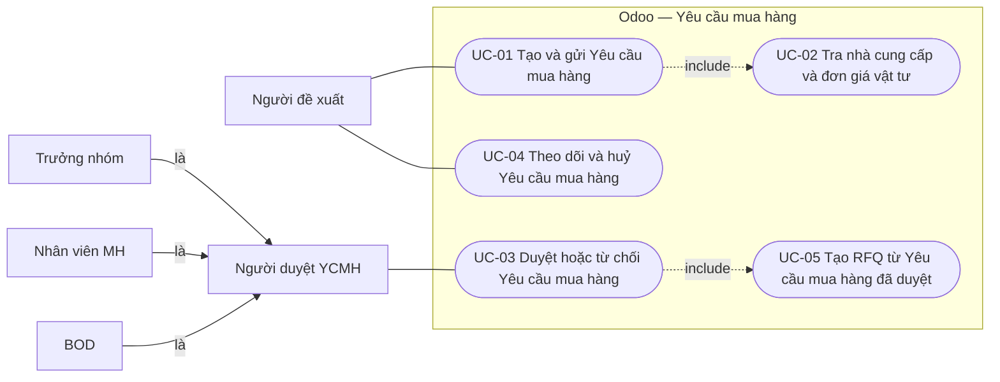
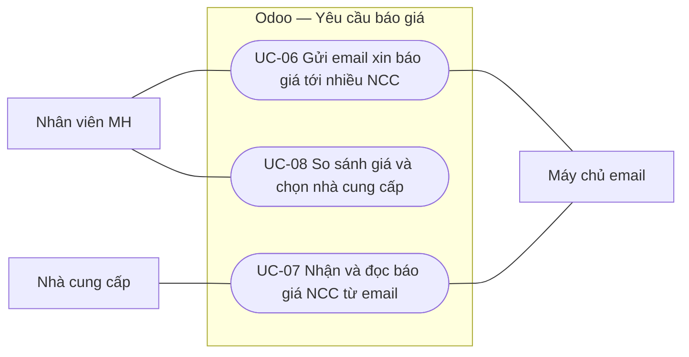
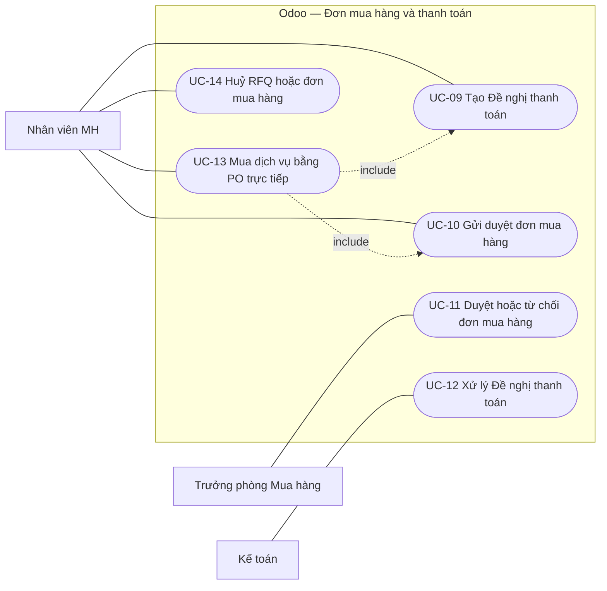
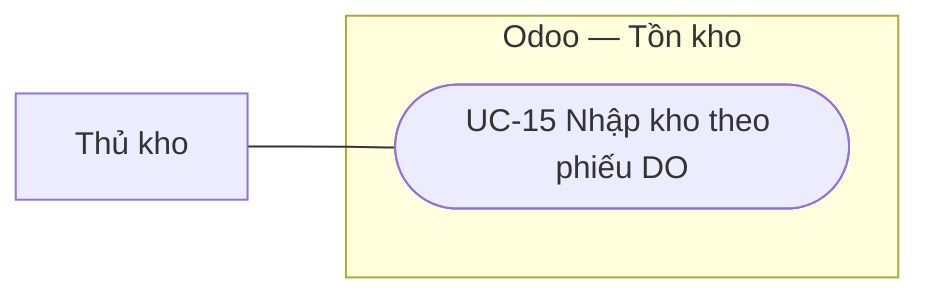
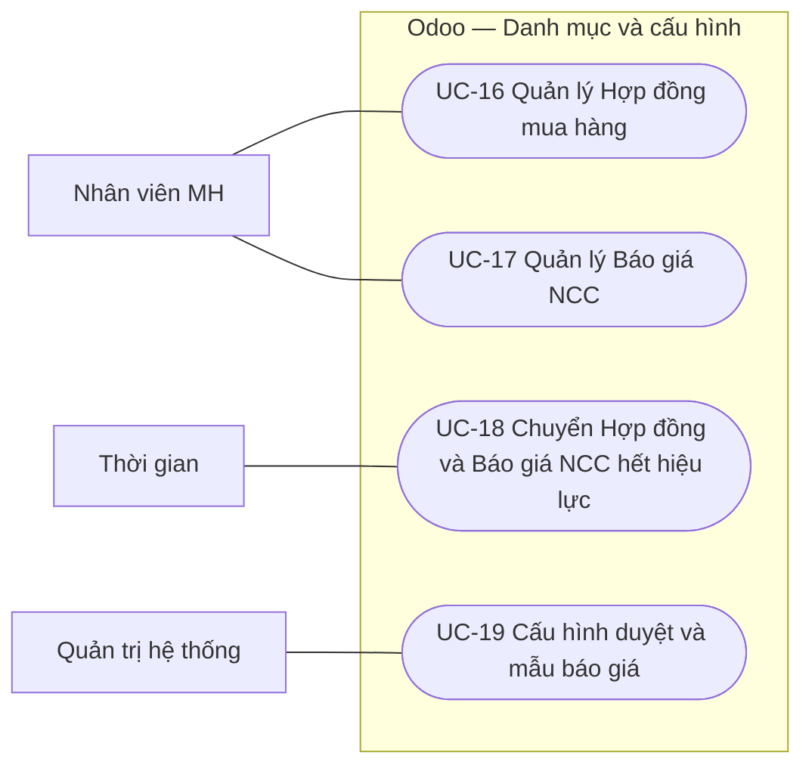

# Use Case — Quy trình mua hàng trên Odoo

| Thuộc tính | Giá trị |
|---|---|
| Mã dự án | odoo-mua-hang |
| Phiên bản | 0.3 |
| Ngày | 2026-11-07 |
| Nguồn | docs/URD.md v0.3; diagrams/swimlanes/*.json; input/khao-sat-lan-3-yeu-cau-bao-gia.md |
| Trạng thái | Chờ khách hàng review |

## 1. Tác nhân

| Tác nhân | Loại | Mô tả | Use case (chính) |
|---|---|---|---|
| Người đề xuất | Người | Nhân viên các phòng ban có nhu cầu mua vật tư Nhập kho | UC-01, UC-04 |
| Người duyệt YCMH | Người | Vai trò chung của 3 cấp duyệt Yêu cầu mua hàng: Trưởng nhóm (cấp 1), Nhân viên MH (cấp 2), BOD (cấp 3) | UC-03 |
| Nhân viên Mua hàng (MH) | Người | Xử lý RFQ, đơn mua hàng, danh mục Hợp đồng và Báo giá NCC; là người duyệt cấp 2 YCMH | UC-06, UC-08, UC-09, UC-10, UC-13, UC-14, UC-16, UC-17 |
| Trưởng phòng Mua hàng | Người | Duyệt đơn mua hàng 1 cấp, không ngưỡng (AS-39) | UC-11 |
| Kế toán | Người | Duyệt, từ chối, ghi nhận thanh toán Đề nghị thanh toán | UC-12 |
| Thủ kho | Người | Nhập kho theo phiếu DO | UC-15 |
| Quản trị hệ thống | Người | Cấu hình người duyệt, mẫu email, mẫu Excel báo giá, hộp thư | UC-19 |
| Nhà cung cấp | Người (ngoài công ty) | Nhận email xin báo giá, trả lời kèm file Excel | UC-07 |
| Máy chủ email | Hệ thống ngoài | SMTP gửi email RFQ; IMAP/alias nhận email trả lời (AS-45) | UC-06, UC-07 |
| Thời gian | Thời gian | Tác vụ hằng ngày 00:05 (AS-38) | UC-18 |

## 2. Sơ đồ use case

### 2.1 Yêu cầu mua hàng

### 2.2 Yêu cầu báo giá

### 2.3 Đơn mua hàng và thanh toán

### 2.4 Nhận hàng

### 2.5 Danh mục và cấu hình

## 3. Danh sách use case

| UC | Tên | Tác nhân chính | Mức | Ưu tiên | User story |
|---|---|---|---|---|---|
| UC-01 | Tạo và gửi Yêu cầu mua hàng | Người đề xuất | Mục tiêu người dùng | Must | US-01, US-02, US-19, US-20, US-21 |
| UC-02 | Tra nhà cung cấp và đơn giá vật tư | Hệ thống | Chức năng con | Must | US-21 |
| UC-03 | Duyệt hoặc từ chối Yêu cầu mua hàng | Người duyệt YCMH | Mục tiêu người dùng | Must | US-05, US-14, US-24 |
| UC-04 | Theo dõi và huỷ Yêu cầu mua hàng | Người đề xuất | Mục tiêu người dùng | Should | US-03, US-04 |
| UC-05 | Tạo RFQ từ Yêu cầu mua hàng đã duyệt | Hệ thống | Chức năng con | Must | US-06, US-27 |
| UC-06 | Gửi email xin báo giá tới nhiều NCC | Nhân viên MH | Mục tiêu người dùng | Must | US-07 |
| UC-07 | Nhận và đọc báo giá NCC từ email | Nhà cung cấp | Mục tiêu người dùng | Must | US-26 |
| UC-08 | So sánh giá và chọn nhà cung cấp | Nhân viên MH | Mục tiêu người dùng | Must | US-09, US-27 |
| UC-09 | Tạo Đề nghị thanh toán | Nhân viên MH | Mục tiêu người dùng | Must | US-11 |
| UC-10 | Gửi duyệt đơn mua hàng | Nhân viên MH | Mục tiêu người dùng | Must | US-10 |
| UC-11 | Duyệt hoặc từ chối đơn mua hàng | Trưởng phòng Mua hàng | Mục tiêu người dùng | Must | US-15, US-12 |
| UC-12 | Xử lý Đề nghị thanh toán | Kế toán | Mục tiêu người dùng | Must | US-16 |
| UC-13 | Mua dịch vụ bằng PO trực tiếp | Nhân viên MH | Tóm tắt | Must | US-25 |
| UC-14 | Huỷ RFQ hoặc đơn mua hàng | Nhân viên MH | Mục tiêu người dùng | Should | US-13 |
| UC-15 | Nhập kho theo phiếu DO | Thủ kho | Mục tiêu người dùng | Must | US-17 |
| UC-16 | Quản lý Hợp đồng mua hàng | Nhân viên MH | Mục tiêu người dùng | Must | US-22 |
| UC-17 | Quản lý Báo giá NCC | Nhân viên MH | Mục tiêu người dùng | Must | US-23 |
| UC-18 | Chuyển Hợp đồng và Báo giá NCC hết hiệu lực | Thời gian | Chức năng con | Must | US-22, US-23 |
| UC-19 | Cấu hình duyệt và mẫu báo giá | Quản trị hệ thống | Mục tiêu người dùng | Should | US-18 |

## 4. Đặc tả use case

### 4.1 Yêu cầu mua hàng

#### UC-01 — Tạo và gửi Yêu cầu mua hàng
- **Tác nhân chính:** Người đề xuất
- **Tác nhân phụ:** Trưởng nhóm (nhận activity duyệt)
- **Mức:** Mục tiêu người dùng
- **Mô tả:** Người đề xuất lập phiếu Yêu cầu mua hàng (YCMH) gồm nhiều vật tư Nhập kho và gửi vào luồng duyệt 3 cấp.
- **Kích hoạt:** Người đề xuất có nhu cầu mua vật tư Nhập kho.
- **Tiền điều kiện:** Người đề xuất đã đăng nhập, có Trưởng nhóm trên hồ sơ nhân viên (AS-34).
- **Đảm bảo khi thành công:** YCMH có số `<Mã BP>_<XXXX>_<DD>_<MM>_<YY>`, trạng thái "Chờ duyệt" cấp 1; mỗi dòng có vật tư Nhập kho, kho nhận, số lượng, NCC hoặc nguồn giá "Không có"; Trưởng nhóm có activity duyệt.
- **Đảm bảo tối thiểu:** Phiếu không hợp lệ không được gửi duyệt; dữ liệu đã nhập được giữ ở trạng thái "Nháp".
- **Quy tắc nghiệp vụ:** AS-19, AS-28, AS-29, AS-32, AS-35, AS-36; không trùng vật tư + NCC; không để trống số lượng.
- **Quan hệ:** include UC-02 tại bước 3
- **Truy vết:** US-01, US-02, US-19, US-20, US-21
- **Tần suất:** Vài lần mỗi tháng mỗi người đề xuất
- **Độ ưu tiên:** Must
- **Kịch bản chính:**
  1. Người đề xuất tạo YCMH mới trực tiếp.
  2. Hệ thống điền Người tạo, Bộ phận, Ngày tạo và cấp số phiếu khi lưu.
  3. Người đề xuất thêm các dòng vật tư Nhập kho với kho nhận và số lượng; hệ thống tra NCC và đơn giá cho từng dòng (UC-02).
  4. Người đề xuất nhập Ngày cần hàng, Ghi chú (không bắt buộc).
  5. Người đề xuất gửi phiếu duyệt.
  6. Hệ thống kiểm tra mọi dòng hợp lệ, chuyển phiếu "Chờ duyệt" cấp 1 và giao activity cho Trưởng nhóm của người đề xuất.
- **Luồng thay thế / ngoại lệ:**
  - **1a. Người đề xuất tạo YCMH từ một Hợp đồng còn hiệu lực:**
    - 1a1. Hệ thống mở YCMH Nháp có Nguồn tạo = số hợp đồng, chép mọi dòng với NCC và đơn giá khoá, số lượng để trống (AS-36).
    - 1a2. Người đề xuất nhập số lượng, xoá dòng không cần. Quay lại bước 4.
  - **1b. Người đề xuất tạo YCMH từ một Báo giá NCC còn hiệu lực:**
    - 1b1. Hệ thống mở YCMH Nháp có Nguồn tạo = số báo giá, chép dòng như 1a1. Quay lại bước 4.
  - **1c. Phiếu đã bị người duyệt trả về (đang "Nháp", có lý do từ chối):**
    - 1c1. Hệ thống hiện lý do từ chối gần nhất ở đầu phiếu.
    - 1c2. Người đề xuất sửa dòng. Quay lại bước 5; phiếu duyệt lại từ cấp 1.
  - **3a. Hai dòng trùng vật tư và nhà cung cấp:**
    - 3a1. Hệ thống chặn lưu, báo "Trùng vật tư và nhà cung cấp với dòng <số dòng>". Quay lại bước 3.
  - **3b. Một dòng để trống số lượng:**
    - 3b1. Hệ thống chặn lưu, báo "Không được để trống số lượng". Quay lại bước 3.
  - **6a. Người đề xuất chưa có Trưởng nhóm trên hồ sơ:**
    - 6a1. Hệ thống chặn gửi duyệt, báo liên hệ quản trị. Use case kết thúc thất bại; phiếu giữ "Nháp".

#### UC-02 — Tra nhà cung cấp và đơn giá vật tư
- **Tác nhân chính:** Hệ thống
- **Tác nhân phụ:** Không có
- **Mức:** Chức năng con
- **Mô tả:** Khi một dòng YCMH được chọn vật tư (không chép từ chứng từ nguồn), hệ thống tự điền NCC, đơn giá và nguồn giá.
- **Kích hoạt:** Vật tư, đơn vị tính hoặc số lượng của dòng thay đổi khi phiếu chưa gửi duyệt.
- **Tiền điều kiện:** Dòng chưa có nguồn giá "Hợp đồng" hoặc "Báo giá NCC" chép từ chứng từ nguồn.
- **Đảm bảo khi thành công:** Dòng có NCC, đơn giá và nguồn giá "Hợp đồng <số>" (giá khoá) hoặc "Price List" (sửa được).
- **Đảm bảo tối thiểu:** Không tìm được giá thì NCC, đơn giá để trống, nguồn giá "Không có"; không chặn người dùng.
- **Quy tắc nghiệp vụ:** AS-30, AS-31, AS-32, AS-33 (Báo giá NCC không tham gia tra giá).
- **Quan hệ:** Được UC-01 include tại bước 3
- **Truy vết:** US-21
- **Tần suất:** Mỗi dòng YCMH
- **Độ ưu tiên:** Must
- **Kịch bản chính:**
  1. Hệ thống tìm dòng Hợp đồng còn hiệu lực có vật tư này.
  2. Hệ thống chọn hợp đồng có đơn giá thấp nhất, bằng nhau thì hợp đồng hết hạn sớm nhất.
  3. Hệ thống điền NCC, đơn giá, nguồn giá "Hợp đồng <số>" và khoá ô đơn giá.
- **Luồng thay thế / ngoại lệ:**
  - **1a. Không có hợp đồng còn hiệu lực:**
    - 1a1. Hệ thống tra Price List theo quy tắc chuẩn Odoo (thứ tự, số lượng tối thiểu, hiệu lực).
    - 1a2. Có giá: điền NCC, đơn giá, nguồn giá "Price List", cho phép sửa. Use case kết thúc thành công.
    - 1a3. Không có giá: để trống NCC, đơn giá, nguồn giá "Không có"; người đề xuất chọn NCC bằng tay (nguồn giá "Nhập tay").
  - **3a. Người đề xuất sửa đơn giá lấy từ Price List:**
    - 3a1. Hệ thống đổi nguồn giá thành "Nhập tay".

#### UC-03 — Duyệt hoặc từ chối Yêu cầu mua hàng
- **Tác nhân chính:** Người duyệt YCMH (Trưởng nhóm cấp 1, Nhân viên MH cấp 2, BOD cấp 3)
- **Tác nhân phụ:** Người đề xuất (nhận email khi bị từ chối)
- **Mức:** Mục tiêu người dùng
- **Mô tả:** Từng cấp duyệt kiểm tra phiếu và duyệt cho đi tiếp hoặc từ chối trả về người đề xuất.
- **Kích hoạt:** Người duyệt có activity duyệt YCMH ở cấp của mình.
- **Tiền điều kiện:** Phiếu "Chờ duyệt"; các cấp trước đã duyệt; người duyệt đúng cấp (Trưởng nhóm của người tạo / nhóm MH / nhóm BOD).
- **Đảm bảo khi thành công:** Cấp hiện tại ghi "Đã duyệt" kèm người và thời điểm; cấp tiếp theo có activity. Cấp 3 duyệt xong → phiếu "Đã duyệt" và RFQ được tạo (UC-05) trong cùng giao dịch.
- **Đảm bảo tối thiểu:** Mọi thao tác duyệt/từ chối ghi chatter; phiếu không bị duyệt vượt cấp.
- **Quy tắc nghiệp vụ:** AS-09, AS-25, AS-32, AS-34; lý do từ chối bắt buộc, tối thiểu 10 ký tự.
- **Quan hệ:** include UC-05 tại bước 5
- **Truy vết:** US-05, US-14, US-24
- **Tần suất:** Hằng ngày
- **Độ ưu tiên:** Must
- **Kịch bản chính:**
  1. Người duyệt mở phiếu từ activity.
  2. Người duyệt xem các dòng, NCC, đơn giá và lịch sử duyệt.
  3. Người duyệt duyệt phiếu.
  4. Hệ thống ghi duyệt cấp hiện tại và giao activity cho cấp tiếp theo.
  5. Ở cấp 3 (BOD): hệ thống chuyển phiếu "Đã duyệt" và tạo RFQ theo NCC (UC-05).
- **Luồng thay thế / ngoại lệ:**
  - **3a. Người duyệt từ chối phiếu:**
    - 3a1. Hệ thống yêu cầu lý do (tối thiểu 10 ký tự).
    - 3a2. Hệ thống đưa phiếu về "Nháp", đặt lại trạng thái các cấp, gửi email cho người đề xuất nêu người từ chối, cấp duyệt, lý do. Use case kết thúc (phiếu đi tiếp ở UC-01, luồng 1c).
  - **3b. Cấp 2 (Nhân viên MH) duyệt khi còn dòng chưa có NCC:**
    - 3b1. Hệ thống chặn, báo tên vật tư thiếu NCC (AS-32).
    - 3b2. Nhân viên MH chọn NCC cho dòng đó. Quay lại bước 3.
  - **1a. Người mở phiếu không phải người duyệt của cấp hiện tại:**
    - 1a1. Hệ thống không hiện thao tác Duyệt / Từ chối. Use case kết thúc.

#### UC-04 — Theo dõi và huỷ Yêu cầu mua hàng
- **Tác nhân chính:** Người đề xuất
- **Tác nhân phụ:** Không có
- **Mức:** Mục tiêu người dùng
- **Mô tả:** Người đề xuất xem trạng thái phiếu và chứng từ sinh ra (RFQ, đơn, phiếu DO), hoặc huỷ phiếu chưa duyệt xong.
- **Kích hoạt:** Người đề xuất muốn biết tiến độ hoặc không còn nhu cầu.
- **Tiền điều kiện:** Người đề xuất có ít nhất một YCMH.
- **Đảm bảo khi thành công:** Người đề xuất thấy trạng thái và số chứng từ liên quan; phiếu huỷ ở "Đã huỷ", activity duyệt đang mở bị xoá.
- **Đảm bảo tối thiểu:** Phiếu đã duyệt xong không huỷ được.
- **Quy tắc nghiệp vụ:** AS-14
- **Quan hệ:** Không có
- **Truy vết:** US-03, US-04
- **Tần suất:** Vài lần mỗi tuần
- **Độ ưu tiên:** Should
- **Kịch bản chính:**
  1. Người đề xuất mở danh sách YCMH với bộ lọc "Của tôi".
  2. Người đề xuất mở một phiếu.
  3. Hệ thống hiện trạng thái, lịch sử duyệt và số RFQ/đơn mua hàng liên quan.
  4. Người đề xuất mở danh sách RFQ/đơn từ phiếu để xem tiến độ.
- **Luồng thay thế / ngoại lệ:**
  - **2a. Người đề xuất huỷ phiếu đang "Nháp" hoặc "Chờ duyệt":**
    - 2a1. Hệ thống chuyển phiếu "Đã huỷ", xoá activity duyệt, ghi chatter. Use case kết thúc.
  - **2b. Phiếu đã "Đã duyệt":**
    - 2b1. Hệ thống không hiện thao tác Huỷ. Quay lại bước 3.

#### UC-05 — Tạo RFQ từ Yêu cầu mua hàng đã duyệt
- **Tác nhân chính:** Hệ thống
- **Tác nhân phụ:** Nhân viên MH (nhận activity)
- **Mức:** Chức năng con
- **Mô tả:** Khi YCMH được BOD duyệt, hệ thống tạo một RFQ cho mỗi NCC trên phiếu, kế thừa thông tin và gắn mã YCMH.
- **Kích hoạt:** UC-03 bước 5 (BOD duyệt).
- **Tiền điều kiện:** Phiếu vừa chuyển "Đã duyệt"; mọi dòng có NCC.
- **Đảm bảo khi thành công:** N NCC → N RFQ "Nháp", số `<Mã BP>-PO-<XXXX>-<DD>-<MM>-<YYYY>-<NN>`; đầu RFQ có Người tạo YCMH, Bộ phận, Ghi chú, Ngày dự kiến nhận hàng, Mã Yêu cầu mua hàng (hiển thị và lưu ngầm); dòng giữ số lượng, đơn vị, kho nhận, đơn giá.
- **Đảm bảo tối thiểu:** Lỗi tạo RFQ thì huỷ cả thao tác duyệt cấp 3 (rollback), phiếu giữ "Chờ duyệt" cấp 3.
- **Quy tắc nghiệp vụ:** AS-05 (không gộp YCMH khác), AS-42, AS-43; không tạo RFQ trùng khi duyệt lại.
- **Quan hệ:** Được UC-03 include tại bước 5
- **Truy vết:** US-06, US-27
- **Tần suất:** Mỗi YCMH được duyệt
- **Độ ưu tiên:** Must
- **Kịch bản chính:**
  1. Hệ thống nhóm các dòng YCMH theo NCC.
  2. Hệ thống tạo một RFQ "Nháp" cho mỗi nhóm, cấp số theo mẫu và thứ tự NN.
  3. Hệ thống chép đầu phiếu và dòng sang RFQ, ghi mã YCMH vào trường hiển thị và trường ẩn.
  4. Hệ thống giao activity cho Nhân viên MH và ghi chatter YCMH danh sách RFQ đã tạo.
- **Luồng thay thế / ngoại lệ:**
  - **2a. YCMH đã có RFQ (bị kích hoạt lần 2):**
    - 2a1. Hệ thống không tạo thêm RFQ. Use case kết thúc.
  - **3a. YCMH không có Ngày cần hàng:**
    - 3a1. Hệ thống đặt Ngày dự kiến nhận hàng = ngày tạo RFQ + 7 ngày (AS-43). Quay lại bước 3.

### 4.2 Yêu cầu báo giá

#### UC-06 — Gửi email xin báo giá tới nhiều NCC
- **Tác nhân chính:** Nhân viên MH
- **Tác nhân phụ:** Máy chủ email, Nhà cung cấp
- **Mức:** Mục tiêu người dùng
- **Mô tả:** Nhân viên MH soạn một email xin báo giá trên RFQ và gửi riêng tới từng NCC được chọn.
- **Kích hoạt:** RFQ mới tạo hoặc cần hỏi giá thêm NCC.
- **Tiền điều kiện:** RFQ ở "Nháp" hoặc "RFQ"; mẫu email và mẫu Excel báo giá đã cấu hình (UC-19).
- **Đảm bảo khi thành công:** N email riêng (mỗi email 1 người nhận) đã gửi, reply-to là alias của RFQ, kèm PDF RFQ và Excel mẫu; RFQ ở "RFQ"; chatter có 1 tin liệt kê NCC đã gửi; danh sách "NCC được hỏi giá" cập nhật.
- **Đảm bảo tối thiểu:** Có NCC thiếu email thì không email nào được gửi.
- **Quy tắc nghiệp vụ:** AS-13, AS-44, AS-45
- **Quan hệ:** Không có
- **Truy vết:** US-07
- **Tần suất:** Mỗi RFQ 1–3 lần
- **Độ ưu tiên:** Must
- **Kịch bản chính:**
  1. Nhân viên MH mở soạn email "Send email" trên RFQ.
  2. Hệ thống điền sẵn người nhận là NCC của RFQ, tiêu đề, nội dung có bảng vật tư, tệp PDF RFQ và Excel mẫu.
  3. Nhân viên MH thêm các NCC khác, ngăn cách bằng ";", và chỉnh nội dung.
  4. Nhân viên MH gửi.
  5. Hệ thống tách gửi một email cho mỗi NCC qua máy chủ email.
  6. Hệ thống chuyển RFQ "RFQ" và ghi chatter danh sách NCC đã gửi, tệp và thời điểm.
- **Luồng thay thế / ngoại lệ:**
  - **4a. Có NCC chưa có email trên hồ sơ:**
    - 4a1. Hệ thống chặn gửi, báo "Nhà cung cấp <tên> chưa có email", không gửi email nào. Quay lại bước 3.
  - **5a. Máy chủ email lỗi khi gửi:**
    - 5a1. Hệ thống đánh dấu email lỗi trên chatter và gửi lại theo cron chuẩn; trạng thái RFQ vẫn chuyển (NFR-08).
  - **1a. RFQ đã có NCC được chọn và ĐNTT:**
    - 1a1. Hệ thống vẫn cho gửi thêm; báo giá nhận về không tự đổi NCC đã chọn (AS-48).

#### UC-07 — Nhận và đọc báo giá NCC từ email
- **Tác nhân chính:** Nhà cung cấp
- **Tác nhân phụ:** Máy chủ email, Nhân viên MH (nhận activity)
- **Mức:** Mục tiêu người dùng
- **Mô tả:** NCC trả lời email xin báo giá kèm file Excel; hệ thống lưu email vào RFQ và đọc file thành Báo giá NCC.
- **Kích hoạt:** Email trả lời tới alias của RFQ.
- **Tiền điều kiện:** RFQ đã gửi email cho NCC đó (UC-06); hộp thư nhận báo giá hoạt động.
- **Đảm bảo khi thành công:** Chatter RFQ có email và file; Báo giá NCC "Còn hiệu lực" gắn RFQ, có dòng vật tư – đơn giá – ngày giao; báo giá cũ cùng NCC "Đã thay thế"; Nhân viên MH có activity "Có báo giá mới".
- **Đảm bảo tối thiểu:** Email luôn được lưu vào chatter (hoặc hộp "Chưa xử lý") kể cả khi không đọc được file; lỗi ghi rõ tên file và lý do.
- **Quy tắc nghiệp vụ:** AS-44, AS-45, AS-46, AS-47
- **Quan hệ:** Không có
- **Truy vết:** US-26
- **Tần suất:** Mỗi NCC được hỏi 1–2 lần
- **Độ ưu tiên:** Must
- **Kịch bản chính:**
  1. NCC trả lời email xin báo giá, đính kèm file Excel theo mẫu.
  2. Hệ thống nhận email qua hộp thư, ghép vào RFQ theo thread.
  3. Hệ thống xác định NCC theo địa chỉ người gửi.
  4. Hệ thống đọc file Excel, ghép dòng theo Mã vật tư của RFQ.
  5. Hệ thống tạo Báo giá NCC gắn RFQ và chuyển báo giá cũ cùng NCC sang "Đã thay thế".
  6. Hệ thống giao activity "Có báo giá mới" cho Nhân viên MH.
- **Luồng thay thế / ngoại lệ:**
  - **2a. Email không ghép được với RFQ nào:**
    - 2a1. Hệ thống đưa email vào hộp "Chưa xử lý" và báo Nhân viên MH. Use case kết thúc thất bại.
  - **3a. Địa chỉ người gửi không thuộc NCC đã được hỏi giá:**
    - 3a1. Hệ thống lưu email, ghi chatter "Không xác định được NCC", không tạo báo giá. Nhân viên MH gán NCC bằng tay. Use case kết thúc.
  - **4a. File sai mẫu, thiếu cột, đơn giá không phải số, mã vật tư không có trên RFQ, hoặc vượt giới hạn file:**
    - 4a1. Hệ thống ghi chatter "Không đọc được <tên file>: <lý do>", không tạo báo giá. Nhân viên MH yêu cầu NCC gửi lại hoặc nhập tay (UC-08, 1a). Use case kết thúc thất bại.
  - **4b. File thiếu giá một số vật tư:**
    - 4b1. Hệ thống vẫn tạo báo giá với các dòng có giá và ghi chú dòng thiếu. Quay lại bước 5.

#### UC-08 — So sánh giá và chọn nhà cung cấp
- **Tác nhân chính:** Nhân viên MH
- **Tác nhân phụ:** Không có
- **Mức:** Mục tiêu người dùng
- **Mô tả:** Nhân viên MH xem báo giá các NCC trên cùng RFQ và chọn 1 NCC cho cả phiếu.
- **Kích hoạt:** RFQ đã nhận báo giá (UC-07) hoặc Nhân viên MH có báo giá ngoài email.
- **Tiền điều kiện:** RFQ ở "Nháp" hoặc "RFQ".
- **Đảm bảo khi thành công:** RFQ có NCC được chọn; đơn giá, ngày giao, nguồn giá các dòng theo báo giá; báo giá khác "Không chọn"; chatter ghi thay đổi NCC và tổng tiền.
- **Đảm bảo tối thiểu:** Không chọn được NCC thiếu giá bất kỳ dòng nào; RFQ giữ nguyên khi huỷ thao tác.
- **Quy tắc nghiệp vụ:** AS-46; chọn 1 NCC cho cả phiếu (_changes/20261020-093008.md #8); đổi NCC khi đã có ĐNTT chưa duyệt thì ĐNTT bị huỷ.
- **Quan hệ:** Không có
- **Truy vết:** US-09, US-27
- **Tần suất:** Mỗi RFQ 1 lần
- **Độ ưu tiên:** Must
- **Kịch bản chính:**
  1. Nhân viên MH mở bảng so sánh giá trên RFQ.
  2. Hệ thống hiện mỗi vật tư một hàng, mỗi NCC một cột (đơn giá, thành tiền), tổng và ngày giao theo NCC, đánh dấu giá thấp nhất từng dòng và tổng thấp nhất.
  3. Nhân viên MH chọn một NCC.
  4. Hệ thống yêu cầu xác nhận, nêu NCC, báo giá và tổng tiền.
  5. Nhân viên MH xác nhận.
  6. Hệ thống đổi NCC của RFQ (nếu khác), cập nhật đơn giá, ngày giao, nguồn giá các dòng và ghi chatter.
- **Luồng thay thế / ngoại lệ:**
  - **1a. Chưa có báo giá nào hoặc file lỗi:**
    - 1a1. Hệ thống báo "Chưa có báo giá NCC nào được ghi nhận".
    - 1a2. Nhân viên MH nhập tay báo giá cho một NCC (giá từng dòng, ngày giao, tệp đính kèm). Quay lại bước 2.
  - **3a. Báo giá của NCC được chọn thiếu giá một vật tư:**
    - 3a1. Hệ thống chặn, báo "Báo giá của <NCC> thiếu giá cho <vật tư>". Quay lại bước 3.
  - **6a. RFQ đã có ĐNTT chưa được Kế toán duyệt và NCC thay đổi:**
    - 6a1. Hệ thống huỷ ĐNTT đó và báo Nhân viên MH tạo ĐNTT mới (UC-09).

### 4.3 Đơn mua hàng và thanh toán

#### UC-09 — Tạo Đề nghị thanh toán
- **Tác nhân chính:** Nhân viên MH
- **Tác nhân phụ:** Kế toán (nhận activity)
- **Mức:** Mục tiêu người dùng
- **Mô tả:** Nhân viên MH lập Đề nghị thanh toán (ĐNTT) cho RFQ đã chọn NCC hoặc PO dịch vụ, gửi Kế toán, để đơn đủ điều kiện gửi duyệt.
- **Kích hoạt:** RFQ đã chọn NCC (UC-08) hoặc PO dịch vụ đã nhập xong (UC-13).
- **Tiền điều kiện:** Đơn chưa có ĐNTT đang hiệu lực (khác "Từ chối", "Đã huỷ").
- **Đảm bảo khi thành công:** ĐNTT mã `DNTT/<năm>/<4 số>` ở "Chờ kế toán duyệt", gắn đơn; trạng thái đơn không đổi; Kế toán có activity.
- **Đảm bảo tối thiểu:** ĐNTT không hợp lệ giữ "Nháp", không gửi Kế toán.
- **Quy tắc nghiệp vụ:** AS-10, AS-40; số tiền > 0 và ≤ tổng đơn; chuyển khoản bắt buộc tài khoản ngân hàng.
- **Quan hệ:** Được UC-13 include
- **Truy vết:** US-11
- **Tần suất:** Mỗi đơn 1 lần
- **Độ ưu tiên:** Must
- **Kịch bản chính:**
  1. Nhân viên MH tạo ĐNTT từ đơn.
  2. Hệ thống điền sẵn đơn, NCC, số tiền = tổng đơn, ngày đề nghị = hôm nay.
  3. Nhân viên MH chọn hình thức thanh toán, tài khoản ngân hàng NCC, nhập nội dung, đính kèm báo giá.
  4. Nhân viên MH gửi Kế toán.
  5. Hệ thống kiểm tra dữ liệu, chuyển ĐNTT "Chờ kế toán duyệt" và giao activity cho nhóm Kế toán.
- **Luồng thay thế / ngoại lệ:**
  - **5a. Số tiền đề nghị lớn hơn tổng đơn:**
    - 5a1. Hệ thống báo "Số tiền đề nghị vượt tổng giá trị đơn mua hàng". Quay lại bước 3.
  - **5b. Hình thức chuyển khoản nhưng chưa chọn tài khoản ngân hàng:**
    - 5b1. Hệ thống báo lỗi tại trường "Tài khoản ngân hàng". Quay lại bước 3.

#### UC-10 — Gửi duyệt đơn mua hàng
- **Tác nhân chính:** Nhân viên MH
- **Tác nhân phụ:** Trưởng phòng Mua hàng (nhận activity)
- **Mức:** Mục tiêu người dùng
- **Mô tả:** Nhân viên MH gửi RFQ đã chọn NCC (hoặc PO dịch vụ) vào bước duyệt đơn.
- **Kích hoạt:** Đơn đã có ĐNTT đã gửi Kế toán.
- **Tiền điều kiện:** RFQ ở "RFQ" (PO dịch vụ ở "Nháp").
- **Đảm bảo khi thành công:** Đơn ở "Chờ duyệt", ghi người gửi duyệt và thời điểm; Trưởng phòng Mua hàng có activity duyệt.
- **Đảm bảo tối thiểu:** Đơn thiếu điều kiện giữ trạng thái cũ, báo lỗi cụ thể.
- **Quy tắc nghiệp vụ:** AS-39, AS-40; mọi dòng số lượng > 0 có đơn giá > 0; có ít nhất 1 dòng.
- **Quan hệ:** Được UC-13 include
- **Truy vết:** US-10
- **Tần suất:** Mỗi đơn 1–2 lần
- **Độ ưu tiên:** Must
- **Kịch bản chính:**
  1. Nhân viên MH gửi duyệt đơn (Approve).
  2. Hệ thống kiểm tra đơn có ĐNTT từ "Chờ kế toán duyệt" trở lên.
  3. Hệ thống kiểm tra mọi dòng có đơn giá.
  4. Hệ thống chuyển đơn "Chờ duyệt" và giao activity cho Trưởng phòng Mua hàng.
- **Luồng thay thế / ngoại lệ:**
  - **2a. Đơn chưa có ĐNTT:**
    - 2a1. Hệ thống báo "Phải tạo Đề nghị thanh toán trước khi gửi duyệt". Use case kết thúc thất bại (tiếp tục ở UC-09).
  - **3a. Dòng số lượng > 0 có đơn giá 0:**
    - 3a1. Hệ thống báo "Chưa nhập đơn giá cho sản phẩm <tên>". Use case kết thúc thất bại.

#### UC-11 — Duyệt hoặc từ chối đơn mua hàng
- **Tác nhân chính:** Trưởng phòng Mua hàng
- **Tác nhân phụ:** Nhân viên MH (nhận email khi bị từ chối), Thủ kho (nhận phiếu DO)
- **Mức:** Mục tiêu người dùng
- **Mô tả:** Trưởng phòng Mua hàng duyệt đơn 1 cấp; duyệt xong đơn thành PO và hệ thống tạo phiếu DO.
- **Kích hoạt:** Activity duyệt đơn mua hàng.
- **Tiền điều kiện:** Đơn "Chờ duyệt"; người duyệt không phải người gửi duyệt.
- **Đảm bảo khi thành công:** Đơn ở "PO"; vật tư Nhập kho có phiếu DO "Sẵn sàng" cho mỗi kho nhận; Thủ kho có activity; đơn Dịch vụ không có phiếu DO.
- **Đảm bảo tối thiểu:** Lỗi tạo phiếu DO thì huỷ cả thao tác duyệt, đơn giữ "Chờ duyệt".
- **Quy tắc nghiệp vụ:** AS-09, AS-12, AS-29, AS-39, AS-43; không ngưỡng giá trị.
- **Quan hệ:** Không có
- **Truy vết:** US-15, US-12
- **Tần suất:** Hằng ngày
- **Độ ưu tiên:** Must
- **Kịch bản chính:**
  1. Trưởng phòng Mua hàng mở đơn từ activity hoặc bộ lọc "Chờ tôi duyệt".
  2. Trưởng phòng Mua hàng xem NCC, dòng, tổng tiền, báo giá đã so sánh và ĐNTT.
  3. Trưởng phòng Mua hàng duyệt đơn.
  4. Hệ thống xác nhận đơn (chuyển "PO") và tạo một phiếu DO cho mỗi kho nhận của dòng vật tư Nhập kho.
  5. Hệ thống giao activity cho nhóm Thủ kho và ghi chatter.
- **Luồng thay thế / ngoại lệ:**
  - **3a. Trưởng phòng Mua hàng từ chối đơn:**
    - 3a1. Hệ thống yêu cầu lý do (tối thiểu 10 ký tự).
    - 3a2. Hệ thống đưa đơn Nhập kho về "RFQ" (đơn Dịch vụ về "Nháp"), giữ NCC, giá, ĐNTT; gửi email lý do cho Nhân viên MH. Use case kết thúc.
  - **4a. Đơn Dịch vụ:**
    - 4a1. Hệ thống chuyển đơn "PO", không tạo phiếu DO. Use case kết thúc thành công.

#### UC-12 — Xử lý Đề nghị thanh toán
- **Tác nhân chính:** Kế toán
- **Tác nhân phụ:** Nhân viên MH (nhận email khi bị từ chối)
- **Mức:** Mục tiêu người dùng
- **Mô tả:** Kế toán duyệt hoặc từ chối ĐNTT và ghi nhận thanh toán cho NCC.
- **Kích hoạt:** Activity ĐNTT "Chờ kế toán duyệt".
- **Tiền điều kiện:** ĐNTT ở "Chờ kế toán duyệt".
- **Đảm bảo khi thành công:** ĐNTT "Đã thanh toán", có bút toán thanh toán outbound cho NCC liên kết ĐNTT; trạng thái đơn không đổi.
- **Đảm bảo tối thiểu:** Không thanh toán một phần; thao tác ghi chatter.
- **Quy tắc nghiệp vụ:** AS-10, AS-41
- **Quan hệ:** Không có
- **Truy vết:** US-16
- **Tần suất:** Hằng ngày
- **Độ ưu tiên:** Must
- **Kịch bản chính:**
  1. Kế toán mở ĐNTT từ danh sách "Chờ kế toán duyệt".
  2. Kế toán duyệt ĐNTT.
  3. Hệ thống chuyển ĐNTT "Đã duyệt".
  4. Kế toán ghi nhận thanh toán, chọn sổ nhật ký và ngày thanh toán.
  5. Hệ thống tạo bút toán thanh toán bằng số tiền đề nghị và chuyển ĐNTT "Đã thanh toán".
- **Luồng thay thế / ngoại lệ:**
  - **2a. Kế toán từ chối ĐNTT:**
    - 2a1. Hệ thống yêu cầu lý do, chuyển ĐNTT "Từ chối".
    - 2a2. Đơn đang "Chờ duyệt" về "RFQ" (dịch vụ: "Nháp"); đơn đã "PO" giữ "PO"; Nhân viên MH nhận email lý do (AS-41). Use case kết thúc.

#### UC-13 — Mua dịch vụ bằng PO trực tiếp
- **Tác nhân chính:** Nhân viên MH
- **Tác nhân phụ:** Kế toán, Trưởng phòng Mua hàng
- **Mức:** Tóm tắt
- **Mô tả:** Nhân viên MH mua vật tư Dịch vụ bằng PO tạo thẳng, không qua YCMH và Yêu cầu báo giá.
- **Kích hoạt:** Phát sinh nhu cầu dịch vụ (vệ sinh, bảo trì…).
- **Tiền điều kiện:** Vật tư Dịch vụ và NCC đã có trong danh mục.
- **Đảm bảo khi thành công:** PO dịch vụ số `<Mã BP>-PO-<XXXX>-<DD>-<MM>-<YYYY>` ở "PO", có ĐNTT, không có phiếu DO.
- **Đảm bảo tối thiểu:** PO chứa vật tư Nhập kho không lưu được.
- **Quy tắc nghiệp vụ:** AS-26, AS-42
- **Quan hệ:** include UC-09 tại bước 3; include UC-10 tại bước 4
- **Truy vết:** US-25
- **Tần suất:** Vài lần mỗi tháng
- **Độ ưu tiên:** Must
- **Kịch bản chính:**
  1. Nhân viên MH tạo PO mới, chọn NCC và dòng vật tư Dịch vụ, ngày dự kiến.
  2. Hệ thống lưu PO "Nháp" và cấp số theo mẫu PO dịch vụ.
  3. Nhân viên MH tạo và gửi ĐNTT (UC-09).
  4. Nhân viên MH gửi duyệt PO (UC-10).
  5. Trưởng phòng Mua hàng duyệt (UC-11, luồng 4a); PO chuyển "PO".
- **Luồng thay thế / ngoại lệ:**
  - **2a. Có dòng vật tư Nhập kho:**
    - 2a1. Hệ thống báo "Vật tư Nhập kho phải mua qua Yêu cầu mua hàng". Quay lại bước 1.

#### UC-14 — Huỷ RFQ hoặc đơn mua hàng
- **Tác nhân chính:** Nhân viên MH
- **Tác nhân phụ:** Không có
- **Mức:** Mục tiêu người dùng
- **Mô tả:** Nhân viên MH huỷ RFQ hoặc đơn không còn dùng trước khi thành PO.
- **Kích hoạt:** Nhu cầu bị huỷ hoặc RFQ thừa.
- **Tiền điều kiện:** Đơn ở "Nháp", "RFQ" hoặc "Chờ duyệt".
- **Đảm bảo khi thành công:** Đơn "Đã huỷ", lý do trên chatter; ĐNTT chưa thanh toán của đơn bị huỷ theo.
- **Đảm bảo tối thiểu:** Đơn đã thanh toán hoặc đã PO không huỷ được.
- **Quy tắc nghiệp vụ:** AS-14, AS-25
- **Quan hệ:** Không có
- **Truy vết:** US-13
- **Tần suất:** Thỉnh thoảng
- **Độ ưu tiên:** Should
- **Kịch bản chính:**
  1. Nhân viên MH huỷ đơn và nhập lý do.
  2. Hệ thống kiểm tra đơn chưa có ĐNTT "Đã thanh toán".
  3. Hệ thống chuyển đơn "Đã huỷ", huỷ ĐNTT chưa thanh toán, ghi chatter.
- **Luồng thay thế / ngoại lệ:**
  - **2a. ĐNTT của đơn đã "Đã thanh toán":**
    - 2a1. Hệ thống báo "Đơn đã được thanh toán, liên hệ Kế toán để xử lý". Use case kết thúc thất bại.

### 4.4 Nhận hàng

#### UC-15 — Nhập kho theo phiếu DO
- **Tác nhân chính:** Thủ kho
- **Tác nhân phụ:** Nhân viên MH (xem Ngày nhận hàng thực tế)
- **Mức:** Mục tiêu người dùng
- **Mô tả:** Thủ kho kiểm đếm hàng về theo phiếu DO và xác nhận số thực nhận.
- **Kích hoạt:** Hàng NCC giao tới kho.
- **Tiền điều kiện:** Phiếu DO "Sẵn sàng" (tạo ở UC-11).
- **Đảm bảo khi thành công:** Phiếu DO "Hoàn tất", tồn kho tăng đúng số thực nhận; phiếu DO cuối cùng hoàn tất thì đơn có Ngày nhận hàng thực tế.
- **Đảm bảo tối thiểu:** Số thực nhận vượt yêu cầu phải xác nhận lần 2.
- **Quy tắc nghiệp vụ:** AS-12, AS-43
- **Quan hệ:** Không có
- **Truy vết:** US-17
- **Tần suất:** Hằng ngày
- **Độ ưu tiên:** Must
- **Kịch bản chính:**
  1. Thủ kho mở phiếu DO của lô hàng.
  2. Thủ kho nhập số lượng thực nhận từng dòng.
  3. Thủ kho xác nhận.
  4. Hệ thống hoàn tất phiếu, cập nhật tồn kho, ghi chatter.
  5. Hệ thống cập nhật Ngày nhận hàng thực tế của đơn khi đây là phiếu DO cuối cùng.
- **Luồng thay thế / ngoại lệ:**
  - **3a. Số thực nhận nhỏ hơn yêu cầu:**
    - 3a1. Hệ thống hỏi có tạo backorder không.
    - 3a2. Thủ kho chọn "Tạo backorder": hệ thống hoàn tất phần đã nhận, tạo phiếu DO mới cho phần thiếu. Quay lại bước 5.
    - 3a3. Thủ kho chọn "Không tạo backorder": hệ thống hoàn tất, ghi nhận thiếu. Quay lại bước 5.
  - **3b. Số thực nhận lớn hơn yêu cầu:**
    - 3b1. Hệ thống cảnh báo và yêu cầu xác nhận lần 2. Quay lại bước 3.

### 4.5 Danh mục và cấu hình

#### UC-16 — Quản lý Hợp đồng mua hàng
- **Tác nhân chính:** Nhân viên MH
- **Tác nhân phụ:** Không có
- **Mức:** Mục tiêu người dùng
- **Mô tả:** Nhân viên MH lưu hợp đồng khung với NCC (vật tư, đơn giá, thời hạn) để hệ thống tra giá và tạo YCMH từ hợp đồng.
- **Kích hoạt:** Ký mới hoặc gia hạn hợp đồng với NCC.
- **Tiền điều kiện:** NCC và vật tư Nhập kho đã có trong danh mục.
- **Đảm bảo khi thành công:** Hợp đồng "Đang hiệu lực" có NCC, ngày hiệu lực, dòng vật tư đơn giá > 0, tệp hợp đồng.
- **Đảm bảo tối thiểu:** Hợp đồng không hợp lệ giữ "Nháp".
- **Quy tắc nghiệp vụ:** AS-30; chỉ vật tư Nhập kho; Hiệu lực đến sau Hiệu lực từ.
- **Quan hệ:** Không có
- **Truy vết:** US-22
- **Tần suất:** Vài lần mỗi quý
- **Độ ưu tiên:** Must
- **Kịch bản chính:**
  1. Nhân viên MH tạo hợp đồng mới.
  2. Nhân viên MH nhập số hợp đồng, NCC, hiệu lực từ – đến, dòng vật tư và đơn giá, đính kèm tệp.
  3. Nhân viên MH xác nhận hợp đồng.
  4. Hệ thống kiểm tra dữ liệu và chuyển hợp đồng "Đang hiệu lực".
- **Luồng thay thế / ngoại lệ:**
  - **4a. Có dòng vật tư Dịch vụ:**
    - 4a1. Hệ thống báo "Hợp đồng chỉ áp dụng cho vật tư Nhập kho". Quay lại bước 2.
  - **4b. Hiệu lực đến sớm hơn hiệu lực từ:**
    - 4b1. Hệ thống báo "Ngày kết thúc phải sau ngày bắt đầu". Quay lại bước 2.

#### UC-17 — Quản lý Báo giá NCC
- **Tác nhân chính:** Nhân viên MH
- **Tác nhân phụ:** Không có
- **Mức:** Mục tiêu người dùng
- **Mô tả:** Nhân viên MH lưu báo giá NCC gửi công ty (ngoài luồng RFQ) để người đề xuất tạo YCMH từ báo giá.
- **Kích hoạt:** NCC gửi báo giá chủ động.
- **Tiền điều kiện:** NCC, vật tư Nhập kho đã có trong danh mục.
- **Đảm bảo khi thành công:** Báo giá "Còn hiệu lực" có NCC, ngày báo giá, hiệu lực đến, dòng vật tư – đơn giá, tệp báo giá.
- **Đảm bảo tối thiểu:** Thiếu tệp báo giá thì không xác nhận được.
- **Quy tắc nghiệp vụ:** AS-33
- **Quan hệ:** Không có
- **Truy vết:** US-23
- **Tần suất:** Vài lần mỗi tháng
- **Độ ưu tiên:** Must
- **Kịch bản chính:**
  1. Nhân viên MH tạo báo giá mới.
  2. Nhân viên MH nhập số báo giá, NCC, ngày báo giá, hiệu lực đến, dòng vật tư và đơn giá, đính kèm tệp.
  3. Nhân viên MH xác nhận báo giá.
  4. Hệ thống chuyển báo giá "Còn hiệu lực".
- **Luồng thay thế / ngoại lệ:**
  - **3a. Chưa đính kèm tệp báo giá:**
    - 3a1. Hệ thống báo thiếu tệp báo giá. Quay lại bước 2.

#### UC-18 — Chuyển Hợp đồng và Báo giá NCC hết hiệu lực
- **Tác nhân chính:** Thời gian
- **Tác nhân phụ:** Không có
- **Mức:** Chức năng con
- **Mô tả:** Tác vụ hằng ngày chuyển hợp đồng và báo giá quá hạn sang "Hết hiệu lực".
- **Kích hoạt:** 00:05 mỗi ngày (AS-38).
- **Tiền điều kiện:** Có hợp đồng "Đang hiệu lực" hoặc báo giá "Còn hiệu lực".
- **Đảm bảo khi thành công:** Mọi hợp đồng / báo giá có ngày hiện tại sau "Hiệu lực đến" ở "Hết hiệu lực"; không còn được tra giá hoặc tạo YCMH.
- **Đảm bảo tối thiểu:** Lỗi một bản ghi không chặn các bản ghi khác; lỗi ghi log.
- **Quy tắc nghiệp vụ:** AS-30, AS-33, AS-38
- **Quan hệ:** Không có
- **Truy vết:** US-22, US-23
- **Tần suất:** Hằng ngày
- **Độ ưu tiên:** Must
- **Kịch bản chính:**
  1. Hệ thống tìm hợp đồng và báo giá còn hiệu lực có "Hiệu lực đến" trước hôm nay.
  2. Hệ thống chuyển từng bản ghi sang "Hết hiệu lực" và ghi chatter.
  3. Hệ thống ghi log số bản ghi đã chuyển.
- **Luồng thay thế / ngoại lệ:**
  - **2a. Một bản ghi lỗi khi cập nhật:**
    - 2a1. Hệ thống ghi log lỗi bản ghi đó và xử lý tiếp bản ghi khác. Quay lại bước 2.

#### UC-19 — Cấu hình duyệt và mẫu báo giá
- **Tác nhân chính:** Quản trị hệ thống
- **Tác nhân phụ:** Không có
- **Mức:** Mục tiêu người dùng
- **Mô tả:** Quản trị hệ thống cấu hình người duyệt đơn, mẫu email, mẫu Excel báo giá và hộp thư nhận báo giá.
- **Kích hoạt:** Thay đổi chính sách hoặc triển khai lần đầu.
- **Tiền điều kiện:** Người dùng thuộc nhóm "Quản trị mua hàng".
- **Đảm bảo khi thành công:** Cấu hình lưu theo công ty, áp dụng cho đơn gửi duyệt và email gửi sau thời điểm lưu.
- **Đảm bảo tối thiểu:** Đơn đang "Chờ duyệt" giữ người duyệt đã giao.
- **Quy tắc nghiệp vụ:** AS-39, AS-44, AS-45
- **Quan hệ:** Không có
- **Truy vết:** US-18
- **Tần suất:** Khi thay đổi chính sách
- **Độ ưu tiên:** Should
- **Kịch bản chính:**
  1. Quản trị hệ thống mở cấu hình Mua hàng.
  2. Quản trị hệ thống chọn người duyệt đơn, mẫu email RFQ, mẫu email từ chối, tải mẫu Excel báo giá, nhập hộp thư nhận báo giá.
  3. Quản trị hệ thống lưu.
  4. Hệ thống kiểm tra và lưu cấu hình.
- **Luồng thay thế / ngoại lệ:**
  - **4a. Để trống người duyệt đơn:**
    - 4a1. Hệ thống báo "Vui lòng chọn người duyệt đơn mua hàng". Quay lại bước 2.
  - **4b. Mẫu Excel thiếu cột bắt buộc:**
    - 4b1. Hệ thống báo "Mẫu báo giá thiếu cột: <tên cột>". Quay lại bước 2.

## 5. Ma trận truy vết

<!-- uc-matrix:start -->
> Sinh tự động bởi `check_uc.py --write-matrix` — không sửa tay.

| UC | Tên | Tác nhân chính | User story | FR (từ SRS) |
|---|---|---|---|---|
| UC-01 | Tạo và gửi Yêu cầu mua hàng | Người đề xuất | US-01, US-02, US-19, US-20, US-21 | FR-01, FR-03, FR-19, FR-22, FR-23, FR-24 |
| UC-02 | Tra nhà cung cấp và đơn giá vật tư | Hệ thống | US-21 | FR-24 |
| UC-03 | Duyệt hoặc từ chối Yêu cầu mua hàng | Người duyệt YCMH (Trưởng nhóm cấp 1, Nhân viên MH cấp 2, BOD cấp 3) | US-05, US-14, US-24 | FR-02, FR-03, FR-16 |
| UC-04 | Theo dõi và huỷ Yêu cầu mua hàng | Người đề xuất | US-03, US-04 | FR-04, FR-17 |
| UC-05 | Tạo RFQ từ Yêu cầu mua hàng đã duyệt | Hệ thống | US-06, US-27 | FR-05, FR-27 |
| UC-06 | Gửi email xin báo giá tới nhiều NCC | Nhân viên MH | US-07 | FR-06 |
| UC-07 | Nhận và đọc báo giá NCC từ email | Nhà cung cấp | US-26 | FR-21, FR-26 |
| UC-08 | So sánh giá và chọn nhà cung cấp | Nhân viên MH | US-09, US-27 | FR-08, FR-27 |
| UC-09 | Tạo Đề nghị thanh toán | Nhân viên MH | US-11 | FR-11 |
| UC-10 | Gửi duyệt đơn mua hàng | Nhân viên MH | US-10 | FR-09 |
| UC-11 | Duyệt hoặc từ chối đơn mua hàng | Trưởng phòng Mua hàng | US-15, US-12 | FR-10, FR-13, FR-16 |
| UC-12 | Xử lý Đề nghị thanh toán | Kế toán | US-16 | FR-12, FR-16 |
| UC-13 | Mua dịch vụ bằng PO trực tiếp | Nhân viên MH | US-25 | FR-13, FR-19, FR-25 |
| UC-14 | Huỷ RFQ hoặc đơn mua hàng | Nhân viên MH | US-13 | FR-15 |
| UC-15 | Nhập kho theo phiếu DO | Thủ kho | US-17 | FR-14 |
| UC-16 | Quản lý Hợp đồng mua hàng | Nhân viên MH | US-22 | FR-20 |
| UC-17 | Quản lý Báo giá NCC | Nhân viên MH | US-23 | FR-21 |
| UC-18 | Chuyển Hợp đồng và Báo giá NCC hết hiệu lực | Thời gian | US-22, US-23 | FR-20, FR-21 |
| UC-19 | Cấu hình duyệt và mẫu báo giá | Quản trị hệ thống | US-18 | FR-18 |

User story chưa thuộc use case nào: không có.
<!-- uc-matrix:end -->

## 6. Assumptions & Open Questions (phát sinh khi viết use case)

### 6.1 Giả định
| Mã | Giả định | Lý do chọn | Liên quan |
|---|---|---|---|
| AS-48 | NCC trả lời sau khi RFQ đã chọn NCC: báo giá vẫn được lưu và hiện trên bảng so sánh, không tự đổi NCC đã chọn | Input chưa nói; tránh thay đổi đơn ngoài ý muốn của Nhân viên MH | UC-06, UC-07, UC-08 |

### 6.2 Câu hỏi mở
| Mã | Câu hỏi | Người cần trả lời | Liên quan |
|---|---|---|---|
| OQ-40 | Có hạn trả lời báo giá không? Hệ thống có cần nhắc NCC chưa trả lời, hoặc khoá nhận báo giá sau hạn? | Phòng Mua hàng | UC-06, UC-07 |
